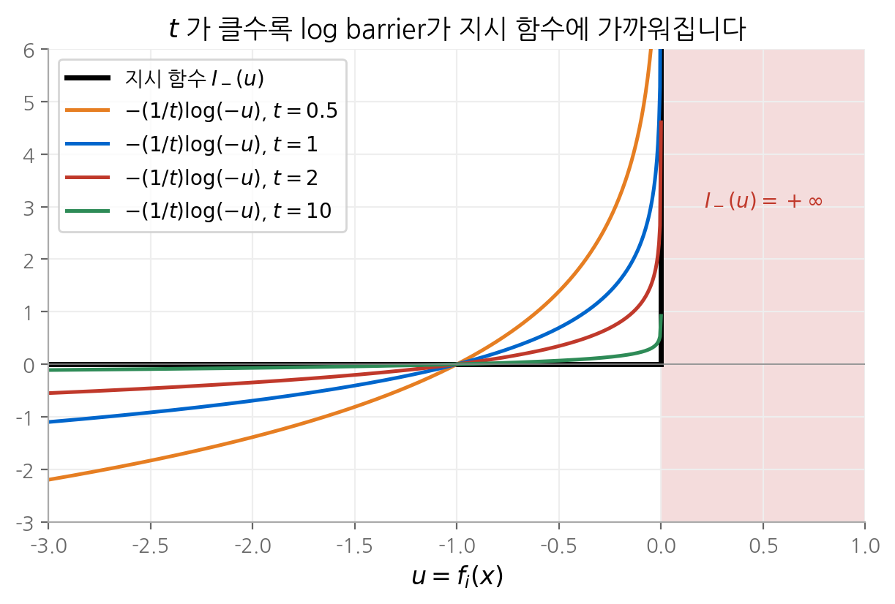
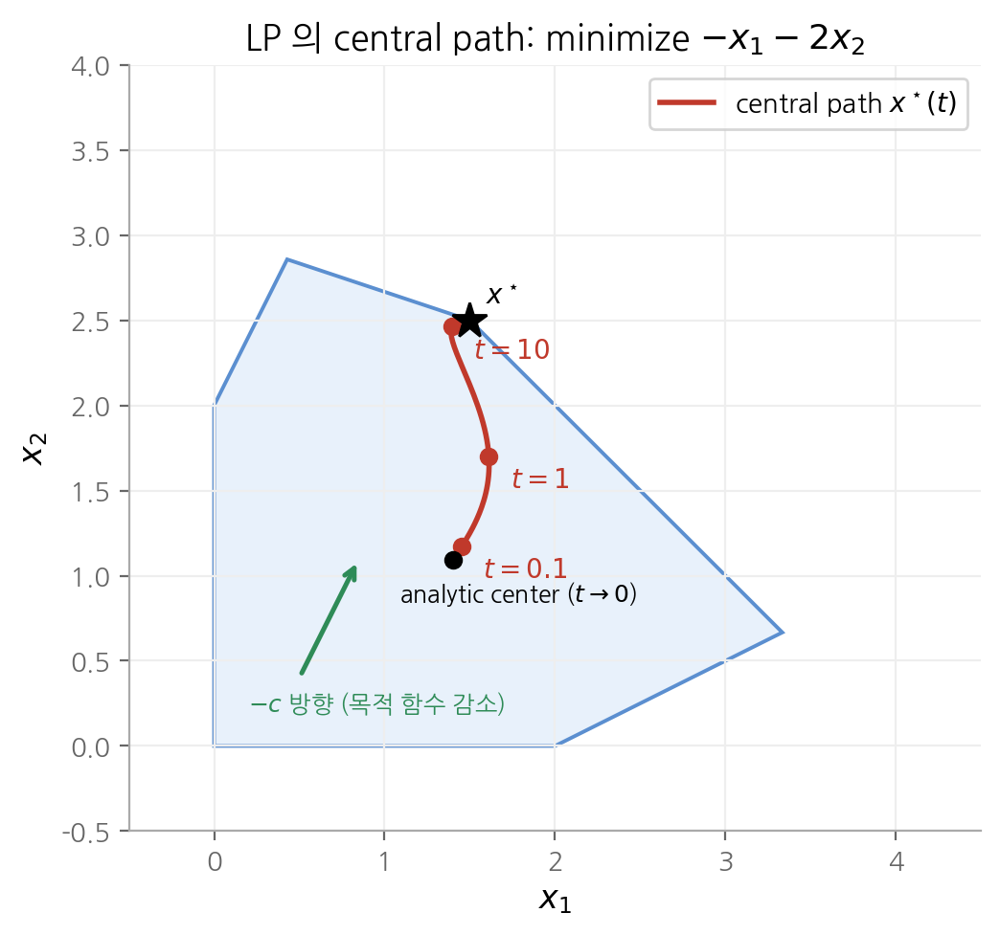
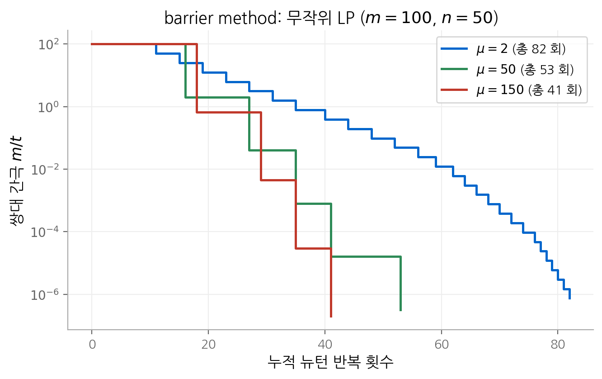

# 11. 내부점법

마지막 장은 부등식 제약이 있는 일반 볼록 문제를 풉니다. 아이디어는 간단합니다.
부등식 제약을 목적 함수에 붙는 **log barrier**로 바꾸면 10장의 등식 제약 문제가 됩니다.
그 문제를 뉴턴법으로 풀고, barrier의 가중치를 줄여 가며 반복합니다. 이 장은 이 방법(barrier method)이 왜 수렴하는지,
얼마나 많은 뉴턴 반복이 필요한지 유도합니다. 9장의 self-concordant 분석이 여기서 다항 시간 복잡도로 이어집니다.
CVXPY 같은 모델링 도구가 호출하는 솔버(ECOS, Clarabel, MOSEK)는 이 장의 원시-쌍대 내부점법을 구현한 것입니다.

!!! info "원문과 자료"
    - 교재: Boyd & Vandenberghe, *Convex Optimization*, 11장 Interior-point methods (p.561–632)
    - 슬라이드: [EE364a 강의 슬라이드 p.353–395](https://web.stanford.edu/~boyd/cvxbook/bv_cvxslides.pdf#page=353)
    - 선수 내용: [5. 쌍대성](05-duality.md)의 KKT 조건과 쌍대 간극, [9장](09-unconstrained.md)의 self-concordant 함수,
      [10장](10-equality-constrained.md)의 등식 제약 뉴턴법

## 1. 문제와 가정

$$
\begin{aligned}
\text{minimize} \quad & f_0(x) \\
\text{subject to} \quad & f_i(x) \le 0, \quad i = 1, \dots, m \\
& Ax = b
\end{aligned}
$$

$f_0, \dots, f_m$ 은 볼록이고 두 번 연속 미분 가능합니다. $A \in \mathbf{R}^{p \times n}$, $\operatorname{rank} A = p$ 입니다.
최적값 $p^\star$ 가 유한하고 최적점이 존재한다고 가정합니다. 또 **엄격히 가능한 점**(strictly feasible point)이 있다고 가정합니다.
즉 $f_i(x) < 0$ ($i = 1, \dots, m$)과 $Ax = b$ 를 함께 만족하는 $x$ 가 있습니다. 그러면 Slater 조건에 의해
강쌍대성이 성립하고, 최적점에서 KKT 조건이 성립합니다.

$$
\begin{aligned}
& Ax^\star = b, \quad f_i(x^\star) \le 0, \quad \lambda^\star \succeq 0 \\
& \nabla f_0(x^\star) + \sum_{i=1}^m \lambda_i^\star \nabla f_i(x^\star) + A^\top \nu^\star = 0 \\
& -\lambda_i^\star f_i(x^\star) = 0, \quad i = 1, \dots, m
\end{aligned}
$$

LP, QP, QCQP, GP(볼록 형태), 그리고 일반화 부등식까지 포함하면 SOCP와 SDP가 모두 이 형태에 들어갑니다.

## 2. log barrier

### 지시 함수를 매끄럽게 근사합니다

부등식 제약을 목적 함수로 옮기면 정확한 표현은 지시 함수입니다.

$$
\text{minimize} \quad f_0(x) + \sum_{i=1}^m I_-(f_i(x)), \qquad
I_-(u) = \begin{cases} 0 & u \le 0 \\ \infty & u > 0 \end{cases}
$$

이 문제는 등식 제약만 남지만 목적 함수가 미분 불가능합니다. 그래서 $I_-$ 를 매끄러운 함수로 근사합니다.

$$
\hat{I}_-(u) = -\frac{1}{t} \log(-u), \qquad \operatorname{dom} \hat{I}_- = -\mathbf{R}_{++}
$$

$t > 0$ 는 근사의 정확도를 정합니다. $\hat{I}_-$ 는 볼록이고 증가 함수이며, $u \to 0^-$ 이면 무한대로 발산합니다.
$t$ 가 클수록 $u < 0$ 영역에서 0에 가까워지므로 $I_-$ 에 가까워집니다.

<figure markdown>

<figcaption markdown>
<b>Figure 1.</b> log barrier와 지시 함수

t 가 커질수록 log barrier가 지시 함수에 가까워집니다. u → 0 에서 발산하므로 반복점이 가능 집합 밖으로 나가지 못합니다.
</figcaption>
</figure>

### log barrier 함수

$$
\phi(x) = -\sum_{i=1}^m \log(-f_i(x)), \qquad \operatorname{dom} \phi = \{x \mid f_i(x) < 0,\; i = 1, \dots, m\}
$$

$\phi$ 를 **log barrier 함수**라고 합니다. 근사 문제는 $\text{minimize}\; f_0(x) + (1/t)\phi(x)$ s.t. $Ax = b$ 입니다.
실제로는 목적 함수에 $t$ 를 곱한 $t f_0 + \phi$ 를 씁니다. $\phi$ 의 그래디언트와 헤시안은 다음과 같습니다.

$$
\begin{aligned}
\nabla \phi(x) &= \sum_{i=1}^m \frac{1}{-f_i(x)} \nabla f_i(x) \\
\nabla^2 \phi(x) &= \sum_{i=1}^m \frac{1}{f_i(x)^2} \nabla f_i(x) \nabla f_i(x)^\top + \sum_{i=1}^m \frac{1}{-f_i(x)} \nabla^2 f_i(x)
\end{aligned}
$$

제약 경계($f_i \to 0$)에 가까울수록 첫 항의 가중치 $1/f_i^2$ 가 커집니다. 경계 근처에서 헤시안이 커지므로
뉴턴 단계가 짧아지고, 반복점은 경계를 넘지 않습니다.

## 3. central path

### 정의

각 $t > 0$ 에 대해 다음 문제를 생각합니다. 이 문제를 **중심화 문제**(centering problem)라고 합니다.

$$
\begin{aligned}
\text{minimize} \quad & t f_0(x) + \phi(x) \\
\text{subject to} \quad & Ax = b
\end{aligned}
$$

해가 유일하다고 가정하고 $x^\star(t)$ 로 씁니다. 점들의 집합 $\{x^\star(t) \mid t > 0\}$ 을 **central path**라고 합니다.
$t \to 0$ 이면 $x^\star(t)$ 는 가능 집합의 analytic center로 가고, $t \to \infty$ 이면 최적점 $x^\star$ 로 갑니다.

### central path의 점은 쌍대 가능점을 줍니다

$x^\star(t)$ 의 최적 조건은 10장의 형태입니다. 어떤 $\hat{\nu}$ 에 대해 다음이 성립합니다.

$$
t \nabla f_0(x^\star(t)) + \sum_{i=1}^m \frac{1}{-f_i(x^\star(t))} \nabla f_i(x^\star(t)) + A^\top \hat{\nu} = 0
$$

양변을 $t$ 로 나누고 다음과 같이 정의합니다.

$$
\lambda_i^\star(t) = -\frac{1}{t f_i(x^\star(t))}, \qquad \nu^\star(t) = \frac{\hat{\nu}}{t}
$$

$f_i(x^\star(t)) < 0$ 이므로 $\lambda^\star(t) \succ 0$ 입니다. 위 식은 $x^\star(t)$ 가 Lagrangian
$L(x, \lambda^\star(t), \nu^\star(t))$ 를 최소화한다는 뜻입니다. 따라서 $(\lambda^\star(t), \nu^\star(t))$ 는 **쌍대 가능점**이고, 쌍대 함수값을 계산할 수 있습니다.

$$
g(\lambda^\star(t), \nu^\star(t)) = f_0(x^\star(t)) + \sum_{i=1}^m \lambda_i^\star(t) f_i(x^\star(t)) + \nu^\star(t)^\top (Ax^\star(t) - b) = f_0(x^\star(t)) - \frac{m}{t}
$$

$\lambda_i^\star(t) f_i(x^\star(t)) = -1/t$ 가 $m$ 개 더해졌습니다. 약쌍대성 $g \le p^\star$ 에서 다음을 얻습니다.

$$
f_0(x^\star(t)) - p^\star \le \frac{m}{t}
$$

**central path의 점은 $m/t$ 이하의 준최적성을 가지고, 그 증명서(쌍대 가능점)도 함께 줍니다.**
$t$ 만 키우면 원하는 정확도에 도달합니다. 이 결과가 barrier method의 정지 조건을 줍니다.

### KKT 조건의 수정으로 보기

$x = x^\star(t)$, $\lambda = \lambda^\star(t)$, $\nu = \nu^\star(t)$ 는 다음 조건을 만족합니다.

$$
\begin{aligned}
& Ax = b, \quad f_i(x) \le 0, \quad \lambda \succeq 0 \\
& \nabla f_0(x) + \sum_{i=1}^m \lambda_i \nabla f_i(x) + A^\top \nu = 0 \\
& -\lambda_i f_i(x) = 1/t, \quad i = 1, \dots, m
\end{aligned}
$$

1절의 KKT 조건과 다른 곳은 마지막 줄뿐입니다. complementary slackness 조건 $-\lambda_i f_i = 0$ 이 $-\lambda_i f_i = 1/t$ 로 완화되었습니다.
$t \to \infty$ 이면 원래의 KKT 조건으로 돌아갑니다. 6절의 원시-쌍대 내부점법은 이 수정 KKT 방정식을 직접 풉니다.

### 힘의 장 해석

$\phi$ 의 각 항 $-\log(-f_i(x))$ 를 퍼텐셜로 보면, 제약 $i$ 는 점 $x$ 에 힘 $-\nabla f_i(x)/f_i(x)$ 를 가합니다.
이 힘은 경계에서 멀어지는 방향이고, 경계에 가까울수록 커집니다. 목적 함수는 힘 $-t\nabla f_0(x)$ 를 가합니다.
$x^\star(t)$ 는 이 힘들이 평형을 이루는 점입니다. $t$ 를 키우면 목적 함수의 힘이 커져서 점이 경계 쪽 최적점으로 밀려갑니다.

<figure markdown>

<figcaption markdown>
<b>Figure 2.</b> LP 의 central path

central path는 analytic center에서 출발해 t 가 커질수록 최적 꼭짓점 x* = (1.5, 2.5) 로 다가갑니다.
</figcaption>
</figure>

## 4. barrier method

### 알고리즘

중심화 문제를 $t$ 가 큰 값에서 한 번에 풀면 뉴턴법이 느립니다. 헤시안이 경계 근처에서 급변하기 때문입니다.
그래서 $t$ 를 조금씩 키우면서, 직전 중심점을 다음 중심화의 시작점으로 씁니다(warm start).

1. 엄격히 가능한 $x$, $t := t^{(0)} > 0$, $\mu > 1$, 허용 오차 $\epsilon > 0$ 을 정합니다.
2. **중심화 단계**: $x$ 에서 시작해 $\min\; t f_0 + \phi$ s.t. $Ax = b$ 를 10장의 뉴턴법으로 풀고, 결과 $x^\star(t)$ 를 $x$ 로 둡니다.
3. $m/t < \epsilon$ 이면 멈춥니다.
4. $t := \mu t$ 로 키우고 2단계로 돌아갑니다.

2단계를 **바깥 반복**(outer iteration), 그 안의 뉴턴 반복을 **안쪽 반복**(inner iteration)이라고 합니다.
이 방법은 **경로 추종법**(path-following method)이라고도 부릅니다. central path 위의 점을 차례로 따라가기 때문입니다.

### μ 의 선택: 바깥 반복과 안쪽 반복의 맞교환

바깥 반복 한 번마다 쌍대 간극 $m/t$ 가 정확히 $\mu$ 배로 줄어듭니다. 따라서 바깥 반복 횟수는 다음과 같습니다.

$$
\left\lceil \frac{\log\big(m / (\epsilon t^{(0)})\big)}{\log \mu} \right\rceil
$$

$\mu$ 가 크면 바깥 반복은 적지만, 시작점이 새 중심에서 멀어지므로 중심화마다 뉴턴 반복이 늘어납니다.
$\mu$ 가 1에 가까우면 그 반대입니다. 교재의 수치 실험에서는 $\mu$ 를 10~100 범위에서 고르면 총 반복 횟수가 거의 같고,
수십 회 수준입니다.

$m = 100$, $n = 50$ 인 무작위 LP (inequality form, $\min c^\top x$ s.t. $Ax \preceq b$)를 풀었습니다.
$t^{(0)} = 1$ 에서 시작해 쌍대 간극 $10^{-6}$ 까지 줄였고, 첫 중심화(6회)도 반복 횟수에 포함했습니다.

| $\mu$ | 바깥 반복 | 총 뉴턴 반복 | 중심화 1회당 뉴턴 반복 |
| --- | --- | --- | --- |
| 2 | 28 | 82 | 1~5 |
| 50 | 6 | 53 | 6~12 |
| 150 | 5 | 41 | 6~12 |

<figure markdown>

<figcaption markdown>
<b>Figure 3.</b> barrier method의 쌍대 간극

μ 가 클수록 계단이 높고 깁니다. 세 경우 모두 간극을 10⁸ 배 줄이는 데 뉴턴 반복 100회 미만이 듭니다.
</figcaption>
</figure>

### 초기값 t⁽⁰⁾

$m/t^{(0)}$ 는 첫 중심화 뒤의 쌍대 간극입니다. 너무 크면 바깥 반복이 쓸데없이 늘고, 너무 작으면 첫 중심화가 오래 걸립니다.
쌍대 가능점 $(\lambda, \nu)$ 를 알고 쌍대 간극이 $\eta$ 이면 $t^{(0)} = m/\eta$ 로 고르는 것이 합리적입니다.

## 5. Phase I: 시작점 찾기

barrier method는 엄격히 가능한 시작점이 필요합니다. 이 점을 찾는 과정을 **Phase I**이라고 하고,
찾은 점에서 barrier method를 실행하는 과정을 **Phase II** 라고 합니다.

### 기본 Phase I

새 변수 $s \in \mathbf{R}$ 를 도입해 다음 문제를 풉니다.

$$
\begin{aligned}
\text{minimize} \quad & s \\
\text{subject to} \quad & f_i(x) \le s, \quad i = 1, \dots, m \\
& Ax = b
\end{aligned}
$$

$Ax = b$ 를 만족하는 아무 $x^{(0)}$ 를 고르고 $s > \max_i f_i(x^{(0)})$ 로 두면 이 문제는 처음부터 엄격히 가능합니다.
그래서 barrier method로 풀 수 있습니다. 최적값 $\bar{p}^\star$ 에 따라 결론이 나뉩니다.

| 결과 | 의미 |
| --- | --- |
| $\bar{p}^\star < 0$ | 원래 문제가 엄격히 가능합니다. $s < 0$ 이 되는 순간 멈추고 그 $x$ 를 씁니다. |
| $\bar{p}^\star > 0$ | 원래 문제가 불가능합니다. 쌍대 가능점이 $\bar{p}^\star > 0$ 을 증명하는 순간 멈춥니다. |
| $\bar{p}^\star = 0$ | 가능하지만 엄격히 가능하지 않습니다(경계에만 가능점이 있음). |

### 불가능성의 합

$s$ 를 제약마다 따로 둔 변형도 있습니다.

$$
\text{minimize} \quad \mathbf{1}^\top s \quad \text{subject to} \quad f_i(x) \le s_i, \quad s \succeq 0, \quad Ax = b
$$

원래 문제가 불가능할 때, 이 변형의 해는 대개 많은 제약을 만족하고 일부만 위반합니다($\ell_1$ 노름 벌점이 희소한 해를 주는 것과 같은 원리).
어떤 제약이 문제를 불가능하게 만드는지 찾을 때 유용합니다.

### infeasible start 뉴턴법을 쓰는 방법

10장의 infeasible start 뉴턴법을 쓰면 $Ax = b$ 를 처음부터 만족할 필요가 없습니다. 원래 문제에 $f_i(x) \le s$, $s = 0$ 제약을 더하고
$s$ 를 크게 시작하면 등식 제약 $s = 0$ 만 처음에 위반된 상태에서 barrier method를 시작할 수 있습니다.

## 6. 복잡도 분석

### 가정

$t f_0 + \phi$ 가 모든 $t \ge t^{(0)}$ 에서 self-concordant 함수라고 가정합니다. LP, QP, QCQP의 log barrier는 이 조건을 만족합니다.
9장의 결과에 따르면 이때 뉴턴법의 반복 횟수는 시작점의 준최적성으로만 묶입니다.

### 중심화 1회당 뉴턴 반복

$x = x^\star(t)$ 에서 출발해 $x^\star(\mu t)$ 를 구하는 중심화를 생각합니다. 시작점의 준최적성은
쌍대성을 써서 다음과 같이 묶을 수 있습니다.

$$
\mu t f_0(x) + \phi(x) - \big(\mu t f_0(x^+) + \phi(x^+)\big) \le m(\mu - 1 - \log \mu)
$$

9장의 self-concordant 한계에 넣으면 중심화 1회의 뉴턴 반복 횟수는 다음 이하입니다.

$$
\frac{m(\mu - 1 - \log \mu)}{\gamma} + c, \qquad \gamma = \frac{\alpha\beta(1 - 2\alpha)^2}{20 - 8\alpha}
$$

$c$ 는 이차 수렴 단계의 $\log_2 \log_2(1/\epsilon)$ 항입니다(실용적으로 6 정도). 이 한계는 $n$, $p$, 문제 데이터, $t$ 와 무관합니다.
$\mu - 1 - \log \mu$ 는 $\mu$ 가 1에 가까우면 $(\mu - 1)^2/2$ 처럼 작고, $\mu$ 가 크면 거의 선형으로 커집니다.

### 총 뉴턴 반복과 √m 한계

바깥 반복 횟수를 곱하면 총 뉴턴 반복의 상한을 얻습니다.

$$
N = \left\lceil \frac{\log\big(m/(t^{(0)}\epsilon)\big)}{\log \mu} \right\rceil \left(\frac{m(\mu - 1 - \log\mu)}{\gamma} + c\right)
$$

$\mu$ 를 고정하면 $N$ 은 $m$ 에 비례합니다. 그런데 $\mu = 1 + 1/\sqrt{m}$ 으로 고르면 $\mu - 1 - \log\mu \le 1/(2m)$ 과
$\log \mu \ge (\log 2)/\sqrt{m}$ 이 성립합니다. 대입하면 다음을 얻습니다.

$$
N \le \left\lceil \sqrt{m}\, \log_2 \frac{m}{t^{(0)}\epsilon} \right\rceil \left(\frac{1}{2\gamma} + c\right) = O\!\left(\sqrt{m} \log \frac{m}{t^{(0)}\epsilon}\right)
$$

**뉴턴 반복 횟수가 제약 개수의 제곱근과 정확도의 로그에 비례합니다.** 뉴턴 반복 하나의 비용이 다항식이므로
전체 알고리즘이 다항 시간입니다. 이것이 내부점법의 이론적 핵심 결과입니다.

다만 이 한계는 매우 보수적입니다. 교재의 예($m = 100$, $\gamma = 1/375$, 간극 감소 $10^5$ 배)에서 상한의 최솟값은 약 8000회지만,
실제로는 $\mu$ 를 2~100으로 크게 잡아도 수십 회면 충분합니다. 위의 무작위 LP 실험이 그 예입니다.

## 7. 일반화 부등식: SOCP와 SDP

### 일반화 로그

부등식이 원뿔 $K$ 에 대한 일반화 부등식 $f_i(x) \preceq_{K_i} 0$ 이면 $\log$ 대신 **일반화 로그** $\psi$ 를 씁니다.
$\psi$ 는 $\operatorname{int} K$ 에서 정의되는 오목 함수이고, $s > 0$ 에서 $\psi(sy) = \psi(y) + \theta \log s$ 를 만족합니다. $\theta$ 를 $\psi$ 의 **차수**라고 합니다.

| 원뿔 | 일반화 로그 $\psi(y)$ | 차수 $\theta$ |
| --- | --- | --- |
| 음이 아닌 오르탄트 $\mathbf{R}_+^n$ | $\sum_i \log y_i$ | $n$ |
| 2차 원뿔 $\{(u, s) \mid \lVert u \rVert_2 \le s\} \subset \mathbf{R}^{n+1}$ | $\log(s^2 - \lVert u \rVert_2^2)$ | $2$ |
| 양의 준정부호 원뿔 $\mathbf{S}_+^p$ | $\log \det Y$ | $p$ |

### 같은 결과, θ 로 바뀐 간극

log barrier는 $\phi(x) = -\sum_i \psi_i(-f_i(x))$ 입니다. 스칼라 경우와 같은 논리로 central path의 점에서 쌍대 가능점을 만들 수 있고,
쌍대 간극이 $m/t$ 대신 다음이 됩니다.

$$
\frac{1}{t} \sum_{i=1}^m \theta_i
$$

barrier method, Phase I, 복잡도 분석이 모두 $m$ 을 $\sum_i \theta_i$ 로 바꾸어 그대로 성립합니다.
SOCP는 제약마다 $\theta_i = 2$ 이므로 원뿔의 차원과 무관하게 간극이 $2m/t$ 입니다.
SDP는 $p \times p$ 행렬 부등식 하나가 $\theta = p$ 입니다.

## 8. 원시-쌍대 내부점법

### barrier method과의 차이

barrier method는 바깥 반복과 안쪽 반복을 나누고, 원시 변수만 뉴턴법으로 갱신합니다. 원시-쌍대 내부점법은 3절의 수정 KKT 조건을
$(x, \lambda, \nu)$ 에 대한 방정식으로 보고 뉴턴법을 직접 씁니다. 잔차는 다음과 같습니다.

$$
r_t(x, \lambda, \nu) =
\begin{bmatrix}
\nabla f_0(x) + Df(x)^\top \lambda + A^\top \nu \\
-\operatorname{diag}(\lambda) f(x) - (1/t) \mathbf{1} \\
Ax - b
\end{bmatrix}
=
\begin{bmatrix} r_{\text{dual}} \\ r_{\text{cent}} \\ r_{\text{pri}} \end{bmatrix}
$$

$f(x) = (f_1(x), \dots, f_m(x))$ 이고, $Df(x)$ 는 그 야코비안입니다. 세 성분은 각각 **쌍대 잔차**, **중심 잔차**, **원시 잔차**입니다.
$r_t = 0$ 의 해는 정확히 $(x^\star(t), \lambda^\star(t), \nu^\star(t))$ 입니다.

### 대리 쌍대 간극

반복점은 central path 위에 있지 않으므로 $m/t$ 를 쌍대 간극으로 쓸 수 없습니다. 대신 **대리 쌍대 간극**(surrogate duality gap)을 씁니다.

$$
\hat{\eta}(x, \lambda) = -f(x)^\top \lambda
$$

$x$ 가 원시 가능점이고 $(\lambda, \nu)$ 가 쌍대 가능점이면 $\hat{\eta}$ 는 실제 쌍대 간극과 같습니다.

### 알고리즘

1. $f_i(x) < 0$ 인 $x$, $\lambda \succ 0$, $\nu$, 그리고 $\mu > 1$ 을 정합니다.
2. $t := \mu m / \hat{\eta}$ 로 정합니다.
3. $r_t$ 의 뉴턴 단계 $\Delta y_{\text{pd}} = (\Delta x, \Delta \lambda, \Delta \nu)$ 를 계산합니다.
4. $\lambda \succ 0$, $f(x) \prec 0$ 을 유지하고 $\lVert r_t \rVert_2$ 가 줄어드는 보폭 $s$ 를 선 탐색으로 고릅니다.
5. $y := y + s \Delta y_{\text{pd}}$ 로 갱신합니다.
6. $\lVert r_{\text{pri}} \rVert_2 \le \epsilon_{\text{feas}}$, $\lVert r_{\text{dual}} \rVert_2 \le \epsilon_{\text{feas}}$, $\hat{\eta} \le \epsilon$ 이면 멈추고, 아니면 2단계로 돌아갑니다.

안쪽 반복과 바깥 반복의 구분이 없습니다. 매 반복 $t$ 를 대리 간극에 맞춰 다시 정하고 뉴턴 단계를 한 번만 밟습니다.
시작점이 원시·쌍대 가능할 필요도 없습니다(10장의 infeasible start 뉴턴법과 같은 원리). 실제로 barrier method보다 빠르고,
높은 정확도에서는 초선형 수렴에 가까운 거동을 보입니다. LP는 대개 20~50회 안에 풀립니다.

### 신경망 학습에 내부점법을 쓰지 않는 이유

| 이유 | 설명 |
| --- | --- |
| 반복당 비용 | 매 반복 $n \times n$ 뉴턴 시스템을 풀어야 합니다. $n = 10^9$ 이면 불가능합니다. |
| 비볼록성 | central path, 쌍대 간극, self-concordant 분석이 모두 볼록성에 의존합니다. |
| 확률적 그래디언트 | 내부점법은 정확한 그래디언트와 헤시안을 가정합니다. 미니배치 잡음은 선 탐색을 무력화합니다. |
| 필요한 정확도 | 학습은 $10^{-8}$ 정밀도가 필요 없습니다. 일반화 성능이 먼저 포화됩니다. |

그 대신 내부점법은 신경망 주변의 작은 볼록 부분 문제에서 쓰입니다. 예로 미분 가능한 최적화 층(OptNet, cvxpylayers),
모델 예측 제어, 포트폴리오 최적화, 신경망 검증의 LP·SDP 완화가 있습니다.

## 핵심 정리

| 개념 | 핵심 내용 |
| --- | --- |
| log barrier | $\phi(x) = -\sum_i \log(-f_i(x))$, 지시 함수의 매끄러운 근사 |
| central path | $x^\star(t) = \operatorname{argmin}\{t f_0 + \phi \mid Ax = b\}$, $t \to \infty$ 이면 $x^\star$ |
| 쌍대 가능점 | $\lambda_i^\star(t) = -1/(t f_i(x^\star(t)))$, 쌍대 간극 $m/t$ |
| 수정 KKT | complementary slackness $-\lambda_i f_i = 0$ 을 $-\lambda_i f_i = 1/t$ 로 완화 |
| barrier method | 중심화 후 $t := \mu t$, 바깥 반복 $\lceil \log(m/(\epsilon t^{(0)}))/\log\mu \rceil$ 회 |
| Phase I | $\min s$ s.t. $f_i(x) \le s$ 로 엄격히 가능한 점을 찾거나 불가능을 증명 |
| 복잡도 | self-concordant 가정에서 총 뉴턴 반복 $O(\sqrt{m} \log(m/(t^{(0)}\epsilon)))$ |
| 일반화 부등식 | 일반화 로그의 차수 $\theta$, 쌍대 간극 $\sum_i \theta_i / t$ |
| 원시-쌍대 내부점법 | $r_t(x, \lambda, \nu) = 0$ 에 뉴턴법, 대리 간극 $\hat{\eta} = -f(x)^\top \lambda$ |

## 다음 장

이 장이 교재 본문의 마지막 장입니다. 전체 목차는 [볼록 최적화 개요](index.md)에서 볼 수 있습니다.
