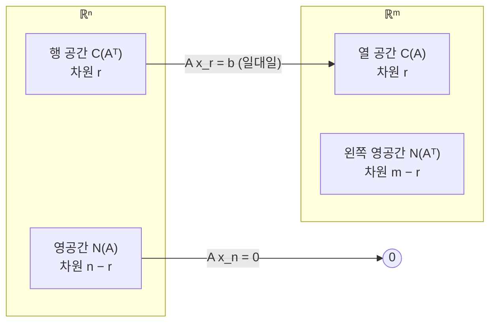

# 3. 직교성

2장은 네 부분 공간의 **차원**을 구했습니다. 이 장은 네 부분 공간 사이의 **각도**를 다룹니다.
핵심 결과는 **선형대수의 기본 정리 2부**입니다. 행 공간과 영공간은 직교하고, 열 공간과 왼쪽 영공간도 직교합니다.
이 사실에서 사영 행렬과 최소제곱이 나옵니다. 장의 후반은 직교 기저를 만드는 그람-슈미트 과정과 고속 푸리에 변환을 다룹니다.

## 3.1 직교 벡터와 직교 부분 공간 (3.1절)

### 길이와 내적

벡터 $x$ 의 길이 제곱은 $\|x\|^2 = x^\top x = x_1^2 + \cdots + x_n^2$ 입니다. 피타고라스 정리를 $n - 1$ 번 적용한 결과입니다.
예를 들어 $x = (1, 2, -3)$ 이면 $x^\top x = 14$ 이고 길이는 $\sqrt{14}$ 입니다.

두 벡터 $x, y$ 가 **직교**하려면 $x^\top y = 0$ 이어야 합니다. 이 조건은 피타고라스 정리에서 나옵니다.

$$
\|x\|^2 + \|y\|^2 = \|x - y\|^2 \iff x^\top y + y^\top x = 0 \iff x^\top y = 0
$$

책은 이것을 정리 3A로 씁니다. $x^\top y > 0$ 이면 두 벡터의 각은 90°보다 작고, $x^\top y < 0$ 이면 90°보다 큽니다.
자기 자신과 직교하는 벡터는 영벡터뿐입니다. 영벡터는 모든 벡터와 직교합니다.
책의 예시로 $(2, 2, -1)$ 과 $(-1, 2, 2)$ 는 직교하고, 둘 다 길이가 3입니다.

0이 아닌 벡터들이 서로 직교하면 그 벡터들은 선형 독립입니다.
$c_1 v_1 + \cdots + c_k v_k = 0$ 에 $v_i^\top$ 를 곱하면 $c_i \|v_i\|^2 = 0$ 이 되기 때문입니다.
좌표 벡터 $e_1, \dots, e_n$ 이 가장 단순한 정규 직교 기저입니다. 축을 회전한 $(\cos\theta, \sin\theta)$, $(-\sin\theta, \cos\theta)$ 도 $\mathbb{R}^2$ 의 정규 직교 기저입니다.

### 직교 부분 공간

두 부분 공간 $V, W$ 의 모든 벡터 쌍이 직교하면 $V$ 와 $W$ 가 직교한다고 말합니다(정리 3B).
직교하는 두 부분 공간은 영벡터 외에는 공통 벡터가 없습니다.

- 직선은 직선이나 평면과 직교할 수 있습니다.
- $\mathbb{R}^3$ 의 두 평면은 직교할 수 없습니다. 방의 앞벽과 옆벽은 수직처럼 보입니다. 하지만 두 벽이 만나는 모서리 직선은 두 평면에 모두 속하고, 자기 자신과 직교하지 않습니다.

책의 예시로 $\mathbb{R}^4$ 에서 $V$ 를 $(1, 0, 0, 0)$, $(1, 1, 0, 0)$ 이 생성하는 평면이라고 둡니다.
$w = (0, 0, 4, 5)$ 가 생성하는 직선 $W$ 는 $V$ 와 직교합니다. $z = (0, 0, 5, -4)$ 가 생성하는 직선 $L$ 은 $V$ 와 $W$ 에 모두 직교합니다. 차원의 합은 $2 + 1 + 1 = 4$ 입니다.

### 기본 정리 2부

$Ax = 0$ 을 행 단위로 읽으면 $x$ 는 $A$ 의 모든 행과 직교합니다. 따라서 $x$ 는 행 공간 전체와 직교합니다.

$$
Ax = \begin{bmatrix} \text{행}_1 \\ \vdots \\ \text{행}_m \end{bmatrix} x = \begin{bmatrix} 0 \\ \vdots \\ 0 \end{bmatrix}
$$

같은 이유로 $A^\top y = 0$, 즉 $y^\top A = 0$ 이면 $y$ 는 $A$ 의 모든 열과 직교합니다. 이것이 책의 정리 3C(직교성의 기본 정리)입니다.
좌표를 쓰지 않는 증명도 있습니다. 행 공간의 벡터는 $v = A^\top z$ 꼴이므로 $v^\top x = z^\top A x = z^\top 0 = 0$ 입니다.

**예시(책의 예시 3).** 랭크 1 행렬로 네 부분 공간을 확인합니다.

$$
A = \begin{bmatrix} 1 & 3 \\ 2 & 6 \\ 3 & 9 \end{bmatrix}
$$

- 행 공간은 $(1, 3)$ 방향 직선이고, 영공간은 $(-3, 1)$ 방향 직선입니다. 두 직선은 $\mathbb{R}^2$ 에서 수직이며 차원의 합은 $1 + 1 = 2$ 입니다.
- 열 공간은 $(1, 2, 3)$ 방향 직선입니다. 왼쪽 영공간은 수직인 평면 $y_1 + 2y_2 + 3y_3 = 0$ 입니다. 차원의 합은 $1 + 2 = 3$ 입니다.

### 직교 여공간

$V$ 에 직교하는 모든 벡터의 집합을 **직교 여공간** $V^\perp$ ("V perp")라고 부릅니다.
영공간은 행 공간과 직교할 뿐 아니라, 행 공간에 직교하는 벡터를 **모두** 포함합니다.
차원을 더하면 $r + (n - r) = n$ 이므로 두 공간은 서로의 직교 여공간입니다. 이것이 정리 3D, **선형대수의 기본 정리 2부**입니다.

$$
N(A) = C(A^\top)^\perp \ \text{(in } \mathbb{R}^n), \qquad N(A^\top) = C(A)^\perp \ \text{(in } \mathbb{R}^m)
$$

직교하는 것과 직교 여공간인 것은 다릅니다. $(0, 1, 0)$ 방향 직선과 $(0, 0, 1)$ 방향 직선은 직교합니다. 하지만 한 직선의 직교 여공간은 평면이므로, 두 직선은 서로의 직교 여공간이 아닙니다.
차원이 맞으면 직교하는 부분 공간은 직교 여공간이 됩니다. 이때 $(V^\perp)^\perp = V$ 이고 $\dim V + \dim V^\perp = n$ 입니다.

### 풀 수 있는 조건

기본 정리 2부는 어떤 방정식을 풀 수 있는지 정합니다.
직접 보면 $b$ 가 열 공간에 있어야 합니다. 간접적으로 보면 $b$ 가 왼쪽 영공간과 직교해야 합니다(정리 3E).

$$
Ax = b \text{ 가 해를 가진다} \iff y^\top A = 0 \text{ 인 모든 } y \text{ 에 대해 } y^\top b = 0
$$

왼쪽 영공간의 차원이 작으면 간접 조건이 더 확인하기 쉽습니다. 책의 예시는 다음 시스템입니다.

$$
\begin{aligned}
x_1 - x_2 &= b_1 \\
x_2 - x_3 &= b_2 \\
x_3 - x_1 &= b_3
\end{aligned}
\qquad
A = \begin{bmatrix} 1 & -1 & 0 \\ 0 & 1 & -1 \\ -1 & 0 & 1 \end{bmatrix}
$$

왼쪽 영공간은 $y = (1, 1, 1)$ 이 생성합니다. 따라서 $b_1 + b_2 + b_3 = 0$ 일 때만 해가 있습니다. 2.5절의 키르히호프 전압 법칙이 같은 구조입니다.

### 큰 그림

$\mathbb{R}^n$ 의 모든 벡터 $x$ 는 행 공간 성분 $x_r$ 과 영공간 성분 $x_n$ 으로 나뉩니다.
$A$ 는 $x_n$ 을 0으로 보내고, $x_r$ 을 열 공간으로 보냅니다. 책은 이 그림(그림 3.4)을 책에서 가장 중요한 그림으로 꼽습니다.

행 공간에서 열 공간으로 가는 대응은 **일대일**입니다(정리 3F). 두 행 공간 벡터 $x_r, x_r'$ 의 상이 같으면, 차이 $x_r - x_r'$ 은 행 공간과 영공간에 동시에 속합니다. 두 공간은 직교하므로 차이는 0입니다.
즉 $r$ 차원의 두 공간 사이에서 $A$ 는 가역입니다.
$A^\top$ 는 공간을 반대 방향으로 옮기지만, 개별 벡터를 되돌리지는 않습니다. 이 역대응이 6장의 유사 역행렬 $A^+$ 입니다. $A^+$ 는 행 공간의 $x$ 에 대해 $A^+ A x = x$ 이고, 왼쪽 영공간을 0으로 보냅니다.

## 3.2 코사인과 직선 위로의 사영 (3.2절)

### 각도

두 벡터 사이의 각 $\theta$ 는 내적으로 구합니다(정리 3G).

$$
\cos\theta = \frac{a^\top b}{\|a\| \, \|b\|}
$$

$\mathbb{R}^2$ 에서는 $\cos(\beta - \alpha) = \cos\beta\cos\alpha + \sin\beta\sin\alpha$ 에서 바로 나옵니다.
$n$ 차원에서는 코사인 법칙 $\|b - a\|^2 = \|b\|^2 + \|a\|^2 - 2\|a\|\|b\|\cos\theta$ 의 좌변을 $(b - a)^\top (b - a)$ 로 전개해서 얻습니다.
$b$ 의 길이를 두 배로 늘려도 코사인은 그대로입니다. $b$ 의 부호를 바꾸면 코사인의 부호가 바뀝니다.

### 직선 위로의 사영

벡터 $b$ 를 $a$ 방향 직선 위로 사영한 점 $p = \hat{x} a$ 를 구합니다.
오차 $e = b - \hat{x} a$ 는 $a$ 와 직교해야 합니다(정리 3H).

$$
a^\top (b - \hat{x} a) = 0 \implies \hat{x} = \frac{a^\top b}{a^\top a}, \qquad p = \frac{a^\top b}{a^\top a}\, a
$$

**예시(책의 예시 1).** $b = (1, 2, 3)$ 을 $a = (1, 1, 1)$ 방향 직선 위로 사영합니다.

1. $\hat{x} = a^\top b / a^\top a = 6/3 = 2$ 입니다.
2. $p = 2a = (2, 2, 2)$ 이고, $e = b - p = (-1, 0, 1)$ 입니다. $a^\top e = 0$ 입니다.
3. $\cos\theta = \dfrac{6}{\sqrt{3}\sqrt{14}} = \dfrac{\|p\|}{\|b\|} = \dfrac{\sqrt{12}}{\sqrt{14}}$ 입니다.

다른 예로 $a = (1, 2, 2)$, $b = (1, 1, 1)$ 이면 $\hat{x} = 5/9$ 이고 $p = (5/9, 10/9, 10/9)$ 입니다.
$e = b - p = (4/9, -1/9, -1/9)$ 이며, $a^\top e = 4/9 - 2/9 - 2/9 = 0$ 으로 직교를 확인할 수 있습니다.

### 슈바르츠 부등식

오차의 길이 제곱은 음수일 수 없습니다. 이 사실에서 **슈바르츠 부등식**이 나옵니다(정리 3I).

$$
\|e\|^2 = \left\| b - \frac{a^\top b}{a^\top a} a \right\|^2 = \frac{(b^\top b)(a^\top a) - (a^\top b)^2}{a^\top a} \ge 0
\implies \lvert a^\top b \rvert \le \|a\| \, \|b\|
$$

이 부등식은 $\lvert\cos\theta\rvert \le 1$ 과 같은 내용입니다. 등호는 $b$ 가 $a$ 의 배수일 때만 성립합니다. 이때 $b = p$ 이고 직선까지의 거리는 0입니다.
위 예시에서 부등식은 $6 \le \sqrt{3}\sqrt{14}$, 즉 $\sqrt{36} \le \sqrt{42}$ 입니다.
책은 이 부등식을 코시-슈바르츠-부냐콥스키 부등식이라고도 부른다고 소개합니다.

### 사영 행렬

$p = Pb$ 로 쓰면 사영 행렬은 $P = \dfrac{a a^\top}{a^\top a}$ 입니다. 열벡터와 행벡터를 곱한 정사각 행렬을 수 $a^\top a$ 로 나눈 것입니다.
책의 예시 2는 $a = (1, 1, 1)$ 입니다.

$$
P = \frac{1}{3} \begin{bmatrix} 1 \\ 1 \\ 1 \end{bmatrix} \begin{bmatrix} 1 & 1 & 1 \end{bmatrix}
= \frac{1}{3} \begin{bmatrix} 1 & 1 & 1 \\ 1 & 1 & 1 \\ 1 & 1 & 1 \end{bmatrix}
$$

$P$ 는 랭크 1이고 대칭이며, $P^2 = P$ 를 만족합니다. 이미 직선 위에 있는 점을 다시 사영해도 그대로이기 때문입니다.
$P$ 의 열 공간은 $a$ 방향 직선이고, 영공간은 $a$ 에 수직인 평면입니다. $P$ 는 대칭이므로 행 공간과 열 공간이 같습니다.

- $a$ 의 길이를 바꿔도 $P$ 는 같습니다. $a = (2, 2, 2)$ 로 계산해도 같은 $P$ 가 나옵니다. $P$ 는 직선에만 의존합니다.
- $a$ 가 단위 벡터이면 $P = a a^\top$ 입니다.
- 책의 예시 3은 $\theta$ 방향 직선 $a = (\cos\theta, \sin\theta)$ 입니다. $c = \cos\theta$, $s = \sin\theta$ 로 쓰면 $P = \begin{bmatrix} c^2 & cs \\ cs & s^2 \end{bmatrix}$ 이며, 2.6절의 사영 변환과 같습니다.

### 내적으로 정의하는 전치

전치는 대각선을 기준으로 뒤집은 행렬입니다. 책은 내적을 이용한 정의를 더 근본적인 정의로 제시합니다(정리 3J).

$$
(Ax)^\top y = x^\top (A^\top y) \quad \text{모든 } x, y \text{ 에 대해}
$$

이 정의를 두 번 쓰면 $(ABx)^\top y = (Bx)^\top (A^\top y) = x^\top (B^\top A^\top y)$ 이므로 $(AB)^\top = B^\top A^\top$ 가 바로 나옵니다.

## 3.3 사영과 최소제곱 (3.3절)

### 해가 없는 시스템

방정식이 미지수보다 많으면($m > n$) 대부분의 $b$ 는 열 공간 밖에 있습니다. $Ax = b$ 는 해가 없습니다.
일부 방정식만 골라 푸는 방법은 근거가 약합니다. 대신 오차 $\|Ax - b\|^2$ 을 최소화하는 $\hat{x}$ 를 고르고, 이것을 **최소제곱해**라고 부릅니다.

미지수가 하나인 $ax = b$ 부터 봅니다. $E^2 = \|ax - b\|^2$ 을 미분해서 0으로 두면 3.2절의 사영 공식과 같은 답이 나옵니다(정리 3K).

$$
\hat{x} = \frac{a^\top b}{a^\top a}
$$

예를 들어 $2x = b_1$, $3x = b_2$, $4x = b_3$ 의 최소제곱해는 $\hat{x} = (2b_1 + 3b_2 + 4b_3)/29$ 입니다. 미적분과 기하가 같은 답을 줍니다.

### 정규 방정식

$A\hat{x}$ 는 $b$ 에 가장 가까운 열 공간의 점입니다. 따라서 오차 $e = b - A\hat{x}$ 는 열 공간과 직교합니다.
3.1절에 따라 $e$ 는 왼쪽 영공간 $N(A^\top)$ 에 속합니다.

$$
A^\top (b - A\hat{x}) = 0 \implies A^\top A \hat{x} = A^\top b
$$

같은 식을 세 가지 방법으로 얻을 수 있습니다.

1. 오차가 왼쪽 영공간에 속한다는 조건에서 얻습니다.
2. 오차가 $A$ 의 각 열 $a_i$ 와 직교한다는 조건 $a_i^\top (b - A\hat{x}) = 0$ 을 모아서 얻습니다.
3. $E^2 = (Ax - b)^\top (Ax - b)$ 의 편미분을 0으로 두어 $2A^\top A x - 2A^\top b = 0$ 을 얻습니다.

가장 빠른 기억법은 풀 수 없는 $Ax = b$ 의 양변에 $A^\top$ 를 곱하는 것입니다. 통계에서는 이 식을 **정규 방정식**이라고 부릅니다(정리 3L).

$$
\hat{x} = (A^\top A)^{-1} A^\top b, \qquad p = A\hat{x} = A (A^\top A)^{-1} A^\top b
$$

**예시(교재 p.182).** 직관으로 답을 알 수 있는 경우입니다.

$$
A = \begin{bmatrix} 1 & 2 \\ 1 & 3 \\ 0 & 0 \end{bmatrix}, \qquad b = \begin{bmatrix} 4 \\ 5 \\ 6 \end{bmatrix}
$$

열 공간은 $xy$ 평면입니다. 따라서 $b$ 의 사영은 $z$ 성분만 지운 $(4, 5, 0)$ 이어야 합니다. 정규 방정식으로 확인합니다.

$$
A^\top A = \begin{bmatrix} 2 & 5 \\ 5 & 13 \end{bmatrix}, \quad
(A^\top A)^{-1} = \begin{bmatrix} 13 & -5 \\ -5 & 2 \end{bmatrix}, \quad
\hat{x} = \begin{bmatrix} 2 \\ 1 \end{bmatrix}, \quad
p = A\hat{x} = \begin{bmatrix} 4 \\ 5 \\ 0 \end{bmatrix}
$$

세 번째 방정식 $0x_1 + 0x_2 = 6$ 의 오차 6은 피할 수 없습니다.

책은 극단적인 경우도 확인합니다.

- $b$ 가 열 공간에 있으면($b = Ax$) $p = b$ 입니다.
- $b$ 가 모든 열과 직교하면($A^\top b = 0$) $p = 0$ 입니다.
- $A$ 가 정사각 가역 행렬이면 $p = b$ 입니다. $(A^\top A)^{-1} = A^{-1} (A^\top)^{-1}$ 로 쪼갤 수 있는 경우는 이때뿐입니다.
- $A$ 의 열이 하나($a$)이면 $\hat{x} = a^\top b / a^\top a$ 로 돌아갑니다.

### 교차곱 행렬 $A^\top A$

$A^\top A$ 는 대칭입니다. $(i, j)$ 성분은 $A$ 의 $i$ 번째 열과 $j$ 번째 열의 내적입니다.
$A^\top A$ 는 $A$ 와 같은 영공간을 가집니다. $A^\top A x = 0$ 이면 $x^\top A^\top A x = \|Ax\|^2 = 0$ 이고, 따라서 $Ax = 0$ 이기 때문입니다.
그러므로 $A$ 의 열이 독립이면 $A^\top A$ 는 정사각, 대칭, 가역 행렬입니다(정리 3M). 6장에서 양의 정부호임도 보입니다.

### 사영 행렬

$A$ 의 열 공간 위로 사영하는 행렬은 다음과 같습니다.

$$
P = A (A^\top A)^{-1} A^\top
$$

$Pb$ 는 $b$ 의 열 공간 성분이고, $(I - P)b$ 는 왼쪽 영공간 성분입니다. $I - P$ 도 사영 행렬이며, 직교 여공간 위로 사영합니다.
$P$ 는 두 성질을 가집니다(정리 3N).

$$
P^2 = P, \qquad P^\top = P
$$

역도 성립합니다. $P^2 = P$ 이고 $P^\top = P$ 인 행렬은 자기 열 공간 위로의 사영입니다.
열 공간의 임의의 벡터 $Pc$ 에 대해 $(b - Pb)^\top Pc = b^\top (P - P^2) c = 0$ 이기 때문입니다.

### 예시: 직선 맞추기

측정값 $b$ 가 입력 $t$ 의 일차 함수 $b = C + Dt$ 를 따른다고 봅니다. 측정이 $m$ 번이면 $m$ 개의 방정식과 두 미지수가 생깁니다.
그래프에서 최소화하는 오차는 직선까지의 수직 거리가 아니라 **세로 방향** 거리 $b_i - C - Dt_i$ 입니다.

책의 예시 2는 세 점 $(t, b) = (-1, 1), (1, 1), (2, 3)$ 입니다. $t$ 값의 간격이 같을 필요는 없습니다.
세 점이 한 직선 위에 있지 않으므로 다음 시스템은 해가 없습니다.

$$
\underbrace{\begin{bmatrix} 1 & -1 \\ 1 & 1 \\ 1 & 2 \end{bmatrix}}_{A}
\begin{bmatrix} C \\ D \end{bmatrix}
= \underbrace{\begin{bmatrix} 1 \\ 1 \\ 3 \end{bmatrix}}_{b}
$$

정규 방정식을 세웁니다.

$$
A^\top A = \begin{bmatrix} 3 & 2 \\ 2 & 6 \end{bmatrix}, \qquad
A^\top b = \begin{bmatrix} 5 \\ 6 \end{bmatrix}
\implies
\begin{bmatrix} \hat{C} \\ \hat{D} \end{bmatrix} = \begin{bmatrix} 9/7 \\ 4/7 \end{bmatrix}
$$

최적 직선은 $b = \tfrac97 + \tfrac47 t$ 입니다. 결과를 확인합니다.

- 사영 $p = A\hat{x} = (5/7, 13/7, 17/7)$ 입니다. 측정 시각에서 최적 직선의 높이이므로 세 점이 한 직선 위에 있습니다.
- 오차 $e = b - p = (2/7, -6/7, 4/7)$ 입니다.
- $e$ 는 $A$ 의 두 열 $(1, 1, 1)$, $(-1, 1, 2)$ 와 모두 직교합니다. $\tfrac27 - \tfrac67 + \tfrac47 = 0$, $-\tfrac27 - \tfrac67 + \tfrac87 = 0$ 입니다.
- 최소 오차는 $\|e\|^2 = 8/7$ 입니다.
- 측정값이 오차 $e$ 자체였다면 최적 직선은 가로축($\hat{x} = 0$)입니다. $e$ 는 왼쪽 영공간에 있으므로 0으로 사영됩니다.

같은 문제를 두 그림으로 볼 수 있습니다. $tb$ 평면에서는 한 직선 위에 있지 않은 점 $b_i$ 를 직선 위의 점 $p_i$ 로 바꿉니다. $\mathbb{R}^m$ 에서는 $b$ 를 열 공간 위로 사영합니다.
일반적인 직선 맞추기의 정규 방정식은 다음과 같습니다(정리 3O).

$$
\begin{bmatrix} m & \sum t_i \\ \sum t_i & \sum t_i^2 \end{bmatrix}
\begin{bmatrix} \hat{C} \\ \hat{D} \end{bmatrix}
= \begin{bmatrix} \sum b_i \\ \sum t_i b_i \end{bmatrix}
$$

미지수에 대해 선형이기만 하면 직선이 아닌 모델도 같은 방법으로 맞춥니다. 예를 들어 반감기를 아는 두 방사성 물질의 양 $C, D$ 는 $b = Ce^{-\lambda t} + De^{-\mu t}$ 로 맞춥니다.
반대로 $\lambda, \mu$ 를 구하는 문제는 비선형 최소제곱이며 더 어렵습니다.

### 가중 최소제곱

한 환자의 몸무게를 두 번 측정해 $x = b_1$, $x = b_2$ 를 얻었다고 봅니다. 보통의 최소제곱해는 평균 $(b_1 + b_2)/2$ 입니다.
두 측정의 신뢰도가 다르면 가중치 $w_1, w_2$ 를 붙여 $E^2 = w_1^2 (x - b_1)^2 + w_2^2 (x - b_2)^2$ 을 최소화합니다.

$$
\hat{x}_W = \frac{w_1^2 b_1 + w_2^2 b_2}{w_1^2 + w_2^2}
$$

결과는 가중 평균이며, 가중치가 큰 측정값에 더 가깝습니다.

일반적으로는 $Ax = b$ 대신 $WAx = Wb$ 를 최소제곱으로 풉니다. 정규 방정식은 다음과 같습니다.

$$
A^\top W^\top W A \, \hat{x}_W = A^\top W^\top W b, \qquad C = W^\top W
$$

가중치는 새 내적 $(x, y)_W = (Wy)^\top (Wx)$ 와 새 길이 $\|x\|_W = \|Wx\|$ 를 정의합니다. 이 내적 기준으로 $A\hat{x}_W$ 와 오차 $b - A\hat{x}_W$ 는 다시 직교합니다.
$W$ 가 직교 행렬이면 $C = I$ 이므로 내적이 바뀌지 않습니다.

- 오차들이 독립이고 분산이 $\sigma_i^2$ 이면 가중치는 $w_i = 1/\sigma_i$ 입니다. 정확한 측정일수록 가중치가 큽니다.
- 오차들이 상관되어 있으면 $C$ 는 오차 공분산 행렬의 역행렬입니다.
- 책의 예시 3(브리지 게임)은 공분산 행렬 $\begin{bmatrix} 2/3 & -1/3 \\ -1/3 & 2/3 \end{bmatrix}$ 의 역행렬로 $C = \begin{bmatrix} 2 & 1 \\ 1 & 2 \end{bmatrix}$ 를 얻습니다.

$A^\top C A$ 는 2.5절의 그래프와 네트워크에서 본 행렬과 같은 구조입니다.

!!! tip "딥러닝과의 연결"

    선형 회귀의 닫힌 해 $\hat{w} = (X^\top X)^{-1} X^\top y$ 가 정규 방정식입니다.
    여기에 $\lambda I$ 를 더한 $(X^\top X + \lambda I)^{-1} X^\top y$ 가 릿지 회귀이며, 가중치 감쇠와 같은 정규화 효과를 냅니다.
    사전 학습 모델의 은닉 표현에 선형 프로브를 학습하는 것도 최소제곱 또는 그 분류 버전입니다.

## 3.4 직교 기저와 그람-슈미트 (3.4절)

### 직교 행렬

벡터 $q_1, \dots, q_n$ 이 $q_i^\top q_j = 0$ ($i \ne j$), $q_i^\top q_i = 1$ 을 만족하면 **정규 직교**라고 부릅니다(정리 3P).
열이 정규 직교인 행렬 $Q$ 는 $Q^\top Q = I$ 를 만족합니다(정리 3Q). $Q$ 가 직사각이어도 성립하며, 이때 $Q^\top$ 는 왼쪽 역행렬입니다.
정사각이면 $Q^{-1} = Q^\top$ 이며, 이런 행렬을 **직교 행렬**이라고 부릅니다. 책은 "정규 직교 행렬"이 더 나은 이름이었다고 덧붙입니다. 직사각 $Q$ 는 직교 행렬이라고 부르지 않습니다.

직교 행렬은 길이와 내적을 보존합니다(정리 3R).

$$
\|Qx\|^2 = x^\top Q^\top Q x = x^\top x = \|x\|^2, \qquad (Qx)^\top (Qy) = x^\top y
$$

대표적인 예는 다음과 같습니다.

- 회전 $Q = \begin{bmatrix} \cos\theta & -\sin\theta \\ \sin\theta & \cos\theta \end{bmatrix}$ 이고, $Q^\top$ 는 $-\theta$ 만큼 되돌리는 회전입니다.
- 치환 행렬은 각 열의 1이 다른 위치에 있으므로 직교 행렬입니다.
- 반사도 직교 행렬입니다. $\begin{bmatrix} 0 & 1 \\ 1 & 0 \end{bmatrix}$ 은 $(x, y)$ 를 45° 직선에 대칭인 $(y, x)$ 로 보냅니다.

사영 행렬은 길이를 줄이므로 직교 행렬이 아닙니다.

정사각 $Q$ 는 $QQ^\top = I$ 도 만족합니다. 따라서 **열이 정규 직교이면 행도 정규 직교**입니다. 책의 예시는 다음과 같습니다.

$$
Q = \begin{bmatrix} 1/\sqrt{3} & 1/\sqrt{2} & 1/\sqrt{6} \\ 1/\sqrt{3} & 0 & -2/\sqrt{6} \\ 1/\sqrt{3} & -1/\sqrt{2} & 1/\sqrt{6} \end{bmatrix}
$$

### 정규 직교 기저에서의 계산

정규 직교 기저에서는 계산이 단순해집니다.

- 계수 구하기: $b = x_1 q_1 + \cdots + x_n q_n$ 이면 $x_i = q_i^\top b$ 입니다. 즉 $x = Q^\top b$ 이며, $A^{-1}$ 을 구하는 수고가 없습니다.
- 각 항 $(q_i^\top b) q_i$ 는 $q_i$ 방향 직선 위로의 사영입니다. 그래서 $\|b\|^2 = (q_1^\top b)^2 + \cdots + (q_n^\top b)^2$ 이 성립합니다.

$Q$ 가 $m \times n$ 직사각($m > n$)이면 $Qx = b$ 는 대개 해가 없고, 최소제곱으로 풉니다(정리 3S).

$$
\hat{x} = Q^\top b, \qquad p = Q\hat{x} = (q_1^\top b) q_1 + \cdots + (q_n^\top b) q_n, \qquad P = QQ^\top
$$

$A^\top A$ 가 $Q^\top Q = I$ 로 바뀌므로 최소제곱의 어려운 부분이 사라집니다.
$Q^\top Q$ 는 $n \times n$ 단위 행렬이고, $QQ^\top$ 는 $m \times m$ 사영 행렬입니다. 직사각인 경우 사영들의 합은 $b$ 가 아니라 $p$ 입니다.
책의 예시 3에서 $q_1 = e_1$, $q_2 = e_2$ 이면 $P = q_1 q_1^\top + q_2 q_2^\top$ 는 $xy$ 평면 위로의 사영이며 $(x, y, z)$ 를 $(x, y, 0)$ 으로 보냅니다.

### 예시: 측정 시각의 평균이 0인 직선 맞추기

책의 예시 4는 $t = -3, 0, 3$ 에서 $y = C + Dt$ 를 맞춥니다. 두 열 $(1, 1, 1)$ 과 $(-3, 0, 3)$ 은 직교합니다.
따라서 $A^\top A = \operatorname{diag}(3, 18)$ 이고, 계수를 따로 구할 수 있습니다.

$$
\hat{C} = \frac{y_1 + y_2 + y_3}{3}, \qquad \hat{D} = \frac{-3y_1 + 3y_3}{18}
$$

$\hat{C}$ 는 데이터의 평균입니다. 시각의 평균 $\bar{t}$ 가 0이 아니면 $y = c + d(t - \bar{t})$ 로 시각 원점을 옮깁니다. 최적 직선은 같습니다.

$$
\hat{c} = \frac{y_1 + \cdots + y_m}{m}, \qquad \hat{d} = \frac{\sum (t_i - \bar{t}) y_i}{\sum (t_i - \bar{t})^2}
$$

원점 이동은 $A^\top A$ 의 비대각 성분 $\sum t_i$ 를 0으로 만듭니다. 미리 직교화하는 그람-슈미트의 한 예입니다.

### 그람-슈미트 과정

독립 벡터 $a, b, c$ 에서 정규 직교 벡터 $q_1, q_2, q_3$ 를 만듭니다. 각 벡터에서 **이미 정해진 방향의 성분을 빼고** 길이를 1로 맞춥니다.

$$
\begin{aligned}
q_1 &= a / \|a\| \\
B &= b - (q_1^\top b)\, q_1, & q_2 &= B / \|B\| \\
C &= c - (q_1^\top c)\, q_1 - (q_2^\top c)\, q_2, & q_3 &= C / \|C\|
\end{aligned}
$$

일반적으로 $j$ 번째 단계는 $A_j = a_j - (q_1^\top a_j) q_1 - \cdots - (q_{j-1}^\top a_j) q_{j-1}$ 이고 $q_j = A_j / \|A_j\|$ 입니다(정리 3T).
$C = 0$ 이 나오면 처음 벡터들이 독립이 아니었다는 뜻입니다.

**예시(책의 예시 5).** 다음 세 벡터에 적용합니다.

$$
a = \begin{bmatrix} 1 \\ 0 \\ 1 \end{bmatrix}, \quad
b = \begin{bmatrix} 1 \\ 0 \\ 0 \end{bmatrix}, \quad
c = \begin{bmatrix} 2 \\ 1 \\ 0 \end{bmatrix}
$$

1. $q_1 = a / \sqrt{2} = (1/\sqrt{2}, 0, 1/\sqrt{2})$ 입니다.
2. $q_1^\top b = 1/\sqrt{2}$ 이므로 $B = b - \tfrac{1}{\sqrt{2}} q_1 = \tfrac12 (1, 0, -1)$ 입니다. $q_2 = (1/\sqrt{2}, 0, -1/\sqrt{2})$ 입니다.
3. $q_1^\top c = q_2^\top c = \sqrt{2}$ 이므로 $C = c - \sqrt{2} q_1 - \sqrt{2} q_2 = (0, 1, 0)$ 입니다. $C$ 는 이미 단위 벡터이므로 $q_3 = C$ 입니다.

$$
Q = \begin{bmatrix} q_1 & q_2 & q_3 \end{bmatrix} = \begin{bmatrix} 1/\sqrt{2} & 1/\sqrt{2} & 0 \\ 0 & 0 & 1 \\ 1/\sqrt{2} & -1/\sqrt{2} & 0 \end{bmatrix}
$$

책은 손 계산에서 길이를 마지막에 맞추라고 권합니다. $B = b - \frac{a^\top b}{a^\top a} a$ 처럼 쓰면 제곱근이 마지막 정규화 단계에서만 나옵니다.
위 예시에서는 $B = b - \tfrac12 a$, $C = c - a - 2B$ 로 같은 $B, C$ 를 얻습니다.

### $A = QR$

그람-슈미트를 행렬로 기록하면 $A = QR$ 이 됩니다. 각 $a_j$ 를 $q$ 들의 결합으로 쓰면 다음과 같습니다.

$$
\begin{bmatrix} a & b & c \end{bmatrix}
=
\begin{bmatrix} q_1 & q_2 & q_3 \end{bmatrix}
\begin{bmatrix} q_1^\top a & q_1^\top b & q_1^\top c \\ 0 & q_2^\top b & q_2^\top c \\ 0 & 0 & q_3^\top c \end{bmatrix}
$$

$R$ 은 상삼각 행렬이며, 성분은 $r_{ij} = q_i^\top a_j$ 입니다. $R$ 이 상삼각인 이유는 $a_j$ 가 $q_1, \dots, q_j$ 만으로 표현되기 때문입니다.
$R$ 의 대각 성분은 $\|a\|, \|B\|, \|C\|$ 입니다. 책의 예시 5의 분해는 다음과 같습니다.

$$
\begin{bmatrix} 1 & 1 & 2 \\ 0 & 0 & 1 \\ 1 & 0 & 0 \end{bmatrix}
=
\begin{bmatrix} 1/\sqrt{2} & 1/\sqrt{2} & 0 \\ 0 & 0 & 1 \\ 1/\sqrt{2} & -1/\sqrt{2} & 0 \end{bmatrix}
\begin{bmatrix} \sqrt{2} & 1/\sqrt{2} & \sqrt{2} \\ 0 & 1/\sqrt{2} & \sqrt{2} \\ 0 & 0 & 1 \end{bmatrix}
$$

열이 독립인 모든 $m \times n$ 행렬은 $A = QR$ 로 분해됩니다. $Q$ 의 열은 정규 직교이고, $R$ 은 가역인 상삼각 행렬입니다(정리 3U). 정사각이면 $Q$ 는 직교 행렬입니다.

$A = QR$ 이면 $A^\top A = R^\top Q^\top Q R = R^\top R$ 입니다. 따라서 정규 방정식 $A^\top A \hat{x} = A^\top b$ 는 $R \hat{x} = Q^\top b$ 로 단순해집니다.
$R$ 이 삼각이므로 후진 대입으로 풉니다. 실제 비용은 $Q$ 와 $R$ 을 구하는 그람-슈미트의 약 $mn^2$ 번 연산입니다.
직교 행렬은 길이를 보존하므로 반올림 오차를 키우지 않습니다. 실제 계산에서는 수치 안정성이 더 좋은 하우스홀더 반사(7장)로 $QR$ 을 구합니다.

### 함수 공간과 푸리에 급수

이 소절은 책에서 선택 학습 내용입니다.

**힐베르트 공간.** 성분이 무한히 많은 벡터 $v = (v_1, v_2, \dots)$ 중 $\|v\|^2 = v_1^2 + v_2^2 + \cdots$ 이 유한한 것만 모은 공간입니다.
예를 들어 $(1, \tfrac12, \tfrac13, \dots)$ 은 포함되고 $(1, 1, 1, \dots)$ 은 포함되지 않습니다. 슈바르츠 부등식과 직교 개념이 그대로 성립합니다.

**함수의 길이와 내적.** 합을 적분으로 바꾸면 함수도 벡터처럼 다룰 수 있습니다.

$$
(f, g) = \int_0^{2\pi} f(x) g(x)\, dx, \qquad \|\sin x\|^2 = \int_0^{2\pi} \sin^2 x \, dx = \pi, \qquad (\sin x, \cos x) = 0
$$

**푸리에 급수.** $1, \cos x, \sin x, \cos 2x, \sin 2x, \dots$ 는 이 내적에 대해 서로 직교합니다.
따라서 $f(x) = a_0 + a_1 \cos x + b_1 \sin x + \cdots$ 의 계수는 직선 위로의 사영 공식과 같은 모양입니다. $k \ge 1$ 이면 다음과 같습니다.

$$
a_k = \frac{(f, \cos kx)}{(\cos kx, \cos kx)} = \frac{1}{\pi} \int_0^{2\pi} f(x) \cos kx \, dx
$$

$b_1 \sin x$ 는 풀 수 없는 방정식 $b_1 \sin x = f(x)$ 의 최소제곱해입니다. 푸리에 급수는 무한히 많은 직교 축에 대한 $f$ 의 좌표입니다.

**함수에 대한 그람-슈미트.** 거듭제곱 $1, x, x^2, \dots$ 은 직교하지 않습니다. 구간 $[0, 1]$ 에서 $1, x, x^2$ 의 $A^\top A$ 는 **힐베르트 행렬**입니다.

$$
A^\top A = \begin{bmatrix} 1 & 1/2 & 1/3 \\ 1/2 & 1/3 & 1/4 \\ 1/3 & 1/4 & 1/5 \end{bmatrix}
$$

이 행렬은 조건이 나쁩니다. 10차 다항식을 정규 방정식과 가우스 소거로 맞추면 반올림 오차가 $10^{13}$ 배 넘게 커집니다.
해결책은 직교 축으로 바꾸는 것입니다. 구간 $[-1, 1]$ 에서는 홀수 차수와 짝수 차수가 자동으로 직교합니다. 그래서 $1, x$ 는 그대로 쓰고 $x^2$ 만 고칩니다.

$$
v_3 = x^2 - \frac{(1, x^2)}{(1, 1)} \cdot 1 - \frac{(x, x^2)}{(x, x)} \, x = x^2 - \frac13
$$

이렇게 얻는 **르장드르 다항식** $1,\ x,\ x^2 - \tfrac13,\ \dots$ 은 $[-1, 1]$ 에서 서로 직교합니다.

**최적 직선(책의 예).** $[0, 1]$ 에서 $y = x^5$ 를 직선 $C + Dx$ 로 근사하는 세 방법이 같은 답을 줍니다.

1. 최소제곱: $\begin{bmatrix} 1 & 1/2 \\ 1/2 & 1/3 \end{bmatrix} \begin{bmatrix} C \\ D \end{bmatrix} = \begin{bmatrix} 1/6 \\ 1/7 \end{bmatrix}$ 을 풉니다.
2. 미적분: $E^2 = \int_0^1 (x^5 - C - Dx)^2 dx$ 를 $C, D$ 로 미분해서 0으로 둡니다. 같은 정규 방정식이 나옵니다.
3. 그람-슈미트: $x$ 를 $1$ 과 직교하는 $x - \tfrac12$ 로 바꿉니다. 그러면 두 사영을 더하기만 하면 됩니다.

$$
C + Dx = \frac{(x^5, 1)}{(1, 1)} + \frac{(x^5, x - \frac12)}{(x - \frac12, x - \frac12)} \left(x - \tfrac12\right) = \frac16 + \frac57 \left(x - \tfrac12\right)
$$

따라서 $\hat{C} = \tfrac16 - \tfrac{5}{14} = -\tfrac{4}{21}$, $\hat{D} = \tfrac57$ 입니다.

## 3.5 고속 푸리에 변환 (3.5절)

### 단위근

$w = e^{2\pi i / n} = \cos\frac{2\pi}{n} + i \sin\frac{2\pi}{n}$ 은 $w^n = 1$ 을 만족하는 원시 $n$ 제곱근입니다.
$w$ 의 거듭제곱은 단위원 위에 $2\pi/n$ 간격으로 놓입니다. 예를 들어 $n = 8$ 이면 $w_8 = (1 + i)/\sqrt{2}$ 이고 $w_8^2 = i = w_4$ 입니다.

$n$ 개의 단위근을 모두 더하면 0입니다. 합에 $w$ 를 곱해도 같은 점들의 합이므로, 그 합은 $w$ 배에 대해 변하지 않는 수 0이어야 합니다.

$$
1 + w + w^2 + \cdots + w^{n-1} = 0
$$

### 푸리에 행렬

$n \times n$ 푸리에 행렬은 $F_{jk} = w^{jk}$ 입니다($j, k = 0, \dots, n-1$). 행과 열 번호를 0부터 셉니다.
$n = 4$ 이면 $w = i$ 이고 다음과 같습니다.

$$
F_4 = \begin{bmatrix} 1 & 1 & 1 & 1 \\ 1 & i & i^2 & i^3 \\ 1 & i^2 & i^4 & i^6 \\ 1 & i^3 & i^6 & i^9 \end{bmatrix}
= \begin{bmatrix} 1 & 1 & 1 & 1 \\ 1 & i & -1 & -i \\ 1 & -1 & 1 & -1 \\ 1 & -i & -1 & i \end{bmatrix}
$$

$F \overline{F} = nI$ 입니다. 즉 $F$ 의 열은 서로 직교합니다(복소 내적 기준). 따라서 역행렬은 켤레를 취해 $n$ 으로 나누면 됩니다(정리 3V).

$$
F_n^{-1} = \frac{1}{n} \overline{F_n}, \qquad \overline{w} = w^{-1}
$$

비대각 성분이 0인 이유는 $W = w^j w^{-k}$ ($j \ne k$)도 1이 아닌 단위근이기 때문입니다. 위의 단위근 합 공식에 따라 $1 + W + \cdots + W^{n-1} = 0$ 입니다.

**예시(교재 p.214).** 이산 푸리에 급수 $c_0 + c_1 e^{ix} + c_2 e^{2ix} + c_3 e^{3ix}$ 가 $x = 0, \pi/2, \pi, 3\pi/2$ 에서 $y = (2, 4, 6, 8)$ 과 같아지도록 계수를 구합니다. 이것이 $F_4 c = y$ 입니다.
역행렬 공식으로 풀면 다음과 같습니다.

$$
c = \frac14 \overline{F_4} \, y = \begin{bmatrix} 5 \\ -1 + i \\ -1 \\ -1 - i \end{bmatrix}
$$

$c_0 = 5$ 는 $y$ 의 평균입니다.

### FFT의 핵심 아이디어

$F_n c$ 를 직접 계산하면 $n^2$ 번의 곱셈이 필요합니다. FFT는 $F_n$ 을 $F_m$ ($m = n/2$) 두 개로 나눕니다.
핵심 사실은 $w_n^2 = w_m$ 입니다. 예를 들어 $(e^{2\pi i/64})^2 = e^{2\pi i/32}$ 입니다.

쿨리와 튜키의 방법은 세 단계입니다(정리 3W).

1. $c$ 를 짝수 번째 성분 $c' = (c_0, c_2, \dots)$ 과 홀수 번째 성분 $c'' = (c_1, c_3, \dots)$ 으로 나눕니다.
2. 반 크기 변환 $y' = F_m c'$, $y'' = F_m c''$ 를 계산합니다.
3. 다음 식으로 $y = F_n c$ 를 조립합니다.

$$
y_j = y'_j + w_n^j \, y''_j, \qquad y_{j+m} = y'_j - w_n^j \, y''_j, \qquad j = 0, \dots, m-1
$$

두 번째 식의 부호가 바뀌는 이유는 $w_n^m = e^{\pi i} = -1$ 이기 때문입니다.
이 과정을 행렬로 쓰면 다음 분해가 됩니다.

$$
F_{n} = \begin{bmatrix} I & D \\ I & -D \end{bmatrix}
\begin{bmatrix} F_m & 0 \\ 0 & F_m \end{bmatrix}
P
$$

- $P$ 는 짝수 번째 성분을 앞으로, 홀수 번째 성분을 뒤로 모으는 치환입니다.
- $D = \operatorname{diag}(1, w_n, \dots, w_n^{m-1})$ 입니다.

**예시(책의 예시 1).** $n = 4$, $m = 2$ 에서 분해는 다음과 같습니다.

$$
F_4 =
\begin{bmatrix} 1 & 0 & 1 & 0 \\ 0 & 1 & 0 & i \\ 1 & 0 & -1 & 0 \\ 0 & 1 & 0 & -i \end{bmatrix}
\begin{bmatrix} 1 & 1 & 0 & 0 \\ 1 & -1 & 0 & 0 \\ 0 & 0 & 1 & 1 \\ 0 & 0 & 1 & -1 \end{bmatrix}
\begin{bmatrix} 1 & 0 & 0 & 0 \\ 0 & 0 & 1 & 0 \\ 0 & 1 & 0 & 0 \\ 0 & 0 & 0 & 1 \end{bmatrix}
$$

가운데에 $F_2$ 두 개가 있습니다. $F_8$ 에서 시작하면 가운데에 $F_4$ 두 개가 생기고, 각각을 다시 위처럼 나눕니다. FFT는 푸리에 행렬의 거대한 인수분해입니다.

### 비용과 나비 구조

분해를 $\ell = \log_2 n$ 번 반복하면 각 단계에서 $D$ 와의 곱셈이 $n/2$ 번 필요합니다. 총 곱셈 수는 $\tfrac12 n \log_2 n$ 입니다.
$n = 1024$ 이면 직접 계산은 약 100만 번, FFT는 약 5천 번으로 약 200배 빠릅니다.

FFT의 흐름 그래프는 나비(butterfly) 모양입니다. 입력 $c$ 의 첨자는 **비트 역순**으로 들어갑니다. 첨자를 이진수로 쓰고 비트 순서를 뒤집으면 입력 순서가 나옵니다.
$n$ 이 2의 거듭제곱이 아니어도 다른 소인수로 같은 아이디어를 쓸 수 있습니다. $n$ 이 소수이면 다른 알고리즘을 씁니다.

## 정리

| 개념 | 핵심 |
| --- | --- |
| 기본 정리 2부 | $N(A) = C(A^\top)^\perp$, $N(A^\top) = C(A)^\perp$ 입니다. |
| 풀 수 있는 조건 | $Ax = b$ 는 $b$ 가 왼쪽 영공간과 직교할 때만 해를 가집니다. |
| 직선 사영 | $p = \dfrac{a^\top b}{a^\top a} a$ 이고, 오차는 $a$ 와 직교합니다. |
| 슈바르츠 부등식 | $\lvert a^\top b \rvert \le \lVert a \rVert \lVert b \rVert$ 이며, $\lVert e \rVert^2 \ge 0$ 에서 나옵니다. |
| 최소제곱 | $A^\top A \hat{x} = A^\top b$ 입니다. 오차는 왼쪽 영공간에 속합니다. |
| 사영 행렬 | $P = A(A^\top A)^{-1} A^\top$ 이며, $P^2 = P = P^\top$ 입니다. |
| 직교 행렬 | $Q^\top Q = I$ 이고, 길이와 내적을 보존합니다. 최소제곱해는 $\hat{x} = Q^\top b$ 입니다. |
| 그람-슈미트 | 앞 방향 성분을 빼서 정규 직교 기저를 만들고, $A = QR$ 로 기록합니다. |
| FFT | $F_n$ 을 $F_{n/2}$ 두 개로 나눠 비용을 $n^2$ 에서 $\tfrac12 n \log_2 n$ 으로 줄입니다. |
