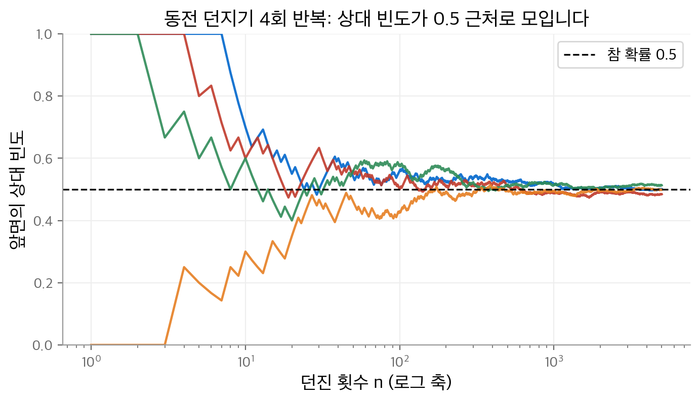
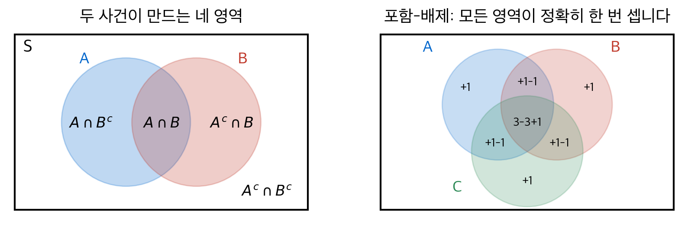
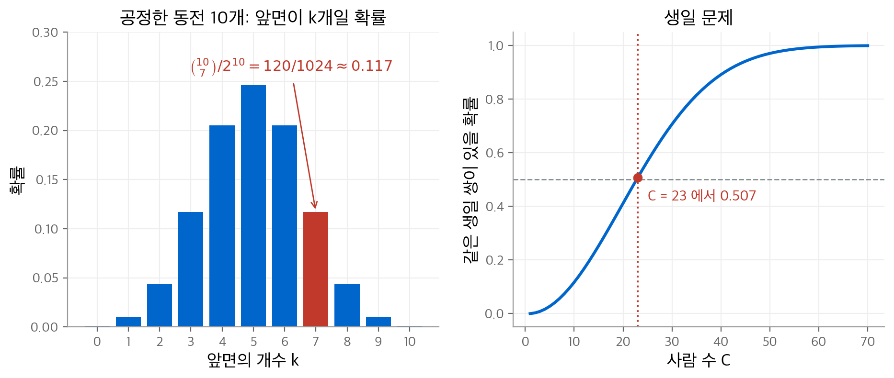
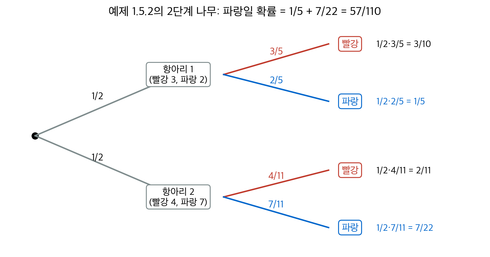
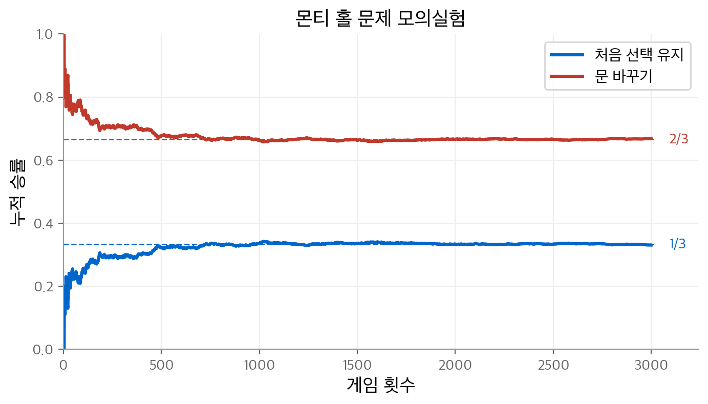

# 1. 확률 모형

확률론은 불확실성을 다루는 수학입니다. 이 장은 그 출발점인 **확률 모형**(probability model)을 정의합니다.
확률 모형은 표본 공간, 사건, 확률 측도라는 세 가지 요소로 이루어집니다.
이어서 공리에서 바로 나오는 성질을 정리하고, 유한 공간의 균등 확률을 세는 방법을 다룹니다.
마지막으로 조건부 확률, 베이즈 정리, 독립성, 그리고 확률의 연속성을 다룹니다.

!!! info "원문과 자료"

    - 교재: Michael J. Evans & Jeffrey S. Rosenthal, *Probability and Statistics: The Science of Uncertainty*, 2nd Edition, 1장 Probability Models (p. 1–32)
    - PDF: [1장 시작 페이지](https://utstat.utoronto.ca/mikevans/jeffrosenthal/book.pdf#page=15)

## 1.1 불확실성의 척도로서의 확률 (1.1절)

"내일 비가 올 확률이 40%"라는 말은 내일 날씨를 안다는 뜻이 아닙니다.
**내일 날씨에 대해 무엇을 모르는지 안다**는 뜻입니다. 확률은 이렇게 제한된 지식을 다루는 정밀한 규칙을 줍니다.

확률을 해석하는 대표적인 방법은 **상대 빈도**(relative frequency)입니다.
동전의 앞면 확률이 50%라는 말은 아주 많이 던지면 대략 절반이 앞면이라는 뜻입니다.
이 해석은 직관을 기르는 데 유용합니다. 그러나 내일 날씨처럼 반복할 수 없는 실험에는 그대로 쓸 수 없습니다.

<figure markdown>

<figcaption markdown>
<b>Figure 1.</b> 동전 던지기의 상대 빈도

던진 횟수가 늘면 네 경로의 상대 빈도가 모두 0.5 근처로 모입니다(4장의 큰 수의 법칙).
</figcaption>
</figure>

책은 확률론이 필요한 이유를 세 가지 내기로 보여 줍니다.

| 상황 | 직관 | 실제 값 | 근거 |
| --- | --- | --- | --- |
| 로또 6/49 당첨 | 운이 좋으면 가능 | $1/\binom{49}{6} = 1/13{,}983{,}816$ | 1.4절의 조합 |
| 한 면이 빨강인 카드의 반대 면도 빨강 | 50% | $2/3$ | 1.5절의 조건부 확률 |
| 동전 1,000번 중 앞면이 600번 초과 | 꽤 있을 법함 | $9.0 \times 10^{-11}$ 정도 | 4장의 큰 수의 법칙 |

## 1.2 확률 모형 (1.2절)

### 정의

**표본 공간**(sample space) $S$ 는 실험에서 나올 수 있는 모든 결과를 모은 집합입니다.
**사건**(event)은 $S$ 의 부분집합입니다. 이 책은 단순하게 모든 부분집합을 사건으로 둡니다.
**확률 측도**(probability measure) $P$ 는 각 사건 $A$ 에 수 $P(A)$ 를 대응시킵니다.

!!! note "정의 1.2.1 (확률 모형)"

    확률 모형은 공집합이 아닌 표본 공간 $S$, 사건의 모임, 확률 측도 $P$ 로 이루어집니다. $P$ 는 다음을 만족합니다.

    1. 모든 사건 $A$ 에서 $0 \le P(A) \le 1$ 입니다.
    2. $P(\varnothing) = 0$ 이고 $P(S) = 1$ 입니다.
    3. **가산 가법성**(countable additivity): 서로소인 사건열 $A_1, A_2, \ldots$ 에서 다음이 성립합니다.

    $$
    P(A_1 \cup A_2 \cup \cdots) = P(A_1) + P(A_2) + \cdots
    $$

두 사건이 공통 결과를 갖지 않으면 **서로소**(disjoint)라고 부릅니다.
가법성은 복잡한 사건의 확률을 서로소인 작은 사건의 확률의 합으로 계산하게 해 줍니다.

### 예제

- **예제 1.2.1 (날씨)**: $S = \{\text{rain}, \text{snow}, \text{clear}\}$ 이고 확률이 각각 $0.40, 0.15, 0.45$ 입니다.
  비 또는 눈이 올 확률은 가법성으로 $0.40 + 0.15 = 0.55$ 입니다.
- **예제 1.2.4 (동전 3개의 순서)**: $S$ 는 $HHH, HHT, \ldots, TTT$ 의 8개 결과이고, 각 확률은 $1/8$ 입니다.
  첫 동전이 앞면이고 둘째 동전이 뒷면일 확률은 $P(HTH) + P(HTT) = 1/4$ 입니다.
- **예제 1.2.5 (앞면의 개수)**: 같은 실험에서 개수만 기록하면 $S = \{0, 1, 2, 3\}$ 입니다.
  이번에는 결과가 균등하지 않습니다. $P(\{0\}) = P(\{3\}) = 1/8$ 이고 $P(\{1\}) = P(\{2\}) = 3/8$ 입니다.
- **예제 1.2.6 (구간 $[0, 1]$ 의 균등 분포)**: $P([a, b]) = b - a$ 로 정의합니다.
  표본 공간이 비가산 집합이어도 확률 모형을 만들 수 있습니다. 이때 한 점의 확률은 $P(\{s\}) = 0$ 입니다.

예제 1.2.4와 1.2.5는 같은 실험을 다른 표본 공간으로 기술합니다.
**표본 공간은 관심 있는 정보만 담습니다.** 무엇을 기록할지에 따라 모형이 달라집니다.

### 벤 다이어그램과 집합 연산

**여사건**(complement) $A^c$ 는 $A$ 에 속하지 않는 결과의 집합입니다.
두 사건 $A, B$ 는 표본 공간을 네 개의 서로소 영역으로 나눕니다.

<figure markdown>

<figcaption markdown>
<b>Figure 2.</b> 벤 다이어그램

두 사건이 만드는 네 영역과, 세 사건의 포함-배제 공식에서 각 영역이 세어지는 횟수입니다.
</figcaption>
</figure>

**드모르간 법칙**(De Morgan's laws)은 합집합과 교집합의 여사건을 바꿔 씁니다.

$$
(A \cup B)^c = A^c \cap B^c, \qquad (A \cap B)^c = A^c \cup B^c
$$

## 1.3 확률 모형의 성질 (1.3절)

공리만으로 다음 성질이 모두 나옵니다. 어떤 확률 모형에서도 성립합니다.

| 성질 | 식 | 증명의 핵심 |
| --- | --- | --- |
| 여사건 | $P(A^c) = 1 - P(A)$ | $A$ 와 $A^c$ 는 서로소이고 합집합이 $S$ 입니다. |
| 전확률(분할 형태) | $P(B) = \sum_i P(A_i \cap B)$ | $A_i$ 가 $S$ 의 분할이면 $A_i \cap B$ 도 서로소입니다. |
| 차집합 | $A \supseteq B$ 이면 $P(A \cap B^c) = P(A) - P(B)$ | $A = B \cup (A \cap B^c)$ 입니다. |
| 단조성 | $A \supseteq B$ 이면 $P(A) \ge P(B)$ | 차집합의 확률은 0 이상입니다. |
| 포함-배제 | $P(A \cup B) = P(A) + P(B) - P(A \cap B)$ | 교집합을 두 번 셌으므로 한 번 뺍니다. |
| 가산 부가법성 | $P(\bigcup_i A_i) \le \sum_i P(A_i)$ | 서로소가 되도록 $B_n = A_n \cap (A_1 \cup \cdots \cup A_{n-1})^c$ 로 바꿉니다. |

**분할**(partition)은 서로소이면서 합집합이 $S$ 인 사건의 모임입니다.
공리 $P(\varnothing) = 0$ 도 사실은 가법성과 $P(S) = 1$ 에서 나옵니다. $S = S \cup \varnothing$ 이 서로소 합이기 때문입니다.

### 포함-배제의 일반형

세 사건의 경우는 다음과 같습니다(도전 문제 1.3.10).

$$
\begin{aligned}
P(A \cup B \cup C) = {} & P(A) + P(B) + P(C) \\
& - P(A \cap B) - P(A \cap C) - P(B \cap C) \\
& + P(A \cap B \cap C)
\end{aligned}
$$

위 그림의 오른쪽이 이 공식을 보여 줍니다. 세 사건이 모두 겹치는 영역은 3번 더해지고 3번 빠집니다.
마지막 항에서 1번 더해져 결국 정확히 한 번 셉니다. $n$ 개 사건에서는 부호를 번갈아 바꾸며 $n$ 겹 교집합까지 더합니다.

### 예: 연습 문제 1.3.3

직원이 지각할 확률이 0.10, 조퇴할 확률이 0.20, 둘 다 할 확률이 0.05입니다.
지각 또는 조퇴할 확률은 $0.10 + 0.20 - 0.05 = 0.25$ 입니다.

## 1.4 유한 공간의 균등 확률 (1.4절)

$S$ 가 유한 집합이면 각 결과에 같은 확률 $1/|S|$ 를 줄 수 있습니다. 이것을 **균등 확률 측도**(uniform probability measure)라고 부릅니다.
가법성에 따라 모든 사건에서 다음이 성립합니다.

$$
P(A) = \frac{|A|}{|S|}
$$

따라서 확률 계산은 **집합의 크기를 세는 문제**가 됩니다. 셈을 다루는 분야를 **조합론**(combinatorics)이라고 부릅니다.

### 세는 원리

| 원리 | 셀 대상 | 개수 | 책의 예 |
| --- | --- | --- | --- |
| 곱셈 원리 | $S_1 \times \cdots \times S_k$ 의 순서열 | $\lvert S_1 \rvert \cdots \lvert S_k \rvert$ | 동전 3개와 주사위 2개: $2^3 \cdot 6^2 = 288$ (예제 1.4.5) |
| 순열 | $n$ 개에서 중복 없이 고른 길이 $k$ 의 순서열 | $n!/(n-k)!$ | 외투 4벌을 모두 제 주인에게: $1/4! = 1/24$ (예제 1.4.7) |
| 조합 | $n$ 개에서 고른 크기 $k$ 의 부분집합 | $\binom{n}{k} = \dfrac{n!}{k!(n-k)!}$ | 동전 10개 중 앞면 7개: $\binom{10}{7} = 120$ (예제 1.4.8) |
| 다항 계수 | 크기 $k_1, \ldots, k_l$ 의 순서 있는 분할 | $\dfrac{n!}{k_1! \cdots k_l!}$ | 브리지 패: $\dfrac{52!}{(13!)^4} \approx 5.364 \times 10^{28}$ (예제 1.4.9) |

조합의 공식은 순열에서 나옵니다. 길이 $k$ 의 순열 $n!/(n-k)!$ 개는 같은 부분집합을 $k!$ 번씩 셉니다.
따라서 $k!$ 로 나누면 부분집합의 개수가 됩니다.

### 예제 1.4.8: 앞면이 정확히 7개일 확률

공정한 동전 10개를 던지면 결과는 $2^{10} = 1024$ 개이고 모두 같은 확률입니다.
앞면 7개의 위치를 고르는 방법은 $\binom{10}{7} = 120$ 가지입니다. 따라서 확률은 $120/1024 \approx 0.117$ 입니다.

앞면 확률이 $\theta$ 인 동전 $n$ 개로 일반화하면 다음 식이 됩니다(식 1.4.2).

$$
P(\text{앞면이 정확히 } k \text{개}) = \binom{n}{k} \theta^k (1 - \theta)^{n-k}
$$

각 패턴의 확률이 $\theta^k (1-\theta)^{n-k}$ 이고 패턴이 $\binom{n}{k}$ 개이기 때문입니다.
패턴의 확률을 곱으로 쓰는 근거는 1.5절의 독립성입니다. 이 식은 2장의 **이항 분포**입니다.

### 생일 문제 (도전 문제 1.4.21)

$C$ 명의 생일이 365일에 균등하게 분포한다고 가정합니다. 생일이 같은 쌍이 있을 확률을 구합니다.
여사건 "모두 생일이 다르다"를 세는 편이 쉽습니다.

$$
P(\text{같은 생일 쌍이 있음}) = 1 - \frac{365 \cdot 364 \cdots (365 - C + 1)}{365^C}
$$

이 값이 0.5를 넘는 최소 인원은 $C = 23$ 이고, 이때 확률은 0.507입니다.
$C = 50$ 이면 0.970입니다. 쌍의 개수 $\binom{C}{2}$ 가 $C^2$ 에 비례해서 늘기 때문에 직관보다 빨리 커집니다.

<figure markdown>

<figcaption markdown>
<b>Figure 3.</b> 이항 계수와 생일 문제

앞면 수의 확률 $\binom{10}{k}/2^{10}$ 과 생일 문제의 확률입니다. 생일 문제는 23명에서 처음 0.5를 넘습니다.
</figcaption>
</figure>

## 1.5 조건부 확률과 독립성 (1.5절)

### 조건부 확률

동전 3개를 던졌고, 누군가 "앞면이 정확히 2개"라고 알려 줍니다. 이 정보로 가능한 결과는 $HHT, HTH, THH$ 로 줄어듭니다.
그중 첫 동전이 앞면인 결과는 2개이므로, 첫 동전이 앞면일 확률은 $1/2$ 에서 $2/3$ 로 바뀝니다.
**정보가 바뀌면 확률도 바뀝니다.**

!!! note "정의 1.5.1 (조건부 확률)"

    $P(B) > 0$ 일 때, $B$ 가 주어졌을 때 $A$ 의 **조건부 확률**(conditional probability)은 다음과 같습니다.

    $$
    P(A \mid B) = \frac{P(A \cap B)}{P(B)}
    $$

$B$ 가 일어나지 않은 경우를 모두 버리고, $B$ 가 일어난 경우 중에서 $A$ 의 비율을 잽니다.
위 예에서 $P(A \cap B) = 2/8$ 이고 $P(B) = 3/8$ 이므로 $P(A \mid B) = 2/3$ 입니다.

정의를 바꿔 쓰면 **곱셈 공식**(multiplication formula)이 됩니다.

$$
P(A \cap B) = P(A)\, P(B \mid A)
$$

### 전확률 법칙과 베이즈 정리

!!! note "정리 1.5.1 (전확률 법칙, 조건부 형태)"

    $A_1, A_2, \ldots$ 가 확률이 양수인 $S$ 의 분할이면, 모든 사건 $B$ 에서 다음이 성립합니다.

    $$
    P(B) = \sum_i P(A_i)\, P(B \mid A_i)
    $$

!!! note "정리 1.5.2 (베이즈 정리)"

    $P(A) > 0$ 이고 $P(B) > 0$ 이면 다음이 성립합니다.

    $$
    P(A \mid B) = \frac{P(A)}{P(B)}\, P(B \mid A)
    $$

**예제 1.5.1**: 학급의 60%가 여학생이고 40%가 남학생입니다. 여학생의 30%, 남학생의 20%가 긴 머리입니다.
임의로 뽑은 학생이 긴 머리일 확률은 $0.6 \times 0.3 + 0.4 \times 0.2 = 0.26$ 입니다.

### 예제 1.5.2: 2단계 시스템

세 정리는 **2단계 시스템**에서 함께 쓰입니다. 첫 단계에서 항아리를 고르고, 둘째 단계에서 공을 하나 뽑습니다.
항아리 1에는 빨강 3개와 파랑 2개, 항아리 2에는 빨강 4개와 파랑 7개가 있습니다. 항아리는 각각 확률 $1/2$ 로 고릅니다.
$A$ 를 "항아리 2 선택", $B$ 를 "파랑 공"이라고 둡니다.

1. **곱셈 공식**으로 두 단계의 결합 확률을 구합니다. $P(A \cap B) = \frac{1}{2} \cdot \frac{7}{11} = \frac{7}{22}$ 입니다.
2. **전확률 법칙**으로 둘째 단계의 확률을 구합니다. $P(B) = \frac{1}{2} \cdot \frac{7}{11} + \frac{1}{2} \cdot \frac{2}{5} = \frac{57}{110}$ 입니다.
3. **베이즈 정리**로 첫 단계를 역추론합니다. $P(A \mid B) = \dfrac{7/22}{57/110} = \dfrac{35}{57} \approx 0.614$ 입니다.

파랑 공이 나왔다는 정보로 항아리 2의 확률이 $0.5$ 에서 $0.614$ 로 올라갑니다.
항아리 2의 파랑 비율($7/11$)이 항아리 1의 비율($2/5$)보다 크기 때문입니다.

<figure markdown>

<figcaption markdown>
<b>Figure 4.</b> 예제 1.5.2의 확률 나무

가지의 확률을 곱하면 경로 확률(곱셈 공식), 경로를 더하면 $P(B)$(전확률 법칙)입니다.
</figcaption>
</figure>

### 카드 세 장과 몬티 홀 문제

1.1절의 카드 내기(문제 1.5.13)를 베이즈 정리로 풉니다. 카드는 빨강-빨강(RR), 검정-검정(BB), 빨강-검정(RB)의 세 장입니다.
보이는 면이 빨강일 확률은 $\frac{1}{3} \cdot 1 + \frac{1}{3} \cdot 0 + \frac{1}{3} \cdot \frac{1}{2} = \frac{1}{2}$ 입니다.
따라서 다음 식이 성립합니다.

$$
P(\text{RR} \mid \text{빨강 면}) = \frac{(1/3) \cdot 1}{1/2} = \frac{2}{3}
$$

직관의 50%가 틀린 이유는 RR 카드가 빨강 면을 보일 방법이 두 가지이기 때문입니다.

**몬티 홀 문제**(도전 문제 1.5.18)도 같은 구조입니다. 참가자가 문 A를 고르고, 사회자가 염소가 있는 문 B를 엽니다.
차의 위치를 조건으로 두면 사회자가 B를 열 확률은 다음과 같습니다.

| 차의 위치 | 사전 확률 | 사회자가 B를 열 확률 | 곱 |
| --- | --- | --- | --- |
| A | $1/3$ | $1/2$ | $1/6$ |
| B | $1/3$ | $0$ | $0$ |
| C | $1/3$ | $1$ | $1/3$ |

곱의 합이 $P(\text{B를 엶}) = 1/2$ 입니다. 베이즈 정리로 $P(\text{차가 A} \mid \text{B를 엶}) = (1/6)/(1/2) = 1/3$ 입니다.
따라서 처음 선택을 유지하면 승률이 $1/3$ 이고, 문을 바꾸면 $2/3$ 입니다.

<figure markdown>

<figcaption markdown>
<b>Figure 5.</b> 몬티 홀 문제 모의실험

누적 승률은 선택을 유지하면 $1/3$, 바꾸면 $2/3$ 로 수렴합니다.
</figcaption>
</figure>

### 독립성

주사위 하나와 동전 하나를 던지는 예제 1.4.4에서 $P(\text{주사위} = 5 \mid \text{뒷면}) = 1/6$ 입니다.
이 값은 조건이 없는 확률과 같습니다. 동전 정보가 주사위 확률에 아무 영향을 주지 않습니다.

!!! note "정의 1.5.2, 1.5.3 (독립)"

    두 사건 $A, B$ 가 다음을 만족하면 **독립**(independent)이라고 부릅니다.

    $$
    P(A \cap B) = P(A)\, P(B)
    $$

    사건의 모임 $A_1, A_2, \ldots$ 은 서로 다른 사건으로 이루어진 **모든 유한 부분 모임**에서 곱 공식이 성립할 때 독립입니다.

$P(B) > 0$ 이면 독립은 $P(A \mid B) = P(A)$ 와 같습니다. 정의 1.5.2는 확률이 0인 사건에도 쓸 수 있다는 장점이 있습니다.

### 예제 1.5.4: 쌍별 독립이지만 독립은 아닌 경우

$S = \{1, 2, 3, 4\}$ 에 균등 확률을 두고 $A = \{1, 2\}$, $B = \{1, 3\}$, $C = \{1, 4\}$ 로 둡니다.

- 두 사건씩 보면 $P(A \cap B) = P(\{1\}) = 1/4 = P(A)P(B)$ 입니다. $A \cap C$ 와 $B \cap C$ 도 같습니다.
- 세 사건을 함께 보면 $P(A \cap B \cap C) = 1/4$ 이지만 $P(A)P(B)P(C) = 1/8$ 입니다.

세 사건은 **쌍별 독립**(pairwise independent)이지만 독립은 아닙니다. 독립을 확인하려면 모든 부분 모임의 조건을 확인해야 합니다.

## 1.6 확률의 연속성 (1.6절)

사건열 $A_1 \subseteq A_2 \subseteq \cdots$ 의 합집합이 $A$ 이면 $A_n \nearrow A$ 로 씁니다.
$A_1 \supseteq A_2 \supseteq \cdots$ 의 교집합이 $A$ 이면 $A_n \searrow A$ 로 씁니다.

!!! note "정리 1.6.1 (확률의 연속성)"

    $A_n \nearrow A$ 이거나 $A_n \searrow A$ 이면 $\lim_{n \to \infty} P(A_n) = P(A)$ 입니다.

증가하는 경우의 증명은 다음과 같습니다. $A$ 를 서로소인 조각 $A_1, A_2 \cap A_1^c, A_3 \cap A_2^c, \ldots$ 로 나눕니다.
가산 가법성에 따라 $P(A)$ 는 이 조각들의 확률의 무한 합입니다. 처음 $n$ 개 조각의 합은 정확히 $P(A_n)$ 입니다.
감소하는 경우는 여사건을 취해 증가하는 경우로 바꿉니다.

**예제 1.6.1**: $S$ 가 양의 정수 전체이고 $P(\{s\}) = 2^{-s}$ 입니다. $A_n = \{5, 6, \ldots, n\}$ 은 $A = \{5, 6, 7, \ldots\}$ 로 증가합니다.

$$
P(A) = \lim_{n \to \infty} \left(2^{-5} + \cdots + 2^{-n}\right) = \lim_{n \to \infty} \left(2^{-4} - 2^{-n}\right) = \frac{1}{16}
$$

**예제 1.6.2**는 주의할 점을 보여 줍니다. $P((3, 5 + 1/n)) = \delta$ 가 모든 $n$ 에서 성립하면 $P((3, 5]) = \delta$ 입니다.
그러나 $P((3, 5))$ 는 0일 수도 있습니다. 확률이 한 점 $\{5\}$ 에 몰려 있을 수 있기 때문입니다.
극한 집합이 정확히 무엇인지 확인해야 합니다.

연속성은 가산 가법성과 같은 내용입니다. 유한 가법성과 연속성을 함께 가정하면 가산 가법성이 나옵니다(도전 문제 1.6.11).

## 딥러닝에서의 쓰임

| 개념 | 딥러닝에서 쓰이는 곳 |
| --- | --- |
| 표본 공간과 확률 측도 | 언어 모델의 출력은 어휘 집합 위의 확률 측도입니다. softmax는 합이 1인 값을 만들어 공리를 만족시킵니다. |
| 곱셈 공식의 연쇄 | 자기회귀 언어 모델은 $P(x_1, \ldots, x_T) = \prod_t P(x_t \mid x_{<t})$ 로 문장 확률을 분해합니다. |
| 베이즈 정리 | 생성 모델의 분류 규칙, 베이즈 신경망의 사후 분포, 확산 모델의 역과정 유도에 쓰입니다. |
| 전확률 법칙 | 잠재 변수 모델의 주변 우도 $p(x) = \sum_z p(z)\, p(x \mid z)$ 가 이 법칙입니다. VAE와 MoE의 출발점입니다. |
| 독립성 | 미니배치 샘플의 i.i.d. 가정, 나이브 베이즈, 드롭아웃 마스크의 독립 표본에 쓰입니다. |
| 포함-배제와 부가법성 | 합집합 한계(union bound)는 일반화 오차 상한과 다중 검정 보정에서 쓰입니다. |

## 정리

| 개념 | 핵심 |
| --- | --- |
| 확률 모형 | 표본 공간 $S$, 사건, 확률 측도 $P$ 로 이루어집니다. $P(S) = 1$ 이고 가산 가법적입니다. |
| 기본 성질 | 여사건, 단조성, 포함-배제, 부가법성이 공리에서 바로 나옵니다. |
| 균등 확률 | $P(A) = \lvert A \rvert / \lvert S \rvert$ 입니다. 곱셈 원리, 순열, 조합, 다항 계수로 셉니다. |
| 조건부 확률 | $P(A \mid B) = P(A \cap B)/P(B)$, 정보가 바뀌면 확률이 바뀝니다. |
| 베이즈 정리 | 2단계 시스템에서 둘째 단계의 관측으로 첫 단계를 역추론합니다. |
| 독립 | $P(A \cap B) = P(A)P(B)$, 여러 사건은 모든 부분 모임에서 확인합니다. |
| 연속성 | 단조 사건열에서 $P(A_n) \to P(A)$ 입니다. 가산 가법성과 같은 내용입니다. |

## 다음 장

이 장은 결과 자체의 확률을 다뤘습니다. [다음 장](02-random-variables.md)에서는 결과에 수를 대응시키는 **확률 변수**를 도입합니다.
이산 분포와 연속 분포, 결합 분포, 변수 변환을 다룹니다.
