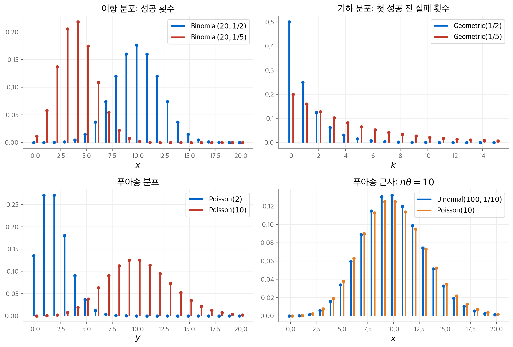
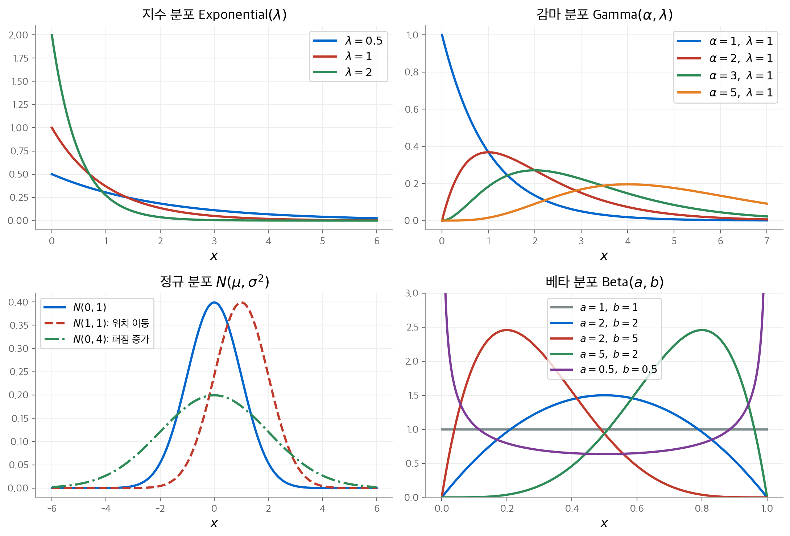
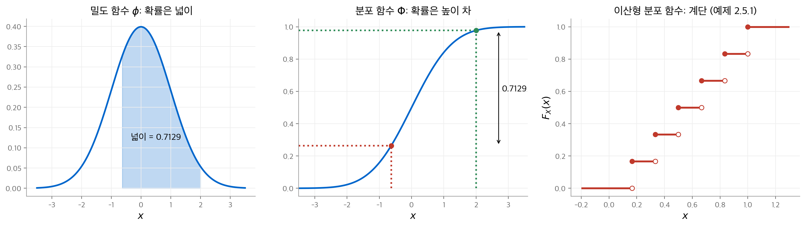
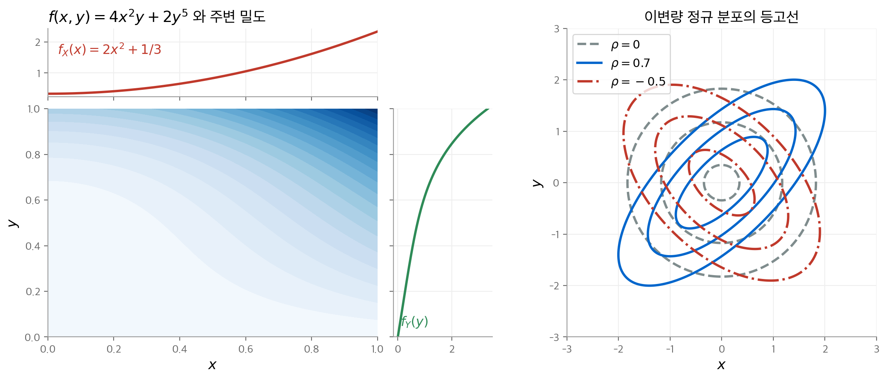
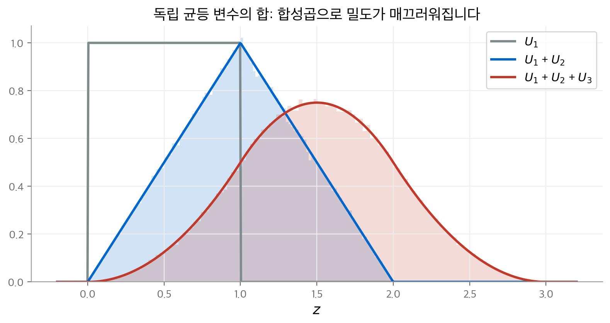
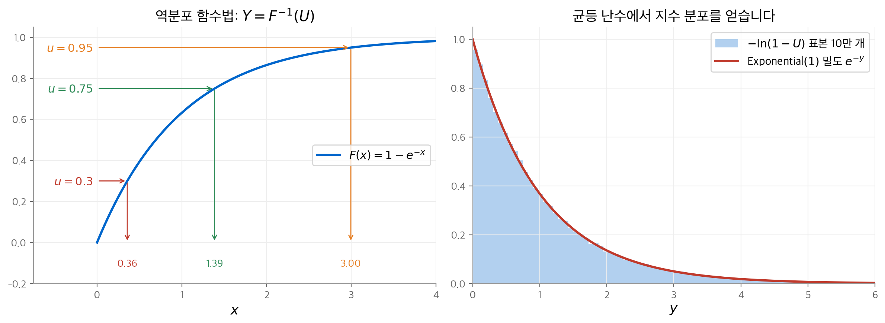

# 2. 확률 변수와 분포

1장은 표본 공간 $S$ 와 확률 측도 $P$ 로 확률 모형을 세웠습니다.
이 장은 표본 공간의 결과에 **수를 붙이는 함수**, 곧 확률 변수를 도입합니다.
확률 변수를 쓰면 사건 대신 실수 위에서 계산할 수 있습니다.
분포를 기록하는 도구는 세 가지입니다. 이산형은 확률 함수, 연속형은 밀도 함수, 모든 경우에는 분포 함수를 씁니다.
후반부는 두 변수 이상의 결합 분포, 조건부 분포와 독립성, 변수 변환을 다룹니다.
마지막 절은 균등 난수 하나로 임의의 분포를 시뮬레이션하는 방법을 설명합니다.

!!! info "원문과 자료"

    - 교재: Michael J. Evans & Jeffrey S. Rosenthal, *Probability and Statistics: The Science of Uncertainty*, 2nd Edition, 2장 Random Variables and Distributions (p. 33–128)
    - PDF: [2장 시작 페이지](https://utstat.utoronto.ca/mikevans/jeffrosenthal/book.pdf#page=47)

## 2.1 확률 변수 (2.1절)

**확률 변수**(random variable)는 표본 공간 $S$ 에서 실수 $\mathbb{R}$ 로 가는 함수 $X : S \to \mathbb{R}$ 입니다.
이름에 "변수"가 붙지만 실체는 함수입니다. 무작위성은 $X$ 가 아니라 어떤 $s \in S$ 가 나오는가에 있습니다.

예제 2.1.1은 날씨를 다룹니다. $S = \{\text{비}, \text{눈}, \text{맑음}\}$ 이고, 다음 함수를 정의합니다.

$$
X(\text{비}) = 3, \qquad X(\text{눈}) = 6, \qquad X(\text{맑음}) = -2.7
$$

같은 표본 공간 위에 확률 변수를 얼마든지 정의할 수 있습니다. 동전 세 개를 던지면 앞면 수, 뒷면 수, "앞면이 정확히 하나인가"가 모두 확률 변수입니다(예제 2.1.3).

두 가지 특수한 확률 변수가 자주 나옵니다.

- **상수**: 모든 $s$ 에서 $c(s) = c$ 이면 상수 $c$ 도 확률 변수입니다(예제 2.1.5).
- **지시 함수**(indicator function): 사건 $A$ 에 대해 $I_A(s) = 1$ ($s \in A$), $I_A(s) = 0$ ($s \notin A$) 입니다(예제 2.1.6).

확률 변수끼리는 점별로 더하고 곱할 수 있습니다. 예를 들어 $Z = X^2 + Y$ 는 $Z(s) = X(s)^2 + Y(s)$ 로 정의합니다.
부등호도 점별로 읽습니다. $X \le Y$ 는 **모든** $s$ 에서 $X(s) \le Y(s)$ 라는 뜻입니다.
예제 2.1.8은 주사위 눈 $X$ 와 $Y = X + I_{\{6\}}$ 를 비교합니다. $Y(s) = X(s)$ 가 $s \le 5$ 에서 성립하지만 $Y(6) = 7 \ne 6$ 이므로 $Y = X$ 는 거짓이고 $Y \ge X$ 는 참입니다.

## 2.2 확률 변수의 분포 (2.2절)

확률 변수 $X$ 의 **분포**(distribution)는 모든 실수 부분집합 $B$ 에 대한 확률의 모임입니다.

$$
P(X \in B) = P(\{s \in S : X(s) \in B\})
$$

엄밀하게는 $B$ 가 보렐 집합이어야 합니다. 실제로 적을 수 있는 집합은 모두 보렐 집합이므로 이 제약은 신경 쓰지 않아도 됩니다.

예제 2.2.1은 날씨 예에 확률 $P(\text{비}) = 0.4$, $P(\text{눈}) = 0.15$, $P(\text{맑음}) = 0.45$ 를 줍니다.

$$
P(X \in \{3, 6\}) = 0.4 + 0.15 = 0.55, \qquad P(X < 5) = P(X = 3) + P(X = -2.7) = 0.85
$$

분포 전체는 지시 함수로 한 줄에 쓸 수 있습니다(예제 2.2.2).

$$
P(X \in B) = 0.4\, I_B(3) + 0.15\, I_B(6) + 0.45\, I_B(-2.7)
$$

예제 2.2.3은 $Y(\text{비}) = Y(\text{맑음}) = 5$, $Y(\text{눈}) = 7$ 인 경우입니다. 서로 다른 결과가 같은 값으로 가므로 확률을 합칩니다. $P(Y = 5) = 0.85$, $P(Y = 7) = 0.15$ 입니다.
모든 $B$ 를 추적하는 일은 번거롭습니다. 다음 절부터 분포를 더 간단히 기록하는 함수를 도입합니다.

## 2.3 이산 분포 (2.3절)

### 정의

확률 변수 $X$ 가 유한 개 또는 셀 수 있는 개수의 값 $x_1, x_2, \ldots$ 에 확률을 모두 몰아 두면 **이산형**(discrete)입니다.
즉 $\sum_i P(X = x_i) = 1$ 입니다. 이때 **확률 함수**(probability function) $p_X(x) = P(X = x)$ 가 분포를 완전히 결정합니다.

$$
P(X \in B) = \sum_{x \in B} p_X(x)
$$

### 대표 이산 분포

책은 다음 분포를 차례로 도입합니다. 기댓값과 분산은 3장에서 유도하지만 미리 표에 적어 둡니다.

| 분포 | 확률 함수 | 값의 범위 | 평균 | 분산 | 상황 |
| --- | --- | --- | --- | --- | --- |
| Bernoulli$(\theta)$ | $\theta^x (1-\theta)^{1-x}$ | $x \in \{0, 1\}$ | $\theta$ | $\theta(1-\theta)$ | 시행 한 번의 성공 여부 |
| Binomial$(n, \theta)$ | $\binom{n}{x} \theta^x (1-\theta)^{n-x}$ | $0, 1, \ldots, n$ | $n\theta$ | $n\theta(1-\theta)$ | 독립 시행 $n$ 번의 성공 횟수 |
| Geometric$(\theta)$ | $(1-\theta)^k \theta$ | $0, 1, 2, \ldots$ | $(1-\theta)/\theta$ | $(1-\theta)/\theta^2$ | 첫 성공 전 실패 횟수 |
| Negative-Binomial$(r, \theta)$ | $\binom{r-1+k}{k} \theta^r (1-\theta)^k$ | $0, 1, 2, \ldots$ | $r(1-\theta)/\theta$ | $r(1-\theta)/\theta^2$ | $r$ 번째 성공 전 실패 횟수 |
| Poisson$(\lambda)$ | $\lambda^y e^{-\lambda} / y!$ | $0, 1, 2, \ldots$ | $\lambda$ | $\lambda$ | 드문 사건의 발생 횟수 |
| Hypergeometric$(N, M, n)$ | $\binom{M}{x}\binom{N-M}{n-x} / \binom{N}{n}$ | $\max(0, n+M-N) \le x \le \min(n, M)$ | $nM/N$ | $n\frac{M}{N}\frac{N-M}{N}\frac{N-n}{N-1}$ | 비복원 추출의 흰 공 개수 |

몇 가지 관계가 있습니다.

- Bernoulli$(\theta)$ 는 Binomial$(1, \theta)$ 입니다. 독립 Bernoulli$(\theta)$ 변수 $n$ 개의 합은 Binomial$(n, \theta)$ 입니다.
- Geometric$(\theta)$ 는 Negative-Binomial$(1, \theta)$ 입니다.
- 일부 교재는 기하 분포를 "첫 성공까지의 시행 횟수"로 정의합니다. 이 책의 정의보다 1이 큽니다.

<figure markdown>

<figcaption markdown>
<b>Figure 1.</b> 대표 이산 분포의 확률 함수

이항, 기하, 푸아송 분포의 모양입니다. Binomial$(100, 1/10)$ 과 Poisson$(10)$ 은 거의 겹칩니다.
</figcaption>
</figure>

### 이항 분포의 푸아송 근사 (예제 2.3.6)

$X \sim$ Binomial$(n, \lambda/n)$ 으로 두고 $n \to \infty$ 의 극한을 봅니다.

$$
P(X = x) = \frac{n(n-1)\cdots(n-x+1)}{n^x} \cdot \frac{\lambda^x}{x!} \cdot \left(1 - \frac{\lambda}{n}\right)^{n-x}
$$

첫 인수는 1로 수렴합니다. 마지막 인수는 $(1 - \lambda/n)^n \to e^{-\lambda}$ 이고 $(1 - \lambda/n)^{-x} \to 1$ 이므로 $e^{-\lambda}$ 로 수렴합니다.

$$
\lim_{n \to \infty} P(X = x) = \frac{\lambda^x}{x!} e^{-\lambda}
$$

**시행 수가 많고 성공 확률이 작으면 성공 횟수가 푸아송 분포를 따릅니다.** 화재 건수, 가이거 계수기의 계수, 웹 페이지 접속 수가 예입니다.
Binomial$(100, 0.1)$ 과 Poisson$(10)$ 을 직접 비교하면 $P(X = 10)$ 은 각각 $0.1319$ 와 $0.1251$ 입니다. 모든 $x$ 에서 두 확률의 차이는 $0.0068$ 이하입니다.

### 초기하 분포와 비복원 추출 (예제 2.3.7)

항아리에 공이 $N$ 개 있고 그중 $M$ 개가 흰 공입니다. 공 $n$ 개를 **되돌려 넣지 않고** 뽑을 때, 흰 공 개수 $X$ 는 초기하 분포를 따릅니다.
$n$ 개 부분집합이 모두 같은 확률 $1/\binom{N}{n}$ 로 뽑히므로, 흰 공 $x$ 개를 포함하는 부분집합의 수를 세면 됩니다.
$N = 20$, $M = 10$, $n = 5$ 에서 $P(X = 2) = 0.3483$ 입니다. 같은 비율로 복원 추출하면 Binomial$(5, 1/2)$ 이고 $P(X = 2) = 0.3125$ 입니다.
$N$ 이 $n$ 보다 훨씬 크면 두 분포의 차이가 작아집니다.

## 2.4 연속 분포 (2.4절)

### 연속과 절대 연속

모든 $x$ 에서 $P(X = x) = 0$ 이면 $X$ 를 **연속형**(continuous)이라고 부릅니다.
이때 점 확률을 더하는 방법은 쓸 수 없습니다. 대신 **밀도 함수**(density function) $f \ge 0$, $\int_{-\infty}^{\infty} f(x)\,dx = 1$ 을 씁니다.
다음 식을 만족하는 $f$ 가 있으면 $X$ 를 **절대 연속**(absolutely continuous)이라고 부릅니다.

$$
P(a \le X \le b) = \int_a^b f(x)\, dx \qquad (a \le b)
$$

절대 연속이면 연속입니다(정리 2.4.1). $a = b$ 로 두면 적분이 0이 되기 때문입니다.
**밀도의 값은 확률이 아닙니다.** $f(x)$ 는 1보다 클 수 있습니다. 확률은 밀도 아래의 넓이입니다.

### 균등 분포 (예제 2.4.1–2.4.3)

Uniform$[0, 1]$ 은 $P(a \le X \le b) = b - a$ ($0 \le a \le b \le 1$) 인 분포입니다. 밀도는 $[0, 1]$ 에서 1이고 그 밖에서 0입니다.

$$
P\!\left(\tfrac{1}{2} \le X \le \tfrac{3}{4}\right) = \tfrac{1}{4}, \qquad P\!\left(X \ge \tfrac{2}{3}\right) = \tfrac{1}{3}
$$

일반적인 Uniform$[L, R]$ 의 밀도는 $[L, R]$ 에서 $1/(R - L)$ 입니다.

### 지수 분포 (예제 2.4.4, 2.4.5)

Exponential$(\lambda)$ 의 밀도는 $f(x) = \lambda e^{-\lambda x}$ ($x \ge 0$) 입니다. 구간 확률과 꼬리 확률은 다음과 같습니다.

$$
P(a \le X \le b) = e^{-\lambda a} - e^{-\lambda b}, \qquad P(X \ge x) = e^{-\lambda x}
$$

책은 지수 분포를 대기 시간과 연결합니다. 단위 시간당 도착 수가 Poisson$(\lambda)$ 이면 길이 $t$ 구간의 도착 수는 Poisson$(\lambda t)$ 입니다.
첫 도착 시각 $T_1$ 이 $t$ 보다 크다는 것은 $[0, t]$ 에 도착이 없다는 뜻입니다.

$$
P(T_1 > t) = \frac{(\lambda t)^0}{0!} e^{-\lambda t} = e^{-\lambda t}
$$

따라서 $T_1 \sim$ Exponential$(\lambda)$ 입니다. 일부 교재와 소프트웨어는 $\lambda$ 대신 평균 $1/\lambda$ 를 모수로 씁니다. 다른 자료를 쓸 때는 정의를 먼저 확인해야 합니다.

### 감마, 정규, 베타 분포 (예제 2.4.6–2.4.8)

**감마 함수**(gamma function)는 $\Gamma(\alpha) = \int_0^\infty t^{\alpha-1} e^{-t}\, dt$ 입니다.
$\Gamma(1) = 1$, $\Gamma(\alpha + 1) = \alpha\Gamma(\alpha)$, $\Gamma(n) = (n-1)!$, $\Gamma(1/2) = \sqrt{\pi}$ 가 성립합니다.

| 분포 | 밀도 함수 | 범위 | 평균 | 분산 |
| --- | --- | --- | --- | --- |
| Uniform$[L, R]$ | $\dfrac{1}{R - L}$ | $L \le x \le R$ | $\dfrac{L + R}{2}$ | $\dfrac{(R - L)^2}{12}$ |
| Exponential$(\lambda)$ | $\lambda e^{-\lambda x}$ | $x \ge 0$ | $1/\lambda$ | $1/\lambda^2$ |
| Gamma$(\alpha, \lambda)$ | $\dfrac{\lambda^\alpha x^{\alpha-1} e^{-\lambda x}}{\Gamma(\alpha)}$ | $x > 0$ | $\alpha/\lambda$ | $\alpha/\lambda^2$ |
| $N(\mu, \sigma^2)$ | $\dfrac{1}{\sigma\sqrt{2\pi}} e^{-(x-\mu)^2/2\sigma^2}$ | $x \in \mathbb{R}$ | $\mu$ | $\sigma^2$ |
| Beta$(a, b)$ | $\dfrac{\Gamma(a+b)}{\Gamma(a)\Gamma(b)} x^{a-1}(1-x)^{b-1}$ | $0 < x < 1$ | $\dfrac{a}{a+b}$ | $\dfrac{ab}{(a+b)^2(a+b+1)}$ |

- Gamma$(1, \lambda)$ 는 Exponential$(\lambda)$ 입니다. $\alpha$ 가 커지면 봉우리가 오른쪽으로 이동하고 대칭에 가까워집니다.
- $N(0, 1)$ 을 **표준 정규 분포**(standard normal distribution)라고 부르고, 밀도를 $\phi$ 로 씁니다.
  $\mu$ 는 밀도를 평행 이동하고, $\sigma^2$ 은 퍼짐을 조절합니다.
- Beta$(1, 1)$ 은 Uniform$[0, 1]$ 입니다. 베타 분포는 $[0, 1]$ 위의 모양을 두 모수로 자유롭게 바꿉니다(책에서는 문제 2.4.24).

<figure markdown>

<figcaption markdown>
<b>Figure 2.</b> 대표 연속 분포의 밀도 함수

지수, 감마, 정규, 베타 분포의 밀도가 매개변수에 따라 어떻게 바뀌는지 보여 줍니다.
</figcaption>
</figure>

## 2.5 누적 분포 함수 (2.5절)

### 정의와 성질

확률 변수 $X$ 의 **누적 분포 함수**(cumulative distribution function, cdf)는 다음 함수입니다.

$$
F_X(x) = P(X \le x), \qquad x \in \mathbb{R}
$$

cdf는 이산형, 연속형, 그 밖의 경우에 모두 정의됩니다. 또 **cdf가 분포를 완전히 결정합니다**(정리 2.5.1).
정리 2.5.2는 cdf의 네 가지 성질을 줍니다.

1. $0 \le F_X(x) \le 1$ 입니다.
2. $x \le y$ 이면 $F_X(x) \le F_X(y)$ 입니다(단조 증가).
3. $\lim_{x \to \infty} F_X(x) = 1$, $\lim_{x \to -\infty} F_X(x) = 0$ 입니다.
4. 오른쪽 연속입니다. $\lim_{y \downarrow x} F_X(y) = F_X(x)$ 입니다.

구간 확률은 $P(a < X \le b) = F_X(b) - F_X(a)$ 로 계산합니다.

### 이산형의 cdf (예제 2.5.1)

공정한 주사위의 눈을 6으로 나눈 값을 $X$ 로 둡니다. $F_X(x) = \lfloor 6x \rfloor / 6$ ($0 \le x \le 1$) 입니다.
이산형의 cdf는 **계단 함수**입니다. 각 값 $x_i$ 에서 높이 $p_X(x_i)$ 만큼 뜁니다.

### 절대 연속형의 cdf와 정규 확률 계산

절대 연속형에서는 $F_X(x) = \int_{-\infty}^x f(t)\,dt$ 이고, 미분하면 밀도를 다시 얻습니다(정리 2.5.4, 따름정리 2.5.1).

$$
F_X'(x) = f_X(x)
$$

표준 정규 분포의 cdf를 $\Phi(x) = \int_{-\infty}^x \phi(t)\,dt$ 로 씁니다. $\Phi$ 는 닫힌 형태가 없으므로 표나 소프트웨어로 계산합니다.
예제 2.5.2는 $X \sim N(0, 1)$ 일 때 다음 확률을 구합니다.

$$
P(-0.63 \le X \le 2.0) = \Phi(2.0) - \Phi(-0.63) = 0.9772 - 0.2643 = 0.7129
$$

일반 정규 분포는 표준화로 $\Phi$ 에 돌립니다. $y = (x - \mu)/\sigma$ 로 치환하면 다음 식을 얻습니다.

$$
P(a \le X \le b) = \Phi\!\left(\frac{b - \mu}{\sigma}\right) - \Phi\!\left(\frac{a - \mu}{\sigma}\right)
$$

$\mu = 1.3$, $\sigma^2 = 4$ 이면 $P(-0.63 \le X \le 2.0) = \Phi(0.35) - \Phi(-0.965) = 0.6368 - 0.1673 = 0.4696$ 입니다.

<figure markdown>

<figcaption markdown>
<b>Figure 3.</b> 밀도 함수와 분포 함수의 관계

같은 확률이 밀도 아래의 넓이이자 cdf의 높이 차입니다. 이산형의 cdf는 오른쪽 연속인 계단 함수입니다.
</figcaption>
</figure>

예제 2.5.3은 cdf가 직접 주어진 경우입니다. $F_X(x) = (x-2)^4/16$ ($2 \le x < 4$), $x < 2$ 에서 0, $x \ge 4$ 에서 1입니다.

$$
P(X < 3) = \frac{1}{16}, \qquad P(X > 2.5) = 1 - \frac{0.5^4}{16} = 0.9961, \qquad P(1.2 < X \le 3.4) = \frac{1.4^4}{16} = 0.2401
$$

### 혼합 분포 (예제 2.5.4, 2.5.5)

cdf $F_1, \ldots, F_k$ 와 확률 $p_1, \ldots, p_k$ 가 있으면 $G = \sum_i p_i F_i$ 도 cdf입니다. 이를 **혼합 분포**(mixture distribution)라고 부릅니다.
해석은 2단계 실험입니다. 먼저 확률 $p_i$ 로 성분 $i$ 를 고르고, 그다음 $F_i$ 에서 값을 뽑습니다.
예제 2.5.4는 카드로 그릇을 고릅니다. 1번 그릇을 확률 $1/5$, 2번 그릇을 확률 $4/5$ 로 고른 뒤 칩 하나를 뽑습니다. 결과의 cdf는 $G = \frac{1}{5}F_1 + \frac{4}{5}F_2$ 입니다.
$F$ 를 평행 이동한 $F(x - y_i)$ 를 섞으면 위치 혼합이 됩니다. 이산 분포와 연속 분포를 섞으면 **이산형도 연속형도 아닌** 분포가 나옵니다(2.5.5절).

## 2.6 1차원 변수 변환 (2.6절)

$Y = h(X)$ 의 분포를 $X$ 의 분포에서 구하는 문제입니다.

### 이산형 (정리 2.6.1)

$X$ 가 이산형이면 $Y$ 도 이산형입니다. $h(x) = y$ 를 만족하는 모든 $x$ 의 확률을 더합니다.

$$
p_Y(y) = \sum_{x \in h^{-1}(\{y\})} p_X(x)
$$

예제 2.6.2는 주사위 눈 $X$ 에 $Y = X^2 - 3X + 2$ 를 적용합니다. $h(x) = 0$ 의 해는 $x = 1, 2$ 이므로 $P(Y = 0) = 1/6 + 1/6 = 1/3$ 입니다.

### 연속형 (정리 2.6.2, 2.6.3)

$X$ 가 연속형이어도 $Y$ 가 연속형이라는 보장은 없습니다. 예제 2.6.3은 $X \sim$ Uniform$[0, 1]$ 에 계단 함수를 적용해 이산형 $Y$ 를 만듭니다.
$h$ 가 미분 가능하고 **순증가 또는 순감소**이면 다음 공식이 성립합니다.

$$
f_Y(y) = \frac{f_X(h^{-1}(y))}{|h'(h^{-1}(y))|}
$$

분모는 $h$ 가 구간을 늘리거나 줄이는 비율입니다. 늘어난 구간에서는 같은 확률이 넓게 퍼지므로 밀도가 낮아집니다.

- **예제 2.6.4**: $X \sim$ Uniform$[0, 1]$, $Y = 3X$ 이면 $f_Y(y) = \frac{1}{3}$ ($0 \le y \le 3$) 이므로 $Y \sim$ Uniform$[0, 3]$ 입니다.
- **예제 2.6.5**: $X \sim N(0, 1)$, $Y = 2X + 5$ 이면 $h^{-1}(y) = (y-5)/2$, $h' = 2$ 입니다. 대입하면 $Y \sim N(5, 4)$ 입니다.
- **예제 2.6.6**: $X \sim$ Uniform$[0, 1]$, $Y = \ln(1/X)$ 이면 $h$ 가 순감소이고 $h^{-1}(y) = e^{-y}$, $|h'(x)| = 1/x$ 입니다.

$$
f_Y(y) = \frac{f_X(e^{-y})}{1/e^{-y}} = e^{-y}, \qquad y \ge 0
$$

따라서 $Y \sim$ Exponential$(1)$ 입니다. 이 결과는 2.10절의 시뮬레이션에서 다시 씁니다.

정리 2.6.4에 따르면, $h$ 는 $f_X > 0$ 인 영역에서만 단조이면 됩니다. 예를 들어 $X \sim$ Exponential$(\lambda)$ 이면 $h(x) = x^2$ 에도 공식을 쓸 수 있습니다.

## 2.7 결합 분포 (2.7절)

### 주변 분포만으로는 관계를 알 수 없습니다

예제 2.7.1에서 $X \sim$ Bernoulli$(1/2)$, $Y_1 = X$, $Y_2 = 1 - X$ 입니다.
세 변수의 분포는 모두 Bernoulli$(1/2)$ 로 같습니다. 그러나 $X = 1$ 이면 $Y_1 = 1$ 이고 $Y_2 = 0$ 입니다.
**개별 분포는 변수 사이의 관계를 담지 않습니다.** 관계를 담으려면 **결합 분포**(joint distribution) $P((X, Y) \in B)$, $B \subseteq \mathbb{R}^2$ 가 필요합니다.

### 결합 cdf, 결합 확률 함수, 결합 밀도

| 도구 | 정의 | 주변 분포 |
| --- | --- | --- |
| 결합 cdf | $F_{X,Y}(x, y) = P(X \le x, Y \le y)$ | $F_X(x) = \lim_{y \to \infty} F_{X,Y}(x, y)$ |
| 결합 확률 함수 | $p_{X,Y}(x, y) = P(X = x, Y = y)$ | $p_X(x) = \sum_y p_{X,Y}(x, y)$ |
| 결합 밀도 | $P(a \le X \le b, c \le Y \le d) = \int_c^d \int_a^b f_{X,Y}\,dx\,dy$ | $f_X(x) = \int f_{X,Y}(x, y)\,dy$ |

**주변 분포**(marginal distribution)는 결합 분포에서 다른 변수를 합하거나 적분해서 없앤 분포입니다.
직사각형의 확률은 결합 cdf의 포함-배제로 구합니다(정리 2.7.1).

$$
P(a < X \le b,\ c < Y \le d) = F(b, d) - F(a, d) - F(b, c) + F(a, c)
$$

### 예제 2.7.5: 결합 확률표

$X$ 와 $Y$ 의 결합 확률 함수를 표로 적고, 행과 열을 더해 여백에 주변 분포를 적습니다. "주변(marginal)"이라는 이름이 여기서 나옵니다.

| | $Y = 0$ | $Y = 3$ | $Y = 4$ | $p_X$ |
| --- | --- | --- | --- | --- |
| $X = 5$ | $1/7$ | $1/7$ | $1/7$ | $3/7$ |
| $X = 8$ | $3/7$ | $0$ | $1/7$ | $4/7$ |
| $p_Y$ | $4/7$ | $1/7$ | $2/7$ | $1$ |

### 예제 2.7.6, 2.7.7: 결합 밀도와 주변 밀도

$f(x, y) = 4x^2 y + 2y^5$ ($0 \le x, y \le 1$) 를 봅니다. 먼저 전체 적분이 1인지 확인합니다.

$$
\int_0^1 \int_0^1 (4x^2 y + 2y^5)\, dx\, dy = \int_0^1 \left(\tfrac{4}{3} y + 2y^5\right) dy = \tfrac{2}{3} + \tfrac{1}{3} = 1
$$

직사각형 확률은 $P(0.5 \le X \le 0.7,\ 0.2 \le Y \le 0.9) \approx 0.147$ 입니다. 주변 밀도는 한 변수를 적분해서 얻습니다.

$$
f_X(x) = \int_0^1 (4x^2 y + 2y^5)\,dy = 2x^2 + \tfrac{1}{3}, \qquad f_Y(y) = \int_0^1 (4x^2 y + 2y^5)\,dx = \tfrac{4}{3} y + 2y^5
$$

예제 2.7.8은 밀도가 양수인 영역이 정사각형이 아닌 경우입니다. $f(x, y) = 120 x^3 y$ 가 삼각형 $x, y \ge 0$, $x + y \le 1$ 위에 정의됩니다.
이때 적분 한계가 $x$ 에 의존합니다. $f_X(x) = \int_0^{1-x} 120x^3 y\, dy = 60x^3(1-x)^2$ 입니다.

### 이변량 정규 분포 (예제 2.7.9)

모수 $\mu_1, \mu_2, \sigma_1, \sigma_2 > 0$, $-1 < \rho < 1$ 에 대해 **이변량 정규 분포**(bivariate normal distribution)의 밀도는 다음과 같습니다.

$$
f(x, y) = \frac{1}{2\pi\sigma_1\sigma_2\sqrt{1-\rho^2}} \exp\!\left\{-\frac{1}{2(1-\rho^2)}\left[\left(\frac{x-\mu_1}{\sigma_1}\right)^2 + \left(\frac{y-\mu_2}{\sigma_2}\right)^2 - 2\rho\,\frac{x-\mu_1}{\sigma_1}\,\frac{y-\mu_2}{\sigma_2}\right]\right\}
$$

주변 분포는 $X \sim N(\mu_1, \sigma_1^2)$, $Y \sim N(\mu_2, \sigma_2^2)$ 입니다. $\rho$ 는 두 변수의 상관 계수(3장)이고, $\rho = 0$ 일 때만 독립입니다.
독립 표준 정규 변수 $Z_1, Z_2$ 로 이 분포를 만들 수 있습니다(식 2.7.1).

$$
X = \mu_1 + \sigma_1 Z_1, \qquad Y = \mu_2 + \sigma_2\left(\rho Z_1 + \sqrt{1-\rho^2}\, Z_2\right)
$$

<figure markdown>

<figcaption markdown>
<b>Figure 4.</b> 결합 밀도와 주변 밀도, 이변량 정규 분포의 등고선

결합 밀도와 주변 밀도입니다. 이변량 정규 분포의 등고선은 $\rho$ 의 부호에 따라 기우는 방향이 바뀝니다.
</figcaption>
</figure>

## 2.8 조건부 분포와 독립성 (2.8절)

### 이산형 조건부 분포

$P(X = x) > 0$ 이면 1장의 조건부 확률을 그대로 씁니다. **조건부 확률 함수**(conditional probability function)는 다음과 같습니다.

$$
p_{Y|X}(y \mid x) = \frac{p_{X,Y}(x, y)}{p_X(x)}
$$

예제 2.8.1은 앞의 결합 확률표를 씁니다.

$$
P(Y = 4 \mid X = 8) = \frac{1/7}{4/7} = \frac{1}{4}, \qquad P(Y = 4 \mid X = 5) = \frac{1/7}{3/7} = \frac{1}{3}
$$

$X$ 의 값에 따라 $Y$ 의 분포가 달라집니다.

### 연속형 조건부 분포

연속형에서는 $P(X = x) = 0$ 이므로 위 정의로 나눌 수 없습니다.
책은 $x - \epsilon \le X \le x + \epsilon$ 으로 조건을 걸고 $\epsilon \to 0$ 의 극한을 취합니다. 그 결과가 **조건부 밀도**(conditional density)입니다.

$$
f_{Y|X}(y \mid x) = \frac{f_{X,Y}(x, y)}{f_X(x)}, \qquad f_X(x) > 0
$$

예제 2.8.2는 $f = 4x^2 y + 2y^5$ 에서 $X = 0.8$ 이 주어졌을 때의 확률을 계산합니다.

$$
P(0.2 \le Y \le 0.3 \mid X = 0.8) = \frac{\int_{0.2}^{0.3} (4 \cdot 0.8^2\, y + 2y^5)\,dy}{2 \cdot 0.8^2 + 1/3} \approx 0.0398
$$

조건이 없는 확률은 $\int_{0.2}^{0.3} f_Y(y)\,dy \approx 0.0336$ 입니다. $X = 0.8$ 이라는 정보가 이 확률을 높입니다.
결합 밀도는 **주변 밀도와 조건부 밀도의 곱**으로 분해됩니다. 이것이 연속형의 전확률 법칙입니다(정리 2.8.1).

$$
f_{X,Y}(x, y) = f_X(x)\, f_{Y|X}(y \mid x)
$$

### 확률 변수의 독립성

모든 $B_1, B_2$ 에서 $P(X \in B_1, Y \in B_2) = P(X \in B_1) P(Y \in B_2)$ 이면 $X$ 와 $Y$ 는 **독립**(independent)입니다.
정리 2.8.3은 실제로 확인하기 쉬운 조건을 줍니다.

- 이산형: 모든 $x, y$ 에서 $p_{X,Y}(x, y) = p_X(x)\,p_Y(y)$ 입니다.
- 절대 연속형: 모든 $x, y$ 에서 $f_{X,Y}(x, y) = f_X(x)\,f_Y(y)$ 입니다.

동등하게 조건부 분포가 조건에 의존하지 않습니다. $p_{Y|X}(y \mid x) = p_Y(y)$ 입니다(정리 2.8.4).

- **예제 2.8.3**: $f = 4x^2 y + 2y^5$ 는 $(2x^2 + 1/3)(\frac{4}{3}y + 2y^5)$ 와 다르므로 $X$ 와 $Y$ 는 독립이 아닙니다.
- **예제 2.8.4**: $f = (12xy^2 + 6x + 4y^2 + 2)/8080$ ($0 \le x \le 6$, $3 \le y \le 5$) 는 다음처럼 인수분해됩니다.

$$
\frac{12xy^2 + 6x + 4y^2 + 2}{8080} = \frac{(1 + 3x)(1 + 2y^2)}{4040} = \underbrace{\left(\frac{1}{60} + \frac{x}{20}\right)}_{f_X(x)} \underbrace{\left(\frac{3}{202} + \frac{3y^2}{101}\right)}_{f_Y(y)}
$$

따라서 이 경우 $X$ 와 $Y$ 는 독립입니다. 독립 변수의 함수 $f(X)$ 와 $g(Y)$ 도 독립입니다(정리 2.8.5).
서로 독립이고 같은 분포를 따르는 변수열을 **i.i.d.**(independent and identically distributed)라고 부릅니다.

### 다항 분포 (예제 2.8.5)

결과가 $k$ 가지이고 각 확률이 $\theta_1, \ldots, \theta_k$ 인 시행을 독립으로 $n$ 번 합니다. 범주 $i$ 가 나온 횟수 $X_i$ 의 결합 분포가 **다항 분포**(multinomial distribution)입니다.

$$
P(X_1 = x_1, \ldots, X_k = x_k) = \frac{n!}{x_1! \cdots x_k!}\, \theta_1^{x_1} \cdots \theta_k^{x_k}, \qquad \sum_i x_i = n
$$

$k = 2$ 이면 이항 분포입니다.

### 순서 통계량 (예제 2.8.6–2.8.9)

i.i.d. 표본 $X_1, \ldots, X_n$ 을 크기순으로 정렬한 $X_{(1)} \le \cdots \le X_{(n)}$ 을 **순서 통계량**(order statistic)이라고 부릅니다.
최댓값이 $x$ 이하인 것은 모든 $X_i$ 가 $x$ 이하인 것과 같습니다. 최솟값은 여사건으로 계산합니다.

$$
F_{X_{(n)}}(x) = F(x)^n, \qquad F_{X_{(1)}}(x) = 1 - (1 - F(x))^n
$$

Uniform$[0, 1]$ 표본이면 $f_{X_{(n)}}(x) = n x^{n-1}$ 이고 $f_{X_{(1)}}(x) = n(1 - x)^{n-1}$ 입니다.
즉 $X_{(n)} \sim$ Beta$(n, 1)$, $X_{(1)} \sim$ Beta$(1, n)$ 입니다.

## 2.9 다차원 변수 변환 (2.9절)

### 이산형 (정리 2.9.1)

$Z = h_1(X, Y)$, $W = h_2(X, Y)$ 이면 $h(x, y) = (z, w)$ 인 점의 확률을 모두 더합니다.
예제 2.9.1에서 $Z = X + Y$, $W = Y - X^2$ 입니다. $p_{X,Y}(2, 6) = 1/6$, $p_{X,Y}(-3, 11) = 1/4$ 이고, 두 점은 모두 $(Z, W) = (8, 2)$ 로 갑니다.

$$
p_{Z,W}(8, 2) = p_{X,Y}(2, 6) + p_{X,Y}(-3, 11) = \frac{1}{6} + \frac{1}{4} = \frac{5}{12}
$$

$h$ 가 일대일이면 합할 점이 하나뿐이므로 $p_{Z,W}(z, w) = p_{X,Y}(h^{-1}(z, w))$ 입니다(따름정리 2.9.1).

### 연속형과 야코비안 (정리 2.9.2)

$h = (h_1, h_2)$ 가 일대일이고 미분 가능하면 1차원 공식의 $|h'|$ 가 **야코비안**(Jacobian) 행렬식으로 바뀝니다.

$$
f_{Z,W}(z, w) = \frac{f_{X,Y}(h^{-1}(z, w))}{|J(h^{-1}(z, w))|}, \qquad
J(x, y) = \det \begin{bmatrix} \partial h_1/\partial x & \partial h_1/\partial y \\ \partial h_2/\partial x & \partial h_2/\partial y \end{bmatrix}
$$

예제 2.9.2는 $Z = X + Y^2$, $W = X - Y^2$ 입니다. $J = 1 \cdot (-2y) - 1 \cdot 2y = -4y$ 이고, 역변환은 $x = (z + w)/2$, $y = \sqrt{(z - w)/2}$ 입니다.
결합 밀도에 대입하고 $|J| = 4y$ 로 나누면 $(Z, W)$ 의 결합 밀도를 얻습니다.

### 박스-뮬러 변환 (예제 2.9.3)

$U_1, U_2$ 가 i.i.d. Uniform$[0, 1]$ 일 때 다음 변환을 정의합니다.

$$
X = \sqrt{2\ln(1/U_1)}\,\cos(2\pi U_2), \qquad Y = \sqrt{2\ln(1/U_1)}\,\sin(2\pi U_2)
$$

야코비안은 $|J(u_1, u_2)| = 2\pi / u_1$ 입니다. 역변환에서 $u_1 = e^{-(x^2+y^2)/2}$ 이므로 다음 결과가 나옵니다.

$$
f_{X,Y}(x, y) = \frac{u_1}{2\pi} = \frac{1}{\sqrt{2\pi}} e^{-x^2/2} \cdot \frac{1}{\sqrt{2\pi}} e^{-y^2/2}
$$

$X$ 와 $Y$ 는 **독립인 표준 정규 변수**입니다. 균등 난수 두 개로 정규 난수 두 개를 만드는 방법입니다.

### 합성곱 (정리 2.9.3)

$X$ 와 $Y$ 가 독립이고 $Z = X + Y$ 이면, $Z$ 의 분포를 두 분포의 **합성곱**(convolution)이라고 부릅니다.

$$
p_Z(z) = \sum_w p_X(z - w)\,p_Y(w), \qquad f_Z(z) = \int_{-\infty}^{\infty} f_X(z - w)\,f_Y(w)\,dw
$$

증명은 $(X, Y) \mapsto (X + Y, Y)$ 변환을 씁니다. 이 변환의 야코비안은 1입니다.

- **예제 2.9.4**: $X \sim$ Binomial$(4, 1/5)$, $Y \sim$ Bernoulli$(1/4)$ 이면 다음과 같습니다.

$$
P(Z = 3) = P(X = 3)\,P(Y = 0) + P(X = 2)\,P(Y = 1) = 4 \cdot \tfrac{1}{125} \cdot \tfrac{4}{5} \cdot \tfrac{3}{4} + 6 \cdot \tfrac{1}{25} \cdot \tfrac{16}{25} \cdot \tfrac{1}{4} = 0.0576
$$

- **예제 2.9.5**: $X \sim$ Uniform$[3, 7]$, $Y \sim$ Exponential$(6)$ 이면 $f_Z(5) = \int_3^5 \frac{1}{4} \cdot 6e^{-6(5-x)}\,dx = \frac{1}{4}(1 - e^{-12}) \approx 0.2500$ 입니다.
  적분 구간이 $[3, 5]$ 로 줄어드는 이유는 $f_X$ 가 $x < 3$ 에서, $f_Y(5 - x)$ 가 $x > 5$ 에서 0이기 때문입니다.

<figure markdown>

<figcaption markdown>
<b>Figure 5.</b> 독립 균등 변수의 합의 밀도

균등 변수를 더할수록 합의 밀도가 삼각형에서 종 모양으로 바뀌어 정규 분포에 가까워집니다.
</figcaption>
</figure>

## 2.10 확률 분포의 시뮬레이션 (2.10절)

컴퓨터의 **유사 난수 생성기**(pseudorandom number generator)는 근사적으로 i.i.d. Uniform$[0, 1]$ 인 수열 $U_1, U_2, \ldots$ 를 줍니다.
이 절의 질문은 하나입니다. **균등 난수로 원하는 분포의 난수를 어떻게 만드는가?**

### 이산 분포

- **Bernoulli$(\theta)$** (예제 2.10.2): $X = 1$ ($U_1 \le \theta$), $X = 0$ ($U_1 > \theta$) 로 둡니다. $P(X = 1) = P(U_1 \le \theta) = \theta$ 입니다.
- **Binomial$(n, \theta)$** (예제 2.10.3): Bernoulli 난수 $n$ 개를 더합니다.
- **일반 이산 분포** (정리 2.10.1): 값 $x_1, x_2, \ldots$ 의 누적 확률이 처음으로 $U_1$ 이상이 되는 값을 고릅니다.

$$
Y = \min\left\{x_j : \sum_{k=1}^{j} p(x_k) \ge U_1\right\}
$$

  $Y = x_i$ 일 확률은 $U_1$ 이 길이 $p(x_i)$ 인 구간에 떨어질 확률이므로 정확히 $p(x_i)$ 입니다.
- **Geometric$(\theta)$** (예제 2.10.4): 위 방법을 풀면 $Y = \lfloor \ln(1 - U_1)/\ln(1 - \theta) \rfloor$ 라는 닫힌 식이 나옵니다.

### 연속 분포

- **Uniform$[L, R]$**: $X = (R - L)U_1 + L$ 입니다.
- **Exponential$(\lambda)$**: 예제 2.6.6에서 $\ln(1/U_1) \sim$ Exponential$(1)$ 입니다. 이를 $\lambda$ 로 나누면 Exponential$(\lambda)$ 입니다.
- **$N(\mu, \sigma^2)$**: 박스-뮬러 변환(식 2.10.2)으로 $Z \sim N(0, 1)$ 을 만들고 $\mu + \sigma Z$ 로 바꿉니다.

### 역분포 함수법 (정리 2.10.2)

**역분포 함수**(inverse cdf, quantile function)를 $F^{-1}(t) = \min\{x : F(x) \ge t\}$ ($0 < t < 1$) 로 정의합니다.
$U \sim$ Uniform$[0, 1]$ 이고 $Y = F^{-1}(U)$ 이면 $Y$ 의 cdf는 $F$ 입니다. 증명은 한 줄입니다.

$$
P(Y \le y) = P(F^{-1}(U) \le y) = P(U \le F(y)) = F(y)
$$

이 정리는 이산형, 연속형, 혼합형 모두에 성립합니다. 정리 2.10.1은 이산형의 특수한 경우입니다.
예제 2.10.8은 Exponential$(1)$ 에 적용합니다. $F(x) = 1 - e^{-x}$ 이므로 $F^{-1}(t) = \ln(1/(1 - t))$ 입니다.
$1 - U$ 도 Uniform$[0, 1]$ 이므로 이 결과는 예제 2.6.6의 $\ln(1/U)$ 와 같은 방법입니다.

<figure markdown>

<figcaption markdown>
<b>Figure 6.</b> 역분포 함수법으로 지수 분포 난수 만들기

균등 난수 $u$ 를 cdf로 거꾸로 따라가면 $F^{-1}(u)$ 를 얻습니다. $-\ln(1 - U)$ 표본이 Exponential$(1)$ 과 일치합니다.
</figcaption>
</figure>

정규 분포의 $\Phi^{-1}$ 은 닫힌 형태가 없습니다. 그래서 정규 난수에는 역분포 함수법보다 박스-뮬러 변환이 실용적입니다(예제 2.10.9).
역분포 함수도 간단한 요령도 없는 분포에는 기각 표집(rejection sampling)이나 [마르코프 연쇄 몬테카를로](05-stochastic-processes.md)를 씁니다.

## 딥러닝에서의 쓰임

| 개념 | 이 장의 위치 | 딥러닝에서 쓰이는 곳 |
| --- | --- | --- |
| 범주형(다항) 분포 | 2.8절 | 언어 모델의 다음 토큰 분포, softmax 출력 |
| 베르누이 분포 | 2.3절 | 이진 분류의 출력, 드롭아웃 마스크 |
| 정규 분포와 위치·척도 변환 | 2.4절, 2.6절 | 가중치 초기화, 확산 모델의 잡음, VAE의 사전 분포 |
| $Y = \mu + \sigma Z$ 변환 | 2.6절, 2.7절 | VAE의 재매개변수화 기법(reparameterization trick) |
| 변수 변환과 야코비안 | 2.6절, 2.9절 | 정규화 흐름(normalizing flow)의 로그 밀도 계산 |
| 역분포 함수법, 이산 표집 | 2.10절 | 토큰 샘플링, top-$p$ 샘플링의 누적 확률 기준 |
| 혼합 분포 | 2.5절 | 혼합 밀도 네트워크, 가우시안 혼합 모형, MoE 게이팅의 확률적 해석 |
| 조건부 분포의 곱 분해 | 2.8절 | 자기회귀 모델의 $p(x_1, \ldots, x_n) = \prod_t p(x_t \mid x_{<t})$ |

정규화 흐름은 2.9절의 공식을 그대로 학습에 씁니다. 가역 신경망 $h$ 로 $z = h(x)$ 를 만들면 $\log f_X(x) = \log f_Z(h(x)) + \log |\det J_h(x)|$ 입니다.
재매개변수화 기법은 $Z \sim N(0, 1)$ 을 따로 뽑고 $\mu + \sigma Z$ 를 계산합니다. 무작위성이 $\mu$ 와 $\sigma$ 밖으로 빠지므로 두 모수로 기울기가 흐릅니다.

## 정리

| 개념 | 핵심 |
| --- | --- |
| 확률 변수 | 표본 공간에서 실수로 가는 함수입니다. 분포는 $P(X \in B)$ 의 모임입니다. |
| 확률 함수 | 이산형에서 $p_X(x) = P(X = x)$ 이고, 확률은 합으로 구합니다. |
| 밀도 함수 | 절대 연속형에서 확률은 $\int_a^b f(x)\,dx$, 즉 넓이입니다. 밀도의 값은 확률이 아닙니다. |
| 누적 분포 함수 | $F_X(x) = P(X \le x)$ 는 모든 확률 변수에 정의되고 분포를 결정합니다. 단조 증가하고 오른쪽 연속입니다. |
| 푸아송 근사 | Binomial$(n, \lambda/n) \to$ Poisson$(\lambda)$ 입니다. |
| 변수 변환 | 단조 $h$ 에서 $f_Y(y) = f_X(h^{-1}(y)) / |h'(h^{-1}(y))|$, 다차원에서는 야코비안 행렬식을 씁니다. |
| 결합과 주변 | 주변 분포는 결합 분포를 합하거나 적분해 얻습니다. 주변 분포만으로는 관계를 알 수 없습니다. |
| 조건부와 독립 | $f_{Y|X} = f_{X,Y}/f_X$ 이고, 독립은 결합 밀도가 주변 밀도의 곱으로 분해된다는 뜻입니다. |
| 합성곱 | 독립 변수의 합의 밀도는 $f_Z(z) = \int f_X(z - w) f_Y(w)\,dw$ 입니다. |
| 역분포 함수법 | $U \sim$ Uniform$[0, 1]$ 이면 $F^{-1}(U)$ 의 cdf는 $F$ 입니다. |

## 다음 장

분포를 기록하는 방법을 모두 정리했습니다. [다음 장](03-expectation.md)에서는 분포를 몇 개의 수로 요약하는 기댓값, 분산, 공분산을 다룹니다.
이 장의 표에 미리 적은 평균과 분산도 거기서 유도합니다.
