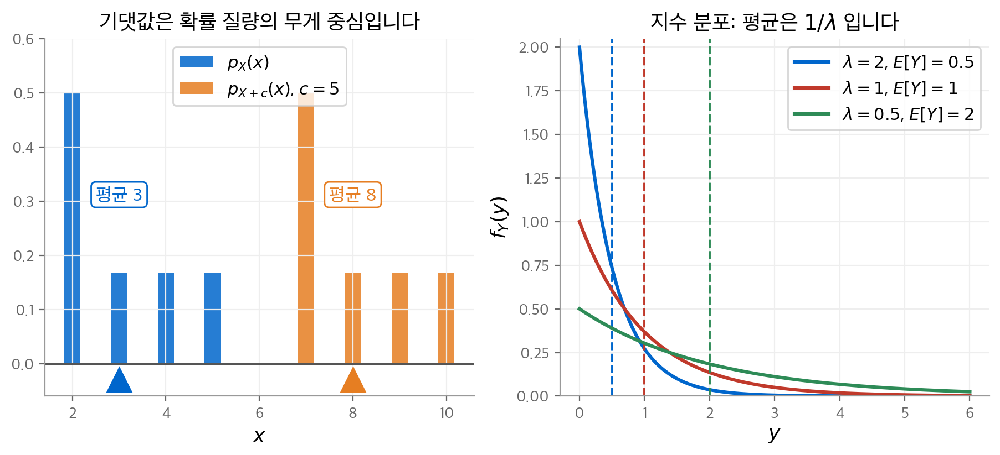
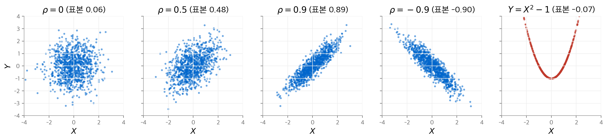
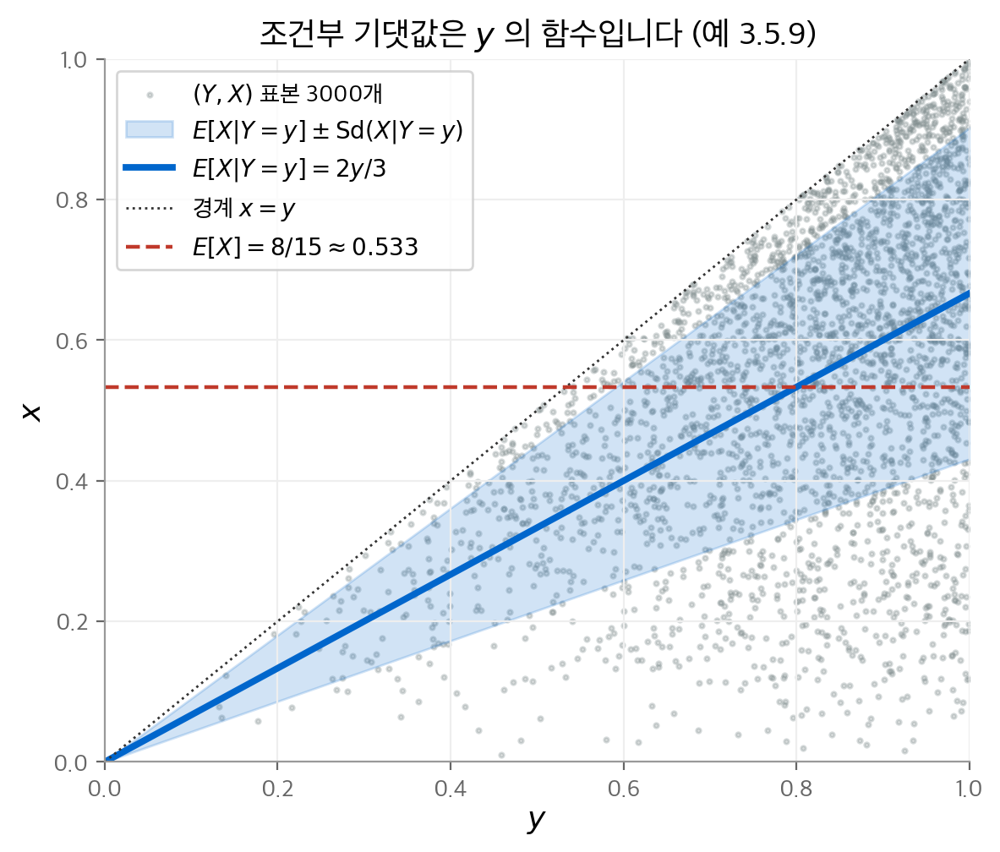
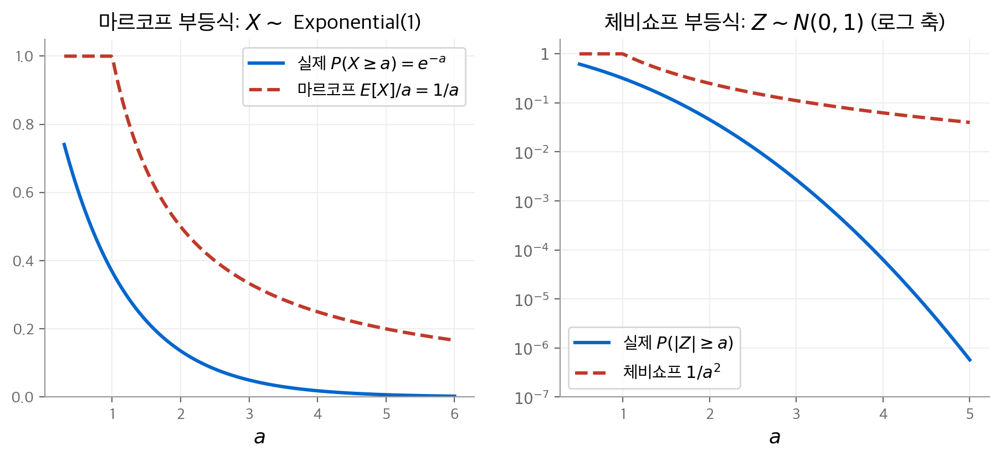
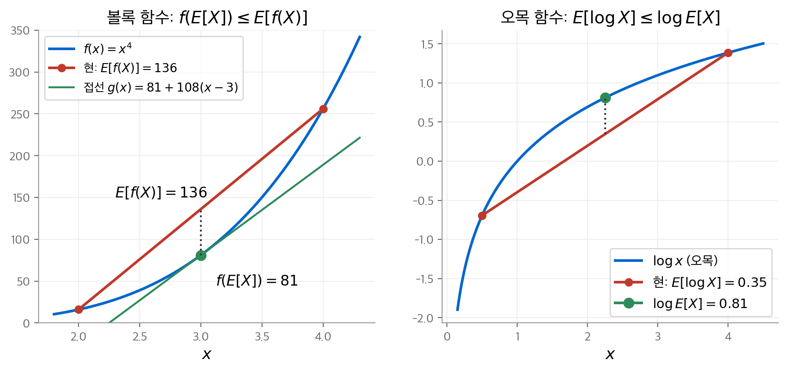

# 3. 기댓값

1장과 2장은 확률 모형, 확률 변수, 분포를 다뤘습니다. 이 장은 확률론의 마지막 기본 개념인 **기댓값**(expected value)을 다룹니다.
기댓값은 확률 변수가 평균적으로 갖는 값입니다. 예를 들어 절반의 확률로 $X = 0$ 이고 나머지 절반의 확률로 $X = 10$ 이면 $E(X) = 5$ 입니다.
이 장은 먼저 이산형과 연속형의 기댓값을 정의하고, 분산·공분산·상관계수로 분포의 퍼짐과 관계를 잽니다.
이어서 생성 함수로 적률을 계산하고, 조건부 기댓값과 주요 부등식을 정리합니다.
마지막으로 이산형과 연속형을 하나로 묶는 일반적 정의를 소개합니다.

!!! info "원문과 자료"

    - 교재: Michael J. Evans, Jeffrey S. Rosenthal, *Probability and Statistics: The Science of Uncertainty*, 2nd Edition, 3장 Expectation (p. 129–198)
    - PDF: [3장 시작 페이지](https://utstat.utoronto.ca/mikevans/jeffrosenthal/book.pdf#page=143)
    - 예시의 수치는 모두 SymPy와 NumPy로 다시 계산해서 검증했습니다.

## 3.1 이산형의 기댓값 (3.1절)

### 정의

$X$ 가 서로 다른 값 $x_1, x_2, \ldots$ 를 확률 $p_i = P(X = x_i)$ 로 갖는 이산형 확률 변수이면, 기댓값은 다음과 같습니다.

$$
E(X) = \sum_{x \in \mathbb{R}} x \, P(X = x) = \sum_i x_i \, p_i
$$

기댓값을 **평균**(mean)이라고도 부르고 $\mu_X$ 로 씁니다. 책의 예 3.1.3은 $P(Z = -3) = 0.2$, $P(Z = 11) = 0.7$, $P(Z = 31) = 0.1$ 인 경우입니다.

$$
E(Z) = (-3)(0.2) + (11)(0.7) + (31)(0.1) = -0.6 + 7.7 + 3.1 = 10.2
$$

기댓값은 확률 질량의 **무게 중심**입니다. 확률을 무게로 보고 수직선 위에 올려놓으면 $E(X)$ 에서 균형이 맞습니다.
분포를 $c$ 만큼 옮기면 무게 중심도 $c$ 만큼 옮겨 갑니다. 즉 $E(X + c) = E(X) + c$ 입니다.

<figure markdown>

<figcaption markdown>
<b>Figure 1.</b> 기댓값은 무게 중심입니다

기댓값은 분포의 무게 중심입니다. 분포를 5만큼 옮기면 평균도 3에서 8로 옮겨 갑니다.
</figcaption>
</figure>

### 주요 이산 분포의 기댓값

| 분포 | 확률 함수 | $E(X)$ | 책의 예 |
| --- | --- | --- | --- |
| 퇴화 분포 | $P(X = c) = 1$ | $c$ | 3.1.5 |
| Bernoulli($\theta$) | $P(X = 1) = \theta$, $P(X = 0) = 1 - \theta$ | $\theta$ | 3.1.6 |
| Binomial($n, \theta$) | $\binom{n}{k} \theta^k (1-\theta)^{n-k}$ | $n\theta$ | 3.1.7 |
| Geometric($\theta$) | $\theta (1-\theta)^k$, $k = 0, 1, 2, \ldots$ | $(1-\theta)/\theta$ | 3.1.8 |
| Poisson($\lambda$) | $e^{-\lambda} \lambda^k / k!$ | $\lambda$ | 3.1.9 |

예 3.1.6은 중요한 사실 하나를 줍니다. 사건 $A$ 의 **지시 함수**(indicator function) $I_A$ 는 Bernoulli($P(A)$) 를 따릅니다.
따라서 $E(I_A) = P(A)$ 입니다. **확률은 지시 함수의 기댓값입니다.**

### 기댓값이 무한대이거나 정의되지 않는 경우

모든 확률 변수가 유한한 기댓값을 갖지는 않습니다.

- **무한대(예 3.1.10)**: $P(X = 2^k) = 2^{-k}$ ($k = 1, 2, \ldots$)이면 $E(X) = \sum_k 2^k \cdot 2^{-k} = \sum_k 1 = \infty$ 입니다.
- **정의되지 않음(예 3.1.11)**: $P(Y = 2^k) = P(Y = -2^k) = 2^{-k-1}$ 이면 양의 부분과 음의 부분이 모두 $\infty$ 입니다. $\infty - \infty$ 는 정의되지 않으므로 $E(Y)$ 는 존재하지 않습니다.

### 상트페테르부르크 역설 (예 3.1.12, 3.1.13)

공정한 동전을 앞면이 나올 때까지 던집니다. 첫 앞면 전에 나온 뒷면의 수를 $Z$ 라고 하면, 상금은 $2^Z$ 센트입니다.
$P(Z = z) = 2^{-(z+1)}$ 이므로 기댓값은 다음과 같습니다.

$$
E(2^Z) = \sum_{z=0}^{\infty} 2^z \cdot 2^{-(z+1)} = \sum_{z=0}^{\infty} \frac{1}{2} = \infty
$$

"공정한 가격 = 기댓값"이라는 해석을 따르면, 이 게임에 얼마를 내도 이득입니다. 실제로는 누구도 큰돈을 내지 않습니다.
상금 상한을 $2^{30}$ 센트(약 1천만 달러)로 정하면 기댓값은 다음과 같습니다.

$$
E\big(2^{\min(30, Z)}\big) = \sum_{z=0}^{30} \frac{1}{2} + 2^{30} \sum_{z=31}^{\infty} 2^{-(z+1)} = 15.5 + 0.5 = 16
$$

상한 하나로 기댓값이 무한대에서 16센트로 떨어집니다.[^stp] 이 예는 기댓값이 꼬리 확률에 매우 민감하다는 점을 보여 줍니다.
효용 이론은 이 차이를 **효용 함수**(utility function) $U(x) = \min(x, 2^{30})$ 으로 설명합니다.

[^stp]: 책은 합을 $z = 1$ 부터 시작해서 15.5센트로 적었습니다. 예 3.1.12와 같이 $z = 0$ 부터 더하면 16센트입니다.

### 함수의 기댓값과 선형성

$g(X)$ 의 기댓값은 $g(X)$ 의 분포를 따로 구하지 않고 계산할 수 있습니다(정리 3.1.1).

$$
E\big(g(X)\big) = \sum_x g(x) \, P(X = x), \qquad
E\big(h(X, Y)\big) = \sum_{x, y} h(x, y) \, P(X = x, Y = y)
$$

이 식에서 기댓값의 핵심 성질이 나옵니다.

| 성질 | 식 | 조건 |
| --- | --- | --- |
| 선형성(정리 3.1.2) | $E(aX + bY) = a E(X) + b E(Y)$ | 항상 성립합니다. 독립성이 필요 없습니다. |
| 곱의 기댓값(정리 3.1.3) | $E(XY) = E(X) E(Y)$ | $X$ 와 $Y$ 가 독립일 때 성립합니다. |
| 단조성(정리 3.1.4) | $X \le Y$ 이면 $E(X) \le E(Y)$ | 항상 성립합니다. |

선형성은 계산을 크게 줄입니다. 예 3.1.15는 이항 분포를 Bernoulli 변수의 합 $Y = X_1 + \cdots + X_n$ 으로 씁니다.
그러면 이항 정리를 쓰지 않고도 $E(Y) = n\theta$ 를 바로 얻습니다.

곱의 성질은 독립이 아니면 성립하지 않을 수 있습니다. 예 3.1.16의 결합 확률 함수는 다음과 같습니다.

| $(x, y)$ | $(3, 5)$ | $(3, 9)$ | $(6, 5)$ | $(6, 9)$ |
| --- | --- | --- | --- | --- |
| $p_{X,Y}(x, y)$ | $1/2$ | $1/6$ | $1/6$ | $1/6$ |

$E(X) = 4$, $E(Y) = 19/3$ 이므로 $E(X)E(Y) = 76/3 \approx 25.33$ 입니다. 그러나 $E(XY) = 26$ 입니다.

## 3.2 연속형의 기댓값 (3.2절)

### 정의

$X$ 가 밀도 $f_X$ 를 갖는 절대 연속(absolutely continuous) 확률 변수이면, 기댓값은 다음과 같습니다.

$$
E(X) = \int_{-\infty}^{\infty} x \, f_X(x) \, dx
$$

이 정의는 이산형에서 나옵니다. 수직선을 폭 $\delta$ 인 구간으로 자르면 $E(X) \approx \sum_i i\delta \, P(i\delta < X \le (i+1)\delta)$ 입니다.
$\delta \to 0$ 이면 이 합이 위의 적분이 됩니다. 정리 3.2.1에 따라 $E(g(X)) = \int g(x) f_X(x)\,dx$ 이고, 선형성·독립일 때의 곱·단조성도 그대로 성립합니다.

### 주요 연속 분포의 기댓값

| 분포 | 밀도 | $E(X)$ | 책의 예 |
| --- | --- | --- | --- |
| Uniform$[L, R]$ | $1/(R-L)$, $L \le x \le R$ | $(L+R)/2$ | 3.2.2 |
| Exponential($\lambda$) | $\lambda e^{-\lambda y}$, $y \ge 0$ | $1/\lambda$ | 3.2.3 |
| $N(0, 1)$ | $\phi(z) = \frac{1}{\sqrt{2\pi}} e^{-z^2/2}$ | $0$ | 3.2.4 |
| $N(\mu, \sigma^2)$ | $X = \mu + \sigma Z$ | $\mu$ | 3.2.7 |

지수 분포의 평균은 부분 적분으로 구합니다($u = y$, $dv = \lambda e^{-\lambda y} dy$).

$$
E(Y) = \int_0^\infty y \lambda e^{-\lambda y} dy = \big[-y e^{-\lambda y}\big]_0^\infty + \int_0^\infty e^{-\lambda y} dy = 0 + \frac{1}{\lambda}
$$

표준 정규 분포는 밀도가 0을 중심으로 대칭입니다. 따라서 양의 부분과 음의 부분이 상쇄되어 $E(Z) = 0$ 입니다.
$N(\mu, \sigma^2)$ 은 $X = \mu + \sigma Z$ 로 쓸 수 있고, 선형성으로 $E(X) = \mu$ 를 얻습니다.

연속형에서도 기댓값이 무한대이거나 정의되지 않을 수 있습니다. 밀도 $f_X(x) = 1/x^2$ ($x \ge 1$)이면 $E(X) = \int_1^\infty (1/x)\,dx = \infty$ 입니다(예 3.2.5).

## 3.3 분산, 공분산, 상관계수 (3.3절)

### 분산과 표준 편차

기댓값은 분포의 위치를 알려 줍니다. 그러나 $X$ 가 평균에서 얼마나 떨어져 있는지는 알려 주지 않습니다.
**분산**(variance)은 평균에서 떨어진 거리의 제곱을 평균한 값입니다.

$$
\sigma_X^2 = \mathrm{Var}(X) = E\big((X - \mu_X)^2\big), \qquad \mathrm{Sd}(X) = \sqrt{\mathrm{Var}(X)}
$$

**표준 편차**(standard deviation) $\mathrm{Sd}(X)$ 는 $X$ 와 단위가 같습니다. 예 3.3.1의 두 변수를 비교합니다.

- $P(X = 10) = 1$ 이면 $\mathrm{Var}(X) = 0$ 입니다.
- $P(Y = 5) = P(Y = 15) = 1/2$ 이면 $\mathrm{Var}(Y) = (25 + 25)/2 = 25$ 입니다.

두 변수의 평균은 모두 10입니다. 그러나 $Y$ 가 훨씬 더 흩어져 있습니다.

정리 3.3.1은 분산의 기본 성질을 정리합니다.

| 성질 | 식 |
| --- | --- |
| 비음성 | $\mathrm{Var}(X) \ge 0$ |
| 척도 변환 | $\mathrm{Var}(aX + b) = a^2 \, \mathrm{Var}(X)$, $\mathrm{Sd}(aX + b) = \lvert a \rvert \, \mathrm{Sd}(X)$ |
| 계산 공식 | $\mathrm{Var}(X) = E(X^2) - (E(X))^2$ |

계산 공식은 대개 정의보다 간단합니다. 지수 분포는 부분 적분으로 $E(W^2) = 2/\lambda^2$ 를 얻습니다(예 3.3.4).
따라서 $\mathrm{Var}(W) = 2/\lambda^2 - 1/\lambda^2 = 1/\lambda^2$ 입니다. 정규 분포 $N(\mu, \sigma^2)$ 의 분산은 $\sigma^2$ 입니다(예 3.3.7).

### 공분산

**공분산**(covariance)은 두 변수가 평균에서 함께 벗어나는 정도를 잽니다.

$$
\mathrm{Cov}(X, Y) = E\big((X - \mu_X)(Y - \mu_Y)\big) = E(XY) - E(X) E(Y)
$$

예 3.3.8의 결합 확률 함수는 $p(3, 4) = 1/2$, $p(3, 6) = 1/3$, $p(5, 6) = 1/6$ 입니다.
$E(X) = 10/3$, $E(Y) = 5$ 이고, 정의대로 계산하면 다음과 같습니다.

$$
\mathrm{Cov}(X, Y) = \left(3 - \tfrac{10}{3}\right)(4 - 5)\tfrac{1}{2} + \left(3 - \tfrac{10}{3}\right)(6 - 5)\tfrac{1}{3} + \left(5 - \tfrac{10}{3}\right)(6 - 5)\tfrac{1}{6} = \frac{1}{3}
$$

공분산은 두 인자에 대해 각각 선형입니다(정리 3.3.2). 또 독립이면 $E(XY) = E(X)E(Y)$ 이므로 $\mathrm{Cov}(X, Y) = 0$ 입니다.
**그 역은 성립하지 않습니다.** 예 3.3.10은 네 점 $(3, 5), (4, 9), (7, 5), (6, 9)$ 에 확률 $1/4$ 씩을 줍니다.
$E(XY) = 35 = 5 \cdot 7 = E(X)E(Y)$ 이므로 공분산은 0입니다.
그러나 $P(X = 4) > 0$, $P(Y = 5) > 0$ 인데 $P(X = 4, Y = 5) = 0$ 이므로 두 변수는 독립이 아닙니다.

### 합의 분산

정리 3.3.4는 합의 분산을 분산과 공분산으로 나눕니다.

$$
\mathrm{Var}\Big(\sum_i X_i\Big) = \sum_i \mathrm{Var}(X_i) + 2 \sum_{i < j} \mathrm{Cov}(X_i, X_j)
$$

변수들이 독립이면 공분산 항이 사라지고 분산이 그대로 더해집니다. 예 3.3.11은 이 결과를 이항 분포에 적용합니다.
$Y = X_1 + \cdots + X_n$ 이고 각 $X_i$ 의 분산이 $\theta(1 - \theta)$ 이므로 $\mathrm{Var}(Y) = n\theta(1-\theta)$ 입니다.

### 상관계수

공분산은 단위에 따라 값이 바뀝니다. **상관계수**(correlation)는 공분산을 두 표준 편차로 나눠 단위를 없앤 값입니다.

$$
\mathrm{Corr}(X, Y) = \frac{\mathrm{Cov}(X, Y)}{\mathrm{Sd}(X)\,\mathrm{Sd}(Y)}
$$

예 3.3.12에서 $Y = 3X$ 이면 $\mathrm{Corr}(X, Y) = 1$ 이고, $Z = -4X$ 이면 $\mathrm{Corr}(X, Z) = -1$ 입니다. 배율 3과 $-4$ 는 사라지고 부호만 남습니다.
3.6절의 코시-슈바르츠 부등식에 따라 상관계수는 항상 $[-1, 1]$ 에 있습니다.
상관계수는 **선형 관계**의 강도를 잽니다. 이변량 정규 분포에서는 모수 $\rho$ 가 곧 상관계수입니다(예 3.3.13).

<figure markdown>

<figcaption markdown>
<b>Figure 2.</b> 상관계수에 따른 산점도

$\lvert\rho\rvert$ 가 클수록 점이 직선 주위로 모입니다. $Y = X^2 - 1$ 은 상관계수가 0이지만 독립이 아닙니다.
</figcaption>
</figure>

## 3.4 생성 함수 (3.4절)

### 확률 생성 함수

음이 아닌 정수 값을 갖는 $X$ 의 **확률 생성 함수**(probability-generating function, PGF)는 $r_X(t) = E(t^X)$ 입니다.

$$
r_X(t) = \sum_{k=0}^{\infty} P(X = k)\, t^k
$$

$r_X$ 는 확률을 계수로 갖는 멱급수입니다. 따라서 $k$ 번 미분해서 $t = 0$ 을 넣으면 확률이 나옵니다(정리 3.4.1).

$$
r_X^{(k)}(0) = k! \, P(X = k)
$$

이항 분포의 PGF는 $(\theta t + 1 - \theta)^n$ 이고, 포아송 분포의 PGF는 $e^{\lambda(t - 1)}$ 입니다(예 3.4.1, 3.4.2).
포아송의 경우 $r_X(0) = e^{-\lambda}$, $r_X'(0) = \lambda e^{-\lambda}$, $r_X''(0) = \lambda^2 e^{-\lambda} = 2! \, P(X = 2)$ 입니다.

### 적률과 적률 생성 함수

$E(X^k)$ 를 $X$ 의 $k$ 차 **적률**(moment)이라고 부릅니다. 1차 적률은 평균이고, 2차 적률은 평균과 함께 분산을 결정합니다.
**적률 생성 함수**(moment-generating function, MGF)는 $m_X(s) = E(e^{sX})$ 입니다. 정의를 비교하면 $m_X(s) = r_X(e^s)$ 입니다(정리 3.4.2).

0 근처의 열린 구간에서 $m_X$ 가 유한하면, $k$ 번 미분한 값이 $k$ 차 적률입니다(정리 3.4.3).

$$
m_X^{(k)}(0) = E(X^k)
$$

예 3.4.8은 지수 분포의 MGF $m_X(s) = \lambda/(\lambda - s)$ ($s < \lambda$)로 평균과 분산을 구합니다.

$$
m_X'(0) = \frac{\lambda}{(\lambda - s)^2}\bigg|_{s=0} = \frac{1}{\lambda}, \qquad
m_X''(0) = \frac{2\lambda}{(\lambda - s)^3}\bigg|_{s=0} = \frac{2}{\lambda^2}, \qquad
\mathrm{Var}(X) = \frac{2}{\lambda^2} - \frac{1}{\lambda^2} = \frac{1}{\lambda^2}
$$

표준 정규 분포의 MGF는 지수에서 제곱을 완성해서 구합니다(정리 3.4.4).

$$
m_Z(s) = \int \frac{1}{\sqrt{2\pi}} e^{sz - z^2/2} dz = e^{s^2/2} \int \frac{1}{\sqrt{2\pi}} e^{-(z-s)^2/2} dz = e^{s^2/2}
$$

### 독립인 변수의 합과 유일성

생성 함수의 가장 유용한 성질은 **독립인 변수의 합을 곱으로 바꾼다**는 점입니다(정리 3.4.5).

$$
r_{X+Y}(t) = r_X(t)\, r_Y(t), \qquad m_{X+Y}(s) = m_X(s)\, m_Y(s)
$$

또 0 근처에서 MGF가 같으면 두 분포는 같습니다(정리 3.4.6, 유일성 정리). 두 성질을 합치면 합의 분포를 구할 수 있습니다.
예 3.4.11은 독립인 $X_i \sim N(\mu_i, \sigma_i^2)$ 의 합을 다룹니다.

$$
m_Y(s) = \prod_{i=1}^n \exp\!\Big(\mu_i s + \frac{\sigma_i^2 s^2}{2}\Big) = \exp\!\Big(s\sum_i \mu_i + \frac{s^2}{2}\sum_i \sigma_i^2\Big)
\quad\Rightarrow\quad Y \sim N\Big(\sum_i \mu_i, \sum_i \sigma_i^2\Big)
$$

**복합 분포**(compound distribution)는 개수 $N$ 도 확률 변수인 합 $S = X_1 + \cdots + X_N$ 의 분포입니다. 보험의 총 청구액이 대표적인 예입니다.
정리 3.4.7에 따라 $E(S) = E(X_1)E(N)$ 이고, $m_S(s) = r_N(m_{X_1}(s))$ 입니다.

### 특성 함수 (3.4.1절, 고급)

MGF는 0 근처에서 무한대일 수 있습니다. 예 3.4.12의 밀도 $1/x^2$ ($x \ge 1$)은 모든 $s > 0$ 에서 $m_X(s) = \infty$ 입니다.
**특성 함수**(characteristic function) $c_X(s) = E(e^{isX})$ 는 이 문제가 없습니다. $\lvert e^{isX} \rvert = 1$ 이므로 모든 $s$ 에서 유한합니다.
특성 함수도 $c_X^{(k)}(0) = i^k E(X^k)$ 와 $c_{X+Y} = c_X c_Y$ (독립일 때)를 만족합니다.

## 3.5 조건부 기댓값 (3.5절)

### 사건과 이산 변수에 대한 조건부 기댓값

조건을 걸면 확률이 바뀌므로 기댓값도 바뀝니다. $P(A) > 0$ 인 사건 $A$ 에 대한 **조건부 기댓값**(conditional expectation)은 다음과 같습니다.

$$
E(X \mid A) = \sum_x x \, P(X = x \mid A) = \sum_x x \, \frac{P(X = x, A)}{P(A)}
$$

예 3.5.1은 공정한 주사위에서 $A = \{3, 5, 6\}$ 을 조건으로 겁니다. 세 값의 조건부 확률이 각각 $1/3$ 이므로 $E(X \mid A) = 14/3$ 입니다.

예 3.5.2의 결합 확률 함수는 다음과 같습니다.

| $(x, y)$ | $(5, 0)$ | $(5, 3)$ | $(5, 4)$ | $(8, 0)$ | $(8, 4)$ |
| --- | --- | --- | --- | --- | --- |
| $p_{X,Y}(x, y)$ | $1/7$ | $1/7$ | $1/7$ | $3/7$ | $1/7$ |

$Y = 0$ 을 조건으로 걸면 $P(Y = 0) = 4/7$ 이므로 다음을 얻습니다.

$$
E(X \mid Y = 0) = 5 \cdot \frac{1/7}{4/7} + 8 \cdot \frac{3/7}{4/7} = \frac{5}{4} + 6 = \frac{29}{4}
$$

같은 방법으로 $E(X \mid Y = 3) = 5$, $E(X \mid Y = 4) = 13/2$ 입니다.

### 확률 변수로서의 $E(X \mid Y)$

$Y$ 의 값을 미리 정하지 않으면, $E(X \mid Y)$ 는 $Y$ 의 값에 따라 정해지는 **확률 변수**입니다(정의 3.5.3).
예 3.5.3에서 $E(X \mid Y)$ 는 $Y = 0, 3, 4$ 일 때 각각 $29/4, 5, 13/2$ 입니다.

연속형에서는 조건부 밀도 $f_{X \mid Y}(x \mid y) = f_{X,Y}(x, y)/f_Y(y)$ 를 씁니다.

$$
E(X \mid Y = y) = \int x \, f_{X \mid Y}(x \mid y)\, dx
$$

예 3.5.4의 결합 밀도는 $f_{X,Y}(x, y) = 4x^2 y + 2y^5$ ($0 \le x, y \le 1$)입니다. 주변 밀도는 $f_Y(y) = 4y/3 + 2y^5$ 입니다.

$$
E(X \mid Y = y) = \frac{\int_0^1 x(4x^2 y + 2y^5)\,dx}{4y/3 + 2y^5} = \frac{y + y^5}{4y/3 + 2y^5} = \frac{1 + y^4}{4/3 + 2y^4}
$$

### 이중 기댓값

$E(X \mid Y)$ 는 확률 변수이므로 다시 기댓값을 취할 수 있습니다. 그 결과는 항상 $E(X)$ 입니다(정리 3.5.2, **전체 기댓값 정리**).

$$
E\big(E(X \mid Y)\big) = E(X)
$$

조건을 걸면 $X$ 의 평균이 $Y$ 에 따라 커지거나 작아집니다. $Y$ 에 대해 다시 평균하면 그 효과가 상쇄됩니다.
예 3.5.6에서 $P(Y = 0) = 4/7$, $P(Y = 3) = 1/7$, $P(Y = 4) = 2/7$ 입니다.

$$
E\big(E(X \mid Y)\big) = \frac{29}{4} \cdot \frac{4}{7} + 5 \cdot \frac{1}{7} + \frac{13}{2} \cdot \frac{2}{7} = \frac{47}{7} = 5 \cdot \frac{3}{7} + 8 \cdot \frac{4}{7} = E(X)
$$

예 3.5.7은 연속형 예 3.5.4에서 같은 사실을 확인합니다. 두 방법 모두 $E(X) = 2/3$ 입니다.

조건부 기댓값의 나머지 성질은 다음과 같습니다.

| 성질 | 식 | 정리 |
| --- | --- | --- |
| 선형성 | $E(aX_1 + bX_2 \mid Y) = aE(X_1 \mid Y) + bE(X_2 \mid Y)$ | 3.5.1 |
| 특성화 | $E\big(g(Y)\,E(X \mid Y)\big) = E\big(g(Y)\,X\big)$ | 3.5.3 |
| 알려진 인자 빼내기 | $E\big(g(Y)X \mid Y\big) = g(Y)\,E(X \mid Y)$ | 3.5.4 |
| 두 번 조건 걸기 | $E\big(E(X \mid Y) \mid Y\big) = E(X \mid Y)$ | 3.5.5 |

### 조건부 분산 (3.5.4절, 고급)

**조건부 분산**(conditional variance)은 조건부 평균을 중심으로 잰 분산입니다.

$$
\mathrm{Var}(X \mid Y) = E\big((X - E(X \mid Y))^2 \mid Y\big) = E(X^2 \mid Y) - \big(E(X \mid Y)\big)^2
$$

예 3.5.8에서 주사위의 무조건 분산은 $\mathrm{Var}(X) = 35/12 \approx 2.92$ 입니다. $A = \{3, 5, 6\}$ 을 조건으로 걸면 $\mathrm{Var}(X \mid A) = 14/9 \approx 1.56$ 입니다.
$A$ 가 일어났다는 정보가 $X$ 의 불확실성을 줄입니다.

예 3.5.9의 결합 밀도는 $f_{X,Y}(x, y) = 8xy$ ($0 \le x \le y \le 1$)입니다. $f_{X \mid Y}(x \mid y) = 2x/y^2$ 이므로 다음을 얻습니다.

$$
E(X \mid Y = y) = \int_0^y x \cdot \frac{2x}{y^2} dx = \frac{2y}{3}, \qquad
\mathrm{Var}(X \mid Y = y) = \int_0^y \Big(x - \frac{2y}{3}\Big)^2 \frac{2x}{y^2} dx = \frac{y^2}{18}
$$

정리 3.5.6은 분산을 두 부분으로 나눕니다(**전체 분산 법칙**).

$$
\mathrm{Var}(X) = \underbrace{\mathrm{Var}\big(E(X \mid Y)\big)}_{\text{조건부 평균의 흔들림}} + \underbrace{E\big(\mathrm{Var}(X \mid Y)\big)}_{\text{남은 흔들림의 평균}}
$$

예 3.5.9에서 직접 확인합니다. $f_Y(y) = 4y^3$ 이므로 $\mathrm{Var}(2Y/3) = 8/675$ 이고 $E(Y^2/18) = 1/27$ 입니다.
두 값의 합은 $8/675 + 25/675 = 11/225$ 이고, 결합 밀도로 직접 구한 $\mathrm{Var}(X)$ 와 같습니다.

<figure markdown>

<figcaption markdown>
<b>Figure 3.</b> 조건부 기댓값과 조건부 표준 편차

파란 직선이 $E(X \mid Y = y) = 2y/3$ 입니다. 이를 $Y$ 의 분포로 평균하면 $E(X) = 8/15$ 입니다.
</figcaption>
</figure>

## 3.6 부등식 (3.6절)

### 마르코프 부등식과 체비쇼프 부등식

기댓값과 분산만 알아도 꼬리 확률의 상한을 구할 수 있습니다. $X \ge 0$ 이면 모든 $a > 0$ 에서 **마르코프 부등식**(Markov's inequality)이 성립합니다(정리 3.6.1).

$$
P(X \ge a) \le \frac{E(X)}{a}
$$

증명은 짧습니다. $Z = a \cdot I_{\{X \ge a\}}$ 로 두면 $Z \le X$ 입니다. 단조성에 따라 $E(X) \ge E(Z) = a P(X \ge a)$ 입니다.

마르코프 부등식을 $(Y - \mu_Y)^2$ 에 적용하면 **체비쇼프 부등식**(Chebychev's inequality)을 얻습니다(정리 3.6.2).

$$
P(\lvert Y - \mu_Y \rvert \ge a) \le \frac{\mathrm{Var}(Y)}{a^2}
$$

책의 예로 두 상한의 정확도를 확인합니다.

| 책의 예 | 상황 | 상한 | 실제 확률 |
| --- | --- | --- | --- |
| 3.6.1 | $P(X=3) = 1/2$, $P(X=4) = 1/3$, $P(X=7) = 1/6$ 에서 $P(X \ge 6)$ | 마르코프 $4/6 = 2/3$ | $1/6$ |
| 3.6.3 | $P(X=0) = P(X=2) = 1/2$ 에서 $P(X \ge 2)$ | 마르코프 $1/2$ | $1/2$ (등호) |
| 3.6.4 | 예 3.6.1의 $X$ ($\mathrm{Var}(X) = 2$)에서 $P(\lvert X - 4 \rvert \ge 3)$ | 체비쇼프 $2/9$ | $1/6$ |
| 3.6.5 | $X \sim$ Exponential(3)에서 $P(\lvert X - 1/3 \rvert \ge 1/2)$ | 체비쇼프 $4/9$, 마르코프 $2/5$ | $e^{-5/2} \approx 0.082$ |

예 3.6.5에서는 마르코프 부등식이 체비쇼프 부등식보다 더 좋은 상한을 줍니다. $X \ge 0$ 이므로 이 사건은 $X \ge 5/6$ 과 같기 때문입니다.
두 부등식은 분포를 거의 가정하지 않습니다. 대신 상한이 실제 확률보다 훨씬 클 수 있습니다.

<figure markdown>

<figcaption markdown>
<b>Figure 4.</b> 마르코프와 체비쇼프 상한

두 상한 모두 실제 꼬리 확률보다 훨씬 큽니다. 예를 들어 $a = 3$ 에서 실제 0.050, 마르코프 상한 0.333입니다.
</figcaption>
</figure>

### 코시-슈바르츠 부등식

분산이 유한하고 0이 아닌 두 변수에서 다음이 성립합니다(정리 3.6.3).

$$
\lvert \mathrm{Cov}(X, Y) \rvert \le \sqrt{\mathrm{Var}(X)\,\mathrm{Var}(Y)}
$$

양변을 $\mathrm{Sd}(X)\mathrm{Sd}(Y)$ 로 나누면 $\lvert \mathrm{Corr}(X, Y) \rvert \le 1$ 입니다(따름정리 3.6.1).
등호는 $X - \mu_X = \frac{\mathrm{Cov}(X, Y)}{\mathrm{Var}(Y)} (Y - \mu_Y)$, 즉 두 변수가 정확히 직선 관계일 때만 성립합니다.
상관계수가 1이면 기울기가 양수이고, $-1$ 이면 기울기가 음수입니다.

### 젠센 부등식 (3.6.1절, 고급)

함수 $f$ 가 **볼록**(convex)이면 두 점을 잇는 현이 그래프보다 위에 있습니다.
$E(f(X))$ 가 유한하면 **젠센 부등식**(Jensen's inequality)이 성립합니다(정리 3.6.4).

$$
f\big(E(X)\big) \le E\big(f(X)\big)
$$

증명은 접선 하나로 끝납니다. $E(X)$ 에서 그은 직선 $g(x) = ax + b$ 는 볼록 함수 $f$ 보다 항상 아래에 있습니다.
따라서 $E(f(X)) \ge E(g(X)) = g(E(X)) = f(E(X))$ 입니다. 등호는 $f(X)$ 가 확률 1로 $X$ 의 일차 함수일 때만 성립합니다.

$f(x) = x^2$ 이면 $E(X^2) \ge (E(X))^2$ 이고, 이는 $\mathrm{Var}(X) \ge 0$ 과 같습니다(예 3.6.9).
$f$ 가 **오목**(concave)이면 부등호 방향이 바뀝니다. 예를 들어 $E(\log X) \le \log E(X)$ 입니다.

<figure markdown>

<figcaption markdown>
<b>Figure 5.</b> 젠센 부등식

볼록 함수에서는 $E(X^4) = 136 \ge (E(X))^4 = 81$ 입니다. 오목 함수 $\log x$ 에서는 부등호가 반대입니다.
</figcaption>
</figure>

## 3.7 일반적인 기댓값 (3.7절, 고급)

어떤 확률 변수는 이산형도 연속형도 아닙니다. 이산 분포와 연속 분포의 혼합이 그 예입니다.
책은 측도론 없이 모든 확률 변수에 쓸 수 있는 정의를 줍니다(정의 3.7.1).

$$
E(X) = \int_0^\infty P(X > t)\, dt - \int_{-\infty}^0 P(X < t)\, dt
$$

두 적분 중 적어도 하나가 유한해야 합니다. 정리 3.7.1은 이 정의가 이산형의 합, 연속형의 적분과 같은 값을 준다고 말합니다.
증명의 핵심은 적분과 합의 순서를 바꾸는 것입니다. 예를 들어 $X \ge 0$ 인 이산형에서는 다음과 같습니다.

$$
\int_0^\infty P(X > t)\, dt = \int_0^\infty \sum_{i:\, x_i > t} p_i \, dt = \sum_i p_i \int_0^{x_i} dt = \sum_i p_i x_i
$$

이 정의에서도 선형성, 독립일 때의 곱, 단조성이 그대로 성립합니다(정리 3.7.2).
또 누적 분포 함수가 $F_X = \sum_i p_i F_i$ 인 혼합 분포의 기댓값은 $E(X) = \sum_i p_i E(Y_i)$ 입니다(정리 3.7.3).

## 딥러닝에서의 쓰임

| 개념 | 절 | 딥러닝에서 쓰이는 곳 |
| --- | --- | --- |
| 기댓값의 선형성 | 3.1 | 미니배치 손실의 평균이 전체 손실의 불편 추정량이 되는 근거입니다. 확률적 경사 하강법의 기울기도 같은 논리로 불편합니다. |
| $E(I_A) = P(A)$ | 3.1 | 정확도는 "정답 여부" 지시 함수의 평균입니다. |
| 합의 분산 | 3.3 | 독립 표본 $B$ 개의 평균은 분산이 $1/B$ 로 줄어듭니다. 배치 크기와 기울기 잡음의 관계가 여기서 나옵니다. |
| 분산의 척도 변환 | 3.3 | 가중치 초기화(Xavier, He)는 $\mathrm{Var}(\sum_i w_i x_i) = n\,\mathrm{Var}(w)\mathrm{Var}(x)$ 를 일정하게 맞추는 규칙입니다. |
| 상관계수 0 ≠ 독립 | 3.3 | 표현의 무상관화(화이트닝)만으로는 특징이 독립이 되지 않습니다. |
| 조건부 기댓값 | 3.5 | 제곱 오차를 최소화하는 예측기는 $E(Y \mid X)$ 입니다. 회귀 모델이 근사하는 대상이 이 함수입니다. |
| 전체 분산 법칙 | 3.5 | 예측 불확실성을 "모델이 설명하는 부분"과 "남은 잡음"으로 나눕니다. 편향-분산 분해와 같은 구조입니다. |
| 마르코프·체비쇼프 | 3.6 | 일반화 오차 상한과 집중 부등식의 출발점입니다. |
| 젠센 부등식 | 3.6 | $\log p(x) = \log E_q\big(p(x, z)/q(z)\big) \ge E_q\big(\log p(x, z) - \log q(z)\big)$ 가 VAE의 ELBO입니다. 같은 부등식으로 KL 발산이 0 이상임을 보입니다. |

KL 발산의 비음성은 젠센 부등식을 오목 함수 $\log$ 에 적용해서 얻습니다.

$$
-D_{\mathrm{KL}}(p \parallel q) = E_p\Big(\log \frac{q(X)}{p(X)}\Big) \le \log E_p\Big(\frac{q(X)}{p(X)}\Big) = \log \sum_x q(x) = 0
$$

## 정리

| 개념 | 핵심 |
| --- | --- |
| 기댓값 | $E(X) = \sum_x x\,p_X(x)$ 또는 $\int x f_X(x)\,dx$ 입니다. 분포의 무게 중심이고, 무한대이거나 정의되지 않을 수 있습니다. |
| 선형성 | $E(aX + bY) = aE(X) + bE(Y)$ 는 독립성 없이 항상 성립합니다. |
| 곱 | 독립이면 $E(XY) = E(X)E(Y)$ 입니다. 독립이 아니면 성립하지 않을 수 있습니다. |
| 분산 | $\mathrm{Var}(X) = E(X^2) - (E(X))^2$, $\mathrm{Var}(aX + b) = a^2 \mathrm{Var}(X)$ 입니다. |
| 공분산과 상관계수 | 독립이면 공분산이 0입니다. 역은 성립하지 않습니다. $\lvert\mathrm{Corr}\rvert \le 1$ 이고, 등호는 직선 관계일 때만 성립합니다. |
| 생성 함수 | $r_X^{(k)}(0) = k!\,P(X = k)$, $m_X^{(k)}(0) = E(X^k)$ 입니다. 독립인 합을 곱으로 바꾸고, 분포를 유일하게 결정합니다. |
| 조건부 기댓값 | $E(X \mid Y)$ 는 $Y$ 의 함수인 확률 변수이고, $E(E(X \mid Y)) = E(X)$ 입니다. |
| 전체 분산 법칙 | $\mathrm{Var}(X) = \mathrm{Var}(E(X \mid Y)) + E(\mathrm{Var}(X \mid Y))$ 입니다. |
| 부등식 | 마르코프 $E(X)/a$, 체비쇼프 $\mathrm{Var}(Y)/a^2$, 볼록 함수의 젠센 $f(E(X)) \le E(f(X))$ 입니다. |
| 일반적 정의 | $E(X) = \int_0^\infty P(X > t)\,dt - \int_{-\infty}^0 P(X < t)\,dt$ 는 모든 확률 변수에 쓸 수 있습니다. |

## 다음 장

기댓값과 분산을 정의하고 계산하는 도구가 갖춰졌습니다. [다음 장](04-sampling-limits.md)에서는 표본 평균의 분포를 다룹니다.
또 이 장의 체비쇼프 부등식으로 큰 수의 법칙을 증명하고, 중심 극한 정리를 다룹니다.
