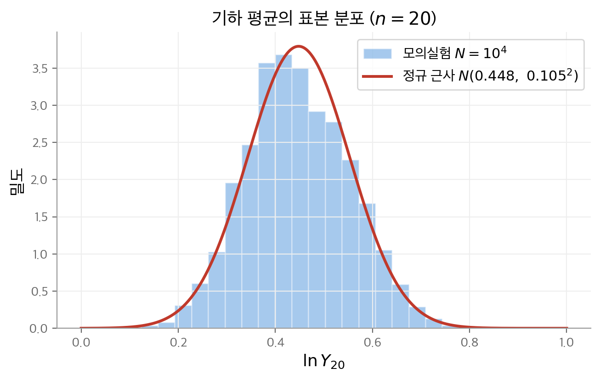
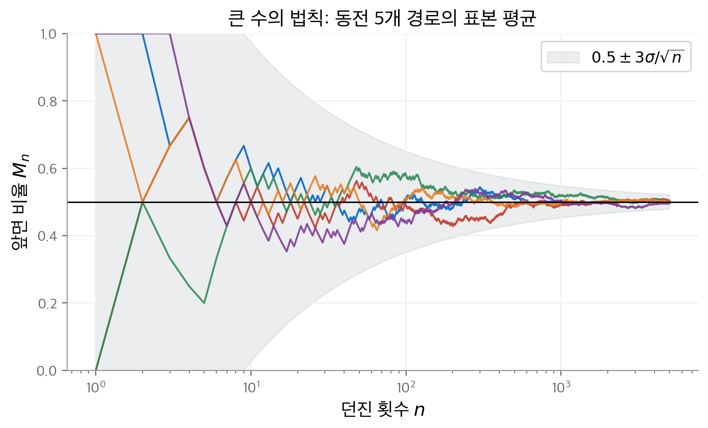
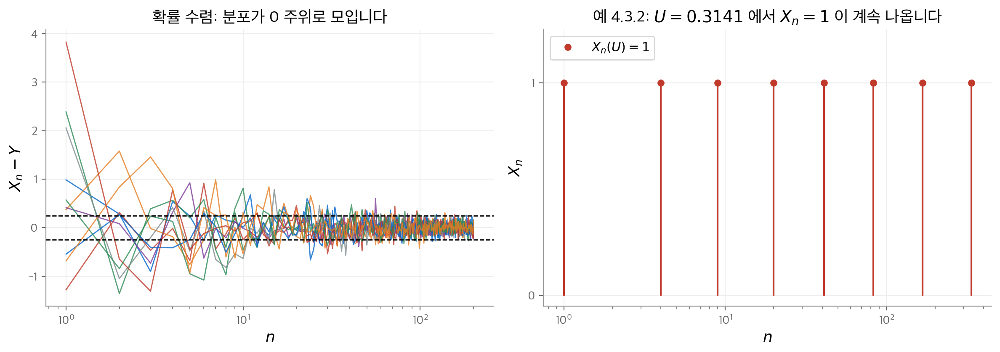
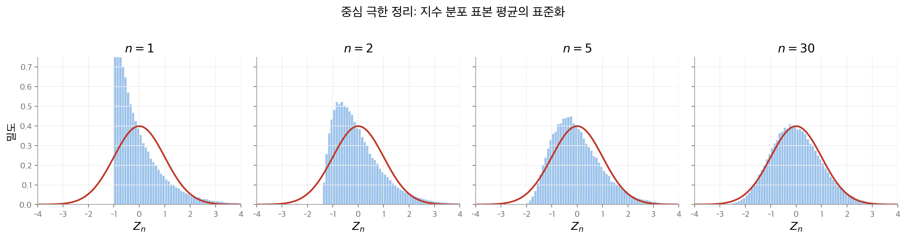
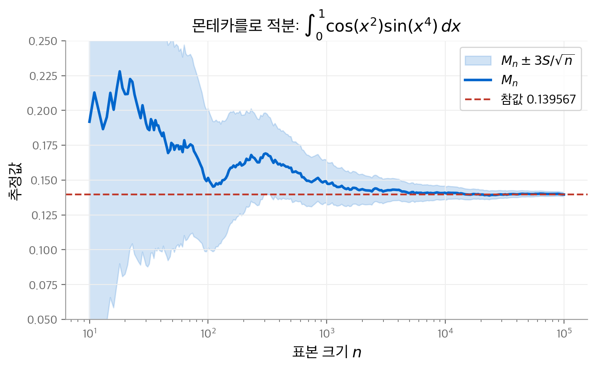
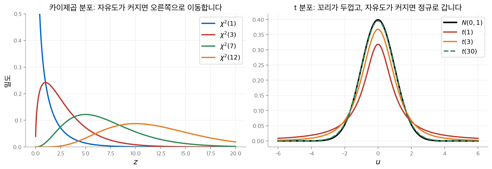

# 4. 표본 분포와 극한

통계와 기계 학습은 대부분 **표본에서 계산한 값**을 다룹니다. 표본 평균, 표본 분산, 미니배치 손실이 모두 그렇습니다.
이 장은 그런 값의 분포를 구하는 방법을 다룹니다. 정확한 분포를 구할 수 없을 때가 많으므로, 세 가지 길을 정리합니다.

1. 표본 크기 $n$ 이 커질 때의 **극한 분포**로 근사합니다(큰 수의 법칙, 중심 극한 정리).
2. 컴퓨터로 표본을 많이 만들어 **몬테카를로**(Monte Carlo)로 근사합니다.
3. 정규 분포에서 나온 표본이면 **정확한 분포**를 씁니다(카이제곱, t, F 분포).

수렴의 종류도 세 가지가 나옵니다. 확률 수렴, 확률 1 수렴, 분포 수렴입니다.
세 수렴의 강도 차이를 예제로 확인하는 것이 이 장의 또 다른 목표입니다.

!!! info "원문과 자료"
    - 교재: Evans & Rosenthal, *Probability and Statistics: The Science of Uncertainty*, 2nd Edition, 4장 Sampling Distributions and Limits (p. 199–252)
    - PDF: [4장 시작 페이지](https://utstat.utoronto.ca/mikevans/jeffrosenthal/book.pdf#page=213)
    - 이 장의 수치는 모두 NumPy와 SciPy로 다시 계산했습니다. 모의실험 값은 난수 시드에 따라 조금 달라집니다.

## 4.1 표본 분포 (4.1절)

$X_1, \dots, X_n$ 이 같은 분포에서 독립으로 뽑은 표본이라고 합니다. 이런 수열을 **i.i.d.**(independent and identically distributed) 수열이라고 부릅니다.
표본의 함수 $Y = h(X_1, \dots, X_n)$ 의 분포를 **표본 분포**(sampling distribution)라고 부릅니다.

원리상으로는 $P(Y \in B) = P\big((X_1, \dots, X_n) \in h^{-1}(B)\big)$ 를 계산하면 됩니다.
그러나 $h^{-1}(B)$ 에 속하는 표본을 모두 세는 일은 대개 불가능합니다.

### 예: 기하 평균의 분포 (예 4.1.1)

$X$ 의 확률 함수가 $p_X(1) = 1/2$, $p_X(2) = 1/4$, $p_X(3) = 1/4$ 이라고 합니다.
표본 기하 평균 $Y_n = (X_1 \cdots X_n)^{1/n}$ 의 분포를 구합니다. $n = 2$ 이면 가능한 표본이 $3^2 = 9$ 개뿐이므로 직접 셀 수 있습니다.

| $y$ | 표본 | $p_{Y_2}(y)$ |
| --- | --- | --- |
| $1$ | $(1,1)$ | $1/4$ |
| $\sqrt{2}$ | $(1,2), (2,1)$ | $1/4$ |
| $\sqrt{3}$ | $(1,3), (3,1)$ | $1/4$ |
| $2$ | $(2,2)$ | $1/16$ |
| $\sqrt{6}$ | $(2,3), (3,2)$ | $1/8$ |
| $3$ | $(3,3)$ | $1/16$ |

$n = 20$ 이면 표본이 $3^{20} = 3{,}486{,}784{,}401$ 개입니다. 직접 세기는 어렵습니다.
대신 로그를 씌워 평균으로 바꿉니다.

$$
\ln Y_n = \frac{1}{n} \sum_{i=1}^n \ln X_i
$$

$\ln X$ 의 평균은 $\frac14 \ln 2 + \frac14 \ln 3 = \frac14 \ln 6 \approx 0.4479$ 이고, 분산은 약 $0.2212$ 입니다.
4.4절의 중심 극한 정리에 따르면 $\ln Y_{20}$ 은 근사적으로 $N(0.4479,\ 0.2212/20) = N(0.4479,\ 0.1052^2)$ 를 따릅니다.

<figure markdown>

<figcaption>
$n = 20$ 인 표본을 $10^4$ 번 만들어 $\ln Y_{20}$ 의 히스토그램을 그렸습니다. 빨간 곡선은 중심 극한 정리로 얻은 정규 근사입니다.
모양은 비슷하지만 히스토그램이 완전히 대칭이지는 않습니다. $n = 20$ 에서는 정규 근사가 아직 완벽하지 않습니다.
</figcaption>
</figure>

이 예는 이 장의 두 도구를 함께 보여 줍니다. 정규 근사는 4.4절에서, 모의실험(몬테카를로)은 4.5절에서 다룹니다.

## 4.2 확률 수렴 (4.2절)

확률 변수는 값 자체가 무작위이므로 "수렴"의 뜻을 새로 정해야 합니다. 가장 단순한 정의는 확률을 이용합니다.

**정의 4.2.1.** 모든 $\varepsilon > 0$ 에서 다음이 성립하면 $X_n$ 이 $Y$ 로 **확률 수렴**(convergence in probability)한다고 말하고, $X_n \xrightarrow{P} Y$ 로 씁니다.

$$
\lim_{n \to \infty} P\big(|X_n - Y| \ge \varepsilon\big) = 0
$$

즉 $X_n$ 과 $Y$ 의 차이가 $\varepsilon$ 이상일 확률이 0으로 갑니다.

### 예: 지수 분포 (예 4.2.4)

$Z_n \sim \text{Exponential}(n)$ 이고 $Y = 0$ 이라고 합니다. 꼬리 확률을 직접 계산합니다.

$$
P(|Z_n - 0| \ge \varepsilon) = \int_\varepsilon^\infty n e^{-nx}\,dx = e^{-n\varepsilon} \to 0
$$

따라서 $Z_n \xrightarrow{P} 0$ 입니다. 각 $Z_n$ 은 퇴화하지 않은 분포를 갖지만, 분포가 점점 0 근처로 몰립니다.

### 약한 큰 수의 법칙

$X_1, X_2, \dots$ 의 표본 평균을 $M_n = (X_1 + \cdots + X_n)/n$ 으로 씁니다.

**정리 4.2.1 (약한 큰 수의 법칙, weak law of large numbers).** $X_i$ 가 독립이고, 평균이 모두 $\mu$ 이고, 분산이 모두 $v$ 이하라고 합니다. 그러면 $M_n \xrightarrow{P} \mu$ 입니다.

증명은 체비쇼프 부등식 한 줄입니다. 독립성에서 $\mathrm{Var}(M_n) \le nv/n^2 = v/n$ 이 나옵니다. 따라서 다음이 성립합니다.

$$
P(|M_n - \mu| \ge \varepsilon) \le \frac{\mathrm{Var}(M_n)}{\varepsilon^2} \le \frac{v}{\varepsilon^2 n} \to 0
$$

이 증명에서 중요한 양은 $\mathrm{Var}(M_n) = \sigma^2/n$ 입니다. **평균의 분산은 표본 수에 반비례합니다.** 이 사실은 4.4절의 오차 평가와 딥러닝의 미니배치 잡음에서 다시 나옵니다.

책의 예 4.2.5는 공정한 동전입니다. $M_n$ 이 앞면 비율이면 $\lim_n P(0.49 < M_n < 0.51) = 1$ 입니다.
$n$ 이 크면 앞면 비율이 0.5에서 0.01 이상 벗어날 확률이 거의 0입니다.

<figure markdown>

<figcaption>
공정한 동전을 5000번 던지는 실험을 5번 반복했습니다. 앞면 비율 $M_n$ 은 처음에 크게 흔들리고 점점 0.5로 모입니다.
회색 띠는 $0.5 \pm 3\sigma/\sqrt{n}$ ($\sigma = 0.5$) 입니다. 띠의 폭이 $1/\sqrt{n}$ 속도로 줄어듭니다.
</figcaption>
</figure>

## 4.3 확률 1 수렴 (4.3절)

**정의 4.3.1.** $P\big(\lim_{n\to\infty} X_n = Y\big) = 1$ 이면 $X_n$ 이 $Y$ 로 **확률 1 수렴**(convergence with probability 1) 또는 **거의 확실한 수렴**(almost sure convergence)을 한다고 말합니다. $X_n \xrightarrow{a.s.} Y$ 로 씁니다.

이 정의는 **경로 하나하나**를 봅니다. 거의 모든 결과 $s$ 에서 실수열 $X_n(s)$ 가 $Y(s)$ 로 수렴해야 합니다.
확률 수렴은 각 $n$ 에서의 분포만 봅니다. 그래서 확률 수렴은 한 경로가 가끔씩 크게 벗어나는 것을 허용합니다.

**정리 4.3.1.** $X_n \xrightarrow{a.s.} Y$ 이면 $X_n \xrightarrow{P} Y$ 입니다. 역은 성립하지 않습니다.

### 반례: 타자기 수열 (예 4.3.2)

$U \sim \text{Uniform}[0, 1]$ 이라고 합니다. $[0, 1]$ 을 2등분, 4등분, 8등분한 구간의 지시 함수를 차례로 늘어놓습니다.

$$
X_1 = I_{[0, 1/2)}(U),\ X_2 = I_{[1/2, 1]}(U),\ X_3 = I_{[0, 1/4)}(U),\ X_4 = I_{[1/4, 1/2)}(U),\ \dots
$$

- **확률 수렴은 성립합니다.** 구간 길이가 0으로 가므로 $P(X_n = 1) \to 0$ 입니다.
- **확률 1 수렴은 성립하지 않습니다.** $U$ 가 어떤 값이든, 매 단계에 $U$ 를 덮는 구간이 하나씩 있습니다. 따라서 $X_n(U) = 1$ 이 무한히 자주 나오고, $X_n(U)$ 는 0으로 수렴하지 않습니다.

<figure markdown>

<figcaption>
왼쪽: 확률 수렴하는 수열의 $X_n - Y$ 를 10번 그렸습니다. $n$ 이 커지면 대부분의 값이 $\pm 0.25$ 안에 들어옵니다.
오른쪽: 타자기 수열에서 $U = 0.3141$ 로 고정한 경로입니다. 1이 나오는 간격은 점점 벌어지지만, 1은 끝없이 다시 나옵니다.
</figcaption>
</figure>

### 강한 큰 수의 법칙

**정리 4.3.2 (강한 큰 수의 법칙, strong law of large numbers).** $X_i$ 가 i.i.d.이고 평균 $\mu$ 가 유한하면 $M_n \xrightarrow{a.s.} \mu$ 입니다.

약한 법칙은 "큰 $n$ 에서 $M_n$ 이 $\mu$ 에 가까울 확률이 크다"고 말합니다.
강한 법칙은 그보다 더 말합니다. **충분히 기다리면 그 뒤의 모든 $M_n$ 이 $\mu$ 근처에 머뭅니다.**
분산이 유한하다는 조건도 필요하지 않습니다. 이런 성질을 가진 추정량을 **일치 추정량**(consistent estimator)이라고 부릅니다.

## 4.4 분포 수렴과 중심 극한 정리 (4.4절)

**정의 4.4.1.** $P(X = x) = 0$ 인 모든 $x$ 에서 $\lim_n P(X_n \le x) = P(X \le x)$ 이면 $X_n$ 이 $X$ 로 **분포 수렴**(convergence in distribution)한다고 말합니다. $X_n \xrightarrow{D} X$ 로 씁니다.

분포 수렴은 누적 분포 함수만 비교합니다. $X_n$ 과 $X$ 가 같은 확률 공간에 있는지도 묻지 않습니다.
$P(X = x) > 0$ 인 점을 빼는 이유는 예 4.4.4에 있습니다. $M_n \to \mu$ 이어도 $P(M_n \le \mu)$ 가 1로 가지 않을 수 있습니다.

### 예: 분포 수렴의 여러 모습

| 예 | 수열 | 극한 | 설명 |
| --- | --- | --- | --- |
| 4.4.3 | $P(X_n = i/n) = 1/n$, $i = 1, \dots, n$ | $\text{Uniform}[0,1]$ | 이산 분포가 연속 분포로 수렴합니다. $\lvert P(X_n \le x) - x \rvert \le 1/n$ 입니다. |
| 4.4.5 | $\text{Binomial}(n, \lambda/n)$ | $\text{Poisson}(\lambda)$ | 포아송 분포가 이항 분포의 극한으로 나오는 이유입니다. |
| 4.4.6 | $X, X_1, X_2, \dots$ i.i.d. $\pm 1$ | $X$ | 분포는 항상 같지만 $P(\lvert X - X_n \rvert = 2) = 1/2$ 이므로 확률 수렴하지 않습니다. |

예 4.4.6은 분포 수렴이 가장 약한 수렴임을 보여 줍니다. 세 수렴의 관계는 다음과 같습니다.

$$
X_n \xrightarrow{a.s.} X \;\Longrightarrow\; X_n \xrightarrow{P} X \;\Longrightarrow\; X_n \xrightarrow{D} X
$$

| 수렴 | 정의 | 보는 대상 | 대표 정리 | 역이 성립하지 않는 예 |
| --- | --- | --- | --- | --- |
| 확률 1 | $P(\lim X_n = X) = 1$ | 경로 하나하나 | 강한 큰 수의 법칙 | |
| 확률 | $P(\lvert X_n - X \rvert \ge \varepsilon) \to 0$ | 각 $n$ 에서의 결합 분포 | 약한 큰 수의 법칙 | 예 4.3.2 타자기 수열 |
| 분포 | $F_{X_n}(x) \to F_X(x)$ | 주변 분포만 | 중심 극한 정리 | 예 4.4.6 독립 $\pm 1$ |

극한이 상수 $c$ 이면 분포 수렴과 확률 수렴이 같아집니다(도전 문제 4.4.26).
분포 수렴을 확인할 때는 적률 생성 함수가 유용합니다. $m_{Z_n}(s) \to m_X(s)$ 가 0 근방에서 성립하면 $Z_n \xrightarrow{D} X$ 입니다(정리 4.4.2).

### 중심 극한 정리

$X_i$ 가 i.i.d.이고 평균 $\mu$, 분산 $\sigma^2$ 이 유한하다고 합니다. 합 $S_n$ 과 평균 $M_n$ 을 표준화합니다.

$$
Z_n = \frac{S_n - n\mu}{\sqrt{n}\,\sigma} = \frac{M_n - \mu}{\sigma/\sqrt{n}}
$$

$Z_n$ 의 평균은 0, 분산은 1입니다. 중심 극한 정리는 분포 전체가 표준 정규로 간다고 말합니다.

**정리 4.4.3 (중심 극한 정리, central limit theorem).** $Z_n \xrightarrow{D} N(0, 1)$ 입니다. 즉 모든 $x$ 에서 $P(Z_n \le x) \to \Phi(x)$ 입니다.

해석하면 $S_n \approx n\mu$ 이고 벗어남의 크기는 $\sqrt{n}$ 수준입니다. $M_n \approx \mu$ 이고 벗어남의 크기는 $1/\sqrt{n}$ 수준입니다.
원래 분포의 모양과 상관없이 극한은 정규 분포입니다. 정규 분포가 통계에서 중심이 되는 이유입니다.

책의 예 4.4.7은 $\text{Uniform}[0,1]$ 표본으로 $Z_n$ 의 히스토그램을 그립니다. $n = 10$ 이면 이미 정규 분포와 거의 같습니다.
같은 실험을 다시 하면 $P(|Z_{10}| \le 1.96)$ 의 모의실험 값은 $0.951$ 이고, 정규 분포의 값은 $0.950$ 입니다.
수렴 속도는 주로 **꼬리**와 **비대칭성**이 정합니다. 아래 그림은 오른쪽으로 치우친 지수 분포에서 같은 실험을 한 결과입니다.

<figure markdown>

<figcaption>
$\text{Exponential}(1)$ 표본으로 $Z_n = \sqrt{n}(M_n - 1)$ 을 $10^5$ 번 계산했습니다. $n = 1$ 에서는 지수 분포 그대로입니다(위쪽이 잘렸습니다).
$n$ 이 커지면 비대칭이 줄어들고, $n = 30$ 에서는 표준 정규 밀도(빨간 곡선)와 거의 겹칩니다. 균등 분포보다 수렴이 느립니다.
</figcaption>
</figure>

### 예: 이항 분포의 정규 근사 (예 4.4.9, 4.4.10)

$Y \sim \text{Binomial}(n, \theta)$ 는 베르누이 변수 $n$ 개의 합입니다. 따라서 중심 극한 정리로 근사할 수 있습니다.
이산 분포를 연속 분포로 근사하므로, 정수 $y$ 에 0.5를 더하는 **연속성 보정**(correction for continuity)을 씁니다.

$$
P(Y \le y) \approx \Phi\!\left(\frac{y + 0.5 - n\theta}{\sqrt{n\theta(1-\theta)}}\right)
$$

앞면 확률이 0.6인 동전을 1000번 던져 앞면이 550번 이상 625번 이하로 나올 확률을 구합니다.

1. 평균과 분산을 구합니다. $E(Y) = 600$, $\mathrm{Var}(Y) = 1000 \cdot 0.6 \cdot 0.4 = 240$ 입니다.
2. 연속성 보정을 적용합니다. 구간은 $549.5 \le Y \le 625.5$ 가 됩니다.
3. 표준화합니다. $(549.5 - 600)/\sqrt{240} = -3.260$, $(625.5 - 600)/\sqrt{240} = 1.646$ 입니다.
4. 정규 분포로 계산합니다. $\Phi(1.646) - \Phi(-3.260) \approx 0.9496$ 입니다.

책은 표준 정규 표에서 1.65로 반올림해 $0.9499$ 를 얻습니다. 이항 분포로 정확히 계산하면 $0.9499$ 입니다. 근사가 소수 셋째 자리까지 맞습니다.

### 중심 극한 정리로 오차를 평가하기 (4.4.2절)

$\mu$ 를 모르고 $M_n$ 으로 추정한다고 합니다. 중심 극한 정리에서 다음이 나옵니다.

$$
P\!\left(M_n - \frac{3\sigma}{\sqrt{n}} \le \mu \le M_n + \frac{3\sigma}{\sqrt{n}}\right) \to \Phi(3) - \Phi(-3) \approx 0.9973
$$

반폭 $3\sigma/\sqrt{n}$ 은 $M_n$ 의 표준 편차의 3배입니다. $\sigma$ 도 모르면 **표본 분산**(sample variance)으로 바꿉니다.

$$
S^2 = \frac{1}{n-1} \sum_{i=1}^n (X_i - M_n)^2
$$

강한 큰 수의 법칙에서 $S^2 \xrightarrow{a.s.} \sigma^2$ 이므로 $S$ 를 넣어도 극한은 같습니다(따름정리 4.4.4).
$S/\sqrt{n}$ 을 $M_n$ 의 **표준 오차**(standard error)라고 부릅니다. 베르누이 표본이면 $S$ 대신 $\sqrt{M_n(1 - M_n)}$ 을 씁니다.
$[M_n - 3S/\sqrt{n},\ M_n + 3S/\sqrt{n}]$ 은 참값을 "사실상 확실히" 포함하는 구간입니다. 이 구간은 4.5절에서 계속 씁니다.

## 4.5 몬테카를로 근사 (4.5절)

큰 수의 법칙을 거꾸로 읽으면 계산 방법이 나옵니다. 구하려는 양을 어떤 확률 변수의 기댓값 $\mu = E(T)$ 로 쓸 수 있다고 합니다.
그러면 $T$ 의 독립 표본을 많이 만들어 평균을 내면 됩니다. 이 방법을 **몬테카를로 근사**(Monte Carlo approximation)라고 부릅니다.
무작위성으로 무작위가 아닌 문제를 풀므로, 모나코의 카지노 이름을 붙였습니다.

### 예: 적분 계산 (예 4.5.3)

$I = \int_0^1 \cos(x^2) \sin(x^4)\,dx$ 는 닫힌 형태로 풀기 어렵습니다. $U \sim \text{Uniform}[0,1]$ 이면 $I = E[\cos(U^2)\sin(U^4)]$ 입니다.

1. 큰 정수 $n$ 을 고릅니다.
2. $U_1, \dots, U_n$ 을 $\text{Uniform}[0,1]$ 에서 독립으로 뽑습니다.
3. $T_i = \cos(U_i^2)\sin(U_i^4)$ 를 계산합니다.
4. $M_n = (T_1 + \cdots + T_n)/n$ 으로 $I$ 를 추정하고, $M_n \pm 3S/\sqrt{n}$ 을 함께 보고합니다.

다시 실행한 결과는 다음과 같습니다. 수치 적분으로 구한 참값은 $I = 0.139567$ 입니다.

| $n$ | $M_n$ | $M_n - 3S/\sqrt{n}$ | $M_n + 3S/\sqrt{n}$ |
| --- | --- | --- | --- |
| $10^3$ | 0.141919 | 0.126553 | 0.157286 |
| $10^4$ | 0.140811 | 0.136035 | 0.145586 |
| $10^5$ | 0.139567 | 0.138058 | 0.141077 |

$n$ 을 10배로 늘리면 구간 폭은 약 $\sqrt{10} \approx 3.16$ 배 줄어듭니다. **자릿수 하나를 더 얻으려면 표본이 100배 필요합니다.**

<figure markdown>

<figcaption>
예 4.5.3의 적분을 표본 크기 $n$ 을 늘려 가며 추정했습니다. 파란 띠는 $M_n \pm 3S/\sqrt{n}$ 입니다.
띠는 처음부터 참값(빨간 점선)을 포함하고, 폭은 $1/\sqrt{n}$ 속도로 줄어듭니다.
</figcaption>
</figure>

### 다른 분포로 표본 뽑기

적분 구간이 $[0, \infty)$ 이거나 실수 전체이면 다른 분포를 씁니다. 책의 예는 세 가지입니다.

| 예 | 구하는 양 | 기댓값으로 다시 쓰기 | 참값 |
| --- | --- | --- | --- |
| 4.5.4 | $\int_0^\infty 25x^2 \cos(x^2) e^{-25x}\,dx$ | $E[X^2\cos(X^2)]$, $X \sim \text{Exponential}(25)$ | $3.1985 \times 10^{-3}$ |
| 4.5.5 | $\sum_{j=0}^\infty (j^2+3)^{-7} 5^{-j}$ | $\frac54 E[(X^2+3)^{-7}]$, $X \sim \text{Geometric}(4/5)$ | $4.6950 \times 10^{-4}$ |
| 4.5.6 | $\int_0^\infty \sin(x) e^{-x^2/2}\,dx$ | $\sqrt{2\pi}\,E[\sin(X) I_{\{X>0\}}]$, $X \sim N(0,1)$ | $0.72478$ |

참값은 수치 적분과 급수 합으로 확인했습니다. 책의 $n = 10^5$ 구간은 세 경우 모두 참값을 포함합니다.

일반적으로 $f$ 가 $[a, b]$ 에서 양수인 밀도이면 다음이 성립합니다.

$$
\int_a^b g(x)\,dx = \int_a^b \frac{g(x)}{f(x)} f(x)\,dx = E_f\!\left[\frac{g(X)}{f(X)}\right]
$$

이 방법을 **중요도 표집**(importance sampling)이라고 부릅니다(문제 4.5.21). $f$ 를 바꾸면 추정량의 분산이 바뀝니다.
표준 오차가 $\sigma_1/\sqrt{n}$ 과 $\sigma_2/\sqrt{n}$ 인 두 방법이 있으면, $\sigma_1 < \sigma_2$ 인 쪽이 더 효율적입니다.
분산이 가장 작은 $f$ 는 $|g|$ 에 비례하는 밀도입니다(도전 문제 4.5.26). 실제로는 $g$ 가 큰 곳에서 큰 $f$ 를 고릅니다.

### 표본 분포를 몬테카를로로 근사하기 (예 4.5.7)

4.1절의 문제로 돌아갑니다. $Y = h(X_1, \dots, X_n)$ 의 누적 분포 함수도 기댓값입니다.

$$
F_Y(y) = E\big[I_{(-\infty, y]}(h(X_1, \dots, X_n))\big]
$$

크기 $n$ 인 표본을 $N$ 번 만들고, $h$ 값이 $y$ 이하인 비율을 셉니다. 이 비율 $\hat{F}_Y(y)$ 는 $N \to \infty$ 에서 $F_Y(y)$ 로 수렴합니다.
오차는 베르누이 표준 오차 $\sqrt{\hat F_Y(y)(1 - \hat F_Y(y))/N}$ 으로 평가합니다. 4.1절의 히스토그램이 바로 이 방법으로 그린 것입니다.

## 4.6 정규 분포 이론 (4.6절)

중심 극한 정리 때문에 정규 분포는 통계 이론의 중심에 있습니다. 이 절은 정규 표본에서 정확히 구할 수 있는 분포를 정리합니다.

### 정규 변수의 일차 결합

**정리 4.6.1.** $X_i \sim N(\mu_i, \sigma_i^2)$ 가 독립이면 일차 결합도 정규 분포입니다.

$$
Y = \sum_i a_i X_i + b \sim N\!\left(\sum_i a_i \mu_i + b,\ \sum_i a_i^2 \sigma_i^2\right)
$$

특히 $X_i$ 가 i.i.d. $N(\mu, \sigma^2)$ 이면 $\bar{X} \sim N(\mu, \sigma^2/n)$ 입니다(따름정리 4.6.1). 중심 극한 정리의 근사가 정규 표본에서는 정확합니다.

**정리 4.6.2.** 같은 독립 정규 변수의 두 일차 결합 $U = \sum a_i X_i$, $V = \sum b_i X_i$ 를 생각합니다.
공분산은 $\mathrm{Cov}(U, V) = \sum_i a_i b_i \sigma_i^2$ 입니다. 그리고 $\mathrm{Cov}(U, V) = 0$ 인 것과 $U$, $V$ 가 독립인 것은 같습니다.

$\sigma_i = 1$ 이면 이 조건은 계수 벡터 $a$ 와 $b$ 의 직교입니다. 일반 분포에서는 공분산 0이 독립을 뜻하지 않습니다.
$X$ 와 $Z = XY$ ($Y = \pm 1$) 는 둘 다 정규이고 공분산이 0이지만 독립이 아닙니다(문제 4.6.13). 정리는 **같은 독립 정규 변수의 일차 결합**에만 적용됩니다.

### 카이제곱 분포

**정의 4.6.1.** $X_1, \dots, X_n$ 이 i.i.d. $N(0,1)$ 일 때, $Z = X_1^2 + \cdots + X_n^2$ 의 분포를 자유도 $n$ 인 **카이제곱 분포**(chi-squared distribution) $\chi^2(n)$ 이라고 부릅니다.

- $E(X_i^2) = 1$ 이므로 $E(Z) = n$ 입니다(정리 4.6.3).
- $\chi^2(1)$ 의 밀도는 $f(z) = (2\pi z)^{-1/2} e^{-z/2}$ 이고, 이는 $\text{Gamma}(1/2, 1/2)$ 입니다(정리 4.6.4).
- 적률 생성 함수를 곱하면 $\chi^2(n) = \text{Gamma}(n/2, 1/2)$ 가 나옵니다(정리 4.6.5). $\chi^2(2)$ 는 $\text{Exponential}(1/2)$ 입니다.

**정리 4.6.6.** $X_1, \dots, X_n$ 이 i.i.d. $N(\mu, \sigma^2)$ 이면 다음이 성립합니다.

$$
\frac{(n-1)S^2}{\sigma^2} \sim \chi^2(n-1), \qquad S^2 \text{ 와 } \bar{X} \text{ 는 독립}
$$

자유도가 $n$ 이 아니라 $n-1$ 인 이유는 $\bar{X}$ 를 추정하면서 자유도 하나를 쓰기 때문입니다.
$\chi^2(n-1)$ 의 평균이 $n-1$ 이므로 $E(S^2) = \sigma^2$ 입니다(따름정리 4.6.2). **$S^2$ 을 $n$ 이 아니라 $n-1$ 로 나누는 이유가 이 등식입니다.**

### t 분포

**정의 4.6.2.** $X \sim N(0,1)$ 과 $Y \sim \chi^2(n)$ 이 독립일 때, $Z = X/\sqrt{Y/n}$ 의 분포를 자유도 $n$ 인 **t 분포**(Student's t distribution) $t(n)$ 이라고 부릅니다.

밀도는 다음과 같습니다(정리 4.6.7).

$$
f_U(u) = \frac{\Gamma\!\left(\frac{n+1}{2}\right)}{\sqrt{\pi n}\,\Gamma\!\left(\frac{n}{2}\right)} \left(1 + \frac{u^2}{n}\right)^{-(n+1)/2}
$$

- 0에 대해 대칭이고 정규 분포와 모양이 비슷합니다.
- 꼬리가 정규 분포보다 두껍습니다. $t(1)$ 은 코시 분포이고, $[-10, 10]$ 에 확률의 $0.9365$ 만 들어 있습니다.
- $n \to \infty$ 이면 강한 큰 수의 법칙으로 분모가 1로 가므로 $t(n) \xrightarrow{D} N(0,1)$ 입니다(정리 4.6.8).

정리 4.6.6과 합치면 $\sqrt{n}(\bar{X} - \mu)/S \sim t(n-1)$ 입니다. $\sigma$ 를 모를 때 평균을 추론하는 기본 통계량입니다(6장).

<figure markdown>

<figcaption>
왼쪽: 카이제곱 밀도는 오른쪽으로 치우쳐 있습니다. 평균이 자유도와 같으므로 자유도가 커지면 질량이 오른쪽으로 갑니다.
오른쪽: t 분포는 표준 정규(검은 선)보다 꼬리가 두껍습니다. $t(30)$ 은 표준 정규와 거의 겹칩니다.
</figcaption>
</figure>

### F 분포

**정의 4.6.3.** $X \sim \chi^2(m)$ 과 $Y \sim \chi^2(n)$ 이 독립일 때, $Z = (X/m)/(Y/n)$ 의 분포를 **F 분포**(F distribution) $F(m, n)$ 이라고 부릅니다.

F 분포는 두 분산의 비를 비교할 때 씁니다(10장의 분산 분석). 다음 관계가 정의에서 바로 나옵니다.

| 관계 | 근거 |
| --- | --- |
| $Z \sim F(m, n)$ 이면 $1/Z \sim F(n, m)$ | 분자와 분모를 바꿉니다(정리 4.6.10). |
| $Z_n \sim F(m, n)$ 이면 $m Z_n \xrightarrow{D} \chi^2(m)$ | 분모가 강한 큰 수의 법칙으로 1로 갑니다(정리 4.6.11). |
| $Z \sim t(n)$ 이면 $Z^2 \sim F(1, n)$ | 분자 $X^2$ 이 $\chi^2(1)$ 입니다(정리 4.6.12). |

## 딥러닝에서의 쓰임

| 개념 | 딥러닝에서 쓰이는 곳 |
| --- | --- |
| $\mathrm{Var}(M_n) = \sigma^2/n$ | 미니배치 그래디언트는 표본별 그래디언트의 평균입니다. 배치 크기 $B$ 를 늘리면 잡음의 표준 편차가 $1/\sqrt{B}$ 로 줄어듭니다. 배치를 키울 때 학습률을 함께 키우는 규칙의 근거입니다. |
| 큰 수의 법칙 | 경험적 위험 $\frac1n \sum_i \ell(f(x_i), y_i)$ 이 기대 위험으로 수렴합니다. 학습 손실로 일반화 손실을 추정하는 근거입니다. |
| 중심 극한 정리 | SGD의 그래디언트 잡음을 가우스 잡음으로 근사합니다. 넓은 층의 사전 활성값이 정규 분포에 가까워지는 현상(무한 폭 극한)도 같은 원리입니다. |
| 몬테카를로 근사 | VAE의 ELBO, 강화 학습의 정책 그래디언트, 드롭아웃 추론이 모두 기댓값을 표본 평균으로 바꿉니다. |
| 중요도 표집 | 오프폴리시 강화 학습(PPO의 확률비), 확산 모델의 시간 단계 가중치에서 다른 분포의 표본을 재가중합니다. |
| 표준 오차 $S/\sqrt{n}$ | 벤치마크 정확도의 오차 막대입니다. 문항 1000개 벤치마크에서 정확도가 0.8이면 표준 오차는 $\sqrt{0.8 \cdot 0.2/1000} \approx 0.013$ 입니다. 1%p 차이는 유의하지 않을 수 있습니다. |
| t 분포 | 시드를 몇 개만 돌린 실험의 평균을 비교할 때 정규 분포 대신 씁니다. |

## 정리

| 개념 | 핵심 |
| --- | --- |
| 표본 분포 | 표본의 함수 $h(X_1, \dots, X_n)$ 의 분포입니다. 정확히 구하기 어려워 근사를 씁니다. |
| 확률 수렴 | $P(\lvert X_n - Y \rvert \ge \varepsilon) \to 0$ 입니다. 약한 큰 수의 법칙이 대표입니다. |
| 확률 1 수렴 | 거의 모든 경로가 수렴합니다. 확률 수렴보다 강합니다(타자기 수열이 반례). |
| 분포 수렴 | 누적 분포 함수만 수렴합니다. 세 수렴 중 가장 약합니다. |
| 큰 수의 법칙 | $M_n \to \mu$ 입니다. 약한 법칙은 확률 수렴, 강한 법칙은 확률 1 수렴입니다. |
| 중심 극한 정리 | $\sqrt{n}(M_n - \mu)/\sigma \xrightarrow{D} N(0,1)$ 입니다. 오차는 $1/\sqrt{n}$ 수준입니다. |
| 표준 오차 | $S/\sqrt{n}$ 입니다. $M_n \pm 3S/\sqrt{n}$ 은 참값을 약 99.7% 확률로 포함합니다. |
| 몬테카를로 | 구하려는 양을 기댓값으로 쓰고 표본 평균으로 추정합니다. 자릿수 하나에 표본 100배가 필요합니다. |
| 정규 분포 이론 | $\bar{X} \sim N(\mu, \sigma^2/n)$, $(n-1)S^2/\sigma^2 \sim \chi^2(n-1)$, $\sqrt{n}(\bar X - \mu)/S \sim t(n-1)$ 입니다. |

## 다음 장

이 장은 독립인 표본의 평균이 어떻게 행동하는지 다뤘습니다. [다음 장](05-stochastic-processes.md)에서는 독립성을 버리고,
시간에 따라 서로 의존하는 확률 변수의 수열을 다룹니다. 랜덤 워크, 마르코프 체인, MCMC, 마팅게일, 브라운 운동이 나옵니다.
마르코프 체인 극한 정리는 이 장의 큰 수의 법칙을 의존하는 수열로 넓힌 결과입니다.
