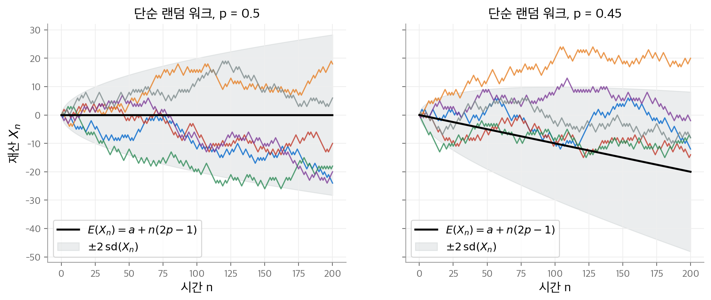
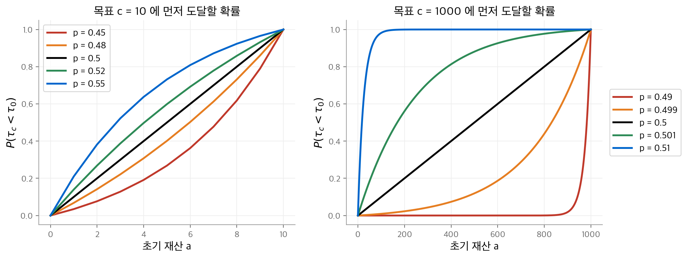
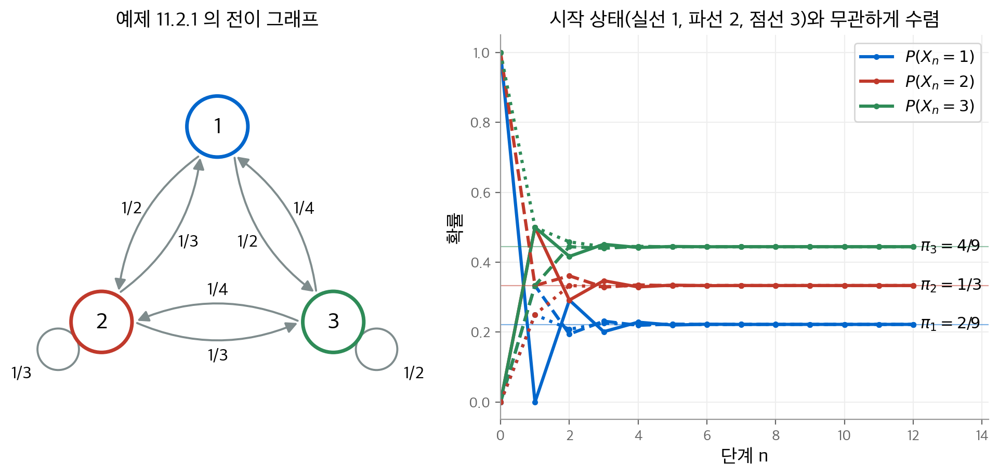
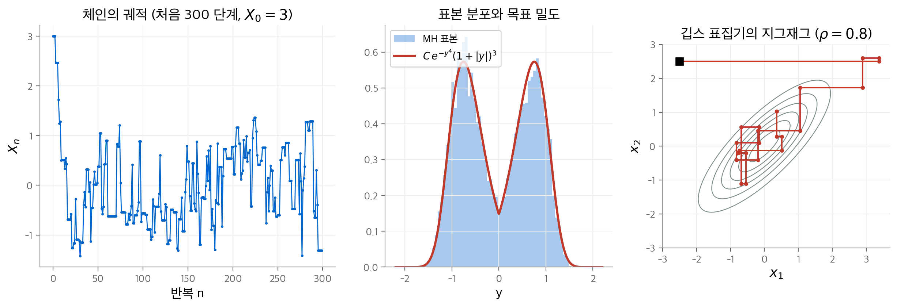
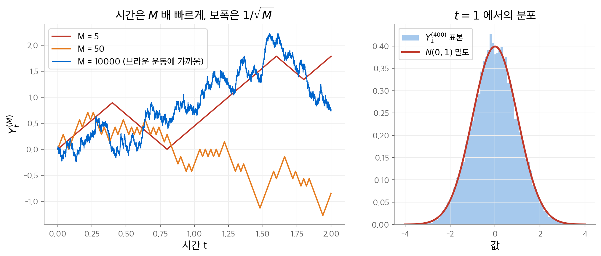
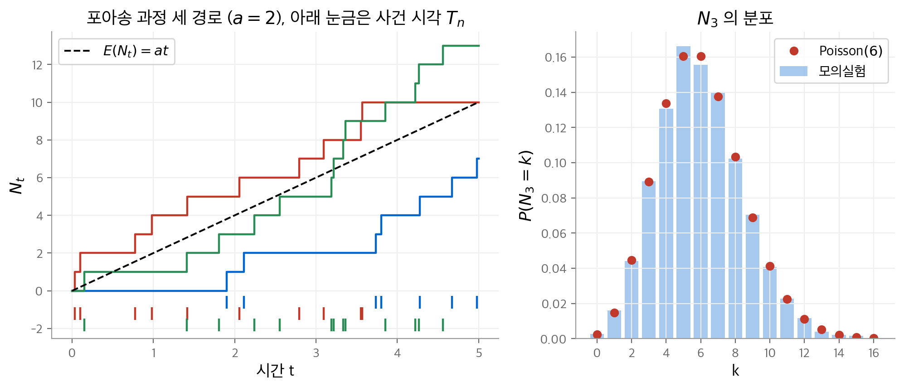

# 5. 확률 과정

1장부터 4장까지는 고정된 확률 변수 $X$, $Y$ 나 독립 동일 분포(i.i.d.) 수열을 다룹니다.
이 장은 시간에 따라 값이 바뀌는 확률 변수의 수열 $X_0, X_1, X_2, \ldots$ 를 다룹니다.
이런 수열을 **확률 과정**(stochastic process)이라고 부릅니다. 시각 $n$ 의 값 $X_n$ 은 직전 값 $X_{n-1}$ 에 의존할 수 있습니다.

이 장은 교재의 11장(Advanced Topic — Stochastic Processes)에 해당합니다.
교재 11장은 1–4장의 내용만 사용하므로, 이 노트에서도 4장 바로 뒤에 둡니다.
구성은 다음과 같습니다. 가장 단순한 예인 단순 랜덤 워크(5.1)에서 출발합니다.
이를 일반화한 마르코프 체인(5.2)과, 마르코프 체인으로 표본을 뽑는 MCMC(5.3)를 다룹니다.
이어서 "평균적으로 변하지 않는" 과정인 마팅게일(5.4)을 다룹니다.
마지막으로 연속 시간 과정인 브라운 운동(5.5)과 포아송 과정(5.6)을 다룹니다.

!!! info "원문과 자료"
    - 교재: Michael J. Evans & Jeffrey S. Rosenthal, *Probability and Statistics: The Science of Uncertainty*, 2nd Edition, 11장 (p. 615–674)
    - PDF: [11장 시작 위치](https://utstat.utoronto.ca/mikevans/jeffrosenthal/book.pdf#page=629)
    - 예제의 수치는 모두 NumPy와 SciPy로 다시 계산했습니다. 그림은 고정된 시드로 생성했습니다.

## 5.1 단순 랜덤 워크 (11.1절)

### 정의

반복되는 도박을 생각합니다. 처음 재산은 $a$ 원이고, 매번 1원을 겁니다.
이길 확률은 $p$, 질 확률은 $q = 1 - p$ 입니다. 각 판의 결과 $Z_i$ 는 i.i.d.이고 다음 분포를 따릅니다.

$$
P(Z_i = 1) = p, \qquad P(Z_i = -1) = q
$$

시각 $n$ 의 재산(fortune)을 $X_n$ 이라고 하면 다음이 성립합니다.

$$
X_0 = a, \qquad X_n = a + Z_1 + Z_2 + \cdots + Z_n
$$

이 과정 $\{X_n\}$ 을 **단순 랜덤 워크**(simple random walk)라고 부릅니다.

### 재산의 분포 (정리 11.1.1)

$n$ 번 중 $u$ 번 이기고 $n - u$ 번 지면 $X_n = a + u - (n - u)$ 입니다.
$X_n = a + k$ 가 되려면 $u = (n + k)/2$ 이어야 합니다. 따라서 $k$ 가 $-n \le k \le n$ 이고 $n + k$ 가 짝수일 때 다음이 성립합니다.

$$
P(X_n = a + k) = \binom{n}{\frac{n+k}{2}} p^{(n+k)/2}\, q^{(n-k)/2}
$$

그 밖의 $k$ 에서는 확률이 0입니다. 기댓값은 $E(X_n) = a + n(2p - 1)$ 입니다.

**예제 11.1.3.** $p = 1/3$, $n = 8$, $a = 1$ 로 둡니다.

1. $P(X_8 = 6) = 0$ 입니다. $k = 5$ 이고 $n + k = 13$ 이 홀수입니다.
2. $P(X_8 = 13) = 0$ 입니다. $k = 12$ 가 $n = 8$ 보다 큽니다.
3. $P(X_8 = 5)$ 는 $k = 4$ 이므로 6번 이기고 2번 지는 경우입니다.

$$
P(X_8 = 5) = \binom{8}{6} \left(\tfrac{1}{3}\right)^6 \left(\tfrac{2}{3}\right)^2 = 28 \cdot \frac{1}{729} \cdot \frac{4}{9} \approx 0.0171
$$

교재에는 이 값이 0.0256으로 인쇄되어 있습니다. 0.0256은 $(2/3)$ 의 지수를 1로 계산한 값입니다.
기댓값은 $E(X_8) = 1 + 8(2/3 - 1) = -5/3$ 입니다.

### 공정한 게임과 불리한 게임 (따름정리 11.1.1)

$E(X_n) = a + n(2p - 1)$ 에서 바로 다음 결론이 나옵니다.

| 조건 | 게임의 성격 | 기대 재산 |
| --- | --- | --- |
| $p = 1/2$ | 공정(fair) | 언제나 $E(X_n) = a$ 입니다. |
| $p < 1/2$ | 불리(subfair) | $n \ge 1$ 이면 $E(X_n) < a$ 입니다. |
| $p > 1/2$ | 유리(superfair) | $n \ge 1$ 이면 $E(X_n) > a$ 입니다. |

실제 카지노의 게임은 언제나 불리합니다. 따라서 평균적으로 손님은 가져온 돈보다 적은 돈을 들고 나갑니다.
불리한 게임에서는 기대 재산이 판마다 $1 - 2p$ 씩 줄어듭니다. 충분히 오래 하면 기대 재산이 음수가 됩니다(예제 11.1.4).

<figure markdown>

<figcaption markdown>
<b>Figure 1.</b> 단순 랜덤 워크의 경로

$p = 0.5$ 이면 평균이 0에 머물고, $p = 0.45$ 이면 기울기 $-0.1$ 로 내려갑니다. 퍼짐은 $\sqrt{n}$ 에 비례합니다.
</figcaption>
</figure>

### 두 배 걸기 전략 (예제 11.1.5)

위 분석은 매번 1원을 거는 전략에만 적용됩니다. "이길 때까지 두 배 걸기" 전략을 생각합니다.
1원을 걸고, 질 때마다 다음 판에 판돈을 두 배로 올리고, 한 번 이기면 멈춥니다.
처음 이기는 순간 지금까지의 손실을 모두 메우고 1원을 법니다. $p > 0$ 이면 언젠가 반드시 이기므로, 확률 1로 1원을 법니다.

이 결과는 $p < 1/2$ 이어도 성립합니다. 그러나 이 전략에는 **무한한 자본**이 필요합니다.
이기기 전에 잃을 수 있는 금액에 상한이 없습니다. 자본이 유한하면 이런 방법으로 불리한 게임을 이길 수 없습니다.
이 사실은 5.4절의 선택 정지 정리로 다시 설명합니다.

### 도박꾼의 파산 문제 (11.1.2절)

$0 < a < c$ 인 정수 $c$ 를 목표 금액으로 정합니다. 0과 $c$ 에 처음 도달하는 시각을 각각 다음과 같이 정의합니다.

$$
\tau_0 = \min\{n \ge 0 : X_n = 0\}, \qquad \tau_c = \min\{n \ge 0 : X_n = c\}
$$

이를 **첫 도달 시각**(first hitting time)이라고 부릅니다. 질문은 "파산하기 전에 $c$ 원을 모을 확률 $P(\tau_c < \tau_0)$ 은 얼마인가"입니다.
몇 판 만에 끝날지 상한이 없으므로, 유한한 $n$ 까지의 확률만 계산해서는 답할 수 없습니다.

**정리 11.1.2 (도박꾼의 파산).** $0 < a < c$ 일 때 다음이 성립합니다.

$$
P(\tau_c < \tau_0) =
\begin{cases}
\dfrac{a}{c}, & p = \dfrac{1}{2} \\[2ex]
\dfrac{1 - (q/p)^a}{1 - (q/p)^c}, & p \ne \dfrac{1}{2}
\end{cases}
$$

**예제 11.1.6과 11.1.7.** 목표가 초기 재산의 두 배인 경우를 비교합니다.

| $a$ | $c$ | $p = 0.499$ | $p = 0.500$ | $p = 0.501$ |
| --- | --- | --- | --- | --- |
| 5 | 10 | 0.495 | 0.500 | 0.505 |
| 5000 | 10000 | $2.06 \times 10^{-9}$ | 0.500 | $1 - 2.06 \times 10^{-9}$ |

판돈이 작으면 $p$ 의 작은 변화가 성공 확률을 조금만 바꿉니다.
판돈이 크면 $p$ 가 0.001만 불리해도 성공 확률이 약 10억분의 2로 떨어집니다.
5000원에서 10000원까지 가려면 많은 판을 거쳐야 합니다. 그동안 한 판의 작은 불리함이 누적됩니다.

<figure markdown>

<figcaption markdown>
<b>Figure 2.</b> 도박꾼의 파산 확률

$p = 1/2$ 이면 성공 확률은 직선 $a/c$ 입니다. $p$ 가 0.5에서 조금만 벗어나도 곡선이 크게 휩니다.
</figcaption>
</figure>

### 파산할 확률 (정리 11.1.3)

$c \to \infty$ 로 보내면 "언젠가 0에 도달할 확률"을 얻습니다.

$$
P(\tau_0 < \infty) =
\begin{cases}
1, & p \le \dfrac{1}{2} \\[1ex]
(q/p)^a, & p > \dfrac{1}{2}
\end{cases}
$$

**예제 11.1.8.** $a = 2$, $p = 2/3$ 이면 파산 확률은 $(1/3 \div 2/3)^2 = 1/4$ 입니다.
2원만으로도 3/4의 확률로 영원히 파산하지 않습니다. 반면 $p \le 1/2$ 이면 $a$ 가 아무리 커도 언젠가 반드시 파산합니다.

## 5.2 마르코프 체인 (11.2절)

### 정의

**마르코프 체인**(Markov chain)은 어떤 대상의 무작위 이동을 나타냅니다. 세 가지 요소가 필요합니다.

1. **상태 공간**(state space) $S$: 대상이 갈 수 있는 모든 위치의 집합입니다.
2. **전이 확률**(transition probability) $p_{ij}$: 상태 $i$ 에서 다음 단계에 $j$ 로 갈 확률입니다. $p_{ij} \ge 0$ 이고 $\sum_{j} p_{ij} = 1$ 입니다.
3. **초기 분포**(initial distribution) $\nu_i = P(X_0 = i)$ 입니다.

핵심 조건은 다음 이동이 **현재 상태에만** 의존한다는 것입니다. 이를 마르코프 성질(Markov property)이라고 부릅니다.

$$
P(X_{n+1} = j \mid X_n = i, X_{n-1} = x_{n-1}, \ldots, X_0 = x_0) = p_{ij}
$$

유한 상태 공간에서는 전이 확률을 행렬 $P = (p_{ij})$ 로 씁니다. 각 행의 합이 1인 이 행렬을 **확률 행렬**(stochastic matrix)이라고 부릅니다.

### 예

| 예제 | 상태 공간 | 전이 규칙 |
| --- | --- | --- |
| 11.2.1 | $\{1, 2, 3\}$ | 아래 행렬 $P$ |
| 11.2.6 원 위의 랜덤 워크 | $\{0, 1, \ldots, d-1\}$ | 제자리, 시계 방향, 반시계 방향으로 각각 확률 1/3 |
| 11.2.7 에렌페스트 항아리 | $\{0, 1, \ldots, d\}$ | 공 $d$ 개 중 하나를 골라 반대 항아리로 옮깁니다. $p_{i,i-1} = i/d$, $p_{i,i+1} = (d-i)/d$ |
| 11.2.8 단순 랜덤 워크 | 정수 전체 | $p_{i,i+1} = p$, $p_{i,i-1} = 1-p$ |

에렌페스트 항아리(Ehrenfest's urn)의 $X_n$ 은 1번 항아리에 든 공의 개수입니다. 단순 랜덤 워크는 상태 공간이 무한한 마르코프 체인입니다.

예제 11.2.1의 전이 행렬은 다음과 같습니다. 이 절의 계산 예는 대부분 이 체인을 씁니다.

$$
P = \begin{bmatrix} 0 & 1/2 & 1/2 \\ 1/3 & 1/3 & 1/3 \\ 1/4 & 1/4 & 1/2 \end{bmatrix}
$$

### 다단계 전이 확률 (11.2.2절)

전확률 공식으로 한 단계 뒤의 분포를 구합니다(정리 11.2.1).

$$
P(X_1 = i) = \sum_{k \in S} \nu_k\, p_{ki}
$$

**예제 11.2.10.** 전이 행렬이 아래와 같고 $\nu = (1/7, 2/7, 4/7)$ 입니다.

$$
P = \begin{bmatrix} 1/4 & 1/4 & 1/2 \\ 1/3 & 1/3 & 1/3 \\ 0.01 & 0.01 & 0.98 \end{bmatrix}
$$

$P(X_1 = 3) = \frac{1}{7} \cdot \frac{1}{2} + \frac{2}{7} \cdot \frac{1}{3} + \frac{4}{7} \cdot 0.98 \approx 0.727$ 입니다.

2단계 전이 확률은 중간 상태 $k$ 에 대한 합입니다(정리 11.2.3).

$$
P_i(X_2 = j) = \sum_{k \in S} p_{ik}\, p_{kj}
$$

**예제 11.2.11.** 예제 11.2.1의 체인에서 $P_1(X_2 = 3)$ 을 구합니다.

$$
P_1(X_2 = 3) = p_{11} p_{13} + p_{12} p_{23} + p_{13} p_{33} = 0 + \tfrac{1}{2} \cdot \tfrac{1}{3} + \tfrac{1}{2} \cdot \tfrac{1}{2} = \tfrac{5}{12}
$$

일반적으로 분포를 행벡터 $\mu^{(n)} = (P(X_n = i))_{i}$ 로 쓰면 행렬 곱 하나로 정리됩니다.

$$
\mu^{(n+1)} = \mu^{(n)} P, \qquad \mu^{(n)} = \mu^{(0)} P^n, \qquad P_i(X_n = j) = (P^n)_{ij}
$$

**예제 11.2.12** 는 같은 체인에서 $P_1(X_3 = 3)$ 을 경로 9개의 합으로 구합니다. 행렬 곱으로 계산하면 $(P^3)_{13} = 65/144 \approx 0.451$ 입니다.
교재에는 $31/72$ 로 인쇄되어 있습니다. 정확한 분수 계산과 수치 계산은 모두 $65/144$ 를 줍니다.

### 정상 분포 (11.2.3절)

**정의 11.2.1.** 분포 $\pi$ 가 모든 $j \in S$ 에서 다음을 만족하면 $\pi$ 를 **정상 분포**(stationary distribution)라고 부릅니다.

$$
\sum_{i \in S} \pi_i\, p_{ij} = \pi_j \qquad (\text{행렬로 쓰면 } \pi P = \pi)
$$

체인이 한 번 정상 분포에 놓이면 이후 모든 시각에서 같은 분포를 유지합니다(정리 11.2.5, 따름정리 11.2.1).
$\pi$ 는 $P^\top$ 의 고유값 1에 대한 고유벡터를 합이 1이 되도록 정규화한 것입니다.

**예제 11.2.14.** $S = \{0, 1\}$ 이고 전이 행렬이 다음과 같습니다.

$$
P = \begin{bmatrix} 0.1 & 0.9 \\ 0.6 & 0.4 \end{bmatrix}
$$

1. 첫 방정식은 $\pi_0 = 0.1\pi_0 + 0.6\pi_1$ 입니다. 정리하면 $\pi_1 = \tfrac{3}{2}\pi_0$ 입니다.
2. $\pi_0 + \pi_1 = 1$ 에 대입합니다. $\tfrac{5}{2}\pi_0 = 1$ 이므로 $\pi_0 = 2/5$ 입니다.
3. 따라서 $\pi = (2/5, 3/5)$ 입니다.

**예제 11.2.16** 은 방정식을 직접 풀어 $\pi = (2/11, 3/11, 6/11)$ 을 얻습니다. 전이 행렬은 다음과 같습니다.

$$
P = \begin{bmatrix} 1/2 & 1/4 & 1/4 \\ 1/3 & 1/3 & 1/3 \\ 0 & 1/4 & 3/4 \end{bmatrix}
$$

**이중 확률 행렬.** 열의 합도 모두 1인 행렬을 **이중 확률 행렬**(doubly stochastic matrix)이라고 부릅니다. 이 경우 균등 분포가 정상 분포입니다(예제 11.2.15).
원 위의 랜덤 워크가 이 경우에 해당합니다. 정상 분포는 $\pi_i = 1/d$ 입니다(예제 11.2.17).

**에렌페스트 항아리(예제 11.2.18).** 공 하나하나는 대부분 가만히 있고, 가끔 반대 항아리로 옮겨집니다.
정상 상태에서 각 공이 1번 항아리에 있을 확률은 1/2이라고 추측할 수 있습니다. 그러면 $\pi = \text{Binomial}(d, 1/2)$ 입니다.
파스칼의 삼각형 $\binom{d-1}{j-1} + \binom{d-1}{j} = \binom{d}{j}$ 로 이 추측이 맞음을 확인합니다.

### 가역성

**정의 11.2.2.** 모든 $i, j$ 에서 다음 **상세 균형 조건**(detailed balance)이 성립하면 체인이 $\pi$ 에 대해 **가역적**(reversible)이라고 부릅니다.

$$
\pi_i\, p_{ij} = \pi_j\, p_{ji}
$$

**정리 11.2.6.** 체인이 $\pi$ 에 대해 가역적이면 $\pi$ 는 정상 분포입니다. 양변을 $i$ 에 대해 더하면 다음을 얻습니다.

$$
\sum_i \pi_i p_{ij} = \sum_i \pi_j p_{ji} = \pi_j \sum_i p_{ji} = \pi_j
$$

**예제 11.2.19.** $S = \{1, \ldots, 5\}$ 이고, 오른쪽으로 갈 확률 2/3, 왼쪽으로 갈 확률 1/3입니다.
양 끝에서는 막힌 쪽으로 가는 대신 제자리에 머무릅니다. $p_{i,i+1} = 2\,p_{i+1,i}$ 이므로 $\pi_i = C\,2^i$ 로 두면 상세 균형이 성립합니다.
$\sum_{i=1}^{5} 2^i = 62$ 이므로 $\pi_i = 2^i / 62$ 입니다.
교재는 정규화 상수를 63으로 적었습니다. $2 + 4 + 8 + 16 + 32 = 62$ 이고, $\pi P = \pi$ 를 수치로 확인하면 62가 맞습니다.

가역성은 정상 분포를 확인하는 가장 쉬운 방법입니다. 5.3절의 메트로폴리스–헤이스팅스 알고리즘은 이 조건을 만족하도록 설계됩니다.

### 마르코프 체인 극한 정리 (11.2.4절)

정상 분포가 있어도 $P(X_n = i) \to \pi_i$ 가 항상 성립하지는 않습니다. 교재는 두 가지 반례를 듭니다.

| 예제 | 전이 행렬 | 수렴하지 않는 이유 |
| --- | --- | --- |
| 11.2.20 | $\begin{bmatrix} 1 & 0 \\ 0 & 1 \end{bmatrix}$ | 체인이 움직이지 않습니다. 1에서 2로 갈 수 없습니다. |
| 11.2.21 | $\begin{bmatrix} 0 & 1 \\ 1 & 0 \end{bmatrix}$ | 1과 2를 번갈아 오갑니다. $P_1(X_n = 1)$ 이 1, 0, 1, 0, … 으로 진동합니다. |

두 반례에서 다음 두 조건이 나옵니다.

- **기약성**(irreducibility): 모든 $i, j$ 에 대해 $P_i(X_n = j) > 0$ 인 $n$ 이 있습니다. 어느 상태에서든 다른 모든 상태로 갈 수 있다는 뜻입니다.
- **비주기성**(aperiodicity): 상태 $i$ 의 **주기**(period)는 $\{n \ge 1 : P_i(X_n = i) > 0\}$ 의 최대공약수입니다. 모든 상태의 주기가 1이면 체인이 비주기적입니다.

예제 11.2.24의 순환 $1 \to 2 \to 3 \to 1$ 은 주기가 3입니다. 예제 11.2.25는 상태 3에 자기 자신으로 가는 경로를 추가합니다.
그러면 3단계와 4단계 귀환이 모두 가능하고, $\gcd(3, 4) = 1$ 이므로 비주기적입니다.
모든 $p_{ij} > 0$ 이면 기약이고 비주기적입니다(정리 11.2.7).

**정리 11.2.8 (마르코프 체인 극한 정리).** 체인이 기약이고 비주기적이며 정상 분포 $\pi$ 를 가지면, 초기 분포와 무관하게 다음이 성립합니다.

$$
\lim_{n \to \infty} P(X_n = i) = \pi_i \qquad (\text{모든 } i \in S)
$$

**예제 11.2.28.** 예제 11.2.16의 체인은 $p_{31} = 0$ 입니다. 그러나 $P_3(X_2 = 1) \ge p_{32} p_{21} > 0$ 이므로 기약입니다.
또 $P_3(X_2 = 3) > 0$ 이고 $P_3(X_3 = 3) > 0$ 입니다. $\gcd(2, 3) = 1$ 이므로 비주기적입니다.
따라서 $P(X_{500} = 1) \approx 2/11$, $P(X_{500} = 2) \approx 3/11$, $P(X_{500} = 3) \approx 6/11$ 입니다.

<figure markdown>

<figcaption markdown>
<b>Figure 3.</b> 마르코프 체인의 전이 그래프와 분포의 수렴

세 시작 상태 모두 10단계 안에 정상 분포 $\pi = (2/9, 1/3, 4/9)$ 로 모입니다.
</figcaption>
</figure>

## 5.3 마르코프 체인 몬테카를로 (11.3절)

### 문제 설정

4장의 몬테카를로 방법은 목표 분포에서 i.i.d. 표본을 뽑을 수 있어야 합니다. 대부분의 분포는 직접 뽑는 방법이 없습니다.
**예제 11.3.1** 은 정수 위의 다음 분포에서 $E[(Z - 20)^2]$ 를 구하려고 합니다.

$$
P(Z = j) = C\,(j - 1/2)^4\, e^{-3|j|} \cos^2(j)
$$

이 분포에서 표본을 뽑는 쉬운 방법은 없습니다. 정규화 상수 $C$ 를 구하는 일조차 어렵습니다.

### MCMC의 아이디어 (정리 11.3.1, 11.3.2)

목표 분포 $\pi$ 를 정상 분포로 갖는 기약·비주기 체인을 만들 수 있다고 가정합니다. 극한 정리에 따라 충분히 긴 시간 $N$ 뒤의 $X_N$ 은 근사적으로 $\pi$ 를 따릅니다.
실제로는 체인 하나를 길게 돌리고 평균을 냅니다.

$$
\hat{A} = \frac{1}{N - B} \sum_{i = B+1}^{N} h(X_i) \;\approx\; E_\pi[h(Z)]
$$

$B$ 는 **번인**(burn-in) 기간입니다. 초기값 $X_0$ 의 영향을 지우기 위해 처음 $B$ 개 값을 버립니다.
이 방법을 **마르코프 체인 몬테카를로**(Markov chain Monte Carlo, MCMC)라고 부릅니다. 오차의 원천은 두 가지입니다.
표본 수가 유한해서 생기는 몬테카를로 오차와, 체인이 아직 정상 분포에 도달하지 않아서 생기는 마르코프 체인 오차입니다.

### 메트로폴리스–헤이스팅스 알고리즘 (11.3.1절)

간단한 **제안 분포**(proposal distribution) $q_{ij}$ 를 고릅니다. $q$ 는 $\pi$ 를 정상 분포로 가질 필요가 없습니다. $X_n = i$ 일 때 다음 단계는 아래와 같습니다.

1. $q_{ij}$ 에 따라 후보 $Y_{n+1} = j$ 를 뽑습니다.
2. 수락 확률 $\alpha_{ij}$ 를 계산합니다.

    $$
    \alpha_{ij} = \min\left(1,\ \frac{\pi_j\, q_{ji}}{\pi_i\, q_{ij}}\right)
    $$

3. 확률 $\alpha_{ij}$ 로 후보를 수락해 $X_{n+1} = j$ 로 둡니다. 거절하면 $X_{n+1} = i$ 로 둡니다.

**정리 11.3.3.** 이렇게 만든 체인은 $\pi$ 를 정상 분포로 가집니다. $i \ne j$ 에서 실제 전이 확률은 $p_{ij} = q_{ij}\alpha_{ij}$ 입니다. 따라서 다음이 성립합니다.

$$
\pi_i\, q_{ij}\, \alpha_{ij} = \min(\pi_i q_{ij},\ \pi_j q_{ji}) = \pi_j\, q_{ji}\, \alpha_{ji}
$$

가운데 식은 $i$ 와 $j$ 에 대해 대칭입니다. 따라서 상세 균형 조건이 성립하고, 정리 11.2.6에 따라 $\pi$ 가 정상 분포입니다.

수락 확률에는 $\pi_j / \pi_i$ 비율만 들어갑니다. **정규화 상수 $C$ 가 약분됩니다.** MCMC가 널리 쓰이는 이유가 여기에 있습니다.

| 예제 | 목표 분포 | 제안 분포 | 수락 확률 |
| --- | --- | --- | --- |
| 11.3.3 | 예제 11.3.1의 $\pi_j$ | 대칭 랜덤 워크 $j = i \pm 1$ | $\min(1, \pi_j / \pi_i)$ |
| 11.3.4 | $\pi_j = K e^{-j^4}$ | $p = 1/4$ 랜덤 워크 | $j = i+1$ 이면 $\min(1, 3e^{i^4 - j^4})$, $j = i-1$ 이면 $\min(1, \tfrac{1}{3}e^{i^4 - j^4})$ |
| 11.3.5 | 밀도 $\propto e^{-y^4}(1 + \lvert y \rvert)^3$ | $N(x, 1)$ | $\min\left(1, \frac{(1+\lvert y\rvert)^3}{(1+\lvert x\rvert)^3} e^{x^4 - y^4}\right)$ |

예제 11.3.4의 제안 분포는 비대칭입니다. 오른쪽 제안이 드물게 나오므로($q = 1/4$) 수락 확률에 3을 곱해 보정합니다.
예제 11.3.5처럼 연속 분포에서는 확률 대신 밀도를 씁니다. 정규 제안 분포는 대칭이므로 $q$ 가 약분됩니다.

### 깁스 표집기 (11.3.2절)

**깁스 표집기**(Gibbs sampler)는 다변량 분포를 위한 메트로폴리스–헤이스팅스 알고리즘의 특수한 경우입니다.
한 좌표를 나머지 좌표가 주어졌을 때의 **조건부 분포**에서 새로 뽑습니다. 이 제안은 수락 확률이 항상 1입니다.

$$
\alpha_{ij} = \min\left(1,\ \frac{\pi_j \cdot \pi_i / \sum_{k \in V(i)} \pi_k}{\pi_i \cdot \pi_j / \sum_{l \in V(i)} \pi_l}\right) = 1
$$

여기서 $V(i)$ 는 $i$ 와 둘째 좌표가 같은 점들의 집합(세로선)입니다. 세로 방향 갱신과 가로 방향 갱신을 번갈아 하면 상태 공간을 지그재그로 돌아다닙니다(정리 11.3.4).

<figure markdown>

<figcaption markdown>
<b>Figure 4.</b> 메트로폴리스-헤이스팅스와 깁스 표집기

메트로폴리스-헤이스팅스 표본이 두 봉우리를 모두 재현합니다(수락 비율 약 55%). 깁스 표집기는 축에 평행하게만 움직입니다.
</figcaption>
</figure>

## 5.4 마팅게일 (11.4절)

### 동기

공정한 랜덤 워크($p = 1/2$)로 도박꾼의 파산 문제를 다시 봅니다. 끝나는 값 $Z$ 는 $c$ 또는 0이고, $P(Z = c) = a/c$ 입니다.

$$
E(Z) = c \cdot \frac{a}{c} + 0 \cdot \left(1 - \frac{a}{c}\right) = a
$$

끝나는 값의 평균이 시작 값 $a$ 와 같습니다. 이는 우연이 아닙니다. 게임이 공정하므로 과정이 "평균적으로" 제자리에 머무릅니다.

### 정의 (정의 11.4.1)

마르코프 체인 $\{X_n\}$ 이 모든 $n$ 에서 다음을 만족하면 **마팅게일**(martingale)이라고 부릅니다.

$$
E(X_{n+1} - X_n \mid X_n) = 0
$$

현재 값이 무엇이든, 다음 단계의 평균 변화량이 0이라는 뜻입니다.

| 예제 | 과정 | $E(X_{n+1} - X_n \mid X_n)$ | 마팅게일 여부 |
| --- | --- | --- | --- |
| 11.4.1 | $p = 1/2$ 랜덤 워크 | $1 \cdot \tfrac12 + (-1) \cdot \tfrac12 = 0$ | 예 |
| 11.4.2 | $p = 2/3$ 랜덤 워크 | $\tfrac23 - \tfrac13 = \tfrac13$ | 아니요 |
| 11.4.3 | 확률 1/4로 +3, 확률 3/4로 −1 | $\tfrac34 - \tfrac34 = 0$ | 예 |
| 11.4.4 | $Z_n = (q/p)^{X_n}$, 일반 $p$ | $p\,Z_n(\tfrac{q}{p} - 1) + q\,Z_n(\tfrac{p}{q} - 1) = 0$ | 예 |

예제 11.4.4는 공정하지 않은 랜덤 워크로도 마팅게일을 만들 수 있음을 보여 줍니다. 이 마팅게일은 아래 예제 11.4.11에서 쓰입니다.

### 기댓값 보존 (정리 11.4.1)

마팅게일이 $X_0 = a$ 에서 시작하면 모든 $n$ 에서 $E(X_n) = a$ 입니다.

**예제 11.4.6.** 10에서 시작해 확률 1/3로 2를 더하고, 확률 2/3로 1을 뺍니다. 이를 25번 반복한 값의 기댓값을 구합니다.
경우를 모두 세면 계산이 길어집니다. 그러나 $E(X_{n+1} - X_n \mid X_n) = 2/3 - 2/3 = 0$ 이므로 마팅게일입니다. 따라서 $E(X_{25}) = 10$ 입니다.

### 정지 시각과 선택 정지 정리 (11.4.3절)

**정의 11.4.2.** 값이 $\{0, 1, 2, \ldots\}$ 인 확률 변수 $T$ 에서, 사건 $\{T = m\}$ 이 미래 값 $X_{m+1}, X_{m+2}, \ldots$ 와 무관하면 $T$ 를 **정지 시각**(stopping time)이라고 부릅니다.
"지금 멈출지"를 미래를 보지 않고 정해야 한다는 뜻입니다. 첫 도달 시각 $\tau_b$ 는 정지 시각입니다.
반면 $\tau_b - 1$ 은 정지 시각이 아닙니다. "$b$ 에 닿기 직전"인지 알려면 다음 값을 봐야 합니다(예제 11.4.7).

**정리 11.4.2 (선택 정지 정리, optional stopping theorem).** $\{X_n\}$ 이 $X_0 = a$ 인 마팅게일이고 $T$ 가 정지 시각입니다. 다음 두 조건 중 하나가 성립하면 $E(X_T) = a$ 입니다.

- (a) 마팅게일이 $T$ 까지 유계입니다. 즉, $n \le T$ 에서 $|X_n| \le M$ 입니다.
- (b) 정지 시각이 유계입니다. 즉, $T \le M$ 입니다.

**예제 11.4.9와 11.4.10: 공정한 경우의 파산 문제.** $p = 1/2$, $r < a < s$ 이고 $T = \min(\tau_r, \tau_s)$ 입니다.

1. $T$ 이전에는 $r \le X_n \le s$ 이므로 조건 (a)가 성립합니다. 따라서 $E(X_T) = a$ 입니다.
2. $h = P(X_T = r)$ 로 두면 $E(X_T) = hr + (1-h)s$ 입니다.
3. $a = hr + (1-h)s$ 를 풀면 $h = (s - a)/(s - r)$ 입니다.

$r = c$, $s = 0$ 으로 두면 $h = a/c$ 이고, 정리 11.1.2의 공정한 경우와 같습니다.

**예제 11.4.11: 공정하지 않은 경우.** $p \ne 1/2$ 이면 $X_n$ 은 마팅게일이 아닙니다. 대신 $Z_n = (q/p)^{X_n}$ 을 씁니다.

1. $Z_n$ 은 마팅게일이고 $Z_0 = (q/p)^a$ 입니다.
2. $T$ 이전에는 $0 \le X_n \le c$ 이므로 $Z_n$ 도 유계입니다. 따라서 $E(Z_T) = (q/p)^a$ 입니다.
3. $g = P(X_T = c)$ 로 두면 $E(Z_T) = g\,(q/p)^c + (1 - g) \cdot 1$ 입니다.
4. $g$ 에 대해 풀면 정리 11.1.2의 공식을 얻습니다.

$$
g = \frac{(q/p)^a - 1}{(q/p)^c - 1}
$$

5.1절에서 길게 증명해야 하는 결과를 마팅게일로는 몇 줄 만에 얻습니다.

**정리의 조건이 필요한 이유 (예제 11.4.12, 11.4.13).** $p = 1/2$, $a = 0$ 이고 $T = \tau_{-1}$ 이면 언제나 $X_T = -1$ 이므로 $E(X_T) = -1 \ne 0$ 입니다.
이 경우 $T$ 와 $X_n$ 모두 유계가 아니므로 선택 정지 정리를 적용할 수 없습니다.
$T = \min(10^6, \tau_{-1})$ 로 자르면 조건 (b)가 성립해 $E(X_T) = 0$ 입니다.
거의 언제나 $X_T = -1$ 이지만, 드물게 $-1$ 에 닿지 않은 경로가 매우 큰 값을 가져 평균을 0으로 맞춥니다.
두 배 걸기 전략(예제 11.1.5)이 유한한 자본으로 작동하지 않는 이유도 같습니다.

## 5.5 브라운 운동 (11.5절)

### 점점 빨라지는 랜덤 워크 (11.5.1절)

$p = 1/2$ 랜덤 워크의 시간을 $M$ 배 빠르게 하고, 보폭을 $1/\sqrt{M}$ 로 줄입니다.

$$
Y^{(M)}_{i/M} = \frac{1}{\sqrt{M}}\,(Z_1 + Z_2 + \cdots + Z_i)
$$

격자점 사이는 선형으로 이어 연속 시간 과정 $\{Y^{(M)}_t : t \ge 0\}$ 을 만듭니다.
보폭을 $1/M$ 이 아니라 $1/\sqrt{M}$ 로 줄이는 이유가 있습니다. 시각 $t$ 까지 $tM$ 걸음을 걸으면 분산이 $tM \cdot (1/\sqrt{M})^2 = t$ 로 일정해집니다.

**정리 11.5.1.** $M$ 이 크면 4장의 중심 극한 정리에 따라 다음이 근사적으로 성립합니다.

- (a) $Y^{(M)}_t \approx N(0, t)$ 입니다.
- (b) $\operatorname{Cov}(Y^{(M)}_s, Y^{(M)}_t) \approx \min(s, t)$ 입니다.
- (c) $t > s$ 이면 증분 $Y^{(M)}_t - Y^{(M)}_s \approx N(0, t - s)$ 이고, 증분은 $Y^{(M)}_s$ 와 근사적으로 독립입니다.
- (d) $Y^{(M)}_t$ 는 $t$ 의 연속 함수입니다.

### 극한으로서의 브라운 운동 (11.5.2절)

$M \to \infty$ 일 때 $Y^{(M)}$ 의 분포의 극한을 **브라운 운동**(Brownian motion) $\{B_t\}$ 라고 부릅니다. 위너 과정(Wiener process)이라고도 부릅니다.
정리 11.5.2에 따라 다음 성질이 정확히 성립합니다.

| 성질 | 식 |
| --- | --- |
| 정규 분포 | $B_t \sim N(0, t)$ |
| 공분산 | $\operatorname{Cov}(B_s, B_t) = \min(s, t)$ |
| 독립 정규 증분 | $0 \le s < t$ 이면 $B_t - B_s \sim N(0, t - s)$ 이고, $B_t - B_s$ 는 $B_s$ 와 독립 |
| 연속성 | $t \mapsto B_t$ 는 연속 함수 |

<figure markdown>

<figcaption markdown>
<b>Figure 5.</b> 빨라지는 랜덤 워크와 브라운 운동

$M$ 이 커질수록 랜덤 워크가 브라운 운동처럼 보이고, $Y^{(400)}_1$ 의 분포는 $N(0, 1)$ 과 일치합니다.
</figcaption>
</figure>

**확률 계산 예.** $\Phi$ 는 표준 정규 분포의 누적 분포 함수입니다. 모두 $B_t / \sqrt{t} \sim N(0, 1)$ 로 표준화해 계산합니다.

| 예제 | 질문 | 계산 | 값 |
| --- | --- | --- | --- |
| 11.5.1 | $P(B_5 \le 3)$ | $\Phi(3/\sqrt{5})$ | 0.910 |
| 11.5.2 | $P(B_7 \ge -4)$ | $1 - \Phi(-4/\sqrt{7})$ | 0.935 |
| 11.5.3 | $P(B_8 - B_6 \le -1.5)$ | $\Phi(-1.5/\sqrt{2})$ | 0.144 |
| 11.5.4 | $P(B_2 \le -0.5,\ B_5 - B_2 \ge -1.5)$ | $\Phi(-0.5/\sqrt{2}) \cdot \bigl(1 - \Phi(-1.5/\sqrt{3})\bigr)$ | 0.292 |

예제 11.5.4는 독립 증분 성질을 씁니다. $B_2$ 와 $B_5 - B_2$ 가 독립이므로 두 확률을 곱합니다.

**마팅게일로서의 브라운 운동 (예제 11.5.5).** 브라운 운동은 공정한 랜덤 워크의 극한이므로 마팅게일입니다.
$c < 0 < b$ 이고 $T = \min(\tau_c, \tau_b)$ 로 두면, 선택 정지 정리에서 $0 = E(B_T) = hc + (1-h)b$ 입니다. 이를 풀면 다음을 얻습니다.

$$
P(\tau_c < \tau_b) = \frac{b}{b - c}
$$

브라운 운동은 연속이지만, 확률 1로 **어디에서도 미분 가능하지 않습니다**. 증분의 크기가 $\sqrt{h}$ 수준이므로 $(B_{t+h} - B_t)/h$ 가 발산합니다.

### 확산 과정과 주가 (11.5.3절)

$X_t = a + \mu t + \sigma B_t$ 를 **확산 과정**(diffusion)이라고 부릅니다. $\mu$ 는 **표류**(drift), $\sigma > 0$ 은 **변동성**(volatility) 모수입니다.
정리 11.5.3에 따라 $X_t \sim N(a + \mu t,\ \sigma^2 t)$ 입니다.

**예제 11.5.6.** 주가가 20달러에서 시작하고, 표류는 연 3달러, 변동성은 1.4입니다. 2.5년 뒤 30달러를 넘을 확률을 구합니다.

1. $X_{2.5} = 20 + 7.5 + 1.4\,B_{2.5} = 27.5 + 1.4\,B_{2.5}$ 입니다.
2. $X_{2.5} > 30$ 은 $B_{2.5} > 2.5/1.4 \approx 1.79$ 와 같습니다.
3. $P(B_{2.5} > 1.79) = 1 - \Phi(1.79/\sqrt{2.5}) \approx 0.129$ 입니다.

**예제 11.5.7** 은 초기 가격 100달러, 표류 연 −2달러, 변동성 5.5인 주가입니다. 반년 뒤 90달러 미만일 확률은 $\Phi(-9 / (5.5\sqrt{0.5})) \approx 0.010$ 입니다.

## 5.6 포아송 과정 (11.6절)

### 정의

**포아송 과정**(Poisson process)은 무작위 시각에 일어나는 사건을 모형화합니다. 예로 화재 발생, 가이거 계수기의 입자 검출, 검문소를 지나는 차량이 있습니다.
강도(intensity) $a > 0$ 와 i.i.d. $R_i \sim \text{Exponential}(a)$ 로 다음을 정의합니다.

$$
T_0 = 0, \qquad T_n = R_1 + \cdots + R_n, \qquad N_t = \max\{n : T_n \le t\}
$$

$T_n$ 은 $n$ 번째 사건의 시각이고, $N_t$ 는 시각 $t$ 까지 일어난 사건의 수입니다. $\{N_t : t \ge 0\}$ 은 브라운 운동처럼 연속 시간 확률 과정입니다.

### 주요 정리

- **정리 11.6.1.** 모든 $t \ge 0$ 에서 $N_t \sim \text{Poisson}(at)$ 입니다.
- **정리 11.6.2.** $0 \le t_0 < t_1 < \cdots < t_d$ 이면 증분 $N_{t_i} - N_{t_{i-1}} \sim \text{Poisson}(a(t_i - t_{i-1}))$ 이고, 서로 독립입니다.

브라운 운동과 구조가 같습니다. 두 과정 모두 **독립 증분**을 가집니다. 브라운 운동의 증분은 정규 분포를, 포아송 과정의 증분은 포아송 분포를 따릅니다.

<figure markdown>

<figcaption markdown>
<b>Figure 6.</b> 포아송 과정의 경로와 N_3 의 분포

포아송 과정의 경로는 사건마다 1씩 오르는 계단입니다. 모의실험한 $N_3$ 의 분포가 $\text{Poisson}(6)$ 과 일치합니다.
</figcaption>
</figure>

### 계산 예

| 예제 | 강도 | 질문 | 계산 | 값 |
| --- | --- | --- | --- | --- |
| 11.6.1 | 5 | $P(N_3 = 12)$ | $e^{-15} 15^{12} / 12!$ | 0.083 |
| 11.6.2 | 2 | $P(N_6 = 11)$ | $e^{-12} 12^{11} / 11!$ | 0.114 |
| 11.6.3 | 4 | $P(N_2 = 3,\ N_5 = 4)$ | $\dfrac{e^{-8} 8^3}{3!} \cdot \dfrac{e^{-12} 12^1}{1!}$ | $2.1 \times 10^{-6}$ |

예제 11.6.3은 사건을 독립 증분으로 바꿔 씁니다. $\{N_2 = 3, N_5 = 4\}$ 는 $\{N_2 = 3, N_5 - N_2 = 1\}$ 과 같습니다.
$N_2 \sim \text{Poisson}(8)$ 과 $N_5 - N_2 \sim \text{Poisson}(12)$ 가 독립이므로 두 확률을 곱합니다.
평균 12건이 기대되는 3시간 동안 1건만 일어나야 하므로 확률이 매우 작습니다.

## 딥러닝에서의 쓰임

| 개념 | 절 | 딥러닝에서 쓰이는 곳 |
| --- | --- | --- |
| 마르코프 체인과 $\mu^{(n)} = \mu^{(0)} P^n$ | 5.2 | 언어 모델의 토큰 생성은 고차 마르코프 체인입니다. 강화 학습의 마르코프 결정 과정(MDP)도 같은 구조입니다. |
| 정상 분포와 극한 정리 | 5.2 | PageRank는 웹 그래프 랜덤 워크의 정상 분포입니다. 그래프 신경망의 메시지 전달은 반복할수록 정상 분포 쪽으로 평탄해지는 과평활화(oversmoothing)를 겪습니다. |
| 상세 균형과 메트로폴리스–헤이스팅스 | 5.2, 5.3 | 베이즈 신경망의 사후 분포 표집, 에너지 기반 모델 학습에 쓰입니다. 랑주뱅 동역학(Langevin dynamics)은 그래디언트를 제안 분포에 넣은 MCMC입니다. |
| 깁스 표집기 | 5.3 | 제한 볼츠만 머신(RBM)의 대조 발산 학습은 은닉층과 가시층을 번갈아 뽑는 깁스 표집입니다. |
| 마팅게일과 선택 정지 | 5.4 | 확률적 경사 하강법(SGD)의 잡음은 평균 0인 마팅게일 차분입니다. 수렴 분석과 집중 부등식(아주마–회프딩)의 출발점입니다. |
| 브라운 운동과 확산 과정 | 5.5 | 확산 모델의 순방향 과정은 데이터에 브라운 운동 잡음을 더하는 확률 미분 방정식(SDE)입니다. 역방향 생성 과정은 스코어 함수를 표류 항으로 쓰는 확산 과정입니다. |
| 포아송 과정 | 5.6 | 사건 시계열 모형(호크스 과정 등), 요청 도착을 모형화하는 추론 서버의 대기열 분석에 쓰입니다. |

## 정리

| 개념 | 핵심 |
| --- | --- |
| 단순 랜덤 워크 | $X_n = a + Z_1 + \cdots + Z_n$, $E(X_n) = a + n(2p-1)$ 입니다. |
| 도박꾼의 파산 | $P(\tau_c < \tau_0) = \dfrac{1 - (q/p)^a}{1 - (q/p)^c}$ ($p = 1/2$ 이면 $a/c$) 입니다. 판돈이 크면 작은 불리함이 결과를 결정합니다. |
| 마르코프 체인 | 다음 상태는 현재 상태에만 의존합니다. $P_i(X_n = j) = (P^n)_{ij}$ 입니다. |
| 정상 분포 | $\pi P = \pi$ 입니다. 상세 균형 $\pi_i p_{ij} = \pi_j p_{ji}$ 이면 충분합니다. |
| 극한 정리 | 기약이고 비주기적이면 초기 분포와 무관하게 $P(X_n = i) \to \pi_i$ 입니다. |
| MCMC | $\pi$ 를 정상 분포로 갖는 체인을 만들어 평균을 냅니다. 메트로폴리스–헤이스팅스는 정규화 상수 없이 작동합니다. |
| 마팅게일 | $E(X_{n+1} - X_n \mid X_n) = 0$ 입니다. 선택 정지 정리의 조건이 성립하면 $E(X_T) = X_0$ 입니다. |
| 브라운 운동 | $B_t - B_s \sim N(0, t-s)$ 인 독립 정규 증분, 연속이지만 어디에서도 미분 불가능합니다. |
| 확산 과정 | $X_t = a + \mu t + \sigma B_t \sim N(a + \mu t, \sigma^2 t)$ 입니다. |
| 포아송 과정 | 지수 분포 간격으로 사건이 일어납니다. $N_t - N_s \sim \text{Poisson}(a(t-s))$ 인 독립 증분을 가집니다. |

이 장으로 교재의 확률론 부분(1–4장과 11장) 정리를 마칩니다. 전체 구성과 다른 장은 [확률론 개요](index.md)에서 확인할 수 있습니다.

## 다음 장

[다음 장](06-statistical-inference.md)부터는 통계적 추론(교재 5–10장)을 다룹니다.
지금까지는 분포를 알고 사건의 확률을 계산했습니다. 이제는 관측한 데이터로 알지 못하는 분포를 추론합니다.
