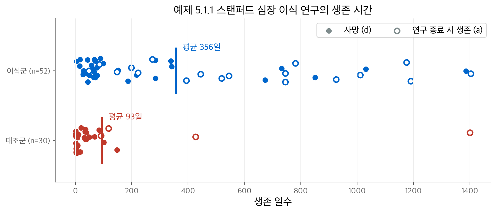
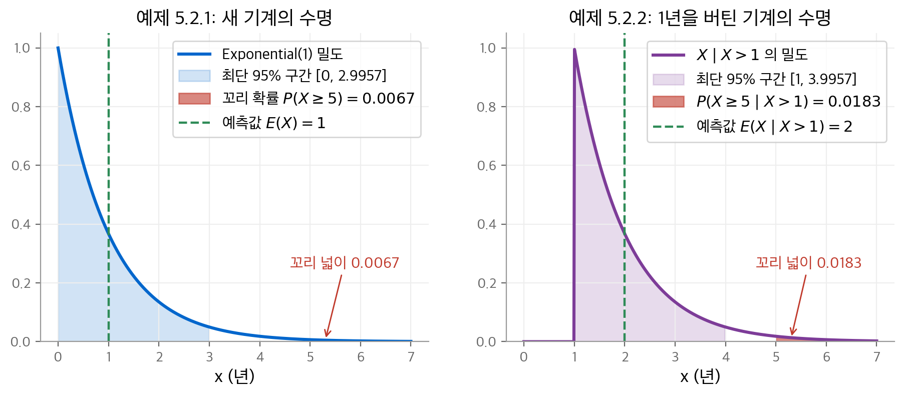
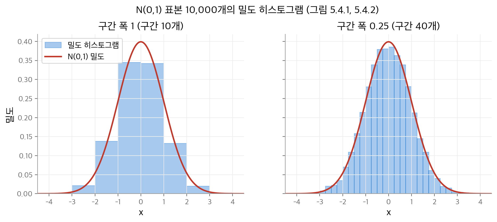
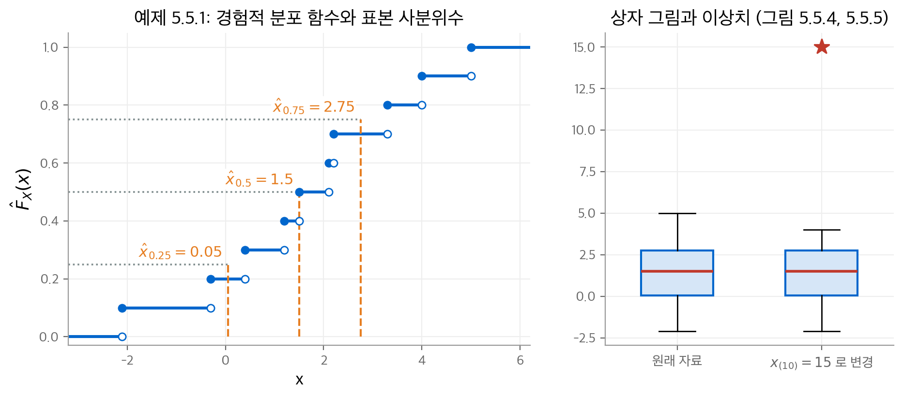
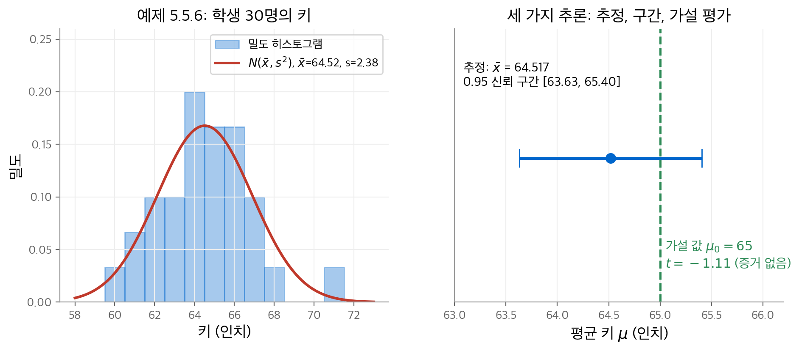

# 6. 통계적 추론

이 장은 교재의 5장입니다. 여기서부터 노트는 확률론에서 통계학으로 넘어갑니다.

1–5장의 확률론은 **확률 모형을 안다고 가정**하고, 그 모형으로 여러 양을 계산했습니다.
실제 문제에서는 올바른 확률 측도를 모릅니다. 기껏해야 참 측도가 어떤 측도들의 집합 안에 있다고 말할 수 있습니다.
이 집합을 **통계 모형**(statistical model)이라고 부릅니다.
불확실성이 한 겹 늘어난 셈입니다. 결과값이 불확실할 뿐 아니라, 결과를 만드는 확률 측도 자체도 불확실합니다.

**통계적 추론**(statistical inference)은 관측한 **자료**(data)와 통계 모형을 함께 써서 참 확률 측도의 특성을 말하는 일입니다.
이 장은 그 기본 개념을 세웁니다. 순서는 다음과 같습니다.

1. 확률 모형을 알 때의 추론(예측, 구간, 타당성 평가)을 정리합니다.
2. 모형을 모를 때 쓰는 통계 모형과 모수를 정의합니다.
3. 자료를 모으는 방법(단순 무작위 표집)과 그 이유를 다룹니다.
4. 기술 통계와 그림으로 자료를 요약하고, 세 가지 추론 유형을 정리합니다.

추론 방법론 자체는 다음 장들에서 다룹니다. 가능도 방법은 [7장](07-likelihood-inference.md), 베이즈 방법은 [8장](08-bayesian-inference.md),
손실 함수와 성능 기준에 기반한 방법은 [9장](09-optimal-inferences.md)에서 다룹니다.

!!! info "원문과 자료"
    - 교재: Evans & Rosenthal, *Probability and Statistics: The Science of Uncertainty*, 2nd Edition, 5장 Statistical Inference (p. 253–296)
    - PDF: [5장 시작 페이지](https://utstat.utoronto.ca/mikevans/jeffrosenthal/book.pdf#page=267)
    - 이 장의 수치는 모두 NumPy와 SciPy로 다시 계산했습니다.

## 6.1 통계가 필요한 이유 (5.1절)

### 예: 스탠퍼드 심장 이식 연구 (예 5.1.1)

스탠퍼드 대학의 심장 이식 프로그램이 환자의 수명을 늘리는지 판단하려고 합니다.
한 환자가 이식 덕분에 더 오래 살았는지는 결코 알 수 없습니다. 그래서 이식받은 환자와 받지 못한 환자의 수명을 비교합니다.
환자의 수명에는 생활 습관, 다른 질환처럼 심장과 무관한 요인도 크게 작용합니다.

두 집단의 수명이 각각 밀도 $f_T$(이식군, treatment)와 $f_C$(대조군, control)를 따른다고 생각합니다.
$f_T$ 와 $f_C$ 를 알면 평균 수명을 비교하면 됩니다. 문제는 두 분포를 모른다는 점입니다.
가진 것은 대조군 30명과 이식군 52명의 관측값뿐입니다.

<figure markdown>

<figcaption>
교재 표 5.1, 5.2의 생존 일수입니다. 이식군은 대기 일수와 이식 후 생존 일수를 더했습니다.
빈 원은 연구 종료 시 살아 있던 환자입니다. 이 환자의 실제 생존 시간은 표시된 값보다 깁니다.
</figcaption>
</figure>

연습 문제 5.1.1을 계산하면 다음과 같습니다.

| 집단 | $n$ | 평균 생존 일수 | 중앙값 | 연구 종료 시 생존 |
| --- | --- | --- | --- | --- |
| 대조군 | 30 | 93.2 | 25.5 | 4명 |
| 이식군 | 52 | 356.2 | 169.5 | 18명 |

평균만 보면 이식군이 훨씬 오래 삽니다. 그러나 이 결론을 바로 믿기는 어렵습니다.

- 대조군의 1400일처럼 한 값이 평균을 크게 끌어올립니다.
- 살아 있는 환자의 생존 시간은 실제보다 짧게 기록됩니다. 이런 자료를 **중도 절단**(censored) 자료라고 부릅니다.
- 이식을 받으려면 대기 기간을 살아남아야 합니다. 그래서 이식군에는 처음부터 더 건강한 환자가 모였을 수 있습니다.

불확실성의 원천은 두 가지입니다. 하나는 **변동**(variation)이고, 확률로 모형화합니다(1–4장).
다른 하나는 **관측의 부족**입니다. 관측이 적으면 올바른 확률 모형을 정확히 알 수 없습니다. 통계학은 두 번째 원천을 다룹니다.

## 6.2 확률 모형을 쓰는 추론 (5.2절)

확률 측도 $P$ 를 안다고 가정합니다. 아직 관측하지 않은 결과값 $s$ 에 대해 세 가지 추론을 할 수 있습니다.

1. **예측**: $s$ 의 그럴듯한 값을 하나 고릅니다. 예를 들어 기댓값을 씁니다.
2. **구간**: $s$ 를 높은 확률로 포함하면서 가능한 작은 집합을 만듭니다.
3. **타당성 평가**: 주어진 값 $s_0$ 가 $P$ 에서 나올 법한 값인지 판단합니다. $s_0$ 가 확률이 낮은 영역에 있으면 타당하지 않다고 봅니다.

### 예: 기계의 수명 (예 5.2.1)

기계의 수명 $X$(단위: 년)가 $X \sim \text{Exponential}(1)$ 을 따른다고 합니다.

- **예측**: $E(X) = 1$ 년입니다.
- **구간**: 밀도가 감소 함수이므로 95% 확률을 담는 최단 구간은 $[0, c]$ 꼴입니다.

$$
0.95 = \int_0^c e^{-x}\,dx = 1 - e^{-c} \quad\Longrightarrow\quad c = -\ln 0.05 \approx 2.9957
$$

- **타당성 평가**: 수명 5년이 그럴듯한지 꼬리 확률로 봅니다.

$$
P(X \ge 5) = \int_5^\infty e^{-x}\,dx = e^{-5} \approx 0.0067
$$

꼬리 확률이 매우 작으므로 5년은 타당하지 않은 값입니다. 구매자는 5년 전에 기계를 교체할 계획을 세워야 합니다.

### 조건부 확률의 원리 (예 5.2.2)

결과에 대한 부분 정보 $s \in C$ 를 얻으면 $P$ 대신 조건부 측도 $P(\cdot \mid C)$ 로 추론합니다.
교재는 이것을 **조건부 확률의 원리**(principle of conditional probability)라고 부릅니다.
이 원리는 수학 정리에서 나오지 않습니다. 추론의 기본 공리로 받아들이는 규칙입니다.

기계가 이미 1년 동안 작동했다고 합니다. $X > 1$ 이 주어졌을 때의 밀도는 $x > 1$ 에서 $e^{-(x-1)}$ 입니다.

| 추론 | 사전 정보 없음 | $X > 1$ 이 주어짐 |
| --- | --- | --- |
| 예측 | $E(X) = 1$ | $E(X \mid X > 1) = 2$ |
| 최단 95% 구간 | $[0,\ 2.9957]$ | $[1,\ 1 - \ln 0.05] = [1,\ 3.9957]$ |
| $P(X \ge 5 \mid \cdot)$ | $e^{-5} \approx 0.0067$ | $e^{-4} \approx 0.0183$ |

남은 수명의 예측값은 처음 예측값과 같은 1년입니다. 이것은 지수 분포의 무기억성 때문이며, 다른 분포에서는 성립하지 않습니다.

<figure markdown>

<figcaption>
왼쪽: 새 기계의 수명 분포입니다. 예측값, 최단 95% 구간, 5년 이후의 꼬리 확률을 표시했습니다.
오른쪽: 1년을 버틴 기계의 조건부 분포입니다. 분포 전체가 1만큼 오른쪽으로 옮겨 갑니다.
</figcaption>
</figure>

## 6.3 통계 모형 (5.3절)

통계 문제의 상황은 6.2절과 반대입니다. 자료 $s$ 는 관측했지만 $P$ 를 모릅니다. 이제 $s$ 로 $P$ 를 추론해야 합니다.

**통계 모형**은 확률 측도의 집합 $\{P_\theta : \theta \in \Omega\}$ 입니다. 이 가운데 하나가 자료 $s$ 를 만든 참 측도라고 가정합니다.

- $\theta$ 를 **모수**(parameter), $\Omega$ 를 **모수 공간**(parameter space)이라고 부릅니다.
- 보통 $\theta$ 가 측도를 구별하도록 고릅니다. 즉 $P_{\theta_1} = P_{\theta_2}$ 이면 $\theta_1 = \theta_2$ 입니다.
- 각 측도를 확률 함수 또는 밀도 $f_\theta$ 로 나타내면 모형을 $\{f_\theta : \theta \in \Omega\}$ 로 씁니다.
- 참 측도에 해당하는 $\theta$ 를 **참 모수값**(true parameter value)이라고 부릅니다. 참 모수값에 대한 추론은 곧 참 분포에 대한 추론입니다.

### 예: 항아리 속 검은 칩의 수 (예 5.3.1)

항아리에 칩 100개가 있고, 검은 칩(B)은 50개 또는 60개라고 합니다. 비복원으로 두 개를 꺼내 색을 기록합니다.
모수는 검은 칩의 수 $\theta$ 이고, $\Omega = \{50, 60\}$ 입니다. 표본 공간은 $\{BB, BW, WB, WW\}$ 입니다.

| 자료 $s$ | $P_{50}(s)$ | $P_{60}(s)$ |
| --- | --- | --- |
| $BB$ | $\frac{50 \cdot 49}{100 \cdot 99} \approx 0.2475$ | $\frac{60 \cdot 59}{100 \cdot 99} \approx 0.3576$ |
| $BW$, $WB$ (각각) | $\frac{50 \cdot 50}{100 \cdot 99} \approx 0.2525$ | $\frac{60 \cdot 40}{100 \cdot 99} \approx 0.2424$ |
| $WW$ | $\frac{50 \cdot 49}{100 \cdot 99} \approx 0.2475$ | $\frac{40 \cdot 39}{100 \cdot 99} \approx 0.1576$ |

모수는 측도를 구별하는 **이름표**일 뿐입니다. $P_1$, $P_2$ 라고 불러도 됩니다.
다만 문제에서 의미가 있는 값을 이름표로 고르면 편리합니다.

### 예: 두 공장의 기계 (예 5.3.2)

첫 공장의 기계 수명은 $\text{Exponential}(1)$, 둘째 공장의 기계 수명은 $\text{Exponential}(2/3)$ 을 따릅니다.
같은 공장에서 만든 기계 5대를 샀고, 어느 공장인지 모릅니다. 모수 공간은 $\Omega = \{1, 2\}$ 입니다.

긴 수명은 $\theta = 2$ 쪽을 지지합니다. 두 표본의 결합 밀도 비 $f_2/f_1$ 를 계산하면 이 직관을 수치로 확인할 수 있습니다.

| 표본 | $\sum x_i$ | $\prod f_2(x_i) \,/\, \prod f_1(x_i)$ |
| --- | --- | --- |
| $(5.0,\ 3.5,\ 3.3,\ 4.1,\ 2.8)$ | 18.7 | 약 67.1 |
| $(2.0,\ 2.5,\ 3.0,\ 3.1,\ 1.8)$ | 12.4 | 약 8.2 |

두 표본 모두 $\theta = 2$ 를 지지합니다. 첫 표본이 더 강하게 지지합니다. 이 비율이 [7장](07-likelihood-inference.md)의 가능도비입니다.

교재 그림 5.3.1의 캡션은 둘째 분포를 "Exponential(1.5)"로 적었습니다. 본문의 $\text{Exponential}(2/3)$ 과 맞지 않습니다.
교재의 지수 분포 모수는 비율이므로, 평균이 1.5인 분포는 $\text{Exponential}(2/3)$ 입니다. 캡션은 평균을 적은 오식으로 보입니다.

모수 대신 평균을 이름표로 쓰면 모수 공간은 $\{1, 1.5\}$ 입니다. 일대일 변환이면 어떤 특성이든 이름표로 쓸 수 있습니다.
이렇게 이름표를 바꾸는 일을 **재모수화**(reparameterization)라고 부릅니다.

### 예: 베르누이 모형 (예 5.3.3)

$x_1, \dots, x_n$ 이 $\text{Bernoulli}(\theta)$ 에서 나온 표본이고 $\theta \in [0, 1]$ 은 모릅니다.
동전 던지기, 불량품 여부, 치료 성공 여부가 모두 이 모형입니다. 표본의 확률 함수는 다음과 같습니다.

$$
\prod_{i=1}^n f_\theta(x_i) = \prod_{i=1}^n \theta^{x_i} (1 - \theta)^{1 - x_i} = \theta^{n\bar{x}} (1 - \theta)^{n(1 - \bar{x})}
$$

확률 함수가 표본 평균 $\bar{x}$ 에만 의존합니다. $\theta^2$ 이나 로짓 $\ln\big(\theta/(1-\theta)\big)$ 도 $[0,1]$ 에서 일대일이므로 모수로 쓸 수 있습니다.

### 예: 위치-척도 정규 모형 (예 5.3.4)

$x_1, \dots, x_n$ 이 $N(\mu, \sigma^2)$ 에서 나온 표본이고, $(\mu, \sigma^2) \in \mathbb{R} \times \mathbb{R}^+$ 를 모릅니다. 표본의 밀도는 다음과 같습니다.

$$
\prod_{i=1}^n f_{(\mu, \sigma^2)}(x_i)
= (2\pi\sigma^2)^{-n/2} \exp\!\left( -\frac{n}{2\sigma^2} (\bar{x} - \mu)^2 - \frac{n-1}{2\sigma^2} s^2 \right)
$$

여기서 $\bar{x} = \frac{1}{n}\sum x_i$ 는 **표본 평균**, $s^2 = \frac{1}{n-1}\sum (x_i - \bar{x})^2$ 은 **표본 분산**입니다.
두 번째 등호는 다음 항등식에서 나옵니다(문제 5.3.13).

$$
\sum_{i=1}^n (x_i - \mu)^2 = n(\bar{x} - \mu)^2 + \sum_{i=1}^n (x_i - \bar{x})^2
$$

이 모형에는 두 가지 근사가 숨어 있습니다.

- 유한 모집단의 참 분포는 이산 분포입니다. 정규 분포는 그 근사입니다.
- 키는 음수일 수 없지만 모형은 모든 $\mu \in \mathbb{R}$ 를 허용합니다. 이런 부정확한 사전 정보는 [8장](08-bayesian-inference.md)의 사전 분포로 반영합니다.

모형이 맞는지는 자료로 확인해야 합니다. 이 절차를 **모형 점검**(model checking)이라고 부르며 [10장](10-model-checking.md)에서 다룹니다.

## 6.4 자료 수집 (5.4절)

6.2절과 6.3절은 자료가 어떤 확률 측도 $P$ 에서 나왔다고 가정했습니다. 실제로는 이 가정을 확신할 수 없는 경우가 많습니다.
자료가 무작위 메커니즘으로 만들어졌는지 확신할 수 없는 분석을 **관찰 연구**(observational study)라고 부릅니다.
관찰 연구에서 통계학자는 자료 생성에 개입하지 않고 자료를 관찰하기만 합니다.

### 유한 모집단

**모집단**(population) $\Pi$ 는 크기 $N$ 인 유한 집합이고, 측정값 $X : \Pi \to \mathbb{R}$ 이 정의되어 있습니다.
측정값은 두 종류로 나뉩니다. 키처럼 산술 연산이 의미 있는 **양적 변수**(quantitative variable)가 있습니다.
성별처럼 분류만 하는 **범주형 변수**(categorical variable)도 있습니다.

**모집단 누적 분포 함수**는 측정값이 $x$ 이하인 원소의 비율입니다.

$$
F_X(x) = \frac{\lvert \{\pi \in \Pi : X(\pi) \le x\} \rvert}{N}
$$

예 5.4.1은 같은 크기의 땅 $N = 20$ 필지의 비옥도(10점 척도)입니다.

$$
4,\ 8,\ 6,\ 7,\ 8,\ 3,\ 7,\ 5,\ 4,\ 6,\ 9,\ 5,\ 7,\ 5,\ 8,\ 3,\ 4,\ 7,\ 8,\ 3
$$

| $x$ 의 범위 | $x < 3$ | $[3,4)$ | $[4,5)$ | $[5,6)$ | $[6,7)$ | $[7,8)$ | $[8,9)$ | $x \ge 9$ |
| --- | --- | --- | --- | --- | --- | --- | --- | --- |
| $F_X(x)$ | 0 | 3/20 | 6/20 | 9/20 | 11/20 | 15/20 | 19/20 | 1 |

모든 원소를 측정하는 **전수 조사**(census)를 하면 $F_X$ 를 정확히 압니다. 대개는 비용 때문에 불가능합니다.
그래서 부분 집합 $\{\pi_1, \dots, \pi_n\}$ 만 측정하고, **경험적 분포 함수**(empirical distribution function)로 $F_X$ 를 근사합니다.

$$
\hat{F}_X(x) = \frac{1}{n} \sum_{i=1}^n I_{(-\infty, x]}\big(X(\pi_i)\big)
$$

남은 질문은 두 가지입니다. 부분 집합을 어떻게 고를지, 그리고 $n$ 을 얼마로 할지입니다.

### 단순 무작위 표집

학번이 작은 학생부터 고르는 식의 **규칙**으로 표본을 뽑으면 위험합니다. 학번이 작은 학생이 고학년이라면, 표본은 고학년 분포만 반영합니다.
이런 왜곡을 **선택 효과**(selection effect) 또는 편향(bias)이라고 부릅니다. 어떤 규칙이든, 상상하지 못한 부분 모집단을 고를 위험이 있습니다.

선택 효과를 확실히 피하는 방법은 무작위성 하나뿐입니다.
**단순 무작위 표집**(simple random sampling)은 크기 $n$ 인 모든 부분 집합이 같은 확률 $1/\binom{N}{n}$ 로 뽑히게 합니다.
그러면 첫 표본의 분포가 모집단 분포와 같습니다.

$$
P\big(X(\pi_1) \le x\big) = F_X(x)
$$

예 5.4.2는 두 번째 표본을 봅니다. 비복원 추출이므로 첫 값 $x_1$ 이 주어지면 분포가 바뀝니다.

$$
P\big(X(\pi_2) \le x \mid X(\pi_1) = x_1\big) =
\begin{cases}
\dfrac{N F_X(x) - 1}{N - 1}, & x \ge x_1 \\[2mm]
\dfrac{N F_X(x)}{N - 1}, & x < x_1
\end{cases}
$$

이 값은 $F_X(x)$ 와 다르므로 $X(\pi_1)$ 과 $X(\pi_2)$ 는 독립이 아닙니다. 그러나 $N$ 이 크면 두 식 모두 $F_X(x)$ 에 가까워집니다.
그래서 $n$ 이 $N$ 에 비해 작으면 표본을 **근사적으로 i.i.d.** 로 다룹니다. 교재는 특별한 언급이 없으면 이 가정을 씁니다.

i.i.d. 가정 아래에서 약한 큰 수의 법칙([4장](04-sampling-limits.md))이 경험적 분포 함수에 그대로 적용됩니다.

$$
\hat{F}_X(x) = \frac{1}{n}\sum_{i=1}^n I_{(-\infty, x]}\big(X(\pi_i)\big) \xrightarrow{P} F_X(x) \qquad (n \to \infty)
$$

단순 무작위 표집으로 모은 자료의 분석을 **표집 연구**(sampling study)라고 부릅니다.
가능하면 언제나 표집 연구를 관찰 연구보다 선호합니다. 표집 연구는 결론이 관심 모집단 전체에 적용된다고 보장합니다.
인과 관계를 밝히는 **실험**(experiment)은 더 높은 수준의 증거이며 [11장](11-relationships.md)에서 다룹니다.

표본 크기 $n$ 은 필요한 정확도를 얻을 만큼 크고, 그 이상은 크지 않게 정합니다. 이 계산을 **표본 크기 계산**(sample-size calculation)이라고 부릅니다.

### 상대 빈도와 밀도 히스토그램

**모집단 상대 빈도 함수**(population relative frequency function) $f_X(x)$ 는 측정값이 정확히 $x$ 인 원소의 비율입니다.
$f_X$ 는 확률 함수의 역할을 하며, $F_X(x) = \sum_{z \le x} f_X(z)$ 입니다. 범주형 변수와 이산 양적 변수에는 $f_X$ 를 추정합니다.

연속 양적 변수에서는 값마다 비율을 세는 일이 의미가 없습니다. 대신 구간 $(h_1, h_2], \dots, (h_{m-1}, h_m]$ 으로 값을 묶습니다.
**밀도 히스토그램 함수**(density histogram function)는 구간에 든 원소의 비율을 구간 길이로 나눈 값입니다.

$$
h_X(x) = \frac{\lvert \{\pi : X(\pi) \in (h_i, h_{i+1}]\} \rvert / N}{h_{i+1} - h_i}, \qquad x \in (h_i, h_{i+1}]
$$

넓이가 비율이 되도록 높이를 정한 것입니다. 구간 끝점에서 $F_X(h_j) - F_X(h_i) = \int_{h_i}^{h_j} h_X(x)\,dx$ 가 성립합니다.
구간이 좁고 $N$ 이 크면 $h_X$ 를 매끄러운 밀도 $f_X$ 로 근사할 수 있습니다. 교재는 연속 분포가 실제로 이렇게 생긴다고 설명합니다.

<figure markdown>

<figcaption>
같은 $N(0,1)$ 표본 10,000개로 그린 밀도 히스토그램입니다. 구간이 좁을수록 히스토그램이 정규 밀도에 가까워집니다.
구간을 너무 좁히면 구간마다 표본이 적어져 높이가 들쭉날쭉해집니다.
</figcaption>
</figure>

### 설문 표집

**설문 표집**(survey sampling)은 유한 모집단 표집의 대표적 응용입니다. 선거 여론 조사와 시장 조사가 여기에 속합니다.
질문 $m$ 개에 대한 응답은 $m$ 차원 벡터 $(X_1(\pi), \dots, X_m(\pi))$ 입니다. 따라서 각 질문의 분포와 함께 **결합 분포**에도 관심을 둡니다.

예 5.4.3은 시장 선거 여론 조사입니다. 유권자 1000명에게 투표 여부 $X_1$, 지지 후보 $X_2$, 나이 $X_3$ 를 묻습니다.
$(X_1, X_3)$ 의 결합 분포는 투표 참여와 나이의 관계를 보여 줍니다. $(X_2, X_3)$ 의 결합 분포는 후보 선택과 나이의 관계를 보여 줍니다.

설문에는 이 책의 범위를 넘는 문제도 있습니다. 무작위로 뽑은 사람이 응답하지 않는 **무응답 오차**(nonresponse error)는 심각한 선택 효과입니다.
층화 표집(stratified sampling)처럼 단순 무작위 표집을 변형하면 정확도가 높아지기도 합니다(도전 문제 5.4.20).

## 6.5 기본적인 추론 (5.5절)

측정값 $X$ 의 분포를 모르고 자료 $x_1, \dots, x_n$ 만 관측했다고 합니다.
먼저 분포의 어떤 특성을 알고 싶은지 정합니다. 다음으로 자료와 통계 모형을 결합해 그 특성을 추론합니다.
이 절은 그 전 단계로, 직관에 기댄 요약 방법인 **기술 통계**(descriptive statistics)를 다룹니다.

### 비율과 누적 비율 (예 5.5.1)

$f_X(x)$ 의 자연스러운 추정값은 $x$ 와 같은 표본의 비율 $\hat{f}_X(x)$ 입니다. $F_X(x)$ 의 추정값은 경험적 분포 함수 $\hat{F}_X(x)$ 입니다.
교재의 표본 $n = 10$ 은 다음과 같습니다.

$$
1.2,\ 2.1,\ 0.4,\ 3.3,\ -2.1,\ 4.0,\ -0.3,\ 2.2,\ 1.5,\ 5.0
$$

$x$ 이하인 값의 개수를 10으로 나누면 됩니다. $\hat{F}_X(-3) = 0$, $\hat{F}_X(0) = 2/10 = 0.2$, $\hat{F}_X(4) = 9/10 = 0.9$ 입니다.

### 분위수 (정의 5.5.1, 예 5.5.2)

**정의 5.5.1.** $p \in [0, 1]$ 일 때, 분포의 **$p$ 분위수**(quantile) $x_p$ 는 $p \le F_X(x_p)$ 를 만족하는 가장 작은 수입니다.

즉 $x_p = F_X^{-1}(p) = \min\{x : p \le F_X(x)\}$ 이며, 2장의 역분포 함수와 같습니다.
$F_X$ 가 연속이고 순증가하면 $x_p$ 는 $F_X(x_p) = p$ 의 유일한 해입니다. 이산 분포에서는 해가 없거나 여러 개일 수 있습니다.
$x_{0.5}$ 를 **중앙값**(median), $x_{0.25}$ 와 $x_{0.75}$ 를 제1, 제3 **사분위수**(quartile)라고 부릅니다.

표본 분위수는 순서 통계량 $x_{(1)} \le \cdots \le x_{(n)}$ 으로 구합니다. $\frac{i-1}{n} < p \le \frac{i}{n}$ 인 $i$ 를 찾고 선형 보간합니다(식 5.5.3).

$$
\hat{x}_p = x_{(i-1)} + n\big(x_{(i)} - x_{(i-1)}\big)\left(p - \frac{i-1}{n}\right)
$$

예 5.5.1의 순서 통계량은 다음과 같습니다.

| $x_{(1)}$ | $x_{(2)}$ | $x_{(3)}$ | $x_{(4)}$ | $x_{(5)}$ | $x_{(6)}$ | $x_{(7)}$ | $x_{(8)}$ | $x_{(9)}$ | $x_{(10)}$ |
| --- | --- | --- | --- | --- | --- | --- | --- | --- | --- |
| $-2.1$ | $-0.3$ | $0.4$ | $1.2$ | $1.5$ | $2.1$ | $2.2$ | $3.3$ | $4.0$ | $5.0$ |

1. 중앙값: $p = 0.5$ 이면 $i = 5$ 이고, $\hat{x}_{0.5} = x_{(5)} = 1.5$ 입니다.
2. 제1 사분위수: $p = 0.25$ 이면 $i = 3$ 입니다. $\hat{x}_{0.25} = -0.3 + 10(0.4 + 0.3)(0.25 - 0.2) = 0.05$ 입니다.
3. 제3 사분위수: $p = 0.75$ 이면 $i = 8$ 입니다. $\hat{x}_{0.75} = 2.2 + 10(3.3 - 2.2)(0.75 - 0.7) = 2.75$ 입니다.

중앙값을 가운데 값(짝수 $n$ 이면 가운데 두 값의 평균)으로 정의하기도 합니다(식 5.5.4). 이 정의로는 중앙값이 $(1.5 + 2.1)/2 = 1.8$ 입니다.
$n$ 이 충분히 크면 정의마다 값이 거의 같아집니다. 응용에서는 어느 정의를 써도 됩니다.

### 위치와 척도 (예 5.5.3)

모집단 평균 $\mu_X$ 와 모집단 분산 $\sigma_X^2$ 의 자연스러운 추정값은 표본 평균과 표본 분산입니다.

$$
\bar{x} = \frac{1}{n}\sum_{i=1}^n x_i, \qquad s^2 = \frac{1}{n-1}\sum_{i=1}^n (x_i - \bar{x})^2
$$

$n$ 대신 $n-1$ 로 나누는 이유는 [7장](07-likelihood-inference.md)에서 설명합니다(불편성). 예 5.5.1의 자료에서는 $\bar{x} = 1.73$, $s \approx 2.097$ 입니다.

위치와 퍼짐을 재는 방법은 두 쌍입니다.

| 측도 | 위치 | 퍼짐 | 극단값에 대한 민감도 |
| --- | --- | --- | --- |
| 적률 기반 | 평균 $\mu_X$ | 표준 편차 $\sigma_X$ | 큽니다. |
| 분위수 기반 | 중앙값 $x_{0.5}$ | 사분위 범위 $x_{0.75} - x_{0.25}$ | 작습니다. |

분포가 **치우친**(skewed) 경우에는 중앙값과 **사분위 범위**(interquartile range, IQR)를 선호합니다.
집값처럼 오른쪽으로 치우친 분포에서는 비싼 집 몇 채가 평균을 크게 바꿉니다. 그 몇 채가 중앙값은 바꾸지 않습니다.
예를 들어 $\chi^2(4)$ 분포는 오른쪽으로 치우쳐 있습니다. 평균은 4이고 중앙값은 약 3.3567입니다.

예 5.5.1에서 표본 IQR은 $2.75 - 0.05 = 2.70$ 입니다. 가장 큰 값 $5.0$ 을 $500.0$ 으로 바꿔 봅니다.
식 5.5.3의 중앙값은 $1.5$ 그대로이지만, 표본 평균은 $1.73$ 에서 $51.23$ 으로 바뀝니다.

### 자료 그리기 (예 5.5.4, 5.5.5)

자료는 언제나 그려 봅니다. 이산 변수는 $\hat{f}_X$ 를, 연속 변수는 밀도 히스토그램을 그립니다. 그림으로 분포의 모양과 치우침을 확인합니다.

**상자 그림**(boxplot)은 중앙값, 사분위수, 수염, 이상치를 한 그림에 담습니다.

1. 상자는 제1 사분위수부터 제3 사분위수까지이고, 가운데 선은 중앙값입니다.
2. 상한은 $\hat{x}_{0.75} + 1.5 \cdot \text{IQR}$, 하한은 $\hat{x}_{0.25} - 1.5 \cdot \text{IQR}$ 입니다.
3. 수염은 사분위수에서 **인접값**(adjacent value)까지 그립니다. 인접값은 상한 이하의 최댓값과 하한 이상의 최솟값입니다.
4. 상한과 하한 밖의 값은 별표로 따로 표시하고 **이상치**(outlier)라고 부릅니다.

예 5.5.1에서 상한은 $2.75 + 1.5 \times 2.70 = 6.80$, 하한은 $0.05 - 4.05 = -4.00$ 입니다. 모든 값이 이 범위 안에 있으므로 이상치는 없습니다.
$x_{(10)} = 5.0$ 을 $15.0$ 으로 바꾸면 15.0이 상한 밖에 있으므로 이상치로 표시됩니다.

<figure markdown>

<figcaption>
왼쪽: 예 5.5.1의 경험적 분포 함수입니다. 계단마다 높이가 $1/10$ 만큼 올라갑니다. 주황색 선은 식 5.5.3으로 구한 표본 사분위수입니다.
오른쪽: 같은 자료의 상자 그림입니다. 가장 큰 값을 15로 바꾸면 그 값이 이상치로 표시되고, 위쪽 수염이 다음 값 4.0에서 끝납니다.
</figcaption>
</figure>

이상치는 기록 실수 때문에 생기기도 하고, 꼬리가 긴 분포에서 표집한 결과이기도 합니다. 어느 쪽인지 가리기는 어렵습니다.
이상치는 분석 결과를 크게 바꿀 수 있으므로, 분석을 보고할 때 그 영향을 함께 적습니다.

범주형 변수는 **막대 그래프**(bar chart)로 그립니다. 예 5.5.5는 학생 100명이 가장 좋아하는 아이스크림 맛입니다.

| 맛 | 초콜릿 | 바닐라 | 버터스카치 | 딸기 |
| --- | --- | --- | --- | --- |
| 개수 | 42 | 28 | 22 | 8 |
| 비율 | 0.42 | 0.28 | 0.22 | 0.08 |

가로축의 값은 이름표일 뿐이므로 산술 연산을 하지 않습니다. 보통 막대끼리 붙이지 않고 띄워서 그립니다.

### 세 가지 추론 유형

기술 통계는 직관으로 고른 방법이고, 통계 모형 $\{f_\theta : \theta \in \Omega\}$ 의 정보를 쓰지 않습니다.
모형 정보를 자료와 결합하려면 추론 이론이 필요합니다. 6.2절의 세 가지 추론이 이제 모수에 대한 추론으로 바뀝니다.

관심 있는 특성을 $\psi(\theta)$ 로 씁니다. 예를 들어 평균 $\psi(\theta) = \int x f_\theta(x)\,dx$ 나 중앙값 $\psi(\theta) = F_\theta^{-1}(0.5)$ 입니다.

| 유형 | 모형을 알 때 (6.2절) | 모형을 모를 때 (통계적 추론) |
| --- | --- | --- |
| 추정 | 미래 값 $s$ 를 예측합니다. | 추정값 $T(s)$ 로 $\psi(\theta)$ 를 추정합니다. |
| 구간 | $s$ 를 담을 확률이 높은 집합 $C$ | $\psi(\theta)$ 의 참값을 담는다고 믿는 신용 영역 또는 신뢰 영역 $C(s)$ |
| 평가 | $s_0$ 가 $P$ 에서 나올 법한지 | 가설 값 $\psi_0$ 가 자료에 비추어 그럴듯한지(**가설 평가**) |

### 예: 위치-척도 정규 모형의 응용 (예 5.5.6)

학생 30명의 키(인치)를 단순 무작위 표본으로 얻었습니다. 통계학자는 모형으로 $\{N(\mu, \sigma^2)\}$ 를 씁니다.
밀도 히스토그램은 대략 정규 분포 모양이지만, 오른쪽 꼬리의 71.4는 조금 걱정스럽습니다. 일단 모형이 타당하다고 보고 진행합니다.

<figure markdown>

<figcaption>
왼쪽: 59.5부터 71.5까지 같은 길이의 구간 12개로 그린 밀도 히스토그램에 적합한 정규 밀도를 겹쳤습니다(교재 그림 5.5.7).
오른쪽: 평균 키에 대한 추정값, 0.95 신뢰 구간, 가설 값 $\mu_0 = 65$ 를 한 축에 그렸습니다.
</figcaption>
</figure>

1. **추정**: $\bar{x} = 64.517$, $s = 2.379$ 입니다. 90번째 백분위수 $\mu + \sigma z_{0.90}$ 은 $\bar{x} + s z_{0.90} = 64.517 + 2.379 \times 1.2816 \approx 67.566$ 으로 추정합니다.
2. **구간**: 7장의 이론에 따르면 $[\bar{x} - sc,\ \bar{x} + sc]$ 꼴의 구간을 씁니다. $c = 0.3734$ 이면 0.95 신뢰 구간이 됩니다. 반길이는 $sc = 2.379 \times 0.3734 \approx 0.888$ 이므로 참 평균을 1인치 이내로 안다고 말할 수 있습니다.
3. **가설 평가**: 다른 모집단의 평균 키 $\mu_0 = 65$ 와 같은지 봅니다. 통계량 $t = (\bar{x} - \mu_0)/(s/\sqrt{n}) \approx -1.11$ 입니다. 이 정도 크기는 $\mu = 65$ 일 때 흔히 나오므로 가설에 반하는 증거가 없습니다.

상수 $c$ 는 $t(29)$ 분포의 0.975 분위수를 $\sqrt{30}$ 으로 나눈 값입니다. $2.0452/\sqrt{30} \approx 0.3734$ 입니다.
$t$ 통계량의 양측 꼬리 확률은 약 0.27입니다. 추출된 교재 텍스트는 $t$ 값을 "1.112"로 보여 줍니다. 계산상 부호는 음수입니다.

## 딥러닝에서의 쓰임

| 개념 | 딥러닝에서 쓰이는 곳 |
| --- | --- |
| 통계 모형 $\{f_\theta\}$ | 신경망 자체가 모수 $\theta$ 로 이름 붙인 분포족입니다. 언어 모델은 $\{p_\theta(x_t \mid x_{<t})\}$ 이고, 학습은 참 분포에 가까운 $\theta$ 를 찾는 추론입니다. |
| 재모수화 | 로짓으로 확률을 표현하거나 $\log\sigma$ 로 분산을 표현합니다. 제약 없는 공간에서 최적화하기 위해서입니다. VAE의 재모수화 기법도 같은 이름을 씁니다. |
| 조건부 확률의 원리 | 프롬프트가 주어진 생성은 조건부 분포 $p(\cdot \mid \text{프롬프트})$ 로 추론합니다. |
| 선택 효과 | 웹 크롤링 데이터는 관찰 자료입니다. 학습 데이터 분포와 실제 사용 분포가 다르면 분포 이동(distribution shift)이 생깁니다. |
| 단순 무작위 표집 | 평가 셋을 무작위로 나누는 이유입니다. 시간순이나 출처별로 나누면 다른 부분 모집단을 평가하게 됩니다. |
| 경험적 분포 | 경험적 위험 최소화는 참 분포 대신 $\hat{F}$ 로 기댓값을 계산합니다. |
| 중앙값과 IQR | 지연 시간, 손실 스파이크처럼 꼬리가 긴 지표는 평균보다 중앙값과 백분위수(p50, p99)로 보고합니다. |
| 세 가지 추론 | 벤치마크 점수는 추정값입니다. 여기에 신뢰 구간을 붙이고, 두 모델의 차이가 0인지 가설 평가를 합니다. |

## 정리

| 개념 | 핵심 |
| --- | --- |
| 통계적 추론 | 자료와 통계 모형으로 모르는 참 분포의 특성을 말합니다. |
| 확률 모형의 추론 | 분포를 알 때 예측, 고확률 구간, 꼬리 확률로 타당성 평가를 합니다. |
| 조건부 확률의 원리 | 부분 정보 $s \in C$ 를 얻으면 $P(\cdot \mid C)$ 로 추론합니다. 정리가 아니라 공리입니다. |
| 통계 모형 | $\{f_\theta : \theta \in \Omega\}$ 이고, 하나가 참 분포입니다. 모수는 이름표이며 재모수화할 수 있습니다. |
| 관찰 연구와 표집 연구 | 규칙으로 뽑으면 선택 효과가 생깁니다. 단순 무작위 표집만이 선택 효과를 막습니다. |
| 근사적 i.i.d. | $n \ll N$ 이면 비복원 표본을 i.i.d. 로 다룹니다. $\hat{F}_X \to F_X$ 입니다. |
| 밀도 히스토그램 | 구간 비율을 구간 길이로 나눈 값입니다. 넓이가 비율입니다. |
| 분위수 | $x_p = \min\{x : p \le F_X(x)\}$ 이고, 표본에서는 순서 통계량을 보간합니다. |
| 기술 통계 | 평균·표준 편차는 극단값에 민감하고, 중앙값·IQR은 둔감합니다. |
| 상자 그림 | 사분위수 $\pm 1.5\,\text{IQR}$ 밖의 값을 이상치로 표시합니다. |
| 추론의 세 유형 | 추정 $T(s)$, 신뢰·신용 영역 $C(s)$, 가설 평가입니다. |

## 다음 장

이 장은 추론의 재료인 통계 모형, 자료, 추론 유형을 정의했습니다. 아직 "어떻게 결합하는가"에는 직관으로만 답했습니다.
[다음 장](07-likelihood-inference.md)에서는 가장 적은 구조를 요구하는 방법인 **가능도**로 첫 이론을 세웁니다.
최대 가능도 추정, 표준 오차, 신뢰 구간, P값이 모두 가능도 함수에서 나옵니다.
