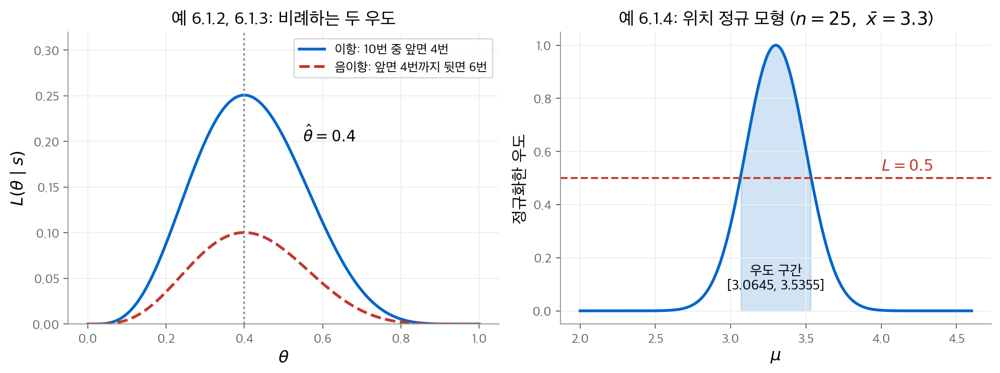
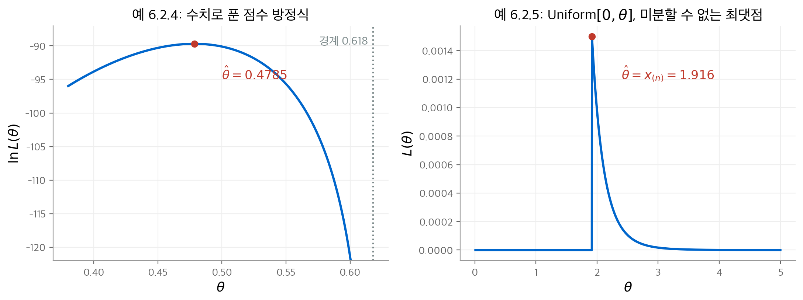
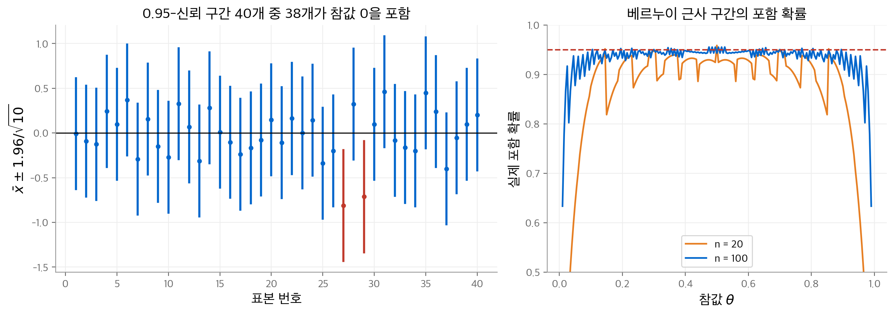
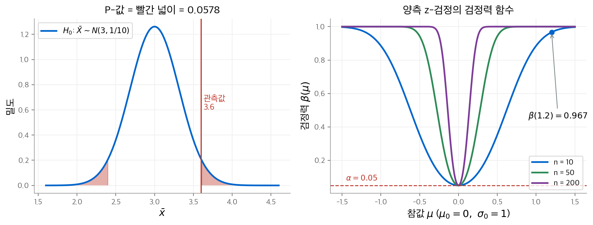
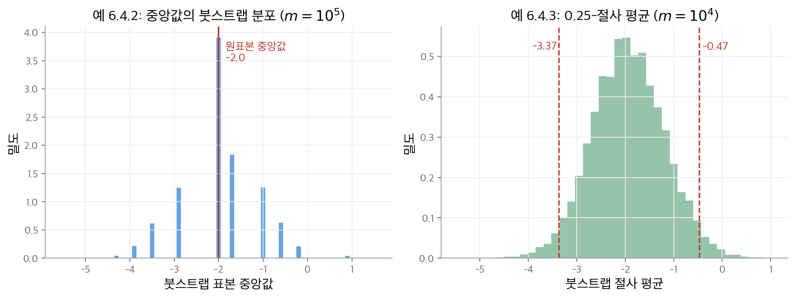
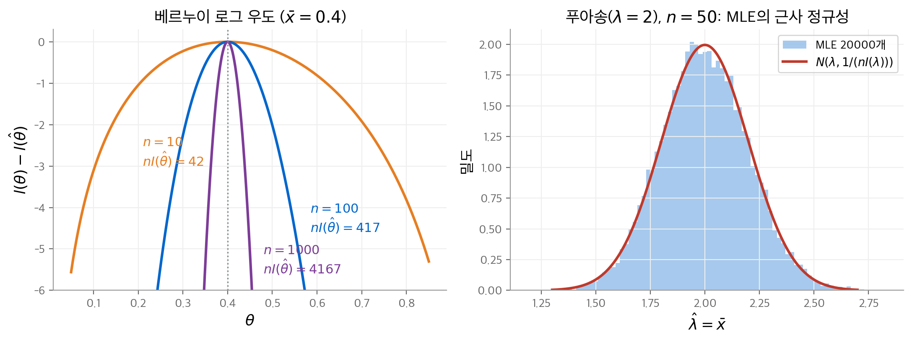

# 7. 우도 추론

[6장](06-statistical-inference.md)은 통계 모형 $\{P_\theta : \theta \in \Omega\}$ 와 데이터 $s$ 로 추론 문제를 세웠습니다.
이 장은 그 문제에 가장 기본적인 답을 줍니다. 추론이 **모형과 데이터에만** 의존하게 만드는 방법입니다.
중심 도구는 **우도 함수**(likelihood function)입니다. 우도 함수의 최댓점이 최대 우도 추정값이 되고,
그 추정값의 표본 분포에서 표준 오차, 신뢰 구간, P-값이 나옵니다.
후반부는 모형 가정을 거의 두지 않는 분포 무관 방법(붓스트랩, 부호 검정)과 MLE의 점근 이론을 다룹니다.
이 장은 교재의 6장에 해당합니다.

!!! info "원문과 자료"
    - 교재: Evans & Rosenthal, *Probability and Statistics: The Science of Uncertainty*, 2nd Edition, 6장 Likelihood Inference (p. 297–372)
    - PDF: [6장 시작 페이지](https://utstat.utoronto.ca/mikevans/jeffrosenthal/book.pdf#page=311)
    - 예제의 수치는 모두 NumPy와 SciPy로 다시 계산했습니다. 붓스트랩 값은 난수 시드에 따라 조금 달라집니다.

## 7.1 우도 함수 (6.1절)

### 정의

모형의 각 분포 $P_\theta$ 가 확률 함수 $f_\theta$ 를 갖는다고 합니다. 데이터 $s$ 를 관측한 뒤, 매개변수 공간 $\Omega$ 위의 함수를 다음과 같이 정의합니다.

$$
L(\theta \mid s) = f_\theta(s)
$$

이 함수를 **우도 함수**라고 부릅니다. 확률 함수와 식은 같지만, **데이터를 고정하고 $\theta$ 를 움직입니다.**
$L(\theta_1 \mid s) > L(\theta_2 \mid s)$ 이면 데이터는 $\theta_2$ 보다 $\theta_1$ 을 더 지지합니다.

해석에서 두 가지를 주의합니다.

- $L(\theta \mid s)$ 는 "$\theta$ 가 참일 때 $s$ 가 나올 확률"입니다. "$s$ 를 관측했을 때 $\theta$ 가 참일 확률"이 아닙니다.
- 우도의 절댓값에는 의미가 없습니다. **우도비** $L(\theta_1 \mid s) / L(\theta_2 \mid s)$ 만 의미가 있습니다.

예 6.1.1이 두 번째 점을 보여 줍니다. $P_1$ 은 $\{1, \dots, 10^3\}$ 위의 균등 분포이고, $P_2$ 는 $\{1, \dots, 10^6\}$ 위의 균등 분포입니다.
$s = 10$ 을 관측하면 $L(1 \mid 10) = 10^{-3}$, $L(2 \mid 10) = 10^{-6}$ 입니다. 두 값은 모두 작지만, 데이터는 $\theta = 1$ 을 1000배 더 지지합니다.

따라서 우도에 양수 $c$ 를 곱해도 추론은 바뀌지 않습니다. 서로 양수배인 두 우도를 **동등**(equivalent)하다고 부릅니다.

### 예: 동전 던지기 (예 6.1.2, 6.1.3)

동전을 $n = 10$ 번 던져 앞면이 $s = 4$ 번 나왔습니다. 모형은 Binomial$(10, \theta)$ 이고, 우도는 다음과 같습니다.

$$
L(\theta \mid 4) = \binom{10}{4} \theta^4 (1 - \theta)^6
$$

우도는 $\theta = 0.4$ 에서 최댓값 $0.2508$ 을 갖습니다.

이번에는 앞면이 네 번 나올 때까지 던졌더니 뒷면이 $s = 6$ 번 나왔다고 합니다. 모형은 음이항 분포이고, 우도는 $\binom{9}{6} \theta^4 (1-\theta)^6$ 입니다.
두 우도의 비는 $\binom{9}{6} / \binom{10}{4} = 84/210 = 0.4$ 로 상수입니다. 따라서 두 우도는 동등합니다.

**우도 원리**(likelihood principle)는 "동등한 우도를 주는 두 실험에서는 추론이 같아야 한다"는 원칙입니다.
이 원리를 따르면 데이터를 모은 방식(던진 횟수를 미리 정했는지, 앞면 수를 미리 정했는지)을 무시해야 합니다.
많은 통계학자는 이 원칙이 너무 강하다고 봅니다. 6.3절의 P-값은 표집 방식에 따라 달라집니다.

<figure markdown>

<figcaption>
왼쪽: 이항 실험과 음이항 실험의 우도는 비례하고, 최댓점이 모두 0.4입니다. 오른쪽: 위치 정규 모형의 우도와,
최댓값의 절반 이상인 구간(우도 구간)입니다.
</figcaption>
</figure>

### 우도 구간과 연속형 모형

$C(s) = \{\theta : L(\theta \mid s) \ge c\}$ 꼴의 집합을 **우도 구간**(likelihood region)이라고 부릅니다. 구간 밖의 값은 구간 안의 어떤 값보다도 덜 지지됩니다.
문제는 $c$ 를 고르는 기준이 우도 자체에 없다는 점입니다. 6.3.2절의 신뢰 구간이 그 기준을 줍니다.

연속형 모형에서는 한 점의 확률이 0입니다. 그래도 $s$ 근처의 작은 구간 $V$ 에서 $P_\theta(V) \approx f_\theta(s) \lvert V \rvert$ 이므로, 밀도 $f_\theta(s)$ 를 우도로 씁니다.

### 예: 위치 정규 모형 (예 6.1.4)

$x_1, \dots, x_n$ 이 $N(\mu, \sigma_0^2)$ 에서 나온 i.i.d. 표본이고, $\mu$ 는 모르고 $\sigma_0^2$ 는 압니다. 이 모형을 **위치 정규 모형**(location normal model)이라고 부릅니다.
$\sum (x_i - \mu)^2 = n(\bar x - \mu)^2 + (n-1)s^2$ 을 쓰면 우도가 다음과 같이 정리됩니다.

$$
L(\mu \mid x_1, \dots, x_n) \propto \exp\!\left( -\frac{n}{2\sigma_0^2} (\bar x - \mu)^2 \right)
$$

$n = 25$, $\sigma_0^2 = 1$, $\bar x = 3.3$ 이면 우도는 $\mu = 3.3$ 에서 1이 됩니다. $L \ge 0.5$ 인 우도 구간은 다음과 같습니다.

$$
3.3 \pm \sqrt{\frac{2 \ln 2}{25}} = [3.0645,\ 3.5355]
$$

### 예: 다항 모형 (예 6.1.5)

범주가 3개인 반응에서 $P(s = i) = \theta_i$ 라고 합니다. 매개변수 공간은 $\theta_i \ge 0$, $\theta_1 + \theta_2 + \theta_3 = 1$ 이므로 실제로는 2차원입니다.
표본에서 범주 $i$ 의 개수를 $x_i$ 라고 하면 우도는 다음과 같습니다.

$$
L(\theta_1, \theta_2, \theta_3 \mid s_1, \dots, s_n) = \theta_1^{x_1} \theta_2^{x_2} \theta_3^{x_3}
$$

원래 표본 대신 개수 $(x_1, x_2, x_3)$ 만 알아도 같은 우도를 얻습니다. 이 현상을 정식화한 개념이 충분 통계량입니다.

### 충분 통계량

**정의 6.1.1.** 표본 공간 위의 함수 $T$ 가 다음을 만족하면 **충분 통계량**(sufficient statistic)이라고 부릅니다.
$T(s_1) = T(s_2)$ 이면 어떤 상수 $c(s_1, s_2) > 0$ 이 있어 $L(\cdot \mid s_1) = c(s_1, s_2)\, L(\cdot \mid s_2)$ 입니다.

$T$ 의 값만 알면 우도비를 모두 계산할 수 있습니다. 즉 $s$ 를 $T(s)$ 로 줄여도 추론에 필요한 정보를 잃지 않습니다.

예 6.1.6은 표본 공간이 $\{1, 2, 3, 4\}$ 이고 분포가 두 개인 모형입니다.

| $s$ | 1 | 2 | 3 | 4 |
| --- | --- | --- | --- | --- |
| $f_a(s)$ | 1/2 | 1/6 | 1/6 | 1/6 |
| $f_b(s)$ | 1/4 | 1/4 | 1/4 | 1/4 |

$s = 2, 3, 4$ 는 모두 같은 우도 $(1/6, 1/4)$ 를 줍니다. 따라서 $T(1) = 0$, $T(2) = T(3) = T(4) = 1$ 이 충분 통계량입니다. 표본 공간의 원소가 4개에서 2개로 줄어듭니다.

**정리 6.1.1 (인수분해 정리).** 밀도가 $f_\theta(s) = h(s)\, g_\theta(T(s))$ 로 인수분해되면 $T$ 는 충분 통계량입니다.

**정의 6.1.2.** 우도 함수에서 $T(s)$ 의 값을 다시 계산할 수 있는 충분 통계량을 **최소 충분 통계량**(minimal sufficient statistic)이라고 부릅니다.
최소 충분 통계량은 데이터를 가장 많이 줄입니다. 다른 충분 통계량 $U$ 가 있으면 $T = h(U)$ 꼴로 쓸 수 있습니다.

| 모형 | 최소 충분 통계량 | 근거 |
| --- | --- | --- |
| 위치 정규 (예 6.1.7) | $\bar x$ | 우도의 최댓점이 $\bar x$ 입니다. |
| 위치-척도 정규 (예 6.1.8) | $(\bar x, s^2)$ | 우도가 $(\bar x, s^2)$ 로만 정해지고, 최댓점 $(\bar x, \frac{n-1}{n}s^2)$ 에서 거꾸로 구할 수 있습니다. |
| 다항 (예 6.1.9) | $(x_1, x_2, x_3)$ | 최댓점이 $(x_1/n, x_2/n, x_3/n)$ 입니다. |

## 7.2 최대 우도 추정 (6.2절)

### 정의

**정의 6.2.1.** 모든 $\theta \in \Omega$ 에서 $L(\hat\theta(s) \mid s) \ge L(\theta \mid s)$ 를 만족하는 $\hat\theta(s)$ 를 **최대 우도 추정값**(maximum likelihood estimate, MLE)이라고 부릅니다.
데이터가 가장 강하게 지지하는 매개변수 값입니다. 우도에 양수를 곱해도 최댓점은 같으므로 어떤 버전의 우도를 써도 됩니다.

예 6.2.1은 칩이 든 그릇 두 개 중 하나를 고르는 문제입니다.

| $s$ | 1 | 2 | 3 |
| --- | --- | --- | --- |
| $f_1(s)$ | 0.3 | 0.4 | 0.3 |
| $f_2(s)$ | 0.1 | 0.7 | 0.2 |

$s = 1$ 을 관측하면 $0.3 > 0.1$ 이므로 $\hat\theta = 1$ 입니다. $s = 2$ 이면 $\hat\theta = 2$, $s = 3$ 이면 $\hat\theta = 1$ 입니다. 표에서 열마다 큰 값을 고르면 됩니다.
MLE는 유일하지 않을 수 있습니다. 같은 열에 최댓값이 둘이면 둘 다 MLE입니다.

**정리 6.2.1 (불변성).** $\hat\theta$ 가 MLE이고 $\psi$ 가 $\Omega$ 위의 일대일 함수이면, $\psi(\hat\theta)$ 는 새 매개변수 $\psi$ 의 MLE입니다.
매개변수의 이름표만 바꿨으므로 최댓점도 그대로 따라갑니다. 모든 추정 방법이 이 성질을 갖지는 않습니다.

### 점수 방정식

곱을 미분하기보다 합을 미분하는 편이 쉽습니다. 그래서 **로그 우도**(log-likelihood) $l(\theta \mid s) = \ln L(\theta \mid s)$ 를 씁니다.
i.i.d. 표본이면 $l(\theta \mid s_1, \dots, s_n) = \sum_{i=1}^n \ln f_\theta(s_i)$ 입니다.
로그 우도의 도함수를 **점수 함수**(score function) $S(\theta \mid s) = \partial l(\theta \mid s) / \partial \theta$ 라고 부릅니다.

MLE를 구하는 절차는 다음과 같습니다.

1. **점수 방정식** $S(\theta \mid s) = 0$ 을 풉니다.
2. 해에서 $\partial^2 l / \partial \theta^2 < 0$ 인지 확인합니다. 이 조건은 극대를 보장합니다.
3. 극대가 여러 개이거나 경계가 있으면 모든 후보에서 $l$ 을 비교해 전역 최댓점을 고릅니다.

| 모형 | 로그 우도 | 점수 방정식의 해 | 2차 도함수 |
| --- | --- | --- | --- |
| 위치 정규 (예 6.2.2) | $-\frac{n}{2\sigma_0^2}(\bar x - \mu)^2$ | $\hat\mu = \bar x$ | $-n/\sigma_0^2 < 0$ |
| 지수, 평균 $\theta$ (예 6.2.3) | $-n \ln \theta - n\bar x/\theta$ | $\hat\theta = \bar x$ | $-n/\bar x^2 < 0$ |

### 예: 닫힌 해가 없는 경우 (예 6.2.4)

세 유형의 비율이 $p_1 = \theta$, $p_2 = \theta^2$, $p_3 = 1 - \theta - \theta^2$ 을 따른다고 합니다. 이런 관계는 유전학의 유전자형 비율에서 자주 나옵니다.
$p_3 \ge 0$ 이어야 하므로 $\theta \in [0, (\sqrt 5 - 1)/2] = [0, 0.618]$ 입니다. 로그 우도와 점수 함수는 다음과 같습니다.

$$
l(\theta) = (x_1 + 2x_2) \ln \theta + x_3 \ln(1 - \theta - \theta^2), \qquad
S(\theta) = \frac{x_1 + 2x_2}{\theta} - \frac{x_3 (1 + 2\theta)}{1 - \theta - \theta^2}
$$

점수 방정식은 이차 방정식이 됩니다. 그러나 근의 공식만으로는 어느 근이 $[0, 0.618]$ 안에 있는지 알 수 없습니다.
후보는 두 근과 두 경계점, 모두 네 개입니다. $x_1 = 70$, $x_2 = 5$, $x_3 = 25$ 이면 두 근은 $-1.28616$ 과 $0.47847$ 이므로 $\hat\theta = 0.47847$ 입니다.

실제로는 점수 방정식을 뉴턴-랩슨(Newton–Raphson) 같은 반복법으로 풉니다. 이때도 얻은 해가 정의 6.2.1을 만족하는지 확인해야 합니다.

### 예: 미분할 수 없는 경우 (예 6.2.5)

Uniform$[0, \theta]$ 모형에서 우도는 $L(\theta) = \theta^{-n} I_{[x_{(n)}, \infty)}(\theta)$ 입니다. 여기서 $x_{(n)}$ 은 가장 큰 순서 통계량입니다.
$\theta < x_{(n)}$ 이면 관측값 하나가 구간 밖에 있으므로 우도가 0입니다. $\theta \ge x_{(n)}$ 이면 우도가 감소합니다.
따라서 $\hat\theta = x_{(n)}$ 이지만, 이 점에서 우도가 미분 불가능해 점수 방정식으로는 찾을 수 없습니다.

<figure markdown>

<figcaption>
왼쪽: 예 6.2.4의 로그 우도. 점수 방정식의 근 중 매개변수 공간 안의 근 0.4785가 MLE입니다. 오른쪽: 예 6.2.5의 우도($n = 10$, $x_{(n)} = 1.916$).
최댓값 $1.916^{-10} \approx 0.0015$ 는 불연속점에서 나옵니다.
</figcaption>
</figure>

### 예: 위치-척도 정규 모형 (예 6.2.6)

$\mu$ 와 $\sigma^2$ 를 모두 모르는 경우입니다. 로그 우도는 다음과 같습니다.

$$
l(\mu, \sigma^2) = -\frac{n}{2} \ln 2\pi - \frac{n}{2} \ln \sigma^2 - \frac{n}{2\sigma^2}(\bar x - \mu)^2 - \frac{n-1}{2\sigma^2} s^2
$$

$\sigma^2$ 를 고정하면 $\mu = \bar x$ 에서 최대이고, 이 값은 $\sigma^2$ 에 의존하지 않습니다. $\mu = \bar x$ 를 대입하고 $\sigma^2$ 로 미분하면 다음을 얻습니다.

$$
\hat\mu = \bar x, \qquad \hat\sigma^2 = \frac{n-1}{n} s^2 = \frac{1}{n} \sum_{i=1}^n (x_i - \bar x)^2
$$

$\hat\sigma^2$ 은 $n$ 으로 나누므로 $n-1$ 로 나누는 $s^2$ 과 다릅니다. 이 차이는 7.3절의 편향에서 다시 나옵니다.

### 대입 MLE의 함정 (예 6.2.7)

관심 있는 양 $\psi(\theta)$ 를 $\psi(\hat\theta)$ 로 추정하는 방법을 **대입 MLE**(plug-in MLE)라고 부릅니다. $\psi$ 가 일대일이 아니면 대입 MLE는 정식 MLE가 아닙니다.

$X_i \sim N(\mu_i, 1)$ 이 독립이고 $\mu_1, \dots, \mu_n$ 을 모두 모른다고 합니다. $\psi = \sum \mu_i^2$ 를 추정하려고 합니다.
$\hat\mu_i = x_i$ 이므로 대입 MLE는 $\sum x_i^2$ 입니다. 그런데 기댓값을 계산하면 다음과 같습니다.

$$
E\left( \sum_{i=1}^n X_i^2 \right) = \sum_{i=1}^n \left( \mathrm{Var}(X_i) + \mu_i^2 \right) = \psi + n
$$

$n$ 이 크면 대입 MLE는 참값에서 체계적으로 멀어집니다. $\sum x_i^2 - n$ 이 즉시 더 나은 추정량입니다.

### 다차원의 경우 (6.2.2절)

$\theta \in \mathbb{R}^k$ 이면 점수 함수는 그래디언트 $\nabla_\theta\, l(\theta \mid s)$ 이고, 점수 방정식은 $k$ 개의 연립 방정식입니다.
해가 극대이려면 로그 우도의 헤시안이 그 점에서 **음의 정부호**(negative definite)여야 합니다. 즉 모든 고윳값이 음수여야 합니다.
대부분 수치 최적화로 풉니다.

## 7.3 MLE에 기반한 추론 (6.3절)

교재는 이 절을 1882년 마이컬슨(Michelson)과 뉴컴(Newcomb)의 빛의 속력 측정값 $n = 66$ 개로 시작합니다.
상자 그림에서 $-44$ 와 $-2$ 가 이상값으로 보입니다. 이 둘을 빼면 히스토그램이 대칭에 가까워, 위치-척도 정규 모형이 그럴듯합니다.
나머지 64개의 평균은 $27.75$, 표준 편차는 $5.08$ 입니다.

추정값만으로는 부족합니다. 추정값이 참값에 얼마나 가까운지도 알려야 합니다. 이 절은 그 정확도를 재는 세 도구를 다룹니다.

### 평균 제곱 오차, 편향, 표준 오차 (6.3.1절)

**정의 6.3.1.** 추정량 $T$ 의 **평균 제곱 오차**(mean-squared error)는 $\mathrm{MSE}_\theta(T) = E_\theta\big((T - \psi(\theta))^2\big)$ 입니다.

**정리 6.3.1.** 평균 제곱 오차는 분산과 편향 제곱의 합입니다.

$$
\mathrm{MSE}_\theta(T) = \mathrm{Var}_\theta(T) + \big( E_\theta(T) - \psi(\theta) \big)^2
$$

둘째 항의 괄호 안을 **편향**(bias)이라고 부릅니다. 모든 $\theta$ 에서 편향이 0인 추정량을 **불편 추정량**(unbiased estimator)이라고 부릅니다.
불편 추정량이면 $\mathrm{MSE}$ 가 분산과 같습니다. 분산의 추정값에 제곱근을 씌운 값을 **표준 오차**(standard error)라고 부릅니다.
추정값을 보고할 때는 표준 오차를 함께 보고하는 것이 좋은 관행입니다.

| 예제 | 모형 | MLE | 표준 오차 | 수치 |
| --- | --- | --- | --- | --- |
| 6.3.1 | 위치 정규 | $\bar x$ | $\sigma_0/\sqrt{n}$ | |
| 6.3.2, 6.3.3 | 베르누이 | $\bar x$ | $\sqrt{\bar x(1-\bar x)/n}$ | 1000가구 중 790가구가 "예": $\bar x = 0.79$, 표준 오차 $0.01288$ |
| 6.3.4, 6.3.5 | 위치-척도 정규 | $\bar x$ | $s/\sqrt{n}$ | 학생 30명의 키: $\bar x = 64.517$, $s = 2.379$, 표준 오차 $0.43434$ |

위치-척도 정규 모형에서 $\hat\sigma^2/n$ 대신 $s^2/n$ 을 씁니다. $E(S^2) = \sigma^2$ 이므로 $S^2$ 이 $\sigma^2$ 의 불편 추정량이기 때문입니다.

### 일치성

**정의 6.3.3.** 추정량의 수열이 모든 $\theta$ 에서 $T_n \xrightarrow{P} \psi(\theta)$ 이면 **일치 추정량**(consistent estimator)이라고 부릅니다. 확률 1 수렴이면 거의 확실한 일치성입니다.
데이터를 더 모으면 정보가 늘어나므로, 일치하지 않는 추정 방법은 쓰면 안 됩니다.
표본 평균의 일치성은 [4장](04-sampling-limits.md)의 큰 수의 법칙에서 바로 나옵니다. MLE의 일치성은 7.5절의 정리 6.5.2가 줍니다.

### 신뢰 구간 (6.3.2절)

**정의 6.3.4.** 모든 $\theta$ 에서 $P_\theta\big(\psi(\theta) \in C(s)\big) \ge \gamma$ 이면 구간 $C(s) = (l(s), u(s))$ 를 **$\gamma$-신뢰 구간**(confidence interval)이라고 부릅니다. $\gamma$ 는 **신뢰 수준**입니다.

확률 $\gamma$ 는 구간을 만드는 **절차**의 성질입니다. 데이터를 관측한 뒤의 특정 구간은 참값을 포함하거나 포함하지 않을 뿐입니다.
따라서 "이 구간이 참값을 포함할 확률이 0.95"라고 말하면 틀립니다.

#### z-신뢰 구간 (예 6.3.6)

위치 정규 모형에서 우도 구간은 $\bar x \pm k\,\sigma_0/\sqrt n$ 꼴입니다. $Z = (\bar X - \mu)/(\sigma_0/\sqrt n) \sim N(0, 1)$ 이므로 포함 확률은 다음과 같습니다.

$$
P_\mu\left( \bar X - k \frac{\sigma_0}{\sqrt n} \le \mu \le \bar X + k \frac{\sigma_0}{\sqrt n} \right) = 2\Phi(k) - 1
$$

$2\Phi(k) - 1 = \gamma$ 로 두면 $k = z_{(1+\gamma)/2}$ 입니다. 이렇게 얻은 **z-신뢰 구간**은 정확한 $\gamma$-신뢰 구간입니다.

$$
\left[ \bar x - z_{(1+\gamma)/2} \frac{\sigma_0}{\sqrt n},\ \bar x + z_{(1+\gamma)/2} \frac{\sigma_0}{\sqrt n} \right]
$$

$\gamma = 0.95$ 이면 $z_{0.975} = 1.96$ 입니다. 구간의 반 길이를 **오차 한계**(margin of error)라고 부릅니다.
표준 오차가 오차 한계를 정합니다. 예를 들어 $\bar x \pm 3\sigma_0/\sqrt n$ 은 참값을 확률 $0.9974$ 로 포함합니다.

<figure markdown>

<figcaption>
왼쪽: $N(0, 1)$ 에서 $n = 10$ 인 표본을 40번 뽑아 만든 0.95-신뢰 구간입니다. 빨간 구간 두 개는 참값 0을 놓쳤습니다(교재 그림 6.3.3과 같은 실험).
오른쪽: 베르누이 근사 구간 (6.3.5)의 실제 포함 확률입니다. $\theta$ 가 0이나 1에 가깝거나 $n$ 이 작으면 0.95보다 크게 낮아집니다.
</figcaption>
</figure>

#### 베르누이 모형의 근사 구간 (예 6.3.7)

베르누이 모형에서 우도 구간을 정확히 구하려면 수치 해법이 필요합니다. 대신 [중심 극한 정리](04-sampling-limits.md)로 근사합니다.
$\sqrt{n}(\bar X - \theta)/\sqrt{\bar X(1-\bar X)} \xrightarrow{D} N(0, 1)$ 이므로 근사 $\gamma$-신뢰 구간은 다음과 같습니다.

$$
\bar x \pm z_{(1+\gamma)/2} \sqrt{\frac{\bar x(1 - \bar x)}{n}}
$$

예 6.3.3의 여론 조사에서는 $0.79 \pm 1.96 \times 0.01288 = [0.76475,\ 0.81525]$ 이고, 오차 한계는 $0.025245$ 입니다.
이 구간은 근사이므로, 실제 포함 확률이 $\gamma$ 와 다를 수 있습니다. 위 그림의 오른쪽 패널처럼 $\theta$ 근처에서 모의실험으로 확인하는 편이 좋습니다.

#### t-신뢰 구간 (예 6.3.8)

$\sigma^2$ 를 모르면 표준 오차 $s/\sqrt n$ 을 씁니다. [4장](04-sampling-limits.md)의 정리 4.6.6에 따라 다음 통계량은 $t(n-1)$ 분포를 따릅니다.

$$
T = \frac{\bar X - \mu}{S/\sqrt{n}} \sim t(n-1)
$$

따라서 $\bar x \pm t_{(1+\gamma)/2}(n-1)\, s/\sqrt n$ 이 정확한 $\gamma$-신뢰 구간입니다. 이 구간을 **t-신뢰 구간**이라고 부릅니다.
$\sigma$ 를 모르는 불확실성 때문에 z-구간보다 깁니다. 예를 들어 $n = 5$ 이면 $\bar x \pm 3s/\sqrt n$ 의 신뢰 수준은 $0.960$ 이고, $\bar x \pm 3\sigma/\sqrt n$ 의 신뢰 수준은 $0.9974$ 입니다.[^t5]

[^t5]: 교재는 이 값을 0.97로 적었습니다. $2G(3;\,4) - 1 = 0.9601$ 입니다.

학생 키 예제에서 $t_{0.975}(29) = 2.0452$ 이므로 0.95-신뢰 구간은 다음과 같습니다.

$$
64.517 \pm 2.0452 \times 0.43434 = [63.629,\ 65.405]
$$

오차 한계가 $0.888$ 인치이므로, 추정값이 참값과 1인치 이내라고 상당히 확신할 수 있습니다.

### 가설 검정과 P-값 (6.3.3절)

**귀무가설**(null hypothesis) $H_0 : \psi(\theta) = \psi_0$ 이 데이터와 맞는지 평가합니다.
$H_0$ 의 분포에서 관측값이 확률이 낮은 영역에 있으면 데이터는 $H_0$ 에 반하는 증거입니다.
이 "놀라움"을 재는 확률을 **P-값**(P-value)이라고 부릅니다. P-값이 작을수록 $H_0$ 아래에서 관측값이 놀랍습니다.

P-값을 해석할 때 세 가지를 주의합니다.

- P-값은 $H_0$ 이 참일 확률이 아닙니다.
- 큰 P-값은 $H_0$ 이 참이라는 증거가 아닙니다.
- 해석은 검정의 검정력(6.3.6절)에 따라 달라집니다.

#### z-검정 (예 6.3.9, 6.3.10)

위치 정규 모형에서 $H_0 : \mu = \mu_0$ 이면 $\bar X \sim N(\mu_0, \sigma_0^2/n)$ 입니다. 정규 밀도는 단봉이므로 확률이 낮은 영역은 양쪽 꼬리입니다.
관측값만큼 또는 그보다 더 중심에서 먼 값이 나올 확률이 P-값입니다.

$$
P\text{-값} = P_{\mu_0}\big( \lvert \bar X - \mu_0 \rvert \ge \lvert \bar x - \mu_0 \rvert \big) = 2\left[ 1 - \Phi\left( \frac{\lvert \bar x - \mu_0 \rvert}{\sigma_0/\sqrt n} \right) \right]
$$

예 6.3.10은 $N(26, 4)$ 에서 만든 표본 $n = 10$ 개이고, $\bar x = 26.6808$ 입니다. $H_0 : \mu = 25$ 를 검정합니다.

$$
2\left[ 1 - \Phi\left( \frac{26.6808 - 25}{2/\sqrt{10}} \right) \right] = 2\left[ 1 - \Phi(2.6576) \right] = 0.0078
$$

$H_0$ 이 참이면 이만큼 놀라운 데이터는 0.78%의 경우에만 나옵니다. 따라서 $H_0$ 에 반하는 증거가 있습니다.

<figure markdown>

<figcaption>
왼쪽: $\mu_0 = 3$, $\sigma_0 = 1$, $n = 10$ 에서 관측값이 3.6일 때의 P-값입니다(설명용 값). 양쪽 꼬리의 빨간 넓이를 더하면 0.0578입니다.
교재 그림 6.3.4의 관측값 4.2는 꼬리 넓이가 0.0001이라 그림에서 보이지 않습니다. 오른쪽: 양측 z-검정의 검정력 함수입니다. $n$ 이 클수록 $\mu_0$ 에서 벗어난 값을 더 잘 찾아냅니다.
</figcaption>
</figure>

#### 베르누이 모형의 검정 (예 6.3.11)

초능력자가 동전 던지기 결과를 맞힌다고 주장합니다. 100번 중 54번을 맞혔습니다. 능력이 없다는 가설은 $H_0 : \theta = 1/2$ 입니다.

$$
2\left[ 1 - \Phi\left( \frac{\sqrt{100}\,(0.54 - 0.5)}{\sqrt{0.5 \times 0.5}} \right) \right] = 2\left[ 1 - \Phi(0.8) \right] = 0.4238
$$

P-값이 크므로 $H_0$ 을 의심할 근거가 없습니다. P-값이 0.05보다 작으면 "5% 수준에서 **통계적으로 유의**(statistically significant)하다"고 말합니다. 0.05라는 기준에 특별한 근거는 없습니다.

#### 통계적 유의성과 실질적 유의성

참값 $\mu_1$ 이 $\mu_0$ 과 아주 조금만 달라도, $n \to \infty$ 이면 z-검정의 P-값은 거의 확실하게 0으로 갑니다.
표본이 충분히 크면 실질적으로 의미 없는 차이도 유의해집니다. 그래서 유의한 결과가 나오면 추정된 차이 $\lvert \bar x - \mu_0 \rvert$ 도 함께 봐야 합니다.
그 차이가 응용에서 중요한 기준 $\delta$ 보다 작으면, 중요한 차이는 없다고 결론 내릴 수 있습니다.

#### 신뢰 구간과 검정의 동치 (예 6.3.12)

z-검정의 P-값이 $1 - \gamma$ 보다 작은 것과, $\mu_0$ 이 z-신뢰 구간 밖에 있는 것은 동치입니다.

$$
2\left[1 - \Phi\left(\frac{\lvert\bar x - \mu_0\rvert}{\sigma_0/\sqrt n}\right)\right] < 1 - \gamma
\iff \mu_0 \notin \left[ \bar x \pm z_{(1+\gamma)/2} \frac{\sigma_0}{\sqrt n} \right]
$$

예 6.3.10의 0.95-신뢰 구간은 $[25.441,\ 27.920]$ 이고, 25를 포함하지 않습니다. 초능력자 예제의 구간은 $[0.44231,\ 0.63769]$ 이고, 0.5를 포함합니다. 두 결론 모두 P-값과 같습니다.

#### t-검정과 단측 검정 (예 6.3.13, 6.3.14)

$\sigma^2$ 을 모르면 $T = (\bar X - \mu_0)/(S/\sqrt n) \sim t(n-1)$ 을 씁니다. P-값은 $2[1 - G(\lvert t \rvert;\, n-1)]$ 이고, 이 절차를 **t-검정**이라고 부릅니다.
예 6.3.10의 데이터에서 $s^2 = 4.8620$ 이면 다음과 같습니다.

$$
t = \frac{26.6808 - 25}{\sqrt{4.8620}/\sqrt{10}} = 2.4105, \qquad t_{0.975}(9) = 2.2622
$$

$\lvert t \rvert > 2.2622$ 이므로 5% 수준에서 유의합니다. 정확한 P-값은 $0.039$ 입니다.

$H_0 : \mu \le \mu_0$ 같은 **단측 검정**(one-sided test)에서는 한쪽 꼬리만 봅니다. 예를 들어 $H_0 : \mu \le \mu_0$ 의 P-값은 $1 - \Phi\big((\bar x - \mu_0)/(\sigma_0/\sqrt n)\big)$ 입니다.

### 분산에 대한 추론 (6.3.4절)

정규 표본에서 $(n-1)S^2/\sigma^2 \sim \chi^2(n-1)$ 이므로(정리 4.6.6), $\sigma^2$ 의 정확한 $\gamma$-신뢰 구간은 다음과 같습니다.

$$
\left[ \frac{(n-1)s^2}{\chi^2_{(1+\gamma)/2}(n-1)},\ \frac{(n-1)s^2}{\chi^2_{(1-\gamma)/2}(n-1)} \right]
$$

예 6.3.15는 예 6.3.10의 데이터를 씁니다. $n = 10$, $s^2 = 4.8620$, $\chi^2_{0.025}(9) = 2.700$, $\chi^2_{0.975}(9) = 19.023$ 입니다.

$$
\left[ \frac{9 \times 4.8620}{19.023},\ \frac{9 \times 4.8620}{2.700} \right] = [2.300,\ 16.207]
$$

구간이 길어 $\sigma^2$ 의 불확실성이 큽니다. 참값 4는 구간 안에 있으므로, $H_0 : \sigma^2 = 4$ 는 5% 수준에서 기각되지 않습니다.

### 표본 크기 계산 (6.3.5–6.3.6절)

#### 신뢰 구간의 길이

오차 한계를 $\delta$ 이하로 만들려면 $z_{(1+\gamma)/2}\, \sigma_0/\sqrt n \le \delta$ 이어야 합니다. 즉 $n \ge \sigma_0^2 (z_{(1+\gamma)/2}/\delta)^2$ 입니다.

| 예제 | 조건 | 최소 $n$ |
| --- | --- | --- |
| 6.3.16 평균 | $\sigma_0^2 = 10$, $\gamma = 0.95$, $\delta = 0.5$ | $10 \times (1.96/0.5)^2 = 153.7 \to 154$ |
| 6.3.17 비율 | $\gamma = 0.95$, $\delta = 0.1$ | $\frac14 (1.96/0.1)^2 = 96.04 \to 97$ |
| 6.3.17 비율 | $\gamma = 0.95$, $\delta = 0.01$ | $\frac14 (1.96/0.01)^2 = 9604$ |

비율의 경우 $\bar x(1 - \bar x) \le 1/4$ 라는 상한을 씁니다. 이 상한은 $\bar x = 1/2$ 에서 등호가 됩니다.
$\sigma^2$ 을 모르면 $s$ 가 아직 관측되지 않았으므로, $\sigma$ 의 보수적인 상한 $b$ 를 대신 씁니다.

#### 검정력

유의 수준 $\alpha$ 에서 참값이 $\theta$ 일 때 P-값이 $\alpha$ 보다 작을 확률을 **검정력**(power) $\beta(\theta)$ 라고 부릅니다.
검정력이 낮으면 $H_0$ 이 거짓이어도 증거를 찾지 못합니다. 그래서 실질적으로 중요한 차이 $\theta_1$ 에서 검정력이 충분하도록 $n$ 을 정합니다.

양측 z-검정의 검정력 함수는 다음과 같습니다(예 6.3.18).

$$
\beta(\mu) = 1 - \Phi\left( \frac{\mu_0 - \mu}{\sigma_0/\sqrt n} + z_{1 - \alpha/2} \right) + \Phi\left( \frac{\mu_0 - \mu}{\sigma_0/\sqrt n} - z_{1 - \alpha/2} \right)
$$

$\beta$ 는 $\mu_0$ 에 대해 대칭이고, $\mu_0$ 에서 최솟값 $\alpha$ 를 갖고, 멀어질수록 증가합니다. 또 $n$ 에 대해 증가합니다.
$n = 10$, $\mu_0 = 0$, $\sigma_0 = 1$, $\alpha = 0.05$ 이면 $\beta(1.2) = 0.967$ 입니다.

$\sigma_0 = 1$, $\alpha = 0.05$, $\lvert \mu_1 - \mu_0 \rvert = 0.1$ 에서 필요한 $n$ 을 계산하면 다음과 같습니다.

| 목표 검정력 | 최소 $n$ |
| --- | --- |
| 0.80 | 785 |
| 0.99 | 1838 |

교재는 목표 검정력을 0.99로 적고 $n = 785$ 를 답으로 적었습니다. 785는 검정력 0.80에 해당하는 값입니다.

## 7.4 분포 무관 방법 (6.4절)

우도 방법은 참 분포가 모형 $\{P_\theta\}$ 안에 있다는 가정에 의존합니다. 가정이 틀리면 결론이 크게 틀릴 수 있습니다.
반대로 모형을 아주 크게 잡으면 가정이 거의 없어집니다. 이런 모형에서 쓰는 방법을 **분포 무관**(distribution-free) 방법이라고 부릅니다.
작은 모형이 맞으면 작은 모형이 정보를 더 잘 씁니다. 모형의 크기에는 이런 상충 관계가 있습니다.

### 적률법 (6.4.1절)

모형이 "처음 $l$ 개 적률이 존재하는 모든 분포"라고 합니다. 모적률 $\mu_i = E(X^i)$ 의 자연스러운 추정량은 표본 적률 $m_i = \frac1n \sum_j x_j^i$ 입니다.
$m_i$ 는 불편이고, 큰 수의 법칙으로 일치합니다. $i \le l/2$ 이면 분산이 유한하므로 근사 신뢰 구간 $m_i \pm z_{(1+\gamma)/2}\, s_i/\sqrt n$ 을 쓸 수 있습니다.
여기서 $s_i^2$ 은 $x_1^i, \dots, x_n^i$ 의 표본 분산입니다.

**적률법 원리**(method of moments principle)는 적률의 함수 $\psi(\mu_1, \dots, \mu_k)$ 를 $\psi(m_1, \dots, m_k)$ 로 추정합니다.
$k = 1$ 이면 **델타 정리**(delta theorem)가 근사 분포를 줍니다.

$$
\frac{\sqrt n \big( \psi(\bar X) - \psi(\mu_1) \big)}{\lvert \psi'(\bar X) \rvert\, S} \xrightarrow{D} N(0, 1)
$$

예 6.4.1은 $\psi(\mu) = 1/\mu^2$ 입니다. $\psi'(\mu) = -2/\mu^3$ 이므로 근사 구간은 $1/\bar x^2 \pm z_{(1+\gamma)/2}\, 2s/(\sqrt n\, \lvert\bar x\rvert^3)$ 입니다.
$\mu = 0$ 근처에서는 $\psi$ 가 미분 가능하지 않으므로 이 구간을 쓰면 안 됩니다.

### 붓스트랩 (6.4.2절)

모형이 $\mathbb{R}^1$ 위의 모든 분포라고 합니다. 누적 분포 함수 $F$ 의 자연스러운 추정량은 **경험 분포 함수**(empirical distribution function)입니다.

$$
\hat F(x) = \frac{1}{n} \sum_{i=1}^n I_{(-\infty, x]}(x_i)
$$

$\hat F(x)$ 는 $F(x)$ 의 불편 일치 추정량입니다. $\hat F$ 는 표본점마다 확률 $1/n$ 을 주는 이산 분포이므로, $\hat F$ 에서 표본을 뽑기는 쉽습니다.

추정량 $\hat\psi$ 의 분산을 알고 싶다고 합니다. 참 분포 $F$ 를 모르므로 $\hat F$ 를 대신 씁니다.
그러나 $\mathrm{Var}_{\hat F}(\hat\psi)$ 를 정확히 계산하려면 $n^n$ 개의 항을 더해야 합니다. $n = 15$ 이면 $15^{15} \approx 4.4 \times 10^{17}$ 개입니다.
대신 몬테카를로로 근사합니다.

1. $\hat F$ 에서 크기 $n$ 인 표본을 복원 추출로 $m$ 번 뽑습니다. 이 표본을 **붓스트랩 표본**(bootstrap sample)이라고 부릅니다.
2. 붓스트랩 표본마다 $\hat\psi_1, \dots, \hat\psi_m$ 을 계산합니다.
3. $\hat\psi_1, \dots, \hat\psi_m$ 의 표본 분산을 $\mathrm{Var}_{\hat F}(\hat\psi)$ 의 추정값으로 씁니다. 그 제곱근이 **붓스트랩 표준 오차**입니다.

편향 제곱은 $\big(\hat\psi - T(\hat F)\big)^2$ 로 추정합니다. 여기서 $T(\hat F)$ 는 경험 분포에서 계산한 같은 특성값입니다. 둘을 더하면 MSE의 추정값입니다.

#### 예: 표본 중앙값 (예 6.4.2)

대칭 분포의 중심을 표본 중앙값으로 추정합니다. 중앙값은 극단값의 영향을 받지 않지만, 표본 분포를 이론으로 구하기 어렵습니다. 데이터는 다음 15개입니다.

$$
-2.0,\ -0.2,\ -5.2,\ -3.5,\ -3.9,\ -0.6,\ -4.3,\ -1.7,\ -9.5,\ 1.6,\ -2.9,\ 0.9,\ -1.0,\ -2.0,\ 3.0
$$

| 양 | 값 |
| --- | --- |
| 표본 중앙값 $\hat\psi$ | $-2.000$ |
| 표본 평균 $T(\hat F) = \bar x$ | $-2.087$ |
| 편향 제곱 추정값 $(-2.000 + 2.087)^2$ | $0.007569$ |
| 붓스트랩 분산 ($m = 10^5$) | 교재 $0.704928$, 다시 계산 $0.7070$ |
| 중앙값의 MSE 추정값 | $0.007569 + 0.704928 = 0.71250$ |
| 표본 평균의 MSE 추정값 $s^2/n$ | $0.62410$ |

두 추정량의 정확도는 비슷합니다. 교재는 $m = 10^3, 10^4, 10^5$ 로 늘리며 값이 안정되는지 확인했습니다. 이 방법이 $m$ 을 고르는 가장 직접적인 방법입니다.

<figure markdown>

<figcaption>
왼쪽: 표본 중앙값의 붓스트랩 분포입니다. 중앙값은 원래 표본값 중 하나만 가질 수 있어서 분포가 이산적이고 비대칭입니다.
오른쪽: 0.25-절사 평균의 붓스트랩 분포입니다. 정규 분포에 가까워 붓스트랩 신뢰 구간을 쓸 수 있습니다. 점선은 백분위 0.95-구간입니다.
</figcaption>
</figure>

#### 붓스트랩 신뢰 구간 (예 6.4.3)

두 가지 간단한 구간이 있습니다.

- **붓스트랩 t-구간**: $\hat\psi \pm t_{(1+\gamma)/2}(n-1)\, \sqrt{\mathrm{Var}_{\hat F}(\hat\psi)}$
- **붓스트랩 백분위 구간**: 붓스트랩 값 $\hat\psi_1, \dots, \hat\psi_m$ 의 $(1-\gamma)/2$ 와 $(1+\gamma)/2$ 경험 분위수

두 구간 모두 $\hat\psi$ 가 거의 불편이고 붓스트랩 분포가 정규에 가까워야 씁니다. 중앙값의 붓스트랩 분포는 정규가 아니므로 이 구간을 쓰지 않습니다.

**정의 6.4.1.** 표본 **$\alpha$-절사 평균**($\alpha$-trimmed mean)은 작은 쪽과 큰 쪽에서 각각 $\lfloor n\alpha \rfloor$ 개를 버리고 남은 값의 평균입니다.
$\alpha = 0$ 이면 표본 평균이고, $\alpha \to 0.5$ 이면 표본 중앙값입니다.

같은 데이터에서 $\alpha = 0.25$ 이면 $\lfloor 3.75 \rfloor = 3$ 개씩 버립니다. 남은 9개의 평균은 $\bar x_{0.25} = -1.97778$ 입니다.
붓스트랩 표준 오차는 $0.7380$ 이고 $t_{0.975}(14) = 2.14479$ 이므로, 붓스트랩 t-구간은 다음과 같습니다.

$$
-1.97778 \pm 2.14479 \times 0.7380 = [-3.56,\ -0.39]
$$

백분위 구간은 교재에서 $[-3.36667,\ -0.488889]$, 다시 계산한 결과는 $[-3.37,\ -0.47]$ 입니다. 두 구간은 비슷합니다.

### 부호 통계량과 분위수 추론 (6.4.3절)

모형이 연속 분포 전체라고 합니다. $p$ 분위수 $x_p$ 에 대한 가설 $H_0 : x_p = x_0$ 을 검정합니다.
**부호 통계량**(sign statistic) $S = \sum_i I_{(-\infty, x_0]}(x_i)$ 는 $x_0$ 이하인 표본의 개수입니다.
$H_0$ 이 참이면 $S \sim$ Binomial$(n, p)$ 이고, 이 분포는 모형의 다른 성질에 의존하지 않습니다. P-값은 관측값 $S_o$ 보다 확률이 같거나 작은 값들의 이항 확률의 합입니다.

#### 예: 부호 검정 (예 6.4.4)

다음 표본 $n = 10$ 개로 중앙값에 대한 가설 $H_0 : x_{0.5} = 0$ 을 검정합니다. 극단값이 두 개 있어 정규 분포 가정은 어울리지 않습니다.

$$
0.44,\ -0.06,\ 0.43,\ -0.16,\ -2.13,\ 1.15,\ 1.08,\ 5.67,\ -4.97,\ 0.11
$$

표본 중앙값은 $(0.11 + 0.43)/2 = 0.27$ 이고, 부호 통계량은 $S_o = 4$ 입니다. Binomial$(10, 1/2)$ 에서 P-값은 다음과 같습니다.

$$
P(\lvert S - 5 \rvert \ge 1) = 1 - P(S = 5) = 1 - \binom{10}{5} 2^{-10} = 1 - 0.24609 = 0.75391
$$

$H_0$ 을 기각할 근거가 없습니다. 0.95-신뢰 구간을 구하려면 $P(\lvert S - 5 \rvert \ge j - 5) \le 0.05$ 인 가장 작은 $j$ 를 찾습니다.

| $j$ | $P(\lvert S - 5 \rvert \ge j - 5)$ |
| --- | --- |
| 10 | $0.001953$ |
| 9 | $0.021484$ |
| 8 | $0.109375$ |

$j = 9$ 이므로 신뢰 구간은 $[x_{(n-j+1)}, x_{(j)}) = [x_{(2)}, x_{(9)})$ 입니다. 정확한 포함 확률은 $1 - 0.021484 = 0.9785$ 입니다.
위 데이터로 계산하면 $[-2.13,\ 1.15)$ 입니다. 교재는 $[-0.16,\ 1.15)$ 로 적었습니다. $-0.16$ 은 세 번째 순서 통계량 $x_{(3)}$ 입니다.

## 7.5 MLE의 점근 이론 (6.5절)

우도의 그래프로 MLE의 정확도를 판단하는 방법에는 한계가 있습니다. 축의 척도에 따라 모양이 달라지고, 3차원 이상이면 그릴 수도 없습니다.
그래서 최댓점에서 로그 우도가 얼마나 뾰족한지를 수로 잽니다.

**정의 6.5.1.** **관측 피셔 정보**(observed Fisher information)는 MLE에서 로그 우도의 음의 2차 도함수입니다.

$$
\hat I(s) = -\left. \frac{\partial^2 l(\theta \mid s)}{\partial \theta^2} \right|_{\theta = \hat\theta(s)}
$$

### 피셔 정보

미분과 적분의 순서를 바꿀 수 있다는 정칙 조건(regularity conditions)을 가정합니다. 그러면 다음이 성립합니다.

**정리 6.5.1.** 점수의 기댓값은 0이고, 점수의 분산은 로그 우도의 음의 2차 도함수의 기댓값과 같습니다.

$$
E_\theta\big( S(\theta \mid X) \big) = 0, \qquad
I(\theta) = \mathrm{Var}_\theta\big( S(\theta \mid X) \big) = -E_\theta\left( \frac{\partial^2}{\partial \theta^2} l(\theta \mid X) \right)
$$

$I(\theta)$ 를 모형의 **피셔 정보**(Fisher information)라고 부릅니다. 첫째 식은 $\int f_\theta(x)\, dx = 1$ 을 $\theta$ 로 미분해서 얻습니다.

**따름정리 6.5.1.** 크기 $n$ 인 i.i.d. 표본의 피셔 정보는 $nI(\theta)$ 입니다. 로그 우도가 독립항의 합이기 때문입니다.

피셔 정보는 항상 정의되지는 않습니다. Uniform$[0, \theta]$ 모형(예 6.5.1)은 밀도가 $x = \theta$ 에서 미분 불가능하고, $\int \partial f_\theta / \partial\theta\, dx = -1/\theta \ne 0$ 이므로 정칙 조건을 만족하지 않습니다.

<figure markdown>

<figcaption>
왼쪽: $\bar x = 0.4$ 로 같은 베르누이 표본의 로그 우도입니다. $n$ 이 커질수록 최댓점의 곡률 $nI(\hat\theta) = n/(\hat\theta(1-\hat\theta))$ 이 커지고, 추정이 정확해집니다.
오른쪽: 푸아송 모형에서 MLE $\bar x$ 의 표본 분포가 $N(\lambda, 1/(nI(\lambda)))$ 에 가깝습니다.
</figcaption>
</figure>

### MLE의 일치성과 점근 정규성

다음 두 정리는 증명 없이 인용합니다(Serfling, *Approximation Theorems of Mathematical Statistics*, 1980).

**정리 6.5.2.** 정칙 조건 아래에서 MLE는 거의 확실하게 존재하고 $\hat\theta \xrightarrow{a.s.} \theta$ 입니다. MLE의 강한 큰 수의 법칙에 해당합니다.

**정리 6.5.3.** 정칙 조건 아래에서 다음이 성립합니다. MLE의 중심 극한 정리에 해당합니다.

$$
\big( nI(\theta) \big)^{1/2} (\hat\theta - \theta) \xrightarrow{D} N(0, 1)
$$

**따름정리 6.5.2.** $I$ 가 연속이면 $\theta$ 자리에 $\hat\theta$ 를 넣어도 같은 결과가 성립합니다. $nI(\hat\theta)$ 를 **대입 피셔 정보**(plug-in Fisher information)라고 부릅니다. $I$ 를 계산하기 어려우면 관측 피셔 정보 $\hat I$ 를 대신 씁니다.

이 결과로 대표본 근사 추론을 만듭니다.

| 추론 | 식 |
| --- | --- |
| 근사 표준 오차 | $\big(nI(\hat\theta)\big)^{-1/2}$ |
| 근사 $\gamma$-신뢰 구간 | $\hat\theta \pm \big(nI(\hat\theta)\big)^{-1/2} z_{(1+\gamma)/2}$ |
| $H_0 : \theta = \theta_0$ 의 근사 P-값 | $2\left[ 1 - \Phi\left( \big(nI(\theta_0)\big)^{1/2} \lvert \hat\theta - \theta_0 \rvert \right) \right]$ |

P-값에는 $\theta_0$ 에서의 피셔 정보를 씁니다. $H_0$ 이 참이면 점근 분산 $(nI(\theta_0))^{-1}$ 을 정확히 알기 때문입니다.

### 예: 세 모형에 적용 (예 6.5.2–6.5.5)

| 모형 | 점수 $S(\theta)$ | $nI(\theta)$ | 근사 $\gamma$-구간 | 비고 |
| --- | --- | --- | --- | --- |
| 위치 정규 | $\frac{n}{\sigma_0^2}(\bar x - \mu)$ | $n/\sigma_0^2$ | $\bar x \pm z\, \sigma_0/\sqrt n$ | z-구간과 같고, 포함 확률이 정확합니다. |
| 베르누이 | $\frac{n\bar x}{\theta} - \frac{n(1-\bar x)}{1-\theta}$ | $\frac{n}{\theta(1-\theta)}$ | $\bar x \pm z \sqrt{\bar x(1-\bar x)/n}$ | 예 6.3.7의 구간과 같습니다. |
| 푸아송 | $\frac{n\bar x}{\lambda} - n$ | $n/\lambda$ | $\bar x \pm z \sqrt{\bar x/n}$ | 대입 정보와 관측 정보가 같습니다. |

세 모형 모두 MLE는 $\bar x$ 입니다. 6.3절에서 모형마다 따로 유도한 구간이 점근 이론 하나로 모두 다시 나옵니다.

## 딥러닝에서의 쓰임

| 개념 | 딥러닝에서 쓰이는 곳 |
| --- | --- |
| 최대 우도 추정 | 분류기와 언어 모델의 학습은 MLE입니다. 로그 우도 $\sum_i \ln q_\theta(y_i \mid x_i)$ 를 최대화하는 것은 음의 로그 우도(NLL)를 최소화하는 것과 같습니다. 원-핫 정답에서 NLL은 교차 엔트로피와 같습니다. 그래서 MLE는 경험 분포와 모델 분포 사이의 KL 발산 최소화가 됩니다([확률론 개요](index.md)의 "교차 엔트로피가 언어 모델의 손실 함수인 이유" 절). |
| 다항 모형의 MLE | 범주형 출력의 MLE는 빈도 $x_i/n$ 입니다(예 6.1.9). 문맥 없는 유니그램 언어 모델의 최적해가 토큰 빈도인 이유입니다. |
| 수치로 푸는 점수 방정식 | 신경망의 MLE에는 닫힌 해가 없습니다. 그래디언트 $\nabla_\theta\, l$ 이 점수 함수이고, 확률적 경사 하강법은 점수 방정식을 반복법으로 푸는 절차입니다. 예 6.2.4처럼 얻은 해가 전역 최댓점이라는 보장은 없습니다. |
| 점수의 기댓값이 0 | $E_\theta[\nabla_\theta \ln f_\theta(X)] = 0$ 은 REINFORCE 같은 정책 그래디언트에서 기준값(baseline)을 빼도 편향이 생기지 않는 근거입니다. |
| 피셔 정보 | 피셔 정보 행렬은 매개변수 공간의 국소 곡률입니다. 자연 그래디언트(natural gradient)는 $I(\theta)^{-1} \nabla l$ 방향으로 갱신해 매개변수화에 무관한 갱신을 만듭니다. K-FAC은 이 행렬을 블록 단위로 근사합니다. 지속 학습의 EWC는 피셔 정보를 가중치 중요도로 씁니다. |
| 편향된 대입 MLE | 정규 분포 분산의 MLE $\hat\sigma^2$ 은 $n$ 으로 나눕니다. 배치 정규화가 학습 중에 쓰는 배치 분산도 $n$ 으로 나누는 값입니다. |
| 붓스트랩 | 벤치마크 문항을 복원 추출해 정확도를 다시 계산하면 평가 지표의 신뢰 구간을 얻습니다. 두 모델의 차이에 대한 신뢰 구간도 같은 방법으로 만듭니다. |
| 검정력과 표본 크기 | 1%p 차이를 검정력 0.8로 찾으려면 문항이 수천 개 필요할 수 있습니다. 작은 벤치마크에서 "유의하지 않음"은 "차이 없음"의 증거가 아닙니다. |

## 정리

| 개념 | 핵심 |
| --- | --- |
| 우도 함수 | $L(\theta \mid s) = f_\theta(s)$, 데이터를 고정하고 $\theta$ 를 움직입니다. 우도비만 의미가 있습니다. |
| 충분 통계량 | 우도를 상수배까지 정하는 통계량입니다. 인수분해 정리로 찾습니다. |
| MLE | 우도를 최대화하는 값입니다. 일대일 재매개변수화에 불변입니다. |
| 점수 방정식 | $\partial l/\partial\theta = 0$ 입니다. 경계, 여러 극대, 미분 불가능성을 확인해야 합니다. |
| MSE | $\mathrm{Var} + \text{편향}^2$ 입니다. 불편 추정량이면 분산과 같습니다. |
| 신뢰 구간 | 절차가 참값을 확률 $\gamma$ 이상으로 포함합니다. z-구간, t-구간, $\chi^2$-구간이 정확한 예입니다. |
| P-값 | $H_0$ 아래에서 관측값이 얼마나 놀라운지 잽니다. $H_0$ 이 참일 확률이 아닙니다. |
| 검정력 | $H_0$ 이 거짓일 때 유의한 결과가 나올 확률입니다. 표본 크기를 정하는 기준입니다. |
| 붓스트랩 | 경험 분포에서 재표집해 추정량의 분산과 신뢰 구간을 근사합니다. |
| 부호 검정 | $S \sim$ Binomial$(n, p)$ 로 분위수를 분포 무관하게 검정합니다. |
| 피셔 정보 | $I(\theta) = \mathrm{Var}(S) = -E(\partial^2 l/\partial\theta^2)$, 표본 $n$ 개이면 $nI(\theta)$ 입니다. |
| 점근 정규성 | $\hat\theta \approx N\big(\theta, (nI(\theta))^{-1}\big)$ 입니다. 대표본 구간과 P-값의 근거입니다. |

## 다음 장

이 장의 추론은 모형과 데이터만 썼습니다. [다음 장](08-bayesian-inference.md)에서는 여기에 **사전 분포**라는 재료를 하나 더 넣습니다.
그러면 "데이터를 관측한 뒤 $\theta$ 가 참일 확률"을 직접 말할 수 있게 됩니다. 이 장에서 우도로는 할 수 없다고 강조한 바로 그 해석입니다.
우도 함수는 베이즈 추론에서도 사후 분포의 핵심 재료로 다시 쓰입니다.
