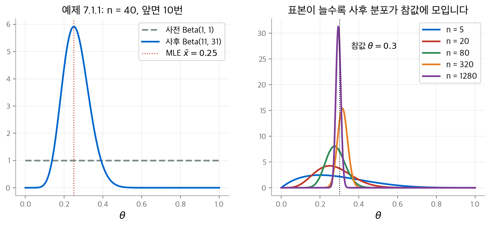
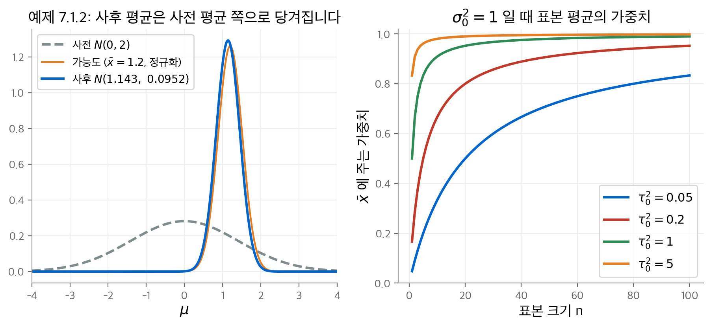
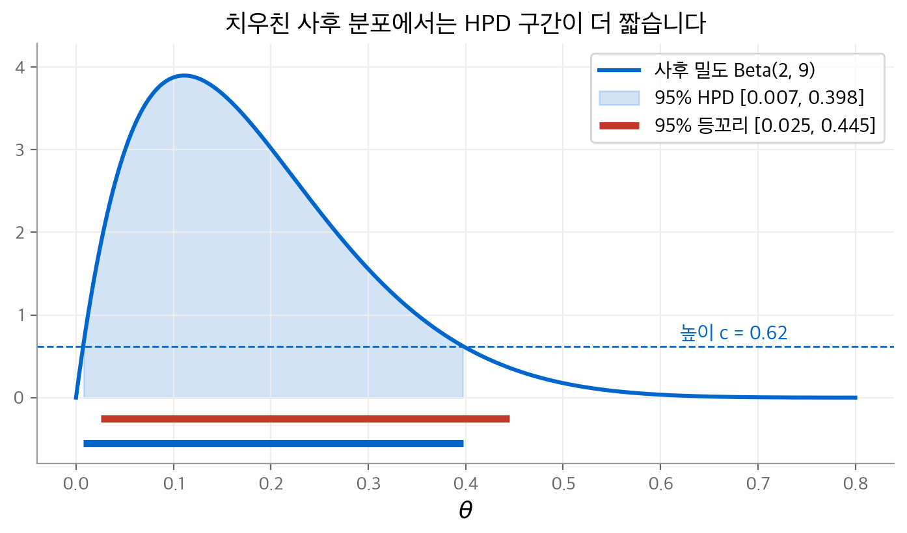
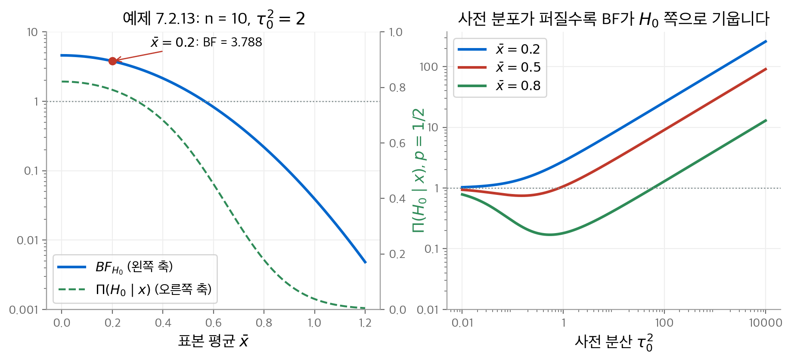
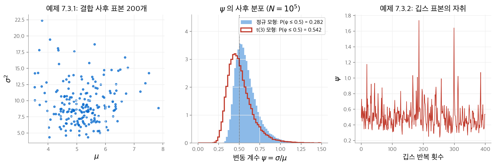
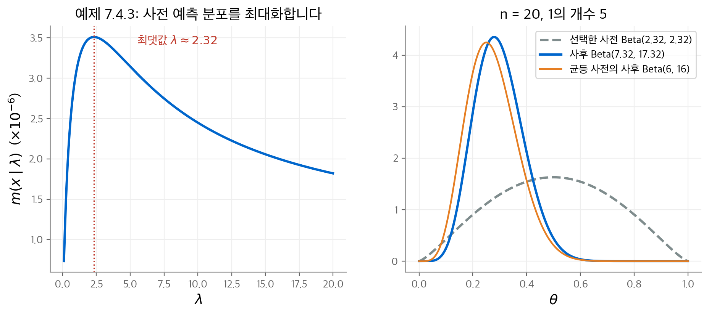

# 8. 베이즈 추론

앞 장의 가능도 추론은 통계 모형 $\{f_\theta : \theta \in \Omega\}$ 와 데이터만으로 결론을 냅니다.
이 장은 모형에 재료 하나를 더합니다. 모수 $\theta$ 에 대한 믿음을 나타내는 **사전 분포**(prior distribution) $\pi$ 입니다.
사전 분포를 넣으면 모든 불확실성이 확률로 표현됩니다. 그러면 1장의 조건부 확률 원리를 그대로 적용할 수 있습니다.
데이터를 본 뒤의 $\theta$ 분포, 즉 **사후 분포**(posterior distribution)가 모든 추론의 출발점이 됩니다.

이 장은 교재의 7장입니다. 다루는 순서는 다음과 같습니다.

1. 사전 분포와 사후 분포를 정의하고, 켤레 분포로 사후 분포를 계산합니다(7.1절).
2. 사후 분포로 점 추정, 신용 구간, 가설 평가, 예측을 합니다(7.2절).
3. 사후 분포를 정확히 구할 수 없을 때 몬테카를로와 깁스 표집으로 근사합니다(7.3절).
4. 사전 분포를 고르는 방법을 정리합니다(7.4절).

!!! info "원문과 자료"
    - 교재: Evans & Rosenthal, *Probability and Statistics: The Science of Uncertainty*, 2nd Edition, 7장 Bayesian Inference (p. 373–432)
    - PDF: [7장 시작 페이지](https://utstat.utoronto.ca/mikevans/jeffrosenthal/book.pdf#page=387)
    - 이 장의 수치는 모두 NumPy와 SciPy로 다시 계산했습니다. 모의실험 값은 난수 시드에 따라 조금 달라집니다.

## 8.1 사전 분포와 사후 분포 (7.1절)

### 베이즈 모형

**베이즈 모형**(Bayesian model)은 두 재료로 이루어집니다.

- 통계 모형 $f_\theta(s)$: $\theta$ 가 주어졌을 때 데이터 $s$ 의 조건부 분포입니다.
- 사전 분포 $\pi(\theta)$: 데이터를 보기 전의 $\theta$ 에 대한 믿음입니다.

전확률 정리(2장)에 따라 두 재료는 $(\theta, s)$ 의 결합 분포 $\pi(\theta) f_\theta(s)$ 를 정합니다.
$\theta$ 를 적분해서 없애면 데이터의 주변 분포가 나옵니다. 이것을 **사전 예측 분포**(prior predictive distribution)라고 부릅니다.

$$
m(s) = \int_\Omega \pi(\theta) f_\theta(s) \, d\theta
$$

사전 분포의 확률은 장기 빈도가 아니라 **믿음**을 나타냅니다.
사전 분포는 통계 모형처럼 분석자가 고르는 가정입니다. 그 가정이 데이터와 맞는지는 교재 9장의 모형 점검으로 확인합니다.

### 사후 분포

데이터 $s$ 를 관측한 뒤에는 조건부 확률 원리에 따라 $\theta$ 의 조건부 분포를 씁니다(정의 7.1.1).

$$
\pi(\theta \mid s) = \frac{\pi(\theta) f_\theta(s)}{m(s)} \propto \pi(\theta) \, L(\theta \mid s)
$$

이 식은 1장 베이즈 정리의 연속형 버전입니다. 계산에서 중요한 사실은 두 가지입니다.

- $m(s)$ 는 $\theta$ 와 무관한 정규화 상수입니다. 그래서 **사전 분포 × 가능도**의 모양만 보고 분포를 알아낼 때가 많습니다.
- 사후 분포는 데이터에 충분 통계량을 통해서만 의존합니다.

교재는 "사후 분포로 추론한다"는 것이 정리가 아니라 **공리**(원리)라고 강조합니다.

### 예: 베르누이 모형 (예 7.1.1)

$x_1, \dots, x_n$ 이 Bernoulli($\theta$) 표본이고, 사전 분포가 Beta($\alpha, \beta$) 라고 합니다. 사후 분포는 다음에 비례합니다.

$$
\underbrace{\theta^{n\bar x}(1-\theta)^{n(1-\bar x)}}_{\text{가능도}} \cdot \underbrace{\theta^{\alpha-1}(1-\theta)^{\beta-1}}_{\text{사전}}
= \theta^{n\bar x + \alpha - 1}(1-\theta)^{n(1-\bar x) + \beta - 1}
$$

이 식은 Beta($n\bar x + \alpha,\ n(1-\bar x) + \beta$) 밀도의 핵심 부분입니다. $m(s)$ 를 계산하지 않고도 사후 분포를 얻었습니다.
책의 수치는 $n = 40$, $n\bar x = 10$, 균등 사전 분포($\alpha = \beta = 1$)입니다. 사후 분포는 Beta(11, 31)입니다.

| 값 | 계산 | 결과 |
| --- | --- | --- |
| 사후 평균 | $11/42$ | $0.2619$ |
| 사후 최빈값 | $10/40$ | $0.25$ (MLE와 같음) |
| 사후 표준 편차 | $\sqrt{11 \cdot 31 / (42^2 \cdot 43)}$ | $0.0670$ |

<figure markdown>

<figcaption>
왼쪽: 균등 사전 분포가 데이터 40개로 Beta(11, 31)이 됩니다. 오른쪽: 참값 θ = 0.3에서 표본을 늘리면 사후 분포가 참값 주변으로 좁아집니다.
사후 분포의 일치성을 보여 줍니다.
</figcaption>
</figure>

### 예: 위치 정규 모형 (예 7.1.2)

$x_1, \dots, x_n$ 이 $N(\mu, \sigma_0^2)$ 표본이고 $\sigma_0^2$ 은 알려져 있습니다. 사전 분포를 $\mu \sim N(\mu_0, \tau_0^2)$ 으로 둡니다.
지수 안을 $\mu$ 에 대해 완전제곱하면 사후 분포가 다시 정규 분포로 나옵니다.

$$
\mu \mid x \sim N\!\left( \left(\frac{1}{\tau_0^2} + \frac{n}{\sigma_0^2}\right)^{-1} \left(\frac{\mu_0}{\tau_0^2} + \frac{n \bar x}{\sigma_0^2}\right),\ \left(\frac{1}{\tau_0^2} + \frac{n}{\sigma_0^2}\right)^{-1} \right)
$$

이 식은 **정밀도**(precision, 분산의 역수)로 읽으면 쉽습니다.

- 사후 정밀도는 사전 정밀도 $1/\tau_0^2$ 과 데이터 정밀도 $n/\sigma_0^2$ 의 합입니다.
- 사후 평균은 사전 평균 $\mu_0$ 와 표본 평균 $\bar x$ 를 각 정밀도로 가중 평균한 값입니다. 그래서 항상 두 값 사이에 놓입니다.

책의 수치는 $\sigma_0^2 = 1$, $\mu_0 = 0$, $\tau_0^2 = 2$, $n = 10$, $\bar x = 1.2$ 입니다.
사후 정밀도는 $1/2 + 10 = 10.5$ 이고, 사후 분포는 $N(12/10.5,\ 1/10.5) = N(1.1429,\ 0.09524)$ 입니다.
표본 평균 $1.2$ 가 사전 평균 0 쪽으로 조금 당겨졌습니다. 이 현상을 **축소**(shrinkage)라고 부릅니다.

사후 분산은 표본 평균의 분산 $\sigma_0^2/n$ 보다 항상 작습니다. 예를 들어 $n = 20$, $\tau_0^2 = \sigma_0^2 = 1$ 이면 두 분산의 비가 $20/21 \approx 0.95$ 입니다.
사전 정보로 분산이 약 5% 줄어듭니다.

<figure markdown>

<figcaption>
왼쪽: 예제 7.1.2의 사전 분포, 정규화한 가능도, 사후 분포입니다. 오른쪽: 표본 평균의 가중치 nτ₀²/(nτ₀² + σ₀²)입니다.
사전 분포가 좁을수록(τ₀² 이 작을수록) 표본이 많아야 데이터가 사전 분포를 이깁니다.
</figcaption>
</figure>

### 다른 켤레 모형 (예 7.1.3, 7.1.4)

- **다항 모형**: 범주 $k$ 개의 확률 $(\theta_1, \dots, \theta_k)$ 에 Dirichlet($\alpha_1, \dots, \alpha_k$) 사전 분포를 둡니다. 범주별 빈도가 $x_i$ 이면 사후 분포는 Dirichlet($x_1 + \alpha_1, \dots, x_k + \alpha_k$) 입니다.
- **위치-척도 정규 모형**: $\mu$ 와 $\sigma^2$ 이 모두 미지입니다. 사전 분포는 $\mu \mid \sigma^2 \sim N(\mu_0, \tau_0^2 \sigma^2)$ 와 $1/\sigma^2 \sim \text{Gamma}(\alpha_0, \beta_0)$ 입니다. 사후 분포도 같은 꼴입니다.

$$
\mu \mid \sigma^2, x \sim N\!\left(\mu_x,\ \left(n + \tfrac{1}{\tau_0^2}\right)^{-1} \sigma^2\right), \qquad
\frac{1}{\sigma^2} \,\Big|\, x \sim \text{Gamma}\!\left(\alpha_0 + \tfrac{n}{2},\ \beta_x\right)
$$

$$
\mu_x = \left(n + \tfrac{1}{\tau_0^2}\right)^{-1}\left(\tfrac{\mu_0}{\tau_0^2} + n\bar x\right), \qquad
\beta_x = \beta_0 + \tfrac{n-1}{2}s^2 + \frac{n(\bar x - \mu_0)^2}{2(1 + n\tau_0^2)}
$$

사후 표본은 **합성법**(method of composition)으로 뽑습니다. 먼저 $1/\sigma^2$ 을 감마 분포에서 뽑고, 그 값으로 $\mu$ 를 정규 분포에서 뽑습니다.

## 8.2 사후 분포에 근거한 추론 (7.2절)

사후 분포가 있으면 관심 있는 양 $\psi(\theta)$ 에 대한 추론은 모두 $\psi$ 의 주변 사후 분포로 합니다.
가능도 추론에서는 장애 모수(nuisance parameter)를 어떻게 처리할지가 모호할 때가 있습니다.
베이즈 추론에서는 장애 모수를 적분으로 없애면 됩니다. 이 점이 베이즈 방법의 큰 장점입니다.

예를 들어 위치-척도 정규 모형에서 $\mu$ 의 주변 사후 분포는 $t$ 분포입니다(예 7.2.1).

$$
\mu \mid x \ \overset{d}{=}\ \mu_x + \sqrt{\frac{2\beta_x}{(2\alpha_0 + n)(n + 1/\tau_0^2)}}\; T, \qquad T \sim t(2\alpha_0 + n)
$$

### 점 추정 (7.2.1절)

대표적인 추정값은 두 가지입니다.

- **사후 최빈값**(posterior mode): 사후 밀도가 가장 큰 점입니다. $m(s)$ 를 몰라도 $\pi(\theta) L(\theta \mid s)$ 를 최대화하면 됩니다. MAP(maximum a posteriori) 추정값이라고도 부릅니다.
- **사후 평균**(posterior mean): $E(\psi \mid s)$ 입니다. 사후 분포가 대칭이면 최빈값과 같습니다.

베르누이 모형에서 Beta($\alpha, \beta$) 사전 분포를 쓰면 두 추정값은 다음과 같습니다(예 7.2.2).

$$
E(\theta \mid x) = \frac{n\bar x + \alpha}{n + \alpha + \beta}, \qquad
\hat\theta_{\text{mode}} = \frac{n\bar x + \alpha - 1}{n + \alpha + \beta - 2}
$$

균등 사전 분포에서 최빈값은 $\bar x$ 로 MLE와 같습니다. 평균은 $(n\bar x + 1)/(n + 2)$ 로, 라플라스의 연속 법칙(rule of succession)입니다.
$n$ 이 크면 두 추정값과 MLE가 모두 가까워집니다.

두 방법이 크게 달라지는 경우도 있습니다(예 7.2.4). 다항 모형에 균등 Dirichlet 사전 분포를 두면 $\theta_1$ 의 주변 사후 분포는 Beta($x_1 + 1,\ n - x_1 + k - 1$) 입니다.

| 추정값 | 식 | $k = 10$, $n = 5$, $x_1 = 2$ |
| --- | --- | --- |
| 플러그인 MLE | $x_1/n$ | $0.400$ |
| 주변 사후 최빈값 | $x_1/(n + k - 2)$ | $0.154$ |
| 사후 평균 | $(x_1 + 1)/(n + k)$ | $0.200$ |

범주 수 $k$ 가 표본 크기 $n$ 에 비해 크면 균등 사전 분포가 확률을 모든 범주에 고르게 나눕니다. 그래서 베이즈 추정값이 MLE보다 크게 작아집니다.

추정의 정확도는 사후 분산으로 잽니다(예 7.2.6). 위치 정규 모형의 사후 분산 $(1/\tau_0^2 + n/\sigma_0^2)^{-1}$ 은 $n \to \infty$ 에서 0으로 갑니다. 또 $\tau_0^2 \to \infty$ 이면 표본 평균의 분산 $\sigma_0^2/n$ 으로 갑니다.

### 신용 구간 (7.2.2절)

$\gamma$-**신용 구간**(credible interval)은 사후 확률이 $\gamma$ 이상인 구간 $C(s)$ 입니다.

$$
\Pi\big(\psi \in C(s) \mid s\big) \ge \gamma
$$

신뢰 구간과 달리 "$\psi$ 가 이 구간에 있을 확률이 $\gamma$ 이다"라고 바로 말할 수 있습니다.
같은 확률이면 짧은 구간이 좋습니다. 그래서 **최고 사후 밀도**(highest posterior density, HPD) 구간을 씁니다.

$$
C(s) = \{\psi : \omega(\psi \mid s) \ge c\}
$$

여기서 $c$ 는 사후 확률이 $\gamma$ 가 되도록 고른 가장 큰 값입니다. 밀도가 높은 곳부터 채우므로 최빈값을 포함합니다.

위치 정규 모형의 사후 분포는 대칭입니다. 그래서 HPD 구간은 "사후 평균 ± $z_{(1+\gamma)/2}$ × 사후 표준 편차"입니다(예 7.2.7).
예 7.1.2의 수치에서 95% HPD 구간은 $1.1429 \pm 1.96 \sqrt{0.09524} = [0.538,\ 1.748]$ 입니다.
$\tau_0^2 \to \infty$ 이면 이 구간은 $\bar x \pm z_{(1+\gamma)/2}\, \sigma_0/\sqrt{n}$ 으로 갑니다. 가능도 추론의 신뢰 구간과 같습니다.
퍼진 사전 분포에서는 베이즈 방법과 빈도주의 방법의 답이 일치합니다.

<figure markdown>

<figcaption>
치우친 사후 분포 Beta(2, 9)의 95% 구간입니다. HPD 구간은 밀도가 수평선 c 위에 있는 영역이고, 길이가 0.391입니다.
양 꼬리에 2.5%씩 남기는 등꼬리 구간은 길이가 0.420입니다. 분포가 대칭이면 두 구간이 같습니다.
</figcaption>
</figure>

HPD 구간은 닫힌 식이 없을 때가 많습니다. 그때는 사후 분포의 $(1-\gamma)/2$ 분위수와 $(1+\gamma)/2$ 분위수로 **등꼬리 구간**을 만듭니다.

### 가설 평가와 베이즈 인자 (7.2.3절)

가설 $H_0 : \psi = \psi_0$ 을 평가하는 가장 직접적인 방법은 사후 확률 $\Pi(\psi = \psi_0 \mid s)$ 를 계산하는 것입니다.
그런데 사전 분포가 연속이면 이 확률은 데이터와 상관없이 항상 0입니다.

대안으로 **베이즈 P-값**을 생각할 수 있습니다. $\psi_0$ 보다 사후 밀도가 낮은 영역의 사후 확률입니다.
이 값에는 모수화에 따라 답이 바뀌는 문제가 있습니다(예 7.2.11).

- 사후 분포가 Beta(2, 1), 즉 밀도 $2\theta$ 이고 $H_0 : \theta = 3/4$ 라고 합니다. P-값은 $\int_0^{3/4} 2\theta \, d\theta = 9/16$ 입니다.
- 같은 가설을 $\psi = \theta^2$ 으로 다시 쓰면 $H_0 : \psi = 9/16$ 입니다. $\psi$ 의 사후 분포는 균등 분포이므로 P-값은 1입니다.

같은 가설인데 답이 $9/16$ 과 $1$ 로 갈립니다. 그래서 교재는 **가설에 양의 사전 확률을 주는 방법**을 권합니다.
사전 분포를 혼합 $p\,\Pi_1 + (1-p)\,\Pi_2$ 로 둡니다. $\Pi_1$ 은 $\psi_0$ 에 집중된 분포이고, $\Pi_2$ 는 연속 분포입니다.
그러면 $H_0$ 의 사전 확률이 $p$ 가 됩니다.

**오즈**(odds)는 $P(A)/P(A^c)$ 입니다. **베이즈 인자**(Bayes factor)는 사후 오즈를 사전 오즈로 나눈 값입니다(정의 7.2.2).

$$
BF_{H_0} = \frac{\Pi(H_0 \mid s) / \Pi(H_0^c \mid s)}{\Pi(H_0) / \Pi(H_0^c)}
$$

혼합 사전 분포에서 베이즈 인자는 두 사전 예측 분포의 비입니다(정리 7.2.1). 그래서 $p$ 와 무관합니다.

$$
BF_{H_0} = \frac{m_1(s)}{m_2(s)}, \qquad \Pi(H_0 \mid s) = \frac{r \cdot BF_{H_0}}{1 + r \cdot BF_{H_0}}, \quad r = \frac{p}{1-p}
$$

$BF$ 는 데이터가 $H_0$ 의 오즈를 몇 배로 바꿨는지를 나타냅니다. 1보다 크면 데이터가 $H_0$ 를 지지합니다.

### 예: 위치 정규 모형의 베이즈 인자 (예 7.2.12, 7.2.13)

$H_0 : \mu = 0$ 을 평가합니다. $\Pi_2$ 는 $N(0, \tau_0^2)$ 이고, $\Pi_1$ 은 0에 집중된 분포입니다.
충분 통계량 $\bar x$ 만 보면 두 사전 예측 분포는 정규 밀도입니다.

$$
m_1:\ \bar x \sim N\!\left(0, \tfrac{\sigma_0^2}{n}\right), \qquad m_2:\ \bar x \sim N\!\left(0, \tfrac{\sigma_0^2}{n} + \tau_0^2\right)
$$

책의 수치는 $\sigma_0^2 = 1$, $\tau_0^2 = 2$, $n = 10$, $\bar x = 0.2$ 입니다.

1. 분자의 지수 부분은 $\exp(-\tfrac{10}{2} \cdot 0.2^2) = e^{-0.2} = 0.81873$ 입니다.
2. 식 (7.2.10)의 분모는 $0.21615$ 입니다.
3. 베이즈 인자는 $0.81873 / 0.21615 = 3.7878$ 입니다. 데이터가 $H_0$ 를 어느 정도 지지합니다.
4. $p = 1/2$ 이면 $r = 1$ 이고, $\Pi(H_0 \mid x) = 3.7878 / 4.7878 = 0.7911$ 입니다.

<figure markdown>

<figcaption>
왼쪽: 예제 7.2.13의 설정에서 표본 평균에 따른 베이즈 인자(로그 축)와 H₀ 의 사후 확률입니다. 오른쪽: 표본 평균을 고정하고 사전 분산 τ₀² 을 키우면
베이즈 인자가 계속 커집니다. 대립 가설의 사전 분포가 너무 퍼지면 데이터가 무엇이든 H₀ 가 이깁니다.
</figcaption>
</figure>

오른쪽 그림은 교재 밖의 주의점을 보여 줍니다. 퍼진 사전 분포는 추정에서는 해가 없습니다. 그러나 베이즈 인자에서는 결과를 크게 바꿉니다.
이 현상은 **린들리 역설**(Lindley's paradox)로 알려져 있습니다. 가설 평가에서는 $\tau_0^2$ 을 신중하게 정해야 합니다.

### 예측 (7.2.4절)

관측하지 않은 값 $t$ 를 예측할 때는 **사후 예측 분포**(posterior predictive distribution)를 씁니다.
$\theta$ 가 주어졌을 때 $t$ 의 분포를 사후 분포로 평균한 것입니다.

$$
q(t \mid s) = \int_\Omega q_\theta(t \mid s) \, \pi(\theta \mid s) \, d\theta
$$

베르누이 모형에서 다음 관측값 $X_{n+1}$ 의 사후 예측 분포는 Bernoulli($E(\theta \mid x)$) 입니다(예 7.2.14).
예 7.1.1의 데이터에서는 $P(X_{n+1} = 1 \mid x) = 11/42 \approx 0.262$ 입니다.
위치 정규 모형에서 $X_{n+1}$ 의 사후 예측 분포는 다음과 같습니다(예 7.2.15, 7.2.17).

$$
X_{n+1} \mid x \sim N\!\left(\mu_x,\ \left(\tfrac{1}{\tau_0^2} + \tfrac{n}{\sigma_0^2}\right)^{-1} + \sigma_0^2\right)
$$

예측 분산은 두 부분의 합입니다. **모수의 불확실성**(사후 분산)과 **관측 잡음**($\sigma_0^2$)입니다.
$n$ 이 커지면 앞부분만 0으로 갑니다. 예측 구간은 아무리 데이터가 많아도 $\pm z \sigma_0$ 보다 좁아지지 않습니다.

## 8.3 베이즈 계산 (7.3절)

### 사후 분포의 점근 정규성 (7.3.1절)

정칙 조건 아래에서 표본이 크면 사후 분포는 정규 분포에 가까워집니다.

$$
\theta \mid x \ \approx\ N\!\left(\hat\theta(x),\ \hat\sigma^2(x)\right), \qquad
\hat\sigma^{-2}(x) = -\frac{\partial^2}{\partial \theta^2} \ln\big(\pi(\theta) L(\theta \mid x)\big)\Big|_{\theta = \hat\theta}
$$

$\hat\theta$ 는 사후 최빈값입니다. 이 근사를 **라플라스 근사**(Laplace approximation)라고 부릅니다.
최빈값 대신 MLE를, 곡률 대신 관측 피셔 정보를 써도 같은 극한이 나옵니다.

예 7.1.1의 Beta(11, 31)에 적용해 봅니다. 최빈값은 $0.25$ 이고, 그 점의 곡률은 $10/0.25^2 + 30/0.75^2 = 213.3$ 입니다.
근사 표준 편차는 $1/\sqrt{213.3} = 0.0685$ 입니다. 정확한 값 $0.0670$ 과 가깝습니다.

### 사후 분포에서 직접 표집하기 (7.3.2절)

추론에 필요한 양은 대부분 사후 기댓값 $E(w(\theta) \mid s)$ 입니다. 사후 확률도 지시 함수의 기댓값입니다.
사후 분포에서 i.i.d. 표본 $\theta_1, \dots, \theta_N$ 을 뽑을 수 있으면 4장의 몬테카를로를 그대로 씁니다.

$$
\hat w = \frac{1}{N} \sum_{i=1}^N w(\theta_i) \xrightarrow{a.s.} E(w(\theta) \mid s), \qquad \text{오차 범위} \approx \hat w \pm 3 \frac{s_w}{\sqrt N}
$$

**예 7.3.1**은 위치-척도 정규 모형에서 **변동 계수**(coefficient of variation) $\psi = \sigma/\mu$ 의 사후 분포를 구합니다.
데이터 15개의 $\bar x = 5.2$, $s = 3.3$ 이고, 사전 분포는 $\mu_0 = 4$, $\tau_0^2 = 2$, $\alpha_0 = 2$, $\beta_0 = 1$ 입니다.

1. $\mu_x = (15 + 1/2)^{-1}(4/2 + 15 \cdot 5.2) = 80/15.5 = 5.161$ 입니다.
2. $\beta_x = 1 + 7 \cdot 3.3^2 + 15 \cdot 1.2^2 / 62 = 77.578$ 입니다.
3. $1/\sigma^2 \sim \text{Gamma}(9.5,\ 77.578)$ 에서 뽑고, $\mu \sim N(5.161,\ \sigma^2/15.5)$ 에서 뽑습니다.
4. 각 표본으로 $\psi = \sigma/\mu$ 를 계산합니다.

| $N$ | 책의 $P(\psi \le 0.5 \mid x)$ 추정값 | 표준 오차 |
| --- | --- | --- |
| 200 | 0.265 | 0.0312 |
| $10^3$ | 0.271 | 0.0141 |
| $10^4$ | 0.289 | 0.0045 |

$N = 10^6$ 으로 다시 계산하면 $0.284 \pm 0.0005$ 입니다. 책의 $N = 10^4$ 결과는 오차 범위 $\pm 3 \times 0.0045$ 안에 있습니다.

책은 함정 하나를 지적합니다. $\psi$ 의 사후 평균은 **존재하지 않습니다**. $\mu$ 가 0 근처일 확률이 양수이기 때문입니다.
표본 평균은 언제든 계산할 수 있지만, 그 값은 아무것도 추정하지 않습니다. 기댓값을 추정하기 전에 기댓값이 있는지부터 확인해야 합니다.

### 깁스 표집 (7.3.3절)

사후 분포에서 직접 뽑을 수 없을 때가 많습니다. **깁스 표집**(Gibbs sampling)은 각 좌표의 **완전 조건부 분포**(full conditional)에서 차례로 뽑습니다.

1. 초깃값 $(y_1^{(0)}, \dots, y_k^{(0)})$ 을 정합니다.
2. $i = 1, \dots, k$ 순서로 $Y_i^{(N)}$ 을 나머지 좌표의 최신 값이 주어진 조건부 분포에서 뽑습니다.
3. 2단계를 반복합니다.

이 수열은 마르코프 체인입니다. 반복이 충분하면 분포가 목표 결합 분포로 수렴합니다([5장](05-stochastic-processes.md)의 MCMC).
표본이 서로 독립이 아니므로 표준 오차는 **배칭**(batching)으로 추정합니다. 수열을 크기 $m$ 인 묶음으로 나누고, 묶음 평균들의 표본 분산을 씁니다.

**예 7.3.2**는 같은 데이터를 꼬리가 두꺼운 $t(3)$ 모형 $X = \mu + \sigma Z$, $Z \sim t(3)$ 으로 분석합니다.
이 사후 분포는 완전 조건부 분포조차 표집하기 어렵습니다. 그래서 **잠재 변수**(latent variable) $V_i$ 를 도입합니다.

$$
V_i \sim \text{Gamma}\!\left(\tfrac{\lambda}{2}, \tfrac{\lambda}{2}\right), \qquad X_i \mid V_i \sim N\!\left(\mu, \tfrac{\sigma^2}{V_i}\right)
$$

$V_i$ 를 적분하면 $X_i$ 는 정확히 $\mu + \sigma\, t(\lambda)$ 분포를 따릅니다. $V_i$ 를 넣으면 모든 완전 조건부 분포가 정규 분포나 감마 분포가 됩니다.

| 변수 | 완전 조건부 분포 |
| --- | --- |
| $\mu$ | $N\big(r(\sum v_i x_i + \mu_0/\tau_0^2),\ r\sigma^2\big)$, $r = (\sum v_i + 1/\tau_0^2)^{-1}$ |
| $1/\sigma^2$ | $\text{Gamma}\big(\tfrac n2 + \alpha_0 + \tfrac12,\ \beta_0 + \tfrac12 \sum v_i (x_i - \mu)^2 + \tfrac{(\mu - \mu_0)^2}{2\tau_0^2}\big)$ |
| $V_i$ | $\text{Gamma}\big(\tfrac{\lambda + 1}{2},\ \tfrac{\lambda}{2} + \tfrac{(x_i - \mu)^2}{2\sigma^2}\big)$ |

책은 $10^4$ 번 반복해서 $P(\psi \le 0.5 \mid x) = 0.5441$, 배칭 표준 오차 약 $0.0066$ 을 얻습니다.
$10^5$ 번 다시 반복하면 $0.540$, 배칭 표준 오차 $0.0022$ 입니다. 두 결과는 오차 범위 안에서 일치합니다.
정규 모형의 $0.28$ 과 크게 다릅니다. **표집 모형의 선택**이 사후 결론을 바꿉니다.

<figure markdown>

<figcaption>
왼쪽: 예제 7.3.1의 결합 사후 분포에서 직접 뽑은 (μ, σ²) 200개입니다. 가운데: ψ = σ/μ 의 사후 분포입니다. 파란 막대는 정규 모형, 빨간 선은 t(3) 모형의 깁스 표본입니다.
오른쪽: 깁스 표본 ψ 의 처음 400개 자취입니다. 체인이 빠르게 섞이지만 큰 값이 가끔 튀어나옵니다.
</figcaption>
</figure>

## 8.4 사전 분포 고르기 (7.4절)

사전 분포가 주관적이라는 비판이 있습니다. 교재는 통계 모형도 똑같이 주관적인 선택이라고 답합니다.
두 선택을 함께 정당화하는 방법은 관측 데이터가 그 결합 분포 아래에서 놀라운지 점검하는 것입니다.
실무에서는 사전 분포의 모임 $\{\pi_\lambda : \lambda \in \Lambda\}$ 을 정하고 그 안에서 고릅니다. $\lambda$ 를 **초모수**(hyperparameter)라고 부릅니다.

### 켤레 사전 분포 (7.4.1절)

모든 데이터에서 사후 분포가 같은 모임에 남으면 그 모임을 **켤레**(conjugate)라고 부릅니다(정의 7.4.1).

| 표집 모형 | 켤레 사전 분포 | 사후 분포 |
| --- | --- | --- |
| Bernoulli($\theta$) | Beta($\alpha, \beta$) | Beta($\alpha + n\bar x,\ \beta + n - n\bar x$) |
| Multinomial($\theta_1, \dots, \theta_k$) | Dirichlet($\alpha_1, \dots, \alpha_k$) | Dirichlet($\alpha_i + x_i$) |
| $N(\mu, \sigma_0^2)$, $\sigma_0^2$ 기지 | $N(\mu_0, \tau_0^2)$ | 정밀도 가중 평균의 정규 분포 |
| $N(\mu, \sigma^2)$ | 정규-역감마 | 정규-역감마 |
| Poisson($\lambda$) | Gamma($\alpha, \beta$) | Gamma($\alpha + n\bar x,\ \beta + n$) |

켤레성은 계산이 편할 뿐 아니라, 초모수를 **가상의 관측값**으로 해석하게 해 줍니다.
Beta($\alpha, \beta$) 사전 분포는 성공 $\alpha$ 번과 실패 $\beta$ 번을 이미 본 것과 같습니다.

### 유도 (7.4.2절)

**유도**(elicitation)는 전문가의 믿음을 질문으로 끌어내 초모수를 정하는 방법입니다(예 7.4.2).
정규 사전 분포 $N(\mu_0, \tau_0^2)$ 는 초모수가 두 개이므로 특성 두 개를 정하면 됩니다.
예를 들어 "참값이 이 값보다 클 확률과 작을 확률이 같다"는 중앙값 $\mu_0$ 와, "참값이 이 범위에 거의 확실히 있다"는 $\mu_0 \pm 3\tau_0$ 를 묻습니다.

### 경험적 베이즈 (7.4.3절)

**경험적 베이즈**(empirical Bayes)는 데이터로 초모수를 고릅니다. 대표적인 방법은 사전 예측 분포 $m(s \mid \lambda)$ 를 $\lambda$ 의 가능도로 보고 최대화하는 것입니다.
데이터를 두 번 쓰므로 조건부 확률 원리에 엄밀히 맞지는 않습니다. 그래도 성질이 좋은 추론을 줄 때가 많습니다.

**예 7.4.3**은 베르누이 표본에 대칭 사전 분포 Beta($\lambda, \lambda$) 를 둡니다. 사전 예측 분포는 다음과 같습니다.

$$
m(x \mid \lambda) = \frac{\Gamma(2\lambda)}{\Gamma(\lambda)^2} \cdot \frac{\Gamma(n\bar x + \lambda)\,\Gamma(n(1-\bar x) + \lambda)}{\Gamma(n + 2\lambda)}
$$

$n = 20$, $n\bar x = 5$ 이면 $\lambda \approx 2.32$ 에서 최대가 되고, 최댓값은 약 $3.51 \times 10^{-6}$ 입니다.
책은 표에서 $\lambda = 2.3$ 을 고르고 사후 분포 Beta(7.3, 17.3)을 씁니다.

<figure markdown>

<figcaption>
왼쪽: 예제 7.4.3의 사전 예측 분포를 λ 의 함수로 그렸습니다. 오른쪽: 선택한 사전 분포와 그 사후 분포입니다.
균등 사전 분포의 사후 분포 Beta(6, 16)보다 1/2 쪽으로 조금 당겨집니다.
</figcaption>
</figure>

### 계층 베이즈 (7.4.4절)

**계층 베이즈**(hierarchical Bayes)는 초모수 $\lambda$ 에 다시 **초사전 분포**(hyperprior) $\nu$ 를 둡니다.
그러면 $\theta$ 의 사전 분포는 $\int \pi_\lambda(\theta)\,\nu(\lambda)\, d\lambda$ 가 됩니다.
$\theta$ 는 데이터를 만든 모형의 모수이지만, $\lambda$ 는 가능도에 들어가지 않습니다. 그래서 $\lambda$ 의 "참값"을 말하는 것은 의미가 없습니다.

### 부적절 사전 분포와 무정보 사전 분포 (7.4.5절)

아무 정보도 넣지 않으려고 고른 사전 분포를 **무정보 사전 분포**(noninformative prior)라고 부릅니다.
이런 분포는 적분이 무한대인 **부적절 사전 분포**(improper prior)가 될 때가 많습니다.

- 위치 정규 모형에서 $\pi(\mu) \equiv 1$ 을 쓰면 사후 분포가 $N(\bar x, \sigma_0^2/n)$ 입니다(예 7.4.5). 예 7.1.2에서 $\tau_0^2 \to \infty$ 로 보낸 극한과 같습니다.
- 부적절 사전 분포를 쓸 때는 **사후 분포가 적절한지**(적분이 유한한지) 반드시 확인해야 합니다.

**제프리스 사전 분포**(Jeffreys' prior)는 피셔 정보로 정합니다.

$$
\pi(\theta) \propto I(\theta)^{1/2} \quad (\text{다차원에서는 } \det I(\theta)^{1/2})
$$

이 사전 분포는 재모수화에 대해 불변입니다. $\psi = \Psi(\theta)$ 로 바꿔서 제프리스 규칙을 적용한 결과와, $\theta$ 의 제프리스 사전 분포를 변수 변환한 결과가 같습니다.
위치 정규 모형에서는 $I(\mu) = n/\sigma_0^2$ 이 상수이므로 균등 사전 분포가 됩니다(예 7.4.6).
베르누이 모형에서는 $I(\theta) = 1/(\theta(1-\theta))$ 이므로 Beta(1/2, 1/2)입니다.
예 7.1.1의 데이터에 쓰면 사후 분포는 Beta(10.5, 30.5)이고, 사후 평균은 $0.256$ 입니다.

## 딥러닝에서의 쓰임

| 개념 | 딥러닝에서 쓰이는 곳 |
| --- | --- |
| MAP 추정 | 가중치에 $N(0, \tau^2 I)$ 사전 분포를 두면 $-\ln \pi(w) = \frac{1}{2\tau^2}\lVert w \rVert^2 + \text{상수}$ 입니다. MAP 추정은 **L2 정규화(가중치 감쇠)** 를 건 최대 가능도와 같습니다. 라플라스 사전 분포는 L1 정규화가 됩니다. |
| 축소 | 정규-정규 모형의 사후 평균은 추정값을 사전 평균 쪽으로 당깁니다. 가중치 감쇠가 가중치를 0 쪽으로 당기는 것과 같은 구조입니다. |
| 사후 예측 분포 | $p(y \mid x, D) = \int p(y \mid x, w)\, \pi(w \mid D)\, dw$ 입니다. 딥 앙상블과 MC 드롭아웃은 이 적분을 표본 몇 개의 평균으로 근사합니다. 예측 분산이 모수 불확실성과 관측 잡음으로 나뉘는 구조도 같습니다. |
| 변분 추론 | 사후 분포를 다루기 쉬운 $q(w)$ 로 근사합니다. [3장의 젠센 부등식](03-expectation.md)으로 $\ln m(D) \ge E_q[\ln p(D \mid w)] - D_{\mathrm{KL}}(q \parallel \pi)$, 즉 ELBO를 얻습니다. VAE는 잠재 변수에 이 방법을 씁니다. |
| 라플라스 근사 | MAP 점의 헤시안으로 사후 분포를 가우스 분포로 근사합니다. 학습된 신경망에 사후 불확실성을 덧붙이는 사후(post-hoc) 방법으로 쓰입니다. |
| 깁스 표집과 MCMC | [5장](05-stochastic-processes.md)의 MCMC와 확률적 그래디언트 랑주뱅 동역학(SGLD)은 사후 분포에서 가중치를 표집합니다. 잠재 변수를 넣어 조건부 분포를 쉽게 만드는 기법은 EM 알고리즘과 같은 발상입니다. |
| 디리클레-다항 켤레 | 언어 모델의 가산 평활(add-$\alpha$ smoothing)은 Dirichlet($\alpha$) 사전 분포의 사후 평균입니다. 어휘 수 $k$ 가 크면 평활 효과가 커지는 것도 예 7.2.4와 같은 현상입니다. |
| 경험적 베이즈 | 가우스 과정의 커널 초모수를 주변 가능도 $m(D \mid \lambda)$ 로 고르는 방법이 경험적 베이즈입니다. |

## 정리

| 개념 | 핵심 |
| --- | --- |
| 베이즈 모형 | 통계 모형 $f_\theta(s)$ 에 사전 분포 $\pi(\theta)$ 를 더해 $(\theta, s)$ 의 결합 분포를 정합니다. |
| 사후 분포 | $\pi(\theta \mid s) \propto \pi(\theta) L(\theta \mid s)$ 입니다. 정규화 상수 $m(s)$ 는 사전 예측 분포입니다. |
| 켤레 사전 분포 | 사후 분포가 사전 분포와 같은 모임에 남습니다. 베타-베르누이, 정규-정규, 디리클레-다항이 대표입니다. |
| 정규-정규 모형 | 사후 정밀도는 정밀도의 합이고, 사후 평균은 정밀도 가중 평균입니다(축소). |
| 점 추정 | 사후 최빈값(MAP)과 사후 평균입니다. 정확도는 사후 분산으로 잽니다. |
| 신용 구간 | HPD 구간이 같은 확률에서 가장 짧습니다. 퍼진 사전 분포에서는 신뢰 구간과 일치합니다. |
| 베이즈 인자 | 사후 오즈 ÷ 사전 오즈 $= m_1(s)/m_2(s)$ 입니다. 대립 가설의 사전 분포가 너무 퍼지면 $H_0$ 로 기웁니다. |
| 사후 예측 분포 | $q_\theta(t)$ 를 사후 분포로 평균합니다. 분산은 모수 불확실성과 관측 잡음의 합입니다. |
| 베이즈 계산 | 라플라스 근사, 직접 몬테카를로, 깁스 표집을 씁니다. 기댓값이 존재하는지 먼저 확인합니다. |
| 사전 분포 선택 | 유도, 경험적 베이즈, 계층 베이즈, 제프리스 사전 분포가 있습니다. 부적절 사전 분포는 사후 분포의 적절성을 확인해야 합니다. |

## 다음 장

이 장과 앞 장은 추정량과 검정을 여러 가지로 만들었습니다. 그중 어느 것이 가장 좋은지는 아직 묻지 않았습니다.
[다음 장](09-optimal-inferences.md)에서는 최적성 기준을 다룹니다. 불편 추정량의 분산 하한(크라메르-라오), 최강력 검정(네이만-피어슨), 결정 이론이 나옵니다.
이 장의 사후 평균은 제곱 오차 손실에서 베이즈 위험을 최소화하는 추정량으로 다시 등장합니다.
