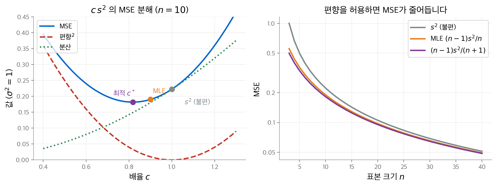
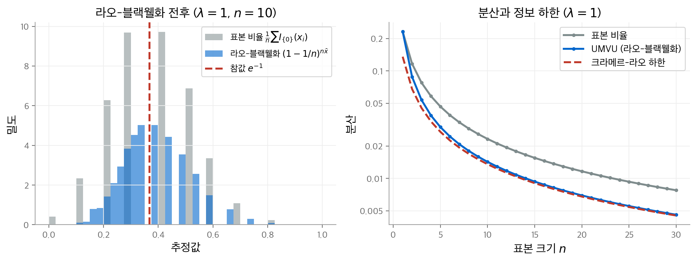
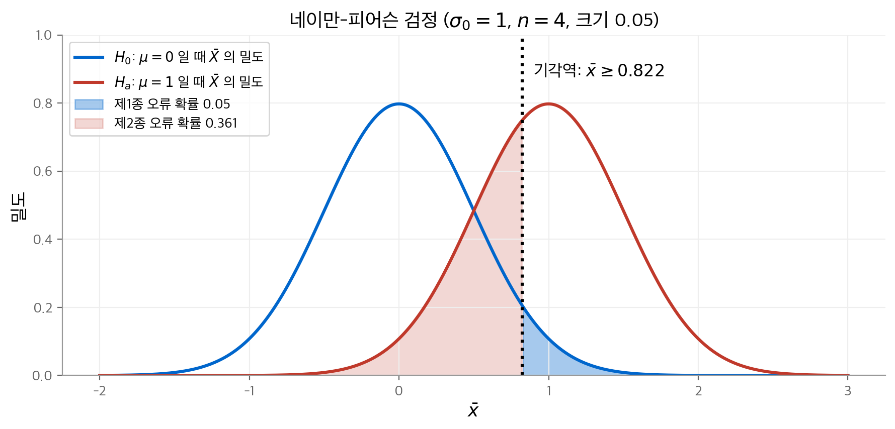
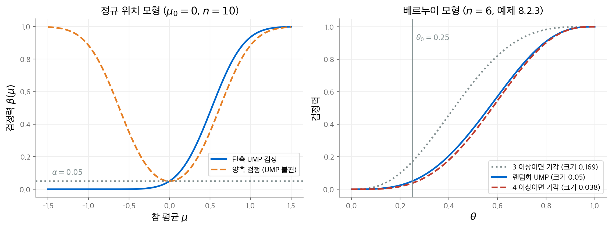
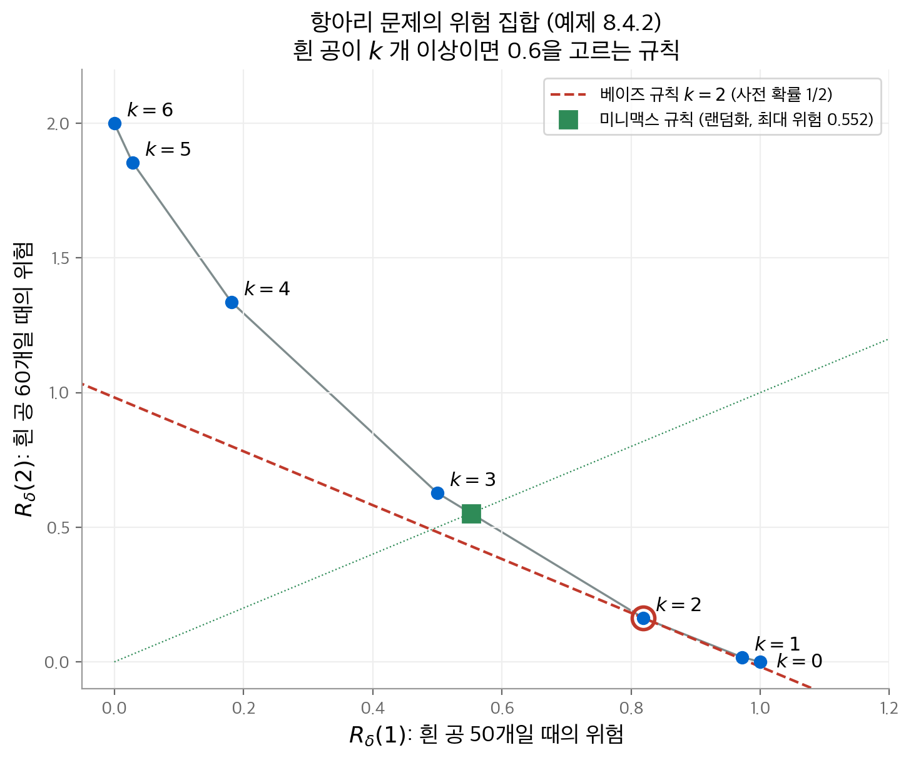

# 9. 최적 추론

앞의 두 장은 우도 함수와 사후 분포로 추론 방법을 만들었습니다. 그러나 그 방법은 대부분 직관에서 나왔습니다.
예를 들어 우도 이론은 여러 추정량 가운데 하나를 고르라고 강제하지 않습니다.
이 장은 **성능 척도**(performance measure)를 먼저 정하고, 그 척도에서 가장 좋은 추론을 찾습니다.
추정에서는 평균 제곱 오차를, 검정에서는 두 종류의 오류 확률을 척도로 씁니다.
이 장은 교재의 8장에 해당합니다.

구성은 네 부분입니다.

1. 불편 추정량 가운데 분산이 가장 작은 추정량을 찾습니다(라오-블랙웰, 레만-셰페, 크라메르-라오).
2. 제1종 오류 확률을 묶어 두고 검정력이 가장 큰 검정을 찾습니다(네이만-피어슨).
3. 사전 분포를 더해 평균 성능이 가장 좋은 베이즈 규칙을 찾습니다.
4. 이 모두를 손실 함수와 위험 함수라는 하나의 틀로 묶습니다(결정 이론).

!!! info "원문과 자료"
    - 교재: Evans & Rosenthal, *Probability and Statistics: The Science of Uncertainty*, 2nd Edition, 8장 Optimal Inferences (p. 433–478)
    - PDF: [8장 시작 페이지](https://utstat.utoronto.ca/mikevans/jeffrosenthal/book.pdf#page=447)
    - 이 장의 수치는 모두 NumPy, SciPy, `fractions` 로 다시 계산했습니다. 모의실험 값은 난수 시드에 따라 조금 달라집니다.

## 9.1 최적 불편 추정 (8.1절)

### 평균 제곱 오차와 그 분해

통계 모형 $\{f_\theta : \theta \in \Omega\}$ 에서 실숫값 특성 $\psi(\theta)$ 를 추정합니다.
데이터 $s$ 에서 값을 계산하는 함수 $T$ 를 **추정량**(estimator)이라고 부릅니다.
추정량의 성능은 **평균 제곱 오차**(mean-squared error, MSE)로 잽니다.

$$
\mathrm{MSE}_\theta(T) = E_\theta\big[(T - \psi(\theta))^2\big]
$$

모든 $\theta$ 에서 MSE가 가장 작은 추정량은 아주 인위적인 경우가 아니면 존재하지 않습니다.
그래서 후보를 줄여 나갑니다. 출발점은 다음 정리입니다.

**정리 8.1.1.** $E_\theta(T^2)$ 이 유한하면 다음이 성립합니다.

$$
E_\theta\big[(T - c)^2\big] = \mathrm{Var}_\theta(T) + \big(E_\theta(T) - c\big)^2
$$

이 값은 $c = E_\theta(T)$ 에서 가장 작습니다. $c = \psi(\theta)$ 를 넣으면 MSE의 분해를 얻습니다.

$$
\mathrm{MSE}_\theta(T) = \mathrm{Var}_\theta(T) + \big(\underbrace{E_\theta(T) - \psi(\theta)}_{\text{편향}}\big)^2
$$

추정량은 평균적으로 자기 기댓값 $E_\theta(T)$ 에 가장 가깝습니다. 그래서 기댓값이 $\psi(\theta)$ 와 같은 추정량을 먼저 찾는 것이 자연스럽습니다.

**정의 8.1.1.** 모든 $\theta$ 에서 $E_\theta(T) = \psi(\theta)$ 이면 $T$ 를 **불편 추정량**(unbiased estimator)이라고 부릅니다.

불편 추정량의 MSE는 분산과 같습니다. 따라서 문제는 "분산이 가장 작은 불편 추정량 찾기"가 됩니다.

**정의 8.1.2.** 모든 $\theta$ 에서 분산이 가장 작은 불편 추정량을 **UMVU 추정량**(uniformly minimum variance unbiased estimator)이라고 부릅니다.

### 예: 불편성이 언제나 최선은 아닙니다 (문제 8.1.16)

정규 표본 $N(\mu, \sigma^2)$ 에서 $\sigma^2$ 을 $c\,s^2$ 꼴로 추정합니다. $s^2 = \frac{1}{n-1}\sum (x_i - \bar x)^2$ 이고 $(n-1)s^2/\sigma^2 \sim \chi^2(n-1)$ 입니다.
따라서 $\mathrm{Var}(s^2) = 2\sigma^4/(n-1)$ 이고, MSE는 $c$ 의 이차식입니다.

$$
\mathrm{MSE}(c\,s^2) = \sigma^4 \left[(c - 1)^2 + \frac{2c^2}{n-1}\right]
$$

$c$ 로 미분해서 0으로 두면 $c^* = (n-1)/(n+1)$ 입니다. $n = 10$, $\sigma^2 = 1$ 에서 세 추정량을 비교합니다.

| 추정량 | $c$ | 편향 | MSE |
| --- | --- | --- | --- |
| $s^2$ (불편) | $1$ | $0$ | $2/9 \approx 0.2222$ |
| MLE $\frac{1}{n}\sum (x_i - \bar x)^2$ | $9/10$ | $-0.1$ | $19/100 = 0.19$ |
| $c^* s^2$ | $9/11$ | $-2/11 \approx -0.182$ | $2/11 \approx 0.1818$ |

불편 추정량 $s^2$ 의 MSE가 가장 큽니다. 편향을 조금 허용하면 분산이 더 크게 줄어듭니다.
$c^*$ 의 편향 $-2\sigma^2/(n+1)$ 은 $n \to \infty$ 에서 0으로 갑니다.

<figure markdown>

<figcaption>
왼쪽: $n = 10$ 에서 $c\,s^2$ 의 MSE를 편향의 제곱과 분산으로 나눴습니다. 최솟점은 $c^* = 9/11$ 이고,
불편 추정량($c = 1$)보다 왼쪽에 있습니다. 오른쪽: 세 추정량의 MSE를 $n$ 에 따라 그렸습니다(로그 축). 차이는 $n$ 이 작을 때 큽니다.
</figcaption>
</figure>

### 라오-블랙웰 정리

**충분 통계량**(sufficient statistic) $U$ 는 7장에서 우도로 정의했습니다. 이 장은 다른 특징을 씁니다.

**정리 8.1.2.** $U$ 가 충분 통계량인 것과, $U = u$ 가 주어졌을 때 데이터 $s$ 의 조건부 분포가 모든 $\theta$ 에서 같은 것은 동치입니다.

$U$ 밖의 정보는 $\theta$ 와 무관한 분포에서 나옵니다. 그래서 그 정보는 $\theta$ 에 관해 아무것도 알려 주지 않습니다.

**예 8.1.1.** $S = \{1, 2, 3, 4\}$, $\Omega = \{a, b\}$ 이고 분포는 다음과 같습니다.

| | $s = 1$ | $s = 2$ | $s = 3$ | $s = 4$ |
| --- | --- | --- | --- | --- |
| $f_a(s)$ | $1/2$ | $1/6$ | $1/6$ | $1/6$ |
| $f_b(s)$ | $1/4$ | $1/4$ | $1/4$ | $1/4$ |

$s = 2, 3, 4$ 에서 우도가 같으므로 $U(1) = 0$, $U(2) = U(3) = U(4) = 1$ 은 충분 통계량입니다.
$U = 1$ 일 때의 조건부 분포는 $\theta = a$ 에서 $(1/6)/(1/2) = 1/3$ 씩, $\theta = b$ 에서 $(1/4)/(3/4) = 1/3$ 씩입니다. 두 분포가 같습니다.

이제 추정량 $T$ 를 충분 통계량에 대해 조건부 평균합니다.

$$
T_U(s) = E\big[T \mid U = U(s)\big]
$$

정리 8.1.2 덕분에 이 조건부 기댓값은 $\theta$ 에 의존하지 않습니다. 그래서 $T_U$ 도 추정량입니다.

**정리 8.1.3 (라오-블랙웰).** $U$ 가 충분 통계량이고 $E_\theta(T^2) < \infty$ 이면 모든 $\theta$ 에서 $\mathrm{MSE}_\theta(T_U) \le \mathrm{MSE}_\theta(T)$ 입니다.

증명은 3장의 전체 기댓값 법칙과 정리 8.1.1을 씁니다. 조건부 MSE는 조건부 분산과 조건부 편향의 제곱으로 나뉩니다.
조건부 분산을 버리면 $T_U$ 의 MSE만 남습니다.
이렇게 추정량을 개선하는 일을 **라오-블랙웰화**(Rao–Blackwellization)라고 부릅니다.
불편 추정량을 라오-블랙웰화하면 결과도 불편이고 분산은 줄어듭니다(정리 8.1.4).

### 예: 불편 추정량이 없는 경우 (예 8.1.2)

베르누이($\theta$) 표본에서 승산 $\psi(\theta) = \theta/(1-\theta)$ 를 추정합니다.
불편 추정량이 있다면 충분 통계량 $n\bar x \sim \mathrm{Binomial}(n, \theta)$ 의 함수 $T$ 로 고를 수 있습니다. 그러면 다음이 모든 $\theta \in [0, 1)$ 에서 성립해야 합니다.

$$
\frac{\theta}{1 - \theta} = \sum_{k=0}^n T(k) \binom{n}{k} \theta^k (1 - \theta)^{n-k}
$$

오른쪽은 $\theta$ 의 다항식이므로 $[0, 1]$ 에서 유계입니다. 왼쪽은 $\theta \to 1$ 에서 무한대로 갑니다.
따라서 불편 추정량이 없습니다. 불편 추정량이 있는 특성을 **U-추정 가능**(U-estimable)하다고 부릅니다.
U-추정 불가능해도 추정은 할 수 있습니다. MLE $\bar x/(1 - \bar x)$ 는 편향이 있지만 합리적입니다.

### 완비성과 레만-셰페 정리

**정의 8.1.3.** 모든 $\theta$ 에서 $E_\theta[h(U)] = 0$ 인 함수 $h$ 가 확률 1로 $h(U) = 0$ 뿐이면, $U$ 를 **완비**(complete) 통계량이라고 부릅니다.

즉 $U$ 의 함수 가운데 0의 불편 추정량은 0뿐입니다.

**정리 8.1.5 (레만-셰페).** $U$ 가 완비 충분 통계량이고, $T$ 가 $U$ 의 함수이고 불편이면, $T$ 는 UMVU입니다.

두 정리를 묶으면 UMVU 추정량을 만드는 절차가 나옵니다.

1. 아무 불편 추정량 $T$ 를 하나 찾습니다.
2. 완비 충분 통계량 $U$ 를 찾습니다.
3. $T_U = E[T \mid U]$ 를 계산합니다. 이 값이 UMVU입니다.

책은 완비 충분 통계량의 대표 예를 셋 듭니다.

| 모형 | 완비 최소 충분 통계량 | UMVU의 예 |
| --- | --- | --- |
| $N(\mu, \sigma_0^2)$, $\sigma_0^2$ 알려짐 (예 8.1.3) | $\bar x$ | $\mu$ 에는 $\bar x$, $p$ 분위수 $\mu + \sigma_0 z_p$ 에는 $\bar x + \sigma_0 z_p$ |
| $N(\mu, \sigma^2)$, 둘 다 모름 (예 8.1.4) | $(\bar x, s^2)$ | $\mu$ 에는 $\bar x$, $\sigma^2$ 에는 $s^2$ |
| 모든 연속 분포 (예 8.1.5) | 순서 통계량 $(x_{(1)}, \dots, x_{(n)})$ | $P(A)$ 에는 표본 상대 빈도 |

### 크라메르-라오 부등식

불편 추정량의 분산에는 넘을 수 없는 하한이 있습니다. 출발점은 코시-슈바르츠 부등식에서 나오는 공분산 부등식입니다(정리 8.1.6).

$$
\mathrm{Var}_\theta(T) \ge \frac{\mathrm{Cov}_\theta(T, U)^2}{\mathrm{Var}_\theta(U)}
$$

$U$ 자리에 **점수 함수**(score function) $S(\theta \mid s) = \partial_\theta \ln f_\theta(s)$ 를 넣습니다.
점수의 분산은 **피셔 정보**(Fisher information) $I(\theta)$ 이고, $\mathrm{Cov}_\theta(T, S) = \partial_\theta E_\theta(T)$ 입니다.

**따름정리 8.1.2 (크라메르-라오).** 정칙 조건에서 $\psi(\theta)$ 의 불편 추정량 $T$ 는 다음을 만족합니다.

$$
\mathrm{Var}_\theta(T) \ge \frac{\big(\psi'(\theta)\big)^2}{I(\theta)}
$$

등호는 $T(s) - \psi(\theta) = \psi'(\theta) I^{-1}(\theta) S(\theta \mid s)$ 일 때만 성립합니다.
이 오른쪽이 $\theta$ 에 의존하면 하한에 닿는 추정량은 없습니다.

### 예: 푸아송 모형 (예 8.1.6)

푸아송($\lambda$) 표본의 로그 우도는 $n\bar x \ln\lambda - n\lambda$ 이고, 점수는 $n\bar x/\lambda - n$ 입니다.
피셔 정보는 $I(\lambda) = n/\lambda$ 입니다.

- **$\lambda$ 를 추정할 때**: 하한은 $\lambda/n$ 입니다. $\bar x$ 는 불편이고 분산이 $\lambda/n$ 이므로 하한에 닿습니다. 따라서 UMVU입니다.
- **$\psi(\lambda) = e^{-\lambda} = P(X = 0)$ 을 추정할 때**: 하한은 $\lambda e^{-2\lambda}/n$ 입니다. 등호 조건의 오른쪽 $e^{-\lambda}(1 - \bar x)$ 가 $\lambda$ 에 의존하므로 하한에 닿는 추정량은 없습니다.

그래도 UMVU 추정량은 있습니다. 표본 비율 $\frac1n \sum I_{\{0\}}(x_i)$ 은 불편이지만 $\bar x$ 의 함수가 아닙니다.
$\bar x$ 가 완비 충분 통계량이므로 라오-블랙웰화합니다. $n\bar X = t$ 가 주어지면 $X_i \sim \mathrm{Binomial}(t, 1/n)$ 입니다. 따라서 다음을 얻습니다.

$$
E\big[I_{\{0\}}(X_1) \mid n\bar X = t\big] = \left(1 - \frac1n\right)^{t}
\quad\Longrightarrow\quad
\hat\psi_{\mathrm{UMVU}} = \left(1 - \frac1n\right)^{n\bar x}
$$

이 식만 보고 불편성을 알아채기는 어렵습니다. 분산은 $T = n\bar X \sim \mathrm{Poisson}(n\lambda)$ 의 확률 생성 함수로 계산합니다.

$$
\mathrm{Var}(\hat\psi_{\mathrm{UMVU}}) = e^{-2\lambda}\left(e^{\lambda/n} - 1\right) > \frac{\lambda e^{-2\lambda}}{n}
$$

$\lambda = 1$ 에서 세 값을 비교합니다.

| $n$ | 표본 비율의 분산 | UMVU의 분산 | 크라메르-라오 하한 |
| --- | --- | --- | --- |
| 1 | 0.2325 | 0.2325 | 0.1353 |
| 5 | 0.0465 | 0.0300 | 0.0271 |
| 10 | 0.0233 | 0.0142 | 0.0135 |
| 50 | 0.0047 | 0.00273 | 0.00271 |

$n = 1$ 이면 두 추정량은 같습니다. $n$ 이 커지면 UMVU의 분산이 하한에 가까워집니다.
$n = 10$ 으로 10만 번 모의실험한 분산은 0.0232와 0.0142였고, 이론값과 일치합니다.
교재 6.5절의 결과에 따르면 MLE도 큰 표본에서 이 하한에 닿습니다. MLE가 데이터의 정보를 다 쓴다는 해석이 여기서 나옵니다.

<figure markdown>

<figcaption>
왼쪽: $\lambda = 1$, $n = 10$ 에서 $e^{-1}$ 을 추정한 값의 분포입니다. 표본 비율(회색)은 0.1 간격의 값만 가집니다.
라오-블랙웰화한 추정량(파랑)은 참값 근처에 더 모입니다. 오른쪽: 두 추정량의 분산과 크라메르-라오 하한입니다(로그 축).
</figcaption>
</figure>

## 9.2 최적 가설 검정 (8.2절)

### 두 종류의 오류

귀무가설 $H_0: \psi(\theta) = \psi_0$ 를 검정합니다. 데이터를 보고 $H_0$ 를 기각하거나 채택합니다. 오류는 두 종류입니다.

| | $H_0$ 가 참 | $H_0$ 가 거짓 |
| --- | --- | --- |
| $H_0$ 기각 | **제1종 오류**(type I error) | 옳은 결정 |
| $H_0$ 채택 | 옳은 결정 | **제2종 오류**(type II error) |

두 오류 확률을 동시에 최소화하는 검정은 대개 없습니다. 그래서 제1종 오류 확률에 상한 $\alpha$ 를 둡니다.
그 안에서 제2종 오류 확률이 가장 작은 검정을 찾습니다. $\alpha$ 를 **임계값**(critical value) 또는 **크기**(size)라고 부릅니다.

### 기각역과 검정 함수

데이터를 보기 전에 집합 $R$ 을 정하고, $s \in R$ 이면 $H_0$ 를 기각합니다. $R$ 을 **기각역**(rejection region)이라고 부릅니다.
$H_0$ 아래에서 $P_\theta(R) \le \alpha$ 이면 크기 $\alpha$ 기각역입니다.

이산 분포에서는 크기를 정확히 $\alpha$ 로 맞추는 기각역이 없을 때가 많습니다. 그래서 개념을 넓힙니다.

**정의 8.2.2.** 함수 $\varphi: S \to [0, 1]$ 을 **검정 함수**(test function)라고 부릅니다. $\beta_\varphi(\theta) = E_\theta(\varphi)$ 를 **검정력 함수**(power function)라고 부릅니다.

$\varphi(s)$ 는 데이터 $s$ 를 보고 $H_0$ 를 기각할 확률입니다. $\varphi(s) = 0.3$ 이면 베르누이(0.3) 난수를 뽑아 1이 나오면 기각합니다.
$H_0$ 아래에서 $\beta_\varphi \le \alpha$ 이고 대립가설 아래에서 $\beta_\varphi$ 가 가장 큰 검정을 **UMP 크기 $\alpha$ 검정**(uniformly most powerful test)이라고 부릅니다.

### 네이만-피어슨 정리

**정리 8.2.1 (네이만-피어슨).** $\Omega = \{\theta_0, \theta_1\}$ 이고 $H_0: \theta = \theta_0$ 를 검정합니다. 다음 꼴의 정확한 크기 $\alpha$ 검정이 존재하고, 이 검정이 UMP입니다.

$$
\varphi_0(s) =
\begin{cases}
1 & f_{\theta_1}(s)/f_{\theta_0}(s) > c_0 \\
\gamma & f_{\theta_1}(s)/f_{\theta_0}(s) = c_0 \\
0 & f_{\theta_1}(s)/f_{\theta_0}(s) < c_0
\end{cases}
$$

검정은 **우도비**(likelihood ratio)를 기준으로 합니다. 대립가설이 데이터를 훨씬 잘 설명하면 기각합니다.
$c_0$ 는 $P_{\theta_0}(\text{우도비} > c_0) \le \alpha$ 를 만족하는 가장 작은 수입니다. 남은 크기는 경계에서 확률 $\gamma$ 로 채웁니다.

$$
\gamma = \frac{\alpha - P_{\theta_0}(\text{우도비} > c_0)}{P_{\theta_0}(\text{우도비} = c_0)}
$$

라오-블랙웰 정리의 검정 버전도 있습니다(정리 8.2.2). 검정 함수를 충분 통계량에 대해 조건부 평균해도 크기와 검정력 함수가 그대로입니다.
따라서 충분 통계량의 함수인 검정만 찾으면 됩니다.

### 예: 정규 위치 모형 (예 8.2.2)

$N(\mu, \sigma_0^2)$ 표본에서 $H_0: \mu = \mu_0$ 대 $H_a: \mu = \mu_1$ 을 검정합니다. $\mu_1 > \mu_0$ 이라고 합니다.
$\bar X \sim N(\mu, \sigma_0^2/n)$ 이므로 우도비는 다음과 같습니다.

$$
\frac{f_{\mu_1}(\bar x)}{f_{\mu_0}(\bar x)} = \exp\left\{\frac{n}{\sigma_0^2}(\mu_1 - \mu_0)\bar x\right\} \exp\left\{-\frac{n}{2\sigma_0^2}(\mu_1^2 - \mu_0^2)\right\}
$$

우도비는 $\bar x$ 의 증가 함수입니다. 따라서 "우도비 > $c_0$"는 "$\bar x$ 가 크다"와 같습니다. 크기 $\alpha$ 로 맞추면 UMP 검정은 다음과 같습니다.

$$
\varphi_0(\bar x) = 1 \iff \frac{\bar x - \mu_0}{\sigma_0/\sqrt{n}} \ge z_{1-\alpha}
$$

$\bar x$ 가 연속 분포이므로 $\gamma = 0$ 이고, 랜덤화가 필요 없습니다.
예를 들어 $\mu_0 = 0$, $\mu_1 = 1$, $\sigma_0 = 1$, $n = 4$, $\alpha = 0.05$ 이면 기각역은 $\bar x \ge 1.645 \times 0.5 = 0.822$ 입니다.
이때 제2종 오류 확률은 $P_{\mu_1}(\bar X < 0.822) = 0.361$ 입니다.

<figure markdown>

<figcaption>
$\bar X$ 의 두 밀도와 기각역 $\bar x \ge 0.822$ 입니다. 파란 넓이는 제1종 오류 확률 0.05이고, 빨간 넓이는 제2종 오류 확률 0.361입니다.
기각역을 오른쪽으로 옮기면 파란 넓이는 줄고 빨간 넓이는 늘어납니다.
</figcaption>
</figure>

이 검정 함수는 $\mu_1$ 에 의존하지 않습니다. 따라서 모든 $\mu_1 > \mu_0$ 에 대해 같은 검정이 UMP입니다.
검정력 $\beta(\mu) = 1 - \Phi\big(z_{1-\alpha} - (\mu - \mu_0)/(\sigma_0/\sqrt{n})\big)$ 은 $\mu$ 의 증가 함수입니다.
그래서 이 검정은 $H_0: \mu \le \mu_0$ 대 $H_a: \mu > \mu_0$ 에서도 UMP입니다.

양측 문제 $H_a: \mu \ne \mu_0$ 에는 UMP 검정이 없습니다. 오른쪽 대립가설에 최적인 검정과 왼쪽 대립가설에 최적인 검정이 서로 다르기 때문입니다.
흔히 쓰는 양측 검정 $|\bar x - \mu_0| \ge z_{1-\alpha/2}\,\sigma_0/\sqrt{n}$ 은 UMP가 아닙니다.
그러나 **불편 검정**(unbiased test) 가운데에서는 UMP입니다. 불편 검정은 $H_0$ 가 거짓일 때의 기각 확률이 언제나 $\alpha$ 이상인 검정입니다(정의 8.2.3).

$\mu_0 = 0$, $\sigma_0 = 1$, $n = 10$, $\alpha = 0.05$ 에서 두 검정의 검정력을 비교합니다.

| 참 평균 $\mu$ | 단측 UMP | 양측 |
| --- | --- | --- |
| 0.5 | 0.475 | 0.353 |
| 1.0 | 0.935 | 0.885 |
| $-0.5$ | 0.0006 | 0.353 |

### 예: 베르누이 모형과 랜덤화 (예 8.2.3)

베르누이($\theta$) 표본에서 $H_0: \theta = \theta_0$ 대 $H_a: \theta = \theta_1 > \theta_0$ 를 검정합니다.
우도비는 충분 통계량 $n\bar x$ 의 증가 함수입니다. 따라서 UMP 검정은 성공 횟수가 클 때 기각합니다.
$n\bar X$ 가 이산 분포이므로 크기를 정확히 맞추려면 경계에서 랜덤화가 필요합니다.

책의 수치는 $n = 6$, $\theta_0 = 0.25$, $\alpha = 0.05$ 입니다. $\mathrm{Binomial}(6, 0.25)$ 의 분포 함수는 다음과 같습니다.

| $x$ | 0 | 1 | 2 | 3 | 4 | 5 | 6 |
| --- | --- | --- | --- | --- | --- | --- | --- |
| $F(x)$ | 0.178 | 0.534 | 0.831 | 0.962 | 0.995 | 1.000 | 1.000 |

1. $P(n\bar X > 3) = 0.0376 \le 0.05$ 이고 $P(n\bar X > 2) = 0.169 > 0.05$ 입니다. 따라서 $c_0 = 3$ 입니다.
2. 경계 확률은 $P(n\bar X = 3) = 0.1318$ 입니다.
3. $\gamma = (0.05 - 0.0376)/0.1318 = 0.094$ 입니다.

결과는 다음과 같습니다. 성공이 4번 이상이면 기각합니다. 2번 이하이면 채택합니다. 정확히 3번이면 확률 0.094로 기각합니다.[^gamma]

[^gamma]: 추출한 원문에는 랜덤화 확률이 0.012로 나옵니다. 0.012는 분자 $0.05 - 0.038$ 의 값입니다. 정의대로 $P(n\bar X = 3)$ 으로 나누면 $\gamma \approx 0.094$ 입니다. 반올림한 표 값으로 계산하면 $0.012/0.131 \approx 0.092$ 입니다.

이 검정도 $\theta_1$ 에 의존하지 않으므로 $H_a: \theta > \theta_0$ 에서 UMP입니다. 예를 들어 $\theta = 0.5$ 에서 검정력은 0.373입니다.

<figure markdown>

<figcaption>
왼쪽: 정규 위치 모형에서 단측 UMP 검정과 양측 검정의 검정력 함수입니다. 오른쪽 대립가설에서는 단측 검정이 늘 더 강합니다.
대신 왼쪽 대립가설은 전혀 잡지 못합니다. 오른쪽: 베르누이 모형에서 랜덤화하지 않은 두 검정(크기 0.169와 0.038)과 랜덤화 UMP 검정(크기 0.05)입니다.
</figcaption>
</figure>

### 일반화 우도비 검정 (8.2.5절)

$H_0$ 나 $H_a$ 가 한 점이 아니면 네이만-피어슨 정리를 바로 쓸 수 없습니다. 이때는 **일반화 우도비 검정**(generalized likelihood ratio test)을 씁니다.
전체 MLE $\hat\theta$ 와 $H_0$ 아래의 MLE $\hat\theta_{H_0}$ 로 우도비를 만듭니다. 정칙 조건에서 $H_0$ 가 참이면 다음이 성립합니다.

$$
-2 \ln \frac{L(\hat\theta_{H_0} \mid s)}{L(\hat\theta \mid s)} \xrightarrow{D} \chi^2(\dim\Omega - \dim H_0)
$$

예를 들어 정규 모형에서 $H_0: \mu = 0$ 을 검정하면 자유도는 $2 - 1 = 1$ 입니다.
크기 0.05 검정은 이 통계량이 $\chi^2_{0.95}(1) = 3.841$ 보다 크면 기각합니다.
일반화 우도비 검정은 최적성에서 유도한 방법이 아닙니다. 네이만-피어슨 정리에서 착안한 방법입니다.

## 9.3 최적 베이즈 추론 (8.3절)

사전 분포 $\Pi$ 를 더하면 최적화 문제에 언제나 해가 생깁니다. 이 해를 **베이즈 규칙**(Bayes rule)이라고 부릅니다.

### 추정

$\theta$ 마다 MSE를 비교하는 대신, 사전 분포로 평균한 MSE를 최소화합니다.

$$
E_\Pi\big[\mathrm{MSE}_\theta(T)\big] = E_M\Big[E_{\Pi(\cdot \mid s)}\big[(T(s) - \psi(\theta))^2\big]\Big]
$$

여기서 $M$ 은 사전 예측 분포이고 $\Pi(\cdot \mid s)$ 는 사후 분포입니다. 바깥 기댓값은 $s$ 에 관한 것입니다.
따라서 $s$ 마다 안쪽 기댓값을 최소화하면 됩니다. 안쪽은 $\psi(\theta)$ 의 사후 분포에 대한 제곱 오차이므로, 정리 8.1.1에 따라 사후 평균이 답입니다.

**정리 8.3.1.** 사전 평균 MSE가 유한하면 베이즈 규칙은 사후 평균 $T(s) = E[\psi(\theta) \mid s]$ 입니다.

불편성 같은 제한이 필요 없습니다. 8장의 베이즈 추정에서 사후 평균을 쓴 이유가 여기서 정당화됩니다.

### 검정

$H_0: \psi(\theta) = \psi_0$ 를 검정할 때, 사전 분포로 평균한 오류 확률(제1종과 제2종의 합)을 최소화합니다.

**정리 8.3.2.** 베이즈 규칙은 $\Pi(H_0 \mid s) \le \Pi(H_0^c \mid s)$ 이면 $H_0$ 를 기각합니다. 즉 사후 확률이 1/2 이하이면 기각합니다.

주의할 점이 있습니다. 연속 사전 분포를 쓰면 한 점 가설의 사전 확률이 0입니다. 그러면 사후 확률도 언제나 0이고, 데이터와 상관없이 늘 기각합니다.
점 가설을 검정하려면 $H_0$ 에 양의 확률을 주는 사전 분포가 필요합니다. 8장의 베이즈 인자 절에서 쓴 혼합 사전 분포가 그런 예입니다.

## 9.4 결정 이론 (8.4절)

### 구성 요소

**결정 이론**(decision theory)은 통계 문제를 "데이터를 보고 행동을 고르는 문제"로 봅니다. 모형과 사전 분포 외에 다음 요소가 더 필요합니다.

| 요소 | 기호 | 뜻 |
| --- | --- | --- |
| 행동 공간 | $\mathcal{A}$ | 고를 수 있는 행동의 집합 |
| 정답 행동 함수 | $A: \Omega \to \mathcal{A}$ | $\theta$ 가 참일 때 옳은 행동 |
| 손실 함수 | $L(\theta, a) \ge 0$ | $a = A(\theta)$ 이면 0, 아니면 양수 |
| 결정 함수 | $\delta(s, \cdot)$ | 데이터 $s$ 를 보고 행동을 고르는 확률 분포 |

추정은 $\mathcal{A} = \psi(\Omega)$, $A(\theta) = \psi(\theta)$ 인 결정 문제입니다(예 8.4.3).
손실로는 절대 오차 $|\psi(\theta) - a|$ 나 **제곱 오차 손실**(squared error loss) $(\psi(\theta) - a)^2$ 을 씁니다.
검정은 $\mathcal{A} = \{H_0, H_a\}$ 인 결정 문제입니다(예 8.4.4). 제1종 오류에 손실 $c$, 제2종 오류에 손실 $b$ 를 줍니다. $b = c = 1$ 이면 **0–1 손실**입니다.

### 위험 함수

**정의 8.4.4.** 결정 함수 $\delta$ 의 **위험 함수**(risk function)는 평균 손실입니다.

$$
R_\delta(\theta) = E_\theta\Big[E_{\delta(s, \cdot)}\big[L(\theta, a)\big]\Big]
$$

먼저 $s$ 를 고정하고 행동에 대해 평균합니다. 다음으로 $s \sim f_\theta$ 에 대해 평균합니다.
제곱 오차 손실의 위험은 MSE입니다(예 8.4.6). 0–1 손실의 위험은 $H_0$ 아래에서 검정력, $H_a$ 아래에서 1 − 검정력입니다(예 8.4.7).
따라서 9.1절과 9.2절의 문제는 모두 위험 최소화 문제입니다.

**예 8.4.5.** $S = \{1, 2, 3\}$, $\Omega = \mathcal{A} = \{1, 2\}$ 이고 손실은 0–1 손실입니다.

| | $s = 1$ | $s = 2$ | $s = 3$ |
| --- | --- | --- | --- |
| $f_1(s)$ | $1/3$ | $1/3$ | $1/3$ |
| $f_2(s)$ | $1/2$ | $1/2$ | $0$ |
| $\delta(s, \{1\})$ | $1/4$ | $1/4$ | $1$ |

$s = 3$ 이면 $\theta = 1$ 이 확실하므로 행동 1을 고릅니다. 위험 함수는 다음과 같습니다.

$$
\begin{aligned}
R_\delta(1) &= \tfrac13 \cdot \tfrac34 + \tfrac13 \cdot \tfrac34 + \tfrac13 \cdot 0 = \tfrac12 \\
R_\delta(2) &= \tfrac12 \cdot \tfrac14 + \tfrac12 \cdot \tfrac14 + 0 \cdot 1 = \tfrac14
\end{aligned}
$$

### 허용성, 베이즈 규칙, 미니맥스

모든 $\theta$ 에서 위험이 가장 작은 결정 함수는 데이터가 정답을 확실히 알려 주는 경우에만 있습니다.
그래서 결정 함수를 비교하는 다른 기준이 필요합니다.

- **허용성**(admissibility): 모든 $\theta$ 에서 위험이 같거나 작고, 한 $\theta$ 에서라도 더 작은 규칙이 없으면 허용 가능하다고 부릅니다. 허용 불가능한 규칙은 쓰지 않습니다. 그러나 허용 가능한 규칙은 보통 많습니다.
- **축소 원리**(reduction principle): 후보를 줄인 뒤 최적을 찾습니다. 크기 $\alpha$ 검정으로 줄인 9.2절이 그 예입니다(예 8.4.8).
- **베이즈 규칙**: 사전 위험 $r_\delta = E_\Pi[R_\delta(\theta)]$ 를 최소화합니다. 사전 위험의 최솟값을 **베이즈 위험**(Bayes risk)이라고 부릅니다.
- **미니맥스 규칙**(minimax rule): 최대 위험 $\max_\theta R_\delta(\theta)$ 를 최소화합니다. 가장 나쁜 경우에 대비하는 기준입니다.

### 예: 항아리 문제 (예 8.4.1, 8.4.2)

공 100개가 든 항아리에 흰 공이 50개($\theta = 1$)이거나 60개($\theta = 2$)입니다.
비복원으로 5개를 뽑아 흰 공의 수 $W$ 를 봅니다. $W$ 는 $\theta = 1$ 이면 $\mathrm{Hypergeometric}(100, 50, 5)$, $\theta = 2$ 이면 $\mathrm{Hypergeometric}(100, 60, 5)$ 를 따릅니다.
행동은 비율 0.5와 0.6 가운데 하나를 고르는 것입니다. 책의 손실 함수는 두 오류를 다르게 취급합니다.

$$
L(1, 0.6) = 1, \qquad L(2, 0.5) = 2, \qquad \text{옳은 선택이면 } 0
$$

0.6이 참인데 0.5를 고르는 오류를 두 배로 무겁게 봅니다. 이제 책의 설정을 이어 직접 계산합니다.
"흰 공이 $k$ 개 이상이면 0.6을 고른다"는 규칙 $d_k$ 를 생각합니다. 위험은 다음과 같습니다.

$$
R_{d_k}(1) = P_1(W \ge k), \qquad R_{d_k}(2) = 2\,P_2(W < k)
$$

| $k$ | $R(1)$ | $R(2)$ | 사전 위험 (사전 확률 1/2씩) |
| --- | --- | --- | --- |
| 0 | 1.000 | 0.000 | 0.500 |
| 1 | 0.972 | 0.018 | 0.495 |
| 2 | 0.819 | 0.163 | 0.491 |
| 3 | 0.500 | 0.628 | 0.564 |
| 4 | 0.181 | 1.337 | 0.759 |
| 5 | 0.028 | 1.855 | 0.942 |
| 6 | 0.000 | 2.000 | 1.000 |

- **베이즈 규칙**: 사전 확률이 1/2씩이면 사전 위험이 가장 작은 규칙은 $k = 2$ 입니다(0.491). 0.6 쪽 오류가 무거우므로 기준이 낮아집니다.
- **미니맥스 규칙**: 랜덤화하지 않은 규칙 가운데 최대 위험이 가장 작은 것은 $k = 3$ 입니다(0.628). $k = 3$ 을 확률 0.837로, $k = 2$ 를 확률 0.163으로 섞으면 두 위험이 0.552로 같아집니다. 이 랜덤화 규칙이 미니맥스입니다.

결정 이론에서 랜덤화가 필요한 이유가 여기서 보입니다. 랜덤화한 규칙의 위험은 두 점을 잇는 선분 위에 있습니다.

<figure markdown>

<figcaption>
규칙 $d_k$ 의 위험을 $(R(1), R(2))$ 평면에 찍었습니다. 랜덤화한 규칙은 이웃한 점을 잇는 선분 위에 놓입니다.
빨간 점선은 사전 위험이 같은 선이고, 이 선이 처음 닿는 점 $k = 2$ 가 베이즈 규칙입니다.
초록 사각형은 대각선 $R(1) = R(2)$ 과 만나는 점이며, 최대 위험이 가장 작은 미니맥스 규칙입니다.
</figcaption>
</figure>

## 딥러닝에서의 쓰임

| 개념 | 딥러닝에서 쓰이는 곳 |
| --- | --- |
| MSE = 분산 + 편향$^2$ | 편향-분산 균형입니다. 가중치 감쇠와 조기 종료는 편향을 조금 허용해 분산을 줄입니다. $c^* s^2$ 가 $s^2$ 보다 나은 것과 같은 원리입니다. |
| 라오-블랙웰화 | 그래디언트 추정의 분산 감소입니다. 일부 확률 변수를 해석적으로 적분하면 분산이 줄어듭니다. 정책 그래디언트의 기준선(baseline)과 제어 변량(control variate)도 같은 목적입니다. |
| 피셔 정보 | 자연 그래디언트와 K-FAC가 피셔 정보 행렬로 그래디언트를 전처리합니다. 연속 학습의 EWC는 피셔 정보를 파라미터 중요도로 씁니다. |
| 크라메르-라오 하한 | 데이터 양이 정해지면 추정 정밀도에 한계가 있습니다. MLE(교차 엔트로피 최소화)가 큰 표본에서 이 하한에 닿는다는 사실이 최대 우도 학습의 근거입니다. |
| 사후 평균 = 제곱 오차의 베이즈 규칙 | MSE로 학습한 회귀 모델은 조건부 평균 $E[y \mid x]$ 를 근사합니다. 절대 오차(L1)로 학습하면 조건부 중앙값을 근사합니다. 손실의 선택이 예측하는 양을 정합니다. |
| 0–1 손실의 베이즈 규칙 | 보정된 분류기는 사후 확률이 가장 큰 클래스를 고릅니다. 오류 비용이 다르면 임계값을 옮깁니다. 제1종 오류 비용이 $c$, 제2종 오류 비용이 $b$ 이면 $H_0$ 의 사후 확률이 $b/(b+c)$ 이하일 때 기각합니다. |
| 네이만-피어슨 | 거짓 양성률을 고정하고 재현율을 최대화하는 문제입니다. ROC 곡선 위의 한 점을 고르는 일이고, 이상 탐지와 안전 분류기의 임계값을 정할 때 씁니다. |
| 미니맥스 | 분포 강건 최적화(DRO)와 적대적 학습은 최악의 분포나 입력에서 손실을 최소화합니다. |

## 정리

| 개념 | 핵심 |
| --- | --- |
| MSE 분해 | $\mathrm{MSE} = \mathrm{Var} + \text{편향}^2$ 입니다. 불편 추정량이 MSE 최소라는 보장은 없습니다. |
| 라오-블랙웰 | 충분 통계량에 대해 조건부 평균하면 MSE가 줄거나 같습니다. |
| 레만-셰페 | 완비 충분 통계량의 함수인 불편 추정량은 UMVU입니다. |
| 크라메르-라오 | 불편 추정량의 분산은 $\psi'(\theta)^2/I(\theta)$ 이상입니다. 하한에 닿지 않는 UMVU도 있습니다. |
| 두 종류의 오류 | 제1종 오류 확률을 $\alpha$ 이하로 묶고 검정력을 최대화합니다. |
| 네이만-피어슨 | 단순 가설 대 단순 가설에서는 우도비 검정이 UMP입니다. 이산 분포에서는 경계에서 랜덤화합니다. |
| 양측 검정 | UMP 검정이 없습니다. 불편 검정 가운데에서는 UMP입니다. |
| 일반화 우도비 | $-2\ln\Lambda \xrightarrow{D} \chi^2(\dim\Omega - \dim H_0)$ 을 써서 복합 가설을 검정합니다. |
| 베이즈 규칙 | 제곱 오차에서는 사후 평균이고, 0–1 손실 검정에서는 사후 확률 1/2 기준입니다. |
| 결정 이론 | 행동 공간, 손실, 위험으로 추정과 검정을 하나의 틀에 넣습니다. 베이즈 규칙과 미니맥스 규칙은 언제나 답을 줍니다. |

## 다음 장

이 장의 최적성은 모두 "모형이 맞다"는 가정 위에 있습니다. 모형이 틀리면 최적 추론도 의미를 잃습니다.
[다음 장](10-model-checking.md)에서는 데이터로 표본 모형과 사전 분포를 검진하는 방법을 다룹니다.
잔차 그림, 카이제곱 적합도 검정, 교차 검증, 사전 분포와 데이터의 충돌 검진이 나옵니다.
