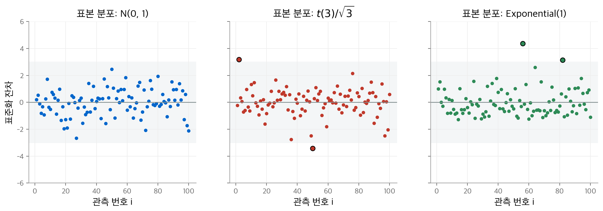
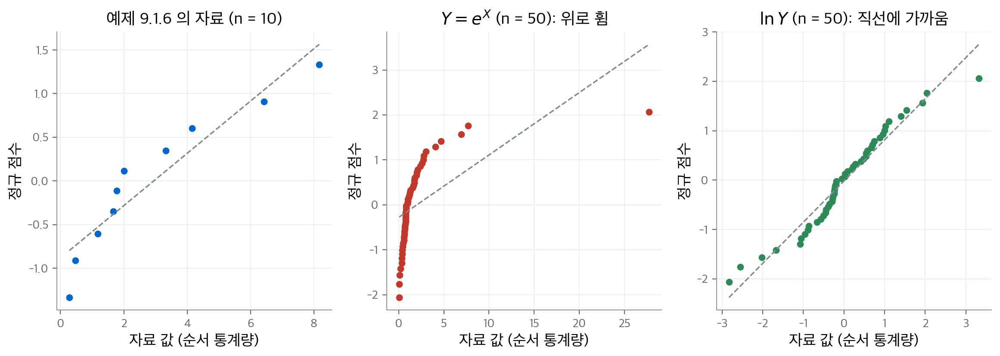
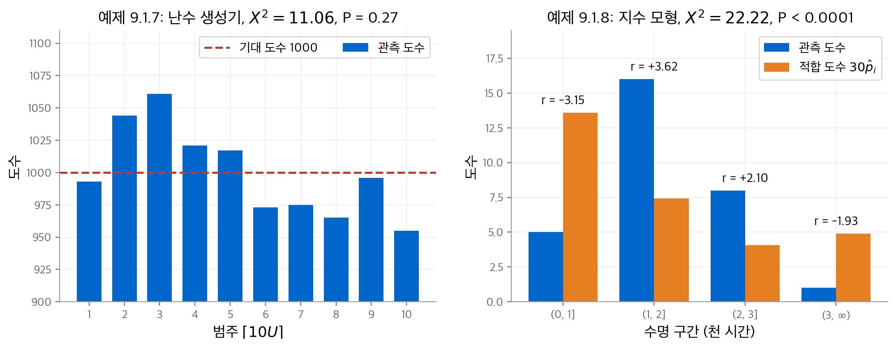
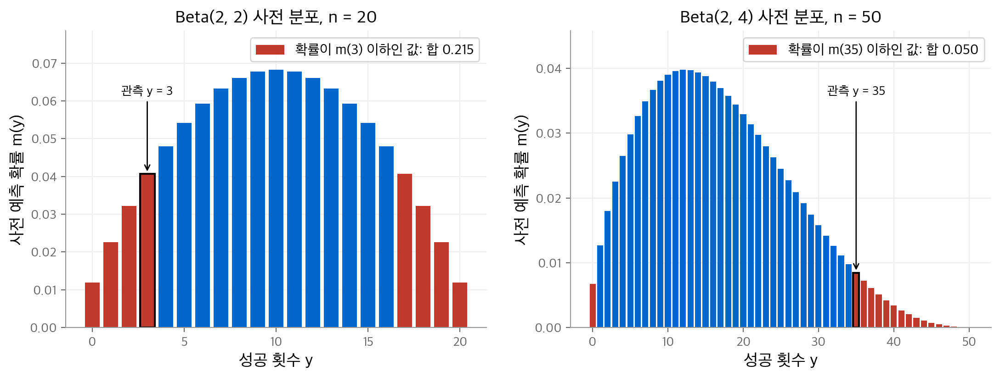
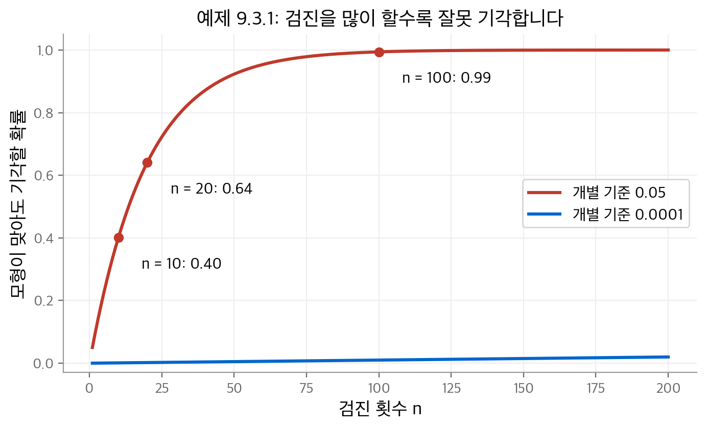

# 10. 모형 검진

앞의 세 장에서 다룬 추론 방법은 모두 가정 위에 서 있습니다.
[우도 추론](07-likelihood-inference.md)은 자료가 통계 모형 $\{f_\theta : \theta \in \Omega\}$ 의 한 분포에서 나왔다고 가정합니다.
[베이즈 추론](08-bayesian-inference.md)은 여기에 사전 분포 $\Pi$ 를 더 가정합니다.
가정이 자료와 맞지 않으면 그 위에서 계산한 추정값, 신뢰 구간, P-값도 믿기 어렵습니다.
이 장은 그 가정을 자료로 점검하는 방법을 다룹니다. 교재는 이 과정을 **모형 검진**(model checking)이라고 부릅니다.
이 노트의 10장은 교재의 9장입니다.

이 장의 질문은 세 가지입니다.

1. 표본 모형 $\{f_\theta\}$ 가 관측 자료를 만들었을 법한가(9.1절)?
2. 표본 모형은 그럴듯한데, 사전 분포가 자료와 충돌하지 않는가(9.2절)?
3. 검진을 여러 번 하면 무슨 문제가 생기는가(9.3절)?

!!! info "원문과 자료"
    - 교재: Evans & Rosenthal, *Probability and Statistics: The Science of Uncertainty*, 2nd Edition, 9장 Model Checking (p. 479–510)
    - PDF: [9장 시작 페이지](https://utstat.utoronto.ca/mikevans/jeffrosenthal/book.pdf#page=493)
    - 이 장의 수치는 모두 NumPy와 SciPy로 다시 계산했습니다. 모의실험 값은 난수 시드에 따라 조금 달라집니다.

## 10.1 표본 모형 검진 (9.1절)

### 모형이 맞다는 것을 증명할 수는 없습니다

모형이 옳다는 사실을 자료로 확정하는 일은 거의 불가능합니다.
할 수 있는 일은 **관측 자료가 모형에서 나왔을 법한지** 평가하는 것입니다.
모형의 모든 분포에서 관측 자료가 놀라운 값이면, 모형이 틀렸다는 증거가 됩니다.
이 판단은 P-값으로 정량화합니다. 이때 귀무가설은 "모형이 옳다"입니다.

표본이 크면 P-값은 아주 작은 어긋남도 찾아냅니다. 그 어긋남이 실제로 중요한지는 따로 판단해야 합니다.
[7장](07-likelihood-inference.md)에서 본 **통계적 유의성**과 **실질적 유의성**의 구분이 여기서도 적용됩니다.

### 불일치 통계량과 보조 통계량

**불일치 통계량**(discrepancy statistic) $D : S \to \mathbb{R}$ 은 자료가 모형에서 얼마나 벗어났는지 재는 함수입니다.
관측값 $D(s)$ 가 모형 아래에서 확률이 낮은 영역에 있으면 모형을 의심합니다.
확률이 낮은 영역은 오른쪽 꼬리일 수도 있고, 왼쪽 꼬리일 수도 있습니다.

- **오른쪽 꼬리**: 불일치가 지나치게 큽니다. 모형이 자료를 **과소적합**(underfitting)합니다.
- **왼쪽 꼬리**: 불일치가 지나치게 작습니다. 모형이 자료를 **과적합**(overfitting)합니다.

P-값을 계산하려면 모형이 옳을 때 $D$ 의 분포가 하나로 정해져야 합니다. 즉 $D$ 의 분포가 $\theta$ 에 의존하면 안 됩니다.
교재는 이 조건을 만족하는 방법 두 가지를 제시합니다.

!!! note "정의 9.1.1: 보조 통계량"
    통계량 $D$ 의 분포가 모든 $\theta \in \Omega$ 에서 같으면 $D$ 를 **보조 통계량**(ancillary statistic)이라고 부릅니다.

1. **보조 통계량을 씁니다.** 모형을 적합하고 남은 정보인 **잔차**(residual)가 좋은 후보입니다.
2. **최소 충분 통계량 $T$ 가 주어졌을 때의 조건부 분포를 씁니다.** [9장의 정리 8.1.2](09-optimal-inferences.md)에 따라 이 분포는 $\theta$ 에 의존하지 않습니다.

두 방법의 결과는 같을 때도 있고 다를 때도 있습니다.

### 예: 위치 정규 모형 (예제 9.1.1)

$x_1, \dots, x_n$ 이 $N(\mu, \sigma_0^2)$ 에서 나온 표본이고, $\mu$ 는 모르고 $\sigma_0^2$ 은 압니다.
$\bar{x}$ 는 최소 충분 통계량이자 $\mu$ 의 추정값입니다. 잔차를 다음과 같이 정의합니다.

$$
r = (x_1 - \bar{x}, \dots, x_n - \bar{x})
$$

잔차 벡터 $R$ 의 분포는 $\mu$ 에 의존하지 않습니다. 또 $R$ 은 $\bar{X}$ 와 독립이고, 각 성분은 다음 분포를 따릅니다.

$$
R_i \sim N\!\left(0, \sigma_0^2 \left(1 - \tfrac{1}{n}\right)\right), \qquad
\mathrm{Cov}(R_i, R_j) = \sigma_0^2 \left(\delta_{ij} - \tfrac{1}{n}\right)
$$

따라서 $r$ 만으로 계산한 통계량은 모두 보조 통계량입니다. $R$ 과 $\bar{X}$ 가 독립이므로 두 방법의 P-값도 같습니다.
[4장의 정리 4.6.6](04-sampling-limits.md)에 따라 다음 통계량은 $\chi^2(n-1)$ 분포를 따릅니다.

$$
D(R) = \frac{1}{\sigma_0^2} \sum_{i=1}^{n} (X_i - \bar{X})^2 \sim \chi^2(n-1)
$$

P-값 $P(D \ge D(r))$ 가 0에 가까우면 $D(r)$ 이 오른쪽 꼬리에 있습니다. P-값이 1에 가까우면 왼쪽 꼬리에 있습니다.
두 경우 모두 모형에 대한 반대 증거입니다. 실제 분산 $\sigma^2$ 이 $\sigma_0^2$ 보다 훨씬 작으면 $E(D) = (n-1)\sigma^2/\sigma_0^2$ 이 작아집니다.
그래서 왼쪽 꼬리도 확인해야 합니다.

!!! warning "자료를 본 뒤에 $D$ 를 고르지 않습니다"
    자료를 먼저 보고 눈에 띄는 특징에 맞춰 $D$ 를 고르면 P-값 계산이 무효가 됩니다.
    그 경우에는 $D$ 를 고르게 만든 자료의 특징까지 조건으로 넣어야 합니다.

### 예: 위치-척도 정규 모형 (예제 9.1.2)

이번에는 $\mu$ 와 $\sigma^2$ 을 모두 모릅니다. 잔차를 표준 편차로 나눠 정의합니다.

$$
r = \left( \frac{x_1 - \bar{x}}{s}, \dots, \frac{x_n - \bar{x}}{s} \right)
$$

이 $R$ 의 분포는 $(\mu, \sigma^2)$ 에 의존하지 않으므로 보조 통계량입니다. 교재가 쓰는 불일치 통계량은 다음과 같습니다.

$$
D(r) = -\frac{1}{n} \sum_{i=1}^{n} \ln \frac{r_i^2}{n - 1}
$$

$D(R)$ 의 분포는 공식으로 쓰기 어렵습니다. 대신 [4장의 몬테카를로 방법](04-sampling-limits.md)으로 근사합니다.

1. $N(0, 1)$ 에서 크기 $n$ 의 표본을 $N$ 개 만듭니다. $D(R)$ 이 $(\mu, \sigma^2)$ 에 의존하지 않으므로 어느 정규 분포를 써도 됩니다.
2. 표본마다 $D(R)$ 을 계산합니다.
3. 관측값 $D(r)$ 이상인 비율을 P-값으로 씁니다.

교재는 $n = 5$ 인 표본에서 $D(r) = 4.93$ 을 얻습니다. 시뮬레이션 값 $10^4$ 개 가운데 0.0057만 이보다 큽니다.
이 노트에서 $2 \times 10^5$ 번 다시 시뮬레이션하면 $P(D \ge 4.93) \approx 0.0065$ 입니다. 귀무 분포의 중앙값은 약 2.48입니다.
어느 쪽이든 정규 모형에 반대하는 뚜렷한 증거입니다.[^d-value]

$D$ 외에도 다음 두 통계량을 자주 씁니다. 둘 다 같은 방법으로 귀무 분포를 시뮬레이션합니다.

| 통계량 | 식 | 측정하는 성질 |
| --- | --- | --- |
| 왜도(skewness) | $D_{\text{skew}}(r) = (n-1)^{-3/2} \sum_i r_i^3$ | 좌우 대칭성 |
| 첨도(kurtosis) | $D_{\text{kurtosis}}(r) = (n-1)^{-2} \sum_i r_i^4$ | 분포의 뾰족함과 꼬리 두께 |

[^d-value]: PDF에서 추출한 텍스트는 부호와 소수점을 잃었습니다. 그래서 교재의 표본 다섯 개로 $D(r) = 4.93$ 을 재현하지 못했습니다. 위의 꼬리 확률은 교재가 보고한 $D(r) = 4.93$ 을 기준으로 계산했습니다.

### 예: 피셔의 정확 검정 (예제 9.1.4)

두 번째 방법(충분 통계량 조건부)이 필요한 예입니다. 학생 $n$ 명을 성별 $A$ 와 시간제 고용 여부 $B$ 로 분류합니다.
모형은 "$A$ 와 $B$ 가 독립"이고, $P(A = 1) = \alpha_1$, $P(B = 1) = \beta_1$ 은 모릅니다. 칸 도수는 [2장의 다항 분포](02-random-variables.md)를 따릅니다.

$$
(X_{11}, X_{12}, X_{21}, X_{22}) \sim \text{Multinomial}(n, \alpha_1\beta_1, \alpha_1\beta_2, \alpha_2\beta_1, \alpha_2\beta_2)
$$

최소 충분 통계량은 두 주변 도수 $(x_{1\cdot}, x_{\cdot 1})$ 입니다. 최대 우도 추정값(MLE)은 표본 비율 $\hat\alpha_1 = x_{1\cdot}/n$, $\hat\beta_1 = x_{\cdot 1}/n$ 입니다.
이 예에서는 자연스러운 잔차가 없습니다. 대신 주변 도수가 주어졌을 때 $x_{11}$ 의 조건부 분포를 씁니다.

$$
P(X_{11} = i \mid x_{1\cdot}, x_{\cdot 1})
= \frac{\binom{x_{1\cdot}}{i} \binom{n - x_{1\cdot}}{x_{\cdot 1} - i}}{\binom{n}{x_{\cdot 1}}}
$$

이 분포는 초기하 분포 $\text{Hypergeometric}(n, x_{\cdot 1}, x_{1\cdot})$ 입니다. $\alpha_1$, $\beta_1$ 이 식에 없습니다.

교재의 수치 예는 $n = 20$, 남학생 $x_{1\cdot} = 6$, 고용된 학생 $x_{\cdot 1} = 12$, 고용된 남학생 $x_{11} = 2$ 입니다.[^fisher]

| $i$ | 0 | 1 | 2 | 3 | 4 | 5 | 6 |
| --- | --- | --- | --- | --- | --- | --- | --- |
| $p(i)$ | 0.001 | 0.017 | 0.119 | 0.318 | 0.358 | 0.163 | 0.024 |

P-값은 $p(i) \le p(2)$ 인 $i$ 의 확률을 모두 더한 값입니다.

$$
p(2) + p(1) + p(0) + p(6) = 0.119 + 0.017 + 0.001 + 0.024 = 0.161
$$

독립 모형에 반대하는 증거는 없습니다. 다만 표본이 작습니다.

[^fisher]: 교재는 $x_{\cdot 1} = 12$ 를 "unemployed"로 적었습니다. $B = 1$ 은 고용 상태이므로 12는 고용된 학생 수입니다. 표의 확률은 이 해석으로 계산한 값과 일치합니다.

### 잔차 그림 (9.1.1절)

P-값보다 덜 엄밀하지만, 그림은 모형의 큰 어긋남을 쉽게 보여 줍니다.
예제 9.1.1의 잔차를 분산 1로 맞추면 **표준화 잔차**(standardized residual)를 얻습니다.

$$
r_i^* = \sqrt{\frac{n}{\sigma_0^2 (n-1)}}\,(x_i - \bar{x}) \qquad (\text{9.1.3}), \qquad
r_i^* = \sqrt{\frac{n}{s^2 (n-1)}}\,(x_i - \bar{x}) \qquad (\text{9.1.4})
$$

$n$ 이 크면 $r_1^*, \dots, r_n^*$ 은 근사적으로 $N(0, 1)$ 의 독립 표본입니다. 그래서 점 $(i, r_i^*)$ 의 그림은 다음 두 조건을 만족해야 합니다.

- 눈에 띄는 패턴이 없습니다.
- 거의 모든 점이 $(-3, 3)$ 안에 있습니다.

<figure markdown>

<figcaption markdown>
<b>Figure 1.</b> 세 분포에서 뽑은 표본의 표준화 잔차

$t(3)/\sqrt{3}$ 은 꼬리가 두꺼워 $(-3, 3)$ 밖의 잔차가, 지수 분포는 큰 양의 잔차가 나옵니다.
</figcaption>
</figure>

정규 분포와 $t(3)$ 분포는 성질이 크게 다릅니다. 정규 분포는 모든 적률이 있고, $t(3)$ 분포는 2차 적률까지만 있습니다.
그런데도 잔차 그림은 꼬리의 점 몇 개를 빼면 비슷해 보입니다. 패턴이 우연인지 판단하려면 $N(0, 1)$ 표본으로 잔차 그림을 몇 개 그려 비교합니다.

### 정규 확률 그림

분포 가정을 직접 확인하는 도구는 **정규 확률 그림**(normal probability plot, 정규 분위수 그림)입니다.
$X_1, \dots, X_n$ 이 $N(\mu, \sigma^2)$ 의 표본이면, $n$ 이 클 때 $i$ 번째 순서 통계량의 기댓값은 다음과 같습니다.

$$
E(X_{(i)}) \approx \mu + \sigma\, \Phi^{-1}\!\left(\frac{i}{n+1}\right) \qquad (\text{9.1.5})
$$

$\Phi^{-1}(i/(n+1))$ 을 $x_{(i)}$ 의 **정규 점수**(normal score)라고 부릅니다.
점 $(x_{(i)}, \Phi^{-1}(i/(n+1)))$ 을 그리면 정규 모형 아래에서 대략 직선 위에 놓입니다.

예제 9.1.6의 자료는 $n = 10$ 입니다.

| $i$ | 1 | 2 | 3 | 4 | 5 | 6 | 7 | 8 | 9 | 10 |
| --- | --- | --- | --- | --- | --- | --- | --- | --- | --- | --- |
| $x_{(i)}$ | 0.28 | 0.47 | 1.18 | 1.66 | 1.77 | 2.00 | 3.33 | 4.15 | 6.43 | 8.17 |
| 정규 점수 | −1.34 | −0.91 | −0.60 | −0.35 | −0.11 | 0.11 | 0.35 | 0.60 | 0.91 | 1.34 |

교재의 표는 일부 점수가 0.01씩 다릅니다(예: −0.61, −0.12, 0.34, 0.90, 1.33). 다시 계산한 값은 위 표와 같고, 차이는 반올림 방식에서 생깁니다.

<figure markdown>

<figcaption markdown>
<b>Figure 2.</b> 정규 확률 그림 세 가지

크기 10인 표본은 직선에서 조금 벗어나도 흔한 정도입니다. $Y = e^X$ 는 뚜렷하게 휘고, $\ln Y$ 는 직선에 가깝습니다.
</figcaption>
</figure>

### 카이제곱 적합도 검정 (9.1.2절)

범주형 확률 변수 $W$ 가 값 $1, \dots, k$ 를 가지고, 확률 $p_i = P(W = i)$ 가 정해져 있다고 합니다.
관측 도수 $(X_1, \dots, X_k)$ 는 $\text{Multinomial}(n, p_1, \dots, p_k)$ 를 따릅니다.
각 $X_i$ 는 $\text{Binomial}(n, p_i)$ 이므로 [4장의 정규 근사](04-sampling-limits.md)에서 다음이 나옵니다.

$$
R_i = \frac{X_i - n p_i}{\sqrt{n p_i (1 - p_i)}} \xrightarrow{D} N(0, 1)
$$

$R_i$ 는 표준화 잔차 역할을 합니다. 그러나 $\sum_i X_i = n$ 이라는 제약 때문에 $R_i$ 가 독립이 아닙니다.
그래서 $\sum_i R_i^2$ 의 극한은 $\chi^2(k)$ 가 아닙니다. 대신 다음 정리가 성립합니다.

!!! note "정리 9.1.1"
    $(X_1, \dots, X_k) \sim \text{Multinomial}(n, p_1, \dots, p_k)$ 이면 $n \to \infty$ 일 때 다음이 성립합니다.

    $$
    X^2 = \sum_{i=1}^{k} (1 - p_i) R_i^2 = \sum_{i=1}^{k} \frac{(X_i - n p_i)^2}{n p_i} \xrightarrow{D} \chi^2(k - 1)
    $$

$X^2$ 을 **카이제곱 통계량**이라고 부릅니다. 각 항은 "(관측 도수 − 기대 도수)² ÷ 기대 도수"입니다.
P-값 $P(X^2 \ge X_0^2)$ 로 모형을 평가하는 절차를 **카이제곱 적합도 검정**(chi-squared goodness of fit test)이라고 부릅니다.
근사가 정확하려면 모든 칸에서 기대 도수 $n p_i \ge 1$ 이 되도록 칸을 합칩니다.

**예제 9.1.7: 난수 생성기 검사.** 몬테카를로 계산은 모두 $\text{Uniform}[0, 1]$ 난수열 $U_1, U_2, \dots$ 에 의존합니다.
$U_i$ 가 정말 균등하면 $\lceil 10 U_i \rceil$ 은 $\{1, \dots, 10\}$ 위의 균등 분포를 따릅니다.
교재는 $n = 10^4$ 개를 생성해 다음 도수를 얻습니다.

| $i$ | 1 | 2 | 3 | 4 | 5 | 6 | 7 | 8 | 9 | 10 |
| --- | --- | --- | --- | --- | --- | --- | --- | --- | --- | --- |
| $x_i$ | 993 | 1044 | 1061 | 1021 | 1017 | 973 | 975 | 965 | 996 | 955 |
| $r_i$ | −0.233 | 1.467 | 2.033 | 0.700 | 0.567 | −0.900 | −0.833 | −1.167 | −0.133 | −1.500 |

$$
X_0^2 = \sum_{i=1}^{10} \frac{(x_i - 1000)^2}{1000} = 11.056, \qquad P(X^2 \ge 11.056) = 0.2719 \quad (X^2 \sim \chi^2(9))
$$

난수 생성기에 결함이 있다는 증거는 없습니다. 실제 검사에서는 쌍 $(i, j)$ 의 빈도처럼 독립성도 함께 검사합니다.

**모수를 추정하는 경우.** 확률이 정해져 있지 않고 모형 $\{P_\theta\}$ 로 주어지면, 도수의 다항 우도로 MLE $\hat\theta$ 를 구합니다.
그리고 $p_i$ 대신 $\hat p_i = P_{\hat\theta}(\{i\})$ 를 씁니다.

!!! note "정리 9.1.2"
    적절한 정칙 조건 아래에서 $n \to \infty$ 일 때 다음이 성립합니다.

    $$
    X^2 = \sum_{i=1}^{k} \frac{(X_i - n \hat p_i)^2}{n \hat p_i} \xrightarrow{D} \chi^2(k - 1 - \dim \Omega)
    $$

모수 하나를 추정할 때마다 자유도가 하나 줄어듭니다. 따라서 칸 수는 $k - 1 > \dim \Omega$ 를 만족해야 합니다.

**예제 9.1.8: 지수 분포 검사.** 전구 $n = 30$ 개의 수명(천 시간 단위)이 $\text{Exponential}(\theta)$ 를 따르는지 검사합니다.
구간 $(0, 1]$, $(1, 2]$, $(2, 3]$, $(3, \infty)$ 의 도수는 $5, 16, 8, 1$ 입니다. 도수의 우도는 다음과 같습니다.

$$
L(\theta) = (1 - e^{-\theta})^5\, (e^{-\theta} - e^{-2\theta})^{16}\, (e^{-2\theta} - e^{-3\theta})^8\, (e^{-3\theta})^1
$$

수치 최적화로 $\hat\theta = 0.603535$ 를 얻습니다. 교재 값과 같습니다.

| 구간 | $(0, 1]$ | $(1, 2]$ | $(2, 3]$ | $(3, \infty)$ |
| --- | --- | --- | --- | --- |
| 관측 도수 | 5 | 16 | 8 | 1 |
| $\hat p_i$ | 0.4531 | 0.2478 | 0.1355 | 0.1636 |
| 적합 도수 $30 \hat p_i$ | 13.594 | 7.434 | 4.066 | 4.907 |
| 표준화 잔차 | −3.152 | 3.622 | 2.099 | −1.928 |

$$
X_0^2 = 22.221, \qquad P(X^2 \ge 22.221) \approx 1.5 \times 10^{-5} \quad (X^2 \sim \chi^2(4 - 1 - 1) = \chi^2(2))
$$

지수 모형에 반대하는 강한 증거입니다. 이 모형으로 $\theta$ 를 추론하면 안 됩니다.

<figure markdown>

<figcaption markdown>
<b>Figure 3.</b> 카이제곱 적합도 검정의 두 예

왼쪽은 기대 도수 주변에 흩어져 P-값이 0.27입니다. 오른쪽은 첫 두 구간의 잔차가 ±3을 넘어 모형이 맞지 않습니다.
</figcaption>
</figure>

!!! warning "도수로 구한 MLE를 씁니다"
    정리 9.1.2는 **구간 도수**의 우도로 구한 MLE에서 성립합니다.
    원자료로 구한 MLE(이 예에서는 $1/\bar{x}$)를 넣으면 극한 분포가 $\chi^2(k - 1 - \dim\Omega)$ 가 아닙니다.

카이제곱 통계량 외에 콜모고로프-스미르노프 검정, 크라메르-폰 미제스 검정도 같은 원리로 만든 불일치 통계량입니다.

### 예측과 교차 검증 (9.1.3절)

과학 이론에 가장 엄격한 검사는 **새 자료를 예측하는 능력**입니다.

- 모형이 너무 단순하면 관측 자료와 새 자료를 모두 과소적합합니다.
- 모형이 너무 복잡하면 관측 자료를 과적합합니다. 이 문제는 새 자료에서 드러납니다.

새 자료를 기다릴 수 없으면 **교차 검증**(cross-validation)을 씁니다.
자료 $x_1, \dots, x_n$ 을 크기 $k$ 의 **훈련 집합** $T$ 와 나머지 $n - k$ 개의 **검증 집합** $V$ 로 나눕니다.
$T$ 로 모형을 적합하고 $V$ 를 예측합니다. 예측값과 실제값의 차이로 $V$ 가 모형의 미래 표본으로 놀라운지 평가합니다.
나누는 방법은 $\binom{n}{k}$ 가지이므로, 분할 하나의 결과로 결정하지 않습니다. 교재는 이 주제를 더 다루지 않습니다.

### 모형이 실패하면 (9.1.4절)

가장 간단한 대처는 **변환**(transformation)입니다. 예를 들어 $Y = e^X$, $X \sim N(\mu, \sigma^2)$ 이면 $\ln Y$ 가 정규 모형 검사를 통과합니다(위 그림의 가운데와 오른쪽).

- 양수 자료에는 로그 변환 $\ln Y$ 를 가장 많이 씁니다.
- 도수 자료에는 제곱근 변환 $Y^{1/2}$ 을 자주 씁니다.
- 일반적으로는 거듭제곱 변환 $Y^p$ ($p \ne 0$) 군에서 고릅니다.

그림이 좋아 보일 때까지 변환을 계속 바꾸면 안 됩니다. 간단한 변환 몇 개만 시도합니다.
또 모형이 검진에서 기각되어도, 어긋남이 작으면 그 모형이 여전히 쓸모 있을 수 있습니다.

## 10.2 사전 분포와 자료의 충돌 검진 (9.2절)

### 베이즈 모형이 틀리는 두 가지 방식

베이즈 모형은 표본 모형 $\{P_\theta\}$ 에 사전 분포 $\Pi$ 를 더합니다. 이 둘이 함께 정하는 자료의 분포는 **사전 예측 분포**(prior predictive distribution)입니다.

$$
M(A) = E_\Pi\big(P_\theta(A)\big)
$$

관측 자료 $s$ 가 $M$ 에서 놀라운 값이면 $M$ 이 틀렸다는 증거입니다. 그러나 표본 모형이 틀렸다는 뜻은 아닙니다.

**예제 9.2.1.** 모수 $\theta \in \{1, 2\}$ 이고 기본 응답의 확률은 다음 표와 같습니다. $s = 1$ 을 20번 관측했습니다.

| | $s = 0$ | $s = 1$ |
| --- | --- | --- |
| $f_1(s)$ | 0.9 | 0.1 |
| $f_2(s)$ | 0.1 | 0.9 |

$f_2$ 에서 이 표본이 나올 확률은 $0.9^{20} = 0.12158$ 입니다. 표본 모형 $\{f_1, f_2\}$ 에 반대하는 증거는 없습니다.
이제 사전 분포를 $\Pi(\{1\}) = 0.9999$ 로 둡니다. 사전 예측 확률은 다음과 같습니다.

$$
M(s) = 0.9999 \cdot 0.1^{20} + 0.0001 \cdot 0.9^{20} = 1.2158 \times 10^{-5}
$$

사전 예측 확률이 이 값 이하인 표본이 나올 확률은 약 0.043입니다. 교재는 "약 0.04"로 적었습니다.
관측 자료가 사전 예측 분포의 꼬리에 있으므로 베이즈 모형은 그럴듯하지 않습니다.

이 예에서 얻는 교훈은 다음과 같습니다.

1. 표본 모형 자체가 자료와 맞지 않을 수 있습니다.
2. 표본 모형이 맞아도, 사전 분포가 자료와 **충돌**(prior–data conflict)할 수 있습니다. 사전 분포가 자료를 놀랍게 만드는 $\theta$ 에 확률을 몰아주면 충돌이 생깁니다.

따라서 먼저 10.1절의 방법으로 표본 모형을 검진합니다. 표본 모형을 받아들인 뒤에 충돌을 검진합니다.
사전 분포가 모든 $\theta$ 에 양의 확률을 주면, 자료가 많을 때 [8장의 일치성](08-bayesian-inference.md)이 충돌을 이겨 냅니다.

### 최소 충분 통계량의 사전 예측 분포를 씁니다

보조 통계량의 사전 예측 분포는 사전 분포와 무관합니다. 그래서 보조 통계량으로는 충돌을 찾을 수 없습니다.
다음 정리는 충분 통계량 너머의 정보도 쓸모없다는 것을 보여 줍니다.

!!! note "정리 9.2.1"
    $T$ 가 모형 $\{f_\theta\}$ 의 충분 통계량이면, $T$ 가 주어졌을 때 자료 $s$ 의 조건부 사전 예측 분포는 사전 분포에 의존하지 않습니다.

증명(이산형)은 인수분해 정리 $f_\theta(s) = h(s)\, g_\theta(T(s))$ 에서 바로 나옵니다.

$$
m(s \mid T = t) = \frac{h(s) \int g_\theta(t)\, \Pi(d\theta)}{\sum_{s' : T(s') = t} h(s') \int g_\theta(t)\, \Pi(d\theta)}
= \frac{h(s)}{\sum_{s' : T(s') = t} h(s')}
$$

결론적으로 충돌 검진은 **최소 충분 통계량의 사전 예측 분포**로 합니다.

### 예: 베르누이 모형의 베타 사전 분포 (예제 9.2.2)

$x_1, \dots, x_n$ 이 $\text{Bernoulli}(\theta)$ 표본이고 $\theta \sim \text{Beta}(\alpha, \beta)$ 입니다.
최소 충분 통계량 $y = \sum_i x_i$ 의 사전 예측 분포는 베타-이항 분포입니다.

$$
m(y) = \binom{n}{y} \frac{B(y + \alpha,\, n - y + \beta)}{B(\alpha, \beta)}, \qquad y = 0, 1, \dots, n
$$

- $\alpha = \beta = 1$ 이면 $m(y) = 1/(n+1)$ 입니다. 균등 사전 분포는 모든 $y$ 를 그럴듯하게 봅니다. 그래서 놀라운 $y$ 가 없습니다.
- $\alpha = \beta = 2$, $n = 20$ 이면 $m(y) \propto (y + 1)(n - y + 1)$ 이고, 0이나 20 근처의 $y$ 가 충돌의 증거가 됩니다.

$y = 3$ 의 P-값은 확률이 $m(3)$ 이하인 $y$ 의 확률 합입니다.

$$
P\big(m(Y) \le m(3)\big) = 0.2146, \qquad P\big(m(Y) < m(3)\big) = m(0) + m(1) + m(2) + m(18) + m(19) + m(20) = \tfrac{236}{1771} = 0.1333
$$

교재는 이 값을 0.0688876으로 적었습니다. 이 값은 $y = 2, 18$ 을 뺀 합 $122/1771$ 과 같습니다. $m(2) < m(3)$ 이므로 $y = 2$ 도 넣어야 합니다.
어느 값을 써도 결론은 같습니다. $y = 3$ 은 5% 수준에서 놀라운 값이 아닙니다.

$n = 50$, $\alpha = 2$, $\beta = 4$ 이면 사전 평균이 $2/6 = 1/3$ 이고 사전 분포가 오른쪽으로 치우칩니다.
$y = 35$ 를 관측하면 확률이 $m(35)$ 이하인 값은 $y = 0$ 과 $y \ge 35$ 입니다. 그 확률 합은 0.0502입니다. 교재 값은 0.0500입니다.

<figure markdown>

<figcaption markdown>
<b>Figure 4.</b> 베타-이항 사전 예측 분포

빨간 막대의 합이 충돌 검진의 P-값입니다. $y = 3$ 은 놀랍지 않고, $y = 35$ 는 5% 경계에 있습니다.
</figcaption>
</figure>

### 예: 위치 정규 모형의 정규 사전 분포 (예제 9.2.3)

$x_1, \dots, x_n \sim N(\mu, \sigma_0^2)$ 이고 $\mu \sim N(\mu_0, \tau_0^2)$ 입니다. $\bar{x} = \mu + z$ 로 쓰면 $z \sim N(0, \sigma_0^2/n)$ 이 $\mu$ 와 독립입니다.
따라서 $\bar{x}$ 의 사전 예측 분포는 $N(\mu_0, \tau_0^2 + \sigma_0^2/n)$ 입니다. 대칭성에서 P-값이 나옵니다.

$$
M\big(|\bar{X} - \mu_0| \ge |\bar{x} - \mu_0|\big) = 2\left[1 - \Phi\!\left(\frac{|\bar{x} - \mu_0|}{\sqrt{\tau_0^2 + \sigma_0^2/n}}\right)\right] \qquad (\text{9.2.1})
$$

이 값이 작으면 사전 분포가 관측 자료를 놀랍게 만드는 $\mu$ 에 질량을 몰아준 것입니다.

### 사후 예측 분포를 쓰지 않는 이유 (예제 9.2.4)

예제 9.2.1로 돌아갑니다. $\theta = 2$ 의 사후 확률을 계산합니다.

$$
\Pi(\{2\} \mid s) = \frac{0.0001 \cdot 0.9^{20}}{0.9999 \cdot 0.1^{20} + 0.0001 \cdot 0.9^{20}} \approx 1
$$

사후 예측 확률은 $0.12158$ 이고 충돌의 신호가 없습니다. 이 예에서는 자료가 사전 분포를 이겨 내서 추론 자체는 괜찮습니다.
그러나 사후 예측 분포는 자료로 모형을 적합한 뒤 같은 자료로 검진합니다. 교재는 이것을 **자료의 이중 사용**(double use of the data)이라고 부릅니다.
이중 사용은 모형을 지나치게 낙관적으로 평가하고 어긋남을 놓치기 쉽습니다.

## 10.3 다중 검진의 문제 (9.3절)

가능한 검진을 모두 실행하는 방법은 합리적이지 않습니다. 교재의 예가 그 이유를 보여 줍니다.

**예제 9.3.1.** $x_1, \dots, x_n$ 이 $N(0, 1)$ 표본이라고 가정합니다. 관측마다 P-값 $P_i = P(X_i^2 \ge x_i^2)$ ($X_i^2 \sim \chi^2(1)$)를 계산합니다.
그리고 최소 P-값이 0.05보다 작으면 모형을 기각합니다. 모형이 옳을 때 기각 확률은 다음과 같습니다.

$$
P\big(\min_i P_i < 0.05\big) = 1 - P\big(\max_i X_i^2 \le \chi^2_{0.95}(1)\big) = 1 - 0.95^n \to 1
$$

| 검진 횟수 $n$ | 10 | 20 | 100 |
| --- | --- | --- | --- |
| 개별 기준 0.05의 오기각 확률 | 0.40 | 0.64 | 0.99 |
| 개별 기준 0.0001의 오기각 확률 | 0.0010 | 0.0020 | 0.0100 |

<figure markdown>

<figcaption markdown>
<b>Figure 5.</b> 검진 횟수에 따른 오기각 확률

모형이 옳아도 개별 기준 0.05로 검진을 많이 하면 거의 확실하게 기각합니다.
</figcaption>
</figure>

이 현상을 **다중 비교 문제**(multiple comparisons problem)라고 부릅니다. 교재의 처방은 다음과 같습니다.

1. 자료를 보기 **전에** 관련 있는 검진 몇 개를 정합니다.
2. 정한 검진만 실행합니다.
3. 필요하면 개별 P-값의 기준을 낮춥니다. 다만 검진들이 독립이 아니면 적절한 기준을 정하기 어렵습니다.

## 딥러닝에서의 쓰임

| 개념 | 딥러닝에서 쓰이는 곳 |
| --- | --- |
| 예측과 교차 검증 | 검증 집합과 $k$-겹 교차 검증은 과적합을 찾는 기본 도구입니다. 훈련 손실은 내려가는데 검증 손실이 올라가면 이 장의 "새 자료에서 드러나는 과적합"입니다. |
| 불일치 통계량의 양쪽 꼬리 | 검증 손실이 훈련 손실보다 지나치게 낮으면 자료 누수(data leakage)를 의심합니다. 불일치가 "너무 작은" 왼쪽 꼬리와 같은 신호입니다. |
| 잔차 그림, 확률 그림 | 회귀 모델의 잔차를 입력이나 예측값에 대해 그려 체계적 오차를 찾습니다. **신뢰도 그림**(reliability diagram)은 예측 확률과 실제 정답률을 비교하는 분류기용 확률 그림입니다. |
| 카이제곱 적합도 검정 | 예측 확률 구간별 관측 정답 수와 기대 정답 수를 비교하면 보정(calibration) 검정이 됩니다. ECE(expected calibration error)도 같은 구조의 불일치 통계량입니다. |
| 분포 검진 | 학습 분포와 배포 환경의 입력 분포를 비교해 **분포 이동**(distribution shift)을 찾습니다. 특성별 카이제곱 검정이나 콜모고로프-스미르노프 검정을 씁니다. |
| 사전 분포와 자료의 충돌 | 사전 학습 모델(사전 분포 역할)이 미세 조정 자료와 크게 어긋나면 적은 자료로는 이를 이겨 내기 어렵습니다. 베이즈 신경망의 사전 분포 선택도 같은 문제입니다. |
| 다중 비교 | 하이퍼파라미터를 수백 번 탐색하고 최고 점수를 보고하면 1−0.95ⁿ 처럼 우연한 승리가 섞입니다. 벤치마크 수십 개에서 몇 개만 고른 비교도 마찬가지입니다. 탐색에 쓰지 않은 시험 집합을 따로 두는 것이 "검진을 미리 정한다"는 처방에 해당합니다. |

## 정리

| 개념 | 핵심 |
| --- | --- |
| 모형 검진 | 모형이 옳다고 증명할 수 없습니다. 자료가 모형에서 나왔을 법한지 P-값으로 평가합니다. |
| 불일치 통계량 | 모형이 옳을 때 분포가 하나로 정해져야 합니다. 오른쪽 꼬리는 과소적합, 왼쪽 꼬리는 과적합을 뜻합니다. |
| 보조 통계량 | 분포가 $\theta$ 에 의존하지 않습니다. 잔차가 대표 예입니다. |
| 충분 통계량 조건부 | 보조 통계량이 없을 때 씁니다. 피셔의 정확 검정이 대표 예입니다(초기하 분포). |
| 잔차 그림, 정규 확률 그림 | 표준화 잔차는 패턴 없이 $(-3, 3)$ 안에 있어야 합니다. 정규 점수 그림은 직선이어야 합니다. |
| 카이제곱 적합도 | $X^2 = \sum (X_i - n p_i)^2 / (n p_i) \to \chi^2(k - 1 - \dim\Omega)$ 입니다. 모수는 도수 우도로 추정합니다. |
| 교차 검증 | 훈련 집합으로 적합하고 검증 집합을 예측해 과적합을 찾습니다. |
| 변환 | 모형이 실패하면 로그나 제곱근 같은 간단한 변환을 몇 개만 시도합니다. |
| 사전 분포와 자료의 충돌 | 표본 모형을 먼저 검진하고, 최소 충분 통계량의 사전 예측 분포로 충돌을 검진합니다. 사후 예측 분포는 자료를 두 번 씁니다. |
| 다중 검진 | 검진을 $n$ 번 하면 오기각 확률이 $1 - 0.95^n$ 입니다. 검진은 자료를 보기 전에 몇 개만 정합니다. |

## 다음 장

이 장까지는 한 변수의 표본을 다뤘습니다. [다음 장](11-relationships.md)에서는 변수 사이의 관계를 다룹니다.
범주형 변수의 분할표, 최소제곱과 선형 회귀, 분산 분석이 나옵니다. 이 장의 표준화 잔차와 정규 확률 그림은 회귀 모형 검진의 핵심 도구로 다시 쓰입니다.
