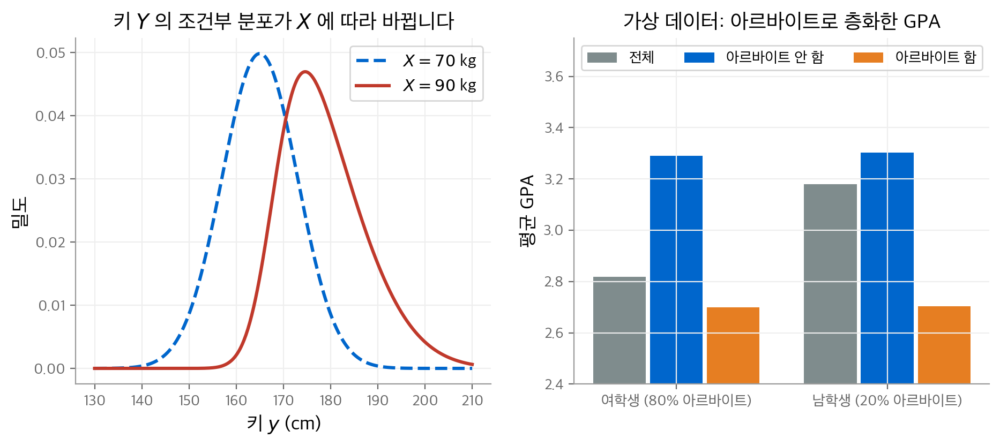
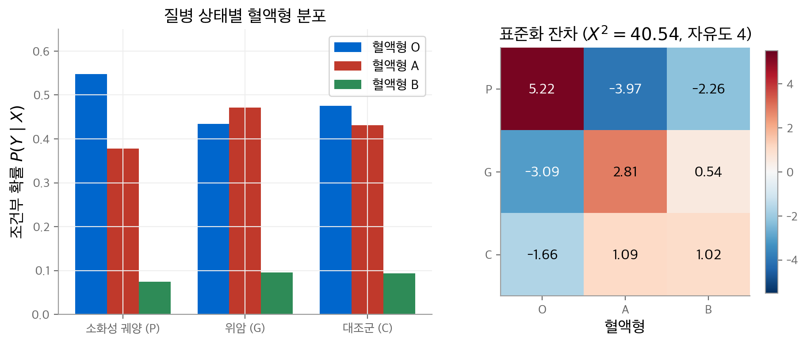
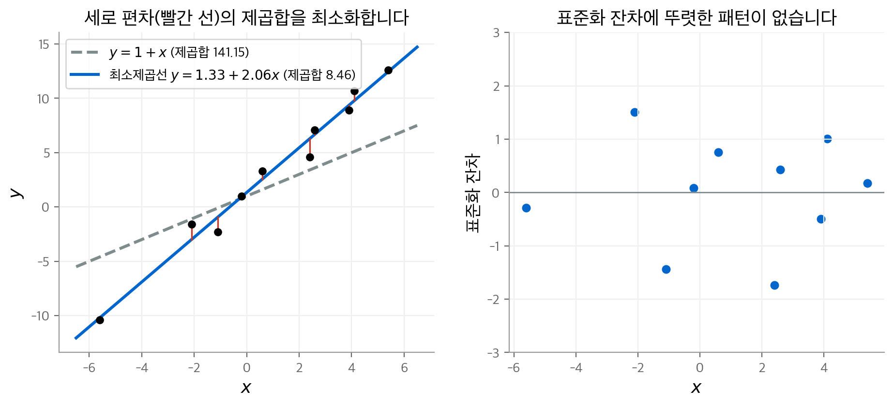
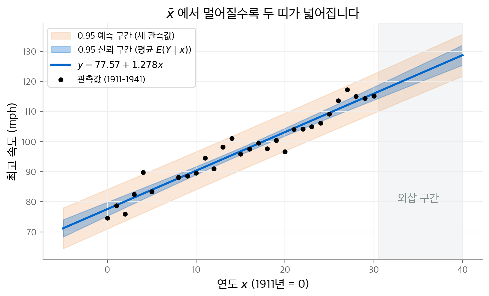
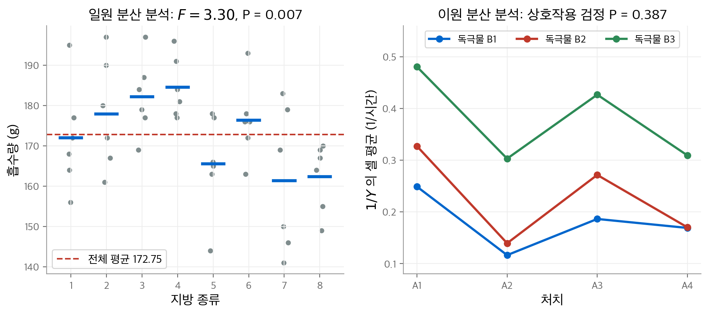
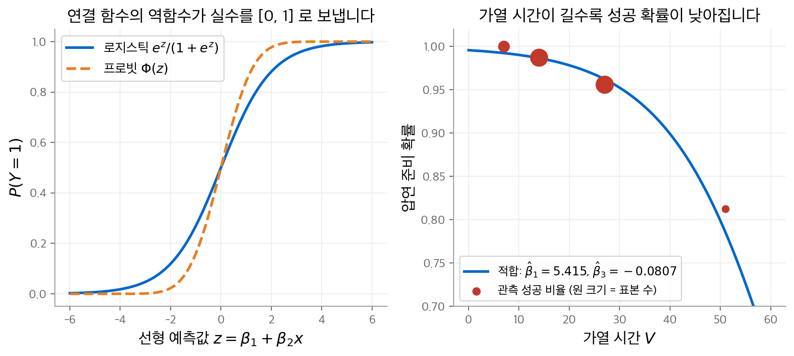

# 11. 변수 사이의 관계

과학과 사회의 질문 대부분은 변수 사이의 관계를 묻습니다. 학급 크기와 성적, 약의 용량과 수명, 탄소 배출량과 기온이 그렇습니다.
이 장은 교재 10장으로, 이 노트의 마지막 장입니다. 앞 장들의 추론 도구(우도, 신뢰 구간, P-값, 모형 점검)를 관계 분석에 적용합니다.

먼저 "두 변수가 관련되어 있다"는 말을 조건부 분포로 정의합니다. 이어서 관련성과 **인과 관계**(cause–effect relationship)를 구분하고,
인과를 주장하려면 데이터를 어떻게 모아야 하는지 다룹니다. 나머지 절은 반응 변수와 예측 변수의 종류에 따라 나뉩니다.

| 반응 변수 | 예측 변수 | 대표 방법 | 절 |
| --- | --- | --- | --- |
| 범주형 | 범주형 | 분할표의 카이제곱 검정 | 11.2 |
| 양적 | 양적 | 최소제곱과 선형 회귀 | 11.3 |
| 양적 | 범주형 | 분산 분석(ANOVA) | 11.4 |
| 범주형 | 양적 | 로지스틱 회귀 | 11.5 |

!!! info "원문과 자료"
    - 교재: Evans & Rosenthal, *Probability and Statistics: The Science of Uncertainty*, 2nd Edition, 10장 Relationships Among Variables (p. 511–614)
    - PDF: [10장 시작 페이지](https://utstat.utoronto.ca/mikevans/jeffrosenthal/book.pdf#page=525)
    - 예제의 수치는 모두 NumPy와 SciPy로 다시 계산했습니다. 교재 값과 다른 곳은 본문에 적었습니다.

## 11.1 관련된 변수 (10.1절)

### 관계의 정의

모집단 위에 두 변수 $X$ 와 $Y$ 가 있다고 합니다. 예를 들어 $X$ 는 몸무게, $Y$ 는 키입니다.
키가 큰 사람이 대체로 무겁지만, 몸무게로 키를 정확히 계산하는 공식은 없습니다. 몸무게가 같은 사람들의 키도 서로 다릅니다.
그래서 관계를 공식이 아니라 **조건부 분포**로 정의합니다.

**정의 10.1.1.** $X = x$ 일 때 $Y$ 의 조건부 분포가 $x$ 에 따라 조금이라도 바뀌면, $X$ 와 $Y$ 는 **관련된 변수**(related variables)입니다.

관련되지 않은 것은 독립인 것과 같습니다. 두 변수가 독립인 것은 한 변수의 조건부 분포가 조건값에 의존하지 않는 것과 같기 때문입니다(2장).
따라서 정의가 비대칭으로 보여도, $Y \mid X$ 가 바뀌면 $X \mid Y$ 도 반드시 바뀝니다.

전수 조사를 하면 조건부 분포에 아주 작은 차이는 거의 항상 보입니다. 그래서 실제로는 **관계의 강도**가 중요합니다.
차이가 아주 작으면 실용적으로 의미 없는 약한 관계입니다.

<figure markdown>

<figcaption>
왼쪽: 몸무게가 70 kg에서 90 kg으로 바뀌면 키의 조건부 분포가 위치와 모양 모두 바뀝니다(교재 그림 10.1.1과 같은 구성).
오른쪽: 예제 10.1.3을 흉내 낸 가상 데이터입니다. 전체 평균(회색)만 보면 성별에 따라 GPA가 다릅니다.
아르바이트 여부로 나누면(파란색, 주황색) 성별 차이가 사라집니다.
</figcaption>
</figure>

### 통계 모형과 회귀 가정

관계의 전체 모습은 모든 조건부 분포의 모임입니다. 이것을 다 다루기는 어려우므로, 보통 조건부 분포가 바뀌는 방식을 모형으로 단순화합니다.

**예제 10.1.1 (단순 정규 선형 회귀 모형).** $Y \mid X = x \sim N(\beta_1 + \beta_2 x,\ \sigma^2)$ 이라고 가정합니다.
조건부 분포는 모양이 고정되어 있고, 평균만 직선 $\beta_1 + \beta_2 x$ 를 따라 움직입니다.
이 모형이 맞다면 두 변수가 관련되지 않은 것은 $\beta_2 = 0$ 인 것과 같습니다.

예측 변수가 $k$ 개이면 $Y \mid X_1, \dots, X_k \sim N(\beta_1 x_1 + \cdots + \beta_k x_k,\ \sigma^2)$ 로 씁니다(예제 10.1.2).
예측 변수끼리 거의 함수 관계에 있으면 추정이 데이터의 작은 변화에 크게 흔들립니다. 이 문제를 **다중 공선성**(multicollinearity)이라고 부릅니다.

**회귀 가정**(regression assumption)은 예측 변수가 바뀔 때 조건부 분포에서 **조건부 평균만** 바뀐다는 가정입니다.
이 가정 아래에서는 $Y$ 를 두 부분으로 나눌 수 있습니다.

$$
Y = E(Y \mid X_1, \dots, X_k) + Z
$$

$Z$ 를 **오차항**(error term)이라고 부릅니다. 회귀 가정이 성립하는 것과 $Z$ 의 조건부 분포가 예측 변수와 무관한 것은 같습니다.

### 인과 관계와 교란 변수

관계가 있다는 사실만으로 $X$ 가 $Y$ 를 바꾼다고 말할 수는 없습니다. 몸무게와 키는 관련되어 있지만, 한쪽이 다른 쪽의 원인은 아닙니다.

**예제 10.1.3.** 어느 학생 집단에서 여학생 대부분은 아르바이트를 하고, 남학생 대부분은 하지 않습니다.
연구자는 성별에 따라 GPA의 조건부 분포가 다르다는 것을 관찰합니다. 그러나 이 차이는 성별이 아니라 아르바이트 때문일 수도 있습니다.
이때 성별과 아르바이트 여부가 **교란되었다**(confounded)고 말합니다.

교란 변수 $Z$ 를 함께 측정하면 $Y \mid X = x, Z = z$ 를 비교할 수 있습니다. 그러나 현실에서는 모든 교란 변수를 알 수 없습니다.
이런 숨은 교란 변수를 **잠복 변수**(lurking variable)라고도 부릅니다.

### 실험의 세 가지 조건

교란 변수 문제를 피하는 방법은 $X$ 의 값을 연구자가 **직접 배정**하는 것입니다.
표본을 무작위로 뽑고, 그중 $n_1$ 명에게 $x_1$ 을, 나머지에게 $x_2$ 를 무작위로 배정합니다.
그러면 두 집단의 $Y$ 값은 각각 $f_{Y \mid X = x_1}$ 과 $f_{Y \mid X = x_2}$ 에서 나온 표본입니다. 두 분포의 차이는 $X$ 의 차이로만 설명됩니다.

교재는 인과 관계를 추론할 수 있는 자료 수집 방법을 **실험**(experiment)이라고 부르고, 다음 세 조건을 요구합니다.

1. 관심 모집단에서 무작위 표본을 뽑습니다. 선택 효과를 피하기 위해서입니다.
2. 표본의 각 단위에 예측 변수의 어떤 값이든 배정할 수 있어야 합니다.
3. 정한 처치 값을 표본에 **무작위로** 배정합니다.

자료 수집 방법에는 위계가 있습니다. 맨 아래가 **관찰 연구**(observational study), 그 위가 표본 조사, 맨 위가 실험입니다.
성별이나 인종처럼 배정할 수 없는 변수는 실험이 불가능합니다. 이때 관찰 연구의 결과는 버리지 않고 **결함이 있을 수 있는 증거**로 다룹니다.
흡연과 폐암의 관계가 대표 예입니다. 독립적인 관찰 연구가 여럿 같은 방향을 가리키면 인과에 대한 확신이 커집니다.

### 실험 설계

**실험 설계**(design of experiments)는 어떤 처치를 몇 번씩 쓸지 정하는 일입니다. 주요 용어는 다음과 같습니다.

| 용어 | 뜻 |
| --- | --- |
| 수준(level) | 실험에 쓰는 예측 변수의 값 $x_1, \dots, x_k$ 입니다. |
| 처치(treatment) | 실험 단위 하나에 수준 하나를 배정하는 일입니다. |
| 균형(balance) | 모든 수준에 같은 수의 단위를 배정합니다. 조건부 분포에 대한 정보가 없을 때 씁니다. |
| 대조 처치(control) | 효과의 기준선입니다. 예제 10.1.5에서 첨가제 농도 $x = 0$ 이 대조 처치입니다. |
| 위약 효과(placebo effect) | 아무 처치를 받아도 증상이 나아지는 현상입니다. 위약을 대조 처치로 씁니다. |
| 맹검(blind) | 참가자가 자신이 받은 처치를 모릅니다. 실험자도 모르면 이중 맹검(double-blind)입니다. |
| 교차(crossed) | 두 예측 변수의 모든 값 조합을 실험에 씁니다. 상호작용을 검사하려면 필요합니다. |
| 블록 변수(blocking variable) | 관심은 없지만 $Y$ 와 관련이 있어 조건으로 넣는 변수입니다. 오차의 분산을 줄입니다. |

예제 10.1.4는 학생 100명 중 50명을 무작위로 골라 지도 교수를 배정합니다. 설계는 $\{(0, 50), (1, 50)\}$ 이고 균형 설계입니다.
예제 10.1.7은 밀 품종 3종을 비교하면서 밭을 비옥도에 따라 두 블록으로 나눕니다. 블록 안의 밭은 더 균질하므로 추론이 정확해집니다.

## 11.2 범주형 반응과 범주형 예측 변수 (10.2절)

### 무작위 예측 변수: 독립성 검정

$X \in \{1, \dots, a\}$, $Y \in \{1, \dots, b\}$ 이고 표본 $n$ 개를 무작위로 뽑습니다. 이때 $X$ 값도 무작위입니다.
$\theta_{ij} = P(X = i, Y = j)$ 라고 두면, 칸 $(i, j)$ 의 도수 $f_{ij}$ 는 다항 분포를 따르고 최대 우도 추정값은 $\hat\theta_{ij} = f_{ij}/n$ 입니다.

관계가 없는 것은 $X$ 와 $Y$ 가 독립인 것과 같습니다. 따라서 귀무가설은 $H_0: \theta_{ij} = \alpha_i \beta_j$ 입니다.
$H_0$ 아래의 최대 우도 추정값은 $\hat\alpha_i = f_{i\cdot}/n$, $\hat\beta_j = f_{\cdot j}/n$ 이고, 검정 통계량은 다음과 같습니다.

$$
X^2 = \sum_{i=1}^a \sum_{j=1}^b \frac{(f_{ij} - n\hat\alpha_i \hat\beta_j)^2}{n \hat\alpha_i \hat\beta_j} \;\approx\; \chi^2\big((a-1)(b-1)\big)
$$

자유도는 전체 모형의 모수 $ab - 1$ 개에서 독립 모형의 모수 $a + b - 2$ 개를 뺀 값입니다. $ab - 1 - (a + b - 2) = (a-1)(b-1)$ 입니다.

**예제 10.2.1 (피스톤 링 자료).** 피스톤 링 고장 166건을 압축기 번호 $Y$ (4종)와 위치 $X$ (북, 중앙, 남)로 분류합니다.

| | $Y=1$ | $Y=2$ | $Y=3$ | $Y=4$ | 합 |
| --- | --- | --- | --- | --- | --- |
| 북(N) | 17 | 11 | 11 | 14 | 53 |
| 중앙(C) | 17 | 9 | 8 | 7 | 41 |
| 남(S) | 12 | 13 | 19 | 28 | 72 |

행별 조건부 분포는 달라 보입니다. 예를 들어 $Y = 1$ 의 비율은 북 0.321, 중앙 0.415, 남 0.167입니다.
독립 가정 아래의 기대 도수를 계산하면 북–$Y{=}1$ 칸이 $166 \cdot \frac{53}{166} \cdot \frac{46}{166} = 14.6867$ 입니다.
검정 통계량은 $X^2 = 11.7223$ 이고, 자유도 6에서 $P(\chi^2(6) > 11.7223) = 0.0685$ 입니다.
관계가 있다는 증거가 약간 있지만 강하지는 않습니다.

### 결정된 예측 변수: 동질성 검정

이번에는 $X = i$ 인 표본을 $n_i$ 개씩 미리 정해서 뽑습니다. 처치를 배정한 실험이거나, $a$ 개 모집단에서 따로 뽑은 경우입니다.
관심 대상은 조건부 분포 $\theta_{j \mid i} = P(Y = j \mid X = i)$ 입니다. 관계가 없다는 귀무가설은 모든 $i$ 에서 $\theta_{j \mid i} = \theta_j$ 라는 것입니다.

$$
X^2 = \sum_{i=1}^a \sum_{j=1}^b \frac{(f_{ij} - n_i \hat\theta_j)^2}{n_i \hat\theta_j} \;\approx\; \chi^2\big((a-1)(b-1)\big), \qquad \hat\theta_j = \frac{f_{\cdot j}}{n}
$$

통계량의 꼴과 자유도는 독립성 검정과 같습니다. 다른 점은 표본 추출 방식과 귀무가설의 해석입니다.

**예제 10.2.2 (혈액형과 질병).** 소화성 궤양(P), 위암(G), 대조군(C) 환자의 혈액형을 셉니다.

| | O | A | B | 합 |
| --- | --- | --- | --- | --- |
| P | 983 | 679 | 134 | 1796 |
| G | 383 | 416 | 84 | 883 |
| C | 2892 | 2625 | 570 | 6087 |

$H_0$ 아래의 추정값은 $\hat\theta_O = 0.4857$, $\hat\theta_A = 0.4244$, $\hat\theta_B = 0.0899$ 입니다.
$X^2 = 40.5434$ 이고 $P(\chi^2(4) > 40.5434) \approx 3.3 \times 10^{-8}$ 입니다. 관계가 있다는 강한 증거입니다.
표준화 잔차 $(f_{ij} - n_i\hat\theta_j)/\sqrt{n_i \hat\theta_j (1 - \hat\theta_j)}$ 를 보면 관계의 모양을 알 수 있습니다.

<figure markdown>

<figcaption>
왼쪽: 질병 상태별 혈액형의 조건부 분포입니다(교재 그림 10.2.1과 같은 내용). 소화성 궤양 환자 집단에서 O형 비율이 높습니다.
오른쪽: 표준화 잔차입니다. P–O 칸(5.22)과 P–A 칸(−3.97)이 검정 통계량을 크게 만듭니다.
</figcaption>
</figure>

교재는 $H_0$ 아래의 추정값을 넷째 자리에서 반올림한 뒤 기대 도수를 계산합니다. 그래서 교재의 기대 도수(예: 872.3172)는 정확한 값(872.3897)과 조금 다릅니다.
검정 통계량과 결론은 같습니다.

### 베이즈 정식화

다항 우도의 켤레 사전 분포는 **디리클레 분포**(Dirichlet distribution)입니다(8장).
무작위 예측 변수 모형에 $\text{Dirichlet}(\alpha_{11}, \dots, \alpha_{ab})$ 사전 분포를 두면, 사후 분포는 $\text{Dirichlet}(f_{11} + \alpha_{11}, \dots, f_{ab} + \alpha_{ab})$ 입니다.
결정된 예측 변수 모형에서는 행마다 독립인 디리클레 사전 분포를 둡니다. 정보가 없으면 모든 모수를 1로 두어 균등 사전 분포를 씁니다.

디리클레 분포의 표본은 베타 분포만으로 만들 수 있습니다(예제 10.2.3).
$X_1 \sim \text{Beta}(\alpha_1, \alpha_2 + \cdots + \alpha_{k+1})$ 를 먼저 뽑고, 다음 성분을 남은 질량의 일부로 차례로 뽑습니다.

$$
X_i = (1 - X_1 - \cdots - X_{i-1})\, U_i, \qquad U_i \sim \text{Beta}(\alpha_i,\ \alpha_{i+1} + \cdots + \alpha_{k+1})
$$

결합 분포를 "주변 분포 × 조건부 분포 × …"로 차례로 뽑는 방법입니다. 이 방법은 다변량 분포의 표본을 만드는 일반적인 방법입니다.

## 11.3 양적 반응과 양적 예측 변수 (10.3절)

### 최소제곱 원리

**최소제곱 원리**(least-squares principle)는 $E(Y)$ 의 가능한 값 중에서 제곱 편차의 합 $\sum_i (y_i - t)^2$ 을 최소로 하는 $t$ 를 추정값으로 고릅니다.
다음 항등식에서 답이 나옵니다.

$$
\sum_{i=1}^n (y_i - t)^2 = \sum_{i=1}^n (y_i - \bar y)^2 + n(\bar y - t)^2
$$

따라서 최소제곱 추정값은 **$E(Y)$ 의 가능한 값 중 $\bar y$ 에 가장 가까운 값**입니다. 가능한 값이 구간이면 $\bar y$ 자신입니다.

**예제 10.3.1.** $E(Y)$ 의 가능한 값이 $1/2$ 과 $2/3$ 뿐이라고 합니다. 표본 $(0, 0, 1, 1, 1)$ 의 평균은 $3/5$ 입니다.
$(3/5 - 2/3)^2 \approx 0.004$ 이고 $(3/5 - 1/2)^2 = 0.01$ 이므로 최소제곱 추정값은 $2/3$ 입니다.

**예제 10.3.2 (정규 분포에서의 최소제곱).** $y_1, \dots, y_n$ 이 $N(\mu, \sigma_0^2)$ 의 표본이면 로그 우도는 다음과 같습니다.

$$
\ell(\mu) = -\frac{n}{2\sigma_0^2} (\bar y - \mu)^2 + \text{상수}
$$

로그 우도를 최대화하는 것은 $(\bar y - \mu)^2$ 을 최소화하는 것과 같습니다. **정규 모형에서는 최소제곱 추정값과 최대 우도 추정값이 같습니다.**
이 사실은 위치 모수에 대해 일반적으로 성립합니다([7장](07-likelihood-inference.md)).

### 단순 선형 회귀

단순 선형 회귀 모형은 $E(Y \mid X = x) = \beta_1 + \beta_2 x$ 를 가정합니다. $\beta_1$ 은 절편, $\beta_2$ 는 기울기입니다.
독립 관측값 $(x_1, y_1), \dots, (x_n, y_n)$ 에 최소제곱을 적용하면 다음 식을 최소화합니다.

$$
\sum_{i=1}^n (y_i - \beta_1 - \beta_2 x_i)^2
$$

**정리 10.3.1.** $\sum_i (x_i - \bar x)^2 > 0$ 이면 최소제곱 추정값은 다음과 같습니다.

$$
b_2 = \frac{\sum_{i=1}^n (x_i - \bar x)(y_i - \bar y)}{\sum_{i=1}^n (x_i - \bar x)^2}, \qquad b_1 = \bar y - b_2 \bar x
$$

**예제 10.3.3.** 다음 10개 점을 씁니다.

| $x$ | 3.9 | 2.6 | 2.4 | 4.1 | −0.2 | 5.4 | 0.6 | −5.6 | −1.1 | −2.1 |
| --- | --- | --- | --- | --- | --- | --- | --- | --- | --- | --- |
| $y$ | 8.9 | 7.1 | 4.6 | 10.7 | 1.0 | 12.6 | 3.3 | −10.4 | −2.3 | −1.6 |

직선 $y = 1 + x$ 의 세로 편차 제곱합은 141.15입니다. 정리 10.3.1로 계산하면 $\bar x = 1.0$, $\sum (x_i - \bar x)^2 = 101.08$ 이고,
$b_1 = 1.33$, $b_2 = 2.06$ 입니다. 이 직선의 제곱합은 8.46으로 훨씬 작습니다.

<figure markdown>

<figcaption>
왼쪽: 예제 10.3.3의 자료입니다. 회색 점선 $y = 1 + x$ 보다 최소제곱선(파란색)이 점들에 훨씬 가깝습니다. 빨간 선분이 잔차입니다.
오른쪽: 예제 10.3.8의 표준화 잔차를 $x$ 에 대해 그렸습니다. 뚜렷한 패턴이 없으므로 모형에 반하는 증거가 없습니다.
</figcaption>
</figure>

### 추정량의 성질과 표준 오차

조건부 분산이 $\sigma^2$ 으로 일정하면 다음이 성립합니다(정리 10.3.2–10.3.4).

| 양 | 결과 |
| --- | --- |
| 불편성 | $E(B_1) = \beta_1$, $E(B_2) = \beta_2$ |
| $\mathrm{Var}(B_2)$ | $\sigma^2 / \sum_i (x_i - \bar x)^2$ |
| $\mathrm{Var}(B_1)$ | $\sigma^2 \left(\frac1n + \frac{\bar x^2}{\sum_i (x_i - \bar x)^2}\right)$ |
| $\mathrm{Var}(B_1 + B_2 x)$ | $\sigma^2 \left(\frac1n + \frac{(x - \bar x)^2}{\sum_i (x_i - \bar x)^2}\right)$ |
| $\sigma^2$ 의 불편 추정량 | $s^2 = \frac{1}{n-2} \sum_i (y_i - b_1 - b_2 x_i)^2$ |

넷째 줄이 중요합니다. 예측의 분산은 $x$ 가 $\bar x$ 에서 멀어질수록 커집니다.
관측 범위 안의 예측을 **내삽**(interpolation), 밖의 예측을 **외삽**(extrapolation)이라고 부릅니다. 외삽은 모형이 그 범위에서도 맞는다는 가정에 기댑니다.

**예제 10.3.4.** 예제 10.3.3의 자료에서 $s^2 = 1.06$ 입니다. $b_1$ 의 표준 오차는 0.3408, $b_2$ 의 표준 오차는 0.1023입니다.
$x = 2.0$ 에서의 예측값은 $1.33 + 2.06 \cdot 2 = 5.45$ 이고, 표준 오차는 0.341입니다.

### 분산 분석 분해와 결정 계수

총제곱합은 회귀 제곱합(RSS)과 오차 제곱합(ESS)으로 나뉩니다(보조정리 10.3.1).

$$
\underbrace{\sum_{i=1}^n (y_i - \bar y)^2}_{\text{총제곱합}} = \underbrace{b_2^2 \sum_{i=1}^n (x_i - \bar x)^2}_{\text{RSS}} + \underbrace{\sum_{i=1}^n (y_i - b_1 - b_2 x_i)^2}_{\text{ESS}}
$$

$E\big(B_2^2 \sum_i (x_i - \bar x)^2\big) = \sigma^2 + \beta_2^2 \sum_i (x_i - \bar x)^2$ 입니다. 따라서 RSS는 $\beta_2 = 0$ 일 때만 $\sigma^2$ 의 불편 추정량입니다.
이 사실에서 $H_0: \beta_2 = 0$ 을 검정하는 **F 통계량**이 나옵니다.

$$
F = \frac{\text{RSS}}{\text{ESS}/(n-2)} = \frac{b_2^2 \sum_i (x_i - \bar x)^2}{s^2} \;\sim\; F(1, n-2) \quad (H_0 \text{ 아래, 정규 오차})
$$

**결정 계수**(coefficient of determination) $R^2 = \text{RSS} / \text{총제곱합}$ 은 반응의 변동 중 예측 변수로 설명되는 비율입니다.
정리 10.3.5에 따라 $R^2$ 은 표본 상관 계수의 제곱 $r_{xy}^2$ 과 같습니다.

**예제 10.3.5, 10.3.6.** 예제 10.3.3의 자료에서 총제곱합은 437.01, RSS는 428.55, ESS는 8.46입니다. $R^2 = 0.981$ 입니다.
교재는 $F = 428.55 / 1.06 = 404.29$ 로 적습니다. 이 값은 반올림한 $s^2$ 로 나눈 값입니다. 정확한 $s^2 = 1.0570$ 으로 나누면 $F = 405.42$ 입니다.

### 신뢰 구간과 검정

$Y \mid X = x \sim N(\beta_1 + \beta_2 x, \sigma^2)$ 이면 $B_1, B_2$ 는 정규 분포를 따르고, $(n-2)S^2/\sigma^2 \sim \chi^2(n-2)$ 는 $(B_1, B_2)$ 와 독립입니다(정리 10.3.6).
따라서 [4장](04-sampling-limits.md)의 t 분포를 그대로 씁니다.

$$
\frac{B_2 - \beta_2}{S / \sqrt{\sum_i (x_i - \bar x)^2}} \sim t(n-2)
$$

**예제 10.3.7.** $t_{0.975}(8) = 2.306$ 입니다. $\beta_1$ 의 0.95 신뢰 구간은 $1.33 \pm 0.3408 \cdot 2.306 = [0.545, 2.117]$ 입니다.
$\beta_2$ 의 0.95 신뢰 구간은 $2.06 \pm 0.1023 \cdot 2.306 = [1.823, 2.295]$ 입니다. 구간이 0을 포함하지 않으므로 관계가 있다는 증거입니다.
F 검정의 P-값도 $P(F(1, 8) > 405.4) \approx 4 \times 10^{-8}$ 입니다. 두 검정의 P-값은 항상 같습니다. $t(n-2)$ 의 제곱이 $F(1, n-2)$ 이기 때문입니다.

### 잔차 분석

모형 점검은 **표준화 잔차**로 합니다([10장](10-model-checking.md)).

$$
\frac{y_i - b_1 - b_2 x_i}{s \sqrt{1 - \frac1n - \frac{(x_i - \bar x)^2}{\sum_j (x_j - \bar x)^2}}}
$$

모형이 맞으면 이 값들은 근사적으로 $N(0, 1)$ 의 표본처럼 보입니다. 예측 변수에 대한 산점도와 정규 확률 그림을 함께 봅니다.
예제 10.3.8의 표준화 잔차는 $-0.496, 0.432, -1.734, 1.005, 0.084, 0.173, 0.753, -0.284, -1.436, 1.510$ 입니다. 문제가 될 패턴은 없습니다.

### 응용: 인디애나폴리스 500 기록

1911–1941년(1917–1918년 제외) 인디애나폴리스 경주의 최고 속도 29개 자료입니다. 연도를 1911년 = 0으로 부호화합니다. 관찰 연구입니다.
최소제곱선은 $y = 77.5681 + 1.27793x$ 이고 $s = 2.999$ 입니다.

| 계수 | 추정값 | 표준 오차 | t 통계량 |
| --- | --- | --- | --- |
| $\beta_1$ | 77.568 | 1.118 | 69.39 |
| $\beta_2$ | 1.278 | 0.062 | 20.55 |

$t_{0.975}(27) = 2.0518$ 이므로 $\beta_2$ 의 0.95 신뢰 구간은 $[1.150, 1.406]$ 입니다. 분산 분석표는 RSS 3797.0, ESS 242.8, 총제곱합 4039.8입니다.
$R^2 = 0.94$ 이고, $F = 422.27$ 입니다. 교재는 반올림한 평균 제곱 $3797.0 / 9.0$ 으로 $F = 421.888$ 이라고 적습니다.

<figure markdown>

<figcaption>
안쪽 띠(파란색)는 평균 $E(Y \mid x)$ 의 0.95 신뢰 구간이고, 바깥 띠(주황색)는 새 관측값 하나의 0.95 예측 구간입니다.
예측 구간은 오차 분산 $\sigma^2$ 을 한 번 더 더하므로 항상 더 넓습니다. 두 띠 모두 $\bar x$ 에서 멀어질수록 넓어집니다.
회색 영역은 관측 범위 밖이므로 외삽입니다.
</figcaption>
</figure>

### 베이즈 단순 선형 모형과 다중 회귀

베이즈 정식화(10.3.3절)는 $\beta_1, \beta_2, \sigma^2$ 에 사전 분포를 둡니다. 교재는 $\alpha_1 = \beta_1 + \beta_2 \bar x$ 로 다시 모수화해서 계산을 단순하게 만듭니다.
확산 사전 분포를 쓰면 결과는 빈도주의 결과와 비슷합니다.

**다중 선형 회귀**(10.3.4절)는 $E(Y \mid x_1, \dots, x_k) = \beta_1 x_1 + \cdots + \beta_k x_k$ 입니다.
설계 행렬 $V \in \mathbb{R}^{n \times k}$ 의 $i$ 행을 $(x_{i1}, \dots, x_{ik})$ 로 두면, 최소제곱은 $\lVert y - V\beta \rVert^2$ 의 최소화입니다.

**정리 10.3.7.** $V$ 의 열이 선형 독립이면 $V^\top V$ 의 역행렬이 존재하고, 최소제곱 추정값은 유일합니다.

$$
b = (V^\top V)^{-1} V^\top y
$$

$Vb$ 는 $y$ 를 $V$ 의 열 공간에 사영한 점입니다([선형대수 3장](../linear-algebra/03-orthogonality.md)).
나머지 결과도 단순 회귀와 같은 꼴입니다. $\mathrm{Cov}(B_i, B_j) = \sigma^2 c_{ij}$ 이고 $c_{ij}$ 는 $(V^\top V)^{-1}$ 의 성분입니다.
$\sigma^2$ 의 불편 추정량은 $s^2 = \lVert y - Vb \rVert^2 / (n - k)$ 입니다.

## 11.4 양적 반응과 범주형 예측 변수 (10.4절)

### 일원 분산 분석

예측 변수 $X$ 가 $a$ 개 수준을 갖고, 수준 $i$ 의 평균 반응이 $\beta_i = E(Y \mid X = i)$ 라고 합니다.
**가변수**(dummy variable) $X_i = \mathbf{1}\{X = i\}$ 를 쓰면 $E(Y \mid X) = \beta_1 X_1 + \cdots + \beta_a X_a$ 가 됩니다. 일원 분산 분석은 선형 회귀의 특수한 경우입니다.

최소제곱 추정값은 각 집단의 평균 $b_i = \bar y_i$ 입니다. 관계가 없다는 가설은 $H_0: \beta_1 = \cdots = \beta_a$ 입니다. 총변동은 다음처럼 나뉩니다.

$$
\sum_{i=1}^a \sum_{j=1}^{n_i} (y_{ij} - \bar y)^2 = \sum_{i=1}^a n_i (\bar y_i - \bar y)^2 + \sum_{i=1}^a \sum_{j=1}^{n_i} (y_{ij} - \bar y_i)^2
$$

$$
F = \frac{\sum_i n_i (\bar y_i - \bar y)^2 / (a - 1)}{s^2} \sim F(a - 1, N - a), \qquad s^2 = \frac{1}{N - a} \sum_{i,j} (y_{ij} - \bar y_i)^2
$$

$a = 2$ 이면 이 검정은 **이표본 t 검정**(two-sample t-test)과 같습니다.

**예제 10.4.1 (도넛의 지방 흡수량).** 지방 8종으로 도넛을 6개씩 튀겨 흡수량(g)을 잽니다.

| 지방 | 1 | 2 | 3 | 4 | 5 | 6 | 7 | 8 |
| --- | --- | --- | --- | --- | --- | --- | --- | --- |
| 평균 | 172.00 | 177.83 | 182.17 | 184.50 | 165.50 | 176.33 | 161.33 | 162.33 |

| 요인 | 자유도 | 제곱합 | 평균 제곱 |
| --- | --- | --- | --- |
| 지방 종류 | 7 | 3344 | 478 |
| 오차 | 40 | 5799 | 145 |
| 합 | 47 | 9143 | |

$F = 478/145 = 3.30$ 이고 $P(F(7, 40) > 3.30) = 0.007$ 입니다. 0.05 수준에서 지방 종류 사이에 차이가 있습니다.

### 다중 비교

$F$ 검정이 차이를 찾으면 어느 쌍이 다른지 봅니다. 지방 8종의 쌍은 $\binom{8}{2} = 28$ 개입니다.
검정을 많이 하면 차이가 전혀 없어도 하나 이상을 "유의"로 판정할 확률이 커집니다. 이 확률을 **족 오류율**(family error rate)이라고 부릅니다.
개별 검정의 기준을 **개별 오류율**(individual error rate)이라고 부릅니다.

교재가 소프트웨어로 계산한 족 오류율은 개별 오류율 0.05에서 0.481, 0.01에서 0.151, 0.003에서 0.0546입니다.
28개 검정이 서로 독립이라고 가정하면 $1 - (1 - \alpha)^{28}$ 은 각각 0.762, 0.245, 0.081입니다.
쌍별 비교는 같은 집단 평균을 공유하므로 서로 독립이 아닙니다. 교재의 값이 독립 가정의 값보다 작은 이유입니다.
개별 오류율 0.003을 쓰면 지방 4와 7, 지방 4와 8의 차이만 남습니다.

<figure markdown>

<figcaption>
왼쪽: 예제 10.4.1의 자료입니다. 회색 점은 관측값, 파란 막대는 집단 평균, 빨간 점선은 전체 평균입니다.
집단 평균이 전체 평균에서 떨어진 정도가 분자, 집단 안의 퍼짐이 분모입니다.
오른쪽: 예제 10.4.5의 상호작용 그림입니다. 반응은 $1/Y$ 입니다. 선의 모양이 비슷하면 상호작용이 작습니다.
</figcaption>
</figure>

### 반복 측정과 대응 비교

같은 단위에서 $Y_1, \dots, Y_k$ 를 모두 재는 설계를 **반복 측정**(repeated measures)이라고 부릅니다. $k = 2$ 이면 **대응 비교**(paired comparisons)입니다.
같은 사람의 두 측정값은 보통 양의 상관을 가지므로 차이의 분산이 줄어듭니다.

$$
\mathrm{Var}(Y_i - Y_j) = \mathrm{Var}(Y_i) + \mathrm{Var}(Y_j) - 2\,\mathrm{Cov}(Y_i, Y_j)
$$

차이 $d_l = y_{li} - y_{lj}$ 를 일표본 자료로 보고 [7장](07-likelihood-inference.md)의 t 추론을 씁니다.

**예제 10.4.4 (캡토프릴과 혈압).** 환자 15명에게서 수축기 혈압의 투약 전후 차이를 잽니다. 음수는 혈압이 내려갔다는 뜻입니다.

$$
-9, -4, -21, -3, -20, -31, -17, -26, -26, -10, -23, -33, -19, -19, -23
$$

평균 차이는 $\bar d = -18.93$, 표준 편차는 $s = 9.03$, 표준 오차는 $9.03/\sqrt{15} = 2.33$ 입니다.
$t_{0.975}(14) = 2.1448$ 이므로 0.95 신뢰 구간은 $[-23.93, -13.93]$ 입니다. 0을 포함하지 않습니다.
$t = -8.12$ 이고 양측 P-값은 0.000입니다. 약이 혈압을 낮춘다는 강한 증거입니다.

### 이원 분산 분석

두 범주형 예측 변수 $A$ ($a$ 수준)와 $B$ ($b$ 수준)를 **교차**해서 모든 조합에서 반응을 잽니다.
셀 평균을 $\beta_{ij} = E(Y \mid A = i, B = j)$ 라고 둡니다. $A$ 와 $B$ 가 **상호작용**(interaction)하지 않는 것은 다음과 같습니다.

$$
\beta_{ij} = \mu_i + \nu_j \quad (\text{가법 모형})
$$

즉 $A$ 의 효과가 $B$ 의 수준과 무관합니다. 상호작용 그림에서는 선들이 평행합니다.
먼저 상호작용을 검정하고, 상호작용이 없을 때만 $A$ 와 $B$ 의 주효과를 따로 검정합니다.

**예제 10.4.5 (독극물과 처치).** 독극물 3종($B$)과 처치 4종($A$)의 조합마다 동물 4마리의 생존 시간을 잽니다.
원래 반응으로 적합하면 잔차의 정규 확률 그림에 문제가 있습니다. Box와 Cox의 제안에 따라 반응을 $1/Y$ 로 바꿉니다.

| 요인 | 자유도 | 제곱합 | 평균 제곱 | $F$ | P-값 |
| --- | --- | --- | --- | --- | --- |
| $A$ | 3 | 0.20414 | 0.06805 | 28.35 | 0.000 |
| $B$ | 2 | 0.34877 | 0.17439 | 72.66 | 0.000 |
| $A \times B$ | 6 | 0.01571 | 0.00262 | 1.09 | 0.387 |
| 오차 | 36 | 0.08643 | 0.00240 | | |
| 합 | 47 | 0.65505 | | | |

상호작용에 반하는 증거는 없습니다(P = 0.387). 두 주효과는 모두 뚜렷합니다. 그래서 가법 모형을 택합니다.

!!! note "교재와 다른 점"
    - 교재의 자료표에서 $A3, B1$ 칸의 넷째 값은 7.5입니다. 그러나 교재의 셀 평균(0.18627)과 분산 분석표는 7.6으로 계산해야 맞습니다. 원 자료(Box & Cox, 1964)도 0.76(단위 10시간)입니다. 위 표는 7.6으로 다시 계산한 값입니다.
    - 교재 식 (10.4.7)은 $A1$ 과 $A2$ 의 평균 차이 $0.352 - 0.186$ 의 신뢰 구간을 $\pm \sqrt{0.00240/12}\; t_{0.975}(36)$ 으로 계산해 $[0.137, 0.195]$ 를 얻습니다. 두 평균은 각각 관측값 12개의 평균이므로 차이의 표준 오차는 $s\sqrt{1/12 + 1/12}$ 입니다. 이 값으로 계산하면 구간은 $[0.125, 0.206]$ 입니다. 0을 포함하지 않으므로 결론은 같습니다.

### 무작위 블록과 공분산 분석

$B$ 가 반응과 관련이 있다는 것을 이미 알고, 관심은 $A$ 에만 있을 때 $B$ 를 **블록 변수**로 넣습니다(10.4.4절).
셀마다 관측값이 하나뿐인 설계를 **무작위 블록 설계**(randomized block design)라고 부릅니다. 이 설계는 상호작용이 없다고 가정하고, 상호작용 제곱합으로 $\sigma^2$ 을 추정합니다.

$$
s^2 = \frac{\text{RSS}(A \times B)}{(a-1)(b-1)}
$$

범주형 예측 변수 $A$ 와 양적 예측 변수 $W$ 가 함께 있으면, 수준마다 직선 $E(Y \mid A = i, W = w) = \beta_{i1} + \beta_{i2} w$ 를 둡니다(10.4.5절).
이 경우 상호작용이 없다는 것은 기울기가 모두 같다는 것, 즉 직선들이 평행하다는 것입니다.
통제할 수 없지만 잴 수 있는 공변량 $W$ 를 모형에 넣어 오차를 줄이는 방법을 **공분산 분석**(analysis of covariance)이라고 부릅니다.

## 11.5 범주형 반응과 양적 예측 변수 (10.5절)

### 연결 함수와 로지스틱 회귀

반응 $Y$ 가 0 또는 1이면 $E(Y \mid x) = P(Y = 1 \mid x) \in [0, 1]$ 입니다. 그래서 선형식 $\beta_1 x_1 + \cdots + \beta_k x_k$ 와 바로 같게 놓을 수 없습니다.
일대일 함수 $l: [0, 1] \to \mathbb{R}$ 을 써서 다음처럼 모형을 세웁니다. $l$ 을 **연결 함수**(link function)라고 부릅니다.

$$
l\big(P(Y = 1 \mid x_1, \dots, x_k)\big) = \beta_1 x_1 + \cdots + \beta_k x_k
$$

연속 분포의 역분포 함수는 모두 연결 함수가 될 수 있습니다. $\Phi^{-1}$ 을 쓰면 **프로빗**(probit) 연결입니다.
가장 많이 쓰는 것은 **로지스틱 연결**(logistic link) $l(p) = \ln\frac{p}{1-p}$ 입니다. 이 값을 **로짓**(logit) 또는 로그 오즈라고 부릅니다.

$$
P(Y = 1 \mid x_1, \dots, x_k) = \frac{\exp(\beta_1 x_1 + \cdots + \beta_k x_k)}{1 + \exp(\beta_1 x_1 + \cdots + \beta_k x_k)}
$$

조건부 분산 $p(x)(1 - p(x))$ 가 $x$ 에 따라 바뀌므로, 엄밀히는 11.1절의 회귀 모형이 아닙니다. 그래도 관례상 **로지스틱 회귀**(logistic regression)라고 부릅니다.
관측값 $n$ 개의 조건부 우도는 베르누이 확률의 곱입니다.

$$
L(\beta) = \prod_{i=1}^n p(x_i)^{y_i} \big(1 - p(x_i)\big)^{1 - y_i}
$$

최대 우도 추정값은 닫힌 꼴이 없어서 수치 최적화로 구합니다. 표준 오차와 P-값은 [7장](07-likelihood-inference.md)의 대표본 근사를 씁니다.
$H_0: \beta_i = 0$ 은 예측 변수 $X_i$ 가 반응과 관련이 없다는 가설입니다.

### 예제: 주괴의 압연 준비

**예제 10.5.1.** 주괴(ingot)를 담금 시간 $U$ 와 가열 시간 $V$ 를 바꿔 가며 처리하고, 압연할 준비가 되었는지(성공) 기록합니다. 19개 설정에서 관측했습니다.
절편과 $U$, $V$ 의 선형항으로 적합한 결과는 다음과 같습니다.

| 계수 | 추정값 | 표준 오차 | $z$ | P-값 |
| --- | --- | --- | --- | --- |
| $\beta_1$ (절편) | 5.559 | 1.120 | 4.96 | 0.000 |
| $\beta_2$ ($U$) | −0.0568 | 0.3312 | −0.17 | 0.864 |
| $\beta_3$ ($V$) | −0.0820 | 0.0237 | −3.46 | 0.001 |

모형 점검에는 칸별 성공 수 $s(x_2, x_3) \sim \text{Binomial}\big(m(x_2, x_3), p(x_2, x_3)\big)$ 를 씁니다. 적합도 통계량은 $X^2 = 13.543$ 입니다.
자유도는 칸 수 19에서 모수 3개를 뺀 16이고, $P(\chi^2(16) > 13.543) = 0.633$ 입니다. 모형에 반하는 증거가 없습니다.

$\beta_2 = 0$ 을 기각하지 못하므로 $U$ 를 빼고 다시 적합합니다. 결과는 $\hat\beta_1 = 5.4152$, $\hat\beta_3 = -0.08070$ 으로 앞의 값과 거의 같습니다.
적합된 성공 확률은 $V = 7$ 에서 0.992, $V = 51$ 에서 0.786입니다. 가열 시간이 길수록 압연 준비 확률이 낮아집니다.

<figure markdown>

<figcaption>
왼쪽: 로지스틱 함수와 표준 정규 분포 함수입니다. 둘 다 실수 전체를 $[0, 1]$ 로 보냅니다. 로지스틱 쪽의 꼬리가 더 두껍습니다.
오른쪽: 예제 10.5.1에서 $V$ 만 쓴 모형의 적합 곡선입니다(교재 그림 10.5.1). 빨간 원은 가열 시간별 관측 성공 비율입니다.
$V = 51$ 의 관측값은 14개뿐이라 원이 작습니다.
</figcaption>
</figure>

교재 식 (10.5.3)의 분모는 $m\hat p$ 입니다. 그러나 교재의 $X^2 = 13.543$ 은 분모를 $m\hat p(1 - \hat p)$ 로 계산해야 나옵니다. 분모가 $m\hat p$ 이면 0.497입니다.
성공과 실패 두 범주를 모두 더한 피어슨 통계량과 같습니다.

## 딥러닝에서의 쓰임

| 개념 | 딥러닝에서 쓰이는 곳 |
| --- | --- |
| 관련성과 인과의 구분 | 모델은 학습 데이터의 조건부 분포만 배웁니다. 배경색이나 워터마크처럼 레이블과 교란된 특징을 쓰는 **허위 상관**(spurious correlation)이 생깁니다. 분포가 바뀌면 이런 모델은 실패합니다. |
| 교란 변수와 층화 | 평가 지표를 데이터 출처, 길이, 언어별로 나눠 보면 전체 평균에 숨은 차이가 드러납니다. 예제 10.1.3과 같은 구조입니다. |
| 최소제곱 = 정규 최대 우도 | 평균 제곱 오차(MSE) 손실은 가우스 잡음을 가정한 음의 로그 우도입니다([7장](07-likelihood-inference.md)). |
| $b = (V^\top V)^{-1}V^\top y$ | 고정된 특징 위의 선형 프로브, 마지막 층의 닫힌 꼴 해, 릿지 회귀의 출발점입니다. |
| 로지스틱 회귀 | 은닉층이 없는 신경망 분류기입니다. 음의 로그 우도가 이진 교차 엔트로피이고, 범주가 여러 개이면 softmax 회귀가 됩니다. |
| 분산 분석과 상호작용 | 하이퍼파라미터를 교차해 실험하고, 효과가 서로 독립인지(가법 모형) 확인하는 절제(ablation) 분석의 틀입니다. |
| 다중 비교 | 벤치마크 수십 개나 설정 수십 개를 비교하면 우연히 "개선"이 나옵니다. 족 오류율을 고려해야 합니다. |
| 대응 비교 | 두 모델을 같은 문항 집합에서 비교하면 문항별 차이로 분산을 줄일 수 있습니다. |
| 무작위 배정 실험 | A/B 테스트와 사용자 대상 평가가 인과 효과를 주장할 수 있는 이유입니다. 관찰된 로그만으로는 인과를 주장하기 어렵습니다. |

## 정리

| 개념 | 핵심 |
| --- | --- |
| 관련된 변수 | $Y \mid X = x$ 의 조건부 분포가 $x$ 에 따라 바뀝니다. 관련 없음은 독립과 같습니다. |
| 회귀 가정 | 조건부 분포에서 평균만 바뀝니다. $Y = E(Y \mid X) + Z$ 로 분해됩니다. |
| 교란과 실험 | 교란 변수가 있으면 인과를 주장할 수 없습니다. 무작위 표본과 무작위 배정이 필요합니다. |
| 분할표 검정 | $X^2 = \sum (f - \hat e)^2 / \hat e \approx \chi^2((a-1)(b-1))$ 입니다. 독립성과 동질성 검정의 꼴이 같습니다. |
| 최소제곱 | $\bar y$ 에 가장 가까운 가능한 평균을 고릅니다. 정규 모형에서 최대 우도 추정과 같습니다. |
| 단순 선형 회귀 | $b_2 = S_{xy}/S_{xx}$, $b_1 = \bar y - b_2 \bar x$ 입니다. 예측 분산은 $\bar x$ 에서 멀수록 커집니다. |
| 분산 분석 분해 | 총제곱합 = RSS + ESS 입니다. $F = \text{RSS}/s^2$ 이고 $R^2 = r_{xy}^2$ 입니다. |
| 다중 회귀 | $b = (V^\top V)^{-1}V^\top y$ 이고 $s^2 = \lVert y - Vb \rVert^2/(n-k)$ 입니다. |
| 일원 분산 분석 | 집단 간 평균 제곱 / 집단 내 평균 제곱 $\sim F(a-1, N-a)$ 입니다. |
| 다중 비교 | 비교가 많으면 족 오류율이 커집니다. 개별 오류율을 낮춰 통제합니다. |
| 이원 분산 분석 | 상호작용을 먼저 검정합니다. 상호작용이 없으면 가법 모형 $\mu_i + \nu_j$ 를 씁니다. |
| 로지스틱 회귀 | $\text{logit}\, P(Y = 1 \mid x) = \beta^\top x$ 입니다. 최대 우도로 적합하고 대표본 근사로 추론합니다. |

## 마치며

이 장으로 교재의 확률론과 통계적 추론을 모두 정리했습니다. 확률 모형(1장)에서 출발해 분포, 기댓값, 극한 정리, 확률 과정을 거쳤습니다.
이어서 우도, 베이즈 추론, 최적 추론, 모형 점검을 세우고, 이 장에서 변수 사이의 관계에 적용했습니다.
전체 목차와 딥러닝 연결 표는 [확률론 개요](index.md)에 있습니다.
