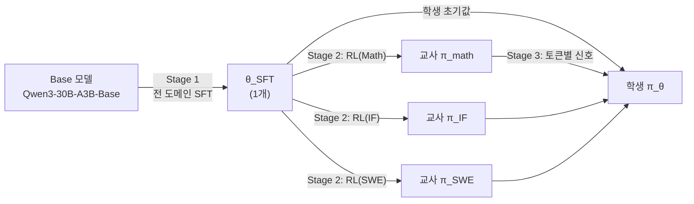
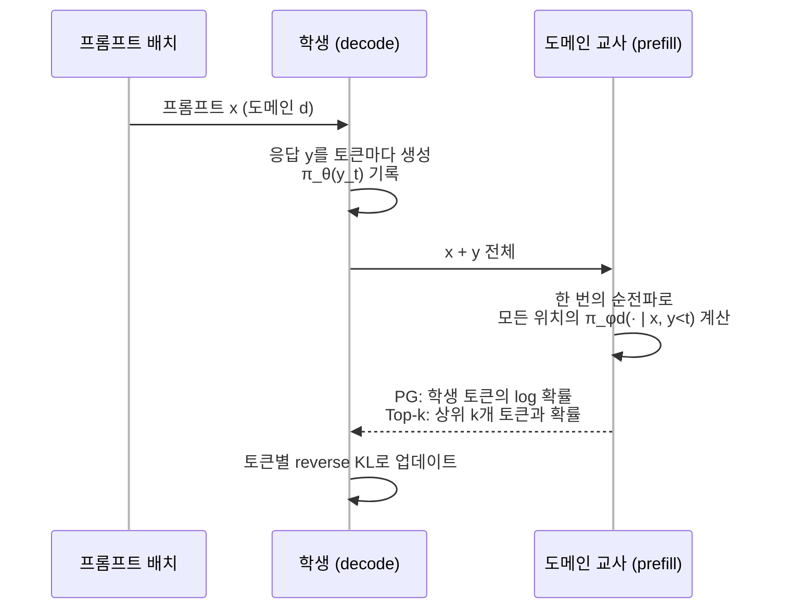
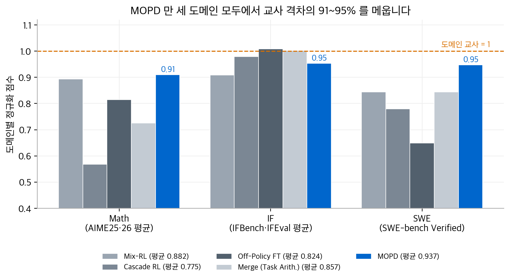
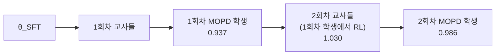

# MOPD: Multi-Teacher On-Policy Distillation for Capability Integration in LLM Post-Training

!!! info "논문 정보"
    - **저자**: Wenhan Ma, Jianyu Wei, Liang Zhao, Hailin Zhang, Bangjun Xiao, Lei Li, Qibin Yang, Bofei Gao, Yudong Wang, Rang Li, Jinhao Dong, Zhifang Sui, Fuli Luo (Peking University, Xiaomi LLM Core 외)
    - **발표**: arXiv, 2026. 6. 29.
    - **링크**: [arXiv:2606.30406](http://arxiv.org/abs/2606.30406)

## 한 줄 요약

같은 SFT 체크포인트에서 도메인별 RL 교사를 병렬로 만듭니다.
그다음 학생 자신의 롤아웃 위에서, 프롬프트마다 해당 도메인 교사와의 토큰 단위 reverse KL을 줄여 하나의 모델로 통합합니다.
통합은 가중치 공간이 아니라 **정책 공간**에서 일어납니다.

## 문제 설정

LLM 후속 학습(post-training)은 도메인마다 다른 RL 파이프라인을 씁니다.
수학은 정답 검증 RL을 쓰고, 소프트웨어 엔지니어링(SWE)은 샌드박스 에이전트 RL을 쓰고, 지시 따르기(IF)는 루브릭 기반 RL을 씁니다.
각 파이프라인은 자기 도메인을 잘 올리지만, 최종 목표는 **모든 도메인을 잘하는 모델 하나**입니다.
논문은 이 능력 통합 문제에 대한 기존 접근을 네 가지로 나눕니다.

| 방법 | 방식 | 문제점 |
| --- | --- | --- |
| Mix-RL | 모든 도메인 프롬프트를 한 데이터셋에 모아 함께 RL | 도메인 간 신호가 간섭합니다(시소 효과). 결과가 도메인 교사보다 낮습니다 |
| Cascade RL | 도메인을 하나씩 순서대로 RL | 뒤 단계를 학습하는 동안 앞 단계의 능력이 줄어듭니다. 전체 학습이 길어 불안정 위험이 커집니다 |
| Off-Policy Finetune | 도메인 교사의 롤아웃으로 학생을 SFT | 노출 편향이 생깁니다 |
| Param-Merge | 교사 가중치를 평균하거나 task vector를 더함 | 합친 모델이 불안정하고 모든 교사의 능력을 따라가지 못합니다 |

논문의 Table 1은 세 축으로 비교합니다. MOPD만 세 조건을 모두 만족한다고 주장합니다.

| 방법 | 조밀한 신호 | On-policy | 병렬 개발 |
| --- | --- | --- | --- |
| Param-Merge | × | — | ✓ |
| Off-Policy Finetune | ✓ | × | ✓ |
| Mix-RL | × | ✓ | × |
| Cascade RL | × | ✓ | × |
| **MOPD** | ✓ | ✓ | ✓ |

## 핵심 아이디어

### 1. 3단계 파이프라인 (§3.1, Fig. 1)

1. **Stage 1. 일반 SFT**: 기본 모델을 전 도메인 말뭉치로 한 번 미세 조정합니다. 결과인 $\theta_{\text{SFT}}$는 교사와 학생이 함께 쓰는 출발점입니다.
2. **Stage 2. 도메인별 RL**: $\theta_{\text{SFT}}$를 도메인마다 복사하고, 각 복사본을 그 도메인 데이터로만 RL 학습합니다. 각 도메인은 자기에게 맞는 RL 방식을 씁니다. 학습은 서로 독립적이므로 병렬로 실행합니다. 학습이 끝난 교사는 고정합니다.
3. **Stage 3. MOPD 증류**: 학생은 $\theta_{\text{SFT}}$에서 시작합니다. 학습 단계마다 다음 순서로 진행합니다.
    1. 세 도메인이 섞인 프롬프트 배치를 뽑습니다(배치 2048, Math : IF : SWE = 0.35 : 0.35 : 0.3).
    2. 학생이 각 프롬프트에 응답을 생성하고 토큰별 확률을 기록합니다.
    3. 각 응답을 해당 도메인 교사에게 보냅니다.
    4. 교사는 응답을 prefill하여 토큰별 확률을 계산합니다.
    5. 학생은 교사와의 토큰별 reverse KL을 줄이도록 업데이트합니다.

역할을 정리하면 다음과 같습니다.

| 역할 | 시작점 | 학습 데이터 | 학습 신호 | 개수 |
| --- | --- | --- | --- | --- |
| SFT 모델 ($\theta_{\text{SFT}}$) | Base 모델 | 전 도메인 SFT 데이터 | 정답 응답 모방 | 1개 |
| 교사 | $\theta_{\text{SFT}}$ | 한 도메인의 RL 데이터만 | 환경 보상 (예: 정답 검증) | 도메인 수만큼 (예: 3개) |
| 학생 | $\theta_{\text{SFT}}$ | 전 도메인 프롬프트 혼합 | 해당 도메인 교사의 토큰별 확률 | 1개 |

교사는 도메인마다 별도의 모델입니다. 구조와 초기 가중치($\theta_{\text{SFT}}$)는 같지만, RL 데이터와 방식과 하이퍼파라미터가 달라 최종 가중치가 다릅니다.
출발점이 같으므로 교사와 학생의 분포가 가깝습니다. 논문은 이것을 **same-origin**이라고 부릅니다.

### 2. On-policy와 Off-policy

두 방식의 구분 기준은 **학습 데이터를 누가 생성했는가**입니다.

| 구분 | Off-policy (Off-Policy Finetune) | On-policy (MOPD) |
| --- | --- | --- |
| 응답 생성자 | 교사 | 학생 |
| 교사 역할 | 정답을 써 줍니다 | 학생 응답을 토큰마다 채점합니다 |
| 학습 방법 | 교사 응답을 SFT로 모방합니다 | 교사와의 reverse KL을 줄입니다 |
| 데이터 | 미리 만든 고정 데이터 | 매 단계 새로 생성하고 버립니다 |
| 노출 편향 | 있습니다 | 없습니다 |

**노출 편향(exposure bias)**은 학습 때 본 상태와 추론 때 만나는 상태가 다른 문제입니다.
Off-policy 학생은 교사의 올바른 앞부분만 보고 배웁니다.
추론 때 한 번 실수하면 처음 보는 상태에 들어가고, 오류가 누적될 수 있습니다.
On-policy 학생은 자기 응답으로 학습하므로 학습 분포와 추론 분포가 같습니다.

> Off-policy는 교사가 쓴 답을 학생이 따라 씁니다. On-policy는 학생이 쓴 답을 교사가 토큰마다 고쳐 줍니다.

### 3. Prefill: 교사가 채점하는 방법

**Prefill**은 주어진 토큰 열을 한 번의 순전파로 읽고, 모든 위치의 다음 토큰 분포를 병렬로 계산하는 단계입니다(일반 지식).
새 토큰을 하나씩 만드는 **decode**와 대비됩니다.

| 단계 | 하는 일 | 처리 방식 |
| --- | --- | --- |
| Prefill | 주어진 토큰 열을 읽습니다 | 모든 위치를 한 번에 병렬 처리합니다 |
| Decode | 새 토큰을 생성합니다 | 토큰마다 순차 처리합니다 |

MOPD에서 교사의 입력은 `프롬프트 + 학생 응답`입니다. 교사는 새 답을 생성하지 않습니다.
Prefill만 해서 학생 토큰 위치마다 자신의 확률을 계산합니다.
즉 on-policy 증류의 "학생이 생성하고, 교사가 채점한다"에서 **생성은 학생의 decode이고, 채점은 교사의 prefill**입니다.

### 4. 목적 함수 (§3.2)

기본 목적은 학생 롤아웃 위에서 계산하는 토큰별 reverse KL입니다.
$\pi_{\phi_d}$는 프롬프트 $x$의 도메인 교사이고, $\pi(v)$는 $\pi(v \mid x, y_{<t})$를 줄여 쓴 것입니다.

$$
\mathcal{L}_{\text{rev-KL}} = \mathbb{E}_{x,\, y \sim \pi_\theta}\left[\frac{1}{|y|} \sum_{t} \sum_{v} \pi_\theta(v) \log \frac{\pi_\theta(v)}{\pi_{\phi_d}(v)}\right] \tag{1}
$$

기댓값이 학생 분포 $y \sim \pi_\theta$ 위에서 계산된다는 점이 on-policy의 핵심입니다.
논문은 이 목적을 구현하는 두 가지 방법을 제시합니다.

#### Policy-gradient 방식 (§3.2.1)

MiniLLM을 따라 증류를 RL 과정으로 바꿉니다. 식 (1)의 그래디언트는 정책 그래디언트 모양이 됩니다.

$$
\nabla_\theta \mathcal{L} = -\mathbb{E}_{x, y}\left[\frac{1}{|y|} \sum_t \log \frac{\pi_{\phi_d}(y_t)}{\pi_\theta(y_t)} \, \nabla_\theta \log \pi_\theta(y_t)\right] \tag{2}
$$

교사와 학생의 로그 확률 차이가 토큰별 어드밴티지 역할을 합니다.
$\operatorname{sg}$는 그래디언트를 막는 stop-gradient이고, 안정성을 위해 $\pm A_{\max}$로 양쪽을 클리핑합니다(기본값 $A_{\max} = 5$).

$$
\hat A_{t} = \operatorname{sg}\!\left[\log \pi_{\phi_d}(y_t) - \log \pi_\theta(y_t)\right],
\qquad
\mathcal{L}_{\text{PG}} = -\mathbb{E}\left[\frac{1}{|y|}\sum_t \operatorname{clip}(\hat A_t, -A_{\max}, A_{\max}) \log \pi_\theta(y_t)\right]
$$

기존 PPO/GRPO 프레임워크에서 **어드밴티지 계산만 바꾸면 됩니다.**
교사가 학생보다 그 토큰을 더 높게 보면 $\hat A_t > 0$이 되어 그 토큰의 확률이 올라가고, 낮게 보면 내려갑니다.

#### Top-k 증류 방식 (§3.2.2)

PG 방식은 위치마다 샘플된 토큰 하나만 씁니다.
Top-k 방식은 교사의 상위 $k$개 토큰 $\mathcal{T}_t^d$ 위에서 분포를 직접 맞춰 분산을 줄입니다(기본값 $k = 64$).

$$
\mathcal{L}_{\text{TopK}} = \mathbb{E}\left[\frac{1}{|y|}\sum_t \sum_{v \in \mathcal{T}_t^d} \left(\pi_\theta(v) \log \frac{\pi_\theta(v)}{\pi_{\phi_d}(v)} - \pi_\theta(v) + \pi_{\phi_d}(v)\right)\right] \tag{5}
$$

뒤에 붙은 $\pi_{\phi_d}(v) - \pi_\theta(v)$는 top-k 절단에서 생기는 편향을 바로잡는 보정항입니다.
보정항이 없으면 절단된 reverse KL은 $\pi_\theta = \pi_{\phi_d}$에서 최소가 되지 않습니다.
보정항을 더하면 각 항이 $f(r) = r \log r - r + 1 \ge 0$ 꼴($r = \pi_\theta / \pi_{\phi_d}$, 교사 확률을 곱한 형태)이 되어 $r = 1$에서만 0이 됩니다.
또한 교사가 보내는 데이터가 상위 64개뿐이라 전송량이 작습니다.

| 구현 | 핵심 | 교사가 돌려주는 값 | 특징 |
| --- | --- | --- | --- |
| Policy-gradient | 로그 확률 차이를 토큰별 어드밴티지로 사용 | 학생 토큰의 로그 확률 (위치당 숫자 1개) | 어드밴티지 계산만 바꾸면 됩니다 |
| Top-k 증류 | 교사 상위 k개 토큰에서 reverse KL + 보정항 | 상위 k개 토큰과 확률 | 분산이 작고 전송량이 작습니다 |

### 5. 인프라 (§3.3)

논문은 교사 prefill을 RL의 **보상 계산과 같은 성격**으로 봅니다.

- 각 교사를 RL 트레이너 밖의 독립 prefill 서비스로 배포합니다.
- 학생 응답 하나가 끝나면 트레이너가 즉시 비동기 요청을 보냅니다.
- 교사 계산이 다른 응답의 생성과 시간적으로 겹칩니다. 그래서 실제 배포에서 추가 소요 시간이 거의 없었다고 보고합니다.

## 기존 연구와의 차이

| 구분 | 새로운 점 | 기존 방법을 따른 점 |
| --- | --- | --- |
| 증류 방식 | 교사를 **여러 개** 두고 프롬프트의 도메인으로 교사를 고릅니다 | "학생이 생성하고 교사가 채점한다"는 on-policy 증류 틀(MiniLLM, GKD) |
| 목적 함수 | Top-k 절단 편향을 바로잡는 보정항 | 토큰별 reverse KL, PG 형태 변환(MiniLLM) |
| 통합 위치 | 가중치가 아니라 정책 공간에서 통합합니다 | 도메인별 RL 레시피는 기존 방식(GRPO 등) 그대로 |
| 학습 체계 | 능력 생산(Stage 2)과 통합(Stage 3)을 분리해 도메인 팀이 병렬로 개발합니다 | |

기존 on-policy 증류는 교사 하나, 도메인 하나에 머물렀습니다. MOPD는 이 틀을 여러 도메인 교사로 넓혔고, 실제 대형 모델(MiMo-V2-Flash) 후속 학습에 적용했습니다.

### Stage 3은 RL인가, 증류인가

겉보기에는 RL과 같지만 학습 신호가 다릅니다.

| 구분 | Stage 2 교사 학습 (RL) | Stage 3 학생 학습 (MOPD) |
| --- | --- | --- |
| 롤아웃 | 모델 자신이 생성합니다 | 학생 자신이 생성합니다 |
| 학습 신호 | 환경 보상 | 교사의 토큰별 확률 |
| 신호 단위 | 궤적당 값 1개 | 토큰마다 값 1개 |
| 목적 | 보상 최대화 | 교사와의 reverse KL 최소화 |

교사 신호 $\log \pi_{\text{teacher}}(y_t) - \log \pi_{\text{student}}(y_t)$는 학생 확률에 따라 값이 바뀝니다. 고정된 보상 함수가 아닙니다.
PG 구현에서는 이 값이 어드밴티지 역할을 하지만, Top-k 구현은 보상 형태를 쓰지 않고 분포를 직접 맞춥니다.
따라서 Stage 3은 "RL"보다 **"on-policy 증류"**가 정확한 표현입니다.

## 실험 결과

### 설정

- **모델**: Qwen3-30B-A3B-Base에서 시작합니다. 모든 기준 방법과 MOPD가 같은 SFT 체크포인트를 씁니다.
- **도메인과 평가**: Math(AIME25, AIME26, avg@32), IF(IFBench, IFEval), SWE(SWE-bench Verified). 모든 평가는 온도 1.0으로 샘플링합니다.
- **정규화 점수**: 도메인마다 여유 폭이 다르므로 원점수 평균을 쓰지 않습니다. 도메인 $d$의 SFT 학생 점수를 $s^{s}_d$, 도메인 교사 점수를 $s^{t}_d$라 할 때 다음 값을 도메인 평균합니다.

$$
\tilde s_d = \frac{s_d - s^{s}_d}{s^{t}_d - s^{s}_d}
\qquad (\text{SFT 학생} = 0,\;\; \text{도메인 교사} = 1)
$$

1을 넘으면 교사보다 좋고, 0보다 작으면 SFT 학생보다 나빠졌다는 뜻입니다.
도메인 점수는 그 도메인 벤치마크들의 평균입니다. 이 방식으로 다시 계산하면 Table 2의 정규화 점수가 그대로 나옵니다.

### 주요 결과 (Table 2)

| 방법 | AIME25 | AIME26 | IFBench | IFEval | SWE-V | 정규화 점수 |
| --- | --- | --- | --- | --- | --- | --- |
| Student (SFT만) | 45.42 | 54.48 | 42.69 | 84.17 | 35.80 | 0.000 |
| RL Teacher | 54.79 | 63.65 | 78.40 | 95.50 | 51.20 | 1.000 |
| Mix-RL | 52.71 | 63.75 | 75.00 | 94.58 | 48.80 | 0.882 |
| Cascade RL | 48.54 | 61.88 | 77.11 | 95.80 | 47.80 | 0.775 |
| Off-Policy Finetune | 51.56 | 63.44 | 80.95 | 93.35 | 45.80 | 0.824 |
| Param-Merge (평균) | 47.81 | 59.58 | 53.74 | 88.79 | 39.60 | 0.328 |
| Param-Merge (Task Arith.) | 49.38 | 63.96 | 78.23 | 95.81 | 48.80 | 0.857 |
| **MOPD** | 51.46 | 65.31 | 77.89 | 93.84 | 50.40 | **0.937** |

<figure markdown>

<figcaption markdown>
<b>Figure 1.</b> MOPD 도메인별 정규화 점수

Table 2로 다시 계산한 점수입니다. 다른 방법은 도메인에 따라 크게 처지지만, MOPD는 세 도메인 모두 0.91~0.95입니다.
</figcaption>
</figure>

읽을 점은 네 가지입니다.

- **MOPD가 가장 높고 가장 고릅니다.** 정규화 점수 0.937로, 다음으로 좋은 Mix-RL(0.882)보다 0.055 높습니다. 도메인별 점수의 폭은 0.044로 가장 좁습니다.
- **기준 방법들은 서로 다른 모양으로 빈틈을 남깁니다.** Cascade RL(IF → Math → SWE 순서)은 IF 격차를 98% 메웠지만 Math는 57%에 그쳤고, SWE 단계에서 Math 점수가 떨어졌습니다. Off-Policy Finetune은 IF에서 교사를 넘었지만(1.01) SWE는 65%만 메웠습니다.
- **Param-Merge는 합치는 방법에 민감합니다.** 단순 평균은 0.328로 실패했고, Task Arithmetic은 0.857이지만 Math는 73%에 그쳤습니다.
- **MOPD는 샘플 효율이 높습니다.** IF는 약 25K 샘플, SWE는 약 30K 샘플 안에 교사 수준에 가까워졌습니다. Mix-RL은 도메인마다 150~180K 샘플을 다 써야 비슷한 수준에 갔습니다(Fig. 2). 토큰마다 신호를 받기 때문입니다.

### 309B 모델 적용 (Table 3)

MiMo-V2-Flash에 Math, Code, IF, SWE, Tool Use 교사로 같은 파이프라인을 적용했습니다.

| | AIME25 | HMMT25 | LCB | IFBench | SWE-V | τ²-Bench | τ²-Telecom |
| --- | --- | --- | --- | --- | --- | --- | --- |
| Student | 89.3 | 76.9 | 77.5 | 55.4 | 67.8 | 75.9 | 92.7 |
| Teacher | 93.9 | 82.6 | 82.6 | 68.9 | 74.2 | 79.6 | 95.0 |
| MOPD | 94.1 | 84.4 | 83.2 | 66.7 | 73.4 | 80.3 | 95.3 |
| Δ (MOPD − Teacher) | +0.2 | +1.8 | +0.6 | −2.2 | −0.8 | +0.7 | +0.3 |

대부분의 벤치마크에서 교사와 같거나 높았습니다. IFBench(−2.2)와 SWE-bench Verified(−0.8)만 교사보다 낮았습니다.

### 분석 1. PG와 Top-k는 비슷합니다 (§4.4.1)

같은 교사, 같은 데이터, 같은 하이퍼파라미터에서 두 구현의 정규화 점수는 PG 0.937, Top-k 0.909였습니다.
같은 출처 교사를 쓰면 학생의 롤아웃이 교사의 고확률 영역에 모이므로 두 추정량이 비슷한 신호를 받습니다.
논문은 **같은 출처 교사에서는 PG 방식만으로도 충분히 안정적**이라고 결론 내립니다.

### 분석 2. 같은 출처 교사가 핵심 전제입니다 (§4.4.2, Table 4)

Math 교사를 더 강한 외부 모델 Qwen3-235B-A22B로 바꾸고 나머지는 그대로 두었습니다.

| Math 교사 | 손실 | AIME25 | AIME26 | 정규화 점수 | 초기 KL | 학습 양상 |
| --- | --- | --- | --- | --- | --- | --- |
| 같은 출처 RL 교사 | PG | 51.46 | 65.31 | 0.937 | 약 0.04 | KL이 단조 감소, 엔트로피 약 0.30 유지 |
| 같은 출처 RL 교사 | Top-k | 51.77 | 64.79 | 0.909 | 약 0.04 | PG와 거의 겹침 |
| Qwen3-235B-A22B | PG | 45.63 | 51.56 | 0.600 | 약 0.19 | Math가 점차 하락, 엔트로피 0.30 → 0.21 |
| Qwen3-235B-A22B | Top-k | 0.94 | 0.42 | −1.190 | 약 0.19 | 약 18단계에서 붕괴 |

외부 교사는 수학 능력 자체는 더 강하지만, 학생과 분포가 멀어 초기 KL이 약 5배 컸습니다.
학생은 교사가 낮게 보는 영역에서 주로 벌점 신호를 받고, 정책이 한 모드로 좁아졌습니다.
**교사가 강하다고 좋은 교사가 되는 것은 아닙니다. 학생과 가까워야 합니다.**

### 분석 3. 다회차 반복 (§4.4.3, Table 5)

MOPD를 마친 학생을 다음 회차 도메인 RL의 초기값으로 씁니다. 2회차에서는 Math와 IF만 다시 학습했습니다.

| 회차 | 정규화 점수 |
| --- | --- |
| 1회차 MOPD | 0.937 |
| 2회차 RL 교사 | 1.030 |
| 2회차 MOPD | 0.986 |

학생이 강해지면 그 학생에서 출발한 교사도 강해지고, 같은 출처 조건도 유지됩니다.

### 설계의 실무적 의미 (§5)

- **병렬 개발**: 도메인 팀이 순서 없이 각자의 보상, 샌드박스, 데이터를 동시에 개발합니다.
- **레시피 분리**: 도메인마다 알고리즘, 롤아웃 방식, 보상 함수, 하이퍼파라미터를 따로 고릅니다.
- **위험 격리**: 한 도메인 RL을 재시작해도 다른 교사에 영향이 없습니다. 통합 RL에서는 재시작이 전체 학습을 처음으로 되돌립니다.

## 한계와 의문점

### 논문이 다루지 않은 것

- **교사 오류를 거르는 장치가 없습니다.** RL 교사도 틀릴 수 있지만, 학생은 교사 분포를 그대로 따라갑니다. 어드밴티지 클리핑(±5)은 안정성 장치이며, 정답 여부를 판별하지 않습니다. 논문이 근거로 드는 것은 두 가지입니다. 교사가 검증 가능한 보상으로 학습했으므로 학생보다 정답 쪽 확률이 높다는 점, 그리고 다회차 반복으로 교사 상한을 올린다는 점입니다.
- **같은 출처 조건은 제약이기도 합니다.** 외부의 더 강한 모델을 교사로 바로 쓸 수 없습니다. 분포가 다른 교사를 쓰려면 별도 장치가 필요해 보입니다.
- **도메인이 3개뿐입니다.** Qwen3-30B-A3B 실험은 Math, IF, SWE만 다룹니다. 도메인이 늘거나 도메인 경계가 모호한 프롬프트에서 교사를 어떻게 고를지는 다루지 않습니다.

### 읽으면서 생긴 의문

- 교사 오류를 줄이려면 결과 보상을 함께 쓰거나, 오답 궤적의 증류 신호를 줄이는 방법을 생각할 수 있습니다. 논문은 이 방법을 검증하지 않았습니다(일반 지식).
- MiMo-V2-Flash에서 IFBench가 교사보다 2.2 낮았습니다. 도메인 수가 5개로 늘면서 간섭이 다시 생긴 것인지, 다회차 반복으로 메워지는지 궁금합니다.
- 프롬프트당 롤아웃을 1개($N = 1$)만 씁니다. 토큰별 신호가 조밀하므로 GRPO처럼 그룹 기준선이 필요 없다는 판단으로 보입니다. $N$을 늘렸을 때의 효과는 보고되지 않았습니다.

## 참고 자료

- [MOPD 논문 (arXiv:2606.30406)](http://arxiv.org/abs/2606.30406)
- Gu et al., MiniLLM: On-policy distillation of large language models (arXiv:2306.08543)
- Agarwal et al., On-policy distillation of language models: Learning from self-generated mistakes (arXiv:2306.13649)
- Wang et al., Nemotron-Cascade: Scaling cascaded reinforcement learning (arXiv:2512.13607)
- Ilharco et al., Editing models with task arithmetic (arXiv:2212.04089)
- Team, MiMo-V2-Flash technical report (arXiv:2601.02780)
