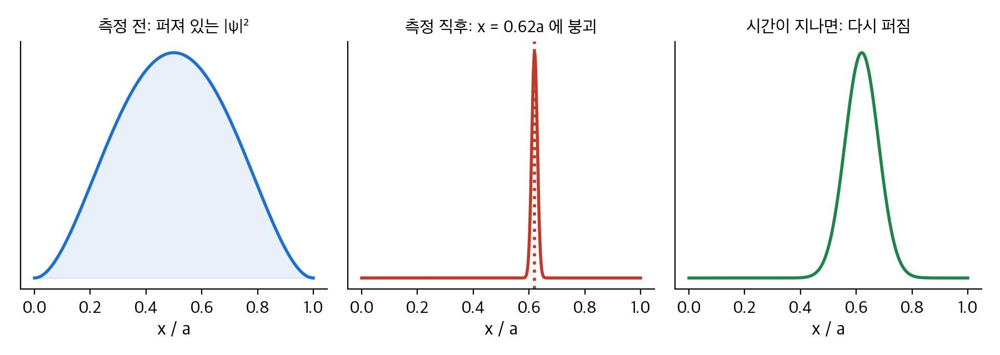
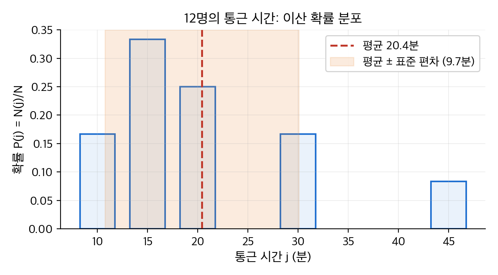
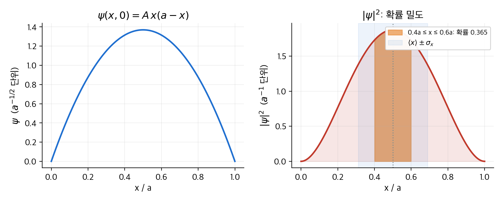
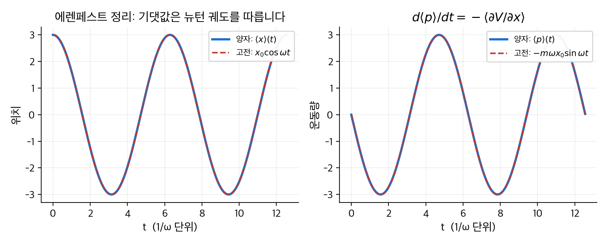
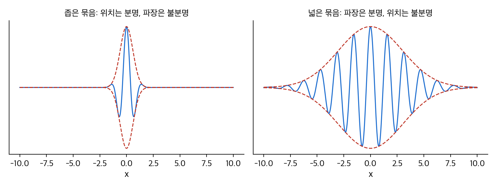
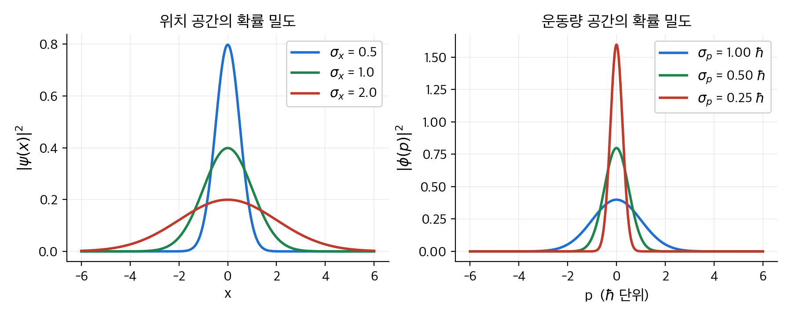

# 1. 파동 함수

이 장은 양자역학의 출발점인 **파동 함수**(wave function) $\Psi(x, t)$ 를 소개합니다.
고전역학은 입자의 위치 $x(t)$ 를 뉴턴 법칙으로 구합니다. 양자역학은 그 대신 파동 함수를 **슈뢰딩거 방정식**으로 구합니다.
파동 함수 자체는 측정할 수 없습니다. 파동 함수의 절댓값 제곱 $|\Psi|^2$ 이 입자를 발견할 **확률 밀도**입니다.
이 장에서는 확률 밀도에서 평균과 표준 편차를 구하는 법을 다룹니다. 파동 함수를 규격화하는 법과 운동량을 연산자로 다루는 법도 다룹니다.
결론은 위치의 표준 편차와 운동량의 표준 편차가 동시에 작아질 수 없다는 **불확정성 원리** $\sigma_x \sigma_p \ge \hbar / 2$ 입니다.

!!! info "원문과 자료"
    - 원문: Griffiths, *Introduction to Quantum Mechanics*, 1st ed. (1995), 1장 The Wave Function (1.1 The Schrödinger Equation, 1.2 The Statistical Interpretation, 1.3 Probability, 1.4 Normalization, 1.5 Momentum, 1.6 The Uncertainty Principle)
    - 함께 읽기: [2. 시간에 무관한 슈뢰딩거 방정식](02-time-independent-schrodinger.md), [3. 형식 체계](03-formalism.md)
    - 확률 밀도와 기댓값의 수학적 정의는 [확률론 2장](../../math/probability/02-random-variables.md)과 [확률론 3장](../../math/probability/03-expectation.md)에 있습니다.
    - 예시의 수치는 모두 NumPy, SciPy, SymPy로 다시 계산해서 검증했습니다.

## 1. 슈뢰딩거 방정식 (1.1절)

### 고전역학이 하는 일

질량 $m$ 인 입자가 $x$ 축 위에서 힘 $F(x, t)$ 를 받으며 움직입니다.
고전역학의 과제는 임의의 시각 $t$ 에서의 위치 $x(t)$ 를 구하는 일입니다.
위치를 알면 속도 $v = dx/dt$, 운동량 $p = mv$, 운동 에너지 $T = mv^2/2$ 를 모두 구할 수 있습니다.
도구는 뉴턴의 제2법칙 $F = ma$ 입니다. 보존력이면 $F = -\partial V / \partial x$ 이므로 다음 미분 방정식을 풉니다.

$$
m \frac{d^2 x}{dt^2} = -\frac{\partial V}{\partial x}
$$

초기 위치 $x(0)$ 와 초기 속도 $v(0)$ 를 주면 이 방정식은 $x(t)$ 를 유일하게 결정합니다.

### 양자역학이 하는 일

양자역학은 같은 문제에 전혀 다른 방식으로 접근합니다.
구하는 대상은 입자의 **파동 함수** $\Psi(x, t)$ 입니다. 도구는 **슈뢰딩거 방정식**(Schrödinger equation)입니다.

$$
i\hbar \frac{\partial \Psi}{\partial t} = -\frac{\hbar^2}{2m} \frac{\partial^2 \Psi}{\partial x^2} + V \Psi
$$

여기서 $i = \sqrt{-1}$ 이고, $\hbar$ 는 플랑크 상수를 $2\pi$ 로 나눈 값입니다.

$$
\hbar = \frac{h}{2\pi} = 1.0546 \times 10^{-34}\,\mathrm{J\,s}
$$

뉴턴 법칙과 슈뢰딩거 방정식은 논리적 위치가 같습니다. 둘 다 초기 조건에서 미래를 결정하는 운동 방정식입니다.
다른 점은 세 가지입니다.

| 항목 | 고전역학 | 양자역학 |
| --- | --- | --- |
| 구하는 대상 | 위치 $x(t)$ (실수 하나) | 파동 함수 $\Psi(x, t)$ (복소수 함수) |
| 초기 조건 | $x(0)$, $v(0)$ (숫자 두 개) | $\Psi(x, 0)$ (함수 하나) |
| 방정식 | 시간에 대해 2계 | 시간에 대해 1계, 공간에 대해 2계 |

시간에 대해 1계이므로 $\Psi(x, 0)$ 만 알면 모든 시각의 $\Psi(x, t)$ 가 결정됩니다.
초기 속도에 해당하는 정보는 따로 주지 않습니다. 뒤에서 보듯이 속도 정보는 $\Psi(x, 0)$ 의 모양 안에 이미 들어 있습니다.

### 왜 복소수인가

슈뢰딩거 방정식에는 $i$ 가 들어 있습니다. 따라서 $\Psi$ 는 일반적으로 복소수 값을 갖습니다.
고전적인 파동(줄의 진동, 음파)은 실수 함수입니다. 양자역학의 파동 함수가 복소수인 것은 수학적 편의가 아니라 이론의 구조입니다.
시간에 대해 1계인 방정식이 진동하는 해를 가지려면 $i$ 가 필요합니다.
$\partial \Psi / \partial t = -i \omega \Psi$ 의 해는 $e^{-i\omega t}$ 이고, 이 함수는 크기가 1로 일정한 채 위상만 돕니다.
$i$ 가 없다면 해는 $e^{-\omega t}$ 처럼 지수적으로 줄어들 뿐입니다.

## 2. 통계적 해석 (1.2절)

### 보른 규칙

입자는 한 점에 있는데 파동 함수는 공간에 퍼져 있습니다. 이 둘을 잇는 것이 **보른의 통계적 해석**(Born's statistical interpretation)입니다.

$$
\int_a^b |\Psi(x, t)|^2 \, dx = \text{시각 } t \text{ 에 입자를 } a \text{ 와 } b \text{ 사이에서 발견할 확률}
$$

$|\Psi|^2 = \Psi^* \Psi$ 는 **확률 밀도**(probability density)입니다. 곡선 아래 넓이가 확률입니다.
$|\Psi|^2$ 이 큰 곳에서 입자가 발견될 가능성이 높고, 작은 곳에서는 낮습니다.

!!! example "일상 비유: 무게 중심이 치우친 주사위"

    여섯 면이 나올 확률이 다른 주사위를 생각합니다. 예를 들어 6이 나올 확률이 0.4이고 나머지는 각 0.12입니다.
    주사위를 던지기 전에는 "어느 면이 나올지"를 모릅니다. 확률 분포만 압니다.
    양자역학의 파동 함수도 같은 역할을 합니다. 측정하기 전에는 "입자가 어디 있는지"를 모르고, $|\Psi|^2$ 이라는 분포만 압니다.

    비유의 한계가 있습니다. 주사위는 던지기 전에도 "어떤 면이 나올지"가 물리적으로 결정되어 있다고 믿을 수 있습니다. 손의 움직임과 공기 흐름을 모두 알면 예측할 수 있기 때문입니다.
    양자역학의 정통 해석은 이 믿음을 부정합니다. 측정 전의 입자는 특정 위치를 "가지고 있지 않습니다".

### 측정 전에 입자는 어디에 있었나

측정해서 입자를 점 $C$ 에서 발견했다고 가정합니다. 측정 직전에 입자는 어디에 있었을까요? 세 가지 입장이 있습니다.

| 입장 | 주장 | 함의 |
| --- | --- | --- |
| **실재론**(realist) | 입자는 처음부터 $C$ 에 있었습니다. | 양자역학은 불완전합니다. 숨은 변수가 더 있어야 합니다. |
| **정통 해석**(orthodox) | 입자는 어디에도 있지 않았습니다. 측정이 위치를 만들어 냈습니다. | 코펜하겐 해석입니다. 측정은 수동적 관찰이 아닙니다. |
| **불가지론**(agnostic) | 답할 수 없는 질문입니다. | 측정 전 상태를 묻는 일은 의미가 없습니다. |

1964년 벨(Bell)은 세 입장이 실험으로 구별된다는 것을 보였습니다. 실험 결과는 정통 해석을 지지합니다.
이 내용은 [12장 맺음말](12-afterword.md)에서 숫자로 확인합니다. 이 노트의 본문은 정통 해석을 따릅니다.

### 파동 함수의 붕괴

정통 해석에서 측정은 파동 함수를 바꿉니다. 측정 직전에 퍼져 있던 $\Psi$ 는 측정 직후 발견된 점 $C$ 주위에 뾰족하게 모입니다.
이를 **파동 함수의 붕괴**(collapse)라고 합니다. 바로 다시 측정하면 같은 값 $C$ 가 나옵니다.
시간이 지나면 슈뢰딩거 방정식에 따라 $\Psi$ 는 다시 퍼집니다.

<figure markdown>

<figcaption markdown>
<span class="fig-title"><b>Figure 1.</b> 측정이 파동 함수를 붕괴시킵니다</span>

왼쪽은 측정 전의 확률 밀도입니다. 가운데는 $x = 0.62a$ 에서 입자를 발견한 직후입니다. 오른쪽은 시간이 조금 지난 뒤입니다.
붕괴는 슈뢰딩거 방정식을 따르지 않습니다. 퍼지는 과정만 슈뢰딩거 방정식을 따릅니다.
</figcaption>
</figure>

따라서 양자역학에는 두 종류의 시간 변화가 있습니다.
측정 사이에는 슈뢰딩거 방정식에 따라 매끄럽게 변합니다. 측정 순간에는 불연속적으로 붕괴합니다.

## 3. 확률 (1.3절)

양자역학은 확률 언어로 답을 줍니다. 이산 분포와 연속 분포의 기본 용어를 먼저 정리합니다.

### 이산 변수: 12명의 통근 시간

어느 팀 12명의 통근 시간이 다음과 같다고 가정합니다. $N(j)$ 는 통근 시간이 $j$ 분인 사람 수입니다.

| 통근 시간 $j$ (분) | 10 | 15 | 20 | 30 | 45 |
| --- | --- | --- | --- | --- | --- |
| 사람 수 $N(j)$ | 2 | 4 | 3 | 2 | 1 |

전체 인원은 $N = \sum_j N(j) = 12$ 입니다. 한 사람을 무작위로 뽑을 때 통근 시간이 $j$ 인 확률은 $P(j) = N(j)/N$ 입니다.
확률의 합은 1입니다.

<figure markdown>

<figcaption markdown>
<span class="fig-title"><b>Figure 2.</b> 12명의 통근 시간 분포</span>

막대 높이가 확률 $P(j)$ 입니다. 빨간 점선이 평균, 주황 띠가 평균에서 표준 편차 하나 안쪽 구간입니다.
</figcaption>
</figure>

이 분포에서 자주 묻는 양을 계산합니다.

- **최빈값**(mode): 가장 많은 사람이 해당하는 값입니다. 15분입니다.
- **중앙값**(median): 크기순으로 늘어놓았을 때 가운데 값입니다. 6번째가 15분, 7번째가 20분이므로 17.5분입니다.
- **평균**(mean, 기댓값): 모든 값을 확률로 가중해서 더한 값입니다.

$$
\langle j \rangle = \sum_j j \, P(j) = \frac{10 \cdot 2 + 15 \cdot 4 + 20 \cdot 3 + 30 \cdot 2 + 45 \cdot 1}{12} = \frac{245}{12} = 20.42
$$

평균은 실제로 아무도 갖지 않는 값일 수 있습니다. 20.42분인 사람은 없습니다.
양자역학에서 **기댓값**(expectation value)은 바로 이 평균입니다. 한 번 측정해서 나올 가장 가능성 높은 값이 아니라, 같은 상태를 여러 번 측정한 결과의 평균입니다.

함수의 기댓값도 같은 방식으로 구합니다. 예를 들어 $j^2$ 의 기댓값은 다음과 같습니다.

$$
\langle j^2 \rangle = \sum_j j^2 \, P(j) = \frac{200 + 900 + 1200 + 1800 + 2025}{12} = \frac{6125}{12} = 510.42
$$

일반적으로 $\langle j^2 \rangle \ne \langle j \rangle^2$ 입니다. 여기서도 $510.42 \ne 20.42^2 = 416.84$ 입니다.

### 분산과 표준 편차

분포가 얼마나 퍼져 있는지를 재는 양이 **분산**(variance) $\sigma^2$ 과 **표준 편차**(standard deviation) $\sigma$ 입니다.
각 값이 평균에서 벗어난 정도 $\Delta j = j - \langle j \rangle$ 의 제곱을 평균합니다.

$$
\sigma^2 = \langle (\Delta j)^2 \rangle = \langle j^2 \rangle - \langle j \rangle^2
$$

두 번째 등호는 $\langle (j - \langle j \rangle)^2 \rangle = \langle j^2 \rangle - 2 \langle j \rangle \langle j \rangle + \langle j \rangle^2$ 을 정리한 결과입니다.
이 공식은 계산할 때 편리합니다. 통근 시간 예에 적용합니다.

$$
\sigma^2 = 510.42 - 416.84 = 93.58, \qquad \sigma = 9.67\,\text{분}
$$

```python
import numpy as np
j = np.array([10, 15, 20, 30, 45]); n = np.array([2, 4, 3, 2, 1])
p = n / n.sum()
mean = (j * p).sum(); mean_sq = (j**2 * p).sum()
print(mean, mean_sq, mean_sq - mean**2, np.sqrt(mean_sq - mean**2))
# 20.4167  510.4167  93.5764  9.6735
```

### 연속 변수: 확률 밀도

위치처럼 연속인 변수는 "정확히 $x$ 일 확률"이 0입니다. 대신 **확률 밀도**(probability density) $\rho(x)$ 를 씁니다.

$$
P(a \le x \le b) = \int_a^b \rho(x) \, dx
$$

$\rho(x)\,dx$ 가 "$x$ 와 $x + dx$ 사이에서 발견할 확률"입니다. 이산 공식의 합을 적분으로 바꾸면 됩니다.

| 양 | 이산 | 연속 |
| --- | --- | --- |
| 전체 확률 | $\sum_j P(j) = 1$ | $\int_{-\infty}^{\infty} \rho(x)\,dx = 1$ |
| 기댓값 | $\langle j \rangle = \sum_j j P(j)$ | $\langle x \rangle = \int x \rho(x)\,dx$ |
| 함수의 기댓값 | $\langle f(j) \rangle = \sum_j f(j) P(j)$ | $\langle f(x) \rangle = \int f(x) \rho(x)\,dx$ |
| 분산 | $\sigma^2 = \langle j^2 \rangle - \langle j \rangle^2$ | $\sigma^2 = \langle x^2 \rangle - \langle x \rangle^2$ |

양자역학에서는 $\rho(x) = |\Psi(x, t)|^2$ 입니다. 다음 절부터 이 공식을 파동 함수에 직접 적용합니다.

## 4. 규격화 (1.4절)

### 규격화 조건

입자는 어딘가에는 반드시 있습니다. 따라서 전체 확률은 1이어야 합니다.

$$
\int_{-\infty}^{\infty} |\Psi(x, t)|^2 \, dx = 1
$$

슈뢰딩거 방정식은 선형입니다. $\Psi$ 가 해이면 $A\Psi$ 도 해입니다.
따라서 상수 $A$ 를 골라 위 조건을 맞출 수 있습니다. 이 과정이 **규격화**(normalization)입니다.
적분이 발산하거나 0인 해는 규격화할 수 없고, 물리적 상태를 나타내지 않습니다.

### 수치 예: 포물선 모양의 파동 함수

$t = 0$ 에서 파동 함수가 다음과 같다고 가정합니다.

$$
\Psi(x, 0) = \begin{cases} A\,x(a - x) & 0 \le x \le a \\ 0 & \text{그 밖} \end{cases}
$$

규격화 상수를 구합니다.

$$
\int_0^a A^2 x^2 (a - x)^2 \, dx = A^2 \left( \frac{a^5}{3} - \frac{2a^5}{4} + \frac{a^5}{5} \right) = A^2 \frac{a^5}{30} = 1
\quad \Rightarrow \quad A = \sqrt{\frac{30}{a^5}}
$$

<figure markdown>

<figcaption markdown>
<span class="fig-title"><b>Figure 3.</b> 포물선 파동 함수 $\Psi = A x(a - x)$ 와 확률 밀도 $|\Psi|^2$</span>

오른쪽에서 주황 영역의 넓이가 $0.4a \le x \le 0.6a$ 에서 입자를 발견할 확률 0.365입니다. 연한 파란 띠는 $\langle x \rangle \pm \sigma_x$ 구간입니다.
</figcaption>
</figure>

이제 기댓값을 구합니다. 대칭이므로 $\langle x \rangle = a/2$ 입니다. 직접 적분해도 같습니다.

$$
\langle x \rangle = \frac{30}{a^5} \int_0^a x \cdot x^2 (a-x)^2 \, dx = \frac{30}{a^5} \cdot \frac{a^6}{60} = \frac{a}{2}
$$

$$
\langle x^2 \rangle = \frac{30}{a^5} \int_0^a x^4 (a-x)^2 \, dx = \frac{30}{a^5} \cdot \frac{a^7}{105} = \frac{2a^2}{7}
$$

$$
\sigma_x^2 = \frac{2a^2}{7} - \frac{a^2}{4} = \frac{a^2}{28}, \qquad \sigma_x = \frac{a}{2\sqrt{7}} = 0.189\,a
$$

특정 구간의 확률도 적분 하나입니다. 중앙 20% 구간 $[0.4a, 0.6a]$ 의 확률은 0.365입니다.
구간 길이는 전체의 20%인데 확률은 36.5%입니다. 밀도가 중앙에서 높기 때문입니다.

```python
from sympy import symbols, sqrt, integrate
x, a = symbols("x a", positive=True)
psi = sqrt(30 / a**5) * x * (a - x)
print(integrate(psi**2, (x, 0, a)))            # 1
ex, ex2 = integrate(x * psi**2, (x, 0, a)), integrate(x**2 * psi**2, (x, 0, a))
print(ex, ex2, sqrt(ex2 - ex**2))             # a/2, 2a²/7, √7·a/14
print(integrate(psi**2, (x, 0.4 * a, 0.6 * a)))  # 0.36512
```

### 규격화는 시간이 지나도 유지됩니다

$t = 0$ 에서 규격화했는데 시간이 지나면 적분값이 달라지지 않을까요?
달라진다면 매 순간 다시 규격화해야 하고, $A$ 가 시간의 함수가 되어 더 이상 해가 아닙니다.
다행히 슈뢰딩거 방정식은 적분값을 보존합니다. 증명은 짧습니다.

$$
\frac{d}{dt} \int_{-\infty}^{\infty} |\Psi|^2 \, dx = \int_{-\infty}^{\infty} \frac{\partial}{\partial t} (\Psi^* \Psi) \, dx
= \int_{-\infty}^{\infty} \left( \Psi^* \frac{\partial \Psi}{\partial t} + \frac{\partial \Psi^*}{\partial t} \Psi \right) dx
$$

슈뢰딩거 방정식과 그 켤레 복소수에서 시간 미분을 공간 미분으로 바꿉니다.

$$
\frac{\partial \Psi}{\partial t} = \frac{i\hbar}{2m} \frac{\partial^2 \Psi}{\partial x^2} - \frac{i}{\hbar} V \Psi, \qquad
\frac{\partial \Psi^*}{\partial t} = -\frac{i\hbar}{2m} \frac{\partial^2 \Psi^*}{\partial x^2} + \frac{i}{\hbar} V \Psi^*
$$

$V$ 가 실수이므로 퍼텐셜 항은 서로 지워집니다. 남는 항은 전미분 꼴로 묶입니다.

$$
\frac{\partial}{\partial t} |\Psi|^2 = \frac{i\hbar}{2m} \left( \Psi^* \frac{\partial^2 \Psi}{\partial x^2} - \frac{\partial^2 \Psi^*}{\partial x^2} \Psi \right)
= \frac{\partial}{\partial x} \left[ \frac{i\hbar}{2m} \left( \Psi^* \frac{\partial \Psi}{\partial x} - \frac{\partial \Psi^*}{\partial x} \Psi \right) \right]
$$

따라서 적분은 양 끝에서의 값만 남습니다.

$$
\frac{d}{dt} \int_{-\infty}^{\infty} |\Psi|^2 \, dx = \left[ \frac{i\hbar}{2m} \left( \Psi^* \frac{\partial \Psi}{\partial x} - \frac{\partial \Psi^*}{\partial x} \Psi \right) \right]_{-\infty}^{\infty} = 0
$$

규격화 가능한 $\Psi$ 는 $x \to \pm\infty$ 에서 0으로 가므로 끝값은 0입니다.
따라서 적분값은 시간에 무관합니다. 한 번 규격화하면 영원히 규격화되어 있습니다.

대괄호 안의 양은 **확률 흐름**(probability current) $J$ 에 $-1$ 을 곱한 값입니다.
$\partial |\Psi|^2 / \partial t = -\partial J / \partial x$ 는 확률이 생기거나 사라지지 않고 흐른다는 연속 방정식입니다.
전하 보존이나 유체의 질량 보존과 같은 꼴입니다.

## 5. 운동량 (1.5절)

### 위치 기댓값의 시간 변화

규격화된 $\Psi$ 에 대해 위치 기댓값은 다음과 같습니다.

$$
\langle x \rangle = \int_{-\infty}^{\infty} x\, |\Psi(x, t)|^2 \, dx
$$

이 값은 "입자가 평균적으로 있는 위치"가 아닙니다. 같은 상태 $\Psi$ 로 준비한 입자를 많이 만들어 각각 한 번씩 위치를 측정한 결과의 평균입니다.
한 입자를 반복 측정하면 같은 값만 나옵니다. 첫 측정에서 파동 함수가 붕괴하기 때문입니다.

시간이 지나면 $\Psi$ 가 변하므로 $\langle x \rangle$ 도 변합니다. 앞 절의 연속 방정식에 부분 적분을 두 번 적용하면 다음 식이 나옵니다.

$$
\frac{d \langle x \rangle}{dt} = \int x \frac{\partial}{\partial t} |\Psi|^2 \, dx
= -\frac{i\hbar}{m} \int \Psi^* \frac{\partial \Psi}{\partial x} \, dx
$$

이 값을 **속도의 기댓값** $\langle v \rangle$ 로 해석합니다. 운동량 기댓값은 질량을 곱한 값입니다.

$$
\langle p \rangle = m \frac{d \langle x \rangle}{dt} = \int \Psi^* \left( -i\hbar \frac{\partial}{\partial x} \right) \Psi \, dx
$$

### 연산자

두 기댓값을 나란히 놓으면 공통 구조가 보입니다.

$$
\langle x \rangle = \int \Psi^* \,(x)\, \Psi \, dx, \qquad
\langle p \rangle = \int \Psi^* \left( -i\hbar \frac{\partial}{\partial x} \right) \Psi \, dx
$$

위치는 "$x$ 를 곱하기", 운동량은 "$-i\hbar\,\partial/\partial x$ 를 적용하기"입니다.
이렇게 함수에 작용하는 규칙을 **연산자**(operator)라고 하고, 모자를 씌워 $\hat{x}$, $\hat{p}$ 로 씁니다.

$$
\hat{x} = x, \qquad \hat{p} = -i\hbar \frac{\partial}{\partial x}
$$

고전역학의 모든 물리량은 $x$ 와 $p$ 의 함수 $Q(x, p)$ 입니다. 양자역학에서 그 기댓값은 $p$ 자리에 $\hat{p}$ 를 넣어 구합니다.

$$
\langle Q(x, p) \rangle = \int \Psi^* \, Q\!\left(x, -i\hbar \frac{\partial}{\partial x}\right) \Psi \, dx
$$

예를 들어 운동 에너지 $T = p^2 / 2m$ 의 기댓값은 다음과 같습니다.

$$
\langle T \rangle = -\frac{\hbar^2}{2m} \int \Psi^* \frac{\partial^2 \Psi}{\partial x^2} \, dx
$$

### 수치 예: 포물선 파동 함수의 운동량

4절의 $\Psi = A x(a-x)$ 에 적용합니다. 운동량 기댓값은 0입니다.

$$
\langle p \rangle = -i\hbar A^2 \int_0^a x(a-x) \cdot (a - 2x) \, dx = -i\hbar A^2 \cdot 0 = 0
$$

적분값이 0인 이유는 피적분 함수가 $x = a/2$ 에 대해 홀함수이기 때문입니다.
실수 파동 함수의 운동량 기댓값은 항상 0입니다. 오른쪽으로 갈 확률과 왼쪽으로 갈 확률이 같습니다.

$p^2$ 의 기댓값은 0이 아닙니다.

$$
\langle p^2 \rangle = -\hbar^2 A^2 \int_0^a x(a-x) \cdot (-2) \, dx = 2\hbar^2 \frac{30}{a^5} \cdot \frac{a^3}{6} = \frac{10 \hbar^2}{a^2}
$$

$$
\sigma_p = \sqrt{\langle p^2 \rangle - \langle p \rangle^2} = \frac{\sqrt{10}\, \hbar}{a}
$$

$a = 1\,\mathrm{nm}$ 인 전자라면 다음 숫자가 나옵니다.

| 양 | 값 |
| --- | --- |
| $\sigma_x = a / (2\sqrt{7})$ | $0.189\,\mathrm{nm}$ |
| $\sigma_p = \sqrt{10}\,\hbar / a$ | $3.33 \times 10^{-25}\,\mathrm{kg\,m/s}$ |
| $\langle T \rangle = \langle p^2 \rangle / 2m_e$ | $0.381\,\mathrm{eV}$ |
| $\sigma_p / m_e$ (속도 폭) | $3.66 \times 10^5\,\mathrm{m/s}$ |

운동량 기댓값은 0인데 운동 에너지는 0이 아닙니다. 멈춰 있는 것이 아니라 양쪽으로 같은 확률로 움직이는 상태입니다.

### 에렌페스트 정리

$\langle p \rangle$ 의 시간 변화도 같은 방법으로 구할 수 있습니다. 결과는 다음과 같습니다.

$$
\frac{d \langle p \rangle}{dt} = \left\langle -\frac{\partial V}{\partial x} \right\rangle
$$

$d\langle x \rangle / dt = \langle p \rangle / m$ 과 합치면 기댓값이 뉴턴 법칙을 따른다는 **에렌페스트 정리**(Ehrenfest's theorem)입니다.
양자역학은 고전역학을 버린 것이 아니라 평균 수준에서 포함합니다.

조화 퍼텐셜 $V = m\omega^2 x^2 / 2$ 에서 확인합니다. $-\partial V / \partial x = -m\omega^2 x$ 는 $x$ 의 선형 함수입니다. 따라서 $\langle -\partial V / \partial x \rangle = -m\omega^2 \langle x \rangle$ 입니다.
따라서 $\langle x \rangle(t)$ 는 고전 궤도 $x_0 \cos \omega t$ 와 정확히 같습니다.
가우스 파동 묶음을 $x_0 = 3$ 에서 정지 상태로 놓고 슈뢰딩거 방정식을 수치로 풀었습니다.

<figure markdown>

<figcaption markdown>
<span class="fig-title"><b>Figure 4.</b> 에렌페스트 정리의 수치 확인</span>

파란 실선은 슈뢰딩거 방정식을 크랭크-니콜슨 방법으로 푼 뒤 구한 $\langle x \rangle(t)$ 와 $\langle p \rangle(t)$ 입니다. 빨간 점선은 같은 초기 조건의 고전 궤도입니다.
두 주기 동안 최대 차이는 0.008로, 격자 간격에서 오는 수치 오차입니다. 규격화 적분의 변동은 $10^{-13}$ 이하입니다.
</figcaption>
</figure>

퍼텐셜이 $x$ 의 2차식까지일 때만 $\langle -\partial V / \partial x \rangle = -\partial V(\langle x \rangle) / \partial x$ 가 정확히 성립합니다.
일반 퍼텐셜에서는 $\langle x^3 \rangle \ne \langle x \rangle^3$ 같은 차이 때문에 기댓값 궤도가 고전 궤도에서 조금 벗어납니다.
파동 묶음이 퍼텐셜의 변화 길이보다 좁으면 그 차이는 작습니다.

### 드브로이 관계

운동량 연산자 $\hat{p} = -i\hbar\,\partial/\partial x$ 의 고유 함수는 $e^{ikx}$ 입니다.

$$
-i\hbar \frac{\partial}{\partial x} e^{ikx} = \hbar k \, e^{ikx}
$$

파장이 $\lambda = 2\pi / k$ 인 파동은 운동량 $p = \hbar k = h / \lambda$ 를 갖습니다. 이것이 **드브로이 관계**(de Broglie relation)입니다.
운동량이 큰 입자일수록 파장이 짧습니다.

| 대상 | 운동량 $p$ | 파장 $\lambda = h/p$ |
| --- | --- | --- |
| 전자, 운동 에너지 1 eV | $5.40 \times 10^{-25}\,\mathrm{kg\,m/s}$ | $1.23\,\mathrm{nm}$ |
| 전자, 운동 에너지 100 eV | $5.40 \times 10^{-24}\,\mathrm{kg\,m/s}$ | $0.123\,\mathrm{nm}$ |
| 야구공 0.145 kg, 40 m/s | $5.8\,\mathrm{kg\,m/s}$ | $1.1 \times 10^{-34}\,\mathrm{m}$ |

100 eV 전자의 파장은 결정의 원자 간격과 비슷합니다. 전자 회절 실험이 가능한 이유입니다.
야구공의 파장은 원자핵보다 $10^{19}$ 배 작아서 파동성이 전혀 드러나지 않습니다.

## 6. 불확정성 원리 (1.6절)

### 파동의 직관

긴 밧줄을 잡고 규칙적으로 흔들면 파장이 뚜렷한 파동이 생깁니다. 그런데 "파동이 어디 있느냐"고 물으면 답하기 어렵습니다. 밧줄 전체에 퍼져 있기 때문입니다.
반대로 밧줄을 한 번만 세게 튕기면 좁은 혹 하나가 생깁니다. 위치는 분명하지만 파장은 정의하기 어렵습니다. 혹 안에 진동이 한 번도 채 들어 있지 않기 때문입니다.

<figure markdown>

<figcaption markdown>
<span class="fig-title"><b>Figure 5.</b> 파동 묶음의 폭과 파장의 선명도</span>

왼쪽은 포락선(빨간 점선)이 좁아 위치는 분명하지만 안에 진동이 두 번도 안 들어가 파장이 불분명합니다. 오른쪽은 진동이 여러 번 들어가 파장이 분명하지만 위치는 넓게 퍼져 있습니다.
</figcaption>
</figure>

드브로이 관계에 따라 파장은 운동량입니다. 따라서 위치가 분명하면 운동량이 불분명합니다. 운동량이 분명하면 위치가 불분명합니다.
이것이 **하이젠베르크 불확정성 원리**(Heisenberg uncertainty principle)입니다. 정량적 표현은 다음과 같습니다.

$$
\sigma_x \, \sigma_p \ge \frac{\hbar}{2}
$$

같은 상태를 많이 준비합니다. 절반은 위치를 재고 절반은 운동량을 잽니다. $\sigma_x$ 와 $\sigma_p$ 는 두 결과의 표준 편차입니다.
측정 장치의 정밀도 한계가 아닙니다. 상태 자체의 성질입니다. 증명은 [3장](03-formalism.md)에서 합니다.

### 수치 예: 가우스 파동 묶음

등호가 성립하는 상태는 가우스 함수입니다. $|\Psi(x)|^2$ 이 표준 편차 $\sigma_x$ 인 정규 분포이면, 운동량 분포도 정규 분포이고 그 표준 편차는 정확히 $\sigma_p = \hbar / (2\sigma_x)$ 입니다.

<figure markdown>

<figcaption markdown>
<span class="fig-title"><b>Figure 6.</b> 가우스 파동 묶음: $\sigma_x$ 가 작아지면 $\sigma_p$ 가 커집니다</span>

같은 색이 같은 상태입니다. 위치 분포가 좁은 파란 상태는 운동량 분포가 가장 넓습니다. 세 상태 모두 $\sigma_x \sigma_p = \hbar/2$ 입니다.
</figcaption>
</figure>

### 수치 예: 여러 모양의 파동 함수

4절과 5절에서 구한 포물선 파동 함수는 $\sigma_x \sigma_p = \sqrt{10/28}\,\hbar = 0.598\,\hbar$ 입니다. 하한 $\hbar/2$ 보다 19.5% 큽니다.
다른 모양도 같은 방법으로 계산해 비교합니다. 모두 $[0, a]$ 구간에만 있는 실수 함수이므로 $\langle p \rangle = 0$ 이고 $\langle p^2 \rangle = \hbar^2 \int |\Psi'|^2 dx$ 입니다.

| 파동 함수 (규격화 상수 생략) | $\sigma_x / a$ | $\sigma_p \cdot a / \hbar$ | $\sigma_x \sigma_p / (\hbar/2)$ |
| --- | --- | --- | --- |
| 가우스 (무한 구간) | $\sigma$ | $1/(2\sigma)$ | $1.000$ |
| 삼각형 $x$ ($x < a/2$), $a - x$ ($x > a/2$) | $\sqrt{10}/20 = 0.158$ | $2\sqrt{3} = 3.46$ | $1.095$ |
| 반 사인 $\sin(\pi x / a)$ | $\sqrt{\pi^2/3 - 2}/(2\pi) = 0.181$ | $\pi = 3.14$ | $1.136$ |
| 포물선 $x(a - x)$ | $1/(2\sqrt{7}) = 0.189$ | $\sqrt{10} = 3.16$ | $1.195$ |

어떤 모양도 1.000 아래로 내려가지 않습니다. 삼각형은 꼭짓점에서 미분이 불연속이지만 $\int |\Psi'|^2 dx$ 는 유한해서 계산이 됩니다.

```python
import numpy as np
from scipy.integrate import quad
a, hbar = 1.0, 1.0
f, df = lambda x: x * (a - x), lambda x: a - 2 * x          # 포물선
N = quad(lambda x: f(x)**2, 0, a)[0]
ex = quad(lambda x: x * f(x)**2, 0, a)[0] / N
ex2 = quad(lambda x: x**2 * f(x)**2, 0, a)[0] / N
ep2 = hbar**2 * quad(lambda x: df(x)**2, 0, a)[0] / N
sx, sp = np.sqrt(ex2 - ex**2), np.sqrt(ep2)
print(sx, sp, sx * sp / (hbar / 2))   # 0.1890  3.1623  1.1952
```

### 수치 예: 원자 속 전자의 최소 운동 에너지

불확정성 원리는 원자가 왜 찌그러지지 않는지를 설명합니다.
전자가 원자 크기 $\sigma_x \approx 0.1\,\mathrm{nm}$ 안에 갇히면 운동량 폭은 적어도 다음과 같습니다.

$$
\sigma_p \ge \frac{\hbar}{2 \sigma_x} = \frac{1.0546 \times 10^{-34}}{2 \times 10^{-10}} = 5.3 \times 10^{-25}\,\mathrm{kg\,m/s}
$$

$\langle p \rangle = 0$ 이면 $\langle p^2 \rangle = \sigma_p^2$ 이므로 운동 에너지는 적어도 다음과 같습니다.

$$
\langle T \rangle \ge \frac{\sigma_p^2}{2 m_e} = \frac{(5.3 \times 10^{-25})^2}{2 \times 9.109 \times 10^{-31}} = 1.5 \times 10^{-19}\,\mathrm{J} = 0.95\,\mathrm{eV}
$$

전자를 더 좁은 영역으로 밀어 넣으면 운동 에너지가 $1/\sigma_x^2$ 으로 커집니다. 이 에너지 비용이 쿨롱 인력과 균형을 이루는 크기가 원자 크기입니다.
정확한 계산은 [4장](04-three-dimensions.md)의 수소 원자에서 합니다. 거기서 나오는 바닥 상태 에너지 $-13.6\,\mathrm{eV}$ 와 보어 반지름 $0.053\,\mathrm{nm}$ 는 이 어림과 자릿수가 같습니다.

## 7. 이 장의 요약

| 개념 | 식 | 뜻 |
| --- | --- | --- |
| 슈뢰딩거 방정식 | $i\hbar\,\partial_t \Psi = -\frac{\hbar^2}{2m} \partial_x^2 \Psi + V\Psi$ | 뉴턴 법칙을 대신하는 운동 방정식 |
| 보른 규칙 | $P(a \le x \le b) = \int_a^b |\Psi|^2 dx$ | $|\Psi|^2$ 은 확률 밀도 |
| 규격화 | $\int |\Psi|^2 dx = 1$ | 한 번 맞추면 시간이 지나도 유지 |
| 기댓값 | $\langle Q \rangle = \int \Psi^* \hat{Q} \Psi \, dx$ | 같은 상태를 많이 측정한 평균 |
| 연산자 | $\hat{x} = x$, $\hat{p} = -i\hbar\,\partial_x$ | 물리량을 함수에 작용하는 규칙으로 |
| 에렌페스트 정리 | $\frac{d\langle p \rangle}{dt} = \langle -\partial_x V \rangle$ | 기댓값은 뉴턴 법칙을 따름 |
| 드브로이 관계 | $p = h / \lambda$ | 운동량은 파장 |
| 불확정성 원리 | $\sigma_x \sigma_p \ge \hbar / 2$ | 위치와 운동량의 퍼짐은 동시에 작을 수 없음 |

다음 장은 퍼텐셜 $V$ 가 시간에 무관할 때 슈뢰딩거 방정식을 실제로 푸는 방법을 다룹니다.
무한 우물, 조화 진동자, 자유 입자처럼 정확한 해가 있는 경우를 하나씩 풀고, 각 경우에 이 장의 기댓값과 불확정성을 숫자로 확인합니다.
