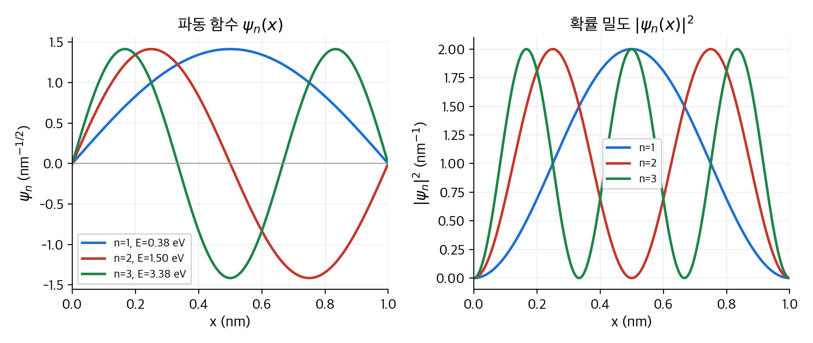
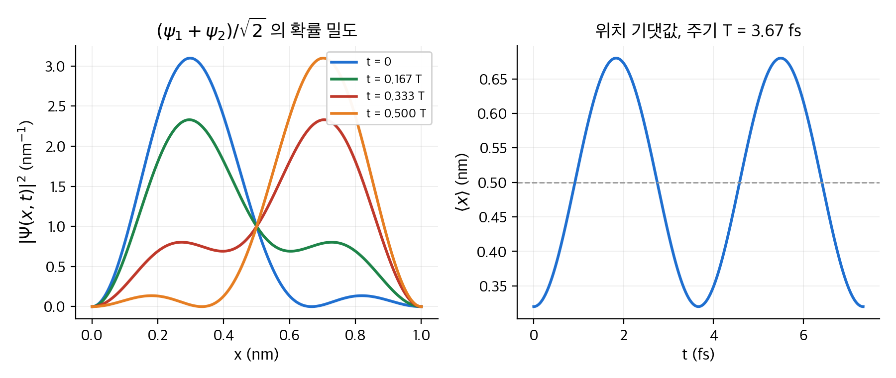
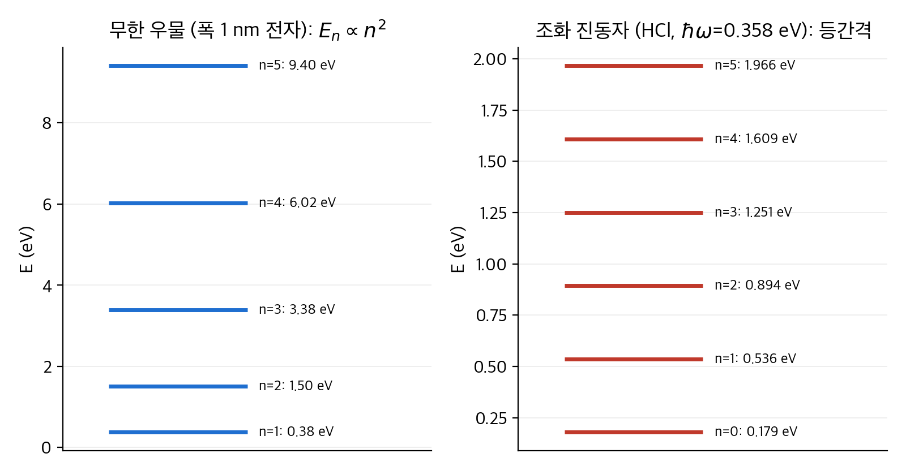
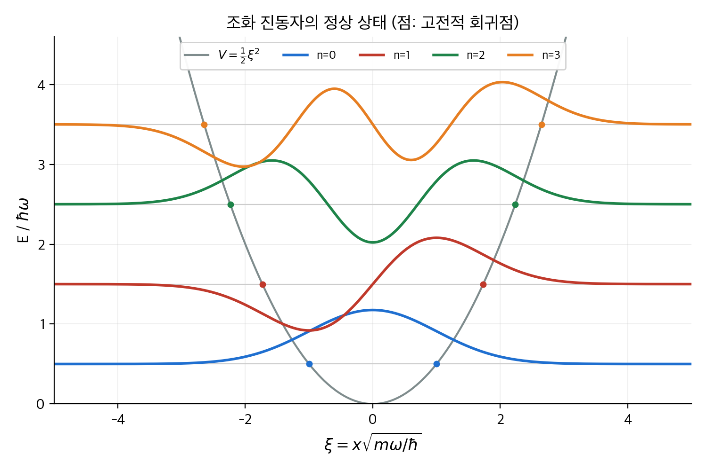
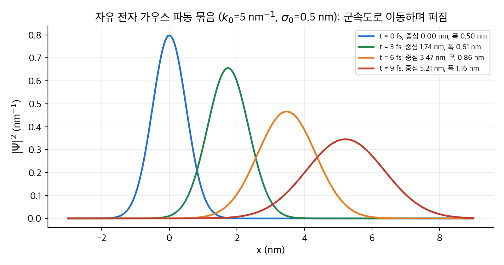
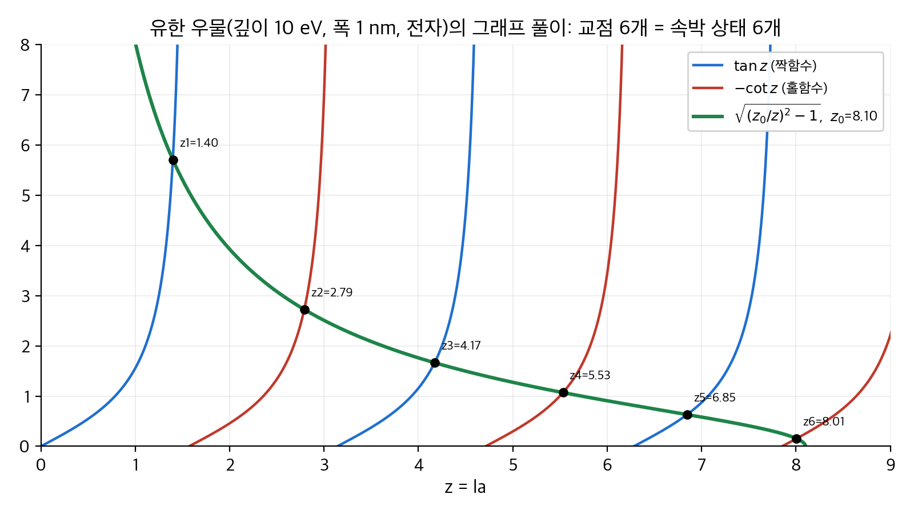
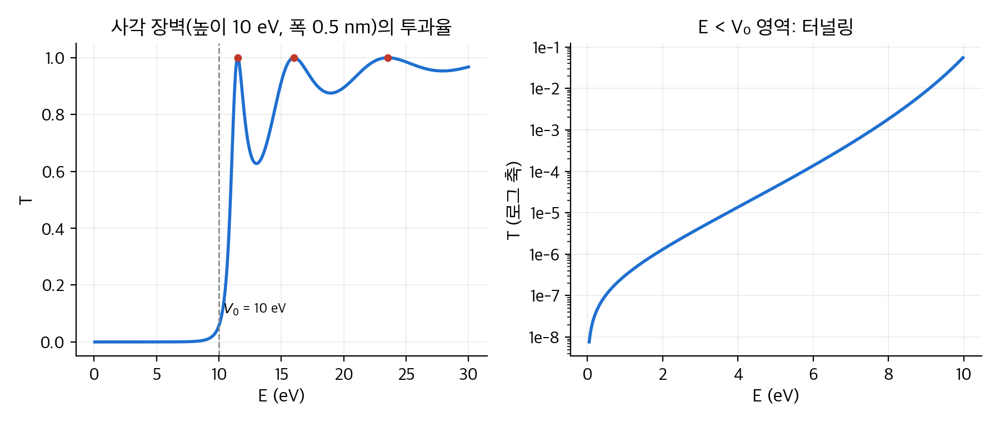

# 2. 시간에 무관한 슈뢰딩거 방정식

1장은 파동 함수 $\Psi(x, t)$ 가 무엇을 뜻하는지 정했습니다. 이 장은 그 파동 함수를 실제로 구합니다.
핵심 도구는 **변수 분리**(separation of variables)입니다. 시간과 공간을 떼어 놓으면 시간에 무관한 슈뢰딩거 방정식이 남습니다.
이 방정식을 여섯 가지 퍼텐셜에서 풉니다. 무한 사각 우물, 조화 진동자, 자유 입자, 델타 함수 퍼텐셜, 유한 사각 우물, 그리고 일반 산란 문제입니다.
결론은 두 가지입니다. 갇힌 입자의 에너지는 띄엄띄엄한 값만 허용되고, 자유로운 입자는 장벽을 만나도 일부 확률로 통과합니다.
이 장의 예시는 뒤의 모든 장에서 다시 쓰입니다. 특히 무한 우물과 조화 진동자는 섭동 이론과 변분 원리의 시험대입니다.

!!! info "원문과 자료"
    - 원문: Griffiths, *Introduction to Quantum Mechanics*, 1st ed. (1995), 2장 The Time-Independent Schrödinger Equation (2.1 Stationary States, 2.2 The Infinite Square Well, 2.3 The Harmonic Oscillator, 2.4 The Free Particle, 2.5 The Delta-Function Potential, 2.6 The Finite Square Well, 2.7 The Scattering Matrix)
    - 함께 읽기: [1. 파동 함수](01-wave-function.md), [3. 형식 체계](03-formalism.md), [6. 시간에 무관한 섭동 이론](06-time-independent-perturbation.md), [8. WKB 근사](08-wkb.md)
    - 수치 예는 전자 질량과 $\hbar^2 / m_e = 0.0762\,\mathrm{eV\,nm^2}$ 를 씁니다. 모든 수치는 NumPy와 SciPy로 다시 계산해서 검증했습니다.

## 1. 정상 상태 (2.1절)

### 변수 분리

퍼텐셜 $V$ 가 시간에 무관하면 슈뢰딩거 방정식의 해를 곱 꼴로 찾을 수 있습니다.

$$
\Psi(x, t) = \psi(x)\, \varphi(t)
$$

이것을 $i\hbar\, \partial_t \Psi = -\frac{\hbar^2}{2m} \partial_x^2 \Psi + V \Psi$ 에 넣고 양변을 $\psi \varphi$ 로 나눕니다.
왼쪽은 $t$ 만의 함수, 오른쪽은 $x$ 만의 함수가 됩니다. 두 함수가 모든 $x, t$ 에서 같으려면 둘 다 상수여야 합니다.
그 상수를 $E$ 라고 부릅니다. 그러면 방정식이 둘로 갈라집니다.

$$
\varphi(t) = e^{-iEt/\hbar}, \qquad
-\frac{\hbar^2}{2m} \frac{d^2 \psi}{dx^2} + V \psi = E \psi
$$

두 번째 식이 **시간에 무관한 슈뢰딩거 방정식**(time-independent Schrödinger equation)입니다.
연산자 $\hat H = -\frac{\hbar^2}{2m} \partial_x^2 + V$ 를 **해밀토니안**(Hamiltonian)이라고 부르면 $\hat H \psi = E \psi$ 로 짧게 씁니다.
이 식은 고유값 문제입니다. $E$ 는 고유값, $\psi$ 는 고유함수입니다. 행렬의 고유값 문제와 같은 구조는 [선형대수 5장](../../math/linear-algebra/05-eigenvalues.md)에 있습니다.

### 왜 "정상" 상태인가

곱 꼴 해 $\Psi = \psi(x) e^{-iEt/\hbar}$ 를 **정상 상태**(stationary state)라고 부릅니다. 세 가지 성질 때문입니다.

1. **확률 밀도가 시간에 무관합니다.** $|\Psi|^2 = \psi^* e^{+iEt/\hbar} \psi e^{-iEt/\hbar} = |\psi|^2$ 입니다. 시간 인자가 사라집니다.
2. **모든 기댓값이 시간에 무관합니다.** $\langle x \rangle$, $\langle p \rangle$ 등 어떤 물리량의 기댓값도 상수입니다. 특히 $\langle p \rangle = 0$ 입니다.
3. **에너지가 확정됩니다.** $\langle H \rangle = E$ 이고 $\langle H^2 \rangle = E^2$ 이므로 분산 $\sigma_H^2 = 0$ 입니다. 에너지를 재면 항상 $E$ 가 나옵니다.

정상 상태는 기타 줄의 **정상파**(standing wave)와 닮았습니다. 특정 진동수로만 울리고, 마디의 위치가 움직이지 않습니다.
다만 비유에는 한계가 있습니다. 기타 줄은 진폭이 실수로 진동하지만, 양자 상태는 복소 위상 $e^{-iEt/\hbar}$ 만 돌고 $|\psi|^2$ 는 얼어붙어 있습니다.

### 일반해는 중첩입니다

시간에 무관한 방정식은 보통 허용된 에너지 $E_1, E_2, \ldots$ 마다 해 $\psi_1, \psi_2, \ldots$ 를 하나씩 줍니다.
슈뢰딩거 방정식은 선형이므로 이것들의 임의 조합도 해입니다.

$$
\Psi(x, t) = \sum_{n=1}^{\infty} c_n\, \psi_n(x)\, e^{-iE_n t/\hbar}
$$

이 식이 이 장의 처방전입니다. 초기 조건 $\Psi(x, 0) = \sum c_n \psi_n(x)$ 에 맞는 계수 $c_n$ 을 찾습니다. 그다음 각 항에 자기 시간 인자를 붙이면 모든 시각의 상태를 얻습니다.
중첩 상태는 정상 상태가 아닙니다. 서로 다른 $E_n$ 의 위상이 다른 속도로 돌기 때문에 $|\Psi|^2$ 가 시간에 따라 움직입니다. 2절의 수치 예에서 확인합니다.

### E 에 대한 두 가지 사실

- **$E$ 는 실수입니다.** $E$ 가 복소수이면 $|\varphi(t)|^2 = e^{2\,\mathrm{Im}(E)\,t/\hbar}$ 가 되어 전체 확률이 시간에 따라 변합니다. 이는 규격화와 모순입니다.
- **$E$ 는 $V$ 의 최솟값보다 커야 합니다.** $E < V_{\min}$ 이면 $\psi'' = \frac{2m}{\hbar^2}(V - E)\psi$ 에서 $\psi''$ 와 $\psi$ 의 부호가 항상 같습니다. 그런 함수는 0에서 멀어지기만 하므로 규격화할 수 없습니다. 고전역학에서 운동 에너지가 음수일 수 없는 것과 같은 뜻입니다.

## 2. 무한 사각 우물 (2.2절)

### 설정과 풀이

가장 단순한 갇힘입니다. $0 \le x \le a$ 에서 $V = 0$ 이고 바깥에서는 $V = \infty$ 입니다. 바깥에서는 $\psi = 0$ 입니다.
안에서는 $\psi'' = -k^2 \psi$ 이고 $k = \sqrt{2mE}/\hbar$ 입니다. 일반해는 $A \sin kx + B \cos kx$ 입니다.
경계 조건 $\psi(0) = 0$ 에서 $B = 0$ 이고, $\psi(a) = 0$ 에서 $ka = n\pi$ 입니다. $k$ 는 아무 값이나 가질 수 없습니다.

$$
E_n = \frac{n^2 \pi^2 \hbar^2}{2 m a^2}, \qquad
\psi_n(x) = \sqrt{\frac{2}{a}} \sin\!\left(\frac{n\pi x}{a}\right), \qquad n = 1, 2, 3, \ldots
$$

$n = 0$ 은 $\psi = 0$ 이므로 버립니다. 음수 $n$ 은 부호만 다른 같은 상태입니다. 규격화 상수 $\sqrt{2/a}$ 는 $\int_0^a |\psi|^2 dx = 1$ 에서 나옵니다.
에너지가 **양자화**(quantization)된 이유는 경계 조건입니다. 줄의 양 끝을 고정하면 특정 파장만 들어가는 것과 같습니다.

<figure markdown>

<figcaption markdown>
<span class="fig-title"><b>Figure 1.</b> 폭 1 nm 무한 우물의 처음 세 정상 상태</span>

왼쪽은 파동 함수, 오른쪽은 확률 밀도입니다. $n$ 번째 상태는 양 끝을 빼고 마디가 $n - 1$ 개입니다. $n = 2$ 상태의 전자는 우물 한가운데에서 발견될 확률이 0입니다.
</figcaption>
</figure>

### 정상 상태의 네 가지 성질

이 성질은 무한 우물만의 것이 아닙니다. 대칭 퍼텐셜의 속박 상태에서 거의 항상 성립합니다.

1. **짝과 홀이 번갈아 나옵니다.** 우물 중심을 기준으로 $\psi_1$ 은 짝함수, $\psi_2$ 는 홀함수입니다.
2. **마디가 하나씩 늘어납니다.** $\psi_n$ 은 안쪽에 마디가 $n - 1$ 개 있습니다. 마디가 많을수록 곡률이 크고 에너지가 높습니다.
3. **서로 직교합니다.** $\int \psi_m^* \psi_n\, dx = \delta_{mn}$ 입니다. 직교성과 규격화를 합쳐 **정규 직교**(orthonormal)라고 부릅니다.
4. **완비합니다.** 구간 위의 임의 함수를 $\sum c_n \psi_n$ 으로 전개할 수 있습니다. 이것은 푸리에 사인 급수입니다.

직교성 덕분에 계수를 바로 구합니다. 양변에 $\psi_m^*$ 를 곱해 적분하면 다른 항이 모두 죽습니다.

$$
c_n = \int_0^a \psi_n(x)^*\, \Psi(x, 0)\, dx
$$

이 요령을 책은 **푸리에의 묘수**(Fourier's trick)라고 부릅니다. 벡터를 정규 직교 기저에 투영하는 것과 같은 계산입니다. [선형대수 3장](../../math/linear-algebra/03-orthogonality.md)을 참고합니다.

### 수치 예 1: 폭 1 nm 우물 속 전자

$a = 1\,\mathrm{nm}$ 전자에 $\hbar^2 / m_e = 0.0762\,\mathrm{eV\,nm^2}$ 를 넣습니다.

$$
E_1 = \frac{\pi^2}{2} \cdot \frac{0.0762\,\mathrm{eV\,nm^2}}{(1\,\mathrm{nm})^2} = 0.376\,\mathrm{eV}
$$

| $n$ | $E_n = n^2 E_1$ | 비고 |
| --- | --- | --- |
| 1 | 0.376 eV | 바닥 상태. 가둬 두기만 해도 에너지가 0이 아닙니다. |
| 2 | 1.504 eV | |
| 3 | 3.385 eV | |
| 4 | 6.018 eV | |

전자가 $n = 2$ 에서 $n = 1$ 로 떨어지며 내는 광자의 에너지는 $E_2 - E_1 = 1.128\,\mathrm{eV}$ 입니다.
파장은 $\lambda = hc / \Delta E = 1240\,\mathrm{eV\,nm} / 1.128\,\mathrm{eV} = 1099\,\mathrm{nm}$ 로 근적외선입니다.
이 크기의 우물은 반도체 양자점과 비슷합니다. 양자점의 발광 색이 크기에 따라 달라지는 이유가 $E_n \propto 1/a^2$ 입니다.

### 수치 예 2: 1 g 구슬이 1 cm 상자에 갇히면

같은 공식에 $m = 10^{-3}\,\mathrm{kg}$, $a = 10^{-2}\,\mathrm{m}$ 를 넣습니다.

$$
E_1 = \frac{\pi^2 (1.055 \times 10^{-34})^2}{2 \times 10^{-3} \times 10^{-4}} = 5.5 \times 10^{-61}\,\mathrm{J}
$$

구슬이 $1\,\mathrm{cm/s}$ 로 움직이면 운동 에너지는 $5 \times 10^{-8}\,\mathrm{J}$ 입니다. 이에 해당하는 양자수는 $n = \sqrt{E / E_1} \approx 3 \times 10^{26}$ 입니다.
이웃한 준위 사이의 간격은 $E_{n+1} - E_n \approx 2 n E_1 \approx 3 \times 10^{-34}\,\mathrm{J}$ 로, 어떤 실험으로도 구분할 수 없습니다.
양자화는 늘 있지만 질량이 크면 준위가 연속처럼 보입니다. 이것이 **대응 원리**(correspondence principle)의 한 예입니다.

### 수치 예 3: 초기 상태를 정상 상태로 전개하기

처음에 전자가 포물선 모양 $\Psi(x, 0) = A\, x (a - x)$ 에 있다고 가정합니다. 우물 가운데가 볼록한 종 모양입니다.
먼저 규격화합니다. $\int_0^a A^2 x^2 (a - x)^2 dx = A^2 a^5 / 30 = 1$ 에서 $A = \sqrt{30 / a^5}$ 입니다.
계수는 푸리에의 묘수로 구합니다. 부분 적분을 두 번 하면 닫힌 식이 나옵니다.

$$
c_n = \sqrt{\frac{2}{a}} \sqrt{\frac{30}{a^5}} \int_0^a x(a - x) \sin\frac{n\pi x}{a}\, dx
= \begin{cases} \dfrac{8\sqrt{15}}{(n\pi)^3} & n \text{ 홀수} \\[6pt] 0 & n \text{ 짝수} \end{cases}
$$

짝수 항이 0인 이유는 대칭입니다. 초기 상태는 우물 중심에 대해 짝함수이고, 짝수 $n$ 의 $\psi_n$ 은 홀함수이므로 적분이 상쇄됩니다.

| $n$ | $c_n$ | $\lvert c_n \rvert^2$ (에너지 $E_n$ 을 잴 확률) |
| --- | --- | --- |
| 1 | 0.99928 | 0.99856 |
| 3 | 0.03701 | 0.00137 |
| 5 | 0.00799 | 0.00006 |
| 7 | 0.00291 | 0.00001 |

종 모양은 $\psi_1$ 과 매우 닮았으므로 $|c_1|^2$ 가 99.9% 입니다. 합 $\sum |c_n|^2 = \frac{960}{\pi^6} \sum_{\text{홀수}} n^{-6} = 1$ 이 정확히 성립합니다.
에너지 기댓값은 $\langle H \rangle = \sum |c_n|^2 E_n$ 입니다. 급수를 더하면 $\langle H \rangle = \frac{960 E_1}{\pi^6} \sum_{\text{홀수}} n^{-4} = \frac{10}{\pi^2} E_1 = 1.013\, E_1$ 입니다.
1 nm 전자 우물이면 $0.381\,\mathrm{eV}$ 입니다. 직접 $\int \Psi^* \hat H \Psi\, dx = 5\hbar^2 / (m a^2)$ 를 계산해도 같은 값이 나옵니다.

```python
import numpy as np
from scipy.integrate import quad

a = 1.0                                   # nm
A = np.sqrt(30 / a**5)
psi = lambda n, x: np.sqrt(2 / a) * np.sin(n * np.pi * x / a)
c = [quad(lambda x: psi(n, x) * A * x * (a - x), 0, a)[0] for n in range(1, 8)]
E1 = np.pi**2 * 0.0762 / (2 * a**2)      # eV
print(np.round(c, 5))                     # [0.99928 0. 0.03701 0. 0.00799 0. 0.00291]
print(sum(ci**2 for ci in c))             # 0.999997 (7항까지)
print(sum(ci**2 * n**2 for n, ci in enumerate(c, 1)) * E1, 10 / np.pi**2 * E1)
```

### 수치 예 4: 두 상태의 중첩은 움직입니다

$\Psi(x, 0) = (\psi_1 + \psi_2) / \sqrt{2}$ 에서 출발합니다. 시간이 지나면 각 항에 자기 위상이 붙습니다.

$$
|\Psi(x, t)|^2 = \frac{1}{2}\left[\psi_1^2 + \psi_2^2 + 2 \psi_1 \psi_2 \cos(\omega t)\right], \qquad
\omega = \frac{E_2 - E_1}{\hbar} = \frac{3 E_1}{\hbar}
$$

교차항이 $\cos \omega t$ 로 진동합니다. 위치 기댓값을 계산하면 다음과 같습니다.

$$
\langle x \rangle(t) = \frac{a}{2} - \frac{16 a}{9 \pi^2} \cos(\omega t)
$$

1 nm 전자 우물에서 주기는 $T = 2\pi\hbar / (3E_1) = 4.136 \times 10^{-15}\,\mathrm{eV\,s} / (1.128\,\mathrm{eV}) = 3.67\,\mathrm{fs}$ 입니다.
전자는 중심에서 $\pm 0.18\,\mathrm{nm}$ 범위로 좌우로 출렁입니다. 진동하는 전하는 전자기파를 냅니다. 그 진동수가 바로 광자 $E_2 - E_1$ 의 진동수입니다.
이것이 원자가 빛을 내는 과정의 가장 단순한 그림입니다. 9장에서 자세히 다룹니다.

<figure markdown>

<figcaption markdown>
<span class="fig-title"><b>Figure 2.</b> $(\psi_1 + \psi_2)/\sqrt{2}$ 의 시간 변화</span>

왼쪽은 반주기 동안 확률 밀도가 왼쪽에서 오른쪽으로 옮겨 가는 모습입니다. 오른쪽은 위치 기댓값입니다. 폭 1 nm 전자 우물에서 주기는 3.67 fs 입니다.
</figcaption>
</figure>

## 3. 조화 진동자 (2.3절)

### 왜 조화 진동자인가

퍼텐셜이 $V(x) = \frac{1}{2} m \omega^2 x^2$ 인 문제입니다. 용수철에 매달린 질량의 양자판입니다.
이 문제가 중요한 이유는 보편성입니다. 어떤 매끄러운 퍼텐셜이든 극소점 $x_0$ 근처에서 테일러 전개하면 $V \approx V(x_0) + \frac{1}{2} V''(x_0)(x - x_0)^2$ 입니다.
즉 안정 평형 근처의 작은 진동은 모두 조화 진동자입니다. 분자의 진동, 고체 격자의 진동, 전자기장의 모드가 모두 여기에 속합니다.

### 대수적 방법: 사다리 연산자

해밀토니안은 $\hat H = \frac{1}{2m}[\hat p^2 + (m\omega \hat x)^2]$ 입니다. 숫자라면 $u^2 + v^2 = (u - iv)(u + iv)$ 로 인수분해할 수 있습니다.
연산자도 같은 시도를 합니다. 다만 $\hat x$ 와 $\hat p$ 는 교환하지 않으므로 나머지가 남습니다. 다음 연산자를 정의합니다.

$$
a_\pm = \frac{1}{\sqrt{2\hbar m \omega}} (\mp i \hat p + m \omega \hat x)
$$

**정준 교환 관계**(canonical commutation relation) $[\hat x, \hat p] = i\hbar$ 를 쓰면 다음이 나옵니다.

$$
a_- a_+ = \frac{1}{\hbar\omega} \hat H + \frac{1}{2}, \qquad
a_+ a_- = \frac{1}{\hbar\omega} \hat H - \frac{1}{2}, \qquad
[a_-, a_+] = 1
$$

따라서 $\hat H = \hbar\omega\,(a_+ a_- + \tfrac{1}{2})$ 입니다. 핵심 성질은 다음과 같습니다. $\psi$ 가 에너지 $E$ 의 해이면 $a_+ \psi$ 는 에너지 $E + \hbar\omega$ 의 해입니다. $a_- \psi$ 는 에너지 $E - \hbar\omega$ 의 해입니다.
증명은 한 줄입니다. $\hat H (a_+ \psi) = \hbar\omega(a_+ a_- + \frac{1}{2}) a_+ \psi = a_+ \hbar\omega (a_- a_+ + \frac{1}{2}) \psi = a_+ (\hat H + \hbar\omega)\psi = (E + \hbar\omega)(a_+ \psi)$ 입니다.
$a_+$ 를 **올림 연산자**(raising operator), $a_-$ 를 **내림 연산자**(lowering operator)라고 부릅니다.

내림을 반복하면 에너지가 $V_{\min} = 0$ 아래로 내려가야 하는데, 1절에서 그런 해는 없다고 했습니다. 그러므로 사다리의 맨 아래 칸 $\psi_0$ 가 있어야 하고 $a_- \psi_0 = 0$ 입니다.
이것은 1계 미분 방정식입니다.

$$
\frac{1}{\sqrt{2\hbar m\omega}} \left(\hbar \frac{d}{dx} + m\omega x\right) \psi_0 = 0
\;\Longrightarrow\;
\psi_0(x) = \left(\frac{m\omega}{\pi\hbar}\right)^{1/4} e^{-m\omega x^2 / 2\hbar}
$$

바닥 상태 에너지는 $\hat H \psi_0 = \hbar\omega(a_+ a_- + \frac{1}{2})\psi_0 = \frac{1}{2}\hbar\omega\, \psi_0$ 에서 $E_0 = \frac{1}{2}\hbar\omega$ 입니다.
나머지는 사다리를 올라가며 얻습니다.

$$
\psi_n = \frac{1}{\sqrt{n!}} (a_+)^n \psi_0, \qquad E_n = \left(n + \frac{1}{2}\right)\hbar\omega, \qquad n = 0, 1, 2, \ldots
$$

규격화 인자는 $a_+ \psi_n = \sqrt{n+1}\, \psi_{n+1}$, $a_- \psi_n = \sqrt{n}\, \psi_{n-1}$ 에서 나옵니다.
무한 우물과 달리 준위가 **등간격**입니다. 간격은 $\hbar\omega$ 하나뿐입니다. 또 바닥 상태 에너지 $\frac{1}{2}\hbar\omega$ 는 **영점 에너지**(zero-point energy)라고 부릅니다. 절대 영도에서도 진동이 멈추지 않습니다.

<figure markdown>

<figcaption markdown>
<span class="fig-title"><b>Figure 3.</b> 무한 우물과 조화 진동자의 에너지 사다리</span>

왼쪽은 폭 1 nm 전자 우물로 간격이 $n^2$ 으로 벌어집니다. 오른쪽은 HCl 분자의 진동으로 간격이 일정합니다. 두 사다리 모두 맨 아래가 0이 아닙니다.
</figcaption>
</figure>

### 손계산 예: $\psi_0$ 에서 $\psi_1$ 만들기

$\xi = \sqrt{m\omega/\hbar}\, x$ 로 길이를 무차원화하면 $a_+ = \frac{1}{\sqrt 2}(\xi - \frac{d}{d\xi})$ 이고 $\psi_0 = \pi^{-1/4} e^{-\xi^2/2}$ 입니다.

$$
\psi_1 = a_+ \psi_0 = \frac{\pi^{-1/4}}{\sqrt 2}\left(\xi e^{-\xi^2/2} - \frac{d}{d\xi} e^{-\xi^2/2}\right)
= \frac{\pi^{-1/4}}{\sqrt 2}\left(\xi e^{-\xi^2/2} + \xi e^{-\xi^2/2}\right)
= \pi^{-1/4} \sqrt{2}\, \xi\, e^{-\xi^2/2}
$$

$\psi_1$ 은 홀함수이고 원점에 마디가 하나 있습니다. 규격화 확인: $\int \psi_1^2 d\xi = \frac{2}{\sqrt\pi} \int \xi^2 e^{-\xi^2} d\xi = \frac{2}{\sqrt\pi} \cdot \frac{\sqrt\pi}{2} = 1$ 입니다.
한 번 더 올리면 $\psi_2 = \frac{1}{\sqrt 2} a_+ \psi_1 = \frac{\pi^{-1/4}}{\sqrt 2}(2\xi^2 - 1) e^{-\xi^2/2}$ 가 나옵니다. 이 과정을 기계적으로 반복하면 모든 상태를 얻습니다.

### 해석적 방법과 에르미트 다항식

같은 문제를 멱급수로 풀 수도 있습니다. $\psi = h(\xi) e^{-\xi^2/2}$ 로 두면 $h$ 에 대한 점화식 $a_{j+2} = \frac{2j + 1 - 2E/\hbar\omega}{(j+1)(j+2)} a_j$ 가 나옵니다.
급수가 끝나지 않으면 $h \sim e^{\xi^2}$ 처럼 자라서 규격화가 깨집니다. 급수가 끝나려면 분자가 0이 되는 $j = n$ 이 있어야 합니다. 즉 $E = (n + \frac{1}{2})\hbar\omega$ 입니다.
양자화 조건이 "급수가 다항식으로 끝나야 한다"에서 나옵니다. 그 다항식이 **에르미트 다항식**(Hermite polynomial) $H_n$ 입니다.

| $n$ | $H_n(\xi)$ | $\psi_n(\xi) \propto H_n(\xi) e^{-\xi^2/2}$ 의 마디 수 |
| --- | --- | --- |
| 0 | $1$ | 0 |
| 1 | $2\xi$ | 1 |
| 2 | $4\xi^2 - 2$ | 2 |
| 3 | $8\xi^3 - 12\xi$ | 3 |

손계산 예의 $\psi_1 \propto \xi e^{-\xi^2/2}$, $\psi_2 \propto (2\xi^2 - 1)e^{-\xi^2/2}$ 와 표의 $H_1, H_2$ 가 비례합니다. 두 방법이 같은 답을 줍니다.

<figure markdown>

<figcaption markdown>
<span class="fig-title"><b>Figure 4.</b> 조화 진동자의 정상 상태</span>

각 파동 함수를 자기 에너지 높이에 그렸습니다. 점은 $E_n = V(x)$ 가 되는 고전적 회귀점입니다. 고전 입자는 점 밖으로 나갈 수 없지만, 파동 함수는 점 밖으로 지수적으로 새어 나갑니다.
</figcaption>
</figure>

### 수치 예: HCl 분자의 진동

염화수소 분자의 결합은 용수철 상수 $k \approx 480\,\mathrm{N/m}$ 인 용수철로 근사할 수 있습니다. 진동하는 질량은 환산 질량 $\mu = m_H m_{Cl} / (m_H + m_{Cl}) = 1.63 \times 10^{-27}\,\mathrm{kg}$ 입니다.

| 양 | 계산 | 값 |
| --- | --- | --- |
| 각진동수 | $\omega = \sqrt{k/\mu}$ | $5.43 \times 10^{14}\,\mathrm{rad/s}$ |
| 준위 간격 | $\hbar\omega$ | $0.358\,\mathrm{eV}$ |
| 영점 에너지 | $E_0 = \frac{1}{2}\hbar\omega$ | $0.179\,\mathrm{eV}$ |
| 흡수 파장 | $\lambda = hc / \hbar\omega$ | $3.47\,\mathrm{\mu m}$ (적외선) |
| 길이 척도 | $\sqrt{\hbar / \mu\omega}$ | $10.9\,\mathrm{pm}$ |
| 실온 대비 | $\hbar\omega / k_B T$ ($T = 300\,\mathrm{K}$) | $13.8$ |

실측된 HCl의 적외선 흡수는 $3.46\,\mathrm{\mu m}$ 근처입니다. 단순한 용수철 모형이 1% 안으로 맞습니다.
마지막 줄이 중요합니다. $\hbar\omega$ 가 열에너지의 14배이므로 실온에서 첫 들뜬 상태에 있을 확률은 $e^{-13.8} \approx 10^{-6}$ 입니다. 거의 모든 분자가 바닥 상태에 있습니다.
따라서 실온 기체의 비열에 진동 자유도가 기여하지 않습니다. 고전 물리로는 설명할 수 없던 사실입니다.
길이 척도 $10.9\,\mathrm{pm}$ 은 결합 길이 $127\,\mathrm{pm}$ 의 9% 입니다. 바닥 상태에서도 원자핵은 이만큼 퍼져 있습니다.

```python
import numpy as np
hbar, eV, u = 1.0546e-34, 1.602e-19, 1.6605e-27
k, mu = 480.0, (1.008 * 35.45) / (1.008 + 35.45) * u
w = np.sqrt(k / mu)
print(hbar * w / eV, 0.5 * hbar * w / eV)        # 0.358 eV, 0.179 eV
print(1240 / (hbar * w / eV))                    # 3466 nm
print(hbar * w / (1.381e-23 * 300))              # 13.8
```

## 4. 자유 입자 (2.4절)

### 규격화할 수 없는 정상 상태

$V = 0$ 이면 방정식은 $\psi'' = -k^2\psi$ 이고 해는 $\psi_k(x) = A e^{ikx}$ 입니다. 시간 인자를 붙이면 $\Psi_k = A e^{i(kx - \hbar k^2 t / 2m)}$ 입니다.
이것은 $k > 0$ 이면 오른쪽으로, $k < 0$ 이면 왼쪽으로 가는 평면파입니다. 경계 조건이 없으므로 $k$ 에 제한이 없고, 에너지 $E = \hbar^2 k^2 / 2m$ 은 연속입니다.
문제는 $|\Psi_k|^2 = |A|^2$ 가 상수라서 전 공간 적분이 발산한다는 점입니다. 평면파는 물리적 상태가 아닙니다.
자유 입자의 물리적 상태는 평면파의 **중첩**입니다. 합이 적분으로 바뀝니다.

$$
\Psi(x, t) = \frac{1}{\sqrt{2\pi}} \int_{-\infty}^{\infty} \phi(k)\, e^{i(kx - \hbar k^2 t/2m)}\, dk, \qquad
\phi(k) = \frac{1}{\sqrt{2\pi}} \int_{-\infty}^{\infty} \Psi(x, 0)\, e^{-ikx}\, dx
$$

$\phi(k)$ 는 초기 상태의 푸리에 변환입니다. 이렇게 만든 국소화된 덩어리를 **파동 묶음**(wave packet)이라고 부릅니다.

### 위상 속도와 군속도

평면파 하나의 속도는 $v_{\text{위상}} = \omega / k = \hbar k / 2m$ 입니다. 그런데 고전 입자의 속도는 $p / m = \hbar k / m$ 으로 두 배입니다.
모순처럼 보이지만 아닙니다. 입자에 대응하는 것은 평면파 하나가 아니라 묶음입니다. 묶음의 봉우리는 **군속도**(group velocity) $v_{\text{군}} = d\omega / dk = \hbar k / m$ 으로 움직입니다.
이 값은 고전 속도와 정확히 같습니다. 바다의 파도 무리를 보면 같은 현상이 보입니다. 무리 안의 개별 물결은 무리보다 빠르게 앞으로 흘러가서 앞쪽에서 사라집니다.

### 수치 예: 가우스 파동 묶음의 퍼짐

초기 폭 $\sigma_0 = 0.5\,\mathrm{nm}$, 중심 파수 $k_0 = 5\,\mathrm{nm^{-1}}$ 인 가우스 묶음을 가진 전자를 봅니다.

| 양 | 계산 | 값 |
| --- | --- | --- |
| 드브로이 파장 | $2\pi / k_0$ | $1.26\,\mathrm{nm}$ |
| 운동 에너지 | $\hbar^2 k_0^2 / 2m_e = 0.0762 \times 25 / 2$ | $0.95\,\mathrm{eV}$ |
| 군속도 | $\hbar k_0 / m_e$ | $5.79 \times 10^5\,\mathrm{m/s} = 0.579\,\mathrm{nm/fs}$ |
| 위상 속도 | $\hbar k_0 / 2m_e$ | $0.289\,\mathrm{nm/fs}$ |

가우스 묶음의 폭은 시간에 따라 다음처럼 자랍니다.

$$
\sigma(t) = \sigma_0 \sqrt{1 + \left(\frac{\hbar t}{2 m \sigma_0^2}\right)^2}
$$

$\hbar / m_e = 0.1158\,\mathrm{nm^2/fs}$ 를 넣으면 $t = 9\,\mathrm{fs}$ 에 폭이 $1.16\,\mathrm{nm}$ 로 두 배 넘게 퍼집니다. 그동안 중심은 $5.2\,\mathrm{nm}$ 이동합니다.
퍼지는 이유는 $\phi(k)$ 가 여러 $k$ 를 담고 있기 때문입니다. 빠른 성분은 앞서가고 느린 성분은 뒤처집니다. 처음 폭이 좁을수록 $\phi(k)$ 가 넓고, 더 빨리 퍼집니다.

<figure markdown>

<figcaption markdown>
<span class="fig-title"><b>Figure 5.</b> 자유 전자 파동 묶음의 시간 변화</span>

중심은 군속도 0.579 nm/fs 로 등속 이동합니다. 폭은 9 fs 동안 0.5 nm 에서 1.16 nm 로 퍼집니다. 전체 넓이(확률)는 항상 1 입니다.
</figcaption>
</figure>

## 5. 델타 함수 퍼텐셜 (2.5절)

### 속박 상태와 산란 상태

지금까지 두 종류의 해를 봤습니다. 우물과 진동자는 띄엄띄엄한 에너지의 규격화 가능한 해를 주었습니다. 자유 입자는 연속 에너지의 규격화 불가능한 해를 주었습니다.
구분 기준은 간단합니다. $E < V(\pm\infty)$ 이면 **속박 상태**(bound state)이고, $E > V(\pm\infty)$ 이면 **산란 상태**(scattering state)입니다.
고전적으로 보면 속박 상태는 되돌아오는 입자입니다. 산란 상태는 멀리서 와서 멀리로 가는 입자입니다. 보통 $V(\pm\infty) = 0$ 으로 두므로 $E < 0$ 은 속박, $E > 0$ 은 산란입니다.

### 델타 함수 우물

**디랙 델타 함수**(Dirac delta function) $\delta(x)$ 는 원점에서 무한히 높고 폭이 0이며 넓이가 1인 뾰족한 함수입니다. 핵심 성질은 $\int f(x)\delta(x - c)\, dx = f(c)$ 입니다.
퍼텐셜 $V(x) = -\alpha\,\delta(x)$ ($\alpha > 0$)는 무한히 좁고 깊은 우물입니다. 원점을 뺀 모든 곳에서 $V = 0$ 이므로 해는 쉽습니다.
원점에서는 경계 조건이 필요합니다. 슈뢰딩거 방정식을 $-\epsilon$ 부터 $\epsilon$ 까지 적분하고 $\epsilon \to 0$ 으로 보내면 두 조건이 나옵니다.

1. $\psi$ 는 연속입니다.
2. $\psi'$ 는 불연속이고, 그 점프는 $\Delta\psi' = -\dfrac{2m\alpha}{\hbar^2}\psi(0)$ 입니다.

**속박 상태** ($E < 0$): $\kappa = \sqrt{-2mE}/\hbar$ 로 두면 양쪽에서 $\psi = B e^{-\kappa|x|}$ 입니다. 도함수 조건 $-2\kappa B = -\frac{2m\alpha}{\hbar^2} B$ 에서 $\kappa = m\alpha/\hbar^2$ 입니다.

$$
E = -\frac{m\alpha^2}{2\hbar^2}, \qquad \psi(x) = \frac{\sqrt{m\alpha}}{\hbar}\, e^{-m\alpha|x|/\hbar^2}
$$

$\alpha$ 가 얼마든 속박 상태는 정확히 **하나**입니다. 1차원에서 끌어당기는 퍼텐셜은 아무리 약해도 속박 상태를 가집니다.

### 산란 상태와 투과율

$E > 0$ 에서 $k = \sqrt{2mE}/\hbar$ 입니다. 왼쪽에서 입자가 들어온다고 하면 왼쪽은 $A e^{ikx} + B e^{-ikx}$, 오른쪽은 $F e^{ikx}$ 입니다.
$A$ 는 입사파, $B$ 는 반사파, $F$ 는 투과파의 진폭입니다. 두 경계 조건으로 $B, F$ 를 $A$ 로 나타냅니다. $\beta = m\alpha / \hbar^2 k$ 로 두면 다음과 같습니다.

$$
R = \frac{|B|^2}{|A|^2} = \frac{\beta^2}{1 + \beta^2}, \qquad
T = \frac{|F|^2}{|A|^2} = \frac{1}{1 + \beta^2}, \qquad R + T = 1
$$

**반사율**(reflection coefficient) $R$ 과 **투과율**(transmission coefficient) $T$ 는 각각 반사될 확률과 통과할 확률입니다.
$\beta^2 = m\alpha^2 / 2\hbar^2 E = |E_{\text{속박}}| / E$ 이므로 투과율을 속박 에너지로 바로 쓸 수 있습니다.

$$
T = \frac{1}{1 + |E_{\text{속박}}| / E}
$$

### 수치 예: 속박 에너지 1 eV 인 델타 우물

$|E_{\text{속박}}| = 1\,\mathrm{eV}$ 가 되도록 $\alpha$ 를 정하면 $\alpha = \sqrt{2\hbar^2 |E| / m_e} = \sqrt{2 \times 0.0762 \times 1} = 0.390\,\mathrm{eV\,nm}$ 입니다.
속박 상태의 폭은 $1/\kappa = \hbar^2 / m\alpha = 0.195\,\mathrm{nm}$ 입니다. 이 우물에 여러 에너지의 전자를 쏘면 투과율은 다음과 같습니다.

| 입사 에너지 $E$ | $\beta^2 = 1\,\mathrm{eV} / E$ | $T$ | $R$ |
| --- | --- | --- | --- |
| 0.25 eV | 4 | 0.20 | 0.80 |
| 0.5 eV | 2 | 0.33 | 0.67 |
| 1 eV | 1 | 0.50 | 0.50 |
| 2 eV | 0.5 | 0.67 | 0.33 |
| 4 eV | 0.25 | 0.80 | 0.20 |

고전 입자는 우물을 **항상** 통과합니다. 우물은 아래로 파인 곳이므로 가로막는 것이 없습니다. 그런데 양자 입자는 1 eV 로 오면 절반이 튕겨 나갑니다.
바닥에 얕은 홈이 있는 길을 지나는 구슬이 절반은 되돌아오는 셈입니다. 파동이 급격한 매질 변화를 만나면 반사하는 것과 같은 현상입니다.

### 델타 함수 장벽

$\alpha$ 의 부호를 바꾸면 $V = +\alpha\,\delta(x)$ 인 장벽입니다. 속박 상태는 사라집니다. 그런데 $R$ 과 $T$ 는 $\alpha^2$ 에만 의존하므로 **우물과 똑같습니다**.
무한히 높은 장벽을 입자가 통과합니다. 이것이 **터널링**(tunneling)의 첫 예입니다. 장벽이 무한히 높아도 무한히 얇기 때문에 가능합니다. 유한한 두께의 장벽은 7절에서 다룹니다.

## 6. 유한 사각 우물 (2.6절)

### 설정과 초월 방정식

$-a < x < a$ 에서 $V = -V_0$ 이고 바깥에서 $V = 0$ 입니다. 무한 우물과 달리 바깥에서 $\psi$ 가 0이 아닙니다.
속박 상태 ($-V_0 < E < 0$)를 봅니다. $\kappa = \sqrt{-2mE}/\hbar$, $l = \sqrt{2m(E + V_0)}/\hbar$ 로 둡니다.
바깥에서는 $\psi \propto e^{-\kappa|x|}$ 로 감쇠하고, 안에서는 $\sin lx$ 또는 $\cos lx$ 로 진동합니다.
퍼텐셜이 짝함수이므로 해를 짝함수와 홀함수로 나눌 수 있습니다. 짝함수 해는 안에서 $D\cos lx$, 밖에서 $Fe^{-\kappa x}$ ($x > a$)입니다.
$x = a$ 에서 $\psi$ 와 $\psi'$ 가 연속이어야 합니다. 두 조건을 나누면 $\kappa = l \tan la$ 가 됩니다.
무차원 변수 $z = la$, $z_0 = \frac{a}{\hbar}\sqrt{2mV_0}$ 를 쓰면 $\kappa a = \sqrt{z_0^2 - z^2}$ 이므로 다음과 같습니다.

$$
\tan z = \sqrt{(z_0/z)^2 - 1} \quad (\text{짝함수}), \qquad
-\cot z = \sqrt{(z_0/z)^2 - 1} \quad (\text{홀함수})
$$

이것은 **초월 방정식**(transcendental equation)이라서 닫힌 해가 없습니다. 그래프로 풀거나 수치로 풉니다.
$z_0$ 하나가 우물의 모든 것을 담습니다. 깊고 넓을수록 $z_0$ 가 큽니다. 속박 상태의 개수는 $z_0$ 를 $\pi/2$ 로 나눈 몫에 1을 더한 값입니다.

### 두 극한

- **깊고 넓은 우물** ($z_0 \to \infty$): 교점이 $z_n \to n\pi/2$ 로 갑니다. 그러면 $E_n + V_0 \to \frac{n^2 \pi^2 \hbar^2}{2m(2a)^2}$ 로, 폭 $2a$ 무한 우물의 준위로 돌아갑니다.
- **얕고 좁은 우물** ($z_0 \to 0$): 홀함수 해는 모두 사라지지만 짝함수 해 하나는 끝까지 남습니다. 1차원 우물은 아무리 얕아도 속박 상태가 하나 있습니다. 델타 우물에서 본 것과 같은 결론입니다.

### 수치 예: 깊이 10 eV, 폭 1 nm 우물 속 전자

$V_0 = 10\,\mathrm{eV}$, $a = 0.5\,\mathrm{nm}$ 입니다. $z_0 = a \sqrt{2 V_0 / (\hbar^2/m_e)} = 0.5 \times \sqrt{20 / 0.0762} = 8.10$ 입니다.
$8.10 / (\pi/2) = 5.16$ 이므로 속박 상태는 6개입니다. 교점을 수치로 구하면 다음과 같습니다.

| $n$ | 대칭 | $z_n$ | $E_n$ | 바닥에서 잰 $E_n + V_0$ | 같은 폭 무한 우물 | 침투 깊이 $1/\kappa$ |
| --- | --- | --- | --- | --- | --- | --- |
| 1 | 짝 | 1.397 | −9.70 eV | 0.30 eV | 0.38 eV | 0.063 nm |
| 2 | 홀 | 2.790 | −8.81 eV | 1.19 eV | 1.50 eV | 0.066 nm |
| 3 | 짝 | 4.171 | −7.35 eV | 2.65 eV | 3.38 eV | 0.072 nm |
| 4 | 홀 | 5.532 | −5.34 eV | 4.66 eV | 6.02 eV | 0.084 nm |
| 5 | 짝 | 6.847 | −2.86 eV | 7.14 eV | 9.40 eV | 0.116 nm |
| 6 | 홀 | 8.006 | −0.23 eV | 9.77 eV | 13.54 eV | 0.406 nm |

세 가지가 보입니다. 첫째, 유한 우물의 준위는 같은 폭의 무한 우물보다 항상 낮습니다. 파동 함수가 벽 밖으로 새어 나가 사실상 더 넓은 우물에 있기 때문입니다.
둘째, 위로 갈수록 침투 깊이가 길어집니다. 6번째 상태는 우물 꼭대기에서 0.23 eV 아래에 겨우 걸려 있고, 벽 밖으로 0.4 nm 까지 뻗습니다.
셋째, 7번째 상태는 없습니다. 무한 우물이라면 $E_7 = 18.4\,\mathrm{eV}$ 입니다. 우물 깊이가 10 eV 이므로 이 상태를 담을 수 없습니다.

<figure markdown>

<figcaption markdown>
<span class="fig-title"><b>Figure 6.</b> 유한 우물의 그래프 풀이</span>

파란 곡선 $\tan z$ 와 빨간 곡선 $-\cot z$ 가 초록 곡선 $\sqrt{(z_0/z)^2 - 1}$ 과 만나는 점이 속박 상태입니다. $z_0 = 8.10$ 에서 교점은 6개입니다. 초록 곡선은 $z = z_0$ 에서 0이 되어 끝나므로 그 뒤의 가지와는 만나지 않습니다.
</figcaption>
</figure>

```python
import numpy as np
from scipy.optimize import brentq

V0, a, hb2m = 10.0, 0.5, 0.0762            # eV, nm, eV nm^2
z0 = a * np.sqrt(2 * V0 / hb2m)             # 8.10
rhs = lambda z: np.sqrt((z0 / z)**2 - 1)
roots = []
for k in range(int(z0 / np.pi) + 1):        # 가지마다 하나씩 찾습니다.
    lo, hi = k * np.pi + 1e-6, min(k * np.pi + np.pi / 2 - 1e-6, z0 - 1e-6)
    if lo < hi: roots.append(brentq(lambda z: np.tan(z) - rhs(z), lo, hi))
    lo, hi = k * np.pi + np.pi / 2 + 1e-6, min((k + 1) * np.pi - 1e-6, z0 - 1e-6)
    if lo < hi: roots.append(brentq(lambda z: -1 / np.tan(z) - rhs(z), lo, hi))
E = -V0 + hb2m * np.array(sorted(roots))**2 / (2 * a**2)
print(np.round(E, 2))   # [-9.7  -8.81 -7.35 -5.34 -2.86 -0.23]
```

## 7. 산란 행렬 (2.7절)

### 일반 국소 퍼텐셜의 산란

퍼텐셜이 유한한 구간 밖에서 0이면, 왼쪽 멀리서는 $A e^{ikx} + B e^{-ikx}$, 오른쪽 멀리서는 $F e^{ikx} + G e^{-ikx}$ 입니다.
$A$ 와 $G$ 는 들어오는 파, $B$ 와 $F$ 는 나가는 파입니다. 가운데 구간을 풀어 경계 조건을 맞춥니다. 그러면 나가는 진폭이 들어오는 진폭의 선형 결합으로 표현됩니다.

$$
\begin{pmatrix} B \\ F \end{pmatrix} = \begin{pmatrix} S_{11} & S_{12} \\ S_{21} & S_{22} \end{pmatrix} \begin{pmatrix} A \\ G \end{pmatrix}
$$

이 $2 \times 2$ 행렬 $S$ 가 **산란 행렬**(scattering matrix)입니다. 퍼텐셜의 산란 성질이 모두 여기에 담깁니다.
왼쪽에서 입사하면 ($G = 0$) $R = |S_{11}|^2$, $T = |S_{21}|^2$ 입니다. 오른쪽에서 입사하면 $R = |S_{22}|^2$, $T = |S_{12}|^2$ 입니다.
$S$ 에는 속박 상태 정보도 들어 있습니다. $k \to i\kappa$ 로 해석적 연속을 하면 $S$ 의 극점이 속박 상태 에너지에서 나타납니다. 델타 우물에 적용하면 $\kappa = m\alpha/\hbar^2$ 가 바로 나옵니다.
여러 퍼텐셜이 잇달아 있을 때는 $S$ 대신 **전달 행렬**(transfer matrix) $M$ 을 씁니다. $M$ 은 왼쪽 진폭을 오른쪽 진폭으로 보내므로 전체 $M$ 은 각 조각의 $M$ 을 차례로 곱한 행렬입니다.

### 수치 예: 사각 장벽의 투과율

높이 $V_0$, 폭 $L$ 인 사각 장벽을 봅니다. 경계 조건 네 개를 맞추면 투과율이 닫힌 식으로 나옵니다.

$$
T(E) = \begin{cases}
\left[1 + \dfrac{V_0^2 \sinh^2(\kappa L)}{4E(V_0 - E)}\right]^{-1}, & E < V_0,\quad \kappa = \sqrt{2m(V_0 - E)}/\hbar \\[10pt]
\left[1 + \dfrac{V_0^2 \sin^2(k' L)}{4E(E - V_0)}\right]^{-1}, & E > V_0,\quad k' = \sqrt{2m(E - V_0)}/\hbar
\end{cases}
$$

$V_0 = 10\,\mathrm{eV}$, $L = 0.5\,\mathrm{nm}$ 장벽에 전자를 쏩니다.

| 입사 에너지 $E$ | 영역 | $T$ | 고전적 예측 |
| --- | --- | --- | --- |
| 1 eV | 터널링 | $3.0 \times 10^{-7}$ | 0 |
| 5 eV | 터널링 | $4.2 \times 10^{-5}$ | 0 |
| 9 eV | 터널링 | $8.6 \times 10^{-3}$ | 0 |
| 11.50 eV | 공명 | $1.000$ | 1 |
| 13 eV | 장벽 위 | $0.63$ | 1 |
| 16.02 eV | 공명 | $1.000$ | 1 |
| 30 eV | 장벽 위 | $0.97$ | 1 |

고전 입자는 $E < V_0$ 에서 전부 반사되고 $E > V_0$ 에서 전부 통과합니다. 양자 입자는 둘 다 아닙니다.
장벽 아래에서는 작지만 0이 아닌 확률로 통과합니다. $\kappa L \gg 1$ 이면 $T \approx 16 \frac{E}{V_0}(1 - \frac{E}{V_0}) e^{-2\kappa L}$ 로 장벽 두께에 지수적으로 민감합니다.
주사 터널링 현미경은 이 민감도를 씁니다. 탐침과 시료 사이 간격이 0.1 nm 바뀌면 전류가 열 배쯤 변합니다. 8장에서 다룹니다.
장벽 위에서는 $k' L = n\pi$ 일 때 $T = 1$ 인 **투과 공명**(transmission resonance)이 생깁니다. 장벽 안에 반파장이 정수 개 들어가서 양쪽 경계의 반사파가 상쇄되는 조건입니다.
공명 에너지는 $E = V_0 + n^2 \pi^2 \hbar^2 / 2mL^2$ 로 11.50, 16.02, 23.54 eV 입니다. 폭 $L$ 의 무한 우물 준위를 $V_0$ 위에 얹은 값입니다.

<figure markdown>

<figcaption markdown>
<span class="fig-title"><b>Figure 7.</b> 사각 장벽(높이 10 eV, 폭 0.5 nm)의 투과율</span>

왼쪽은 선형 축입니다. 장벽 높이 위에서 투과율이 진동하고, 빨간 점에서 1이 됩니다. 오른쪽은 장벽 아래 영역을 로그 축으로 그린 그래프입니다. 에너지가 1 eV 에서 9 eV 로 오르는 동안 투과율이 네 자릿수 넘게 커집니다.
</figcaption>
</figure>

```python
import numpy as np
hb2m, V0, L = 0.0762, 10.0, 0.5
def T(E):
    if E < V0:
        kap = np.sqrt(2 * (V0 - E) / hb2m)
        return 1 / (1 + V0**2 * np.sinh(kap * L)**2 / (4 * E * (V0 - E)))
    k2 = np.sqrt(2 * (E - V0) / hb2m)
    return 1 / (1 + V0**2 * np.sin(k2 * L)**2 / (4 * E * (E - V0)))
for E in (1, 5, 9, 13, 30): print(E, f"{T(E):.3g}")
print(V0 + np.arange(1, 4)**2 * np.pi**2 * hb2m / (2 * L**2))   # 공명: 11.50 16.02 23.54
```

## 정리

이 장에서 푼 여섯 문제를 한 표에 모읍니다.

| 퍼텐셜 | 속박 상태 | 에너지 | 핵심 특징 |
| --- | --- | --- | --- |
| 무한 사각 우물 | 무한히 많음 | $E_n \propto n^2$ | 경계 조건이 양자화를 만듭니다. 사인 함수 기저가 완비합니다. |
| 조화 진동자 | 무한히 많음 | $E_n = (n + \frac{1}{2})\hbar\omega$ | 등간격 준위, 영점 에너지, 사다리 연산자 |
| 자유 입자 | 없음 | 연속 | 평면파는 규격화 불가. 파동 묶음이 군속도로 움직이며 퍼집니다. |
| 델타 함수 우물 | 정확히 1개 | $E = -m\alpha^2/2\hbar^2$ | 산란 상태의 $T = (1 + \lvert E_{\text{속박}} \rvert/E)^{-1}$. 장벽도 같은 $T$ 입니다. |
| 유한 사각 우물 | 유한 개 ($\ge 1$) | 초월 방정식의 해 | 벽 밖으로 새어 나가 무한 우물보다 준위가 낮습니다. |
| 사각 장벽 | 없음 | 연속 | 터널링은 두께에 지수적으로 민감합니다. 장벽 위에서 투과 공명이 생깁니다. |

공통 교훈은 두 가지입니다. 갇히면 에너지가 띄엄띄엄해지고, 그 간격은 $\hbar^2 / (m \times \text{길이}^2)$ 꼴로 정해집니다.
따라서 전자처럼 가볍고 나노미터 크기로 갇힌 입자에서만 양자화가 눈에 보입니다. 파동 함수는 고전적으로 금지된 영역으로 새어 나갑니다. 그 결과가 터널링입니다.
다음 장은 이 장에서 쓴 계산을 선형대수의 언어로 다시 정리합니다. $c_n$ 은 벡터의 성분이고, $\hat H$ 는 에르미트 연산자이며, 측정은 고유값으로의 투영입니다.
