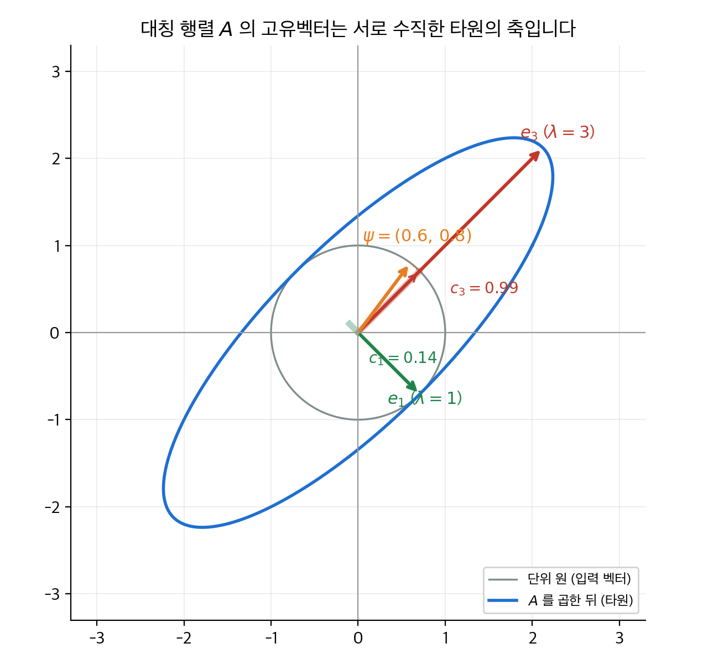
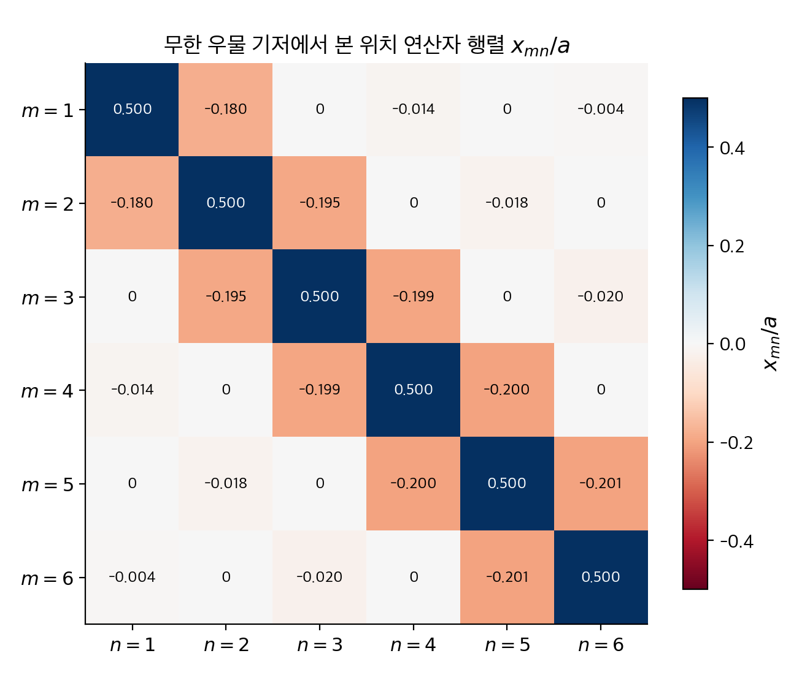
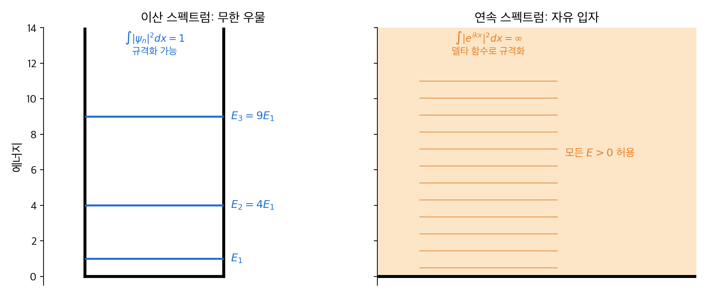
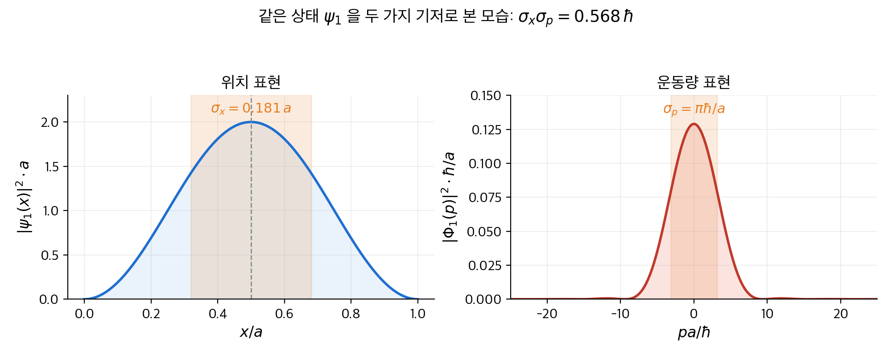
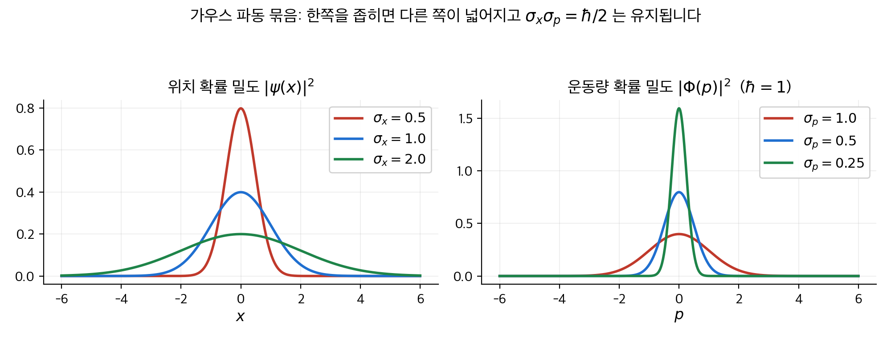

# 3. 형식 체계

1장과 2장은 파동 함수 $\Psi(x, t)$ 와 몇 가지 퍼텐셜 문제를 다뤘습니다.
그 과정에서 "에너지를 측정하면 $E_n$ 가운데 하나가 나오고, 확률은 $|c_n|^2$ 이다"라는 규칙을 썼습니다.
이 장은 그 규칙이 어디서 오는지를 선형대수의 언어로 정리합니다.
결론은 세 문장입니다. 상태는 **힐베르트 공간**의 벡터입니다. 관측량은 **에르미트 연산자**입니다. 측정값은 그 연산자의 **고유값**이고, 확률은 고유벡터 성분의 제곱입니다.
이 세 문장에서 위치·운동량 표현의 관계, 일반 불확정성 원리, 에너지-시간 불확정성이 모두 따라 나옵니다.

!!! info "원문과 자료"
    - 원문: Griffiths, *Introduction to Quantum Mechanics*, 1st ed. (1995), 3장 Formalism (3.1 Linear Algebra, 3.2 Function Spaces, 3.3 The Generalized Statistical Interpretation, 3.4 The Uncertainty Principle)
    - 함께 읽기: [1. 파동 함수](01-wave-function.md), [2. 시간에 무관한 슈뢰딩거 방정식](02-time-independent-schrodinger.md), [4. 3차원 양자역학](04-three-dimensions.md)
    - 수학 배경: [선형대수 5장 고유값과 고유벡터](../../math/linear-algebra/05-eigenvalues.md), [선형대수 3장 직교성](../../math/linear-algebra/03-orthogonality.md)
    - 예시의 수치는 모두 NumPy와 SciPy로 다시 계산해서 검증했습니다.

## 1. 선형대수 요약 (3.1절)

### 왜 선형대수인가

슈뢰딩거 방정식은 선형입니다. $\Psi_1$ 과 $\Psi_2$ 가 해이면 $c_1 \Psi_1 + c_2 \Psi_2$ 도 해입니다.
파동 함수는 벡터처럼 더하고 상수배할 수 있습니다. 벡터처럼 다룰 수 있는 대상의 이론이 선형대수입니다.
2장에서 푼 문제의 답이 모두 "고유 함수와 고유값"이었던 것도 우연이 아닙니다.
여기서는 양자역학에 필요한 최소한만 정리합니다. 증명과 자세한 내용은 [선형대수](../../math/linear-algebra/index.md) 섹션에 있습니다.

### 내적과 에르미트 행렬

복소 벡터 $\alpha = (a_1, \ldots, a_N)$, $\beta = (b_1, \ldots, b_N)$ 의 **내적**(inner product)은 다음과 같습니다.

$$
\langle \alpha | \beta \rangle = \sum_{i=1}^{N} a_i^* b_i
$$

첫 번째 인자에 켤레를 붙입니다. 그래야 $\langle \alpha | \alpha \rangle = \sum |a_i|^2 \ge 0$ 이 되어 길이를 정의할 수 있습니다.
행렬 $T$ 의 **에르미트 켤레**(Hermitian conjugate)는 전치하고 켤레를 취한 $T^\dagger = (\tilde{T})^*$ 입니다.
$T^\dagger = T$ 이면 **에르미트 행렬**(Hermitian matrix)이라고 합니다. 실수 행렬에서는 대칭 행렬과 같습니다.
에르미트 행렬은 내적 안에서 자리를 옮길 수 있습니다.

$$
\langle \alpha | T \beta \rangle = \langle T \alpha | \beta \rangle
$$

### 고유값과 대각화

$T \alpha = \lambda \alpha$ 를 만족하는 $\alpha \ne 0$ 을 **고유벡터**(eigenvector), $\lambda$ 를 **고유값**(eigenvalue)이라고 합니다.
에르미트 행렬의 고유값은 실수이고, 다른 고유값의 고유벡터는 서로 수직이며, 고유벡터들은 공간 전체를 펼칩니다.
이 세 성질이 양자역학에서 쓰는 전부입니다. 고유벡터를 새 기저로 잡으면 $T$ 는 대각 행렬이 됩니다. 이것이 **대각화**(diagonalization)입니다.

### 손계산 예: 2×2 실수 대칭 행렬

$A = \begin{pmatrix} 2 & 1 \\ 1 & 2 \end{pmatrix}$ 의 고유값은 $\det(A - \lambda I) = (2-\lambda)^2 - 1 = 0$ 에서 $\lambda = 1, 3$ 입니다.
고유벡터는 $(A - \lambda I)\alpha = 0$ 을 풀어 구합니다.

| 고유값 | 방정식 | 규격화한 고유벡터 |
| --- | --- | --- |
| $\lambda = 3$ | $-a_1 + a_2 = 0$ | $e_3 = \frac{1}{\sqrt 2}(1, 1)$ |
| $\lambda = 1$ | $a_1 + a_2 = 0$ | $e_1 = \frac{1}{\sqrt 2}(1, -1)$ |

$\langle e_1 | e_3 \rangle = \frac{1}{2}(1 - 1) = 0$ 이므로 서로 수직입니다.
이제 상태 벡터 $\psi = (0.6, 0.8)$ 을 고유벡터로 전개합니다. $\langle \psi | \psi \rangle = 0.36 + 0.64 = 1$ 이므로 규격화되어 있습니다.

$$
c_3 = \langle e_3 | \psi \rangle = \frac{0.6 + 0.8}{\sqrt 2} = 0.990, \qquad
c_1 = \langle e_1 | \psi \rangle = \frac{0.6 - 0.8}{\sqrt 2} = -0.141
$$

$|c_3|^2 = 0.98$, $|c_1|^2 = 0.02$ 이고 합은 1입니다.
이 숫자가 뒤에서 "측정 확률"이 됩니다. 3.3절에서 $A$ 를 관측량이라고 보면, 측정값 3이 나올 확률이 98 %, 1이 나올 확률이 2 %입니다.
기댓값은 두 가지 방법으로 같은 값이 나옵니다.

$$
\langle A \rangle = \sum_n |c_n|^2 \lambda_n = 0.98 \times 3 + 0.02 \times 1 = 2.96, \qquad
\langle \psi | A \psi \rangle = (0.6, 0.8) \cdot (2.0, 2.2) = 2.96
$$

<figure markdown>

<figcaption markdown>
<span class="fig-title"><b>Figure 1.</b> 대칭 행렬의 고유벡터와 상태 벡터의 분해</span>

단위 원 위의 벡터에 $A$ 를 곱하면 타원이 됩니다. 타원의 긴 축과 짧은 축이 고유벡터 $e_3$, $e_1$ 이고, 늘어난 배율이 고유값 3과 1입니다.
상태 $\psi = (0.6, 0.8)$ 을 두 축으로 분해한 성분 $c_3 = 0.99$, $c_1 = 0.14$ 의 제곱이 측정 확률입니다.
</figcaption>
</figure>

### 손계산 예: 복소 에르미트 행렬

$B = \begin{pmatrix} 1 & i \\ -i & 1 \end{pmatrix}$ 은 전치하면 $\begin{pmatrix} 1 & -i \\ i & 1 \end{pmatrix}$ 입니다. 켤레를 취하면 다시 $B$ 입니다. 그러므로 에르미트 행렬입니다.
특성 방정식은 $(1-\lambda)^2 - (i)(-i) = (1-\lambda)^2 - 1 = 0$ 이므로 $\lambda = 0, 2$ 입니다. 복소 행렬인데도 고유값은 실수입니다.
$\lambda = 2$ 의 고유벡터는 $-a_1 + i a_2 = 0$ 에서 $\frac{1}{\sqrt 2}(1, -i)$ 입니다. $\lambda = 0$ 의 고유벡터는 $\frac{1}{\sqrt 2}(1, i)$ 입니다.
두 벡터의 내적은 켤레를 잊지 않고 계산해야 0이 나옵니다.

$$
\frac{1}{2}\left[ 1^* \cdot 1 + (-i)^* \cdot i \right] = \frac{1}{2}\left[ 1 + i \cdot i \right] = \frac{1}{2}(1 - 1) = 0
$$

켤레 없이 $1 \cdot 1 + (-i)(i) = 2$ 로 계산하면 수직이 아닌 것처럼 보입니다. 이것이 내적에 켤레가 필요한 이유입니다.
4장에서 이 행렬은 스핀의 $y$ 성분 $\sigma_y$ 에 단위 행렬을 더한 꼴로 다시 나옵니다.

### 손계산 예: 3×3 행렬

$C = \begin{pmatrix} 2 & 1 & 0 \\ 1 & 2 & 1 \\ 0 & 1 & 2 \end{pmatrix}$ 의 고유값은 $2 - \sqrt 2 = 0.586$, $2$, $2 + \sqrt 2 = 3.414$ 입니다.
고유벡터는 차례로 $\frac{1}{2}(1, -\sqrt 2, 1)$, $\frac{1}{\sqrt 2}(1, 0, -1)$, $\frac{1}{2}(1, \sqrt 2, 1)$ 입니다.
상태 $\psi = \frac{1}{\sqrt 3}(1, 1, 1)$ 을 전개하면 가운데 고유벡터와의 내적은 $(1 + 0 - 1)/\sqrt 6 = 0$ 입니다.

| 고유값 | $c_n$ | $|c_n|^2$ |
| --- | --- | --- |
| $3.414$ | $(2 + \sqrt 2)/(2\sqrt 3) = 0.986$ | $0.971$ |
| $2$ | $0$ | $0$ |
| $0.586$ | $(2 - \sqrt 2)/(2\sqrt 3) = 0.169$ | $0.029$ |

기댓값은 $0.971 \times 3.414 + 0.029 \times 0.586 = 3.333$ 입니다.
직접 계산하면 $\langle \psi | C \psi \rangle$ 은 $C$ 의 모든 성분의 합을 3으로 나눈 $10/3$ 이므로 일치합니다.
측정값 2는 절대 나오지 않습니다. 상태가 그 고유벡터와 수직이기 때문입니다.

```python
import numpy as np
C = np.array([[2., 1, 0], [1, 2, 1], [0, 1, 2]])
lam, V = np.linalg.eigh(C)            # 에르미트 행렬 전용 대각화
psi = np.ones(3) / np.sqrt(3)
c = V.T @ psi                         # 각 고유벡터 방향 성분
print(lam.round(3), (c**2).round(3))  # [0.586 2. 3.414] [0.029 0. 0.971]
print((c**2 * lam).sum(), psi @ C @ psi)  # 3.333 3.333
```

### 에르미트가 아니면 어떻게 되는가

$D = \begin{pmatrix} 0 & 1 \\ -1 & 0 \end{pmatrix}$ 은 $D^\dagger = -D$ 입니다. 특성 방정식 $\lambda^2 + 1 = 0$ 의 해는 $\lambda = \pm i$ 입니다.
측정값이 허수일 수는 없습니다. 관측량을 나타내는 연산자는 반드시 에르미트여야 합니다.
이것이 3.2절의 출발점입니다.

## 2. 함수 공간 (3.2절)

### 힐베르트 공간

유한 차원 벡터의 성분 $(a_1, \ldots, a_N)$ 을 함수값 $f(x)$ 로 바꾸면 함수도 벡터입니다. 첨자 $i$ 가 연속 변수 $x$ 로 바뀌었을 뿐입니다.
내적은 합이 적분으로 바뀝니다.

$$
\langle f | g \rangle = \int_{-\infty}^{\infty} f(x)^* g(x) \, dx
$$

이 적분이 수렴하려면 $\int |f|^2 dx < \infty$ 여야 합니다. 이런 함수를 **제곱 적분 가능**(square-integrable)하다고 하고, 그 모임을 $L^2$ 라고 씁니다.
$L^2$ 는 내적이 정의된 완비 벡터 공간이므로 **힐베르트 공간**(Hilbert space)입니다.
1장의 규격화 조건 $\int |\Psi|^2 dx = 1$ 은 "파동 함수는 힐베르트 공간의 단위 벡터다"라는 말입니다.

### 연산자는 행렬이다

기저 함수 $\{e_n(x)\}$ 를 정하면 연산자 $T$ 는 행렬 성분 $T_{mn} = \langle e_m | T e_n \rangle$ 으로 표현됩니다.
2장의 무한 우물 고유 함수 $\psi_n(x) = \sqrt{2/a}\, \sin(n\pi x / a)$ 를 기저로 잡아 봅니다.
해밀토니안은 $H \psi_n = E_n \psi_n$ 이므로 $H_{mn} = E_n \delta_{mn}$ 이고, 대각 행렬입니다.

$$
H = E_1 \begin{pmatrix} 1 & 0 & 0 & \cdots \\ 0 & 4 & 0 & \cdots \\ 0 & 0 & 9 & \cdots \\ \vdots & \vdots & \vdots & \ddots \end{pmatrix}
$$

위치 연산자 $x$ 는 이 기저에서 대각 행렬이 아닙니다. 성분을 적분으로 구하면 다음과 같습니다.

$$
x_{mn} = \frac{2}{a} \int_0^a x \sin\frac{m \pi x}{a} \sin\frac{n \pi x}{a} \, dx =
\begin{cases}
a/2 & (m = n) \\
-\dfrac{8 a\, m n}{\pi^2 (m^2 - n^2)^2} & (m + n \text{ 홀수}) \\
0 & (m + n \text{ 짝수}, m \ne n)
\end{cases}
$$

$x_{12} = -16a/(9\pi^2) = -0.180a$, $x_{23} = -48a/(25\pi^2) = -0.195a$, $x_{13} = 0$ 입니다.
앞 3개 상태만 남긴 3×3 행렬은 다음과 같습니다.

$$
x \approx a \begin{pmatrix} 0.500 & -0.180 & 0 \\ -0.180 & 0.500 & -0.195 \\ 0 & -0.195 & 0.500 \end{pmatrix}
$$

이 행렬에서 세 가지를 읽을 수 있습니다.
대각 성분 $a/2$ 는 모든 정상 상태에서 $\langle x \rangle$ 이 우물 한가운데라는 뜻입니다.
$x_{13} = 0$ 은 $\psi_1$ 과 $\psi_3$ 이 둘 다 우물 중앙에 대해 대칭이어서 $x$ 가 두 상태를 연결하지 못한다는 뜻입니다.
$x_{12} \ne 0$ 은 $\psi_1 + \psi_2$ 같은 중첩에서 $\langle x \rangle$ 이 시간에 따라 흔들린다는 뜻입니다. 이 값은 9장에서 전이율을 계산할 때 다시 쓰입니다.

<figure markdown>

<figcaption markdown>
<span class="fig-title"><b>Figure 2.</b> 무한 우물 기저에서 위치 연산자의 행렬 성분</span>

$x_{mn}/a$ 를 $m, n = 1, \ldots, 6$ 까지 수치 적분으로 구했습니다. 대각 성분은 모두 $0.5$ 이고, $m + n$ 이 짝수인 비대각 성분은 정확히 0입니다.
바로 이웃한 상태 사이의 성분이 가장 크고, 멀어질수록 빠르게 줄어듭니다.
</figcaption>
</figure>

```python
import numpy as np
from scipy.integrate import quad
a = 1.0
def x_mn(m, n):
    f = lambda x: 2/a * x * np.sin(m*np.pi*x/a) * np.sin(n*np.pi*x/a)
    return quad(f, 0, a)[0]
X = np.array([[x_mn(m, n) for n in range(1, 4)] for m in range(1, 4)])
print(X.round(3))
# [[ 0.5   -0.18   0.   ]
#  [-0.18   0.5   -0.195]
#  [ 0.    -0.195  0.5  ]]
```

### 에르미트 연산자

연산자 $Q$ 가 모든 $f, g \in L^2$ 에 대해 $\langle f | Q g \rangle = \langle Q f | g \rangle$ 를 만족하면 **에르미트 연산자**(Hermitian operator)입니다.
관측량의 기댓값 $\langle Q \rangle = \langle \Psi | Q \Psi \rangle$ 은 실수여야 하므로 $\langle \Psi | Q \Psi \rangle = \langle Q \Psi | \Psi \rangle$ 이어야 합니다.
관측량은 에르미트 연산자로 나타냅니다.

위치 $x$ 는 실수를 곱하는 연산이므로 자명하게 에르미트입니다. 운동량 $p = -i\hbar\, d/dx$ 는 부분 적분으로 확인합니다.

$$
\langle f | p g \rangle = \int f^* \left( -i\hbar \frac{dg}{dx} \right) dx
= -i\hbar \Big[ f^* g \Big]_{-\infty}^{\infty} + i\hbar \int \frac{df^*}{dx} g \, dx
$$

$f, g \in L^2$ 이면 무한대에서 0이므로 경계항이 사라집니다. 남은 항은 $\int \left( -i\hbar \frac{df}{dx} \right)^* g \, dx = \langle p f | g \rangle$ 입니다.
$-i$ 의 켤레가 $+i$ 이고, 부분 적분에서 나온 부호 $-$ 와 곱해져 $-i$ 로 돌아오기 때문입니다.
반면 $D = d/dx$ 만 쓰면 $\langle f | D g \rangle = -\langle D f | g \rangle$ 이 되어 에르미트가 아닙니다. 허수 단위 $i$ 가 부호를 맞춰 주는 역할을 합니다.

| 연산자 | $\langle f | Q g \rangle$ 과 $\langle Q f | g \rangle$ 의 관계 | 에르미트인가 |
| --- | --- | --- |
| $x$ | 같음 | 예 |
| $d/dx$ | 부호 반대 | 아니오 |
| $-i\hbar\, d/dx$ | 같음 | 예 |
| $d^2/dx^2$ | 같음 (부분 적분 두 번) | 예 |
| $H = -\frac{\hbar^2}{2m} \frac{d^2}{dx^2} + V(x)$ | 같음 | 예 |

### 확정 상태와 고유 함수

관측량 $Q$ 를 측정할 때마다 항상 같은 값 $q$ 가 나오는 상태를 **확정 상태**(determinate state)라고 합니다.
이 상태에서는 분산 $\sigma_Q^2 = \langle (Q - q)^2 \rangle = \langle (Q - q)\Psi | (Q - q)\Psi \rangle = 0$ 입니다.
벡터의 길이가 0이면 벡터 자체가 0이므로 $Q \Psi = q \Psi$ 입니다. 확정 상태는 $Q$ 의 **고유 함수**(eigenfunction)이고, 측정값은 고유값입니다.
2장의 정상 상태가 바로 해밀토니안의 확정 상태입니다.

에르미트 연산자의 고유 함수는 유한 차원과 같은 세 성질을 가집니다.
고유값은 실수입니다. 서로 다른 고유값의 고유 함수는 직교합니다. 고유 함수들은 완비 집합이어서 임의의 $f \in L^2$ 를 전개할 수 있습니다.
무한 우물의 $\psi_n$ 이 완비 직교 집합이라는 것은 2장에서 푸리에 급수로 확인했습니다.

### 이산 스펙트럼과 연속 스펙트럼

무한 우물이나 조화 진동자처럼 고유값이 띄엄띄엄 있으면 **이산 스펙트럼**(discrete spectrum)입니다. 고유 함수는 규격화할 수 있고 위의 성질이 그대로 성립합니다.
자유 입자처럼 고유값이 연속 구간을 채우면 **연속 스펙트럼**(continuous spectrum)입니다. 이때 고유 함수는 $L^2$ 에 들어가지 않습니다.

운동량 연산자의 고유 방정식 $-i\hbar\, df/dx = p f$ 의 해는 $f_p(x) = A e^{ipx/\hbar}$ 입니다. $|f_p|^2 = |A|^2$ 이므로 적분이 발산합니다.
대신 두 고유 함수의 내적을 계산하면 다음이 나옵니다.

$$
\langle f_{p'} | f_p \rangle = |A|^2 \int e^{i(p - p')x/\hbar} dx = |A|^2 \, 2\pi\hbar\, \delta(p - p')
$$

$A = 1/\sqrt{2\pi\hbar}$ 로 잡으면 $\langle f_{p'} | f_p \rangle = \delta(p - p')$ 입니다. 크로네커 델타 $\delta_{mn}$ 자리에 디랙 델타가 들어간 셈입니다.
이것을 **디랙 규격화**(Dirac normalization)라고 합니다. 위치의 고유 함수 $g_y(x) = \delta(x - y)$ 도 마찬가지로 $\langle g_{y'} | g_y \rangle = \delta(y - y')$ 입니다.
전개식에서는 합이 적분으로 바뀝니다.

$$
f(x) = \int c(p) f_p(x) \, dp, \qquad c(p) = \langle f_p | f \rangle
$$

<figure markdown>

<figcaption markdown>
<span class="fig-title"><b>Figure 3.</b> 이산 스펙트럼과 연속 스펙트럼</span>

무한 우물의 에너지는 $E_1, 4E_1, 9E_1, \ldots$ 로 띄엄띄엄 있고 고유 함수는 규격화됩니다.
자유 입자의 에너지는 $E > 0$ 전체를 채우고 고유 함수 $e^{ikx}$ 는 제곱 적분이 발산하므로 델타 함수로 규격화합니다.
</figcaption>
</figure>

### 비유: 좌표계를 돌려 보기

평면 위의 화살표 하나는 좌표계를 어떻게 잡느냐에 따라 성분이 달라집니다. 화살표 자체는 같습니다.
양자 상태도 마찬가지입니다. 상태 $|\Psi\rangle$ 은 하나입니다. 위치 고유 함수 기저로 보면 $\Psi(x)$ 입니다. 운동량 고유 함수 기저로 보면 $\Phi(p)$ 입니다.
에너지 고유 함수 기저로 보면 성분이 $c_n$ 입니다. 세 가지는 같은 벡터의 다른 좌표 표현입니다.
비유의 한계는 차원입니다. 평면은 2차원이지만 힐베르트 공간은 무한 차원이고, 연속 스펙트럼에서는 좌표축이 연속체입니다.

## 3. 일반화된 통계적 해석 (3.3절)

### 세 가지 규칙

지금까지의 내용을 합치면 양자역학의 측정 규칙이 됩니다.

1. 관측량 $Q$ 를 측정하면 에르미트 연산자 $\hat Q$ 의 고유값 가운데 하나가 나옵니다.
2. 상태 $\Psi = \sum_n c_n f_n$ 에서 고유값 $q_n$ 이 나올 확률은 $|c_n|^2 = |\langle f_n | \Psi \rangle|^2$ 입니다. 연속 스펙트럼이면 $|c(q)|^2 dq$ 가 $q$ 와 $q + dq$ 사이에서 측정될 확률입니다.
3. 측정 직후 상태는 측정된 고유값의 고유 함수 $f_n$ 으로 **붕괴**(collapse)합니다.

규격화 $\langle \Psi | \Psi \rangle = \sum_n |c_n|^2 = 1$ 은 확률의 합이 1이라는 뜻입니다.
기댓값은 $\langle Q \rangle = \sum_n q_n |c_n|^2$ 이고, 이것은 $\langle \Psi | \hat Q \Psi \rangle$ 과 같습니다. 3.1절의 2×2 예에서 2.96이 두 방법으로 똑같이 나온 이유입니다.

### 수치 예: 무한 우물 바닥 상태의 운동량 분포

바닥 상태 $\psi_1(x) = \sqrt{2/a}\, \sin(\pi x / a)$ 를 운동량 고유 함수로 전개하면 **운동량 공간 파동 함수**(momentum-space wave function)가 나옵니다.

$$
\Phi(p) = \langle f_p | \psi_1 \rangle = \frac{1}{\sqrt{2\pi\hbar}} \int_0^a \sqrt{\frac{2}{a}} \sin\frac{\pi x}{a}\, e^{-ipx/\hbar} \, dx
$$

적분을 끝까지 하면 $u = pa/\hbar$ 로 두었을 때 다음과 같습니다.

$$
|\Phi(p)|^2 = \frac{4\pi a}{\hbar}\, \frac{\cos^2(u/2)}{(\pi^2 - u^2)^2}
$$

이 식으로 확인할 수 있는 숫자가 세 개 있습니다.

| 양 | 계산 | 값 |
| --- | --- | --- |
| $\int \lvert\Phi\rvert^2 dp$ | 수치 적분 | $1.000$ |
| $\langle p^2 \rangle$ | $\int p^2 \lvert\Phi\rvert^2 dp$ | $9.87\,(\hbar/a)^2 = \pi^2 \hbar^2 / a^2$ |
| $\sigma_x \sigma_p$ | $\sigma_x = 0.181a$, $\sigma_p = \pi\hbar/a$ | $0.568\,\hbar > \hbar/2$ |

$\langle p^2 \rangle = \pi^2\hbar^2/a^2$ 은 $2m E_1$ 과 같습니다. 운동량 표현으로 계산한 운동 에너지가 2장의 $E_1$ 과 일치합니다.
$u = \pm\pi$ 에서 분모가 0이 되지만 분자 $\cos^2(\pm\pi/2) = 0$ 도 0이어서 유한한 값 $1/(4\pi)$ 로 수렴합니다.

<figure markdown>

<figcaption markdown>
<span class="fig-title"><b>Figure 4.</b> 무한 우물 바닥 상태의 위치 표현과 운동량 표현</span>

왼쪽은 $|\psi_1(x)|^2$, 오른쪽은 같은 상태를 운동량 기저에서 본 $|\Phi_1(p)|^2$ 입니다.
운동량 분포는 $p = 0$ 을 중심으로 폭 $\pi\hbar/a$ 정도이고, 두 폭의 곱은 $0.568\hbar$ 로 하한 $\hbar/2$ 보다 큽니다.
</figcaption>
</figure>

```python
import numpy as np
from scipy.integrate import quad
Phi2 = lambda u: 4*np.pi*np.cos(u/2)**2 / (np.pi**2 - u**2)**2   # u = p a / hbar
norm = quad(Phi2, -200, 200, limit=2000)[0]                        # 1.000
p2 = quad(lambda u: u**2 * Phi2(u), -400, 400, limit=4000)[0]      # 9.84 ≈ pi^2
sigma_x = np.sqrt(1/12 - 1/(2*np.pi**2))                           # 0.181 (a 단위)
print(norm, p2, sigma_x * np.sqrt(p2))                             # 0.568 (hbar 단위)
```

### 위치 표현과 운동량 표현의 관계

일반적으로 $\Phi(p)$ 와 $\Psi(x)$ 는 푸리에 변환 쌍입니다.

$$
\Phi(p, t) = \frac{1}{\sqrt{2\pi\hbar}} \int \Psi(x, t)\, e^{-ipx/\hbar} \, dx, \qquad
\Psi(x, t) = \frac{1}{\sqrt{2\pi\hbar}} \int \Phi(p, t)\, e^{ipx/\hbar} \, dp
$$

위치 표현에서 $p = -i\hbar\, \partial/\partial x$ 였듯이, 운동량 표현에서는 $x = i\hbar\, \partial/\partial p$ 입니다.
어느 표현을 쓰든 물리적 예측은 같습니다. 위치가 나올 확률을 알고 싶으면 $|\Psi|^2$ 을, 운동량이면 $|\Phi|^2$ 을 보면 됩니다.

## 4. 불확정성 원리 (3.4절)

### 일반 불확정성 원리

1장에서 증명 없이 쓴 $\sigma_x \sigma_p \ge \hbar/2$ 는 임의의 두 관측량으로 일반화됩니다.
$f = (\hat A - \langle A \rangle)\Psi$, $g = (\hat B - \langle B \rangle)\Psi$ 로 두면 $\sigma_A^2 = \langle f | f \rangle$, $\sigma_B^2 = \langle g | g \rangle$ 입니다.
슈바르츠 부등식 $\langle f | f \rangle \langle g | g \rangle \ge |\langle f | g \rangle|^2$ 과 $|z|^2 \ge [\mathrm{Im}\, z]^2 = \left[ \frac{1}{2i}(z - z^*) \right]^2$ 을 쓰면 다음이 나옵니다.

$$
\sigma_A^2 \sigma_B^2 \ge \left( \frac{1}{2i} \langle [\hat A, \hat B] \rangle \right)^2
$$

여기서 $[\hat A, \hat B] = \hat A \hat B - \hat B \hat A$ 는 **교환자**(commutator)입니다.
두 연산자가 교환하지 않으면 두 양을 동시에 확정할 수 없습니다. 교환하면 공통 고유 함수가 있어 동시에 확정할 수 있습니다.

### 손계산 예: $[x, p] = i\hbar$

교환자는 항상 시험 함수에 작용시켜 계산합니다. 연산자만 보고 계산하면 곱의 미분 항을 놓치기 쉽습니다.

$$
[x, p] f = x \left( -i\hbar \frac{df}{dx} \right) - \left( -i\hbar \frac{d}{dx} \right)(x f)
= -i\hbar\, x f' + i\hbar (f + x f') = i\hbar f
$$

$f = x^2 e^{-x}$ 로 확인해 봅니다. $f' = (2x - x^2) e^{-x}$ 입니다.
$x f' = (2x^2 - x^3)e^{-x}$ 이고 $(xf)' = (3x^2 - x^3) e^{-x}$ 이므로 둘의 차는 $x^2 e^{-x} = f$ 입니다.
어떤 $f$ 를 넣어도 $[x, p] f = i\hbar f$ 이므로 $[x, p] = i\hbar$ 라고 씁니다.
일반 불확정성 원리에 넣으면 $\sigma_x^2 \sigma_p^2 \ge \left( \frac{1}{2i} i\hbar \right)^2 = \left( \frac{\hbar}{2} \right)^2$ 이고, 이것이 하이젠베르크의 부등식입니다.

| 두 관측량 | 교환자 | 동시 확정 가능한가 |
| --- | --- | --- |
| $x$, $p$ | $i\hbar$ | 아니오 |
| $x$, $H$ (자유 입자) | $i\hbar p / m$ | 아니오 |
| $p$, $H$ (자유 입자) | $0$ | 예 |
| $H$, $p$ (우물 안) | $0$ 이 아님 ($V$ 가 상수 아님) | 아니오 |
| $L^2$, $L_z$ (4장) | $0$ | 예 |

### 최소 불확정성 파동 묶음

슈바르츠 부등식이 등호가 되려면 $g = c f$ 여야 합니다. $\mathrm{Re}\langle f | g \rangle = 0$ 이려면 $c = ia$ 로 순허수여야 합니다.
$x$ 와 $p$ 에 적용하면 미분 방정식 $(-i\hbar\, d/dx - \langle p \rangle)\Psi = ia(x - \langle x \rangle)\Psi$ 가 됩니다. 해는 가우스 함수입니다.

$$
\Psi(x) = A\, e^{-a(x - \langle x \rangle)^2 / 2\hbar}\, e^{i \langle p \rangle x / \hbar}
$$

폭 $\sigma_x$ 인 가우스 파동 묶음의 운동량 분포도 가우스이고 폭은 정확히 $\sigma_p = \hbar / (2\sigma_x)$ 입니다.
한쪽을 좁히면 다른 쪽이 그만큼 넓어집니다.

<figure markdown>

<figcaption markdown>
<span class="fig-title"><b>Figure 5.</b> 가우스 파동 묶음의 위치 폭과 운동량 폭</span>

$\sigma_x = 0.5, 1, 2$ 인 세 가우스 파동 묶음과 각각의 운동량 분포입니다($\hbar = 1$).
위치 폭을 4배 늘리면 운동량 폭은 4배 줄어들고, 곱은 항상 $\hbar / 2$ 입니다. 무한 우물의 바닥 상태는 가우스가 아니어서 $0.568\hbar$ 로 이 값보다 큽니다.
</figcaption>
</figure>

### 에너지-시간 불확정성

시간은 연산자가 아니므로 $\sigma_t$ 를 그냥 정의할 수는 없습니다. 대신 기댓값의 시간 변화에서 출발합니다.
슈뢰딩거 방정식 $i\hbar\, \partial\Psi/\partial t = H\Psi$ 를 쓰면 시간에 직접 의존하지 않는 임의의 관측량 $Q$ 에 대해 다음이 성립합니다.

$$
\frac{d}{dt} \langle Q \rangle = \frac{i}{\hbar} \langle [H, Q] \rangle
$$

이 식 하나로 많은 것이 따라옵니다. $Q = H$ 이면 에너지가 보존됩니다. $Q = x$ 이면 $d\langle x \rangle/dt = \langle p \rangle / m$ 입니다. $Q = p$ 이면 $d\langle p \rangle/dt = -\langle dV/dx \rangle$ 입니다. 1장의 에렌페스트 정리입니다.
일반 불확정성 원리에 $A = H$, $B = Q$ 를 넣고 위 식으로 교환자를 바꾸면 다음이 나옵니다.

$$
\sigma_H \, \sigma_Q \ge \frac{\hbar}{2} \left| \frac{d\langle Q \rangle}{dt} \right|
\quad \Longrightarrow \quad
\Delta E \, \Delta t \ge \frac{\hbar}{2}, \qquad \Delta t \equiv \frac{\sigma_Q}{|d\langle Q \rangle / dt|}
$$

$\Delta t$ 는 "$\langle Q \rangle$ 이 표준 편차 하나만큼 바뀌는 데 걸리는 시간"입니다. 에너지가 확정된 정상 상태에서는 $\sigma_H = 0$ 이므로 $\Delta t = \infty$ 이고, 실제로 어떤 기댓값도 변하지 않습니다.

### 수치 예: 두 상태 중첩의 $\Delta E \, \Delta t$

폭 $a = 1\,\mathrm{nm}$ 인 무한 우물에서 전자가 $\Psi = \frac{1}{\sqrt 2}(\psi_1 e^{-iE_1 t/\hbar} + \psi_2 e^{-iE_2 t/\hbar})$ 에 있다고 합니다.
에너지는 $E_1$ 또는 $E_2 = 4E_1$ 이 반반 확률로 나오므로 $\sigma_H = (E_2 - E_1)/2 = 1.5 E_1$ 입니다.
위치 기댓값은 3.2절의 행렬 성분 $x_{12}$ 로 바로 씁니다.

$$
\langle x \rangle(t) = \frac{a}{2} + x_{12} \cos\omega t, \qquad \omega = \frac{E_2 - E_1}{\hbar} = \frac{3E_1}{\hbar}, \qquad x_{12} = -0.180a
$$

$|d\langle x\rangle/dt|$ 가 최대인 순간($\omega t = \pi/2$)에 $\sigma_x = 0.227a$ 이고 $|d\langle x\rangle/dt| = \omega |x_{12}|$ 입니다.
따라서 $\Delta t = 0.227a / (0.180a\,\omega) = 1.26/\omega$ 이고

$$
\Delta E \, \Delta t = \frac{3E_1}{2} \cdot \frac{1.26\,\hbar}{3E_1} = 0.63\,\hbar \ge 0.5\,\hbar
$$

부등식이 성립합니다. 실제 단위를 넣으면 다음과 같습니다. $\hbar^2/m_e = 0.0762\,\mathrm{eV\,nm^2}$ 을 씁니다.

| 양 | 값 |
| --- | --- |
| $E_1 = \pi^2 \hbar^2 / (2 m_e a^2)$ | $0.376\,\mathrm{eV}$ |
| $E_2 - E_1 = 3E_1$ | $1.128\,\mathrm{eV}$ |
| 진동 주기 $2\pi\hbar / (E_2 - E_1)$ | $3.67\,\mathrm{fs}$ |
| $\Delta E = \sigma_H$ | $0.564\,\mathrm{eV}$ |
| $\Delta t$ | $0.74\,\mathrm{fs}$ |

전자가 우물 안에서 왼쪽 오른쪽으로 한 번 왕복하는 데 약 3.7 fs 가 걸립니다. 그 위치가 눈에 띄게 바뀌는 시간 척도가 0.7 fs 정도입니다.
에너지 분산이 클수록 상태가 빨리 변합니다. 9장의 자발 방출에서는 이 관계를 거꾸로 씁니다. 들뜬 상태의 수명 $\tau$ 에서 스펙트럼 선의 자연 폭 $\Delta E \approx \hbar / \tau$ 를 구합니다.

### 비유와 그 한계

$\Delta E \, \Delta t$ 는 음악의 음정과 비슷합니다. 아주 짧게 친 음은 진동수를 정확히 잴 수 없습니다. 진동수를 정확히 재려면 오래 울려야 합니다.
파동의 진동수 폭과 지속 시간의 곱이 1 정도라는 것은 고전 파동에서도 성립하는 푸리에 변환의 성질입니다.
양자역학이 더하는 것은 $E = \hbar\omega$ 라는 관계뿐입니다. 진동수의 폭이 곧 에너지의 폭입니다.
한계는 $\Delta t$ 의 뜻입니다. $\Delta t$ 는 측정에 걸린 시간이 아니라 계의 상태가 유의미하게 변하는 데 걸리는 시간입니다.

## 5. 정리

| 선형대수 (유한 차원) | 양자역학 (힐베르트 공간) |
| --- | --- |
| 벡터 $\alpha$ | 상태 $\Psi(x)$ 또는 $\lvert\Psi\rangle$ |
| 내적 $\sum a_i^* b_i$ | $\int f^* g \, dx$ |
| 에르미트 행렬 | 관측량 연산자 ($x$, $p$, $H$) |
| 고유값 | 측정 가능한 값 |
| 고유벡터 성분의 제곱 $\lvert c_n\rvert^2$ | 측정 확률 |
| 기저 변환 | 위치 표현 ↔ 운동량 표현 (푸리에 변환) |
| 교환하는 행렬은 동시 대각화 가능 | 교환하는 관측량은 동시 확정 가능 |

이 대응표가 양자역학의 뼈대입니다. 4장은 이 뼈대 위에서 각운동량과 스핀을 세웁니다.
특히 스핀은 처음부터 2×2 행렬로만 기술되므로, 이 장의 2×2 손계산 예가 그대로 물리가 됩니다.
