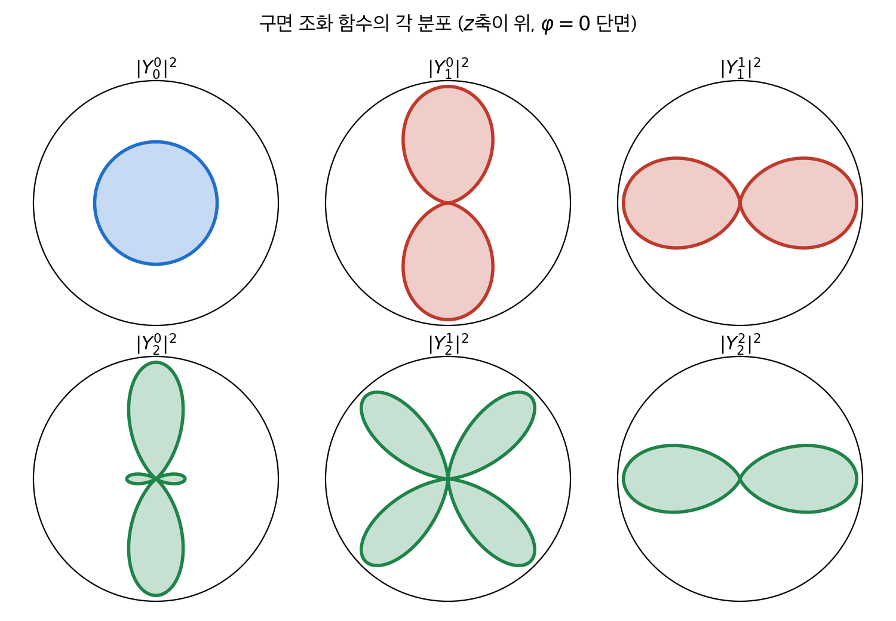
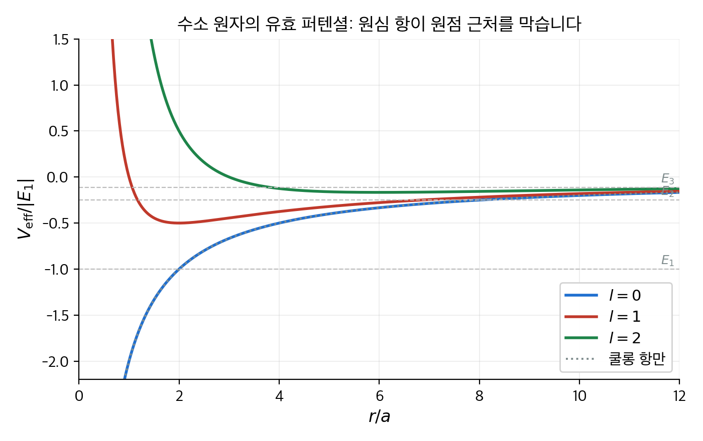
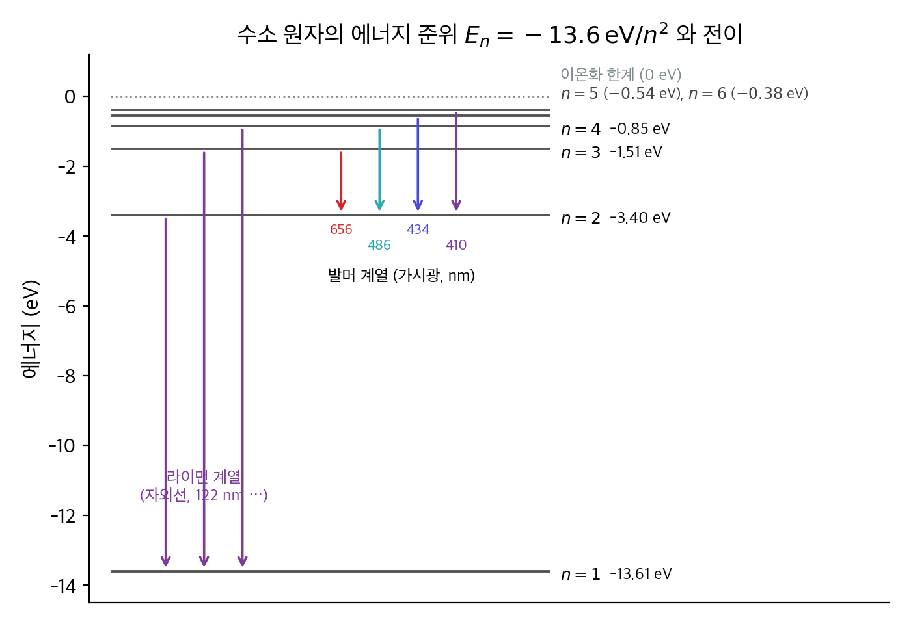
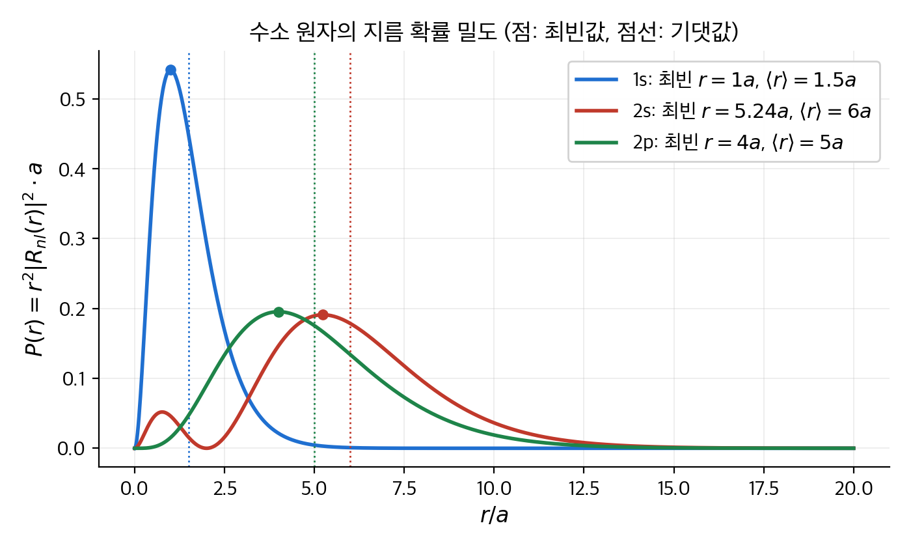
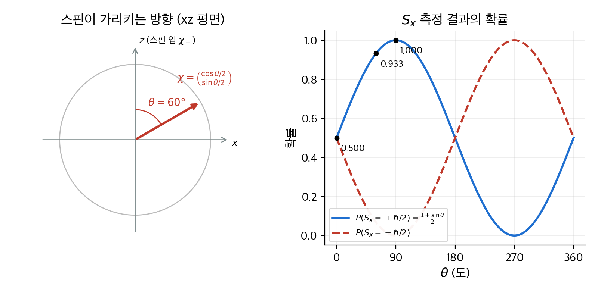
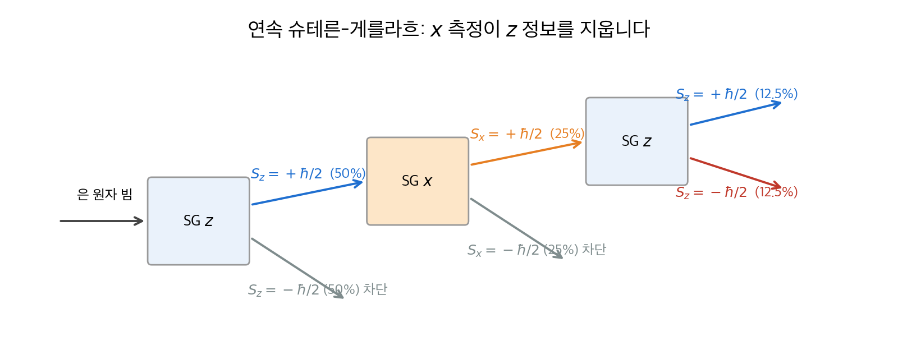
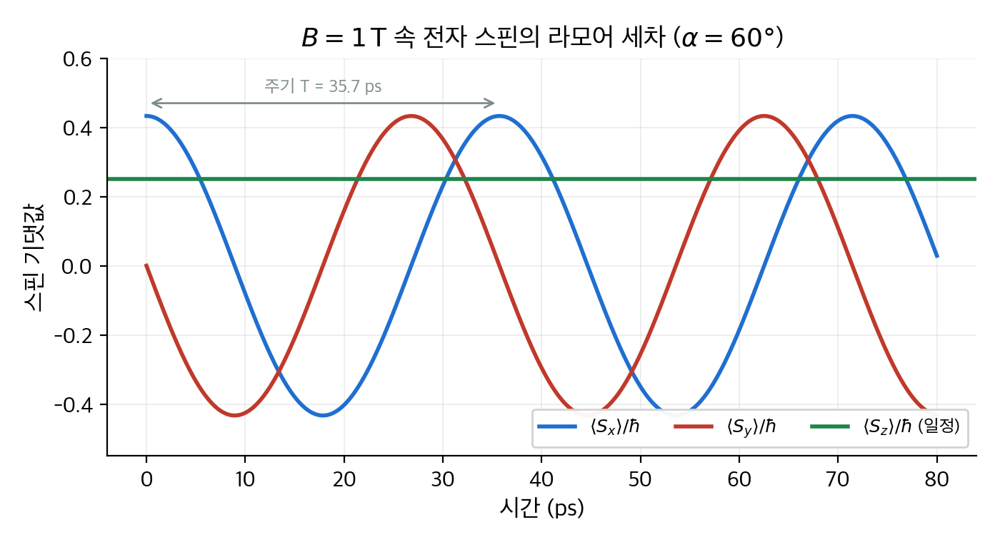

# 4. 3차원 양자역학

앞의 세 장은 입자를 한 직선 위에 두었습니다. 이 장은 슈뢰딩거 방정식을 실제 공간인 3차원으로 가져갑니다.
퍼텐셜이 거리 $r$ 에만 의존하면 방정식은 각 부분과 지름 부분으로 갈라집니다. 각 부분의 해는 **구면 조화 함수**이고, 어떤 퍼텐셜이든 같습니다.
지름 부분에 쿨롱 퍼텐셜을 넣으면 수소 원자의 에너지 준위 $E_n = -13.6\,\mathrm{eV}/n^2$ 이 나옵니다.
뒤이어 각운동량을 교환 관계만으로 다루는 방법을 다룹니다. 그 결과는 고전역학에 대응물이 없는 **스핀**까지 설명합니다.
결론은 세 가지입니다. 각운동량의 크기와 한 성분은 $\hbar$ 단위로 양자화됩니다. 수소 원자의 에너지는 $n$ 에만 의존하고 $n^2$ 겹 축퇴합니다. 스핀 $1/2$ 은 2×2 행렬로 모든 계산이 끝납니다.

!!! info "원문과 자료"
    - 원문: Griffiths, *Introduction to Quantum Mechanics*, 1st ed. (1995), 4장 Quantum Mechanics in Three Dimensions (4.1 Schrödinger Equations in Spherical Coordinates, 4.2 The Hydrogen Atom, 4.3 Angular Momentum, 4.4 Spin)
    - 함께 읽기: [2. 시간에 무관한 슈뢰딩거 방정식](02-time-independent-schrodinger.md), [3. 형식 체계](03-formalism.md), [5. 동일 입자](05-identical-particles.md), [6. 시간에 무관한 섭동 이론](06-time-independent-perturbation.md)
    - 고유값 문제의 수학은 [선형대수 5장](../../math/linear-algebra/05-eigenvalues.md)에 있습니다.
    - 예시의 수치는 모두 NumPy와 SciPy로 다시 계산해서 검증했습니다.

## 1. 구면 좌표의 슈뢰딩거 방정식 (4.1절)

### 3차원으로 가는 규칙

1차원에서 운동량은 $p = -i\hbar\, \partial/\partial x$ 였습니다. 3차원에서는 세 성분을 한꺼번에 $\mathbf{p} = -i\hbar \nabla$ 로 씁니다.
그러면 운동 에너지 $p^2/2m$ 은 $-(\hbar^2/2m)\nabla^2$ 이 되고, 시간에 무관한 슈뢰딩거 방정식은 다음과 같습니다.

$$
-\frac{\hbar^2}{2m} \nabla^2 \psi + V \psi = E \psi
$$

규격화 조건은 $\int |\psi|^2 \, d^3\mathbf{r} = 1$ 입니다. 1차원과 다른 점은 라플라시안 $\nabla^2$ 뿐입니다.

### 변수 분리

퍼텐셜이 원점에서의 거리에만 의존하면, 즉 $V = V(r)$ 이면 구면 좌표 $(r, \theta, \phi)$ 가 편합니다.
해를 $\psi(r, \theta, \phi) = R(r)\, Y(\theta, \phi)$ 로 놓고 대입합니다. $RY$ 로 나누면 $r$ 에만 의존하는 묶음과 각에만 의존하는 묶음이 갈라집니다.
두 묶음의 합이 0이므로 각각은 상수여야 합니다. 그 상수를 $l(l+1)$ 로 쓰면 다음 두 방정식이 나옵니다.

$$
\frac{1}{R}\frac{d}{dr}\!\left(r^2 \frac{dR}{dr}\right) - \frac{2mr^2}{\hbar^2}\,[V(r) - E] = l(l+1)
$$

$$
\frac{1}{Y}\left[\frac{1}{\sin\theta}\frac{\partial}{\partial\theta}\!\left(\sin\theta\,\frac{\partial Y}{\partial\theta}\right) + \frac{1}{\sin^2\theta}\frac{\partial^2 Y}{\partial\phi^2}\right] = -l(l+1)
$$

상수를 $l(l+1)$ 이라는 모양으로 쓴 이유는 나중에 $l$ 이 0, 1, 2, … 의 정수가 된다는 결과를 미리 반영했기 때문입니다.

### 각 방정식과 구면 조화 함수

각 방정식에는 퍼텐셜이 들어 있지 않습니다. 따라서 그 해는 **모든** 중심력 문제에서 같습니다.
$Y = \Theta(\theta)\Phi(\phi)$ 로 한 번 더 분리하면 $\Phi = e^{im\phi}$ 가 나옵니다.
$\phi$ 를 $2\pi$ 돌리면 같은 점이므로 $e^{im(\phi + 2\pi)} = e^{im\phi}$ 이어야 합니다. 따라서 $m$ 은 정수입니다.
$\Theta$ 방정식의 해는 **버금 르장드르 함수**(associated Legendre function) $P_l^m(\cos\theta)$ 입니다. 이 해가 $\theta = 0, \pi$ 에서 발산하지 않으려면 $l$ 은 음이 아닌 정수이고 $|m| \le l$ 이어야 합니다.
둘을 곱하고 규격화한 것이 **구면 조화 함수**(spherical harmonics) $Y_l^m(\theta, \phi)$ 입니다.

| $l$ | $m$ | $Y_l^m$ | 모양 |
| --- | --- | --- | --- |
| 0 | 0 | $\sqrt{1/4\pi}$ | 구 대칭 |
| 1 | 0 | $\sqrt{3/4\pi}\,\cos\theta$ | $z$ 축 방향 아령 |
| 1 | $\pm 1$ | $\mp\sqrt{3/8\pi}\,\sin\theta\, e^{\pm i\phi}$ | $xy$ 평면 쪽 도넛 |
| 2 | 0 | $\sqrt{5/16\pi}\,(3\cos^2\theta - 1)$ | $z$ 축 아령과 작은 고리 |

구면 조화 함수는 단위 구 위에서 직교 규격화되어 있습니다. $\int Y_l^m{}^* Y_{l'}^{m'} \sin\theta\, d\theta\, d\phi = \delta_{ll'}\delta_{mm'}$ 입니다.
3장의 언어로 말하면, $Y_l^m$ 은 각운동량 연산자의 고유 함수이고 구 위의 함수를 전개하는 완전 기저입니다.

<figure markdown>

<figcaption markdown>
<span class="fig-title"><b>Figure 1.</b> 구면 조화 함수 $|Y_l^m|^2$ 의 각 분포</span>

원점에서 각 방향으로 뻗은 길이가 그 방향에서 입자를 발견할 확률 밀도입니다. $l$ 이 커질수록 마디가 늘고, $|m|$ 이 커질수록 분포가 $xy$ 평면 쪽으로 눕습니다. $|Y|^2$ 은 $\phi$ 에 의존하지 않으므로 $z$ 축을 중심으로 회전 대칭입니다.
</figcaption>
</figure>

### 지름 방정식과 유효 퍼텐셜

지름 방정식은 $u(r) \equiv rR(r)$ 로 바꾸면 1차원 슈뢰딩거 방정식과 똑같은 꼴이 됩니다.

$$
-\frac{\hbar^2}{2m}\frac{d^2 u}{dr^2} + \left[V(r) + \frac{\hbar^2}{2m}\frac{l(l+1)}{r^2}\right] u = E u
$$

대괄호 안을 **유효 퍼텐셜**(effective potential) $V_{\mathrm{eff}}$ 라고 부릅니다. 추가된 항 $\hbar^2 l(l+1)/2mr^2$ 은 **원심 항**(centrifugal term)입니다.
고전역학에서 각운동량 $L$ 을 가진 입자가 중심으로 다가가면 $L^2/2mr^2$ 만큼 회전 운동 에너지가 커져서 밀려나는 것과 같은 역할을 합니다.
규격화 조건은 $\int_0^\infty |u|^2 dr = 1$ 입니다. 1차원과 다른 점은 두 가지입니다. 영역이 $r \ge 0$ 이고, $u(0) = 0$ 이어야 합니다.

<figure markdown>

<figcaption markdown>
<span class="fig-title"><b>Figure 2.</b> 쿨롱 퍼텐셜에 원심 항을 더한 유효 퍼텐셜</span>

$l = 0$ 이면 퍼텐셜은 원점까지 떨어집니다. $l \ge 1$ 이면 원심 항이 원점 근처에 벽을 세우고, 우물의 바닥이 바깥으로 밀립니다. $l$ 이 큰 상태일수록 전자는 핵에서 멀리 머뭅니다. 점선은 수소의 에너지 준위 $E_1, E_2, E_3$ 입니다.
</figcaption>
</figure>

### 수치 예: 반지름 1 nm 의 무한 구형 우물

퍼텐셜이 $r < a$ 에서 0, 밖에서 무한대인 **무한 구형 우물**(infinite spherical well)을 봅니다.
$l = 0$ 이면 지름 방정식은 $u'' = -k^2 u$ 이고, $u(0) = 0$ 과 $u(a) = 0$ 에서 $u = \sin(n\pi r/a)$ 입니다. 에너지는 1차원 무한 우물과 똑같이 $E_{n0} = n^2\pi^2\hbar^2/2ma^2$ 입니다.
$l \ge 1$ 이면 해는 **구면 베셀 함수**(spherical Bessel function) $j_l(kr)$ 이고, 경계 조건 $j_l(ka) = 0$ 이 에너지를 정합니다.
$j_l$ 의 $n$ 번째 영점을 $\beta_{nl}$ 이라 하면 $E_{nl} = \hbar^2 \beta_{nl}^2 / 2ma^2$ 입니다.

전자를 $a = 1\,\mathrm{nm}$ 우물에 넣어 봅니다. $\hbar^2/m_e = 0.0762\,\mathrm{eV\,nm^2}$ 이므로 $E = 0.0381\,\mathrm{eV} \times \beta^2$ 입니다.

| $l$ | $\beta_{1l}$ | $E_{1l}$ (eV) | $\beta_{2l}$ | $E_{2l}$ (eV) |
| --- | --- | --- | --- | --- |
| 0 | $\pi = 3.142$ | 0.376 | $2\pi = 6.283$ | 1.504 |
| 1 | 4.493 | 0.769 | 7.725 | 2.274 |
| 2 | 5.763 | 1.266 | 9.095 | 3.152 |

같은 $n$ 이라도 $l$ 이 크면 에너지가 높습니다. 원심 항이 운동 에너지를 더하기 때문입니다.
각 준위는 $m = -l, \ldots, l$ 의 $2l + 1$ 가지 상태가 같은 에너지를 가집니다. 이것이 중심력 문제의 기본 축퇴입니다.

```python
import numpy as np
from scipy.special import spherical_jn
from scipy.optimize import brentq

def zeros(l, n_max=2):
    x = np.linspace(0.1, 15, 3000); v = spherical_jn(l, x); out = []
    for i in range(len(x) - 1):
        if v[i] * v[i+1] < 0:
            out.append(brentq(lambda t: spherical_jn(l, t), x[i], x[i+1]))
    return out[:n_max]

hb2m = 0.0762                                   # hbar^2 / m_e  (eV nm^2)
for l in range(3):
    print(l, [round(hb2m * b**2 / 2, 3) for b in zeros(l)])   # a = 1 nm
```

## 2. 수소 원자 (4.2절)

### 문제 설정

양성자가 원점에 고정되어 있고, 전자가 쿨롱 퍼텐셜 속에서 움직입니다.

$$
V(r) = -\frac{e^2}{4\pi\epsilon_0}\frac{1}{r}
$$

속박 상태이므로 $E < 0$ 입니다. $\kappa \equiv \sqrt{-2m_e E}/\hbar$ 로 두고 $\rho \equiv \kappa r$ 로 길이를 무차원화합니다. 그러면 지름 방정식은 다음이 됩니다.

$$
\frac{d^2 u}{d\rho^2} = \left[1 - \frac{\rho_0}{\rho} + \frac{l(l+1)}{\rho^2}\right] u, \qquad \rho_0 \equiv \frac{m_e e^2}{2\pi\epsilon_0 \hbar^2 \kappa}
$$

### 풀이의 흐름

풀이는 네 단계입니다. 자세한 대수는 길지만, 흐름을 알면 결과의 의미가 보입니다.

1. **멀리서의 거동.** $\rho \to \infty$ 이면 $u'' \approx u$ 이므로 $u \sim e^{-\rho}$ 입니다. 지수 증가 해는 규격화가 안 되므로 버립니다.
2. **원점 근처의 거동.** $\rho \to 0$ 이면 원심 항이 지배하고 $u \sim \rho^{l+1}$ 입니다.
3. **가운데 부분.** 두 거동을 뽑아내고 $u = \rho^{l+1} e^{-\rho} v(\rho)$ 로 놓습니다. $v$ 를 거듭제곱 급수 $\sum c_j \rho^j$ 로 전개하면 계수 사이에 점화식이 나옵니다.

    $$
    c_{j+1} = \frac{2(j + l + 1) - \rho_0}{(j+1)(j + 2l + 2)}\, c_j
    $$

4. **급수의 종결.** $j$ 가 크면 $c_{j+1}/c_j \approx 2/j$ 이고, 이것은 $e^{2\rho}$ 의 계수 비율입니다. 급수가 끝나지 않으면 $u \sim e^{+\rho}$ 가 되어 1단계에서 버린 해로 돌아갑니다. 그러므로 어떤 $j_{\max}$ 에서 분자가 0이 되어야 합니다. $n \equiv j_{\max} + l + 1$ 로 두면 조건은 $\rho_0 = 2n$ 입니다.

마지막 조건이 에너지를 양자화합니다. $\rho_0 = 2n$ 을 $\kappa$ 에 대해 풀고 $E = -\hbar^2\kappa^2/2m_e$ 에 넣으면 **보어 공식**(Bohr formula)이 나옵니다.

$$
E_n = -\left[\frac{m_e}{2\hbar^2}\left(\frac{e^2}{4\pi\epsilon_0}\right)^2\right]\frac{1}{n^2} = \frac{E_1}{n^2}, \qquad E_1 = -13.6\,\mathrm{eV}, \quad n = 1, 2, 3, \ldots
$$

길이의 단위도 자연스럽게 나옵니다. $\kappa = 1/(na)$ 에서 **보어 반지름**(Bohr radius)은 다음과 같습니다.

$$
a = \frac{4\pi\epsilon_0\hbar^2}{m_e e^2} = 0.529 \times 10^{-10}\,\mathrm{m}
$$

### 파동 함수와 축퇴

$n$ 이 정해지면 $l$ 은 $0, 1, \ldots, n-1$ 가운데 하나입니다. 각 $l$ 마다 $m$ 이 $2l+1$ 가지입니다.
따라서 에너지 $E_n$ 을 갖는 상태의 수는 $\sum_{l=0}^{n-1}(2l+1) = n^2$ 입니다. 이것이 수소 원자의 **$n^2$ 겹 축퇴**입니다.
$l$ 이 달라도 에너지가 같은 것은 쿨롱 퍼텐셜만의 특별한 성질입니다. 앞 절의 구형 우물은 $l$ 마다 에너지가 달랐습니다.

지름 함수 $R_{nl} = u/r$ 가운데 처음 셋은 다음과 같습니다. 관례대로 1s, 2s, 2p 라고 부릅니다.

| 상태 | $(n, l)$ | $R_{nl}(r)$ | 마디 수 |
| --- | --- | --- | --- |
| 1s | (1, 0) | $2a^{-3/2} e^{-r/a}$ | 0 |
| 2s | (2, 0) | $\dfrac{1}{\sqrt{2}}a^{-3/2}\left(1 - \dfrac{r}{2a}\right)e^{-r/2a}$ | 1 ($r = 2a$) |
| 2p | (2, 1) | $\dfrac{1}{\sqrt{24}}a^{-3/2}\dfrac{r}{a}e^{-r/2a}$ | 0 |

전체 파동 함수는 $\psi_{nlm} = R_{nl}(r) Y_l^m(\theta, \phi)$ 입니다. 바닥 상태는 $\psi_{100} = (\pi a^3)^{-1/2} e^{-r/a}$ 입니다.

### 수치 예: 에너지 준위와 스펙트럼

| $n$ | $E_n$ (eV) | 상태 수 $n^2$ |
| --- | --- | --- |
| 1 | $-13.606$ | 1 |
| 2 | $-3.401$ | 4 |
| 3 | $-1.512$ | 9 |
| 4 | $-0.850$ | 16 |

전자가 $n_i$ 에서 $n_f$ 로 떨어지면 에너지 차이만큼의 광자가 나옵니다. $E_\gamma = hc/\lambda$ 이므로 파장은 다음과 같습니다.

$$
\frac{1}{\lambda} = \mathcal{R}\left(\frac{1}{n_f^2} - \frac{1}{n_i^2}\right), \qquad \mathcal{R} = \frac{-E_1}{2\pi\hbar c} = 1.097 \times 10^7\,\mathrm{m^{-1}}
$$

$\mathcal{R}$ 은 **뤼드베리 상수**(Rydberg constant)입니다. 19세기에 분광학자들이 측정으로 찾은 값과 보어 공식이 일치한 것이 양자역학의 첫 성공이었습니다.
$n_i = 3 \to n_f = 2$ 를 손으로 계산해 봅니다.

$$
\frac{1}{\lambda} = 1.097 \times 10^7 \times \left(\frac{1}{4} - \frac{1}{9}\right) = 1.097 \times 10^7 \times 0.1389 = 1.524 \times 10^6\,\mathrm{m^{-1}}
\;\Rightarrow\; \lambda = 656.1\,\mathrm{nm}
$$

이것이 붉은색 **H$\alpha$ 선**입니다. 성운 사진이 붉게 보이는 이유가 이 전이입니다.

| 계열 | $n_f$ | $n_i$ | 파장 (nm) | 영역 |
| --- | --- | --- | --- | --- |
| 라이먼 | 1 | 2 | 121.5 | 자외선 |
| 발머 | 2 | 3 | 656.1 | 가시광(빨강) |
| 발머 | 2 | 4 | 486.0 | 가시광(청록) |
| 발머 | 2 | 5 | 433.9 | 가시광(보라) |

<figure markdown>

<figcaption markdown>
<span class="fig-title"><b>Figure 3.</b> 수소 원자의 에너지 준위와 라이먼·발머 계열</span>

준위 간격은 $n$ 이 커질수록 빠르게 줄어 0 eV 에 모입니다. $n = 1$ 로 떨어지는 라이먼 계열은 자외선이고, $n = 2$ 로 떨어지는 발머 계열이 눈에 보이는 네 선을 만듭니다.
</figcaption>
</figure>

### 수치 예: 바닥 상태 전자는 핵에서 얼마나 떨어져 있는가

$|\psi_{100}|^2$ 은 원점에서 가장 큽니다. 그러나 "반지름 $r$ 에서 발견할 확률"은 부피 요소 $4\pi r^2 dr$ 까지 곱해야 합니다.
따라서 **지름 확률 밀도**(radial probability density) $P(r) = r^2|R_{10}|^2 = (4/a^3) r^2 e^{-2r/a}$ 를 봅니다.

**최빈값.** $dP/dr = 0$ 에서 $2r - 2r^2/a = 0$ 이므로 $r = a$ 입니다. 보어 반지름은 전자가 가장 자주 발견되는 거리입니다.

**기댓값.** $\int_0^\infty r^k e^{-2r/a} dr = k!\,(a/2)^{k+1}$ 을 씁니다.

$$
\langle r \rangle = \frac{4}{a^3}\int_0^\infty r^3 e^{-2r/a} dr = \frac{4}{a^3} \cdot 3! \left(\frac{a}{2}\right)^4 = \frac{4 \cdot 6}{16} a = \frac{3}{2}a
$$

분포가 오른쪽으로 긴 꼬리를 가져서 평균이 최빈값보다 큽니다.

**$r < a$ 일 확률.** 부분 적분을 두 번 하면 다음이 나옵니다.

$$
P(r < a) = \frac{4}{a^3}\int_0^a r^2 e^{-2r/a} dr = 1 - 5e^{-2} = 0.323
$$

전자가 보어 반지름 안쪽에 있을 확률은 1/3 이 안 됩니다. "전자가 반지름 $a$ 의 궤도를 돈다"는 보어 모형의 그림과 다릅니다.

| 상태 | 최빈 $r$ | $\langle r \rangle$ | 비고 |
| --- | --- | --- | --- |
| 1s | $a$ | $1.5a$ | |
| 2s | $5.24a$ | $6a$ | $r = 2a$ 에 마디, 안쪽에 작은 봉우리 |
| 2p | $4a$ | $5a$ | 마디 없음 |

일반 공식 $\langle r \rangle = \tfrac{a}{2}[3n^2 - l(l+1)]$ 에 넣으면 세 값이 모두 맞습니다.

<figure markdown>

<figcaption markdown>
<span class="fig-title"><b>Figure 4.</b> 1s, 2s, 2p 상태의 지름 확률 밀도</span>

점은 최빈값, 점선은 기댓값입니다. 1s 의 봉우리는 정확히 $r = a$ 에 있습니다. 2s 는 $r = 2a$ 에서 0이 되고 바깥에 큰 봉우리를 가집니다. $n = 2$ 두 상태는 1s 보다 네 배쯤 바깥에 퍼져 있습니다.
</figcaption>
</figure>

```python
import numpy as np
from scipy.integrate import quad

P = lambda r: 4 * r**2 * np.exp(-2 * r)              # 1s, 단위 a = 1
print(quad(P, 0, 1)[0], 1 - 5 * np.exp(-2))           # 0.3233 0.3233
print(quad(lambda r: r * P(r), 0, np.inf)[0])         # 1.5
E1 = -13.6057
R = -E1 / (2 * np.pi * 197.327)                        # hbar c = 197.3 eV nm -> 1/nm
print(1 / (R * (1/4 - 1/9)))                           # 656.1 nm
```

## 3. 각운동량 (4.3절)

### 교환 관계만으로 풀기

고전역학의 각운동량 $\mathbf{L} = \mathbf{r} \times \mathbf{p}$ 를 연산자로 바꾸면 $L_z = xp_y - yp_x$ 등입니다.
$[x, p_x] = i\hbar$ 를 쓰면 세 성분 사이의 **교환 관계**(commutation relation)가 나옵니다.

$$
[L_x, L_y] = i\hbar L_z, \qquad [L_y, L_z] = i\hbar L_x, \qquad [L_z, L_x] = i\hbar L_y
$$

세 성분이 서로 교환하지 않으므로 둘을 동시에 확정할 수 없습니다. 3장의 일반 불확정성 원리를 적용하면 $\sigma_{L_x}\sigma_{L_y} \ge \tfrac{\hbar}{2}|\langle L_z \rangle|$ 입니다.
반면 크기의 제곱 $L^2 = L_x^2 + L_y^2 + L_z^2$ 은 모든 성분과 교환합니다. 따라서 $L^2$ 과 $L_z$ 의 **동시 고유 상태**를 찾습니다.

$$
L^2 f = \lambda f, \qquad L_z f = \mu f
$$

### 사다리 연산자

2장의 조화 진동자에서 썼던 기법을 다시 씁니다. $L_\pm \equiv L_x \pm iL_y$ 로 정의하면 $[L_z, L_\pm] = \pm\hbar L_\pm$ 입니다.
따라서 $f$ 가 $L_z$ 의 고유값 $\mu$ 를 가지면 $L_\pm f$ 는 고유값 $\mu \pm \hbar$ 를 가집니다. $L_+$ 는 한 칸 올리고 $L_-$ 는 한 칸 내립니다.
$L^2$ 은 $L_\pm$ 과 교환하므로 $\lambda$ 는 바뀌지 않습니다.

사다리는 끝이 있어야 합니다. $\langle L_x^2 + L_y^2 \rangle \ge 0$ 이므로 $\mu^2 \le \lambda$ 이기 때문입니다.
맨 위 칸을 $\hbar l$, 맨 아래 칸을 $\hbar \bar{l}$ 이라 하면 $L_+ f_{\mathrm{top}} = 0$ 과 $L_- f_{\mathrm{bottom}} = 0$ 에서 각각 $\lambda = \hbar^2 l(l+1)$ 과 $\lambda = \hbar^2 \bar{l}(\bar{l} - 1)$ 이 나옵니다. 둘이 같으려면 $\bar{l} = -l$ 입니다.
맨 아래에서 맨 위까지 $\hbar$ 씩 정수 번 올라가므로 $2l$ 은 정수입니다. 결론은 다음과 같습니다.

$$
L^2 f_l^m = \hbar^2 l(l+1) f_l^m, \qquad L_z f_l^m = \hbar m f_l^m, \qquad l = 0, \tfrac{1}{2}, 1, \tfrac{3}{2}, \ldots, \quad m = -l, \ldots, l
$$

대수만으로는 $l$ 이 반정수일 가능성을 배제할 수 없습니다. 그런데 1절에서 미분 방정식을 풀 때는 $e^{im\phi}$ 의 주기성 때문에 $m$ 이 정수, 따라서 $l$ 도 정수였습니다.
궤도 각운동량 $\mathbf{r} \times \mathbf{p}$ 는 정수 $l$ 만 가집니다. 반정수 해는 다음 절의 스핀에서 실제로 쓰입니다.

각운동량의 크기는 $\hbar\sqrt{l(l+1)}$ 이고 $z$ 성분의 최댓값은 $\hbar l$ 입니다. 둘은 결코 같지 않습니다.
각운동량 벡터가 $z$ 축에 완전히 나란히 설 수 없다는 뜻입니다. 그렇게 되면 $L_x = L_y = 0$ 이 확정되어 불확정성 원리에 어긋나기 때문입니다.

### 손계산 예: $l = 1$ 을 3×3 행렬로

$l = 1$ 이면 $m = 1, 0, -1$ 의 세 상태가 있습니다. 이 순서로 기저를 잡으면 $L_z$ 는 대각 행렬입니다.
$L_\pm f_l^m = \hbar\sqrt{l(l+1) - m(m \pm 1)}\, f_l^{m \pm 1}$ 을 쓰면 올림 연산자의 0이 아닌 성분은 $\sqrt{2}\hbar$ 뿐입니다. ($\hbar = 1$ 로 둡니다.)

$$
L_z = \begin{pmatrix} 1 & 0 & 0 \\ 0 & 0 & 0 \\ 0 & 0 & -1 \end{pmatrix}, \quad
L_+ = \begin{pmatrix} 0 & \sqrt{2} & 0 \\ 0 & 0 & \sqrt{2} \\ 0 & 0 & 0 \end{pmatrix}, \quad
L_- = L_+^\dagger
$$

$L_x = (L_+ + L_-)/2$, $L_y = (L_+ - L_-)/2i$ 로 되돌리면 다음과 같습니다.

$$
L_x = \frac{1}{\sqrt{2}}\begin{pmatrix} 0 & 1 & 0 \\ 1 & 0 & 1 \\ 0 & 1 & 0 \end{pmatrix}, \qquad
L_y = \frac{1}{\sqrt{2}}\begin{pmatrix} 0 & -i & 0 \\ i & 0 & -i \\ 0 & i & 0 \end{pmatrix}
$$

$L_x L_y$ 의 (1,1) 성분을 손으로 계산하면 $\tfrac{1}{2}(0 \cdot 0 + 1 \cdot i + 0) = i/2$ 입니다. $L_y L_x$ 의 (1,1) 성분은 $\tfrac{1}{2}(0 + (-i) \cdot 1 + 0) = -i/2$ 입니다.
차이는 $i$ 이고, 이것은 $i L_z$ 의 (1,1) 성분 $i \cdot 1$ 과 같습니다. 나머지 성분도 같은 식으로 확인됩니다.
$L^2 = L_x^2 + L_y^2 + L_z^2$ 을 계산하면 $2 I$ 가 나옵니다. $l(l+1) = 2$ 와 일치합니다.
$L_x$ 의 고유값은 $1, 0, -1$ 로 $L_z$ 와 같습니다. 어느 축을 재든 결과는 같은 세 값 가운데 하나입니다.

```python
import numpy as np
s2 = np.sqrt(2)
Lz = np.diag([1., 0., -1.])
Lp = np.array([[0, s2, 0], [0, 0, s2], [0, 0, 0]])
Lx, Ly = (Lp + Lp.T) / 2, (Lp - Lp.T) / 2j
print(np.allclose(Lx @ Ly - Ly @ Lx, 1j * Lz))        # True
print(np.round((Lx @ Lx + Ly @ Ly + Lz @ Lz).real, 6)) # 2 * I
print(np.linalg.eigvalsh(Lx))                         # [-1, 0, 1]
```

## 4. 스핀 (4.4절)

### 고전적 대응물이 없는 각운동량

지구는 태양 둘레를 도는 궤도 각운동량과 자전하는 스핀 각운동량을 가집니다. 전자도 비슷하게 두 종류의 각운동량을 가집니다.
그러나 전자의 **스핀**(spin) $\mathbf{S}$ 는 실제 회전이 아닙니다. 전자는 크기가 없는 점입자이고, 스핀 값은 상태와 무관하게 고정되어 있습니다.
스핀은 3절의 교환 관계 $[S_x, S_y] = i\hbar S_z$ 를 그대로 만족하고, 고유값도 같은 꼴입니다.

$$
S^2 |s\, m\rangle = \hbar^2 s(s+1)|s\, m\rangle, \qquad S_z |s\, m\rangle = \hbar m |s\, m\rangle
$$

차이는 $s$ 가 반정수여도 된다는 점입니다. 궤도 각운동량의 정수 조건은 $e^{im\phi}$ 의 주기성에서 왔는데, 스핀은 공간 좌표의 함수가 아니어서 그 제약이 없습니다.
입자마다 $s$ 가 정해져 있습니다. 전자, 양성자, 중성자, 쿼크는 $s = 1/2$ 이고, 광자는 $s = 1$ 이며, 파이 중간자는 $s = 0$ 입니다.

### 스핀 1/2 과 파울리 행렬

$s = 1/2$ 이면 상태는 $m = +1/2$ 와 $m = -1/2$ 둘뿐입니다. **스핀 업**(spin up) $\chi_+$ 와 **스핀 다운**(spin down) $\chi_-$ 라고 부릅니다.
일반 상태는 두 성분 열벡터 **스피너**(spinor) $\chi = \binom{a}{b} = a\chi_+ + b\chi_-$ 이고, $|a|^2 + |b|^2 = 1$ 입니다.
연산자는 2×2 행렬입니다. $\mathbf{S} = \tfrac{\hbar}{2}\boldsymbol{\sigma}$ 로 쓰면 $\boldsymbol{\sigma}$ 가 **파울리 행렬**(Pauli matrices)입니다.

$$
\sigma_x = \begin{pmatrix} 0 & 1 \\ 1 & 0 \end{pmatrix}, \qquad
\sigma_y = \begin{pmatrix} 0 & -i \\ i & 0 \end{pmatrix}, \qquad
\sigma_z = \begin{pmatrix} 1 & 0 \\ 0 & -1 \end{pmatrix}
$$

$S^2 = \tfrac{3}{4}\hbar^2 I$ 입니다. $s(s+1) = 3/4$ 과 맞습니다. 무한 차원 함수 공간이 필요했던 궤도 각운동량과 달리, 스핀 1/2 의 모든 계산은 이 세 행렬로 끝납니다.

### 손계산 예: 스핀 업 상태에서 $S_x$ 를 재면

$S_x = \tfrac{\hbar}{2}\sigma_x$ 의 고유값과 고유벡터를 구합니다. 특성 방정식 $\lambda^2 - (\hbar/2)^2 = 0$ 에서 $\lambda = \pm\hbar/2$ 입니다.
$\lambda = +\hbar/2$ 에 대해 $\sigma_x \binom{a}{b} = \binom{a}{b}$ 이므로 $b = a$ 입니다. 규격화하면 다음과 같습니다.

$$
\chi_+^{(x)} = \frac{1}{\sqrt{2}}\begin{pmatrix} 1 \\ 1 \end{pmatrix}, \qquad
\chi_-^{(x)} = \frac{1}{\sqrt{2}}\begin{pmatrix} 1 \\ -1 \end{pmatrix}
$$

이제 입자가 스핀 업 $\chi_+ = \binom{1}{0}$ 에 있다고 합니다. $S_z$ 를 재면 확실히 $+\hbar/2$ 입니다. 그러나 $S_x$ 를 재면 어떻게 될까요?
3장의 일반화된 통계적 해석대로 $\chi_+$ 를 $S_x$ 의 고유벡터로 전개합니다.

$$
\begin{pmatrix} 1 \\ 0 \end{pmatrix} = \frac{1}{\sqrt{2}}\,\chi_+^{(x)} + \frac{1}{\sqrt{2}}\,\chi_-^{(x)}
$$

따라서 $+\hbar/2$ 가 나올 확률은 $|1/\sqrt{2}|^2 = 1/2$ 이고 $-\hbar/2$ 도 $1/2$ 입니다. 기댓값은 0 입니다. 그러나 측정값은 결코 0 이 아니라 항상 $\pm\hbar/2$ 가운데 하나입니다.
측정이 끝나면 상태는 측정된 고유벡터로 붕괴합니다. 그 뒤 다시 $S_z$ 를 재면 이제는 $\pm\hbar/2$ 가 반반입니다. $S_x$ 측정이 처음의 $S_z$ 정보를 지웠기 때문입니다.

### 수치 예: 기울어진 스핀

스핀이 $z$ 축에서 각 $\theta$ 만큼 기운 방향(xz 평면 안)을 가리키는 상태는 다음과 같습니다.

$$
\chi(\theta) = \begin{pmatrix} \cos(\theta/2) \\ \sin(\theta/2) \end{pmatrix}
$$

반각이 들어가는 것이 스피너의 특징입니다. $\theta = 0$ 이면 $\chi_+$, $\theta = \pi$ 이면 $\chi_-$, $\theta = \pi/2$ 이면 $\chi_+^{(x)}$ 가 되어 앞뒤가 맞습니다.
$S_x = +\hbar/2$ 가 나올 확률은 내적의 제곱입니다.

$$
P_+ = \left|\frac{1}{\sqrt{2}}\left(\cos\frac{\theta}{2} + \sin\frac{\theta}{2}\right)\right|^2
= \frac{1}{2}\left(1 + 2\sin\frac{\theta}{2}\cos\frac{\theta}{2}\right) = \frac{1 + \sin\theta}{2}
$$

| $\theta$ | $\chi(\theta)$ | $P(S_x = +\hbar/2)$ | $\langle S_x \rangle$ |
| --- | --- | --- | --- |
| $0°$ | $(1, 0)$ | 0.500 | 0 |
| $60°$ | $(0.866, 0.500)$ | 0.933 | $0.433\hbar$ |
| $90°$ | $(0.707, 0.707)$ | 1.000 | $0.5\hbar$ |
| $180°$ | $(0, 1)$ | 0.500 | 0 |

기댓값 $\langle S_x \rangle = \tfrac{\hbar}{2}\sin\theta$ 는 길이 $\hbar/2$ 인 고전 벡터를 $x$ 축에 사영한 값과 정확히 같습니다.
고전 직관은 기댓값에서는 맞고, 개별 측정값이 항상 $\pm\hbar/2$ 라는 점에서는 틀립니다.

<figure markdown>

<figcaption markdown>
<span class="fig-title"><b>Figure 5.</b> 각 $\theta$ 로 기운 스핀 상태와 $S_x$ 측정 확률</span>

왼쪽은 스피너 $(\cos\theta/2, \sin\theta/2)$ 가 가리키는 방향입니다. 오른쪽은 $S_x$ 를 쟀을 때 $+\hbar/2$ 가 나올 확률 $(1 + \sin\theta)/2$ 입니다. 스핀이 $x$ 축을 향하면 확률 1이고, $z$ 축을 향하면 반반입니다.
</figcaption>
</figure>

### 슈테른-게를라흐 실험

스핀 측정을 실제로 하는 장치가 **슈테른-게를라흐 장치**(Stern–Gerlach apparatus)입니다.
자기 모멘트 $\boldsymbol{\mu} = \gamma\mathbf{S}$ 를 가진 입자가 불균일한 자기장을 지나면 $F = \nabla(\boldsymbol{\mu}\cdot\mathbf{B})$ 의 힘을 받습니다.
고전 입자라면 $\mu_z$ 가 연속 분포라서 빔이 넓게 번집니다. 실제로는 $S_z = \pm\hbar/2$ 두 값만 있으므로 빔이 정확히 두 갈래로 갈라집니다.

장치를 세 개 이어 붙이면 앞의 손계산이 눈에 보입니다.

1. 첫 $z$ 장치에서 위쪽 빔(50%)만 통과시킵니다. 이제 모든 입자가 $\chi_+$ 입니다.
2. $x$ 장치에 넣으면 반반으로 갈립니다. $+$ 쪽(전체의 25%)만 통과시킵니다. 이제 모든 입자가 $\chi_+^{(x)}$ 입니다.
3. 다시 $z$ 장치에 넣으면 또 반반으로 갈립니다(각 12.5%). 1단계에서 걸러 낸 "모두 스핀 업"이라는 정보가 사라졌습니다.

<figure markdown>

<figcaption markdown>
<span class="fig-title"><b>Figure 6.</b> $z$, $x$, $z$ 순서로 이어 붙인 슈테른-게를라흐 장치</span>

가운데의 $x$ 측정이 없다면 세 번째 장치에서 빔은 갈라지지 않고 전부 위로 나옵니다. $x$ 측정을 끼워 넣는 순간 $z$ 결과가 다시 무작위가 됩니다. $S_x$ 와 $S_z$ 가 교환하지 않는다는 사실의 실험적 의미입니다.
</figcaption>
</figure>

### 자기장 속의 전자: 라모어 세차

균일한 자기장 $\mathbf{B} = B\hat{z}$ 속에 놓인 스핀의 해밀토니안은 $H = -\boldsymbol{\mu}\cdot\mathbf{B} = -\gamma B S_z$ 입니다.
$\gamma$ 는 **자기 회전 비율**(gyromagnetic ratio)이고 전자에서는 크기가 거의 $e/m_e$ 입니다.
$H$ 가 $S_z$ 에 비례하므로 고유 상태는 $\chi_\pm$ 그대로이고 에너지는 $E_\pm = \mp\gamma B\hbar/2$ 입니다.
처음 상태를 $\chi(0) = (\cos\frac{\alpha}{2}, \sin\frac{\alpha}{2})$ 로 두면 시간 변화는 각 성분에 $e^{-iE_\pm t/\hbar}$ 를 곱한 결과입니다.

$$
\chi(t) = \begin{pmatrix} \cos(\alpha/2)\, e^{i\gamma Bt/2} \\ \sin(\alpha/2)\, e^{-i\gamma Bt/2} \end{pmatrix}
$$

기댓값을 계산하면 다음이 나옵니다.

$$
\langle S_x \rangle = \frac{\hbar}{2}\sin\alpha\cos(\gamma Bt), \qquad
\langle S_y \rangle = -\frac{\hbar}{2}\sin\alpha\sin(\gamma Bt), \qquad
\langle S_z \rangle = \frac{\hbar}{2}\cos\alpha
$$

스핀의 기댓값 벡터는 $z$ 축과 각 $\alpha$ 를 유지한 채 **라모어 진동수**(Larmor frequency) $\omega = \gamma B$ 로 돕니다. 이것이 **라모어 세차**(Larmor precession)입니다.

**수치 예.** $B = 1\,\mathrm{T}$ 속의 전자입니다.

| 양 | 계산 | 값 |
| --- | --- | --- |
| $\omega = \gamma B$ | $(1.602 \times 10^{-19} / 9.109 \times 10^{-31}) \times 1$ | $1.76 \times 10^{11}\,\mathrm{rad/s}$ |
| 진동수 $f = \omega/2\pi$ | | $28.0\,\mathrm{GHz}$ |
| 주기 $T = 2\pi/\omega$ | | $35.7\,\mathrm{ps}$ |
| 준위 간격 $\hbar\omega$ | $6.582 \times 10^{-16} \times 1.76 \times 10^{11}$ | $1.16 \times 10^{-4}\,\mathrm{eV}$ |

진동수 28 GHz 는 마이크로파입니다. 이 진동수의 전자기파를 쪼이면 두 준위 사이의 전이가 일어납니다. 이것이 **전자 스핀 공명**(ESR)의 원리이고, 양성자로 같은 일을 하면 MRI 의 원리인 핵자기 공명입니다.
양성자는 질량이 1836배 크고 $g$ 인자가 다르므로 1 T 에서 42.6 MHz 입니다.

<figure markdown>

<figcaption markdown>
<span class="fig-title"><b>Figure 7.</b> $B = 1\,\mathrm{T}$ 속 전자 스핀 기댓값의 시간 변화 ($\alpha = 60°$)</span>

$\langle S_x \rangle$ 와 $\langle S_y \rangle$ 는 위상이 $90°$ 어긋난 채 35.7 ps 주기로 진동하고, $\langle S_z \rangle$ 는 일정합니다. 기댓값 벡터가 $z$ 축 둘레를 원뿔 모양으로 도는 모습입니다.
</figcaption>
</figure>

**비유와 한계.** 기울어진 팽이가 중력 아래에서 세차하는 모습과 똑같은 그림입니다. 돌림힘 $\boldsymbol{\mu} \times \mathbf{B}$ 가 각운동량을 옆으로 밀기 때문입니다.
그러나 비유는 기댓값에만 해당합니다. 팽이의 축은 아무 각도나 가리킬 수 있지만, 전자의 $S_z$ 를 실제로 재면 언제나 $\pm\hbar/2$ 둘 가운데 하나입니다.
또 팽이는 세차를 멈추면 한 방향을 가리킵니다. 반면 전자의 스핀은 세 성분을 동시에 확정할 수 없습니다.

### 각운동량의 덧셈: 스핀 1/2 두 개

전자가 두 개 있으면 전체 스핀 $\mathbf{S} = \mathbf{S}^{(1)} + \mathbf{S}^{(2)}$ 는 얼마일까요? 네 가지 곱 상태 $\uparrow\uparrow$, $\uparrow\downarrow$, $\downarrow\uparrow$, $\downarrow\downarrow$ 에서 출발합니다.
$S_z = S_z^{(1)} + S_z^{(2)}$ 의 고유값은 차례로 $m = 1, 0, 0, -1$ 입니다. $m = 0$ 이 둘이므로 $s = 1$ 하나만으로는 설명이 안 됩니다.

내림 연산자를 $\uparrow\uparrow$ 에 적용해 봅니다. $S_- = S_-^{(1)} + S_-^{(2)}$ 이고 $S_-\!\uparrow\, = \hbar\!\downarrow$ 이므로 다음이 나옵니다.

$$
S_-(\uparrow\uparrow) = \hbar(\downarrow\uparrow + \uparrow\downarrow)
$$

규격화하면 $m = 0$ 인 $s = 1$ 상태는 $(\uparrow\downarrow + \downarrow\uparrow)/\sqrt{2}$ 입니다. 여기에 직교하는 나머지 조합이 $s = 0$ 입니다.

| 이름 | $s$ | $m$ | 상태 | 교환 대칭 |
| --- | --- | --- | --- | --- |
| 삼중항 | 1 | 1 | $\uparrow\uparrow$ | 대칭 |
| 삼중항 | 1 | 0 | $(\uparrow\downarrow + \downarrow\uparrow)/\sqrt{2}$ | 대칭 |
| 삼중항 | 1 | $-1$ | $\downarrow\downarrow$ | 대칭 |
| 단일항 | 0 | 0 | $(\uparrow\downarrow - \downarrow\uparrow)/\sqrt{2}$ | 반대칭 |

**삼중항**(triplet)은 두 입자를 바꿔도 그대로이고, **단일항**(singlet)은 부호가 바뀝니다. 이 대칭성이 5장에서 동일 입자를 다룰 때 결정적 역할을 합니다.
확인은 $S^2 = (S^{(1)})^2 + (S^{(2)})^2 + 2\mathbf{S}^{(1)}\cdot\mathbf{S}^{(2)}$ 으로 합니다. 단일항에 적용하면 0, 삼중항에 적용하면 $2\hbar^2 = \hbar^2 \cdot 1 \cdot 2$ 가 나옵니다.
4×4 행렬로 직접 계산해도 같은 결과입니다.

```python
import numpy as np
sx = np.array([[0, 1], [1, 0]]) / 2; sy = np.array([[0, -1j], [1j, 0]]) / 2
sz = np.diag([0.5, -0.5]); I = np.eye(2)
S = [np.kron(s, I) + np.kron(I, s) for s in (sx, sy, sz)]      # 전체 스핀 성분
S2 = sum(s @ s for s in S)
up, dn = np.array([1, 0]), np.array([0, 1])
singlet = (np.kron(up, dn) - np.kron(dn, up)) / np.sqrt(2)
triplet0 = (np.kron(up, dn) + np.kron(dn, up)) / np.sqrt(2)
print(singlet @ S2 @ singlet, triplet0 @ S2 @ triplet0)      # 0.0, 2.0  (단위 hbar^2)
```

일반 규칙은 다음과 같습니다. 스핀 $s_1$ 과 $s_2$ 를 더하면 전체 스핀은 $s_1 + s_2$ 부터 $|s_1 - s_2|$ 까지 1씩 줄어드는 모든 값이 허용됩니다.
곱 상태를 전체 스핀 상태로 바꾸는 계수가 **클렙시-고든 계수**(Clebsch–Gordan coefficient)입니다. 위 표의 $1/\sqrt{2}$ 와 $-1/\sqrt{2}$ 가 가장 간단한 예입니다.
같은 규칙이 궤도 각운동량과 스핀의 합 $\mathbf{J} = \mathbf{L} + \mathbf{S}$ 에도 적용되고, 6장의 미세 구조에서 다시 씁니다.

## 5. 정리

| 개념 | 핵심 결과 | 이 장의 예시 |
| --- | --- | --- |
| 중심력 문제의 분리 | $\psi = R(r)Y_l^m$, 각 부분은 퍼텐셜과 무관 | 반지름 1 nm 구형 우물: $E_{10} = 0.38\,\mathrm{eV}$, $E_{11} = 0.77\,\mathrm{eV}$ |
| 수소 원자 | $E_n = -13.6\,\mathrm{eV}/n^2$, $n^2$ 겹 축퇴 | H$\alpha$ 656 nm, 1s 의 $\langle r \rangle = 1.5a$, $P(r<a) = 0.32$ |
| 각운동량 | $L^2 \to \hbar^2 l(l+1)$, $L_z \to \hbar m$ | $l = 1$ 의 3×3 행렬에서 $[L_x, L_y] = i\hbar L_z$ 확인 |
| 스핀 1/2 | 파울리 행렬, 측정값은 항상 $\pm\hbar/2$ | 기울기 $60°$ 에서 $P(S_x = +) = 0.933$ |
| 자기장 속 스핀 | 라모어 세차 $\omega = \gamma B$ | 1 T 에서 28 GHz, 주기 35.7 ps |
| 스핀 덧셈 | $1/2 \otimes 1/2 = 1 \oplus 0$ | 단일항과 삼중항, $S^2$ 고유값 0 과 $2\hbar^2$ |

다음 장은 전자가 둘 이상일 때 생기는 문제를 다룹니다. 이 장의 단일항·삼중항 대칭성이 파울리 배타 원리와 주기율표로 이어집니다.
