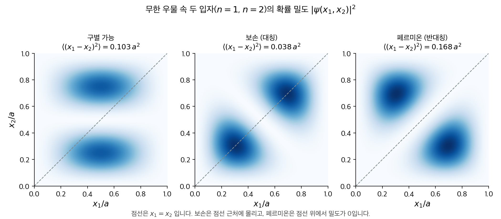
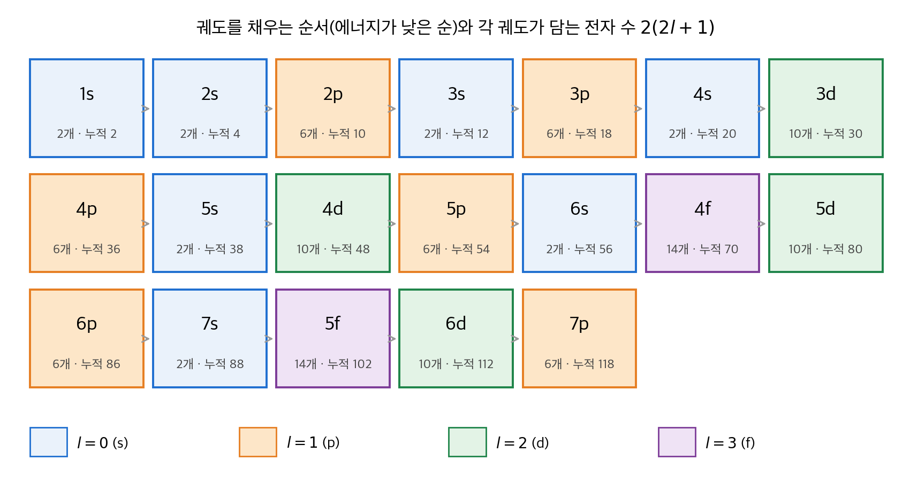
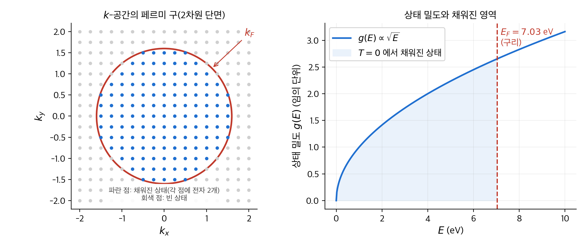
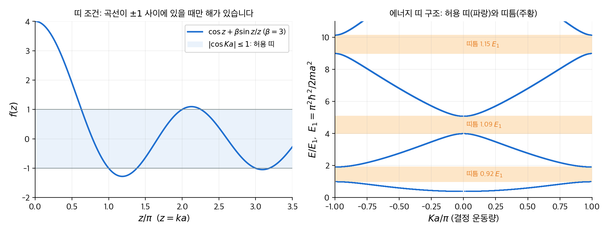
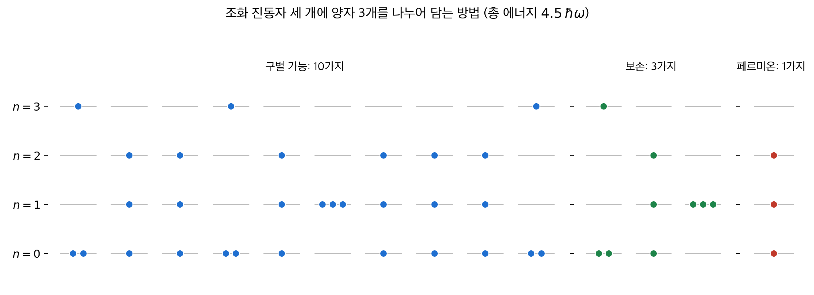
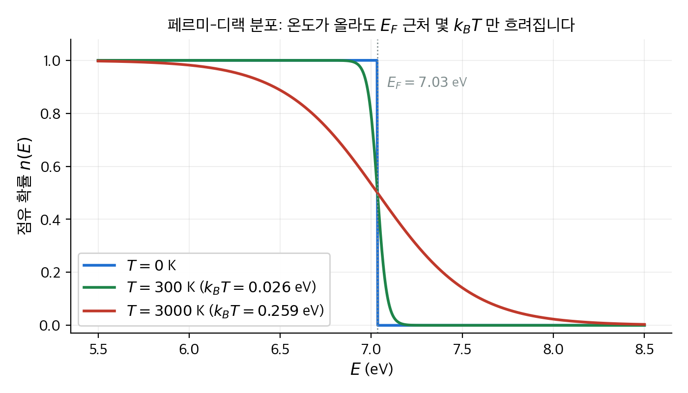
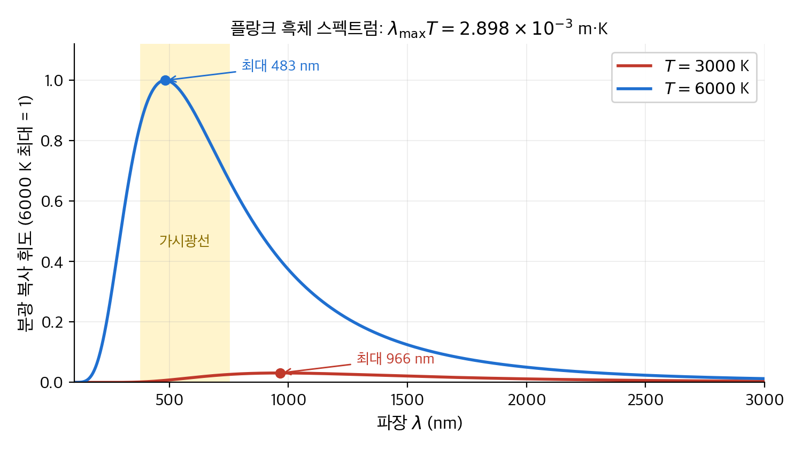

# 5. 동일 입자

앞의 네 장은 입자 하나를 다뤘습니다. 이 장은 입자가 둘 이상일 때 생기는 새로운 규칙을 다룹니다.
고전역학에서는 똑같은 공 두 개에도 이름표를 붙여 따로 추적할 수 있습니다. 양자역학에서는 전자 두 개를 구별할 방법이 없습니다.
이 한 가지 사실에서 **보손**(boson)과 **페르미온**(fermion)의 구분, **파울리 배타 원리**(Pauli exclusion principle), **교환력**(exchange force)이 따라 나옵니다.
결론은 넷입니다. 동일한 페르미온은 서로 멀어지고 보손은 서로 가까워집니다. 주기율표의 구조는 배타 원리의 결과입니다.
금속 속 전자는 상온에서도 수만 K짜리 "뜨거운" 기체처럼 행동합니다. 입자가 많아지면 세 가지 통계 분포(맥스웰-볼츠만, 보스-아인슈타인, 페르미-디랙)가 나옵니다.

!!! info "원문과 자료"
    - 원문: Griffiths, *Introduction to Quantum Mechanics*, 1st ed. (1995), 5장 Identical Particles (5.1 Two-Particle Systems, 5.2 Atoms, 5.3 Solids, 5.4 Quantum Statistical Mechanics)
    - 함께 읽기: [2. 시간에 무관한 슈뢰딩거 방정식](02-time-independent-schrodinger.md)(무한 우물, 조화 진동자), [4. 3차원 양자역학](04-three-dimensions.md)(수소 원자, 스핀 단일항과 삼중항), [7. 변분 원리](07-variational-principle.md)(헬륨 바닥 상태의 정밀 계산)
    - 예시의 수치는 모두 NumPy와 SciPy로 다시 계산해서 검증했습니다.

## 1. 두 입자 계 (5.1절)

### 두 입자의 파동 함수

입자 두 개의 상태는 변수 여섯 개의 함수 $\Psi(\mathbf r_1, \mathbf r_2, t)$ 하나로 기술합니다. 입자마다 파동 함수를 하나씩 두지 않습니다.
해밀토니안은 두 입자의 운동 에너지와 퍼텐셜의 합입니다.

$$
H = -\frac{\hbar^2}{2m_1}\nabla_1^2 - \frac{\hbar^2}{2m_2}\nabla_2^2 + V(\mathbf r_1, \mathbf r_2, t)
$$

$|\Psi(\mathbf r_1, \mathbf r_2, t)|^2 \, d^3\mathbf r_1 \, d^3\mathbf r_2$ 는 입자 1이 $d^3\mathbf r_1$ 안에, 동시에 입자 2가 $d^3\mathbf r_2$ 안에 있을 확률입니다.
따라서 규격화는 여섯 겹 적분 $\int |\Psi|^2 \, d^3\mathbf r_1 \, d^3\mathbf r_2 = 1$ 입니다.
퍼텐셜이 시간에 무관하면 1입자 때와 같이 $\Psi = \psi(\mathbf r_1, \mathbf r_2) e^{-iEt/\hbar}$ 로 분리됩니다.
두 입자가 서로 상호작용하지 않고 각자 외부 퍼텐셜만 느낀다고 가정합니다. 그러면 해는 1입자 해의 곱 $\psi(\mathbf r_1, \mathbf r_2) = \psi_a(\mathbf r_1)\psi_b(\mathbf r_2)$ 입니다. 에너지는 $E_a + E_b$ 입니다.

### 보손과 페르미온

고전역학에서는 "입자 1은 상태 $a$, 입자 2는 상태 $b$"라고 말할 수 있습니다.
양자역학에서는 전자 두 개가 완전히 동일하므로 어느 쪽이 1인지 정할 수 없습니다.
따라서 파동 함수는 두 입자를 바꿔도 물리적으로 같은 상태를 나타내야 합니다. 가능한 조합은 두 가지뿐입니다.

$$
\psi_\pm(\mathbf r_1, \mathbf r_2) = A\left[\psi_a(\mathbf r_1)\psi_b(\mathbf r_2) \pm \psi_b(\mathbf r_1)\psi_a(\mathbf r_2)\right]
$$

- 더하기 부호($\psi_+$)를 택하는 입자를 **보손**이라고 부릅니다. 파동 함수가 교환에 **대칭**(symmetric)입니다. 광자, 헬륨-4 원자, 파이 중간자가 보손입니다.
- 빼기 부호($\psi_-$)를 택하는 입자를 **페르미온**이라고 부릅니다. 파동 함수가 교환에 **반대칭**(antisymmetric)입니다. 전자, 양성자, 중성자가 페르미온입니다.

어느 쪽인지는 스핀이 정합니다. 정수 스핀은 보손, 반정수 스핀은 페르미온입니다.
이 **스핀-통계 연결**(spin-statistics connection)은 상대론적 양자장론에서 증명되지만, 비상대론적 양자역학에서는 공리로 받아들입니다.

페르미온에 $\psi_a = \psi_b$ 를 넣으면 $\psi_- = A[\psi_a\psi_a - \psi_a\psi_a] = 0$ 입니다.
즉 **동일한 페르미온 두 개는 같은 상태를 차지할 수 없습니다.** 이것이 파울리 배타 원리입니다.
보손에는 이런 제한이 없습니다. 같은 상태에 몇 개라도 들어갈 수 있습니다.

형식적으로는 **교환 연산자**(exchange operator) $P$ 를 정의합니다. $Pf(\mathbf r_1, \mathbf r_2) = f(\mathbf r_2, \mathbf r_1)$ 입니다.
$P^2 = 1$ 이므로 고유값은 $\pm 1$ 입니다. 두 입자의 질량과 퍼텐셜이 같으면 $[P, H] = 0$ 입니다.
따라서 처음에 대칭이었던 상태는 영원히 대칭입니다. 반대칭이었던 상태는 영원히 반대칭입니다. 입자의 종류는 시간이 지나도 바뀌지 않습니다.

### 교환력: 두 입자는 얼마나 떨어져 있는가

대칭·반대칭이 실제로 무엇을 바꾸는지 보기 위해 두 입자 사이 거리의 제곱 $\langle (x_1 - x_2)^2 \rangle$ 을 계산합니다.
1차원에서 규격화된 직교 상태 $\psi_a$, $\psi_b$ 를 쓰고 $\langle x \rangle_a = \int x |\psi_a|^2 dx$, $\langle x \rangle_{ab} = \int x \psi_a^* \psi_b \, dx$ 로 표기합니다.
$(x_1 - x_2)^2 = x_1^2 + x_2^2 - 2x_1x_2$ 를 전개해 각 항의 기댓값을 구하면 세 경우가 다음과 같이 나옵니다.

| 경우 | 파동 함수 | $\langle (x_1 - x_2)^2 \rangle$ |
| --- | --- | --- |
| 구별 가능 | $\psi_a(x_1)\psi_b(x_2)$ | $\langle x^2 \rangle_a + \langle x^2 \rangle_b - 2\langle x \rangle_a \langle x \rangle_b$ |
| 보손 | $\psi_+$ | 위 값 $- 2\lvert\langle x \rangle_{ab}\rvert^2$ |
| 페르미온 | $\psi_-$ | 위 값 $+ 2\lvert\langle x \rangle_{ab}\rvert^2$ |

보손은 구별 가능한 경우보다 가깝고, 페르미온은 멉니다. 마치 보손끼리는 끌어당기고 페르미온끼리는 밀어내는 힘이 있는 것처럼 보입니다.
이 겉보기 힘을 **교환력**이라고 부릅니다. 실제 힘은 아닙니다. 파동 함수의 대칭성이 만드는 기하학적 효과입니다.
교환 항 $\langle x \rangle_{ab}$ 는 두 파동 함수가 겹치는 영역에서만 값을 가집니다. 두 입자가 멀리 떨어져 있으면 교환력은 사라집니다.

#### 수치 예: 무한 우물 속 두 입자

폭 $a$ 인 무한 사각 우물의 $n = 1$ 과 $n = 2$ 상태에 입자 하나씩을 넣습니다. [2장](02-time-independent-schrodinger.md)의 $\psi_n(x) = \sqrt{2/a}\sin(n\pi x/a)$ 를 씁니다. 필요한 적분은 셋입니다.

$$
\langle x \rangle_n = \frac{a}{2}, \qquad
\langle x^2 \rangle_n = a^2\left(\frac{1}{3} - \frac{1}{2n^2\pi^2}\right), \qquad
\langle x \rangle_{12} = -\frac{16a}{9\pi^2}
$$

숫자를 넣으면 $\langle x^2 \rangle_1 = 0.2827a^2$, $\langle x^2 \rangle_2 = 0.3207a^2$, $\langle x \rangle_{12} = -0.1801a$ 입니다.

| 경우 | 계산 | 값 |
| --- | --- | --- |
| 구별 가능 | $0.2827 + 0.3207 - 2 \times 0.25$ | $0.1033\,a^2$ |
| 보손 | $0.1033 - 2 \times 0.1801^2$ | $0.0384\,a^2$ |
| 페르미온 | $0.1033 + 2 \times 0.1801^2$ | $0.1682\,a^2$ |

페르미온 쌍의 평균 제곱 거리는 보손 쌍의 4.4배입니다. 같은 두 상태를 썼는데 대칭성만으로 이만큼 달라집니다.
다음 코드는 2차원 격자 적분으로 세 값을 다시 계산합니다.

```python
import numpy as np
a = 1.0
x = np.linspace(0, a, 2001)
X1, X2 = np.meshgrid(x, x, indexing="ij")
psi = lambda n, x: np.sqrt(2 / a) * np.sin(n * np.pi * x / a)
dist = psi(1, X1) * psi(2, X2)
boson = (psi(1, X1) * psi(2, X2) + psi(2, X1) * psi(1, X2)) / np.sqrt(2)
fermion = (psi(1, X1) * psi(2, X2) - psi(2, X1) * psi(1, X2)) / np.sqrt(2)
for name, p in [("dist", dist), ("boson", boson), ("fermion", fermion)]:
    val = np.trapezoid(np.trapezoid(p**2 * (X1 - X2) ** 2, x, axis=1), x)
    print(name, round(val, 4))      # 0.1033, 0.0384, 0.1682
```

<figure markdown>

<figcaption markdown>
<span class="fig-title"><b>Figure 1.</b> 무한 우물 속 두 입자의 확률 밀도 $|\psi(x_1, x_2)|^2$</span>

왼쪽은 구별 가능한 입자, 가운데는 보손, 오른쪽은 페르미온입니다. 점선 $x_1 = x_2$ 위에서 페르미온의 밀도는 정확히 0입니다.
보손은 점선 근처(두 입자가 가까운 영역)에 밀도가 몰립니다.
</figcaption>
</figure>

### 스핀까지 넣으면

전자의 전체 상태는 공간 파동 함수와 스피너의 곱 $\psi(\mathbf r)\chi$ 입니다. 반대칭이어야 하는 것은 이 **곱 전체**입니다.
[4장](04-three-dimensions.md)에서 전자 둘의 스핀 상태는 반대칭인 **단일항**(singlet, $s = 0$) 하나와 대칭인 **삼중항**(triplet, $s = 1$) 셋으로 나뉩니다.
그러면 조합은 두 가지입니다.

| 스핀 상태 | 스핀의 대칭성 | 공간 파동 함수 | 두 전자의 거리 |
| --- | --- | --- | --- |
| 단일항 $s = 0$ | 반대칭 | 대칭 $\psi_+$ | 가깝다 |
| 삼중항 $s = 1$ | 대칭 | 반대칭 $\psi_-$ | 멀다 |

수소 분자 $\mathrm{H}_2$ 의 공유 결합은 이 표의 첫 줄입니다. 두 전자가 단일항을 이루면 공간 파동 함수가 대칭이고, 전자가 두 핵 사이에 몰립니다.
핵은 가운데 몰린 음전하에 끌려 결합합니다. 삼중항이면 전자가 핵 사이에서 밀려나 결합이 생기지 않습니다.
"스핀이 반대인 전자끼리 짝을 이룬다"는 화학 규칙은 배타 원리와 교환력의 결과입니다.

### 일상 비유와 한계

- **페르미온은 극장 좌석과 같습니다.** 한 좌석(양자 상태)에 한 사람만 앉습니다. 관객이 늘면 뒤쪽 비싼 자리(높은 에너지)까지 채워야 합니다. 이 비유는 배타 원리를 잘 보여 주지만, 페르미온이 "밀어내는 힘"을 느끼지는 않는다는 점을 놓칩니다. 좌석은 서로 떨어져 있지만 전자는 파동 함수가 겹칠 때만 영향을 받습니다.
- **보손은 합창단과 같습니다.** 같은 음(상태)을 부르는 사람이 많을수록 다른 사람도 그 음에 합류하기 쉽습니다. 레이저가 이렇게 작동합니다. 광자 $n$ 개가 있는 상태로 전이할 확률은 $n + 1$ 에 비례합니다. 한계는 합창단원이 실제로 서로 끌어당기지 않는다는 점입니다. 보손의 "끌림"도 역시 파동 함수의 대칭성에서 나옵니다.

## 2. 원자 (5.2절)

### 헬륨: 전자가 둘이면 생기는 일

헬륨 원자는 양성자 2개짜리 핵과 전자 2개로 이루어집니다. 핵을 고정하면 해밀토니안은 다음과 같습니다.

$$
H = \underbrace{\left(-\frac{\hbar^2}{2m}\nabla_1^2 - \frac{1}{4\pi\epsilon_0}\frac{2e^2}{r_1}\right)}_{\text{수소형 } Z = 2}
+ \underbrace{\left(-\frac{\hbar^2}{2m}\nabla_2^2 - \frac{1}{4\pi\epsilon_0}\frac{2e^2}{r_2}\right)}_{\text{수소형 } Z = 2}
+ \underbrace{\frac{1}{4\pi\epsilon_0}\frac{e^2}{|\mathbf r_1 - \mathbf r_2|}}_{\text{전자 사이 반발}}
$$

마지막 항이 없으면 문제는 수소 원자 두 개로 분리됩니다. 핵 전하가 $Z = 2$ 이므로 수소 에너지에 $Z^2 = 4$ 를 곱합니다.
바닥 상태는 두 전자가 모두 1s에 들어간 $\psi_0 = \psi_{100}(\mathbf r_1)\psi_{100}(\mathbf r_2)$ 이고 에너지는 다음과 같습니다.

$$
E_0 = 2 \times 4 \times (-13.6\,\mathrm{eV}) = 8E_1 = -109\,\mathrm{eV}
$$

실험값은 $-78.975\,\mathrm{eV}$ 입니다. 이 값은 첫 번째 이온화 에너지 $24.6\,\mathrm{eV}$ 와 두 번째 이온화 에너지 $54.4\,\mathrm{eV}$ 의 합입니다.

| 항목 | 값 |
| --- | --- |
| 반발 무시 추정 | $-108.8\,\mathrm{eV}$ |
| 측정값 | $-79.0\,\mathrm{eV}$ |
| 차이 (반발 에너지) | $+29.8\,\mathrm{eV}$ |

차이 $30\,\mathrm{eV}$ 는 두 전자 사이의 반발 에너지입니다. 결합 에너지의 38%나 되므로 무시할 수 없습니다.
그런데 왜 두 전자가 모두 1s에 들어갈 수 있을까요? 공간 파동 함수 $\psi_{100}\psi_{100}$ 은 대칭이므로, 스핀이 반대칭 단일항이어야 합니다.
헬륨 바닥 상태의 두 전자는 반드시 스핀이 반대입니다. 반발 항을 제대로 다루는 계산은 [7장](07-variational-principle.md)의 변분법으로 합니다. 결과는 $-77.5\,\mathrm{eV}$ 로 실험값과 2% 안에 맞습니다.

### 파라헬륨과 오르토헬륨

들뜬 상태는 전자 하나를 1s에 두고 다른 하나를 $\psi_{nlm}$ 에 둡니다. 둘 다 들뜨면 한 전자가 떨어져 나가고 다른 전자가 바닥으로 가는 편이 에너지가 낮아 원자가 스스로 이온화합니다.
공간 파동 함수는 $\psi_{100}(\mathbf r_1)\psi_{nlm}(\mathbf r_2) \pm \psi_{nlm}(\mathbf r_1)\psi_{100}(\mathbf r_2)$ 두 가지를 만들 수 있습니다.

| 이름 | 공간 파동 함수 | 스핀 | 에너지 |
| --- | --- | --- | --- |
| **파라헬륨**(parahelium) | 대칭 | 단일항 | 높다 |
| **오르토헬륨**(orthohelium) | 반대칭 | 삼중항 | 낮다 |

오르토헬륨이 더 낮은 이유는 1절의 교환력입니다. 반대칭 공간 파동 함수에서 두 전자는 서로 멀고, 멀면 반발 에너지가 작습니다.
예를 들어 $1s2s$ 배치에서 삼중항($2^3S_1$)은 단일항($2^1S_0$)보다 약 $0.8\,\mathrm{eV}$ 낮습니다. 스핀은 해밀토니안에 직접 들어가지도 않는데 에너지를 바꿉니다.

### 주기율표

원자 번호 $Z$ 인 중성 원자는 전자 $Z$ 개를 가집니다. 전자 사이 반발을 무시하면 각 전자는 수소형 궤도 $\psi_{nlm}$ 에 들어갑니다.
배타 원리 때문에 한 궤도 $(n, l, m)$ 에는 스핀이 다른 전자 두 개까지만 들어갑니다. 따라서 껍질 $(n, l)$ 은 $2(2l + 1)$ 개를 담습니다.

| $l$ | 이름 | $m$ 의 개수 $2l + 1$ | 담는 전자 수 $2(2l + 1)$ |
| --- | --- | --- | --- |
| 0 | s | 1 | 2 |
| 1 | p | 3 | 6 |
| 2 | d | 5 | 10 |
| 3 | f | 7 | 14 |

수소에서는 에너지가 $n$ 에만 의존합니다. 전자가 여럿이면 안쪽 전자가 핵 전하를 **가립니다**(screening).
$l$ 이 작은 궤도는 핵 가까이까지 파고들어 가려지지 않은 전하를 더 많이 느끼므로 에너지가 낮습니다.
따라서 같은 $n$ 에서 s < p < d < f 순으로 채워집니다. 4s가 3d보다 먼저 채워지는 역전도 일어납니다.

<figure markdown>

<figcaption markdown>
<span class="fig-title"><b>Figure 2.</b> 궤도를 채우는 순서와 각 궤도가 담는 전자 수</span>

화살표 순서로 채우면 바닥 상태 전자 배치가 나옵니다. 누적 전자 수가 2, 10, 18, 36, 54, 86인 지점이 비활성 기체(He, Ne, Ar, Kr, Xe, Rn)입니다.
이 순서는 대부분 맞지만 Cr, Cu처럼 예외가 있습니다.
</figcaption>
</figure>

예를 들어 탄소($Z = 6$)는 $1s^2 2s^2 2p^2$, 철($Z = 26$)은 $1s^2 2s^2 2p^6 3s^2 3p^6 4s^2 3d^6$ 입니다. 지수는 각 껍질의 전자 수입니다.
비활성 기체는 껍질이 꽉 차서 안정합니다. 알칼리 금속은 꽉 찬 껍질 바깥에 전자 하나가 느슨하게 붙어 있어 쉽게 반응합니다.

### 훈트 규칙과 분광 표기

같은 전자 배치라도 전자들의 궤도 각운동량과 스핀이 어떻게 합쳐지는지에 따라 에너지가 다릅니다.
원자 전체의 상태는 총 스핀 $S$, 총 궤도 각운동량 $L$, 총 각운동량 $J$ 로 적습니다. 표기는 $^{2S+1}L_J$ 이고 $L = 0, 1, 2, 3$ 을 S, P, D, F로 씁니다.
바닥 상태가 어느 조합인지 알려 주는 경험 규칙이 **훈트 규칙**(Hund's rules)입니다.

1. 총 스핀 $S$ 가 가장 큰 상태가 가장 낮습니다. 스핀이 나란하면 공간 파동 함수가 반대칭입니다. 그러면 전자가 서로 멀어져 반발이 작기 때문입니다. 1절의 교환력이 여기서 다시 나옵니다.
2. $S$ 가 같으면 $L$ 이 가장 큰 상태가 가장 낮습니다.
3. 껍질이 절반 이하로 차면 $J = |L - S|$, 절반 넘게 차면 $J = L + S$ 입니다.

#### 손계산 예: 탄소, 질소, 산소

2p 껍질에는 $m = -1, 0, 1$ 세 칸이 있고 칸마다 스핀 두 개가 들어갑니다. 규칙 1에 따라 먼저 스핀을 나란히 다른 칸에 채웁니다.

| 원소 | 2p 전자 수 | 채우기 ($m = +1, 0, -1$) | $S$ | $L = \sum m$ | 규칙 3 | 바닥 상태 |
| --- | --- | --- | --- | --- | --- | --- |
| 탄소 C | 2 | ↑ ↑ · | 1 | $1 + 0 = 1$ | 절반 이하, $J = \lvert 1 - 1 \rvert = 0$ | $^3P_0$ |
| 질소 N | 3 | ↑ ↑ ↑ | 3/2 | $1 + 0 - 1 = 0$ | 정확히 절반, $J = S = 3/2$ | $^4S_{3/2}$ |
| 산소 O | 4 | ↑↓ ↑ ↑ | 1 | $1 + 1 + 0 - 1 = 1$ | 절반 초과, $J = 1 + 1 = 2$ | $^3P_2$ |
| 네온 Ne | 6 | ↑↓ ↑↓ ↑↓ | 0 | 0 | 꽉 참 | $^1S_0$ |

규칙 2는 $L$ 을 최대로 만들기 위해 전자를 $m$ 이 큰 칸부터 채우는 것으로 반영했습니다. 꽉 찬 껍질은 $S = L = J = 0$ 이므로 바깥 껍질만 세면 됩니다.
탄소가 $^3P_0$ 라는 것은 "두 2p 전자의 스핀이 나란하고($S = 1$), 궤도 각운동량 합은 1이고, 둘이 반대로 정렬해 총 각운동량은 0"이라는 뜻입니다.

## 3. 고체 (5.3절)

### 자유 전자 기체

금속에서 원자마다 바깥 전자 $q$ 개가 떨어져 나와 금속 전체를 돌아다닙니다. 가장 단순한 모형은 전자 사이 반발과 이온의 퍼텐셜을 모두 무시합니다. 전자를 변의 길이가 $l_x, l_y, l_z$ 인 상자 속 자유 입자로 봅니다.
3차원 무한 우물의 해는 1차원 해의 곱이고, 파수 벡터 $\mathbf k = (n_x\pi/l_x, n_y\pi/l_y, n_z\pi/l_z)$ 로 에너지가 정해집니다.

$$
E = \frac{\hbar^2 k^2}{2m}, \qquad n_x, n_y, n_z = 1, 2, 3, \ldots
$$

$\mathbf k$ 공간에서 상태 하나는 부피 $\pi^3 / V$ 를 차지합니다($V = l_x l_y l_z$). 양의 팔분공간만 허용됩니다.
전자 $Nq$ 개를 낮은 에너지부터 채우면 반지름 $k_F$ 인 구의 팔분의 일이 채워집니다. 상태 하나에 전자 두 개(스핀)가 들어가므로 다음이 성립합니다.

$$
\frac{1}{8}\left(\frac{4}{3}\pi k_F^3\right) = \frac{Nq}{2}\,\frac{\pi^3}{V}
\quad\Longrightarrow\quad
k_F = (3\rho\pi^2)^{1/3}, \qquad \rho = \frac{Nq}{V}
$$

경계면을 **페르미 면**(Fermi surface), 그 에너지를 **페르미 에너지**(Fermi energy)라고 합니다.

$$
E_F = \frac{\hbar^2}{2m}(3\rho\pi^2)^{2/3}
$$

채워진 모든 전자의 에너지를 더하면 총 에너지는 $E_{\text{tot}} = \frac{3}{5}NqE_F$ 입니다. 전자 하나가 평균 $\frac{3}{5}E_F$ 를 가집니다.
상자를 줄이면 $E_F \propto V^{-2/3}$ 이 커지므로 에너지가 올라갑니다. 즉 전자 기체는 바깥으로 미는 압력을 가집니다.

$$
P = -\frac{dE_{\text{tot}}}{dV} = \frac{2}{3}\frac{E_{\text{tot}}}{V} = \frac{2}{5}\rho E_F
$$

이 압력은 열운동이나 전기적 반발과 무관합니다. 배타 원리 때문에 전자를 같은 낮은 상태에 몰아넣을 수 없어서 생깁니다. **축퇴 압력**(degeneracy pressure)이라고 부르는 이유입니다.
이 압력이 금속이 눌리지 않게 버티는 힘의 한 부분이고, 백색 왜성이 중력 붕괴를 견디는 힘입니다.

에너지 $E$ 근처 단위 에너지당 상태 수인 **상태 밀도**(density of states) $g(E)$ 도 유용합니다. 반지름 $k$ 인 구 껍질의 부피에서 $k \propto \sqrt E$ 를 쓰면 $g(E) \propto \sqrt E$ 가 나옵니다.

#### 수치 예: 구리

구리는 원자마다 전자 1개를 내놓고($q = 1$), 전도 전자 밀도는 $\rho = 8.47 \times 10^{28}\,\mathrm{m^{-3}}$ 입니다. 숫자를 넣어 봅니다.

$$
k_F = (3\pi^2 \times 8.47 \times 10^{28})^{1/3} = 1.36 \times 10^{10}\,\mathrm{m^{-1}}, \qquad
E_F = \frac{\hbar^2 k_F^2}{2m_e} = 1.13 \times 10^{-18}\,\mathrm{J} = 7.03\,\mathrm{eV}
$$

| 양 | 식 | 구리의 값 |
| --- | --- | --- |
| 페르미 파수 $k_F$ | $(3\rho\pi^2)^{1/3}$ | $13.6\,\mathrm{nm^{-1}}$ |
| 페르미 에너지 $E_F$ | $\hbar^2 k_F^2 / 2m_e$ | $7.03\,\mathrm{eV}$ |
| 페르미 속도 $v_F$ | $\hbar k_F / m_e$ | $1.57 \times 10^6\,\mathrm{m/s}$ (광속의 0.5%) |
| 페르미 온도 $T_F$ | $E_F / k_B$ | $81{,}600\,\mathrm{K}$ |
| 전자당 평균 에너지 | $\frac{3}{5}E_F$ | $4.22\,\mathrm{eV}$ |
| 축퇴 압력 $P$ | $\frac{2}{5}\rho E_F$ | $3.8 \times 10^{10}\,\mathrm{Pa} = 38\,\mathrm{GPa}$ |
| 부피 탄성률 $B$ | $-V\,dP/dV = \frac{5}{3}P$ | $64\,\mathrm{GPa}$ (측정값 $140\,\mathrm{GPa}$) |

세 가지가 눈에 띕니다.
첫째, 상온의 열에너지 $k_BT = 0.026\,\mathrm{eV}$ 는 $E_F$ 의 0.4%에 불과합니다. 금속 속 전자는 온도 $81{,}600\,\mathrm{K}$ 에 해당하는 에너지로 움직이지만, 그것은 열 때문이 아니라 배타 원리 때문입니다.
둘째, 축퇴 압력은 대기압의 약 40만 배입니다. 이 압력을 양이온 격자의 인력이 맞받아 금속이 유지됩니다.
셋째, 부피 탄성률은 측정값과 2배 정도 차이가 나지만 자릿수가 맞습니다. 전자 사이 반발과 이온을 모두 무시한 모형치고는 좋은 결과입니다.

```python
import numpy as np
hbar, m_e, eV, k_B = 1.0546e-34, 9.109e-31, 1.602e-19, 1.381e-23
rho = 8.47e28                                  # 구리의 전도 전자 밀도 (m^-3)
k_F = (3 * np.pi**2 * rho) ** (1 / 3)
E_F = hbar**2 * k_F**2 / (2 * m_e)
print(E_F / eV, hbar * k_F / m_e, E_F / k_B)   # 7.03 eV, 1.57e6 m/s, 8.16e4 K
P = 0.4 * rho * E_F
print(P / 1e9, 5 / 3 * P / 1e9)                # 38.2 GPa, 63.6 GPa
```

<figure markdown>

<figcaption markdown>
<span class="fig-title"><b>Figure 3.</b> 페르미 구와 상태 밀도</span>

왼쪽은 $\mathbf k$ 공간의 단면입니다. 격자점 하나가 상태 하나이고, 반지름 $k_F$ 안쪽만 채워집니다.
오른쪽은 상태 밀도 $g(E) \propto \sqrt E$ 입니다. $T = 0$ 에서는 $E_F$ 까지 빈틈없이 채워지고 그 위는 비어 있습니다.
</figcaption>
</figure>

### 띠 구조: 주기적 퍼텐셜

자유 전자 모형은 이온이 만드는 퍼텐셜을 완전히 무시했습니다. 다음 단계로 이온을 주기 $a$ 로 늘어선 퍼텐셜로 넣습니다.
1차원에서 가장 다루기 쉬운 모형은 **디랙 빗**(Dirac comb)입니다. 델타 함수 봉우리가 간격 $a$ 로 늘어선 퍼텐셜입니다.

$$
V(x) = \alpha\sum_{j} \delta(x - ja)
$$

주기적 퍼텐셜의 해는 **블로흐 정리**(Bloch's theorem)를 만족합니다. 한 칸 옮기면 파동 함수에 위상만 붙습니다.

$$
\psi(x + a) = e^{iKa}\psi(x)
$$

봉우리 사이에서는 자유 입자 해 $A\sin kx + B\cos kx$ 이고, 봉우리에서 [2장](02-time-independent-schrodinger.md)의 델타 함수 경계 조건(도함수의 불연속)을 적용합니다.
블로흐 조건까지 맞추면 $K$ 와 $k$ 사이의 관계 하나가 남습니다. $z = ka$, $\beta = m\alpha a/\hbar^2$ 로 두면 다음과 같습니다.

$$
\cos(Ka) = \cos z + \beta\,\frac{\sin z}{z}, \qquad E = \frac{\hbar^2 k^2}{2m} = \left(\frac{z}{\pi}\right)^2 E_1, \quad E_1 = \frac{\pi^2\hbar^2}{2ma^2}
$$

왼쪽은 $-1$ 과 $1$ 사이입니다. 오른쪽 $f(z)$ 가 이 범위를 벗어나는 $z$ 에서는 해가 없습니다.
따라서 허용되는 에너지가 **띠**(band)로 나뉩니다. 띠 사이에는 **띠틈**(band gap)이 생깁니다. 띠틈은 $z = \pi, 2\pi, 3\pi, \ldots$ 바로 위에서 열립니다.

#### 수치 예: $\beta = 3$

$f(z) = \cos z + 3\sin z / z$ 가 $\pm 1$ 을 지나는 $z$ 를 수치로 찾으면 띠 경계가 나옵니다.

| 띠 | $z$ 범위 | $E / E_1$ 범위 | 띠 너비 | 위쪽 띠틈 |
| --- | --- | --- | --- | --- |
| 1 | $1.977 \sim \pi$ | $0.396 \sim 1.000$ | $0.60\,E_1$ | $0.92\,E_1$ |
| 2 | $4.349 \sim 2\pi$ | $1.917 \sim 4.000$ | $2.08\,E_1$ | $1.09\,E_1$ |
| 3 | $7.084 \sim 3\pi$ | $5.085 \sim 9.000$ | $3.92\,E_1$ | $1.15\,E_1$ |

띠는 위로 갈수록 넓어지고, 띠틈은 $\beta\,\sin z / z$ 의 진폭이 줄면서 $\beta$ 가 클수록 넓어집니다. 다음 코드는 경계를 찾습니다.

```python
import numpy as np
beta = 3.0
z = np.linspace(1e-6, 3 * np.pi, 300_000)
f = np.cos(z) + beta * np.sin(z) / z
allowed = np.abs(f) <= 1
edges = z[np.where(np.diff(allowed.astype(int)) != 0)]
print(np.round(edges, 3))                 # [1.977 3.142 4.349 6.283 7.084 9.425]
print(np.round((edges / np.pi) ** 2, 3))  # E/E_1: [0.396 1. 1.917 4. 5.085 9.]
```

<figure markdown>

<figcaption markdown>
<span class="fig-title"><b>Figure 4.</b> 디랙 빗 퍼텐셜의 띠 조건과 에너지 띠 구조 ($\beta = 3$)</span>

왼쪽에서 곡선이 파란 띠($-1 \le f \le 1$) 안에 있는 $z$ 만 허용됩니다. 오른쪽은 각 허용 $z$ 에 대해 $Ka = \arccos f(z)$ 를 풀어 그린 $E(K)$ 입니다.
주황 띠가 어떤 $K$ 로도 도달할 수 없는 띠틈입니다.
</figcaption>
</figure>

원자 $N$ 개짜리 고리에서는 $K$ 가 $N$ 개의 값만 가질 수 있습니다. 따라서 띠 하나는 상태 $N$ 개, 스핀까지 전자 $2N$ 개를 담습니다.
이 사실이 도체와 부도체를 가릅니다.

| 원자당 원자가 전자 | 가장 높은 띠의 상태 | 작은 전기장을 걸면 | 분류 |
| --- | --- | --- | --- |
| 1개 (Na, Cu) | 절반만 참 | 바로 위 빈 상태로 옮겨 가 전류가 흐른다 | 도체 |
| 2개, 띠틈 큼 (다이아몬드 $5.5\,\mathrm{eV}$) | 꽉 참 | 띠틈을 넘을 에너지가 없다 | 부도체 |
| 2개, 띠틈 작음 (Si $1.1\,\mathrm{eV}$, Ge $0.67\,\mathrm{eV}$) | 꽉 참 | 열이나 도핑으로 소수 전자가 띠틈을 넘는다 | 반도체 |

전기 전도를 띠로 설명하려면 전자가 바로 위에 **비어 있는** 상태가 필요합니다. 꽉 찬 띠의 전자는 갈 곳이 없어 전기장에 반응하지 못합니다.
1차원 디랙 빗은 장난감 모형이지만, 띠와 띠틈이 주기성만으로 생긴다는 핵심은 3차원 실제 결정에서도 같습니다.

## 4. 양자 통계역학 (5.4절)

### 세 입자로 세어 보기

온도 $T$ 인 계에서 입자가 에너지 $E_j$ 를 가질 확률을 구하는 것이 통계역학의 목표입니다.
기본 가정은 **총 에너지가 같은 모든 배열은 같은 확률**입니다. 그러면 핵심은 "어떤 배열이 몇 가지 방법으로 만들어지는가"를 세는 일입니다. 세는 방법은 입자의 종류에 따라 다릅니다.

작은 예로 봅니다. 조화 진동자 퍼텐셜에 입자 세 개를 넣고 총 에너지를 $(3 + \tfrac{3}{2})\hbar\omega$ 로 고정합니다.
준위 $n = 0, 1, 2, 3$ 에 양자 3개를 나누어 담는 **배치**(configuration)는 $\{0, 0, 3\}$, $\{0, 1, 2\}$, $\{1, 1, 1\}$ 세 가지입니다.

| 배치 (준위 점유) | 구별 가능 | 보손 | 페르미온 |
| --- | --- | --- | --- |
| $\{0, 0, 3\}$: $n = 0$ 에 2개, $n = 3$ 에 1개 | 3가지 (누가 3에 가는가) | 1가지 | 0가지 (배타) |
| $\{0, 1, 2\}$: 세 준위에 하나씩 | 6가지 ($3!$ 순열) | 1가지 | 1가지 |
| $\{1, 1, 1\}$: $n = 1$ 에 3개 | 1가지 | 1가지 | 0가지 (배타) |
| 합계 | 10가지 | 3가지 | 1가지 |

구별 가능한 입자는 $\{0, 1, 2\}$ 가 6/10으로 가장 가능성이 높습니다. 보손은 세 배치가 1/3씩 같습니다. 페르미온은 $\{0, 1, 2\}$ 하나뿐입니다.
여기서 "임의의 입자 하나가 준위 $n$ 에 있을 확률" $P_n$ 을 구하면 세 통계의 차이가 보입니다.

| $n$ | 구별 가능 | 보손 | 페르미온 |
| --- | --- | --- | --- |
| 0 | $\frac{3}{10}\cdot\frac{2}{3} + \frac{6}{10}\cdot\frac{1}{3} = 0.40$ | $\frac{1}{3}\cdot\frac{2}{3} + \frac{1}{3}\cdot\frac{1}{3} = 0.333$ | $0.333$ |
| 1 | $\frac{6}{10}\cdot\frac{1}{3} + \frac{1}{10}\cdot 1 = 0.30$ | $\frac{1}{3}\cdot\frac{1}{3} + \frac{1}{3}\cdot 1 = 0.444$ | $0.333$ |
| 2 | $\frac{6}{10}\cdot\frac{1}{3} = 0.20$ | $\frac{1}{3}\cdot\frac{1}{3} = 0.111$ | $0.333$ |
| 3 | $\frac{3}{10}\cdot\frac{1}{3} = 0.10$ | $\frac{1}{3}\cdot\frac{1}{3} = 0.111$ | $0$ |

```python
import itertools
states = [s for s in itertools.product(range(4), repeat=3) if sum(s) == 3]
bosons = sorted({tuple(sorted(s)) for s in states})
fermions = [s for s in bosons if len(set(s)) == 3]
for name, ws in [("dist", states), ("boson", bosons), ("fermion", fermions)]:
    P = [sum(s.count(n) for s in ws) / (3 * len(ws)) for n in range(4)]
    print(name, len(ws), [round(p, 3) for p in P])
# dist 10 [0.4, 0.3, 0.2, 0.1] / boson 3 [0.333, 0.444, 0.111, 0.111] / fermion 1 [0.333, 0.333, 0.333, 0.0]
```

<figure markdown>

<figcaption markdown>
<span class="fig-title"><b>Figure 5.</b> 조화 진동자 세 개에 양자 3개를 나누어 담는 방법</span>

구별 가능한 입자는 같은 배치라도 누가 어디 있는지에 따라 다른 상태로 셉니다. 보손은 배치 하나가 상태 하나입니다.
페르미온은 두 입자가 같은 준위에 있는 배치를 버립니다.
</figcaption>
</figure>

### 가장 가능성 높은 배치: 세 가지 분포

입자가 $N \sim 10^{23}$ 개이면 배치 하나가 압도적으로 가능성이 높고, 그 배치가 곧 열평형 상태입니다.
에너지 $E_n$ 에 축퇴된 상태가 $d_n$ 개 있고 거기에 입자 $N_n$ 개를 넣는 방법의 수는 다음과 같습니다.

| 통계 | 입자 | $E_n$ 준위를 채우는 방법의 수 |
| --- | --- | --- |
| 맥스웰-볼츠만 | 구별 가능 | $N!\prod_n \dfrac{d_n^{N_n}}{N_n!}$ |
| 보스-아인슈타인 | 보손 | $\prod_n \dfrac{(N_n + d_n - 1)!}{N_n!\,(d_n - 1)!}$ |
| 페르미-디랙 | 페르미온 | $\prod_n \dfrac{d_n!}{N_n!\,(d_n - N_n)!}$ |

보손의 식은 "공 $N_n$ 개를 상자 $d_n$ 개에 넣는 방법", 페르미온의 식은 "상자 $d_n$ 개 가운데 $N_n$ 개를 고르는 방법"입니다.
이 수의 로그를 $\sum N_n = N$, $\sum N_n E_n = E$ 라는 두 제약 아래에서 최대화합니다. 라그랑주 승수 두 개($\alpha$, $\beta$)를 도입하고 스털링 근사를 쓰면 세 경우 모두 같은 꼴이 나옵니다.

$$
n(\epsilon) = \frac{N_n}{d_n} =
\begin{cases}
e^{-(\epsilon - \mu)/k_BT} & \text{맥스웰-볼츠만} \\[6pt]
\dfrac{1}{e^{(\epsilon - \mu)/k_BT} - 1} & \text{보스-아인슈타인} \\[10pt]
\dfrac{1}{e^{(\epsilon - \mu)/k_BT} + 1} & \text{페르미-디랙}
\end{cases}
$$

$n(\epsilon)$ 은 에너지 $\epsilon$ 인 상태 하나에 평균 몇 개가 들어 있는가입니다. 승수의 의미는 $\beta = 1/k_BT$ 이고 $\mu = -\alpha k_BT$ 입니다.
$T$ 는 온도이고, **화학 퍼텐셜**(chemical potential) $\mu(T)$ 는 입자 수 $N$ 을 맞추는 조건에서 정해집니다.
분모의 $\mp 1$ 만 다릅니다. $\epsilon - \mu \gg k_BT$ 이면 지수가 커서 세 분포가 같아집니다. 양자 효과는 상태 하나에 입자가 하나 이상 들어가려 할 때만 드러납니다.

페르미-디랙 분포는 $n(\epsilon) \le 1$ 입니다. 배타 원리가 식에 들어 있습니다. $T \to 0$ 에서는 $\epsilon < \mu$ 이면 1, $\epsilon > \mu$ 이면 0인 계단이 되고, 이때 $\mu(0) = E_F$ 입니다. 3절의 페르미 에너지가 화학 퍼텐셜의 영도 극한입니다.

#### 수치 예: 구리의 전자 점유 확률

$E_F = 7.03\,\mathrm{eV}$ 인 구리에서 $E_F$ 보다 $0.1\,\mathrm{eV}$ 높은 상태와 낮은 상태의 점유 확률을 구합니다. 상온에서 $k_BT = 0.0259\,\mathrm{eV}$ 입니다.

| 상태 에너지 | $(\epsilon - \mu)/k_BT$ | $n(\epsilon)$ (300 K) | $n(\epsilon)$ (3000 K) |
| --- | --- | --- | --- |
| $E_F - 0.1\,\mathrm{eV}$ | $-3.87$ | $0.980$ | $0.595$ |
| $E_F$ | $0$ | $0.500$ | $0.500$ |
| $E_F + 0.1\,\mathrm{eV}$ | $+3.87$ | $0.020$ | $0.405$ |

상온에서는 $E_F$ 에서 $0.1\,\mathrm{eV}$ 만 벗어나도 거의 완전히 차거나 완전히 빕니다. 전체 $7\,\mathrm{eV}$ 가운데 $0.1\,\mathrm{eV}$ 안팎의 전자만 열에 반응합니다.
금속의 전자 비열이 고전 예측의 1% 수준으로 작은 이유입니다.

<figure markdown>

<figcaption markdown>
<span class="fig-title"><b>Figure 6.</b> 온도에 따른 페르미-디랙 분포 ($E_F = 7.03\,\mathrm{eV}$)</span>

$T = 0$ 에서는 계단, $300\,\mathrm{K}$ 에서는 폭 $0.1\,\mathrm{eV}$ 정도만 흐려집니다. $3000\,\mathrm{K}$ 에서도 흐려진 폭은 $1\,\mathrm{eV}$ 안팎입니다.
전자 대부분은 온도와 무관하게 깊이 묻혀 있습니다.
</figcaption>
</figure>

### 흑체 복사

보스-아인슈타인 분포의 가장 유명한 응용은 광자입니다. 광자는 스핀 1인 보손입니다.
광자는 벽에 흡수되고 방출되므로 개수가 보존되지 않습니다. 따라서 입자 수 제약이 없고 $\mu = 0$ 입니다.
진동수 $\omega$ 인 광자의 에너지는 $\hbar\omega$ 입니다. 상자 속 광자 모드의 상태 밀도는 $\omega^2 V/\pi^2 c^3$ 입니다. 편광 두 가지를 포함한 값입니다.
점유 수에 에너지와 상태 밀도를 곱하면 단위 부피, 단위 진동수당 에너지인 **플랑크 공식**(Planck formula)이 나옵니다.

$$
\rho(\omega) = \frac{\hbar\omega^3}{\pi^2 c^3}\,\frac{1}{e^{\hbar\omega/k_BT} - 1}
$$

낮은 진동수에서는 $\rho \approx \omega^2 k_BT/\pi^2c^3$ 로 고전 결과와 같습니다. 높은 진동수에서는 $e^{-\hbar\omega/k_BT}$ 로 잘립니다.
고전 이론은 이 잘림이 없어서 총 에너지가 발산했습니다. 광자가 보손이고 에너지가 $\hbar\omega$ 단위로만 들어간다는 두 사실이 발산을 막습니다.

#### 수치 예: 전구와 태양

$\rho(\omega)$ 가 최대인 곳은 $\hbar\omega_{\max} = 2.821\,k_BT$ 입니다. 파장으로 바꾸면 $\lambda_{\max}T = 2.898 \times 10^{-3}\,\mathrm{m\cdot K}$ 입니다(**빈의 변위 법칙**, Wien's displacement law).

| 광원 | 온도 | $\lambda_{\max}$ | 영역 |
| --- | --- | --- | --- |
| 백열전구 필라멘트 | $3000\,\mathrm{K}$ | $966\,\mathrm{nm}$ | 근적외선 |
| 태양 표면 | $6000\,\mathrm{K}$ | $483\,\mathrm{nm}$ | 가시광선(청록) |

백열전구의 최대 파장은 눈에 보이지 않는 적외선에 있습니다. 전구가 내는 빛의 대부분이 열로 새어 나가므로 효율이 낮습니다.
태양은 최대가 가시광선 한가운데 있습니다. 우리 눈이 이 영역을 보도록 진화한 것은 우연이 아닙니다.

```python
import numpy as np
h, c, k_B = 6.626e-34, 2.998e8, 1.381e-23
def planck(lam, T):                     # 파장당 분광 복사 휘도
    return 2 * h * c**2 / lam**5 / (np.exp(h * c / (lam * k_B * T)) - 1)
lam = np.linspace(100e-9, 3000e-9, 100_000)
for T in (3000, 6000):
    print(T, lam[np.argmax(planck(lam, T))] * 1e9)   # 966 nm, 483 nm
```

<figure markdown>

<figcaption markdown>
<span class="fig-title"><b>Figure 7.</b> 3000 K 와 6000 K 흑체의 플랑크 스펙트럼</span>

온도가 2배 오르면 최대 파장은 절반으로 짧아지고, 총 복사량은 $T^4$ 에 따라 16배로 늘어납니다. 노란 영역이 가시광선(380~750 nm)입니다.
</figcaption>
</figure>

## 5. 정리

| 개념 | 핵심 | 이 장의 예시 |
| --- | --- | --- |
| 대칭화 | 동일 입자의 파동 함수는 교환에 대칭(보손) 또는 반대칭(페르미온) | 무한 우물 $n = 1, 2$ 두 입자 |
| 배타 원리 | 동일한 페르미온은 같은 상태를 공유하지 못함 | 헬륨 바닥 상태는 반드시 스핀 단일항 |
| 교환력 | 보손은 가깝고 페르미온은 멀다 | $\langle(x_1 - x_2)^2\rangle$ = 0.038 대 0.168 $a^2$ |
| 주기율표 | 껍질 $(n, l)$ 은 전자 $2(2l + 1)$ 개, 가림으로 $l$ 의존성 | 탄소 $^3P_0$, 질소 $^4S_{3/2}$ |
| 자유 전자 기체 | $E_F = \frac{\hbar^2}{2m}(3\rho\pi^2)^{2/3}$, 축퇴 압력 $\frac{2}{5}\rho E_F$ | 구리 $7.03\,\mathrm{eV}$, $38\,\mathrm{GPa}$ |
| 띠 구조 | 주기성이 띠와 띠틈을 만든다 | $\beta = 3$ 디랙 빗의 띠틈 $0.92, 1.09, 1.15\,E_1$ |
| 양자 통계 | $n(\epsilon) = 1/(e^{(\epsilon-\mu)/k_BT} \mp 1)$ | 세 입자 세기, 구리의 점유 확률, 플랑크 공식 |

이 장의 결과는 뒤에서 다시 쓰입니다. [6장](06-time-independent-perturbation.md)은 수소 원자의 미세 구조를 다루고, [7장](07-variational-principle.md)은 헬륨의 $30\,\mathrm{eV}$ 반발 에너지를 변분법으로 실제로 계산합니다.
[9장](09-time-dependent-perturbation.md)의 유도 방출은 광자가 보손이라는 사실에서 나옵니다.
