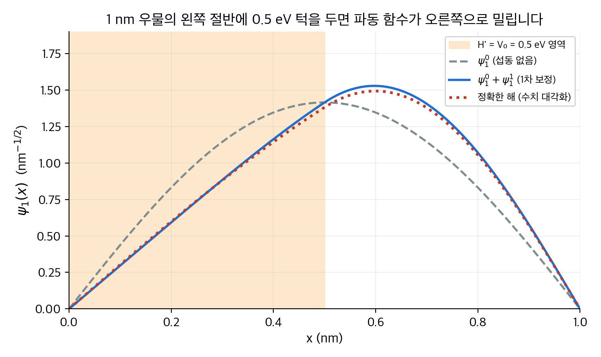
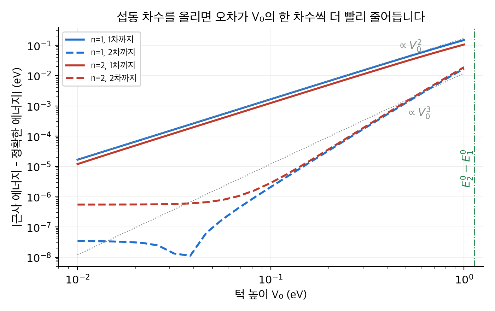
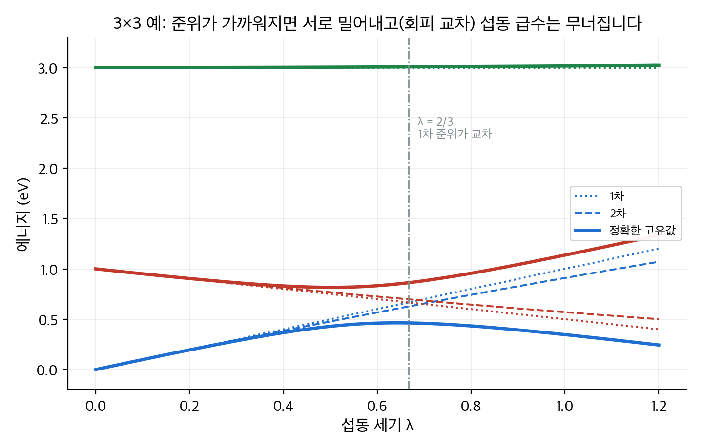
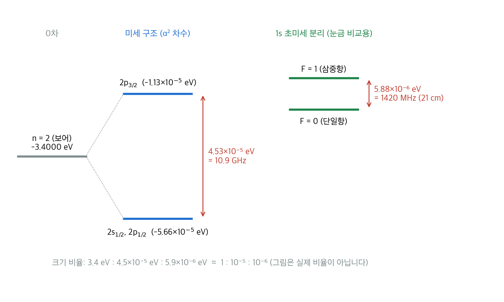
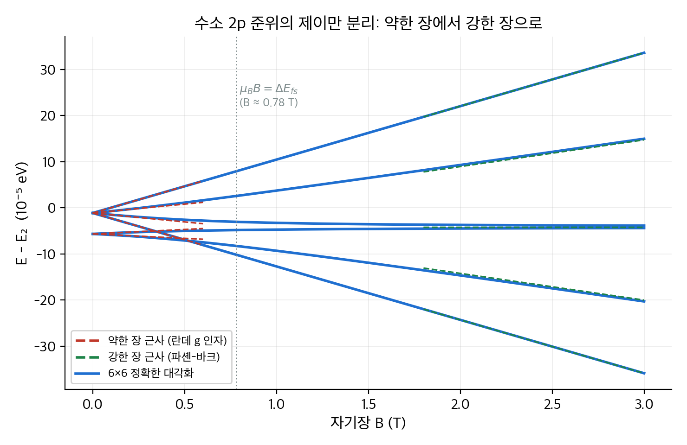

# 6. 시간에 무관한 섭동 이론

2장과 4장에서 정확히 풀 수 있는 문제는 몇 개 되지 않았습니다. 무한 우물, 조화 진동자, 수소 원자가 거의 전부입니다.
실제 계는 대부분 이 문제들과 "조금" 다릅니다. 우물 바닥이 완전히 평평하지 않거나, 수소 원자에 자기장이 걸려 있거나, 전자가 빛의 속도에 비해 조금 빠르게 움직입니다.
**섭동 이론**(perturbation theory)은 이미 아는 답에서 출발해, 작은 차이가 에너지와 파동 함수를 얼마나 바꾸는지 차수별로 계산하는 방법입니다.
이 장은 먼저 일반 공식을 세우고, 축퇴가 있을 때 생기는 함정을 다룹니다. 그다음 수소 원자에 적용해 미세 구조, 제이만 효과, 초미세 분리를 숫자로 확인합니다.
결론적으로 수소 스펙트럼은 보어 모형의 $-13.6\,\mathrm{eV}/n^2$ 위에 $10^{-5}$ 배, $10^{-6}$ 배 크기의 보정이 층층이 쌓인 구조입니다.

!!! info "원문과 자료"
    - 원문: Griffiths, *Introduction to Quantum Mechanics*, 1st ed. (1995), 6장 Time-Independent Perturbation Theory (6.1 Nondegenerate Perturbation Theory, 6.2 Degenerate Perturbation Theory, 6.3 The Fine Structure of Hydrogen, 6.4 The Zeeman Effect, 6.5 Hyperfine Splitting)
    - 함께 읽기: [2. 시간에 무관한 슈뢰딩거 방정식](02-time-independent-schrodinger.md), [3. 형식 체계](03-formalism.md), [4. 3차원 양자역학](04-three-dimensions.md), [7. 변분 원리](07-variational-principle.md), [9. 시간에 의존하는 섭동 이론](09-time-dependent-perturbation.md)
    - 행렬의 고유값과 고유벡터는 [선형대수 5장](../../math/linear-algebra/05-eigenvalues.md)을 참고합니다.
    - 예시의 수치는 모두 NumPy와 SciPy로 다시 계산해서 검증했습니다.

## 1. 비축퇴 섭동 이론 (6.1절)

### 아이디어

진자의 주기를 안다고 가정합니다. 이제 추에 작은 자석을 붙여 바닥의 철판이 추를 살짝 당깁니다.
처음부터 다시 풀 수도 있지만, 더 쉬운 길이 있습니다. 자석이 없을 때의 답을 0차로 둡니다. 자석의 영향은 1차, 2차 보정으로 더합니다.
보정이 작으면 1차에서 멈춰도 충분하고, 조금 크면 2차까지 더합니다.
이 방법이 통하려면 두 가지가 필요합니다. 자석의 영향이 원래 복원력보다 작아야 하고, 0차 답을 정확히 알아야 합니다.

양자역학에서도 같습니다. 해밀토니안을 두 부분으로 나눕니다.

$$
H = H^0 + \lambda H'
$$

$H^0$ 는 고유 상태 $\psi_n^0$ 와 고유값 $E_n^0$ 를 이미 아는 **비섭동 해밀토니안**(unperturbed Hamiltonian)입니다.
$H'$ 는 **섭동**(perturbation)이고, $\lambda$ 는 섭동의 세기를 추적하는 보조 변수입니다. 계산이 끝나면 $\lambda = 1$ 로 둡니다.

### 차수별 전개

참 고유 상태와 고유값을 $\lambda$ 의 멱급수로 씁니다.

$$
\psi_n = \psi_n^0 + \lambda \psi_n^1 + \lambda^2 \psi_n^2 + \cdots, \qquad
E_n = E_n^0 + \lambda E_n^1 + \lambda^2 E_n^2 + \cdots
$$

여기서 $E_n^1$ 은 **1차 보정**(first-order correction), $E_n^2$ 는 **2차 보정**(second-order correction)입니다. 위 첨자는 거듭제곱이 아니라 차수입니다.
이것을 $H\psi_n = E_n \psi_n$ 에 넣고 $\lambda$ 의 같은 차수끼리 모읍니다.

| 차수 | 방정식 |
| --- | --- |
| $\lambda^0$ | $H^0 \psi_n^0 = E_n^0 \psi_n^0$ (이미 아는 식) |
| $\lambda^1$ | $H^0 \psi_n^1 + H' \psi_n^0 = E_n^0 \psi_n^1 + E_n^1 \psi_n^0$ |
| $\lambda^2$ | $H^0 \psi_n^2 + H' \psi_n^1 = E_n^0 \psi_n^2 + E_n^1 \psi_n^1 + E_n^2 \psi_n^0$ |

### 1차 에너지

$\lambda^1$ 식의 양변에 $\psi_n^0$ 를 내적합니다. $H^0$ 가 에르미트이므로 $\langle \psi_n^0 | H^0 \psi_n^1 \rangle = E_n^0 \langle \psi_n^0 | \psi_n^1 \rangle$ 이고, 이 항은 우변의 같은 항과 상쇄됩니다. 남는 것은 다음 식입니다.

$$
E_n^1 = \langle \psi_n^0 | H' | \psi_n^0 \rangle
$$

이 식이 섭동 이론에서 가장 많이 쓰는 결과입니다. **1차 에너지 보정은 섭동을 비섭동 상태에서 평균한 값입니다.**
직관적으로 보면 입자는 $|\psi_n^0|^2$ 의 분포로 퍼져 있습니다. 추가 퍼텐셜 $H'$ 를 그 분포로 가중 평균한 값이 에너지 증가분입니다.

### 1차 파동 함수

$\psi_n^1$ 은 비섭동 상태들의 선형 결합으로 씁니다. $\psi_n^0$ 자신의 성분은 규격화로 흡수되므로 $m \neq n$ 만 남습니다.

$$
\psi_n^1 = \sum_{m \neq n} \frac{\langle \psi_m^0 | H' | \psi_n^0 \rangle}{E_n^0 - E_m^0}\, \psi_m^0
$$

분모가 에너지 차이라는 점이 중요합니다. 에너지가 가까운 상태일수록 섞임이 큽니다.
분모가 0이 되는 경우, 즉 $E_m^0 = E_n^0$ 인 **축퇴**(degenerate) 상태가 있으면 이 식은 쓸 수 없습니다. 그 경우는 2절에서 다룹니다.

### 2차 에너지

$\lambda^2$ 식에 $\psi_n^0$ 를 내적하고 위의 $\psi_n^1$ 을 넣으면 다음을 얻습니다.

$$
E_n^2 = \sum_{m \neq n} \frac{|\langle \psi_m^0 | H' | \psi_n^0 \rangle|^2}{E_n^0 - E_m^0}
$$

바닥 상태($n = 1$)에서는 모든 분모가 음수이므로 $E_1^2 \le 0$ 입니다. **2차 보정은 바닥 상태 에너지를 항상 낮춥니다.**
이 성질은 [7장](07-variational-principle.md)의 변분 원리와 같은 내용입니다. 섭동이 섞어 주는 상태를 써서 에너지를 더 낮출 여지가 생기기 때문입니다.
반대로 들뜬 상태는 아래 준위에 밀려 올라가고 위 준위에 밀려 내려옵니다. 가까운 준위가 어느 쪽에 있는지가 부호를 결정합니다.

### 수치 예: 턱이 있는 무한 우물

폭 $a = 1\,\mathrm{nm}$ 인 무한 우물에 전자가 있습니다. 비섭동 에너지는 [2장](02-time-independent-schrodinger.md)의 결과입니다.

$$
E_n^0 = \frac{n^2 \pi^2 \hbar^2}{2 m_e a^2} = n^2 \times 0.3760\,\mathrm{eV}
$$

이제 우물의 왼쪽 절반 $0 \le x \le a/2$ 에 높이 $V_0$ 인 턱을 둡니다. 즉 $H' = V_0$ (왼쪽 절반), $H' = 0$ (오른쪽 절반)입니다.

**1차 에너지는 손으로 구할 수 있습니다.** $\sin^2$ 을 우물 절반에서 적분하면 정확히 절반이 나옵니다.

$$
E_n^1 = \frac{2 V_0}{a} \int_0^{a/2} \sin^2\!\left(\frac{n \pi x}{a}\right) dx = \frac{2 V_0}{a} \cdot \frac{a}{4} = \frac{V_0}{2}
$$

모든 $n$ 에 대해 같은 값입니다. 어떤 정상 상태든 입자가 왼쪽 절반에 있을 확률이 정확히 $1/2$ 이기 때문입니다.

**비대각 행렬 원소**도 적분 한 번으로 나옵니다. 곱을 합으로 바꾸는 삼각 함수 공식을 쓰면 다음과 같습니다.

$$
\langle \psi_m^0 | H' | \psi_n^0 \rangle = \frac{V_0}{\pi} \left[ \frac{\sin\frac{(m-n)\pi}{2}}{m-n} - \frac{\sin\frac{(m+n)\pi}{2}}{m+n} \right] \qquad (m \neq n)
$$

$m - n$ 이 짝수이면 두 사인이 모두 0이라서 원소가 사라집니다. 턱이 우물 중심에 대해 반대칭이라 같은 패리티끼리는 섞이지 않습니다.
처음 몇 개를 적으면 다음과 같습니다.

| 원소 | 값 |
| --- | --- |
| $\langle 2 \vert H' \vert 1 \rangle$ | $\frac{4 V_0}{3\pi} = 0.4244\,V_0$ |
| $\langle 3 \vert H' \vert 1 \rangle$ | $0$ |
| $\langle 4 \vert H' \vert 1 \rangle$ | $-\frac{8 V_0}{15\pi} = -0.1698\,V_0$ |
| $\langle 3 \vert H' \vert 2 \rangle$ | $\frac{4 V_0}{5\pi} = 0.2546\,V_0$ |

**2차 에너지**는 이 원소들을 제곱해 에너지 차이로 나누어 더합니다. $V_0 = 0.5\,\mathrm{eV}$ 일 때 바닥 상태의 처음 두 항은 다음과 같습니다.

$$
E_1^2 \approx \frac{(0.2122)^2}{0.3760 - 1.5041} + \frac{(0.0849)^2}{0.3760 - 6.0165} = -0.0399 - 0.0013 = -0.0412\,\mathrm{eV}
$$

200항까지 더하면 $-0.0416\,\mathrm{eV}$ 로 수렴합니다. 첫 항이 거의 전부입니다. 가장 가까운 상태가 섞임을 지배하기 때문입니다.

정확한 답은 $x$ 축을 3000칸으로 나눈 유한 차분 행렬을 대각화해서 구했습니다. 세 결과를 비교합니다.

| $n$ | $E_n^0$ | 1차까지 | 2차까지 | 정확한 값 | 1차 오차 | 2차 오차 |
| --- | --- | --- | --- | --- | --- | --- |
| 1 | 0.3760 | 0.6260 | 0.5845 | 0.5857 | 0.0403 | 0.0012 |
| 2 | 1.5041 | 1.7541 | 1.7853 | 1.7839 | 0.0298 | 0.0014 |
| 3 | 3.3843 | 3.6343 | 3.6297 | 3.6298 | 0.0045 | 0.0001 |

단위는 eV입니다. $V_0 = 0.5\,\mathrm{eV}$ 는 $E_1^0$ 보다 큰 값이라 "작은" 섭동이 아닙니다. 그런데도 2차까지 더하면 오차가 1 meV 안팎으로 줄어듭니다.
$n = 3$ 에서 오차가 유독 작은 이유가 있습니다. $\langle 2|H'|3 \rangle$ 과 $\langle 4|H'|3 \rangle$ 이 서로 반대 부호로 2차 항에 기여해 거의 상쇄됩니다.

<figure markdown>

<figcaption markdown>
<span class="fig-title"><b>Figure 1.</b> 턱이 있는 우물의 바닥 상태 파동 함수</span>

왼쪽 절반에 0.5 eV 턱을 두면 전자는 퍼텐셜이 낮은 오른쪽으로 밀립니다. 1차 보정 $\psi_1^0 + \psi_1^1$ (파랑)은 정확한 해(빨강 점선)의 모양을 이미 잘 따라갑니다.
</figcaption>
</figure>

턱 높이를 바꾸어 가며 오차를 재면 섭동 이론의 수렴 성질이 보입니다.

<figure markdown>

<figcaption markdown>
<span class="fig-title"><b>Figure 2.</b> 섭동 차수에 따른 에너지 오차</span>

1차까지 더한 오차는 $V_0^2$ 에, 2차까지 더한 오차는 $V_0^3$ 에 비례합니다. 작은 $V_0$ 에서 오차가 평평해지는 부분은 기준으로 쓴 수치 해 자체의 격자 오차입니다. 초록 선은 $E_2^0 - E_1^0 = 1.13\,\mathrm{eV}$ 로, 섭동 급수가 믿을 만한 범위의 대략적인 상한입니다.
</figcaption>
</figure>

### Python으로 재현하기

```python
import numpy as np
hbar2_m, a, V0 = 0.0762, 1.0, 0.5          # eV nm^2, nm, eV
E0 = lambda n: n**2 * np.pi**2 * hbar2_m / (2 * a**2)
def Hp(m, n):                                # <m|H'|n>, 턱은 [0, a/2]
    if m == n:
        return V0 / 2
    return V0/np.pi * (np.sin((m-n)*np.pi/2)/(m-n) - np.sin((m+n)*np.pi/2)/(m+n))
for n in (1, 2, 3):
    E1 = Hp(n, n)
    E2 = sum(Hp(m, n)**2 / (E0(n) - E0(m)) for m in range(1, 200) if m != n)
    print(n, round(E0(n) + E1, 4), round(E0(n) + E1 + E2, 4))
# 출력: 1 0.626 0.5845 / 2 1.7541 1.7853 / 3 3.6343 3.6297
```

## 2. 축퇴 섭동 이론 (6.2절)

### 왜 앞의 공식이 실패하는가

두 상태 $\psi_a^0$, $\psi_b^0$ 가 같은 에너지 $E^0$ 를 가진다고 가정합니다. 1절의 $\psi_n^1$ 과 $E_n^2$ 공식에는 $E_a^0 - E_b^0 = 0$ 이 분모에 들어가므로 발산합니다.
더 근본적인 문제가 있습니다. 축퇴된 두 상태의 어떤 선형 결합도 $H^0$ 의 고유 상태입니다. 섭동을 켰을 때 "어느 결합에서 출발해야 하는가"가 정해져 있지 않습니다.
$H'$ 를 아주 조금만 켜도 축퇴가 풀리면서 특정한 두 결합이 선택됩니다. 섭동 이론은 그 결합에서 시작해야 합니다. 이것을 **좋은 상태**(good states)라고 부릅니다.

### 2×2 행렬로 좋은 상태 찾기

$\psi^0 = \alpha \psi_a^0 + \beta \psi_b^0$ 로 두고 $\lambda^1$ 차 방정식에 $\psi_a^0$ 와 $\psi_b^0$ 를 각각 내적하면 다음 고유값 문제가 나옵니다.

$$
\begin{pmatrix} W_{aa} & W_{ab} \\ W_{ba} & W_{bb} \end{pmatrix}
\begin{pmatrix} \alpha \\ \beta \end{pmatrix}
= E^1 \begin{pmatrix} \alpha \\ \beta \end{pmatrix},
\qquad W_{ij} = \langle \psi_i^0 | H' | \psi_j^0 \rangle
$$

**1차 에너지 보정은 축퇴 부분 공간에서 $H'$ 의 행렬 $W$ 의 고유값이고, 좋은 상태는 그 고유벡터입니다.** 2×2 의 고유값은 닫힌 꼴로 나옵니다.

$$
E^1_\pm = \frac{1}{2}\left[ W_{aa} + W_{bb} \pm \sqrt{(W_{aa} - W_{bb})^2 + 4|W_{ab}|^2} \right]
$$

$W_{ab} = 0$ 이면 $E^1_+ = W_{aa}$, $E^1_- = W_{bb}$ 로, 비축퇴 공식 $E^1 = \langle \psi | H' | \psi \rangle$ 가 그대로 성립합니다. 축퇴 이론은 비축퇴 이론을 포함합니다.

### 손계산 예

$H^0$ 의 두 상태가 $E^0 = 1\,\mathrm{eV}$ 로 축퇴되어 있고, 섭동이 두 상태를 서로 섞기만 한다고 가정합니다.

$$
W = \begin{pmatrix} 0 & w \\ w & 0 \end{pmatrix}, \qquad w = 0.1\,\mathrm{eV}
$$

$\psi_a^0$ 에서 비축퇴 공식을 그대로 쓰면 $E^1 = W_{aa} = 0$ 입니다. 아무 일도 없다는 뜻인데, 이것은 틀린 답입니다.
$W$ 의 고유값은 $\pm w$ 이고 고유벡터는 $(1, \pm 1)/\sqrt{2}$ 입니다. 따라서 좋은 상태와 에너지는 다음과 같습니다.

| 좋은 상태 | 1차 에너지 |
| --- | --- |
| $(\psi_a^0 + \psi_b^0)/\sqrt{2}$ | $1.1\,\mathrm{eV}$ |
| $(\psi_a^0 - \psi_b^0)/\sqrt{2}$ | $0.9\,\mathrm{eV}$ |

섭동은 축퇴를 $2w = 0.2\,\mathrm{eV}$ 만큼 벌립니다. 두 상태 사이의 결합이 "대칭 결합"과 "반대칭 결합"을 가르는 구조는 [5장](05-identical-particles.md)의 교환 대칭, [7장](07-variational-principle.md)의 수소 분자 이온에서 다시 나타납니다.

### 좋은 상태를 미리 고르는 정리

$W$ 를 대각화하지 않고도 좋은 상태를 찾는 지름길이 있습니다.

> **정리:** 에르미트 연산자 $A$ 가 $H^0$ 와 $H'$ 모두와 교환하고, $\psi_a^0$ 와 $\psi_b^0$ 가 $A$ 의 서로 다른 고유값을 가지는 고유 상태이면 $W_{ab} = 0$ 입니다. 즉 $\psi_a^0$, $\psi_b^0$ 가 이미 좋은 상태입니다.

증명은 한 줄입니다. $[A, H'] = 0$ 이므로 $\langle \psi_a^0 | [A, H'] | \psi_b^0 \rangle = (\mu - \nu) W_{ab} = 0$ 입니다. $\mu \neq \nu$ 이므로 $W_{ab} = 0$ 입니다.
실제로 가장 많이 쓰는 방법은 이 정리입니다. 위의 손계산 예에서 $A$ 는 두 상태를 맞바꾸는 연산자입니다. 수소 원자의 미세 구조에서는 $A = J^2, J_z$ 가 이 역할을 합니다.

### 수치 예: 3×3 행렬과 회피 교차

축퇴가 정확히 0이 아니라 "거의" 있을 때 무슨 일이 생기는지 봅니다. 다음 행렬을 $\lambda$ 를 바꾸며 대각화합니다. 단위는 eV입니다.

$$
H^0 = \begin{pmatrix} 0 & 0 & 0 \\ 0 & 1 & 0 \\ 0 & 0 & 3 \end{pmatrix}, \qquad
H' = \begin{pmatrix} 1 & 0.3 & 0 \\ 0.3 & -0.5 & 0.2 \\ 0 & 0.2 & 0 \end{pmatrix}
$$

1차 에너지는 대각 원소를 그대로 더한 $0 + \lambda$, $1 - 0.5\lambda$, $3$ 입니다. 앞의 두 직선은 $\lambda = 2/3$ 에서 교차합니다.
정확한 고유값은 교차하지 않습니다. 비대각 원소 $0.3\lambda$ 가 두 준위를 서로 밀어내기 때문입니다. 이 현상을 **회피 교차**(avoided crossing)라고 합니다.

| $\lambda$ | 정확한 고유값 (eV) | 1차까지 | 2차까지 |
| --- | --- | --- | --- |
| 0.2 | 0.195, 0.904, 3.001 | 0.200, 0.900, 3.000 | 0.196, 0.903, 3.001 |
| 0.5 | 0.429, 0.817, 3.005 | 0.500, 0.750, 3.000 | 0.478, 0.768, 3.005 |
| 1.0 | 0.347, 1.137, 3.016 | 1.000, 0.500, 3.000 | 0.910, 0.570, 3.020 |

$\lambda = 0.2$ 에서는 2차 근사가 소수 셋째 자리까지 맞습니다. $\lambda = 1$ 에서는 1차와 2차 모두 순서까지 틀립니다.
세 번째 준위는 어느 경우에도 잘 맞습니다. 다른 준위와 2 eV 이상 떨어져 있어 분모가 크기 때문입니다.
**섭동 이론의 유효 범위는 섭동의 절대 크기가 아니라 "섭동 행렬 원소 대 준위 간격"의 비율로 정해집니다.**

<figure markdown>

<figcaption markdown>
<span class="fig-title"><b>Figure 3.</b> 3×3 행렬의 고유값과 섭동 근사</span>

굵은 선은 정확한 고유값, 점선은 1차, 파선은 2차 근사입니다. 1차 준위가 교차하는 $\lambda = 2/3$ 근처에서 정확한 준위는 서로 밀어내고, 섭동 급수는 그 근처부터 쓸 수 없게 됩니다.
</figcaption>
</figure>

## 3. 수소의 미세 구조 (6.3절)

### 크기의 계층

4장의 수소 원자 에너지 $E_n = -13.6\,\mathrm{eV}/n^2$ 는 쿨롱 퍼텐셜과 운동 에너지만 넣은 결과입니다. 실제 스펙트럼선을 자세히 보면 각 선이 여러 개로 갈라져 있습니다.
보정의 크기를 지배하는 수는 **미세 구조 상수**(fine-structure constant)입니다.

$$
\alpha = \frac{e^2}{4\pi\epsilon_0 \hbar c} \approx \frac{1}{137.036}
$$

$\alpha$ 는 단위가 없는 수입니다. 보어 모형에서 전자 속도는 $v = \alpha c$ 이므로, $\alpha$ 는 "수소 원자의 전자가 빛보다 얼마나 느린가"를 나타냅니다.

| 효과 | 크기 | 원인 |
| --- | --- | --- |
| 보어 에너지 | $\alpha^2 m c^2 \sim 10\,\mathrm{eV}$ | 쿨롱 인력 |
| 미세 구조 | $\alpha^4 m c^2 \sim 10^{-4}\,\mathrm{eV}$ | 상대론적 보정, 스핀-궤도 결합 |
| 램 이동 | $\alpha^5 m c^2 \sim 10^{-6}\,\mathrm{eV}$ | 전자기장의 양자화 (이 책 범위 밖) |
| 초미세 분리 | $(m/m_p)\,\alpha^4 m c^2 \sim 10^{-6}\,\mathrm{eV}$ | 양성자 스핀 |

### 상대론적 보정

운동 에너지의 정확한 식은 $T = \sqrt{p^2 c^2 + m^2 c^4} - mc^2$ 입니다. $p \ll mc$ 에서 전개하면 첫 항이 $p^2/2m$ 이고 다음 항이 보정입니다.

$$
H'_r = -\frac{p^4}{8 m^3 c^2}
$$

1차 보정은 $E_r^1 = -\frac{1}{8m^3c^2}\langle p^4 \rangle$ 입니다. $p^2 = 2m(E - V)$ 를 써서 $\langle p^4 \rangle$ 을 $\langle 1/r \rangle$ 과 $\langle 1/r^2 \rangle$ 으로 바꾸면 다음 결과가 나옵니다.

$$
E_r^1 = -\frac{(E_n)^2}{2 m c^2} \left[ \frac{4n}{l + 1/2} - 3 \right]
$$

$H'_r$ 은 $L^2$, $L_z$ 와 교환하므로 $|n\,l\,m_l\rangle$ 이 좋은 상태입니다. 2절의 정리 덕분에 축퇴를 걱정하지 않고 비축퇴 공식을 써도 됩니다.

### 스핀-궤도 결합

전자의 입장에서 보면 양성자가 자기 주위를 돕니다. 도는 전하는 자기장을 만듭니다. 그 자기장이 전자의 스핀 자기 모멘트와 상호 작용합니다.
전자의 정지 좌표계가 가속 좌표계라는 점을 보정하는 **토머스 세차**(Thomas precession) 인자 $1/2$ 를 넣으면 다음 해밀토니안을 얻습니다.

$$
H'_{so} = \frac{e^2}{8\pi\epsilon_0}\,\frac{1}{m^2 c^2 r^3}\, \mathbf{S} \cdot \mathbf{L}
$$

이 항은 $L_z$, $S_z$ 와 따로따로는 교환하지 않습니다. 대신 $J = L + S$ 로 정의한 **총 각운동량**(total angular momentum)의 $J^2$, $J_z$ 와 교환합니다.
따라서 좋은 상태는 $|n\,l\,j\,m_j\rangle$ 입니다. $\mathbf{S} \cdot \mathbf{L}$ 의 고유값은 $J^2 = L^2 + S^2 + 2\,\mathbf{S}\cdot\mathbf{L}$ 에서 바로 나옵니다.

$$
\mathbf{S} \cdot \mathbf{L} = \frac{\hbar^2}{2}\left[ j(j+1) - l(l+1) - \tfrac{3}{4} \right]
$$

$\langle 1/r^3 \rangle$ 을 넣으면 1차 보정은 다음과 같습니다.

$$
E_{so}^1 = \frac{(E_n)^2}{m c^2}\,\frac{n\left[ j(j+1) - l(l+1) - 3/4 \right]}{l\,(l+1/2)\,(l+1)}
$$

### 두 보정의 합

두 보정은 $j$ 로만 쓰면 깔끔하게 합쳐집니다. $l$ 에 대한 의존성이 사라지는 것이 놀라운 점입니다.

$$
E_{fs}^1 = \frac{(E_n)^2}{2 m c^2}\left[ 3 - \frac{4n}{j + 1/2} \right]
$$

보어 에너지와 합치면 수소의 에너지 준위는 $n$ 과 $j$ 만으로 정해집니다.

$$
E_{nj} = -\frac{13.6\,\mathrm{eV}}{n^2}\left[ 1 + \frac{\alpha^2}{n^2}\left( \frac{n}{j + 1/2} - \frac{3}{4} \right) \right]
$$

### 수치 예: n = 2 준위

$n = 2$ 에서 $E_2 = -3.400\,\mathrm{eV}$ 이고, 보정의 눈금은 $(E_2)^2 / mc^2 = 11.56 / 511000 = 2.264 \times 10^{-5}\,\mathrm{eV}$ 입니다.

| 상태 | $l$ | $j$ | $E_r^1$ | $E_{so}^1$ | $E_{fs}^1$ (합) | 결합 공식 |
| --- | --- | --- | --- | --- | --- | --- |
| $2p_{3/2}$ | 1 | 3/2 | $-2.642$ | $+1.509$ | $-1.132$ | $-1.132$ |
| $2p_{1/2}$ | 1 | 1/2 | $-2.642$ | $-3.019$ | $-5.660$ | $-5.660$ |
| $2s_{1/2}$ | 0 | 1/2 | $-14.72$ | (식이 $0/0$) | — | $-5.660$ |

단위는 $10^{-5}\,\mathrm{eV}$ 입니다. $2p$ 두 상태는 따로 계산한 합과 결합 공식이 소수 셋째 자리까지 일치합니다.
$2s$ 는 $l = 0$ 이라 스핀-궤도 공식의 분모가 0이 됩니다. 상대론적 보정만 넣은 값 $-14.72$ 는 틀린 답입니다. 정확한 디랙 방정식에는 $l = 0$ 에만 작용하는 **다윈 항**(Darwin term)이 더 있고, 그것까지 넣으면 결합 공식의 $-5.660$ 이 맞습니다.
결합 공식은 $l = 0$ 에서도 옳은 답을 줍니다. 따라서 $2s_{1/2}$ 와 $2p_{1/2}$ 는 미세 구조까지 넣어도 여전히 축퇴되어 있습니다. 이 축퇴를 깨는 것이 램 이동입니다.

$2p_{3/2}$ 와 $2p_{1/2}$ 의 간격은 다음과 같습니다.

$$
\Delta E_{fs} = 3.4\,\mathrm{eV} \times \frac{\alpha^2}{4} = 4.53 \times 10^{-5}\,\mathrm{eV}, \qquad
\nu = \frac{\Delta E_{fs}}{h} = 10.95\,\mathrm{GHz}
$$

보어 에너지에 비하면 $10^{-5}$ 배이지만, 분광학에서는 쉽게 분해되는 크기입니다. 발머 $\mathrm{H}\alpha$ 선(656 nm)이 두 선으로 갈라져 보이는 이유가 이 간격입니다.

<figure markdown>

<figcaption markdown>
<span class="fig-title"><b>Figure 4.</b> 수소 n = 2 준위의 미세 구조와 초미세 분리의 눈금</span>

보어 준위 $-3.4\,\mathrm{eV}$ 가 미세 구조로 $2p_{3/2}$ 와 $2s_{1/2}, 2p_{1/2}$ 로 갈라집니다. 오른쪽은 5절의 1s 초미세 분리를 눈금 비교용으로 함께 그렸습니다. 세 효과의 크기 비율은 $1 : 10^{-5} : 10^{-6}$ 이라 그림은 실제 비율이 아닙니다.
</figcaption>
</figure>

## 4. 제이만 효과 (6.4절)

### 외부 자기장과 두 개의 자기 모멘트

균일한 자기장 $\mathbf{B}_{ext}$ 를 걸면 궤도 자기 모멘트와 스핀 자기 모멘트가 모두 반응합니다. 스핀의 자기 회전 비율이 궤도의 두 배라는 점이 식에 들어갑니다.

$$
H'_Z = \frac{e}{2m}\left( \mathbf{L} + 2\mathbf{S} \right) \cdot \mathbf{B}_{ext}
$$

에너지의 눈금은 **보어 자기자**(Bohr magneton) $\mu_B = e\hbar/2m = 5.788 \times 10^{-5}\,\mathrm{eV/T}$ 입니다.
이 값을 3절의 미세 구조 간격 $4.53 \times 10^{-5}\,\mathrm{eV}$ 와 비교하면 세 영역이 나뉩니다.

| 영역 | 조건 | 자기장 (수소 n = 2) | 좋은 상태 |
| --- | --- | --- | --- |
| 약한 장 | $\mu_B B \ll \Delta E_{fs}$ | $B \ll 0.78\,\mathrm{T}$ | $\vert n\,l\,j\,m_j\rangle$ (미세 구조가 주, 제이만이 섭동) |
| 중간 장 | $\mu_B B \sim \Delta E_{fs}$ | $B \sim 0.78\,\mathrm{T}$ | 둘 다 섭동으로 두고 행렬을 대각화 |
| 강한 장 | $\mu_B B \gg \Delta E_{fs}$ | $B \gg 0.78\,\mathrm{T}$ | $\vert n\,l\,m_l\,m_s\rangle$ (제이만이 주, 미세 구조가 섭동) |

실험실의 영구 자석은 0.1~1 T 정도입니다. 수소 $n = 2$ 에서는 그 범위가 통째로 "중간 장"에 걸립니다. 반면 $n$ 이 크면 미세 구조가 $1/n^3$ 로 줄어들어 같은 자기장이 강한 장이 됩니다.

### 약한 장: 란데 g 인자

좋은 상태가 $|n\,l\,j\,m_j\rangle$ 이므로 1차 보정은 $\langle \mathbf{L} + 2\mathbf{S} \rangle = \langle \mathbf{J} + \mathbf{S} \rangle$ 의 기댓값입니다.
$\mathbf{S}$ 는 $\mathbf{J}$ 주위를 빠르게 세차하므로 $\mathbf{J}$ 방향 성분만 평균에 남습니다. 그 결과가 **란데 g 인자**(Landé g-factor)입니다.

$$
E_Z^1 = \mu_B\, g_J\, B_{ext}\, m_j, \qquad
g_J = 1 + \frac{j(j+1) - l(l+1) + 3/4}{2 j (j+1)}
$$

$n = 2$ 의 세 준위에 대입하면 다음 표를 얻습니다.

| 준위 | $l$ | $j$ | $g_J$ | 갈라지는 개수 ($2j+1$) |
| --- | --- | --- | --- | --- |
| $2s_{1/2}$ | 0 | 1/2 | 2 | 2 |
| $2p_{1/2}$ | 1 | 1/2 | 2/3 | 2 |
| $2p_{3/2}$ | 1 | 3/2 | 4/3 | 4 |

**수치 예:** $B = 0.1\,\mathrm{T}$ 에서 $\mu_B B = 5.79 \times 10^{-6}\,\mathrm{eV}$ 입니다. $2p_{3/2}$ 의 이웃 준위 간격은 $g_J \mu_B B = 7.72 \times 10^{-6}\,\mathrm{eV} = 1.87\,\mathrm{GHz}$ 입니다.

| $m_j$ | $E_Z^1$ (약한 장 공식) | 6×6 정확한 대각화 |
| --- | --- | --- |
| $+3/2$ | $+11.58$ | $+11.58$ |
| $+1/2$ | $+3.86$ | $+4.02$ |
| $-1/2$ | $-3.86$ | $-3.69$ |
| $-3/2$ | $-11.58$ | $-11.58$ |

단위는 $\mu\mathrm{eV}$ 이고 $2p_{3/2}$ 의 미세 구조 에너지를 기준으로 쟀습니다. $m_j = \pm 3/2$ 는 섞일 상대가 없어서 공식이 정확합니다. $m_j = \pm 1/2$ 는 $2p_{1/2}$ 의 같은 $m_j$ 상태와 조금 섞여서 4% 정도 어긋납니다.

같은 공식을 $B = 1\,\mathrm{T}$ 에 쓰면 간격이 $77.2\,\mu\mathrm{eV} = 18.7\,\mathrm{GHz}$ 로, 미세 구조 간격 $45.3\,\mu\mathrm{eV}$ 보다 큽니다. 이때 $m_j = +1/2$ 준위의 정확한 값은 $E_2$ 기준으로 $+37.3\,\mu\mathrm{eV}$ 입니다. 약한 장 공식은 $+27.3\,\mu\mathrm{eV}$ 을 줍니다. 공식이 무너졌습니다.

### 강한 장: 파셴-바크 효과

$\mu_B B \gg \Delta E_{fs}$ 이면 제이만 항이 주가 되고 좋은 상태는 $|n\,l\,m_l\,m_s\rangle$ 입니다. 이 기저에서 $H'_Z$ 는 대각이고 에너지는 다음과 같습니다.

$$
E_Z = \mu_B B_{ext}\,(m_l + 2 m_s)
$$

여기에 미세 구조를 섭동으로 더합니다. 이 영역을 **파셴-바크 효과**(Paschen–Back effect)라고 부릅니다.
$2p$ 의 여섯 상태는 $m_l + 2m_s \in \{2, 1, 0, 0, -1, -2\}$ 이므로 다섯 개의 등간격 준위가 됩니다. 가운데 두 상태 $(m_l, m_s) = (1, -\tfrac12)$, $(-1, +\tfrac12)$ 는 제이만 에너지가 같고, 미세 구조가 그 둘을 조금 벌립니다.

### 중간 장: 행렬을 직접 대각화

중간 영역에서는 두 섭동을 함께 둡니다. $2p$ 의 여섯 상태 $|m_l, m_s\rangle$ 에서 행렬을 만듭니다.

$$
H = E_r\,\mathbb{1} + \xi\,\frac{\mathbf{L}\cdot\mathbf{S}}{\hbar^2} + \mu_B B\,(m_l + 2m_s),
\qquad E_r = -2.64 \times 10^{-5}\,\mathrm{eV},\quad \xi = 3.02 \times 10^{-5}\,\mathrm{eV}
$$

$\mathbf{L}\cdot\mathbf{S} = L_z S_z + \tfrac12(L_+ S_- + L_- S_+)$ 로 쓰면 사다리 연산자가 $m_j = m_l + m_s$ 가 같은 상태끼리만 잇습니다.
따라서 6×6 행렬은 $m_j = \pm 3/2$ 의 1×1 블록 두 개와 $m_j = \pm 1/2$ 의 2×2 블록 두 개로 나뉩니다. 책이 $n = 2$ 전체(8개 상태)를 다루면서 2×2 행렬 네 개만 풀면 되는 이유입니다.
$B = 0$ 에서 이 행렬의 고유값은 $-1.132$ 와 $-5.660$ ($10^{-5}\,\mathrm{eV}$)으로, 3절의 결과를 재현합니다.

```python
import numpy as np
muB, Er, xi = 5.788e-5, -2.6415e-5, 3.0188e-5          # eV/T, eV, eV
basis = [(ml, ms) for ml in (1, 0, -1) for ms in (0.5, -0.5)]
Lp = lambda m: np.sqrt(2 - m*(m+1))                     # l = 1 의 L+ 계수
LS = np.zeros((6, 6))
for i, (m1, s1) in enumerate(basis):
    for j, (m2, s2) in enumerate(basis):
        if (m1, s1) == (m2, s2):          LS[i, j] += m1*s1
        if m1 == m2+1 and s1 == s2-1:     LS[i, j] += 0.5*Lp(m2)      # L+ S-
        if m1 == m2-1 and s1 == s2+1:     LS[i, j] += 0.5*Lp(m2-1)    # L- S+
Hfs = Er*np.eye(6) + xi*LS
Hz = np.diag([ml + 2*ms for ml, ms in basis])
for B in (0.0, 0.1, 1.0):
    print(B, np.round(np.linalg.eigvalsh(Hfs + muB*B*Hz)*1e6, 1))   # μeV
```

| $B$ (T) | 여섯 고유값 ($\mu\mathrm{eV}$, $E_2$ 기준) |
| --- | --- |
| 0 | $-56.6, -56.6, -11.3, -11.3, -11.3, -11.3$ |
| 0.1 | $-58.7, -54.8, -22.9, -15.0, -7.3, +0.3$ |
| 1.0 | $-127.1, -93.1, -47.3, -32.7, +37.3, +104.4$ |

<figure markdown>

<figcaption markdown>
<span class="fig-title"><b>Figure 5.</b> 수소 2p 준위의 제이만 분리</span>

파란 선은 6×6 행렬을 정확히 대각화한 여섯 준위입니다. 0.5 T 아래에서는 란데 g 인자의 직선(빨간 파선)이, 2 T 위에서는 파셴-바크의 직선(초록 파선)이 잘 맞습니다. $m_j = \pm 3/2$ 의 두 준위는 섞일 상대가 없어서 모든 자기장에서 직선입니다.
</figcaption>
</figure>

## 5. 초미세 분리 (6.5절)

### 양성자도 자석이다

양성자는 스핀 $1/2$ 를 가지고, 그에 따른 자기 모멘트를 가집니다.

$$
\boldsymbol{\mu}_p = \frac{g_p e}{2 m_p}\,\mathbf{S}_p, \qquad g_p = 5.586
$$

전자의 $g_e \approx 2$ 와 달리 $g_p$ 가 5.586인 것은 양성자가 기본 입자가 아니라 쿼크의 복합체이기 때문입니다.
양성자 자기 모멘트는 전자 것보다 $m_e / m_p \approx 1/1836$ 배 작습니다. 따라서 이 효과는 미세 구조보다 세 자릿수가 더 작습니다. **초미세**(hyperfine)라는 이름은 여기서 왔습니다.

### 바닥 상태의 스핀-스핀 결합

양성자의 자기 쌍극자가 만드는 자기장 속에 전자 스핀이 놓입니다. 수소 $1s$ 상태는 구대칭이라 쌍극자장의 각도 의존 부분은 평균이 0이 됩니다.
남는 것은 원점에 집중된 **접촉 항**(contact term)이고, 그 결과 섭동은 두 스핀의 내적에 비례합니다.

$$
E_{hf}^1 = \frac{\mu_0 g_p e^2}{3\pi m_p m_e a^3}\,\frac{\langle \mathbf{S}_p \cdot \mathbf{S}_e \rangle}{\hbar^2}
$$

두 스핀 $1/2$ 를 합치면 총 스핀 $F = 1$ (삼중항) 또는 $F = 0$ (단일항)입니다. $\mathbf{S}_p \cdot \mathbf{S}_e = \tfrac12(F^2 - S_p^2 - S_e^2)$ 이므로 고유값은 다음과 같습니다.

| 상태 | $F$ | $\mathbf{S}_p \cdot \mathbf{S}_e / \hbar^2$ | 축퇴도 |
| --- | --- | --- | --- |
| 삼중항 | 1 | $+1/4$ | 3 |
| 단일항 | 0 | $-3/4$ | 1 |

삼중항이 위, 단일항이 아래입니다. 막대자석 두 개와 같습니다. 나란히 놓으면 에너지가 높고, 반대로 놓으면 낮습니다.

### 수치 예: 21 cm 선

두 준위의 간격은 다음과 같습니다.

$$
\Delta E_{hf} = \frac{4 g_p \hbar^4}{3 m_p m_e^2 c^2 a^4}
$$

상수를 넣으면 $\Delta E_{hf} = 5.88 \times 10^{-6}\,\mathrm{eV}$ 입니다. 광자로 바꾸면 다음과 같습니다.

$$
\nu = \frac{\Delta E_{hf}}{h} = 1421\,\mathrm{MHz}, \qquad \lambda = \frac{c}{\nu} = 21.1\,\mathrm{cm}
$$

실험값은 1420.406 MHz이고, 물리학에서 가장 정밀하게 측정된 양 가운데 하나입니다. 1차 섭동만으로 0.05% 안에 들어옵니다.
이 전이는 전파 천문학의 기본 도구입니다. 우주의 중성 수소는 거의 모두 $1s$ 바닥 상태에 있고, 우주 배경 복사와의 충돌로 삼중항과 단일항을 오갑니다.
21 cm 전파는 성간 먼지를 그대로 통과합니다. 따라서 은하의 나선 팔과 회전 곡선을 재는 데 이 선을 씁니다.

```python
hbar, c = 1.054571817e-34, 2.99792458e8
mp, me, a0, gp, eV = 1.67262192e-27, 9.1093837e-31, 5.29177e-11, 5.5856947, 1.602176634e-19
dE = 4*gp*hbar**4 / (3*mp*me**2*c**2*a0**4)
nu = dE / (2*np.pi*hbar)
print(dE/eV, nu/1e6, c/nu*100)     # 5.877e-06 eV, 1421.2 MHz, 21.09 cm
```

## 6. 요약

| 상황 | 좋은 상태 | 핵심 공식 | 이 장의 수치 예 |
| --- | --- | --- | --- |
| 비축퇴 | $\psi_n^0$ 그대로 | $E^1 = \langle H' \rangle$, $E^2 = \sum \lvert H'_{mn} \rvert^2 / (E_n^0 - E_m^0)$ | 턱 있는 우물: 0.5 eV 턱, 2차 오차 1 meV |
| 축퇴 | $W$ 의 고유벡터 | $E^1 = W$ 의 고유값 | 2×2: $\pm w$, 3×3: 회피 교차 |
| 미세 구조 | $\vert n\,l\,j\,m_j\rangle$ | $E_{fs}^1 = \frac{(E_n)^2}{2mc^2}[3 - \frac{4n}{j+1/2}]$ | $2p_{3/2} - 2p_{1/2} = 4.53 \times 10^{-5}\,\mathrm{eV}$ = 10.9 GHz |
| 약한 장 제이만 | $\vert n\,l\,j\,m_j\rangle$ | $E_Z^1 = \mu_B g_J B m_j$ | 0.1 T에서 $2p_{3/2}$ 간격 1.87 GHz |
| 강한 장 제이만 | $\vert n\,l\,m_l\,m_s\rangle$ | $E_Z = \mu_B B (m_l + 2m_s)$ | 경계 $B \approx 0.78\,\mathrm{T}$ |
| 초미세 | $\vert F\,m_F\rangle$ | $\Delta E = \frac{4 g_p \hbar^4}{3 m_p m_e^2 c^2 a^4}$ | $5.88 \times 10^{-6}\,\mathrm{eV}$ = 1420 MHz = 21 cm |

섭동 이론을 쓸 때 가장 먼저 좋은 상태를 고릅니다. $H^0$ 와 $H'$ 모두와 교환하는 연산자를 찾으면 그 고유 상태가 좋은 상태입니다.
그다음 "섭동 행렬 원소 대 준위 간격"의 비율을 확인합니다. 이 비율이 1에 가까워지면 Figure 3처럼 급수가 무너집니다. 그때는 행렬을 직접 대각화해야 합니다.
