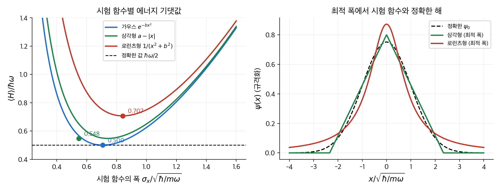
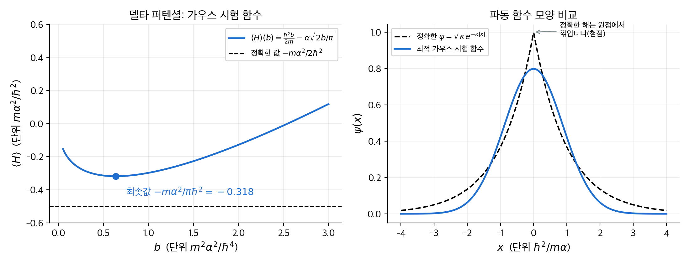
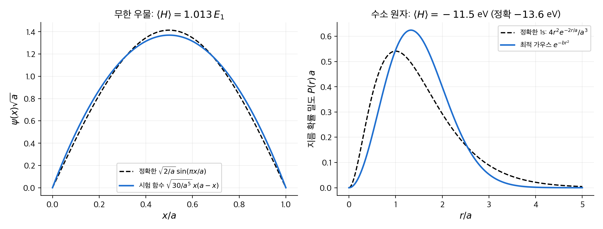
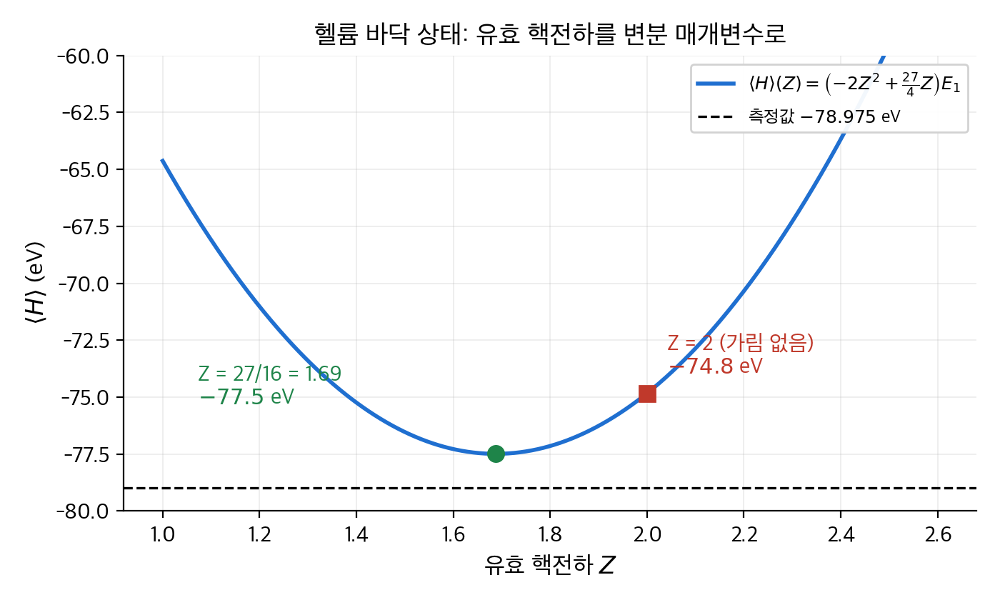
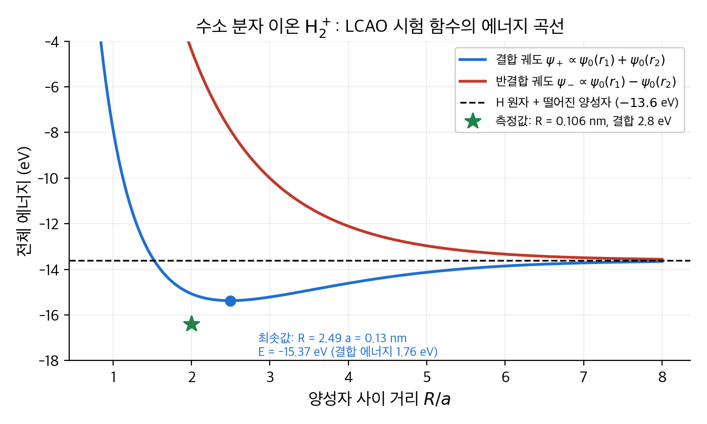
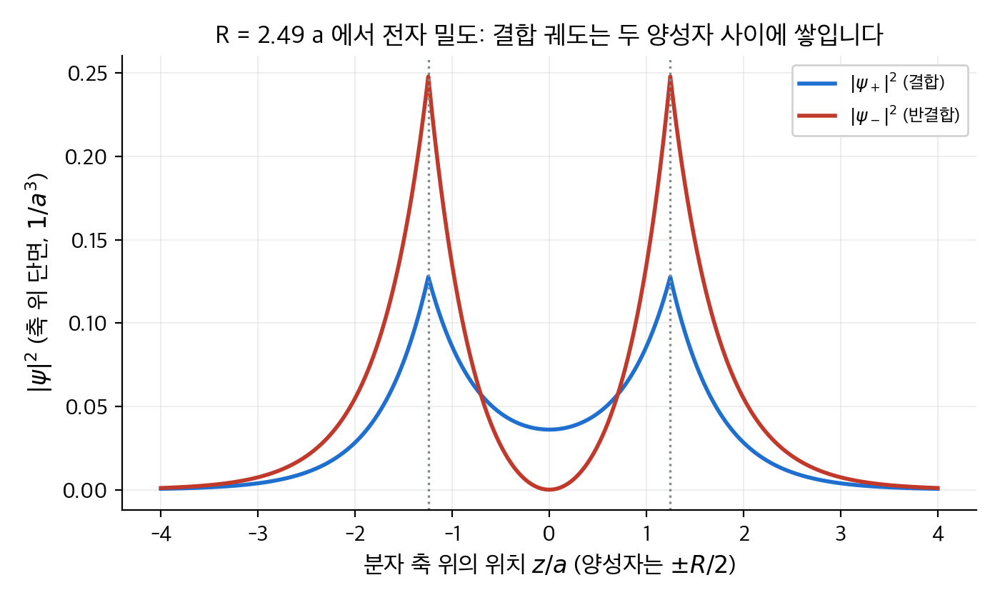
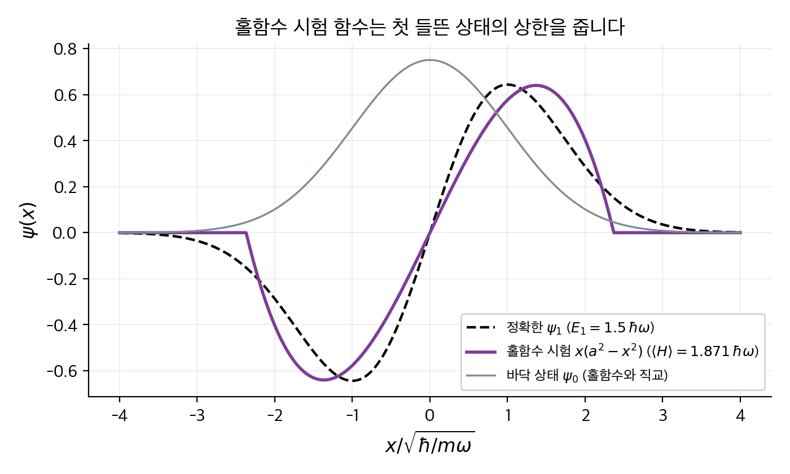

# 7. 변분 원리

슈뢰딩거 방정식을 정확히 풀 수 있는 퍼텐셜은 몇 개 되지 않습니다. 헬륨 원자처럼 전자가 둘만 되어도 닫힌 해가 없습니다.
**변분 원리**(variational principle)는 이런 문제에서 바닥 상태 에너지의 **상한**을 구하는 방법입니다.
아무 함수나 골라서 해밀토니언의 기댓값을 계산하면, 그 값은 바닥 상태 에너지보다 작을 수 없습니다.
따라서 매개변수가 들어 있는 함수 가족을 고릅니다. 기댓값을 가장 작게 하는 매개변수를 찾으면 꽤 좋은 상한을 얻습니다.
이 장에서는 먼저 이 원리를 증명합니다. 조화 진동자처럼 답을 아는 문제로 성능을 가늠한 뒤, 헬륨 원자와 수소 분자 이온에 적용합니다.
헬륨에서는 측정값과 2% 안쪽까지 맞는 에너지를 얻고, 수소 분자 이온에서는 화학 결합이 왜 생기는지를 보게 됩니다.

!!! info "원문과 자료"
    - 원문: Griffiths, *Introduction to Quantum Mechanics*, 1st ed. (1995), 7장 The Variational Principle (7.1 Theory, 7.2 The Ground State of Helium, 7.3 The Hydrogen Molecule Ion)
    - 함께 읽기: [2. 시간에 무관한 슈뢰딩거 방정식](02-time-independent-schrodinger.md), [4. 3차원 양자역학](04-three-dimensions.md), [5. 동일 입자](05-identical-particles.md), [6. 시간에 무관한 섭동 이론](06-time-independent-perturbation.md)
    - 유한 차원에서 같은 구조의 최소화 문제는 [볼록 최적화 9장](../../math/convex-optimization/09-unconstrained.md)에 있습니다.
    - 예시의 수치는 모두 SymPy, NumPy, SciPy로 다시 계산해서 검증했습니다.

## 1. 이론 (7.1절)

### 정리

해밀토니언 $H$ 의 바닥 상태 에너지를 $E_{\rm gs}$ 라고 두겠습니다. 규격화된 **임의의** 함수 $\psi$ 에 대해 다음이 성립합니다.

$$
E_{\rm gs} \le \langle \psi | H | \psi \rangle \equiv \langle H \rangle
$$

$\psi$ 는 바닥 상태와 전혀 닮지 않아도 됩니다. 경계 조건만 만족하면 어떤 함수든 상한을 줍니다.

### 증명

$H$ 의 고유 함수 $\psi_n$ 은 완전 직교 집합을 이룹니다. 따라서 $\psi = \sum_n c_n \psi_n$ 으로 전개할 수 있습니다.
규격화 조건은 $\sum_n |c_n|^2 = 1$ 입니다. 기댓값을 계산하면 다음과 같습니다.

$$
\langle H \rangle = \sum_{m,n} c_m^* c_n \langle \psi_m | H | \psi_n \rangle
= \sum_{m,n} c_m^* c_n E_n \delta_{mn}
= \sum_n |c_n|^2 E_n
$$

바닥 상태 에너지가 가장 작으므로 모든 $n$ 에 대해 $E_n \ge E_{\rm gs}$ 입니다. 그러므로

$$
\langle H \rangle = \sum_n |c_n|^2 E_n \ge E_{\rm gs} \sum_n |c_n|^2 = E_{\rm gs}
$$

입니다. 증명은 이게 전부입니다. $\langle H \rangle$ 는 고유 에너지들을 확률 $|c_n|^2$ 으로 섞은 가중 평균입니다. 가중 평균은 가장 작은 값보다 작을 수 없습니다.

### 일상 비유: 골짜기의 가장 낮은 곳

안개 낀 골짜기에서 가장 낮은 지점의 고도를 알고 싶다고 가정합니다. 어디에 서 있든 발밑의 고도는 가장 낮은 지점보다 높거나 같습니다.
한 지점의 고도를 재면 그 값은 바닥 고도의 상한입니다.
골짜기를 가로지르는 길 하나를 고릅니다. 그 길 위를 걸으며 가장 낮은 곳을 찾으면 더 좋은 상한을 얻습니다. 길이 진짜 바닥을 지나면 정확한 값을 얻습니다.
변분법에서 "길"은 매개변수가 들어 있는 함수 가족이고, "고도"는 $\langle H \rangle$ 입니다.
비유의 한계도 있습니다. 골짜기에서는 바닥이 얼마나 더 아래에 있는지 지형을 보고 가늠할 수 있지만, 변분법은 상한만 줄 뿐 오차의 크기는 알려 주지 않습니다.

### 사용 절차

1. 경계 조건을 만족하는 **시험 함수**(trial function) $\psi(x; b)$ 를 고릅니다. $b$ 는 조절할 매개변수입니다. 매개변수는 여러 개여도 됩니다.
2. 규격화 상수를 $b$ 의 함수로 구합니다.
3. $\langle H \rangle(b) = \langle T \rangle + \langle V \rangle$ 를 계산합니다. 운동 에너지는 부분 적분으로 $\langle T \rangle = \frac{\hbar^2}{2m}\int |\psi'|^2 dx$ 로 쓰면 편합니다.
4. $d\langle H \rangle / db = 0$ 을 풀어 최솟값을 찾습니다. 이 최솟값이 $E_{\rm gs}$ 의 상한입니다.

### 수치 예 1: 조화 진동자와 가우스 시험 함수

답을 아는 문제로 시작합니다. $V = \frac{1}{2} m \omega^2 x^2$ 이고 정확한 바닥 상태 에너지는 $\hbar\omega/2$ 입니다. 시험 함수로 $\psi = A e^{-bx^2}$ 을 고릅니다.

규격화: $\int_{-\infty}^{\infty} e^{-2bx^2} dx = \sqrt{\pi/2b}$ 이므로 $A^2 = \sqrt{2b/\pi}$ 입니다.

운동 에너지: $\psi' = -2bx\psi$ 이므로

$$
\langle T \rangle = \frac{\hbar^2}{2m} A^2 \int 4b^2 x^2 e^{-2bx^2} dx
= \frac{\hbar^2}{2m} \sqrt{\frac{2b}{\pi}} \cdot 4b^2 \cdot \frac{1}{4b}\sqrt{\frac{\pi}{2b}}
= \frac{\hbar^2 b}{2m}
$$

퍼텐셜 에너지: $\langle x^2 \rangle = 1/(4b)$ 이므로 $\langle V \rangle = \frac{1}{2} m\omega^2 \cdot \frac{1}{4b} = \frac{m\omega^2}{8b}$ 입니다.

$$
\langle H \rangle(b) = \frac{\hbar^2 b}{2m} + \frac{m\omega^2}{8b}
$$

첫 항은 $b$ 가 클수록(폭이 좁을수록) 커지고, 둘째 항은 $b$ 가 작을수록(폭이 넓을수록) 커집니다. 둘의 줄다리기가 최솟값을 정합니다.

$$
\frac{d\langle H \rangle}{db} = \frac{\hbar^2}{2m} - \frac{m\omega^2}{8b^2} = 0
\quad\Rightarrow\quad
b = \frac{m\omega}{2\hbar},
\qquad
\langle H \rangle_{\min} = \frac{\hbar\omega}{4} + \frac{\hbar\omega}{4} = \frac{\hbar\omega}{2}
$$

정확한 값이 나왔습니다. 가우스 함수 가족 안에 진짜 바닥 상태 $e^{-m\omega x^2/2\hbar}$ 가 들어 있기 때문입니다. 비유로 말하면, 고른 길이 골짜기 바닥을 지난 경우입니다.

### 수치 예 2: 모양이 틀린 시험 함수

같은 조화 진동자에 일부러 모양이 다른 두 시험 함수를 써 봅니다. 계산 방법은 똑같습니다.

**삼각형** $\psi = A(a - |x|)$, $|x| < a$ 밖에서는 0:
$A^2 = 3/(2a^3)$, $\langle T \rangle = 3\hbar^2/(2ma^2)$, $\langle V \rangle = m\omega^2 a^2/20$ 입니다.
$\langle H \rangle$ 를 최소화하면 $a^2 = \sqrt{30}\,\hbar/(m\omega)$ 에서 $\langle H \rangle_{\min} = \frac{\sqrt{30}}{10}\hbar\omega = 0.548\,\hbar\omega$ 입니다.

**로런츠형** $\psi = A/(x^2 + b^2)$:
$A^2 = 2b^3/\pi$, $\langle T \rangle = \hbar^2/(4mb^2)$, $\langle V \rangle = m\omega^2 b^2/2$ 입니다.
최소화하면 $b^2 = \hbar/(\sqrt{2}\,m\omega)$ 에서 $\langle H \rangle_{\min} = \hbar\omega/\sqrt{2} = 0.707\,\hbar\omega$ 입니다.

| 시험 함수 | $\langle H \rangle_{\min} / \hbar\omega$ | 정확한 값 대비 | 모양의 결함 |
| --- | --- | --- | --- |
| 가우스 $e^{-bx^2}$ | $0.500$ | $0\%$ | 없음 (정확한 해 포함) |
| 삼각형 $a - \lvert x \rvert$ | $0.548$ | $+9.5\%$ | 꼭짓점에서 꺾이고, $\lvert x \rvert > a$ 에서 0 |
| 로런츠형 $1/(x^2 + b^2)$ | $0.707$ | $+41\%$ | 꼬리가 $1/x^2$ 으로 너무 느리게 줄어듦 |

세 경우 모두 $\hbar\omega/2$ 보다 큽니다. 정리가 약속한 대로 상한만 나옵니다.
로런츠형이 가장 나쁜 이유는 꼬리입니다. 퍼텐셜이 $x^2$ 으로 자라는데 확률이 멀리까지 남아 있으면 $\langle V \rangle$ 가 커집니다.
실제 분자에 숫자를 넣어 보면, 일산화탄소의 진동 에너지 양자 $\hbar\omega = 0.269\,\mathrm{eV}$ 에 대해 정확한 영점 에너지는 $0.134\,\mathrm{eV}$ 입니다. 삼각형 시험 함수는 $0.147\,\mathrm{eV}$ 를 줍니다.

<figure markdown>

<figcaption markdown>
<span class="fig-title"><b>Figure 1.</b> 조화 진동자의 세 시험 함수와 에너지 기댓값</span>

왼쪽은 시험 함수의 폭(표준 편차)을 바꿀 때 $\langle H \rangle$ 가 어떻게 변하는지입니다. 모든 곡선이 점선($\hbar\omega/2$) 위에 있고, 가우스만 점선에 닿습니다.
오른쪽은 각 시험 함수를 최적 폭에서 정확한 바닥 상태와 겹쳐 그렸습니다.
</figcaption>
</figure>

### Python으로 확인

적분을 손으로 하기 어려운 시험 함수에는 수치 적분으로 같은 절차를 적용합니다. 삼각형 시험 함수로 위의 $0.548$ 을 재현합니다.

```python
import numpy as np
from scipy.integrate import quad
from scipy.optimize import minimize_scalar

def energy(psi, dpsi, V, lo, hi):          # hbar = m = 1 단위
    norm = quad(lambda x: psi(x)**2, lo, hi)[0]
    T = 0.5 * quad(lambda x: dpsi(x)**2, lo, hi)[0]
    U = quad(lambda x: V(x) * psi(x)**2, lo, hi)[0]
    return (T + U) / norm

V = lambda x: 0.5 * x**2                    # 조화 진동자, omega = 1
tri = lambda a: energy(lambda x: a - abs(x), lambda x: -np.sign(x), V, -a, a)
res = minimize_scalar(tri, bounds=(0.5, 5), method="bounded")
print(f"a* = {res.x:.3f}, <H>min = {res.fun:.4f}")   # a* = 2.340, <H>min = 0.5477
```

$a^* = 30^{1/4} = 2.340$ 과 $\sqrt{30}/10 = 0.5477$ 이 손계산과 일치합니다.

### 수치 예 3: 델타 함수 퍼텐셜

$V = -\alpha\,\delta(x)$ 는 [2장](02-time-independent-schrodinger.md)에서 정확히 풀었습니다. 속박 상태는 하나이고 $E = -m\alpha^2/(2\hbar^2)$, 파동 함수는 $\sqrt{\kappa}\,e^{-\kappa|x|}$ 입니다.
가우스 시험 함수 $\psi = A e^{-bx^2}$ 을 넣어 봅니다. 운동 에너지는 수치 예 1과 같이 $\hbar^2 b/2m$ 입니다. 퍼텐셜 에너지는 델타 함수 덕분에 한 줄입니다.

$$
\langle V \rangle = -\alpha \int \delta(x) |\psi|^2 dx = -\alpha |\psi(0)|^2 = -\alpha A^2 = -\alpha\sqrt{\frac{2b}{\pi}}
$$

$$
\langle H \rangle(b) = \frac{\hbar^2 b}{2m} - \alpha\sqrt{\frac{2b}{\pi}},
\qquad
\frac{d\langle H \rangle}{db} = \frac{\hbar^2}{2m} - \frac{\alpha}{\sqrt{2\pi b}} = 0
\;\Rightarrow\;
b = \frac{2m^2\alpha^2}{\pi\hbar^4}
$$

$$
\langle H \rangle_{\min} = \frac{m\alpha^2}{\pi\hbar^2} - \frac{2m\alpha^2}{\pi\hbar^2} = -\frac{m\alpha^2}{\pi\hbar^2}
$$

정확한 값과 비교하면 $\langle H \rangle_{\min} / E_{\rm exact} = 2/\pi = 0.637$ 입니다. 에너지의 64%만 건졌습니다.
가우스 함수는 원점에서 매끄럽지만, 정확한 해는 원점에서 꺾여 있습니다(첨점). 델타 함수는 바로 그 첨점이 만드는 운동 에너지 절약을 이용하는데, 가우스 함수는 그 구조를 흉내 낼 수 없습니다.

<figure markdown>

<figcaption markdown>
<span class="fig-title"><b>Figure 2.</b> 델타 함수 퍼텐셜의 가우스 시험 함수</span>

왼쪽은 $\langle H \rangle(b)$ 곡선입니다. 최솟값 $-0.318$ 은 정확한 값 $-0.5$ 보다 한참 위에 있습니다.
오른쪽은 모양 비교입니다. 정확한 해의 첨점을 가우스 함수가 따라가지 못합니다.
</figcaption>
</figure>

### 수치 예 4: 무한 우물과 수소 원자

**무한 우물** $0 < x < a$ 에서 양 끝이 0인 가장 단순한 다항식 $\psi = A x(a - x)$ 를 써 봅니다. $A^2 = 30/a^5$ 입니다.
퍼텐셜은 우물 안에서 0이므로 운동 에너지만 남습니다.

$$
\langle H \rangle = \frac{\hbar^2}{2m}\cdot\frac{30}{a^5}\int_0^a (a - 2x)^2 dx = \frac{\hbar^2}{2m}\cdot\frac{30}{a^5}\cdot\frac{a^3}{3} = \frac{5\hbar^2}{ma^2}
$$

정확한 값은 $E_1 = \pi^2\hbar^2/(2ma^2) = 4.935\,\hbar^2/(ma^2)$ 입니다. 비율은 $10/\pi^2 = 1.013$ 입니다. 매개변수 하나 없이 1.3% 오차입니다.
폭 1 nm 우물 속 전자에서는 $E_1 = 0.376\,\mathrm{eV}$ 이고, 시험 함수는 $0.381\,\mathrm{eV}$ 를 줍니다. 포물선과 사인 곡선이 그만큼 닮았기 때문입니다.

**수소 원자**에 가우스 시험 함수 $\psi = A e^{-br^2}$ 을 씁니다. 정확한 1s 상태는 $e^{-r/a}$ 꼴이므로 모양이 틀린 경우입니다. 구면 좌표에서 적분하면 다음과 같습니다.

$$
\langle H \rangle(b) = \frac{3\hbar^2 b}{2m} - \frac{e^2}{4\pi\epsilon_0}\cdot 2\sqrt{\frac{2b}{\pi}}
\quad\Rightarrow\quad
\langle H \rangle_{\min} = -\frac{8}{3\pi}\cdot\frac{m}{2\hbar^2}\left(\frac{e^2}{4\pi\epsilon_0}\right)^2 = \frac{8}{3\pi}E_1
$$

$E_1 = -13.6\,\mathrm{eV}$ 를 넣으면 $\langle H \rangle_{\min} = -11.5\,\mathrm{eV}$ 입니다. 정확한 값의 85%입니다.
최적 $b$ 는 $8/(9\pi a^2)$ 이고, 이때 지름 확률 밀도의 봉우리는 $r = 1.33a$ 에 있습니다. 정확한 봉우리 $r = a$ 보다 바깥입니다.
가우스 함수는 원점 근처에서 너무 평평하고 멀리서 너무 빨리 죽습니다. 쿨롱 퍼텐셜이 원점 근처에서 주는 이득을 놓칩니다.

<figure markdown>

<figcaption markdown>
<span class="fig-title"><b>Figure 3.</b> 무한 우물과 수소 원자의 시험 함수</span>

왼쪽의 포물선은 사인 곡선과 거의 겹쳐서 1.3% 오차만 냅니다.
오른쪽의 가우스 함수는 지수 함수와 모양이 달라서 15% 오차를 냅니다.
</figcaption>
</figure>

## 2. 헬륨의 바닥 상태 (7.2절)

### 문제

헬륨 원자는 전하 $2e$ 의 핵 주위를 전자 둘이 돕니다. 핵의 운동과 미세한 효과를 무시한 해밀토니언은 다음과 같습니다.

$$
H = -\frac{\hbar^2}{2m}\left(\nabla_1^2 + \nabla_2^2\right)
- \frac{e^2}{4\pi\epsilon_0}\left(\frac{2}{r_1} + \frac{2}{r_2} - \frac{1}{|\mathbf{r}_1 - \mathbf{r}_2|}\right)
$$

마지막 항이 두 전자 사이의 반발입니다. 이 항만 없으면 변수가 분리되어 정확히 풀립니다.
그 경우 바닥 상태는 두 전자가 모두 $Z = 2$ 인 수소꼴 1s 궤도에 들어간 상태이고 에너지는 $8E_1 = -109\,\mathrm{eV}$ 입니다.
측정값은 $-78.975\,\mathrm{eV}$ 입니다. 전자 반발이 30 eV 가까이 에너지를 올리므로 무시할 수 없습니다.

### 시험 함수: 유효 핵전하

전자 하나가 보기에 다른 전자는 핵의 전하를 일부 가립니다. 따라서 핵전하를 $2$ 대신 조절 가능한 $Z$ 로 둔 수소꼴 궤도의 곱을 시험 함수로 씁니다.

$$
\psi(\mathbf{r}_1, \mathbf{r}_2) = \frac{Z^3}{\pi a^3} e^{-Z(r_1 + r_2)/a}
$$

$a$ 는 보어 반지름입니다. 이 함수는 핵전하 $Z$ 인 수소꼴 해밀토니언의 정확한 바닥 상태입니다. 그 사실을 이용해 $H$ 를 다시 씁니다.

$$
H = \underbrace{\left[-\frac{\hbar^2}{2m}\nabla_1^2 - \frac{Ze^2}{4\pi\epsilon_0 r_1}\right] + \left[-\frac{\hbar^2}{2m}\nabla_2^2 - \frac{Ze^2}{4\pi\epsilon_0 r_2}\right]}_{\text{각각 } \psi \text{ 에 } Z^2 E_1 \text{ 을 줌}}
+ \frac{e^2}{4\pi\epsilon_0}\left[\frac{Z - 2}{r_1} + \frac{Z - 2}{r_2} + \frac{1}{|\mathbf{r}_1 - \mathbf{r}_2|}\right]
$$

### 기댓값 계산

세 가지 적분이 필요합니다.

1. 수소꼴 1s 상태에서 $\langle 1/r \rangle = Z/a$ 입니다.
2. 전자 반발의 기댓값은 전하 분포 둘의 정전기 에너지입니다. 계산하면 $\langle V_{ee} \rangle = \frac{5Z}{8a}\cdot\frac{e^2}{4\pi\epsilon_0}$ 입니다.
3. $\frac{e^2}{4\pi\epsilon_0 a} = -2E_1 = 27.2\,\mathrm{eV}$ 라는 관계를 써서 모두 $E_1$ 로 나타냅니다.

$$
\langle H \rangle = 2Z^2 E_1 + 2(Z - 2)\cdot\frac{Z}{a}\cdot\frac{e^2}{4\pi\epsilon_0} + \frac{5Z}{8a}\cdot\frac{e^2}{4\pi\epsilon_0}
= 2Z^2 E_1 - 4Z(Z - 2)E_1 - \frac{5Z}{4}E_1
$$

$$
\langle H \rangle(Z) = \left[-2Z^2 + \frac{27}{4}Z\right] E_1
$$

### 수치 예: $Z = 2$ 와 최적 $Z$

먼저 가림을 무시한 $Z = 2$ 를 넣습니다. $\langle H \rangle = (-8 + 13.5)E_1 = 5.5 E_1 = -74.8\,\mathrm{eV}$ 입니다.
이것은 전자 반발을 1차 섭동으로 넣은 결과와 같고, 측정값보다 4.2 eV 높습니다.

이제 $Z$ 를 변분 매개변수로 다룹니다. $E_1 < 0$ 이므로 대괄호 안을 **최대화**해야 $\langle H \rangle$ 가 최소가 됩니다.

$$
\frac{d}{dZ}\left[-2Z^2 + \frac{27}{4}Z\right] = -4Z + \frac{27}{4} = 0
\quad\Rightarrow\quad
Z = \frac{27}{16} = 1.6875
$$

$$
\langle H \rangle_{\min} = \left[-2\left(\frac{27}{16}\right)^2 + \frac{27}{4}\cdot\frac{27}{16}\right]E_1 = \frac{729}{128}E_1 = 5.695 E_1 = -77.5\,\mathrm{eV}
$$

| 계산 | 에너지 | 측정값과의 차이 |
| --- | --- | --- |
| 전자 반발 무시 ($8E_1$) | $-109\,\mathrm{eV}$ | $-30\,\mathrm{eV}$ |
| $Z = 2$, 반발을 기댓값으로 더함 | $-74.8\,\mathrm{eV}$ | $+4.2\,\mathrm{eV}$ |
| 변분 $Z = 27/16$ | $-77.5\,\mathrm{eV}$ | $+1.5\,\mathrm{eV}$ |
| 측정값 | $-78.975\,\mathrm{eV}$ | — |

매개변수 하나로 오차가 4.2 eV에서 1.5 eV로 줄었습니다. 상한이므로 측정값 위에 있는 것도 정리와 맞습니다.
$Z = 1.69$ 라는 값에는 물리적 뜻이 있습니다. 각 전자는 다른 전자가 핵전하를 평균 $0.31e$ 만큼 가린 것으로 느낍니다.
전자가 서로 완전히 가리면 $Z = 1$, 전혀 안 가리면 $Z = 2$ 입니다. 실제는 그 사이입니다.

<figure markdown>

<figcaption markdown>
<span class="fig-title"><b>Figure 4.</b> 헬륨 바닥 상태 에너지의 유효 핵전하 의존성</span>

$\langle H \rangle(Z)$ 는 $Z$ 에 대한 포물선입니다. 사각형은 가림을 무시한 $Z = 2$, 원은 변분 최솟값 $Z = 27/16$ 입니다. 점선은 측정값입니다.
</figcaption>
</figure>

### 더 좋은 시험 함수

매개변수를 더 넣으면 상한이 더 내려갑니다. 두 전자의 유효 핵전하를 따로 두면 $-78.3\,\mathrm{eV}$ 가 나옵니다.
전자 사이 거리 $r_{12}$ 를 시험 함수에 직접 넣으면 $-78.9\,\mathrm{eV}$ 안쪽까지 갑니다.
수백 개의 매개변수를 쓴 계산은 측정값과 $10^{-6}\,\mathrm{eV}$ 수준에서 일치합니다. 상한은 매개변수를 늘릴수록 단조롭게 좋아집니다.

## 3. 수소 분자 이온 (7.3절)

### 문제

$\mathrm{H}_2^+$ 는 양성자 둘과 전자 하나로 된 가장 단순한 분자입니다. 양성자 사이 거리를 $R$ 로 고정하고 전자의 해밀토니언을 씁니다.

$$
H = -\frac{\hbar^2}{2m}\nabla^2 - \frac{e^2}{4\pi\epsilon_0}\left(\frac{1}{r_1} + \frac{1}{r_2}\right)
$$

$r_1$, $r_2$ 는 각 양성자에서 전자까지의 거리입니다. 묻고 싶은 것은 "이 계가 수소 원자 하나와 멀리 떨어진 양성자보다 에너지가 낮은가"입니다.
낮다면 결합이 생깁니다. 그 에너지 차이가 **결합 에너지**이고, 가장 낮은 $R$ 이 **결합 길이**입니다.

### 시험 함수: 원자 궤도의 선형 결합

전자가 양성자 1 근처에 있으면 수소 1s 궤도 $\psi_0(r_1) = e^{-r_1/a}/\sqrt{\pi a^3}$ 처럼 보일 것이고, 양성자 2 근처에서도 마찬가지입니다.
두 상황을 같은 무게로 섞은 함수를 시험 함수로 씁니다. 이 방법을 **원자 궤도의 선형 결합**(LCAO)이라고 부릅니다.

$$
\psi_\pm = A_\pm\left[\psi_0(r_1) \pm \psi_0(r_2)\right]
$$

규격화에는 두 궤도가 얼마나 겹치는지를 재는 **겹침 적분**(overlap integral) $I$ 가 필요합니다. $x \equiv R/a$ 로 두면 다음과 같습니다.

$$
I = \int \psi_0(r_1)\psi_0(r_2)\,d^3r = e^{-x}\left(1 + x + \frac{x^2}{3}\right),
\qquad
A_\pm^2 = \frac{1}{2(1 \pm I)}
$$

$R \to 0$ 이면 $I \to 1$, $R \to \infty$ 이면 $I \to 0$ 입니다.

### 기댓값 계산

$\psi_0(r_1)$ 은 양성자 1만 있는 해밀토니언의 고유 함수입니다. 따라서 $H\psi_0(r_1) = E_1\psi_0(r_1) - \frac{e^2}{4\pi\epsilon_0 r_2}\psi_0(r_1)$ 입니다.
기댓값을 정리하면 두 종류의 적분이 나옵니다.

$$
D \equiv a\left\langle \psi_0(r_1)\left|\frac{1}{r_2}\right|\psi_0(r_1)\right\rangle = \frac{1}{x} - \left(1 + \frac{1}{x}\right)e^{-2x}
\qquad\text{(직접 적분)}
$$

$$
X \equiv a\left\langle \psi_0(r_1)\left|\frac{1}{r_1}\right|\psi_0(r_2)\right\rangle = (1 + x)e^{-x}
\qquad\text{(교환 적분)}
$$

**직접 적분** $D$ 는 양성자 1에 묶인 전자 구름이 양성자 2에게서 받는 인력입니다. 고전 정전기학으로도 나오는 양입니다.
**교환 적분** $X$ 는 전자가 두 궤도에 동시에 걸쳐 있을 때만 생기는 항입니다. 고전적인 대응물이 없습니다.
전자의 에너지는 다음과 같습니다.

$$
\langle H \rangle_\pm = E_1\left[1 + 2\frac{D \pm X}{1 \pm I}\right]
$$

양성자 사이의 반발 $\frac{e^2}{4\pi\epsilon_0 R} = -\frac{2E_1}{x}$ 를 더하면 분자의 전체 에너지가 됩니다.

$$
E_{\rm tot}^\pm(x) = E_1\left[1 + 2\frac{D \pm X}{1 \pm I}\right] - \frac{2E_1}{x}
$$

### 수치 예: 결합 길이와 결합 에너지

$E_{\rm tot}^+(x)$ 를 $x$ 에 대해 수치적으로 최소화합니다. 손으로 한 점만 확인해 봅니다. $x = 2.5$ 에서

| 양 | 값 |
| --- | --- |
| $I = e^{-2.5}(1 + 2.5 + 2.083)$ | $0.458$ |
| $D = 0.4 - 1.4\,e^{-5}$ | $0.391$ |
| $X = 3.5\,e^{-2.5}$ | $0.287$ |
| $1 + 2(D + X)/(1 + I)$ | $1.930$ |
| 전자 에너지 $1.930\,E_1$ | $-26.26\,\mathrm{eV}$ |
| 양성자 반발 $-2E_1/2.5$ | $+10.88\,\mathrm{eV}$ |
| 전체 | $-15.37\,\mathrm{eV}$ |

최솟값은 $x = 2.49$ 에서 $E_{\rm tot}^+ = -15.37\,\mathrm{eV}$ 입니다. 수소 원자 하나의 $-13.6\,\mathrm{eV}$ 보다 낮습니다. 결합이 생깁니다.

| 양 | 변분 계산 | 측정값 |
| --- | --- | --- |
| 결합 길이 $R$ | $2.49a = 0.132\,\mathrm{nm}$ | $0.106\,\mathrm{nm}$ |
| 결합 에너지 | $1.76\,\mathrm{eV}$ | $2.8\,\mathrm{eV}$ |

결합 길이는 25%, 결합 에너지는 37% 틀렸습니다. 수소 원자 궤도 두 개를 더했을 뿐인 시험 함수로서는 괜찮은 결과입니다.
결합 에너지가 작게 나오는 것도 정리와 맞습니다. 변분 에너지는 상한이므로, 진짜 분자는 계산보다 더 단단히 묶여 있어야 합니다.
시험 함수의 지수를 $e^{-r/a}$ 대신 $e^{-Zr/a}$ 로 바꾸고 $Z$ 도 최적화하면 $R = 0.106\,\mathrm{nm}$, 결합 에너지 $2.35\,\mathrm{eV}$ 로 좋아집니다.

<figure markdown>

<figcaption markdown>
<span class="fig-title"><b>Figure 5.</b> 수소 분자 이온의 결합·반결합 에너지 곡선</span>

파란 곡선($\psi_+$)은 $R = 2.49a$ 에서 수소 원자의 에너지(점선) 아래로 내려갑니다. 빨간 곡선($\psi_-$)은 어디서도 점선 아래로 내려가지 않습니다.
별표는 측정값입니다. 상한이므로 계산값은 측정값보다 위에 있습니다.
</figcaption>
</figure>

### 왜 결합이 생기는가

식에서 결합을 만드는 것은 교환 적분 $X$ 입니다. $D$ 만 있으면(고전적인 그림) $E_{\rm tot}$ 는 양성자 반발에 밀려 어디서도 $E_1$ 아래로 내려가지 않습니다.
$\psi_+$ 에서는 $X$ 가 $+$ 부호로 들어와 에너지를 낮추고, $\psi_-$ 에서는 $-$ 부호로 들어와 에너지를 높입니다.

그림으로 보면 뜻이 분명해집니다. $\psi_+$ 는 두 궤도가 보강 간섭을 해서 두 양성자 **사이**에 전자 밀도를 쌓습니다.
그곳의 전자는 두 양성자를 동시에 끌어당겨 반발을 상쇄합니다.
$\psi_-$ 는 두 궤도가 상쇄 간섭을 해서 가운데 평면에서 밀도가 정확히 0입니다. 양성자 사이를 잇는 풀이 없으니 반발만 남습니다.
$\psi_+$ 를 **결합 궤도**(bonding orbital), $\psi_-$ 를 **반결합 궤도**(antibonding orbital)라고 부릅니다.

<figure markdown>

<figcaption markdown>
<span class="fig-title"><b>Figure 6.</b> 결합 궤도와 반결합 궤도의 전자 밀도</span>

분자 축을 따라 자른 $|\psi|^2$ 입니다. 결합 궤도는 두 양성자 사이에 밀도가 남아 있고, 반결합 궤도는 가운데에서 0입니다.
</figcaption>
</figure>

## 4. 변분법의 한계와 들뜬 상태

### 무엇을 말해 주지 않는가

변분법은 쓰기 쉽지만 세 가지를 조심해야 합니다.

1. **상한만 줍니다.** 오차가 얼마인지는 알 수 없습니다. 헬륨에서 1.5 eV 틀렸다는 것은 측정값이 있어서 아는 사실입니다. 측정값이 없는 계에서는 시험 함수를 바꿔 가며 값이 얼마나 내려가는지를 볼 수밖에 없습니다.
2. **에너지가 좋아도 파동 함수는 나쁠 수 있습니다.** 에너지는 파동 함수 오차의 2차로 틀리지만, 다른 물리량의 기댓값은 1차로 틀립니다. 델타 퍼텐셜의 가우스 시험 함수는 에너지를 64% 맞추지만 원점의 첨점 구조를 전혀 재현하지 못합니다.
3. **바닥 상태만 다룹니다.** 아무 함수나 넣으면 바닥 상태의 상한이 나올 뿐, 들뜬 상태에 대해서는 아무 말도 하지 않습니다.

### 들뜬 상태의 상한

세 번째 한계는 피해 갈 수 있습니다. 시험 함수가 바닥 상태와 **직교**하면, 전개 $\psi = \sum c_n\psi_n$ 에서 $c_0 = 0$ 이 됩니다.
그러면 증명을 그대로 반복해 $\langle H \rangle \ge E_1$ (첫 들뜬 상태)을 얻습니다.
문제는 바닥 상태를 모르면 직교 조건을 걸 수 없다는 점입니다. 하지만 **대칭성**이 있으면 바닥 상태를 몰라도 됩니다.

퍼텐셜이 짝함수이면 바닥 상태는 짝함수이고, 홀함수는 짝함수와 자동으로 직교합니다.
따라서 조화 진동자에서 **홀함수** 시험 함수는 첫 들뜬 상태의 상한을 줍니다.

**홀함수 가우스** $\psi = A x e^{-bx^2}$: $\langle H \rangle = \frac{3\hbar^2 b}{2m} + \frac{3m\omega^2}{8b}$ 이고 최솟값은 $b = m\omega/2\hbar$ 에서 $\frac{3}{2}\hbar\omega$ 입니다. 정확한 첫 들뜬 상태가 이 가족 안에 있으므로 정확한 값이 나옵니다.

**홀함수 다항식** $\psi = A x(a^2 - x^2)$, $|x| < a$: $\langle H \rangle = \frac{21\hbar^2}{4ma^2} + \frac{m\omega^2 a^2}{6}$ 이고 최솟값은 $\frac{\sqrt{14}}{2}\hbar\omega = 1.871\,\hbar\omega$ 입니다. 정확한 $1.5\,\hbar\omega$ 보다 25% 위이지만, 분명히 첫 들뜬 상태의 상한입니다.

<figure markdown>

<figcaption markdown>
<span class="fig-title"><b>Figure 7.</b> 홀함수 시험 함수와 첫 들뜬 상태</span>

홀함수 시험 함수는 짝함수인 바닥 상태(회색)와 자동으로 직교합니다. 따라서 그 에너지 기댓값은 바닥 상태가 아니라 첫 들뜬 상태의 상한입니다.
</figcaption>
</figure>

수소 원자에서도 같은 요령이 통합니다. $l = 1$ 인 시험 함수는 $l = 0$ 인 바닥 상태와 직교하므로, $l = 1$ 가운데 가장 낮은 상태(2p)의 상한을 줍니다.

## 5. 정리

| 문제 | 시험 함수 | 변분 결과 | 정확한 값 또는 측정값 |
| --- | --- | --- | --- |
| 조화 진동자 | $e^{-bx^2}$ | $0.500\,\hbar\omega$ | $0.500\,\hbar\omega$ |
| 조화 진동자 | $a - \lvert x \rvert$ | $0.548\,\hbar\omega$ | $0.500\,\hbar\omega$ |
| 조화 진동자 | $1/(x^2 + b^2)$ | $0.707\,\hbar\omega$ | $0.500\,\hbar\omega$ |
| 조화 진동자 첫 들뜬 상태 | $x(a^2 - x^2)$ | $1.871\,\hbar\omega$ | $1.500\,\hbar\omega$ |
| 델타 퍼텐셜 | $e^{-bx^2}$ | $-0.318\,m\alpha^2/\hbar^2$ | $-0.500\,m\alpha^2/\hbar^2$ |
| 무한 우물 | $x(a - x)$ | $1.013\,E_1$ | $E_1$ |
| 수소 원자 | $e^{-br^2}$ | $-11.5\,\mathrm{eV}$ | $-13.6\,\mathrm{eV}$ |
| 헬륨 | $e^{-Z(r_1 + r_2)/a}$ | $-77.5\,\mathrm{eV}$ | $-78.975\,\mathrm{eV}$ |
| $\mathrm{H}_2^+$ | $\psi_0(r_1) + \psi_0(r_2)$ | 결합 $1.76\,\mathrm{eV}$, $R = 0.132\,\mathrm{nm}$ | $2.8\,\mathrm{eV}$, $0.106\,\mathrm{nm}$ |

모든 행에서 변분 결과는 정확한 값보다 크거나 같습니다. 시험 함수가 정확한 해를 포함하면 등호가 성립하고, 모양이 다를수록 간격이 벌어집니다.
변분법은 [6장](06-time-independent-perturbation.md)의 섭동 이론과 서로 보완합니다. 섭동 이론은 "작은 보정"이 있을 때 쓰고, 변분법은 보정이 크더라도 좋은 시험 함수가 있을 때 씁니다.
[8장](08-wkb.md)의 WKB 근사는 세 번째 길로, 퍼텐셜이 천천히 변할 때 씁니다.
