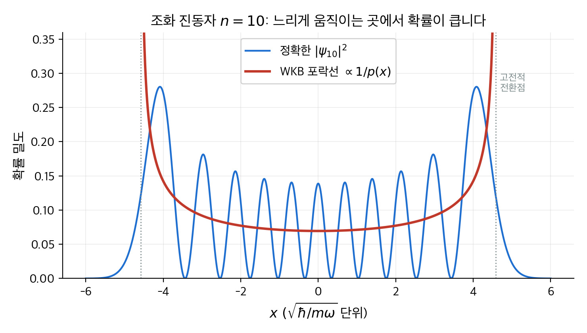
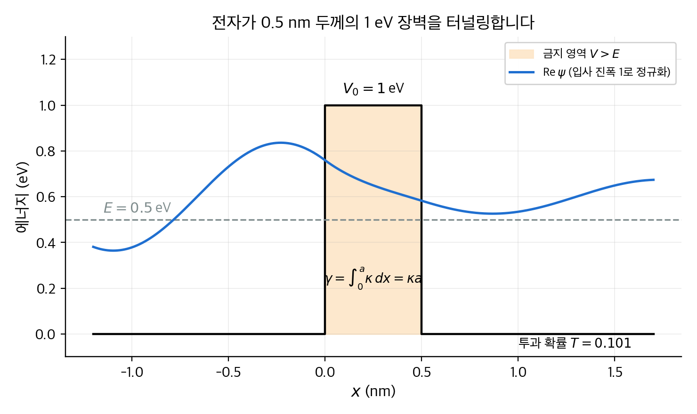
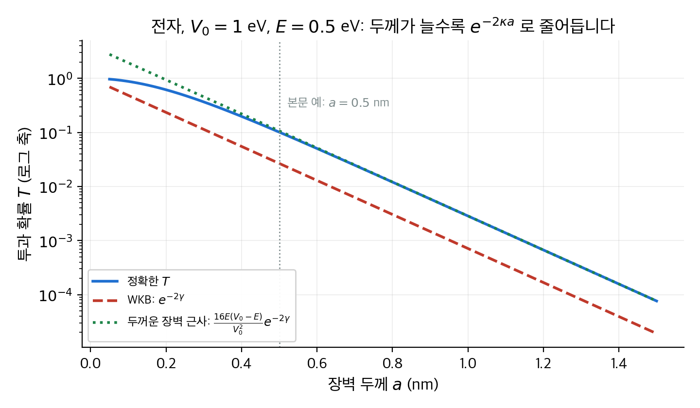
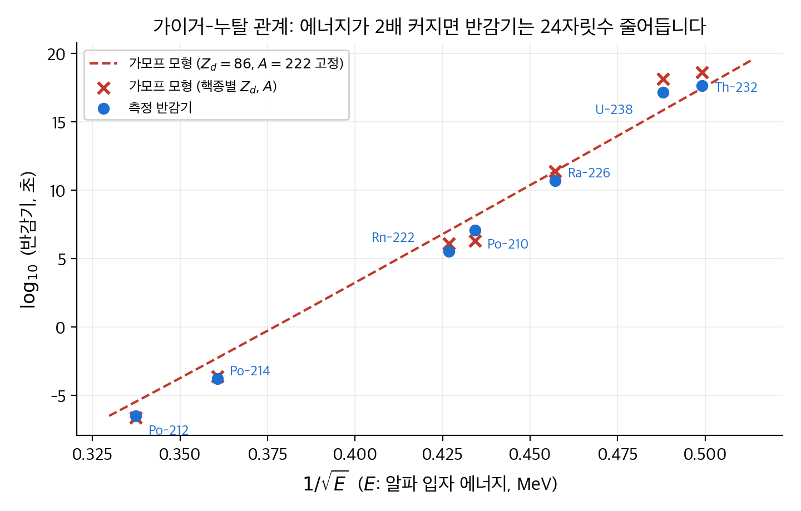
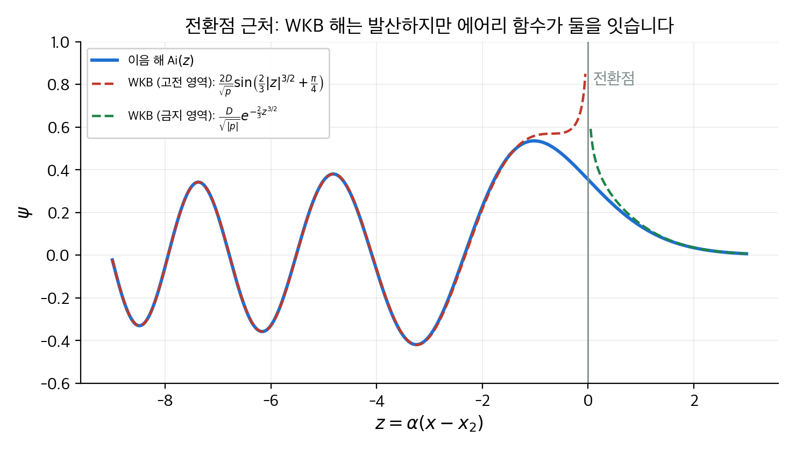
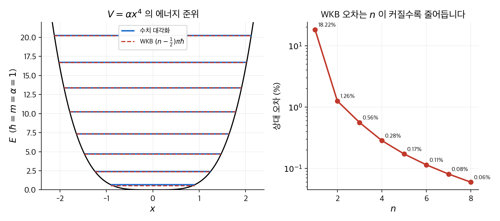

# 8. WKB 근사

이 장은 퍼텐셜이 천천히 변할 때 슈뢰딩거 방정식의 근사해를 구하는 **WKB 근사**(Wentzel–Kramers–Brillouin approximation)를 다룹니다.
핵심 아이디어는 하나입니다. 파장이 변하는 거리보다 파장 자체가 훨씬 짧으면, 파동 함수는 "국소적으로 평면파"처럼 행동합니다.
그러면 진폭은 $1/\sqrt{p(x)}$ 로, 위상은 $\int p\,dx/\hbar$ 로 결정됩니다. 여기서 $p(x) = \sqrt{2m(E - V(x))}$ 는 고전 운동량입니다.
이 한 줄에서 세 가지 결과가 나옵니다. 우물 속 에너지 준위의 양자화 조건, 장벽을 뚫는 터널링 확률 $T \approx e^{-2\gamma}$, 그리고 알파 붕괴 반감기가 에너지에 따라 24자릿수나 달라지는 이유입니다.
수치 예로 1 eV 장벽을 뚫는 전자, 주사 터널링 현미경, 우라늄-238과 폴로늄-212의 반감기를 끝까지 계산합니다.

!!! info "원문과 자료"
    - 원문: Griffiths, *Introduction to Quantum Mechanics*, 1st ed. (1995), 8장 The WKB Approximation (8.1 The "Classical" Region, 8.2 Tunneling, 8.3 The Connection Formulas)
    - 함께 읽기: [2. 시간에 무관한 슈뢰딩거 방정식](02-time-independent-schrodinger.md)(무한 우물, 조화 진동자, 산란 행렬), [7. 변분 원리](07-variational-principle.md), [11. 산란](11-scattering.md)
    - 예시의 수치는 모두 NumPy와 SciPy로 다시 계산해서 검증했습니다. 수치 대각화는 유한 차분 격자를 썼습니다.

## 0. 어떤 근사인가

고전 입자가 우물 속을 왕복하면, 빠르게 지나가는 곳에는 짧게 머물고 느리게 지나가는 곳에는 오래 머뭅니다.
한 지점 근처에서 입자를 발견할 확률은 머무는 시간에 비례하므로 $1/v(x) \propto 1/p(x)$ 입니다.
WKB 근사는 이 고전적 확률 분포를 **포락선**(envelope)으로 삼고, 그 안에 파장 $\lambda(x) = 2\pi\hbar/p(x)$ 의 진동을 채워 넣은 파동 함수입니다.

비유하면 그릇 속을 구르는 구슬의 장노출 사진과 같습니다. 구슬이 느린 가장자리에서는 잔상이 진하고, 빠른 바닥에서는 흐립니다.
비유의 한계도 분명합니다. 구슬은 가장자리 바깥으로 절대 나가지 않지만, 양자 파동 함수는 전환점 너머로 조금 스며듭니다.
또 구슬의 잔상은 매끈하지만, 파동 함수는 포락선 안에서 빠르게 진동하고 마디(node)를 가집니다.

<figure markdown>

<figcaption markdown>
<span class="fig-title"><b>Figure 1.</b> 조화 진동자 $n = 10$ 상태의 확률 밀도와 WKB 포락선</span>

파란 선은 정확한 $|\psi_{10}|^2$ 이고 빨간 선은 고전 확률 밀도 $1/(\pi\sqrt{x_0^2 - x^2})$ 입니다. 진동의 평균이 빨간 포락선을 따라갑니다. 전환점 $x_0 = \sqrt{21}$ 에서 포락선은 발산하지만 실제 파동 함수는 유한하고, 전환점 너머로 지수적으로 감쇠합니다.
</figcaption>
</figure>

근사가 성립하는 조건은 "파장이 한 파장 거리 안에서 거의 변하지 않는다"입니다. 즉 $|d\lambda/dx| \ll 1$ 입니다.
에너지가 높아 파장이 짧을수록, 퍼텐셜이 완만할수록 잘 맞습니다. 반대로 $p(x) = 0$ 이 되는 **전환점**(turning point) 근처에서는 파장이 무한대가 되므로 반드시 깨집니다.
전환점 문제는 3절에서 따로 다룹니다.

## 1. 고전 영역 (원문 8.1절)

### 유도

$E > V(x)$ 인 영역을 **고전 영역**(classical region)이라고 부릅니다. 시간에 무관한 슈뢰딩거 방정식을 다음과 같이 씁니다.

$$
\frac{d^2\psi}{dx^2} = -\frac{p(x)^2}{\hbar^2}\,\psi, \qquad p(x) = \sqrt{2m\,[E - V(x)]}
$$

$V$ 가 상수이면 해는 $e^{\pm ipx/\hbar}$ 입니다. $V$ 가 천천히 변하면 진폭과 위상이 모두 $x$ 에 의존한다고 두는 것이 자연스럽습니다.

$$
\psi(x) = A(x)\,e^{i\phi(x)}, \qquad A, \phi \text{ 는 실수 함수}
$$

이를 대입하고 실수부와 허수부를 나누면 두 방정식이 나옵니다.

$$
A'' - A\,(\phi')^2 = -\frac{p^2}{\hbar^2}A, \qquad 2A'\phi' + A\phi'' = 0
$$

두 번째 식은 $(A^2 \phi')' = 0$ 과 같으므로 $A = C/\sqrt{\phi'}$ 입니다. 여기까지는 정확합니다.
WKB 근사는 첫 번째 식에서 $A''$ 를 버립니다. 진폭이 파장에 비해 천천히 변하면 $A''$ 는 $A(\phi')^2$ 보다 훨씬 작기 때문입니다.
그러면 $\phi' = \pm p/\hbar$ 이고, 결과는 다음과 같습니다.

$$
\psi(x) \approx \frac{C}{\sqrt{p(x)}}\,\exp\!\left(\pm\frac{i}{\hbar}\int^x p(x')\,dx'\right), \qquad |\psi|^2 \approx \frac{|C|^2}{p(x)}
$$

일반해는 두 부호의 선형 결합입니다. 실수 형태로 쓰면 $\psi \approx \dfrac{1}{\sqrt{p}}\left[C_1 \sin\!\left(\frac{1}{\hbar}\int p\,dx\right) + C_2 \cos\!\left(\frac{1}{\hbar}\int p\,dx\right)\right]$ 입니다.

### 수직 벽이 있는 우물의 양자화

양 끝이 무한히 높은 벽($x = 0$, $x = a$)이고 그 사이의 바닥 $V(x)$ 는 완만하다고 가정합니다.
$\psi(0) = 0$ 이므로 사인 항만 남습니다. $\psi(a) = 0$ 이려면 위상이 $\pi$ 의 정수배여야 합니다.

$$
\boxed{\;\int_0^a p(x)\,dx = n\pi\hbar, \qquad n = 1, 2, 3, \ldots\;}
$$

이것이 WKB 양자화 조건입니다. 적분은 "운동량 곡선 아래의 넓이"이고, 그 값이 $\pi\hbar$ 의 정수배일 때만 정상 상태가 존재합니다.
파장으로 읽으면 더 직관적입니다. 우물 안에 반파장이 정확히 $n$ 개 들어간다는 조건입니다. 다만 파장이 자리마다 다르므로 "개수"를 적분으로 셉니다.

**검산: 무한 사각 우물.** 바닥이 평평하면 $p = \sqrt{2mE}$ 가 상수이므로 $\sqrt{2mE}\,a = n\pi\hbar$ 입니다.

$$
E_n = \frac{n^2\pi^2\hbar^2}{2ma^2}
$$

[2장](02-time-independent-schrodinger.md)의 정확한 답과 같습니다. 벽이 수직이고 바닥이 평평하면 WKB가 정확해집니다. 파장이 어디서도 변하지 않기 때문입니다.

### 수치 예: 바닥이 기울어진 우물

폭 $a = 1\,\mathrm{nm}$ 인 무한 우물의 바닥이 $V(x) = \alpha x$ 로 기울어져 있습니다. 오른쪽 벽에서 바닥 높이가 $\alpha a = 1\,\mathrm{eV}$ 입니다. 전자를 넣습니다.
$E > \alpha a$ 이면 전자는 우물 전체를 돌아다니므로 양 끝이 모두 수직 벽입니다.

$$
\int_0^a \sqrt{2m(E - \alpha x)}\,dx = \frac{2\sqrt{2m}}{3\alpha}\left[E^{3/2} - (E - \alpha a)^{3/2}\right] = n\pi\hbar
$$

$E$ 에 대한 이 방정식을 수치적으로 풉니다. $\hbar^2/m_e = 0.0762\,\mathrm{eV\,nm^2}$ 를 쓰면 됩니다.
비교 대상은 같은 퍼텐셜을 4000점 격자에서 유한 차분으로 대각화한 값입니다.

| $n$ | 평평한 우물 $E_n$ | WKB | 수치 대각화 | 상대 오차 |
| --- | --- | --- | --- | --- |
| 1 | 0.376 eV | 0.781 eV | 0.848 eV | $-7.9\,\%$ |
| 2 | 1.504 eV | 2.018 eV | 2.012 eV | $+0.29\,\%$ |
| 3 | 3.384 eV | 3.890 eV | 3.889 eV | $+0.03\,\%$ |
| 4 | 6.017 eV | 6.520 eV | 6.520 eV | $+0.005\,\%$ |
| 5 | 9.401 eV | 9.903 eV | 9.903 eV | $+0.001\,\%$ |

두 가지가 눈에 띕니다. 첫째, 기울기의 평균 높이 $0.5\,\mathrm{eV}$ 만큼 에너지가 거의 그대로 올라갑니다. 이것은 [6장](06-time-independent-perturbation.md)의 1차 섭동 결과와 같습니다.
둘째, $n = 1$ 만 오차가 큽니다. 바닥 상태의 에너지 $0.85\,\mathrm{eV}$ 는 오른쪽 벽의 바닥 높이 $1\,\mathrm{eV}$ 보다 낮습니다.
따라서 전자는 오른쪽 벽에 닿지 못하고 $x = 0.85\,\mathrm{nm}$ 근처의 완만한 전환점에서 되돌아옵니다. 이 경우에는 3절의 공식 $(n - \tfrac14)\pi\hbar$ 를 써야 합니다. 표의 값도 그렇게 계산했습니다. 그래도 오차가 남는 이유는 바닥 상태의 파장이 우물 크기와 비슷해 "천천히 변하는 퍼텐셜" 조건 자체가 약하기 때문입니다.

## 2. 터널링 (원문 8.2절)

### 금지 영역의 해

$E < V(x)$ 인 **금지 영역**(forbidden region)에서는 $p(x)$ 가 허수입니다. $|p(x)| = \sqrt{2m(V - E)}$ 로 두면 같은 유도가 그대로 통하고, 진동 대신 지수 함수가 나옵니다.

$$
\psi(x) \approx \frac{C}{\sqrt{|p(x)|}}\,\exp\!\left(\pm\frac{1}{\hbar}\int^x |p(x')|\,dx'\right)
$$

장벽이 $0 \le x \le a$ 에 있고 왼쪽에서 입사한다고 가정합니다. 장벽이 충분히 두꺼우면 안쪽에서 커지는 지수 항은 거의 없고, 파동 함수는 장벽을 지나며 $e^{-\gamma}$ 배로 줄어듭니다.

$$
\gamma \equiv \frac{1}{\hbar}\int_0^a |p(x)|\,dx = \frac{1}{\hbar}\int_0^a \sqrt{2m\,[V(x) - E]}\,dx
$$

투과 확률은 진폭의 제곱이므로 다음과 같습니다.

$$
\boxed{\;T \approx e^{-2\gamma}\;}
$$

이 식은 지수 부분만 맞습니다. 앞의 계수는 1로 두었습니다. 장벽이 두꺼울수록($\gamma \gg 1$) 지수가 모든 것을 지배하므로 계수의 오차는 상대적으로 작아집니다.

<figure markdown>

<figcaption markdown>
<span class="fig-title"><b>Figure 2.</b> 0.5 nm 두께의 1 eV 장벽을 터널링하는 0.5 eV 전자</span>

장벽 왼쪽에서는 입사파와 반사파가 겹쳐 진동하고, 장벽 안(주황)에서는 지수적으로 줄어들며, 오른쪽에는 작아진 진폭의 투과파가 남습니다. 파동 함수는 정확한 사각 장벽 해로 그렸습니다. $\gamma$ 는 주황 영역에서 $\kappa$ 를 적분한 값입니다.
</figcaption>
</figure>

### 수치 예: 사각 장벽을 뚫는 전자

높이 $V_0 = 1\,\mathrm{eV}$, 두께 $a = 0.5\,\mathrm{nm}$ 인 사각 장벽에 에너지 $E = 0.5\,\mathrm{eV}$ 의 전자가 부딪힙니다. 사각 장벽은 안에서 $|p|$ 가 상수이므로 적분이 곱셈이 됩니다.

$$
\kappa = \frac{\sqrt{2m(V_0 - E)}}{\hbar} = \sqrt{\frac{2 \times 0.5\,\mathrm{eV}}{0.0762\,\mathrm{eV\,nm^2}}} = 3.62\,\mathrm{nm^{-1}}, \qquad \gamma = \kappa a = 1.81
$$

$$
T_{\text{WKB}} = e^{-2 \times 1.81} = 0.027
$$

이 문제는 [2장](02-time-independent-schrodinger.md)의 방법으로 정확히 풀 수 있습니다.

$$
T_{\text{정확}} = \left[1 + \frac{V_0^2}{4E(V_0 - E)}\sinh^2(\kappa a)\right]^{-1} = \frac{1}{1 + 1 \times 8.86} = 0.101
$$

WKB가 4배 작게 나왔습니다. 이유는 앞 계수입니다. $\kappa a \gg 1$ 이면 $\sinh^2(\kappa a) \approx e^{2\kappa a}/4$ 이므로 정확한 식은 $T \approx \dfrac{16E(V_0 - E)}{V_0^2}\,e^{-2\kappa a}$ 가 됩니다.
지금 예에서 이 계수는 $16 \times 0.5 \times 0.5 = 4$ 입니다. 계수를 붙이면 $0.107$ 로 정확한 값에 가깝습니다.
즉 WKB의 $e^{-2\gamma}$ 는 "두께가 0.1 nm 늘 때 $T$ 가 몇 배 줄어드는가"처럼 지수적 의존성을 묻는 질문에 쓰는 도구입니다. 절댓값이 필요하면 계수를 따로 구해야 합니다.

| 두께 $a$ | $2\gamma$ | $T_{\text{WKB}} = e^{-2\gamma}$ | $T_{\text{정확}}$ | 비율 |
| --- | --- | --- | --- | --- |
| 0.2 nm | 1.45 | 0.235 | 0.616 | 2.6 |
| 0.5 nm | 3.62 | 0.027 | 0.101 | 3.8 |
| 1.0 nm | 7.25 | $7.1 \times 10^{-4}$ | $2.9 \times 10^{-3}$ | 4.0 |
| 2.0 nm | 14.5 | $5.1 \times 10^{-7}$ | $2.0 \times 10^{-6}$ | 4.0 |

비율이 4로 수렴합니다. 두께가 두 배가 되면 $T$ 는 $e^{-3.6} \approx 1/37$ 배가 됩니다. 두 방법 모두 이 비율을 똑같이 예측합니다.

<figure markdown>

<figcaption markdown>
<span class="fig-title"><b>Figure 3.</b> 장벽 두께에 따른 투과 확률</span>

로그 축에서 세 곡선은 같은 기울기 $-2\kappa$ 를 가집니다. WKB(빨간 파선)는 정확한 값보다 일정한 배수만큼 아래에 있습니다. 계수 $16E(V_0 - E)/V_0^2$ 를 붙인 초록 점선은 $a > 0.4\,\mathrm{nm}$ 에서 정확한 값과 겹칩니다.
</figcaption>
</figure>

### 수치 예: 주사 터널링 현미경

**주사 터널링 현미경**(scanning tunneling microscope, STM)은 금속 탐침과 시료 사이의 진공 틈을 전자가 터널링하는 전류를 잽니다.
전자가 금속 밖으로 나가려면 **일함수**(work function) $\phi \approx 4.5\,\mathrm{eV}$ 만큼의 장벽을 넘어야 합니다. 틈의 두께를 $d$ 라고 하면 전류는 $T \propto e^{-2\kappa d}$ 에 비례합니다.

$$
\kappa = \sqrt{\frac{2 \times 4.5}{0.0762}}\,\mathrm{nm^{-1}} = 10.9\,\mathrm{nm^{-1}}, \qquad e^{-2\kappa \times 0.1\,\mathrm{nm}} = e^{-2.17} = 0.11
$$

탐침이 $0.1\,\mathrm{nm}$ 멀어질 때마다 전류가 약 10분의 1로 줄어듭니다. 원자 하나의 높이가 $0.2{\sim}0.3\,\mathrm{nm}$ 이므로, 표면의 원자 한 층 차이가 전류를 100배 넘게 바꿉니다.
STM이 원자를 하나씩 구별하는 이유가 바로 이 지수 함수의 민감도입니다.

### 가모프의 알파 붕괴 이론

**알파 붕괴**(alpha decay)는 무거운 핵이 알파 입자(헬륨 핵, 전하 $2e$)를 내보내는 현상입니다. 1928년 가모프(Gamow)는 이를 터널링으로 설명했습니다.
핵 안($r < r_1$)에서는 강한 핵력이 알파 입자를 깊은 우물에 가둡니다. 핵 밖에서는 남은 핵(전하 $Z_d e$)과의 쿨롱 반발 $V(r) = \dfrac{2Z_d e^2}{4\pi\epsilon_0 r}$ 만 남습니다.
알파 입자의 에너지 $E$ 는 쿨롱 장벽의 꼭대기($r = r_1$ 에서 $30\,\mathrm{MeV}$ 정도)보다 훨씬 낮습니다. 고전적으로는 영원히 갇혀 있어야 합니다.

장벽의 바깥 전환점 $r_2$ 는 $V(r_2) = E$ 에서 정해집니다. $e^2/4\pi\epsilon_0 = 1.44\,\mathrm{MeV\,fm}$ 을 쓰면 $r_2 = 2Z_d \times 1.44\,\mathrm{MeV\,fm}/E$ 입니다.
$\gamma$ 적분은 닫힌 형태로 됩니다.

$$
\gamma = \frac{1}{\hbar}\int_{r_1}^{r_2}\sqrt{2m\left(\frac{2Z_d e^2}{4\pi\epsilon_0 r} - E\right)}\,dr
= \frac{\sqrt{2mE}}{\hbar}\left[r_2 \arccos\sqrt{\frac{r_1}{r_2}} - \sqrt{r_1(r_2 - r_1)}\right]
$$

$r_1 \ll r_2$ 이면 $\arccos\sqrt{r_1/r_2} \approx \pi/2 - \sqrt{r_1/r_2}$ 이므로 더 간단해집니다.

$$
\gamma \approx K_1 \frac{Z_d}{\sqrt{E}} - K_2\sqrt{Z_d\,r_1}, \qquad K_1 = 1.980\,\mathrm{MeV^{1/2}}, \quad K_2 = 1.485\,\mathrm{fm^{-1/2}}
$$

수명은 "시도 횟수"로 구합니다. 알파 입자가 핵 안에서 속도 $v = \sqrt{2E/m}$ 로 왕복하며 벽에 부딪힐 때마다 확률 $e^{-2\gamma}$ 로 빠져나간다고 봅니다. 부딪히는 간격은 $2r_1/v$ 이므로 평균 수명은 다음과 같습니다.

$$
\tau \approx \frac{2r_1}{v}\,e^{2\gamma}, \qquad t_{1/2} = \tau\ln 2
$$

이 모형은 거칩니다. 핵 안의 상태를 "자유롭게 왕복하는 입자"로 두었고, 핵 반지름 $r_1$ 도 $1.2\,\mathrm{fm}\,(A_d^{1/3} + 4^{1/3})$ 같은 경험식으로 넣습니다. 그런데도 $e^{2\gamma}$ 가 너무 민감해서 반감기의 자릿수를 맞힙니다.

### 수치 예: 우라늄-238과 폴로늄-212

두 핵종을 끝까지 계산합니다. 알파 입자의 질량 에너지는 $mc^2 = 3727\,\mathrm{MeV}$, $\hbar c = 197.3\,\mathrm{MeV\,fm}$ 입니다.

| 항목 | $^{238}\mathrm{U} \to {}^{234}\mathrm{Th}$ | $^{212}\mathrm{Po} \to {}^{208}\mathrm{Pb}$ |
| --- | --- | --- |
| 알파 입자 에너지 $E$ | 4.20 MeV | 8.78 MeV |
| 딸핵 전하 $Z_d$ | 90 | 82 |
| $r_1 = 1.2\,(A_d^{1/3} + 4^{1/3})$ | 9.3 fm | 9.0 fm |
| $r_2 = 2Z_d(1.44)/E$ | 61.7 fm | 26.9 fm |
| $\gamma$ (정확한 적분) | 45.1 | 16.8 |
| $v/c = \sqrt{2E/mc^2}$ | 0.0475 | 0.0687 |
| 왕복 간격 $2r_1/v$ | $1.3 \times 10^{-21}$ s | $8.7 \times 10^{-22}$ s |
| $e^{2\gamma}$ | $1.5 \times 10^{39}$ | $3.7 \times 10^{14}$ |
| 계산한 반감기 | $1.3 \times 10^{18}$ s = $4.2 \times 10^{10}$ 년 | $2.2 \times 10^{-7}$ s |
| 측정한 반감기 | $4.5 \times 10^{9}$ 년 | $3.0 \times 10^{-7}$ s |

에너지는 2배 차이인데 반감기는 $10^{24}$ 배 차이가 납니다. 계산 결과는 우라늄이 10배, 폴로늄이 0.75배로 자릿수를 맞혔습니다.
$\gamma$ 가 45일 때 $\gamma$ 의 1 % 오차는 $e^{0.9} \approx 2.5$ 배의 반감기 오차가 됩니다. 따라서 이 모형에서 10배 차이는 성공으로 봅니다.

```python
import numpy as np
hbarc, mc2, e2 = 197.327, 3727.38, 1.43996          # MeV fm, MeV, MeV fm
def half_life(Zd, Ad, E):
    r1 = 1.2 * (Ad**(1/3) + 4**(1/3))                  # fm
    r2 = 2 * Zd * e2 / E                                # fm
    gamma = np.sqrt(2*mc2*E)/hbarc * (r2*np.arccos(np.sqrt(r1/r2)) - np.sqrt(r1*(r2-r1)))
    v = np.sqrt(2*E/mc2) * 2.998e23                     # fm/s
    return 2*r1/v * np.exp(2*gamma) * np.log(2)         # s
print(half_life(90, 234, 4.198) / 3.156e7)              # 4.17e10 년
print(half_life(82, 208, 8.785))                        # 2.24e-07 초
```

### 가이거-누탈 관계

$\gamma \approx K_1 Z_d/\sqrt{E} - K_2\sqrt{Z_d r_1}$ 에서 $Z_d$ 와 $r_1$ 은 무거운 핵끼리 거의 같습니다. 그러면 $\ln\tau \approx 2K_1 Z_d/\sqrt{E} + \text{상수}$ 입니다.
즉 $\log_{10} t_{1/2}$ 를 $1/\sqrt{E}$ 에 대해 그리면 직선이 됩니다. 1911년에 경험적으로 발견된 **가이거-누탈 법칙**(Geiger–Nuttall law)입니다. 가모프 이론은 이 직선의 기울기까지 설명합니다.

<figure markdown>

<figcaption markdown>
<span class="fig-title"><b>Figure 4.</b> 가이거-누탈 관계: 측정값과 가모프 모형</span>

파란 점은 7개 핵종의 측정 반감기이고, 빨간 × 는 각 핵종의 $Z_d$, $A_d$ 로 계산한 가모프 모형 값입니다. 빨간 파선은 $Z_d = 86$ 으로 고정한 모형입니다. 세로축 한 칸이 10배이고, 전체 범위가 $10^{-7}$ 초에서 $10^{18}$ 초까지 25자릿수입니다.
</figcaption>
</figure>

## 3. 연결 공식 (원문 8.3절)

### 왜 필요한가

1절에서는 벽이 수직이어서 $\psi = 0$ 이라는 경계 조건을 바로 쓸 수 있었습니다.
조화 진동자처럼 벽이 완만하면 고전 영역의 진동해와 금지 영역의 감쇠해를 전환점에서 이어야 합니다.
그런데 전환점 $x_2$ 에서는 $p(x_2) = 0$ 이므로 WKB 해 $1/\sqrt{p}$ 가 발산합니다. 양쪽 해를 직접 맞댈 수 없습니다.

해결책은 전환점 근처에서만 쓰는 세 번째 해, **이음 함수**(patching function)입니다.
전환점 바로 근처에서 퍼텐셜을 직선으로 근사합니다.

$$
V(x) \approx E + V'(x_2)\,(x - x_2)
$$

그러면 슈뢰딩거 방정식은 $\psi'' = \alpha^3 (x - x_2)\,\psi$ 가 되고, 여기서 $\alpha = \left[2m V'(x_2)/\hbar^2\right]^{1/3}$ 입니다.
변수 $z = \alpha(x - x_2)$ 로 바꾸면 $\psi'' = z\psi$ 인 **에어리 방정식**(Airy equation)이고, 해는 에어리 함수 $\mathrm{Ai}(z)$ 와 $\mathrm{Bi}(z)$ 입니다.
$\mathrm{Bi}$ 는 $z \to \infty$ 에서 발산하므로 오른쪽이 금지 영역이면 $\mathrm{Ai}$ 만 남습니다.

### 에어리 함수로 잇기

$\mathrm{Ai}(z)$ 의 점근 형태는 양쪽에서 다릅니다.

$$
\mathrm{Ai}(z) \approx
\begin{cases}
\dfrac{1}{2\sqrt{\pi}\,z^{1/4}}\exp\!\left(-\tfrac{2}{3}z^{3/2}\right), & z \gg 0 \\[2ex]
\dfrac{1}{\sqrt{\pi}\,|z|^{1/4}}\sin\!\left(\tfrac{2}{3}|z|^{3/2} + \tfrac{\pi}{4}\right), & z \ll 0
\end{cases}
$$

한편 직선 퍼텐셜에서 WKB 해의 위상 적분은 $\frac{1}{\hbar}\int_x^{x_2} p\,dx' = \frac{2}{3}|z|^{3/2}$ 이고, $1/\sqrt{p} \propto 1/|z|^{1/4}$ 입니다.
형태가 정확히 같습니다. 따라서 "전환점에서 충분히 멀어 WKB가 성립하지만, 직선 근사가 아직 유효한" 겹침 영역에서 계수를 맞출 수 있습니다.
결과가 **연결 공식**(connection formulas)입니다. 오른쪽($x > x_2$)이 금지 영역일 때 다음과 같습니다.

$$
\psi(x) \approx
\begin{cases}
\dfrac{2D}{\sqrt{p(x)}}\sin\!\left(\dfrac{1}{\hbar}\displaystyle\int_x^{x_2} p(x')\,dx' + \dfrac{\pi}{4}\right), & x < x_2 \\[3ex]
\dfrac{D}{\sqrt{|p(x)|}}\exp\!\left(-\dfrac{1}{\hbar}\displaystyle\int_{x_2}^{x} |p(x')|\,dx'\right), & x > x_2
\end{cases}
$$

두 가지가 새로 생겼습니다. 위상에 $\pi/4$ 가 붙었고, 고전 영역의 진폭이 금지 영역의 2배입니다.
$\pi/4$ 는 "완만한 벽에서는 파동이 벽 안으로 조금 스며들어, 수직 벽보다 8분의 1 파장만큼 덜 돌아온다"는 뜻입니다.

<figure markdown>

<figcaption markdown>
<span class="fig-title"><b>Figure 5.</b> 전환점 근처에서 에어리 함수가 두 WKB 해를 잇는 모습</span>

파란 선은 $\mathrm{Ai}(z)$ 입니다. 빨간 파선(고전 영역)과 초록 파선(금지 영역)은 연결 공식의 WKB 해이며, 전환점 $z = 0$ 에서 발산합니다. 그러나 $|z| \gtrsim 1.5$ 만 벗어나면 에어리 함수와 겹칩니다. 이 겹침 영역이 계수를 맞추는 자리입니다.
</figcaption>
</figure>

### 양자화 조건

전환점이 두 개인 우물($x_1 < x < x_2$ 가 고전 영역)에서는 양쪽 전환점에 연결 공식을 각각 적용합니다.
왼쪽 전환점에서 시작한 사인 함수와 오른쪽 전환점에서 시작한 사인 함수가 같은 함수여야 합니다. 따라서 두 위상의 합이 $\pi$ 의 정수배가 되어야 합니다.

$$
\boxed{\;\int_{x_1}^{x_2} p(x)\,dx = \left(n - \tfrac{1}{2}\right)\pi\hbar, \qquad n = 1, 2, 3, \ldots\;}
$$

전환점마다 $\pi/4$ 씩, 합쳐서 $\pi/2$ 가 빠졌습니다. 세 가지 경우를 정리하면 다음과 같습니다.

| 벽의 종류 | 양자화 조건 | 예 |
| --- | --- | --- |
| 수직 벽 두 개 | $\int p\,dx = n\pi\hbar$ | 무한 사각 우물 |
| 수직 벽 하나, 완만한 벽 하나 | $\int p\,dx = (n - \tfrac14)\pi\hbar$ | 반쪽 조화 진동자, 1절의 기울어진 우물 바닥 상태 |
| 완만한 벽 두 개 | $\int p\,dx = (n - \tfrac12)\pi\hbar$ | 조화 진동자, $V = \alpha x^4$ |

### 검산: 조화 진동자

$V = \frac12 m\omega^2 x^2$ 의 전환점은 $x_{1,2} = \mp\sqrt{2E/m\omega^2} \equiv \mp x_0$ 입니다. 적분은 반지름 $x_0$ 인 반원의 넓이 꼴입니다.

$$
\int_{-x_0}^{x_0} \sqrt{2m\left(E - \tfrac12 m\omega^2 x^2\right)}\,dx
= m\omega\int_{-x_0}^{x_0}\sqrt{x_0^2 - x^2}\,dx
= m\omega\cdot\frac{\pi x_0^2}{2} = \frac{\pi E}{\omega}
$$

양자화 조건 $\pi E/\omega = (n - \tfrac12)\pi\hbar$ 에서 다음이 나옵니다.

$$
E_n = \left(n - \tfrac{1}{2}\right)\hbar\omega, \qquad n = 1, 2, 3, \ldots
$$

$n$ 을 0부터 세면 $(n + \tfrac12)\hbar\omega$ 이고, [2장](02-time-independent-schrodinger.md)의 정확한 결과와 완전히 같습니다. 바닥 상태의 영점 에너지 $\tfrac12\hbar\omega$ 까지 맞습니다.
WKB가 조화 진동자에서 정확한 것은 우연에 가깝습니다. 버린 항 $A''$ 의 기여가 다음 차수에서 정확히 상쇄되기 때문입니다. 일반적으로는 그렇지 않습니다.

### 수치 예: WKB가 근사인 경우, $V = \alpha x^4$

$\hbar = m = \alpha = 1$ 단위를 씁니다. 전환점은 $\pm E^{1/4}$ 이고 적분은 치환 $x = E^{1/4}u$ 로 계산합니다.

$$
\int_{-E^{1/4}}^{E^{1/4}}\sqrt{2(E - x^4)}\,dx = 2\sqrt{2}\,E^{3/4}\int_0^1\sqrt{1 - u^4}\,du = 2\sqrt{2}\,(0.8740)\,E^{3/4}
$$

따라서 WKB 에너지는 닫힌 형태입니다.

$$
E_n^{\text{WKB}} = \left[\frac{(n - \tfrac12)\pi}{2\sqrt{2}\times 0.8740}\right]^{4/3}
$$

이 퍼텐셜은 정확한 해가 알려져 있지 않으므로 유한 차분 대각화와 비교합니다.

| $n$ | WKB | 수치 대각화 | 상대 오차 |
| --- | --- | --- | --- |
| 1 | 0.546 | 0.668 | 18.2 % |
| 2 | 2.364 | 2.394 | 1.26 % |
| 3 | 4.671 | 4.697 | 0.56 % |
| 4 | 7.315 | 7.336 | 0.28 % |
| 5 | 10.227 | 10.244 | 0.17 % |
| 6 | 13.364 | 13.379 | 0.11 % |

바닥 상태는 18 % 틀리지만 $n = 2$ 부터 1 % 안쪽입니다. 오차는 대략 $1/n^2$ 으로 줄어듭니다.
$n$ 이 커지면 파장이 짧아져 "퍼텐셜이 한 파장 안에서 천천히 변한다"는 조건이 좋아지기 때문입니다.
이것이 WKB를 **준고전 근사**(semiclassical approximation)라고 부르는 이유입니다. 양자수가 클수록, 즉 고전 극한에 가까울수록 정확해집니다.

<figure markdown>

<figcaption markdown>
<span class="fig-title"><b>Figure 6.</b> $V = \alpha x^4$ 의 WKB 에너지와 수치 대각화 비교</span>

왼쪽은 처음 8개 준위입니다. 파란 실선이 수치 대각화, 빨간 파선이 WKB입니다. 바닥 상태만 눈에 띄게 어긋납니다. 오른쪽은 상대 오차를 로그 축에 그린 것으로, $n$ 이 커질수록 꾸준히 줄어듭니다.
</figcaption>
</figure>

```python
import numpy as np
from scipy import integrate, linalg
I4 = integrate.quad(lambda u: np.sqrt(1 - u**4), 0, 1)[0]         # 0.8740
n = np.arange(1, 7)
E_wkb = ((n - 0.5) * np.pi / (2 * np.sqrt(2) * I4)) ** (4 / 3)
x = np.linspace(-12, 12, 6002)[1:-1]; dx = x[1] - x[0]               # 유한 차분 격자
E_num = linalg.eigh_tridiagonal(1/dx**2 + x**4, -0.5/dx**2 * np.ones(len(x)-1),
                                eigvals_only=True, select='i', select_range=(0, 5))
print(np.round(E_wkb, 3)); print(np.round(E_num, 3))
```

## 4. 정리

| 상황 | WKB 결과 | 정확도 |
| --- | --- | --- |
| 고전 영역의 파동 함수 | $\psi \approx \dfrac{C}{\sqrt{p}}\,e^{\pm i\int p\,dx/\hbar}$, $\lvert\psi\rvert^2 \propto 1/p$ | 전환점에서 먼 곳, 높은 $n$ 에서 좋음 |
| 금지 영역의 파동 함수 | $\psi \approx \dfrac{C}{\sqrt{\lvert p\rvert}}\,e^{\pm\int \lvert p\rvert\,dx/\hbar}$ | 같음 |
| 터널링 | $T \approx e^{-2\gamma}$, $\gamma = \frac{1}{\hbar}\int\lvert p\rvert\,dx$ | 지수는 정확, 계수는 1 안팎의 오차 |
| 양자화 (수직 벽) | $\int p\,dx = n\pi\hbar$ | 평평한 바닥에서 정확 |
| 양자화 (완만한 벽) | $\int p\,dx = (n - \tfrac12)\pi\hbar$ | 조화 진동자에서 정확, 일반적으로 $O(1/n^2)$ 오차 |

WKB는 "풀 수 없는 문제의 답을 자릿수까지 맞히는" 도구입니다. 알파 붕괴의 반감기가 대표적입니다.
반면 [6장](06-time-independent-perturbation.md)의 섭동 이론은 "풀 수 있는 문제에 작은 변화가 생겼을 때"의 도구입니다. [7장](07-variational-principle.md)의 변분 원리는 "바닥 상태의 상한"을 주는 도구입니다.
세 방법은 적용 조건이 다르므로 서로 보완합니다. 1절의 기울어진 우물은 섭동 이론과 WKB가 같은 답을 주는 예입니다. $V = \alpha x^4$ 의 바닥 상태는 WKB보다 변분 원리가 훨씬 잘 맞는 예입니다.
