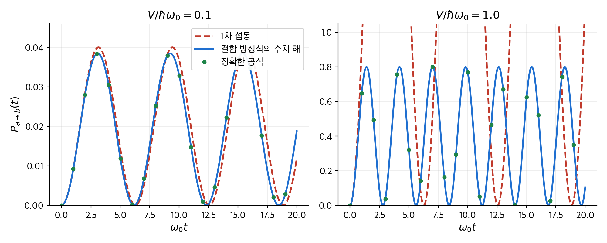
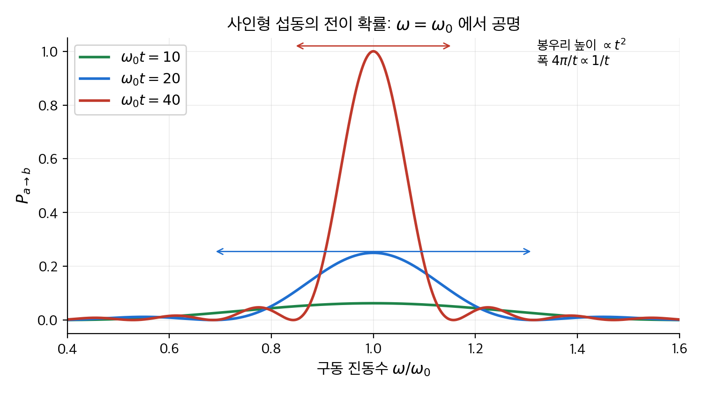
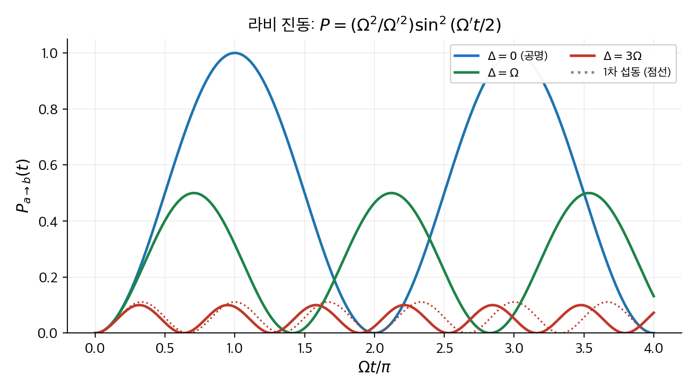
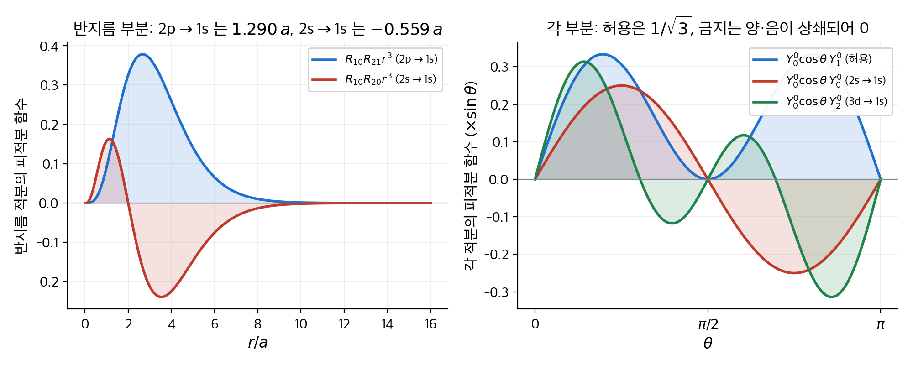
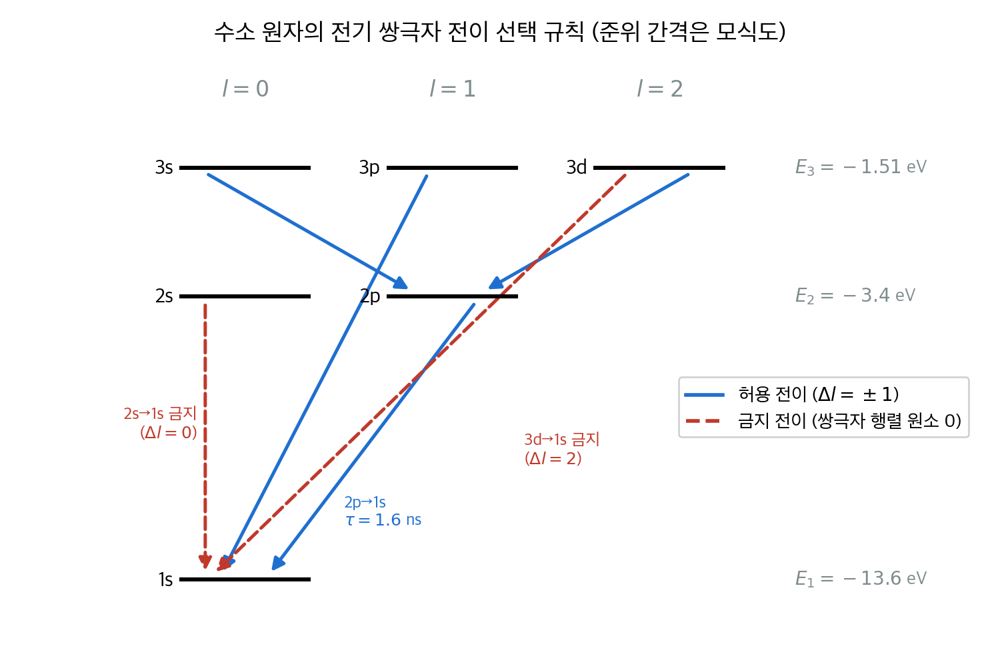
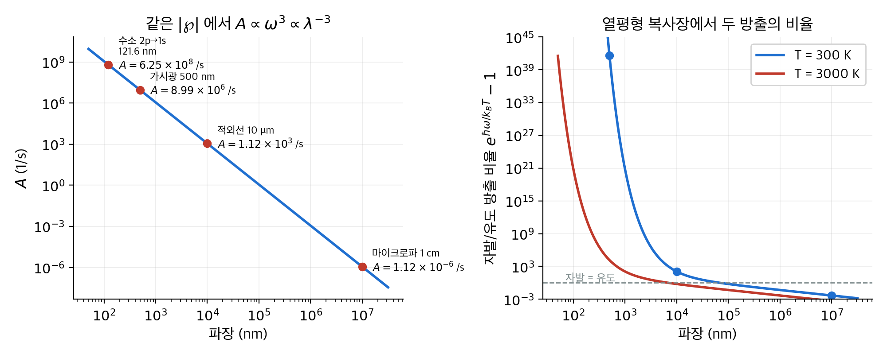

# 9. 시간에 의존하는 섭동 이론

지금까지의 장은 해밀토니안이 시간에 따라 변하지 않는 경우만 다뤘습니다. 그런 계에서는 에너지 고유 상태에 있는 입자가 영원히 그 상태에 머뭅니다.
그런데 원자는 빛을 흡수해서 들뜬 상태로 올라갑니다. 다시 빛을 내면서 바닥 상태로 떨어지기도 합니다. 이런 **전이**(transition)는 해밀토니안에 시간에 의존하는 항이 있어야 일어납니다.
이 장은 시간에 의존하는 작은 섭동 $H'(t)$ 가 상태 사이의 전이를 어떤 확률로 일으키는지 계산합니다.
결론은 세 가지입니다. 사인형 섭동은 진동수가 두 준위의 에너지 차이와 맞을 때만 전이를 일으킵니다(공명). 빛을 흡수하는 확률과 빛을 내도록 유도하는 확률은 같습니다. 들뜬 상태는 아무 섭동이 없어도 저절로 빛을 냅니다. 그 수명은 전이 진동수의 세제곱에 반비례합니다.

!!! info "원문과 자료"
    - 원문: Griffiths, *Introduction to Quantum Mechanics*, 1st ed. (1995), 9장 Time-Dependent Perturbation Theory (9.1 Two-Level Systems, 9.2 Emission and Absorption of Radiation, 9.3 Spontaneous Emission)
    - 함께 읽기: [4. 3차원 양자역학](04-three-dimensions.md)(수소 원자의 파동 함수와 스핀), [6. 시간에 무관한 섭동 이론](06-time-independent-perturbation.md), [10. 단열 근사](10-adiabatic.md)
    - 예시의 수치는 모두 NumPy와 SciPy로 다시 계산해서 검증했습니다. 결합 미분 방정식은 `scipy.integrate.solve_ivp` 로, 적분은 `scipy.integrate.quad` 로 검증했습니다.

## 1. 두 준위 계 (9.1절)

### 왜 시간에 의존하는 섭동이 필요한가

해밀토니안 $H$ 가 시간에 무관하면 일반 해는 정상 상태의 중첩입니다.

$$
\Psi(t) = \sum_n c_n \, \psi_n \, e^{-iE_n t/\hbar}
$$

계수 $c_n$ 은 상수입니다. 따라서 $|c_n|^2$, 즉 에너지 $E_n$ 을 측정할 확률은 시간이 지나도 변하지 않습니다.
처음에 $\psi_1$ 에 있던 전자는 영원히 $\psi_1$ 에 있습니다. 이 그림에서는 원자가 빛을 내는 현상을 설명할 수 없습니다.
전이를 설명하려면 $H = H^0 + H'(t)$ 처럼 시간에 의존하는 항이 필요합니다. 그러면 계수 $c_n$ 이 시간의 함수가 됩니다.
[6장](06-time-independent-perturbation.md)의 섭동 이론은 "에너지 준위가 얼마나 이동하는가"를 물었습니다. 이 장의 섭동 이론은 "준위 사이를 옮겨 갈 확률이 시간에 따라 어떻게 커지는가"를 묻습니다.

### 섭동 계 설정과 결합 방정식

가장 단순한 경우로 상태가 둘뿐인 계를 생각합니다. 섭동이 없는 해밀토니안 $H^0$ 의 고유 상태를 $\psi_a$, $\psi_b$ 라 하고 에너지를 $E_a < E_b$ 라 둡니다.
두 상태는 직교하고 규격화되어 있습니다. 임의의 상태는 두 상태의 중첩으로 쓸 수 있습니다.

$$
\Psi(t) = c_a(t) \, \psi_a \, e^{-iE_a t/\hbar} + c_b(t) \, \psi_b \, e^{-iE_b t/\hbar}, \qquad |c_a|^2 + |c_b|^2 = 1
$$

정상 상태의 위상 인자 $e^{-iE t/\hbar}$ 를 미리 빼 두었습니다. 따라서 섭동이 없으면 $c_a$, $c_b$ 는 상수입니다. 섭동이 있을 때 $c_a$, $c_b$ 가 어떻게 변하는지만 보면 됩니다.
이 식을 시간에 의존하는 슈뢰딩거 방정식 $i\hbar \, \partial\Psi/\partial t = (H^0 + H')\Psi$ 에 넣습니다. $H^0$ 항은 위상 인자의 미분과 정확히 상쇄됩니다.
남은 식에 $\psi_a^*$ 와 $\psi_b^*$ 를 차례로 곱해 적분하면 두 계수에 대한 **결합 방정식**이 나옵니다. 대각 원소 $H'_{aa} = H'_{bb} = 0$ 인 경우(이 장의 모든 예가 그렇습니다)에는 다음과 같습니다.

$$
\dot{c}_a = -\frac{i}{\hbar} H'_{ab} \, e^{-i\omega_0 t} \, c_b, \qquad
\dot{c}_b = -\frac{i}{\hbar} H'_{ba} \, e^{i\omega_0 t} \, c_a, \qquad
\omega_0 \equiv \frac{E_b - E_a}{\hbar}
$$

여기서 $H'_{ij} = \langle \psi_i | H' | \psi_j \rangle$ 는 섭동의 행렬 원소입니다. $\omega_0$ 는 두 준위의 에너지 차이에 해당하는 각진동수입니다. 이 식은 근사가 아닙니다. 두 준위 계에서는 정확한 식입니다.

### 섭동 전개: 0차, 1차, 2차

처음에 입자가 아래 상태에 있다고 가정합니다. $c_a(0) = 1$, $c_b(0) = 0$ 입니다. 섭동이 작으면 계수는 조금씩만 변하므로 차수별로 풀 수 있습니다.

1. **0차**: 섭동을 무시합니다. $c_a^{(0)} = 1$, $c_b^{(0)} = 0$ 입니다.
2. **1차**: 0차 해를 결합 방정식의 오른쪽에 넣고 적분합니다.

$$
c_a^{(1)}(t) = 1, \qquad
c_b^{(1)}(t) = -\frac{i}{\hbar} \int_0^t H'_{ba}(t') \, e^{i\omega_0 t'} \, dt'
$$

3. **2차**: 1차 해를 오른쪽에 넣고 다시 적분합니다. $c_b$ 는 1차에서 바뀌지 않고, $c_a$ 가 처음으로 1에서 벗어납니다.

$$
c_a^{(2)}(t) = 1 - \frac{1}{\hbar^2} \int_0^t H'_{ab}(t') \, e^{-i\omega_0 t'} \left[ \int_0^{t'} H'_{ba}(t'') \, e^{i\omega_0 t''} \, dt'' \right] dt'
$$

$|c_a|^2 + |c_b|^2 = 1$ 은 정확한 해에서만 성립합니다. 1차 근사에서는 $|c_a^{(1)}|^2 + |c_b^{(1)}|^2 = 1 + |c_b^{(1)}|^2 > 1$ 입니다. 어긋나는 양은 2차 크기이므로 1차 근사의 정확도 안에서는 문제가 없습니다.
이 장에서 쓰는 핵심 결과는 1차 식 하나입니다. 아래 상태에서 위 상태로 옮겨 갈 **전이 확률**(transition probability)은 $P_{a \to b}(t) = |c_b^{(1)}(t)|^2$ 입니다.

### 수치 예 1: 상수 섭동을 갑자기 켜기

가장 단순한 섭동으로 전개가 얼마나 믿을 만한지 확인합니다. $t = 0$ 에 행렬 원소가 실수 상수 $V$ 인 섭동을 켭니다. $H'_{ba} = H'_{ab} = V$ 입니다. 1차 적분은 바로 됩니다.

$$
c_b^{(1)}(t) = -\frac{iV}{\hbar} \int_0^t e^{i\omega_0 t'} \, dt' = -\frac{V}{\hbar\omega_0} \left( e^{i\omega_0 t} - 1 \right), \qquad
P_{a \to b}^{(1)}(t) = \frac{4V^2}{\hbar^2 \omega_0^2} \sin^2\!\left(\frac{\omega_0 t}{2}\right)
$$

이 경우는 $2 \times 2$ 행렬 $\begin{pmatrix} E_a & V \\ V & E_b \end{pmatrix}$ 를 대각화하면 정확한 해도 구할 수 있습니다. 두 고유값의 차이를 $\hbar\Omega_R$ 라 두면 $\Omega_R = \sqrt{\omega_0^2 + 4V^2/\hbar^2}$ 이고, 정확한 전이 확률은 다음과 같습니다.

$$
P_{a \to b}^{\text{exact}}(t) = \frac{4V^2}{\hbar^2 \omega_0^2 + 4V^2} \sin^2\!\left(\frac{\Omega_R t}{2}\right)
$$

두 식을 비교하면 1차 근사가 두 가지를 놓칩니다. 진동수가 $\omega_0$ 에서 $\Omega_R$ 로 약간 빨라집니다. 최대 확률은 $4V^2/\hbar^2\omega_0^2$ 보다 작습니다.
$V/\hbar\omega_0$ 가 작으면 두 효과는 모두 무시할 만합니다. 아래 표는 $\hbar = \omega_0 = 1$ 단위에서 계산한 값입니다. 결합 방정식을 수치 적분한 결과는 정확한 공식과 소수점 아래 여덟째 자리까지 일치했습니다.

| $V/\hbar\omega_0$ | 1차 최대 확률 $4V^2/\hbar^2\omega_0^2$ | 정확한 최대 확률 | $\omega_0 t = \pi$ 에서 1차 | $\omega_0 t = \pi$ 에서 정확 |
| --- | --- | --- | --- | --- |
| 0.1 | 0.0400 | 0.0385 | 0.0400 | 0.0384 |
| 0.5 | 1.0 | 0.5 | 1.0 | 0.317 |
| 1.0 | 4.0 (확률이 1을 넘습니다) | 0.8 | 4.0 | 0.105 |

$V/\hbar\omega_0 = 0.1$ 에서는 1차 근사의 오차가 4 % 입니다. $V/\hbar\omega_0 = 1$ 에서는 1차 근사가 확률 4를 내놓습니다. 확률이 1을 넘는 것은 섭동 전개가 깨졌다는 신호입니다.
교훈은 분명합니다. 시간에 의존하는 섭동 이론은 **섭동의 행렬 원소가 준위 간격보다 훨씬 작을 때**($|H'_{ba}| \ll \hbar\omega_0$) 쓰는 도구입니다.

```python
import numpy as np
from scipy.integrate import solve_ivp

def rhs(t, y, V, w0):                       # y = [Re c_a, Im c_a, Re c_b, Im c_b]
    ca, cb = y[0] + 1j*y[1], y[2] + 1j*y[3]
    dca = -1j*V*np.exp(-1j*w0*t)*cb         # hbar = 1
    dcb = -1j*V*np.exp(1j*w0*t)*ca
    return [dca.real, dca.imag, dcb.real, dcb.imag]

V, w0 = 0.1, 1.0
sol = solve_ivp(rhs, [0, 20], [1, 0, 0, 0], args=(V, w0), dense_output=True, rtol=1e-10)
t = np.pi
P_num = sol.sol(t)[2]**2 + sol.sol(t)[3]**2            # 0.03842
P_first = 4*V**2/w0**2*np.sin(w0*t/2)**2                # 0.04000
```

<figure markdown>

<figcaption markdown>
<span class="fig-title"><b>Figure 1.</b> 상수 섭동을 켠 뒤의 전이 확률: 1차 근사와 정확한 해</span>

왼쪽은 $V/\hbar\omega_0 = 0.1$ 입니다. 점선(1차 근사)과 실선(결합 방정식의 수치 해)이 거의 겹칩니다. 녹색 점은 정확한 공식의 값입니다.
오른쪽은 $V/\hbar\omega_0 = 1$ 입니다. 1차 근사는 확률 1을 넘어 그래프 밖으로 나가고, 진동수도 틀립니다. 정확한 해의 최대 확률은 0.8입니다.
</figcaption>
</figure>

### 사인형 섭동과 공명

빛은 진동하는 전기장입니다. 따라서 가장 중요한 섭동은 사인형입니다. 행렬 원소를 $H'_{ba}(t) = V_{ba} \cos(\omega t)$ 로 둡니다. $V_{ba}$ 는 시간에 무관한 복소수이고 $\omega$ 는 섭동의 진동수입니다.
1차 적분에 $\cos \omega t = (e^{i\omega t} + e^{-i\omega t})/2$ 를 넣으면 두 항이 나옵니다.

$$
c_b^{(1)}(t) = -\frac{iV_{ba}}{2\hbar} \int_0^t \left[ e^{i(\omega_0 + \omega)t'} + e^{i(\omega_0 - \omega)t'} \right] dt'
= -\frac{V_{ba}}{2\hbar} \left[ \frac{e^{i(\omega_0 + \omega)t} - 1}{\omega_0 + \omega} + \frac{e^{i(\omega_0 - \omega)t} - 1}{\omega_0 - \omega} \right]
$$

섭동의 진동수가 준위 간격에 가까우면($\omega \approx \omega_0$) 둘째 항의 분모가 작아져서 둘째 항이 첫째 항을 압도합니다. 첫째 항을 버리는 근사를 **회전파 근사**(rotating wave approximation)라고 합니다.
남은 항을 정리하면 전이 확률이 나옵니다.

$$
P_{a \to b}(t) = |c_b^{(1)}|^2 \approx \frac{|V_{ab}|^2}{\hbar^2} \, \frac{\sin^2\!\left[(\omega_0 - \omega)t/2\right]}{(\omega_0 - \omega)^2}
$$

이 식에서 세 가지를 읽을 수 있습니다.

- **공명**(resonance): 고정된 $t$ 에서 $\omega$ 를 바꾸면 $\omega = \omega_0$ 에서 확률이 가장 큽니다. 봉우리 높이는 $|V_{ab}|^2 t^2 / 4\hbar^2$ 로 $t^2$ 에 비례합니다.
- **봉우리의 폭**: 확률이 처음 0이 되는 곳은 $\omega_0 - \omega = \pm 2\pi/t$ 입니다. 봉우리의 전체 폭은 $4\pi/t$ 입니다. 섭동을 오래 가할수록 봉우리가 좁아집니다. 에너지로 바꾸면 $\Delta E \cdot t \sim h$ 입니다. 짧은 펄스는 넓은 에너지 범위의 전이를 일으키고, 긴 펄스는 좁은 범위만 일으킵니다. 이것이 에너지와 시간의 불확정성 관계입니다.
- **시간 변화**: 공명에서 조금 벗어난 고정된 $\omega$ 에서는 확률이 주기 $2\pi/|\omega_0 - \omega|$ 로 진동합니다. 확률은 계속 커지지 않습니다. 한동안 올라갔다가 다시 내려옵니다. 섭동이 입자를 위로 올렸다가 다시 아래로 끌어내립니다.

1차 근사는 확률이 1보다 훨씬 작을 때만 유효합니다. 공명에서는 $t \ll 2\hbar/|V_{ab}|$ 가 필요합니다.

<figure markdown>

<figcaption markdown>
<span class="fig-title"><b>Figure 2.</b> 공명 곡선: 전이 확률을 구동 진동수의 함수로 본 모양</span>

$|V_{ab}|/\hbar = 0.05\,\omega_0$ 로 두고 세 시각에서 그렸습니다. 시간이 두 배가 되면 봉우리는 네 배 높아지고 폭(화살표, $4\pi/t$)은 절반이 됩니다.
봉우리 바깥의 작은 혹은 $\sin^2$ 의 부차 최댓값입니다.
</figcaption>
</figure>

### 공명에서 정확히 풀기: 라비 진동

공명 근처에서는 섭동이 아무리 약해도 시간이 충분히 지나면 1차 근사가 깨집니다. 다행히 회전파 근사를 유지한 채 결합 방정식을 **정확히** 풀 수 있습니다.
$\cos \omega t$ 에서 공명 항만 남기면 결합 방정식은 $\dot{c}_b = -(iV_{ba}/2\hbar) e^{i(\omega_0 - \omega)t} c_a$ 와 그 짝이 됩니다. 이 식은 계수가 상수인 2계 선형 미분 방정식으로 바뀌어 손으로 풀립니다.
세 개의 진동수를 정의합니다.

$$
\Omega \equiv \frac{|V_{ab}|}{\hbar} \ (\text{라비 진동수}), \qquad
\Delta \equiv \omega - \omega_0 \ (\text{이조}), \qquad
\Omega' \equiv \sqrt{\Omega^2 + \Delta^2}
$$

정확한 전이 확률은 다음과 같습니다.

$$
P_{a \to b}(t) = \frac{\Omega^2}{\Omega'^2} \sin^2\!\left(\frac{\Omega' t}{2}\right)
$$

이 식을 **라비 진동**(Rabi flopping)이라고 합니다. 두 극한을 확인합니다.

- 공명($\Delta = 0$)에서는 $P = \sin^2(\Omega t/2)$ 입니다. 확률이 0과 1 사이를 주기 $2\pi/\Omega$ 로 오갑니다. $t = \pi/\Omega$ 에 입자는 확실히 위 상태에 있습니다. 이 길이의 펄스를 **$\pi$ 펄스**라고 부릅니다. 1차 근사는 $P \approx \Omega^2 t^2/4$ 로 처음 짧은 시간에만 맞습니다.
- 이조가 크면($|\Delta| \gg \Omega$) $P \approx (\Omega^2/\Delta^2)\sin^2(\Delta t/2)$ 입니다. 이것은 앞 절의 1차 공식과 정확히 같습니다. 1차 섭동 이론은 "공명에서 충분히 벗어난 경우"의 극한이었습니다.

<figure markdown>

<figcaption markdown>
<span class="fig-title"><b>Figure 3.</b> 라비 진동: 이조에 따른 전이 확률의 시간 변화</span>

공명($\Delta = 0$)에서는 확률이 1까지 올라갑니다. 이조가 $\Omega$ 이면 최대 확률은 $1/2$ 이고, $3\Omega$ 이면 $1/10$ 입니다. 이조가 클수록 진동이 빨라지고 작아집니다.
점선은 같은 이조에서의 1차 근사입니다. $\Delta = 3\Omega$ 에서는 정확한 해와 거의 겹치고, $\Delta = \Omega$ 에서는 정확한 해의 두 배(그래프 밖)를 내놓습니다.
</figcaption>
</figure>

### 수치 예 2: 회전 자기장 속의 스핀 ½

라비 진동을 실제 숫자로 봅니다. 스핀 ½ 입자를 $z$ 방향의 센 정자기장 $B_0$ 에 두고, $xy$ 평면에서 각진동수 $\omega$ 로 회전하는 약한 자기장 $B_1$ 을 겁니다.
[4장](04-three-dimensions.md)에서 본 대로 해밀토니안은 $H = -\gamma \, \mathbf{B} \cdot \mathbf{S}$ 입니다. $\gamma$ 는 자기 회전 비율입니다. 두 준위는 스핀 위와 아래이고, 간격은 $\hbar\omega_0 = \hbar\gamma B_0$ 입니다. $\omega_0$ 를 **라모어 진동수**(Larmor frequency)라고 합니다.
회전 자기장의 행렬 원소는 $\langle \downarrow | H' | \uparrow \rangle = -(\gamma B_1 \hbar/2) e^{i\omega t}$ 입니다. 회전하는 장은 처음부터 $e^{i\omega t}$ 하나만 갖습니다. 따라서 회전파 근사가 근사가 아니라 정확한 식이 됩니다.
라비 진동수는 $\Omega = \gamma B_1$ 입니다. 라비 공식을 그대로 쓸 수 있습니다. $B_0 = 1\,\mathrm{T}$, $B_1 = 1\,\mathrm{mT}$ 로 두고 전자와 양성자를 비교합니다.

| 입자 | $\gamma$ (rad/s/T) | 라모어 진동수 $f_0 = \gamma B_0/2\pi$ | 준위 간격 $\hbar\omega_0$ | 라비 진동수 $f_R = \gamma B_1/2\pi$ | 라비 주기 $2\pi/\Omega$ | $\pi$ 펄스 길이 |
| --- | --- | --- | --- | --- | --- | --- |
| 전자 ($\gamma = g_e e/2m_e$) | $1.761 \times 10^{11}$ | 28.02 GHz | $1.16 \times 10^{-4}$ eV | 28.02 MHz | 35.7 ns | 17.8 ns |
| 양성자 | $2.675 \times 10^{8}$ | 42.58 MHz | $1.76 \times 10^{-7}$ eV | 42.58 kHz | 23.5 μs | 11.7 μs |

두 입자 모두 $f_R / f_0 = B_1/B_0 = 10^{-3}$ 입니다. 라비 진동은 라모어 세차보다 천 배 느립니다. 따라서 "센 장 속에서 빠르게 세차하는 스핀을, 약한 장이 천천히 뒤집는다"는 그림이 성립합니다.
전자의 경우가 **전자 스핀 공명**(ESR), 양성자의 경우가 **핵자기 공명**(NMR)입니다. 병원의 자기 공명 영상(MRI)은 이 양성자 $\pi$ 펄스와 그 뒤의 되돌아오는 신호를 씁니다.
회전 자기장의 진동수 $\omega$ 가 $\omega_0$ 에서 라비 진동수 정도만 벗어나도($\Delta = \Omega$) 최대 뒤집힘 확률은 $1/2$ 로 떨어집니다. 양성자의 경우 42.58 MHz 에서 43 kHz 만 벗어나면 그렇습니다. 공명이 이만큼 날카롭기 때문에 NMR 로 분자 구조를 구별할 수 있습니다.

### 일상 비유: 그네 밀기

그네를 미는 일이 좋은 비유입니다. 그네의 고유 진동수가 $\omega_0$ 이고, 미는 손이 $\omega$ 로 반복합니다.
손의 박자가 그네와 맞으면(공명) 작은 힘으로도 진폭이 계속 커집니다. 박자가 어긋나면 어떤 때는 밀고 어떤 때는 잡아당겨서 진폭이 커졌다 작아졌다 합니다. 어긋남이 클수록 그 주기가 짧고 최대 진폭이 작습니다. 이것이 Figure 3 의 모양입니다.
비유가 깨지는 지점도 있습니다. 고전 그네는 공명에서 진폭이 한없이 커집니다. 양자 두 준위 계는 상태가 둘뿐이므로 확률이 1에 닿으면 더 갈 곳이 없습니다. 계속 밀면 입자가 도로 내려옵니다(라비 진동). 또 고전 그네의 진폭은 연속적이지만, 양자 계에서 변하는 것은 "위에 있을 확률"입니다. 측정하면 위 아니면 아래 둘 중 하나만 나옵니다.

## 2. 복사의 방출과 흡수 (9.2절)

### 전자기파를 섭동으로 쓰기

원자에 빛을 비추는 경우를 생각합니다. $z$ 방향으로 진행하고 $x$ 방향으로 편광된 단색 평면파는 전기장 $\mathbf{E} = E_0 \cos(kz - \omega t) \, \hat{x}$ 와 자기장 $\mathbf{B} = (E_0/c)\cos(kz - \omega t) \, \hat{y}$ 를 갖습니다.
전자에 작용하는 자기력은 전기력의 $v/c$ 배입니다. 수소 원자의 전자 속도는 $v/c \approx 1/137$ 이므로 자기장은 무시합니다.

### 쌍극자 근사

원자의 크기는 $a \approx 0.05\,\mathrm{nm}$ 이고, 수소의 라이먼 알파 선 파장은 $121.6\,\mathrm{nm}$ 입니다. 비율이 약 2300 입니다. 원자 안에서 전기장은 공간적으로 균일하다고 봐도 됩니다. $\cos(kz - \omega t) \approx \cos \omega t$ 로 둡니다. 이것이 **쌍극자 근사**(dipole approximation)입니다.
균일한 전기장 $E_0 \cos\omega t \, \hat{x}$ 속에서 전하 $q$ 의 퍼텐셜 에너지는 $-qE_0 x \cos\omega t$ 입니다. 섭동 해밀토니안과 행렬 원소는 다음과 같습니다.

$$
H' = -qE_0 \, x \cos\omega t, \qquad
H'_{ba} = -\wp E_0 \cos\omega t, \qquad
\wp \equiv q \, \langle \psi_b | x | \psi_a \rangle
$$

$\wp$ 는 두 상태 사이의 **전기 쌍극자 모멘트 행렬 원소**입니다. 사인형 섭동의 $V_{ba}$ 가 $-\wp E_0$ 인 셈입니다. 1절의 결과를 그대로 씁니다.

$$
P_{a \to b}(t) = \left( \frac{|\wp| E_0}{\hbar} \right)^2 \frac{\sin^2\!\left[(\omega_0 - \omega)t/2\right]}{(\omega_0 - \omega)^2}
$$

원자가 공명 진동수 $\omega_0 = (E_b - E_a)/\hbar$ 의 빛을 받으면 광자 하나의 에너지 $\hbar\omega_0$ 를 **흡수**(absorption)해서 위 상태로 올라갑니다.

### 흡수, 유도 방출, 자발 방출

같은 계산을 입자가 처음에 위 상태 $\psi_b$ 에 있는 경우에 하면 아래로 내려올 확률 $P_{b \to a}$ 가 나옵니다. 행렬 원소가 $H'_{ab} = H'_{ba}{}^*$ 로 크기가 같기 때문에 결과는 정확히 같은 식입니다.
즉 빛은 아래 상태의 원자를 올리는 확률과 똑같은 확률로 위 상태의 원자를 끌어내립니다. 이때 원자는 에너지 $\hbar\omega_0$ 를 빛에 돌려줍니다. 이것이 **유도 방출**(stimulated emission)입니다.
유도 방출로 나온 광자는 들어온 광자와 진동수, 방향, 위상이 같습니다. 광자 하나가 들어가 둘이 나옵니다. 이 증폭이 레이저의 원리입니다. 다만 흡수와 유도 방출의 확률이 같기 때문에 증폭하려면 위 상태의 원자가 아래 상태보다 많아야 합니다. 이를 **밀도 반전**(population inversion)이라고 합니다.
세 번째 과정이 있습니다. 빛이 전혀 없어도 들뜬 원자는 저절로 떨어지면서 광자를 냅니다. 이것이 **자발 방출**(spontaneous emission)입니다. 섭동 $H'$ 가 없으므로 지금까지의 계산으로는 나오지 않습니다. 3절에서 열평형 논증으로 구합니다.

| 과정 | 처음 | 나중 | 광자 수 변화 | 이 장에서 구하는 방법 |
| --- | --- | --- | --- | --- |
| 흡수 | 아래 상태 + 광자 | 위 상태 | $-1$ | 1차 섭동 이론 |
| 유도 방출 | 위 상태 + 광자 | 아래 상태 + 광자 2개 | $+1$ | 1차 섭동 이론 (흡수와 같은 확률) |
| 자발 방출 | 위 상태 | 아래 상태 + 광자 | $+1$ | 아인슈타인의 열평형 논증 |

### 수치 예 3: 1 W/cm² 레이저가 수소 원자를 흔드는 세기

쌍극자 행렬 원소가 실제로 얼마나 큰 섭동을 주는지 숫자로 봅니다. 3절에서 계산할 값을 미리 쓰면 수소 1s와 2p 사이의 행렬 원소는 $\langle 1s | z | 2p \rangle = 0.745\,a$ 입니다. 따라서 $|\wp| = e \times 0.745\,a = 6.31 \times 10^{-30}\,\mathrm{C\,m}$ 입니다.
세기 $I = 1\,\mathrm{W/cm^2} = 10^4\,\mathrm{W/m^2}$ 인 레이저의 전기장 진폭은 $I = \varepsilon_0 c E_0^2/2$ 에서 구합니다.

$$
E_0 = \sqrt{\frac{2I}{\varepsilon_0 c}} = \sqrt{\frac{2 \times 10^4}{8.854 \times 10^{-12} \times 2.998 \times 10^8}} = 2.74 \times 10^3\,\mathrm{V/m}
$$

전자가 원자 안에서 느끼는 핵의 전기장 $e/4\pi\varepsilon_0 a^2 = 5.1 \times 10^{11}\,\mathrm{V/m}$ 에 비하면 $10^{-8}$ 배입니다. 섭동 이론을 써도 되는 작은 섭동입니다. 그런데 라비 진동수는 작지 않습니다.

$$
\Omega = \frac{|\wp| E_0}{\hbar} = \frac{6.31 \times 10^{-30} \times 2.74 \times 10^3}{1.055 \times 10^{-34}} = 1.64 \times 10^8\,\mathrm{rad/s}, \qquad f_R = 26\,\mathrm{MHz}
$$

공명 진동수(약 $2.5 \times 10^{15}\,\mathrm{Hz}$)에 정확히 맞춘다면 $\pi$ 펄스 길이 $\pi/\Omega = 19\,\mathrm{ns}$ 만에 원자를 확실히 2p 로 올릴 수 있습니다.
다만 3절에서 2p 상태의 수명이 1.6 ns 로 나옵니다. 라비 진동 반 주기보다 열 배 이상 짧습니다. 전자는 뒤집히기 전에 저절로 떨어집니다. 라비 진동을 실제로 보려면 $\Omega$ 가 자발 방출률보다 커야 하므로 세기를 $(6.25/1.64)^2 \approx 15$ 배인 $15\,\mathrm{W/cm^2}$ 이상으로 올려야 합니다.

### 비간섭 섭동과 전이율

실제 빛은 단색이 아닙니다. 여러 진동수가 섞여 있고 서로 위상이 무관합니다. 그런 빛의 효과는 진동수별 확률을 더해서 얻습니다. 확률 진폭이 아니라 확률을 더하는 것은 위상이 무관하기 때문입니다.
단색파의 에너지 밀도는 $u = \varepsilon_0 E_0^2/2$ 입니다. 진동수 $\omega$ 와 $\omega + d\omega$ 사이의 에너지 밀도를 $\rho(\omega)\,d\omega$ 로 쓰고 $E_0^2 \to 2\rho(\omega)\,d\omega/\varepsilon_0$ 로 바꿔 적분합니다.

$$
P_{a \to b}(t) = \frac{2|\wp|^2}{\varepsilon_0 \hbar^2} \int_0^\infty \rho(\omega) \, \frac{\sin^2\!\left[(\omega_0 - \omega)t/2\right]}{(\omega_0 - \omega)^2} \, d\omega
$$

Figure 2 에서 본 것처럼 피적분 함수의 $\sin^2 / (\cdot)^2$ 부분은 $\omega_0$ 근처의 폭 $4\pi/t$ 안에 몰려 있습니다. $\rho(\omega)$ 가 그 폭 안에서 거의 일정하면 $\rho(\omega_0)$ 를 적분 밖으로 꺼낼 수 있습니다. 남은 적분은 치환 $x = (\omega_0 - \omega)t/2$ 로 계산됩니다.

$$
\int_{-\infty}^{\infty} \frac{\sin^2\!\left[(\omega_0 - \omega)t/2\right]}{(\omega_0 - \omega)^2} \, d\omega = \frac{t}{2} \int_{-\infty}^{\infty} \frac{\sin^2 x}{x^2} \, dx = \frac{\pi t}{2}
$$

수치로 확인하면 $t = 7.3$ 에서 적분값 11.4668 과 $\pi t/2 = 11.4668$ 이 일치합니다. 결과는 다음과 같습니다.

$$
P_{a \to b}(t) = \frac{\pi |\wp|^2}{\varepsilon_0 \hbar^2} \, \rho(\omega_0) \, t
$$

중요한 변화가 생겼습니다. 단색파에서는 확률이 시간에 따라 진동했지만, 비간섭 빛에서는 확률이 시간에 **비례**합니다. 단위 시간당 전이 확률, 즉 **전이율**(transition rate) $R = dP/dt$ 가 상수가 됩니다.
마지막으로 빛이 모든 방향에서 모든 편광으로 들어오는 경우를 생각합니다. 편광 방향 $\hat{n}$ 에 대해 $|\wp \cdot \hat{n}|^2$ 를 모든 방향에 대해 평균하면 $|\wp|^2/3$ 입니다. $\hat{x}$, $\hat{y}$, $\hat{z}$ 세 방향이 공평하게 나눠 갖기 때문입니다.

$$
R_{a \to b} = \frac{\pi}{3\varepsilon_0 \hbar^2} \, |\wp|^2 \, \rho(\omega_0), \qquad
\wp = q \, \langle \psi_b | \mathbf{r} | \psi_a \rangle
$$

이제 $\wp$ 는 벡터입니다. 세 성분 $\langle b|x|a\rangle$, $\langle b|y|a\rangle$, $\langle b|z|a\rangle$ 를 각각 구해 제곱해 더합니다. 유도 방출률 $R_{b \to a}$ 도 같은 식입니다.

## 3. 자발 방출 (9.3절)

### 아인슈타인의 A, B 계수

자발 방출률은 1차 섭동 이론으로 나오지 않습니다. 아인슈타인은 1917년에 열평형을 이용해 우회했습니다. 양자 전기역학을 쓰지 않고도 정확한 답이 나옵니다.
온도 $T$ 인 상자 속에 원자들과 복사가 열평형을 이루고 있습니다. 아래 상태의 원자 수를 $N_a$, 위 상태를 $N_b$ 라 합니다. 세 과정의 비율을 세 계수로 씁니다.

- 자발 방출률: $A$ (빛과 무관한 상수)
- 유도 방출률: $B_{ba} \, \rho(\omega_0)$
- 흡수율: $B_{ab} \, \rho(\omega_0)$

위 상태의 원자 수가 변하는 비율은 다음과 같습니다.

$$
\frac{dN_b}{dt} = -A N_b - B_{ba} \rho(\omega_0) N_b + B_{ab} \rho(\omega_0) N_a
$$

열평형에서는 $dN_b/dt = 0$ 입니다. 또 볼츠만 분포에 따라 $N_a/N_b = e^{\hbar\omega_0/k_B T}$ 입니다. 둘을 합치면 복사의 에너지 밀도가 나옵니다.

$$
\rho(\omega_0) = \frac{A}{e^{\hbar\omega_0/k_B T} B_{ab} - B_{ba}}
$$

이 식이 플랑크의 흑체 복사 공식과 같아야 합니다.

$$
\rho(\omega) = \frac{\hbar}{\pi^2 c^3} \, \frac{\omega^3}{e^{\hbar\omega/k_B T} - 1}
$$

두 식을 모든 온도에서 맞추려면 두 조건이 필요합니다. 첫째, $B_{ab} = B_{ba}$ 입니다. 흡수와 유도 방출의 계수가 같습니다. 이것은 2절에서 섭동 이론으로 얻은 결론과 일치합니다. 둘째, 자발 방출 계수가 정해집니다.

$$
A = \frac{\omega_0^3 \hbar}{\pi^2 c^3} \, B_{ba}
$$

2절의 결과에서 $B_{ba} = \pi |\wp|^2 / 3\varepsilon_0 \hbar^2$ 이므로 자발 방출률은 다음과 같습니다.

$$
A = \frac{\omega_0^3 \, |\wp|^2}{3\pi \varepsilon_0 \hbar c^3}
$$

논증의 묘미는 이렇습니다. 열평형과 플랑크 공식은 복사장의 성질입니다. 그런데 거기서 나온 $A$ 는 온도와 무관한 원자 하나의 성질입니다. 자발 방출은 들뜬 원자가 진공의 전자기장 요동에 "유도"되어 떨어지는 과정이라고 해석할 수 있습니다. 양자 전기역학은 이 해석을 뒷받침합니다.

### 수치 예 4: 자발 방출과 유도 방출의 비율

열평형 복사장 속에서 두 방출의 비율은 두 식을 나누면 바로 나옵니다.

$$
\frac{A}{B_{ba} \rho(\omega_0)} = e^{\hbar\omega_0/k_B T} - 1
$$

실온 $T = 300\,\mathrm{K}$ 에서 $k_B T = 0.02585\,\mathrm{eV}$ 입니다. 파장별로 계산합니다.

| 영역 | 파장 | $\hbar\omega$ | $\hbar\omega/k_B T$ | 자발/유도 비율 |
| --- | --- | --- | --- | --- |
| 가시광 | 500 nm | 2.48 eV | 95.9 | $4.5 \times 10^{41}$ |
| 적외선 | 10 μm | 0.124 eV | 4.79 | 120 |
| 마이크로파 | 1 cm | $1.24 \times 10^{-4}$ eV | 0.0048 | 0.0048 |

가시광에서는 열적 복사에 의한 유도 방출이 사실상 없습니다. 들뜬 원자는 전부 자발 방출로 떨어집니다. 마이크로파에서는 반대로 유도 방출이 자발 방출보다 200배 흔합니다.
따라서 역사적으로 유도 방출 증폭기는 마이크로파에서 먼저 만들어졌습니다(1954년 메이저). 가시광에서는 밀도 반전을 만들기 전에 자발 방출이 에너지를 다 써 버리므로 레이저(1960년)가 더 어려웠습니다. 두 방출이 같아지는 경계는 $\hbar\omega = k_B T \ln 2$ 로, 실온에서 파장 약 69 μm 입니다.

### 들뜬 상태의 수명

빛이 없는 곳에 들뜬 원자 $N_b(0)$ 개가 있으면 자발 방출만 일어납니다. $dN_b/dt = -AN_b$ 이므로 $N_b(t) = N_b(0) e^{-At}$ 입니다.
원자 수가 $1/e$ 로 줄어드는 시간을 **수명**(lifetime)이라고 합니다. $\tau = 1/A$ 입니다. 위 상태에서 내려갈 수 있는 아래 상태가 여럿이면 각 경로의 비율을 더합니다. $\tau = 1/(A_1 + A_2 + \cdots)$ 입니다.

### 수치 예 5: 수소 2p → 1s 의 수명

가장 중요한 예를 끝까지 계산합니다. 수소 원자의 첫 들뜬 상태 2p 가 바닥 상태 1s 로 떨어지는 전이입니다. 파장 121.6 nm 의 라이먼 알파 선입니다.
[4장](04-three-dimensions.md)의 파동 함수를 씁니다. 2p 가운데 $m = 0$ 인 상태를 잡습니다.

$$
\psi_{100} = \frac{1}{\sqrt{\pi a^3}} \, e^{-r/a}, \qquad
\psi_{210} = \frac{1}{\sqrt{32\pi a^5}} \, r \, e^{-r/2a} \cos\theta
$$

먼저 $z = r\cos\theta$ 의 행렬 원소를 구합니다. 반지름 적분과 각 적분으로 나뉩니다.

$$
\langle 100 | z | 210 \rangle
= \frac{1}{\sqrt{32}\,\pi a^4} \underbrace{\int_0^\infty r^4 e^{-3r/2a} \, dr}_{4! \,(2a/3)^5} \ \underbrace{\int \cos^2\theta \, d\Omega}_{4\pi/3}
= \frac{1}{4\sqrt{2}\,\pi a^4} \cdot \frac{768 a^5}{243} \cdot \frac{4\pi}{3}
= \frac{2^7 \sqrt{2}}{3^5} \, a = 0.745\,a
$$

반지름 적분에는 공식 $\int_0^\infty r^n e^{-r/b} dr = n! \, b^{n+1}$ 을 썼습니다. $x$ 와 $y$ 의 행렬 원소는 $m = 0$ 상태에서 0입니다. 각 적분에 $\cos\varphi$ 나 $\sin\varphi$ 가 들어가 한 바퀴 적분하면 사라지기 때문입니다. 따라서 $|\wp|^2 = e^2 (0.745\,a)^2$ 입니다.

```python
import numpy as np
from scipy.integrate import quad
a = 0.529e-10
R10 = lambda r: 2*a**-1.5*np.exp(-r/a)
R21 = lambda r: (1/np.sqrt(24))*a**-1.5*(r/a)*np.exp(-r/(2*a))
radial = quad(lambda r: R10(r)*R21(r)*r**3, 0, 50*a)[0]            # 1.290 a
angular = quad(lambda th: np.sqrt(3)/(4*np.pi)*np.cos(th)**2
               *np.sin(th)*2*np.pi, 0, np.pi)[0]                     # 1/sqrt(3) = 0.577
z = radial*angular                                                    # 0.7449 a
hbar, e, eps0, c = 1.0546e-34, 1.602e-19, 8.854e-12, 2.998e8
w0 = 10.2*e/hbar                                                      # 1.549e16 rad/s
A = w0**3*(e*z)**2/(3*np.pi*eps0*hbar*c**3)                           # 6.25e8 /s
tau = 1/A                                                             # 1.60e-9 s
```

여기서 $R_{nl}$ 은 반지름 파동 함수이고 $\sqrt{3}/4\pi = Y_0^0 Y_1^0 / \cos\theta$ 입니다. 반지름 부분 $1.290\,a$ 와 각 부분 $1/\sqrt{3}$ 의 곱이 $0.745\,a$ 입니다. 이제 수명을 구합니다.

| 양 | 값 |
| --- | --- |
| 전이 에너지 $E_2 - E_1$ | $10.2\,\mathrm{eV}$ |
| $\omega_0 = 10.2\,\mathrm{eV}/\hbar$ | $1.549 \times 10^{16}\,\mathrm{rad/s}$ (파장 121.6 nm) |
| $\lvert\wp\rvert = e \times 0.745\,a$ | $6.31 \times 10^{-30}\,\mathrm{C\,m}$ |
| $A = \omega_0^3 \lvert\wp\rvert^2 / 3\pi\varepsilon_0 \hbar c^3$ | $6.25 \times 10^8\,\mathrm{s^{-1}}$ |
| 수명 $\tau = 1/A$ | $1.60\,\mathrm{ns}$ |

측정값은 1.60 ns 입니다. 1차 섭동 이론과 열평형 논증만으로 유효 숫자 세 자리가 맞습니다.
$m = \pm 1$ 인 2p 상태는 $z$ 성분이 0이고 대신 $x$, $y$ 성분이 살아납니다. $|\langle 100|x|21{\pm}1\rangle|^2 + |\langle 100|y|21{\pm}1\rangle|^2$ 을 계산하면 정확히 $(0.745\,a)^2$ 으로 같습니다. 세 2p 상태의 수명은 모두 1.60 ns 입니다. 공간에 특별한 방향이 없으니 당연한 결과입니다.

<figure markdown>

<figcaption markdown>
<span class="fig-title"><b>Figure 4.</b> 쌍극자 행렬 원소의 피적분 함수: 허용 전이와 금지 전이</span>

왼쪽은 반지름 적분입니다. 2p→1s 의 피적분 함수는 양수만 갖고 $1.290\,a$ 가 됩니다. 2s→1s 는 부호가 바뀌지만 적분은 $-0.559\,a$ 로 0이 아닙니다.
오른쪽은 각 적분입니다. 허용 전이 2p→1s 는 $\cos^2\theta$ 꼴이라 양수만 갖습니다. 2s→1s 와 3d→1s 는 $\theta = \pi/2$ 를 중심으로 양과 음이 정확히 상쇄되어 0이 됩니다. 반지름 적분이 0이 아니어도 각 적분이 0이면 전이는 금지됩니다.
</figcaption>
</figure>

### 선택 규칙

같은 방법으로 2s → 1s 를 계산하면 각 적분 $\int Y_0^0 \cos\theta \, Y_0^0 \, d\Omega = \int \cos\theta \, d\Omega$ 가 0입니다. $x$, $y$ 성분도 0입니다. 쌍극자 행렬 원소가 0이므로 1차 섭동 이론에서 이 전이는 일어나지 않습니다.
어떤 전이가 가능한지 미리 알려 주는 규칙을 **선택 규칙**(selection rule)이라고 합니다. 수소 원자처럼 각운동량 양자수 $l$, $m$ 으로 상태를 분류할 수 있으면 교환 관계만으로 규칙이 나옵니다.

**$m$ 에 대한 규칙.** $L_z$ 와 $z$ 는 교환합니다. $[L_z, z] = 0$ 의 행렬 원소를 취하면 $(m' - m)\hbar \, \langle n'l'm' | z | nlm \rangle = 0$ 입니다. 따라서 $z$ 성분은 $m' = m$ 일 때만 0이 아닙니다.
$x \pm iy$ 에 대해서는 $[L_z, x \pm iy] = \pm\hbar(x \pm iy)$ 이므로 $(m' - m \mp 1)\langle \cdots \rangle = 0$ 입니다. $x$, $y$ 성분은 $m' = m \pm 1$ 일 때만 살아남습니다. 합치면 다음과 같습니다.

$$
\Delta m = 0, \ \pm 1
$$

**$l$ 에 대한 규칙.** 가장 쉬운 논증은 반전성입니다. 좌표를 $\mathbf{r} \to -\mathbf{r}$ 로 뒤집으면 $Y_l^m$ 은 $(-1)^l$ 배가 되고 $\mathbf{r}$ 자체는 부호가 바뀝니다. 피적분 함수 $\psi_{b}^* \, \mathbf{r} \, \psi_a$ 전체의 부호는 $(-1)^{l' + l + 1}$ 입니다. 전 공간 적분이 0이 아니려면 이 부호가 $+1$ 이어야 하므로 $l' + l$ 은 홀수여야 합니다. 더 정밀한 교환 관계 $[L^2, [L^2, \mathbf{r}]] = 2\hbar^2(\mathbf{r}L^2 + L^2\mathbf{r})$ 를 쓰면 범위가 좁혀집니다.

$$
\Delta l = \pm 1
$$

광자가 스핀 1을 갖고 나가므로 원자의 각운동량이 1만큼 바뀌어야 한다고 이해할 수도 있습니다.

| 전이 | $\Delta l$ | $\Delta m$ | 전기 쌍극자 | 비고 |
| --- | --- | --- | --- | --- |
| 2p → 1s | $-1$ | 0, ±1 | 허용 | $\tau = 1.60\,\mathrm{ns}$ |
| 3p → 1s, 3p → 2s | $-1$, $+1$ | 0, ±1 | 허용 | 라이먼 베타, 발머 알파의 일부 |
| 3d → 2p | $-1$ | 0, ±1 | 허용 | |
| 2s → 1s | 0 | 0 | 금지 | 두 광자 과정으로 약 0.12 s 뒤에 떨어집니다 |
| 3d → 1s | $-2$ | 0, ±1, ±2 | 금지 | 전기 사중극자 전이로만 가능합니다 |

금지 전이가 절대 일어나지 않는 것은 아닙니다. 쌍극자 근사에서 버린 다음 항(자기 쌍극자, 전기 사중극자)이나 광자 두 개를 동시에 내는 고차 과정으로 일어납니다. 다만 비율이 수백만 배 이상 작습니다.
따라서 2s 상태는 1.6 ns 가 아니라 약 0.1 s 를 버팁니다. 이런 상태를 **준안정 상태**(metastable state)라고 합니다. 바닥 상태 $l = 0$ 에서는 광자를 흡수해서 $l = 1$ 로만 올라갈 수 있습니다. $l = 1$ 에서는 $l = 0$ 이나 $l = 2$ 로만 갈 수 있습니다. 수소 스펙트럼의 선이 이 규칙대로 사다리를 이룹니다.

<figure markdown>

<figcaption markdown>
<span class="fig-title"><b>Figure 5.</b> 수소 원자의 전기 쌍극자 선택 규칙</span>

같은 $l$ 열 안에서 수직으로 떨어지는 전이(2s→1s)와 두 열을 건너뛰는 전이(3d→1s)는 금지됩니다. 허용 전이는 항상 이웃한 열로 비스듬히 갑니다.
준위 간격은 모식도입니다. 실제 $E_2 - E_1 = 10.2\,\mathrm{eV}$ 는 $E_3 - E_2 = 1.89\,\mathrm{eV}$ 의 다섯 배가 넘습니다.
</figcaption>
</figure>

### $A \propto \omega^3$ 의 의미

자발 방출률 공식 $A = \omega_0^3 |\wp|^2 / 3\pi\varepsilon_0\hbar c^3$ 에서 눈에 띄는 것은 $\omega_0^3$ 입니다. 쌍극자 행렬 원소가 같다면 진동수가 열 배인 전이는 천 배 빨리 일어납니다.
세제곱의 출처는 플랑크 공식의 $\omega^3$ 입니다. 그 가운데 $\omega^2$ 은 진동수 $\omega$ 근처에 있는 전자기 모드의 수이고, 나머지 $\omega$ 하나는 광자 한 개의 에너지 $\hbar\omega$ 입니다. 진동수가 높을수록 광자가 나갈 수 있는 "자리"가 많습니다.

| 가정: $\lvert\wp\rvert = 6.31 \times 10^{-30}\,\mathrm{C\,m}$ 로 고정 | 파장 | $A$ | $\tau$ |
| --- | --- | --- | --- |
| 수소 2p → 1s (실제) | 121.6 nm | $6.25 \times 10^8\,\mathrm{s^{-1}}$ | 1.6 ns |
| 가시광 | 500 nm | $9.0 \times 10^6\,\mathrm{s^{-1}}$ | 110 ns |
| 적외선 | 10 μm | $1.1 \times 10^3\,\mathrm{s^{-1}}$ | 0.9 ms |
| 마이크로파 | 1 cm | $1.1 \times 10^{-6}\,\mathrm{s^{-1}}$ | 10 일 |

이 세제곱이 두 현상을 설명합니다. 분자의 진동 전이(적외선)는 전자 전이(가시광·자외선)보다 수명이 훨씬 깁니다. 마이크로파 영역의 들뜬 상태는 사실상 자발 방출을 하지 않아 메이저와 원자 시계에 쓰입니다.

<figure markdown>

<figcaption markdown>
<span class="fig-title"><b>Figure 6.</b> $A \propto \omega^3$ 과 열평형에서의 자발·유도 방출 비율</span>

왼쪽은 쌍극자 행렬 원소를 수소 2p→1s 값으로 고정했을 때의 $A$ 입니다. 파장이 열 배 길어질 때마다 천 배 느려집니다.
오른쪽은 $e^{\hbar\omega/k_B T} - 1$ 입니다. 300 K 에서 가시광은 자발 방출이 압도하고(점, $10^{41}$ 배), 1 cm 마이크로파는 유도 방출이 200배 흔합니다. 온도가 3000 K 로 오르면 경계가 짧은 파장 쪽으로 열 배 움직입니다.
</figcaption>
</figure>

## 정리

- 시간에 의존하는 섭동 $H'(t)$ 는 정상 상태 사이의 전이를 일으킵니다. 두 준위 계의 결합 방정식은 정확하고, 1차 근사는 $c_b^{(1)} = -(i/\hbar)\int H'_{ba} e^{i\omega_0 t'} dt'$ 입니다. 근사는 $|H'_{ba}| \ll \hbar\omega_0$ 이고 전이 확률이 1보다 훨씬 작을 때만 믿을 수 있습니다.
- 사인형 섭동은 $\omega = \omega_0$ 에서 공명합니다. 봉우리의 높이는 $t^2$, 폭은 $4\pi/t$ 입니다. 공명 근처를 정확히 풀면 라비 진동 $P = (\Omega^2/\Omega'^2)\sin^2(\Omega' t/2)$ 이 나옵니다. 1 T 자기장 속 양성자는 42.58 MHz 로 세차하고, 1 mT 회전 자기장이 11.7 μs 의 $\pi$ 펄스로 스핀을 뒤집습니다.
- 빛은 쌍극자 근사에서 $H' = -qE_0 x\cos\omega t$ 로 작용합니다. 흡수와 유도 방출의 확률은 같습니다. 비간섭 빛에서는 확률이 시간에 비례하고 전이율은 $R = (\pi/3\varepsilon_0\hbar^2)|\wp|^2\rho(\omega_0)$ 입니다.
- 아인슈타인의 열평형 논증은 $B_{ab} = B_{ba}$ 와 $A = \omega_0^3|\wp|^2/3\pi\varepsilon_0\hbar c^3$ 을 줍니다. 수소 2p→1s 의 행렬 원소는 $0.745\,a$ 이고 수명은 1.60 ns 입니다. 계산과 측정이 일치합니다.
- 전기 쌍극자 선택 규칙은 $\Delta l = \pm 1$, $\Delta m = 0, \pm 1$ 입니다. 2s→1s 처럼 규칙에 어긋나는 전이는 고차 과정으로만 일어나 수명이 수십만 배 길어집니다.
