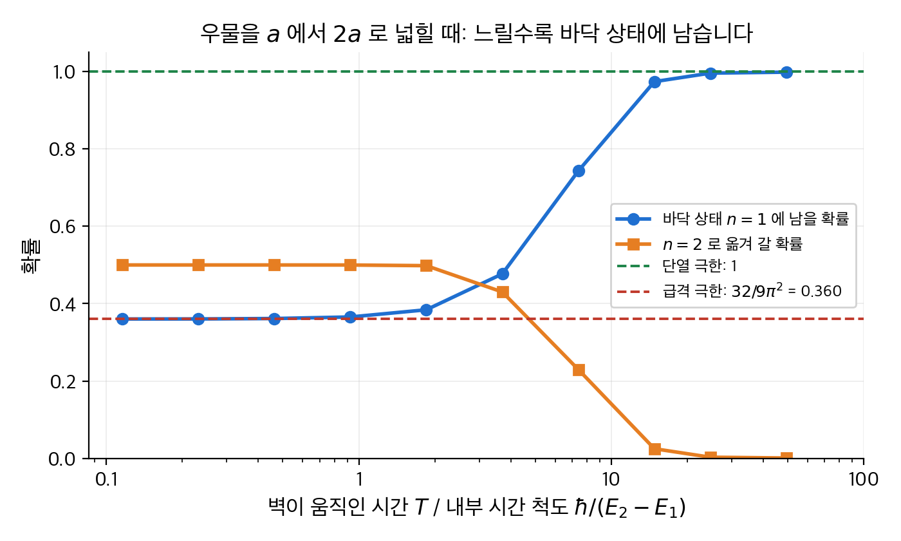
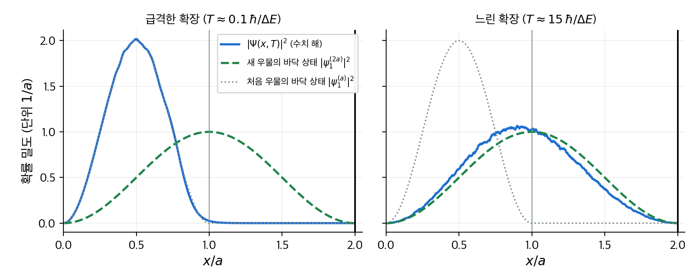
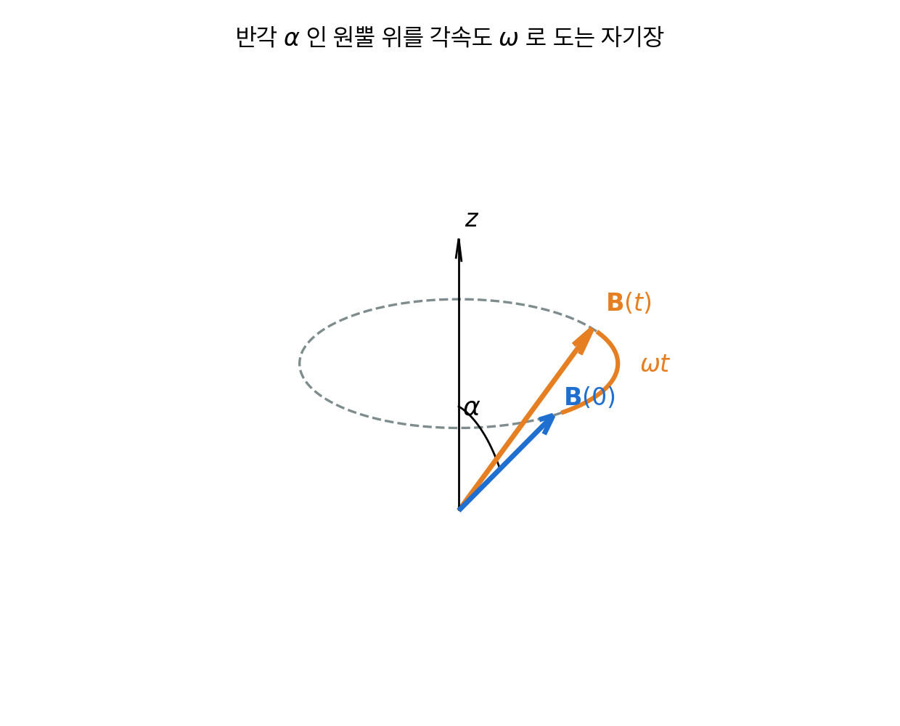
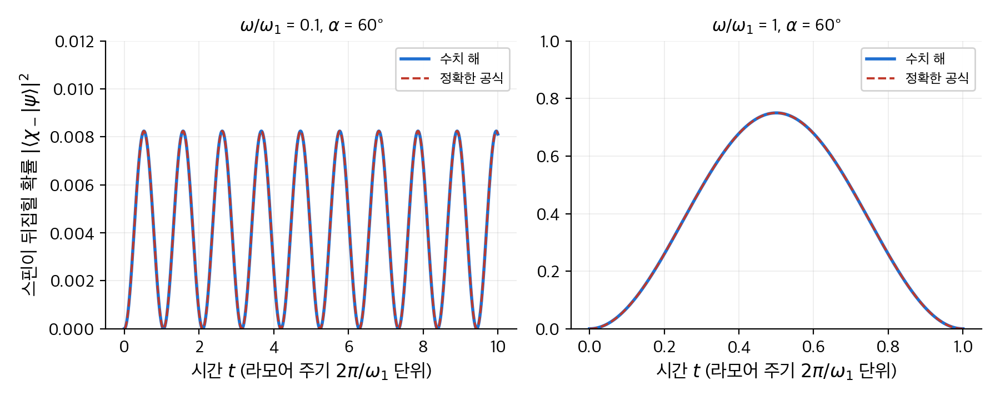
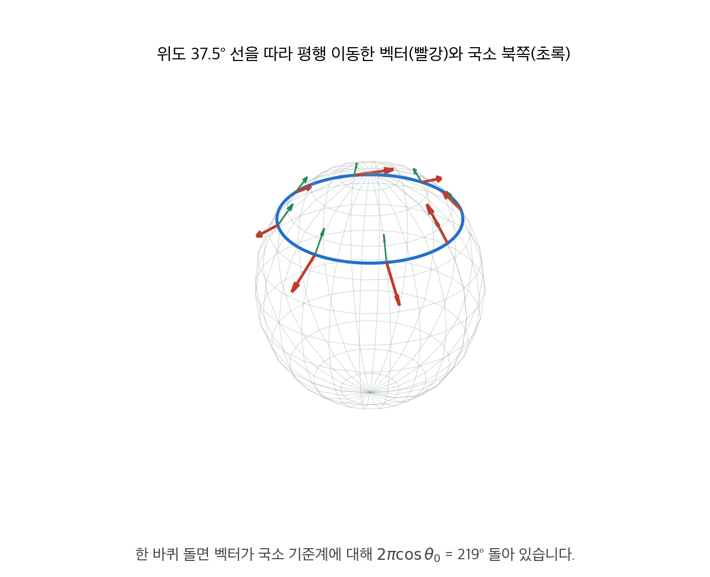
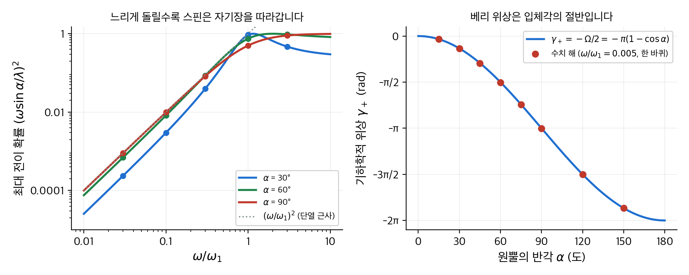
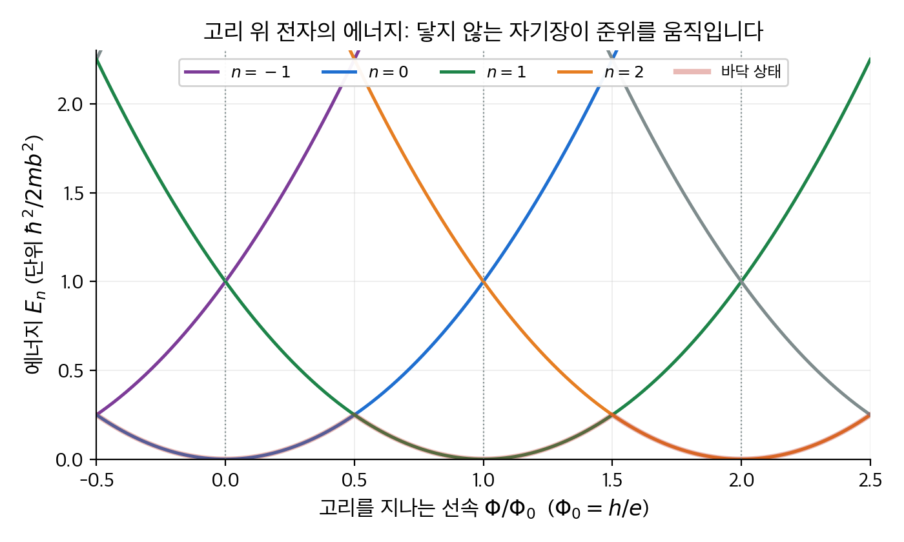

# 10. 단열 근사

이 장은 해밀토니안이 **시간에 따라 천천히 변하는** 계를 다룹니다.
9장의 섭동 이론은 변화가 작다고 가정했습니다. 이 장은 변화가 커도 좋지만 느리다고 가정합니다.
결론은 두 가지입니다. 첫째, 계가 처음에 $n$ 번째 고유 상태에 있었으면 변화가 끝난 뒤에도 (새 해밀토니안의) $n$ 번째 고유 상태에 있습니다. 이것이 **단열 정리**(adiabatic theorem)입니다.
둘째, 그 상태에는 에너지에서 오는 **동역학적 위상** 말고도 변화 경로의 모양에만 의존하는 **기하학적 위상**이 붙습니다. 이것이 **베리 위상**(Berry's phase)입니다.
우물을 천천히 넓히는 시뮬레이션, 원뿔 위를 도는 자기장 속의 스핀, 푸코 진자, 아로노프-봄 효과를 숫자로 따라갑니다.

!!! info "원문과 자료"
    - 원문: Griffiths, *Introduction to Quantum Mechanics*, 1st ed. (1995), 10장 The Adiabatic Approximation (10.1 The Adiabatic Theorem, 10.2 Berry's Phase)
    - 함께 읽기: [2. 시간에 무관한 슈뢰딩거 방정식](02-time-independent-schrodinger.md), [4. 3차원 양자역학](04-three-dimensions.md)(스핀), [9. 시간에 의존하는 섭동 이론](09-time-dependent-perturbation.md)
    - 예시의 수치는 모두 NumPy와 SciPy로 다시 계산해서 검증했습니다. 우물 확장은 크랭크-니콜슨 격자 시뮬레이션으로, 스핀 문제는 2×2 슈뢰딩거 방정식의 수치 적분으로 검증했습니다.

## 1. 단열 정리 (원문 10.1절)

### 느린 변화와 급격한 변화

진자가 걸린 상자를 생각합니다. 상자를 매끄럽게 천천히 옮기면 진자는 원래 평면에서 같은 진폭으로 계속 흔들립니다.
상자를 갑자기 홱 잡아채면 진자는 제멋대로 흔들립니다. 두 경우를 가르는 것은 두 시간 척도의 비율입니다.

- **외부 시간** $T_e$: 상자를 옮기는 데 걸리는 시간처럼, 해밀토니안의 매개변수가 눈에 띄게 바뀌는 시간입니다.
- **내부 시간** $T_i$: 진자의 주기처럼, 계가 스스로 움직이는 시간입니다. 양자역학에서는 $\hbar / (E_m - E_n)$ 이 이 역할을 합니다.

$T_e \gg T_i$ 이면 **단열 과정**(adiabatic process)이라고 부릅니다. $T_e \ll T_i$ 이면 **급격한 과정**(sudden process)입니다.
일상 비유로는 가득 찬 커피 잔을 옮기는 일이 있습니다. 천천히 옮기면 수면이 평평한 채로 따라옵니다. 급히 당기면 커피가 출렁입니다.
이 비유의 한계는 하나입니다. 커피는 출렁임이 결국 잦아들지만, 고립된 양자계는 한번 들뜬 성분이 저절로 사라지지 않습니다.

> **단열 정리:** 해밀토니안이 $H^i$ 에서 $H^f$ 로 **천천히** 바뀌면, 처음에 $H^i$ 의 $n$ 번째 고유 상태에 있던 계는 끝에 $H^f$ 의 $n$ 번째 고유 상태에 있습니다.

정리는 에너지 자체가 보존된다고 말하지 않습니다. 보존되는 것은 **양자수** $n$ 입니다. 에너지는 $E_n^i$ 에서 $E_n^f$ 로 바뀝니다.

### 예: 우물을 천천히 넓히기

폭 $a$ 인 무한 사각 우물의 바닥 상태 $\psi_1^{(a)}(x) = \sqrt{2/a} \sin(\pi x / a)$ 에 전자를 넣습니다. 그다음 오른쪽 벽을 $2a$ 까지 밀어 넓힙니다.

**단열 극한.** 벽을 아주 천천히 밀면 정리에 따라 전자는 새 우물의 바닥 상태 $\psi_1^{(2a)}(x) = \sqrt{1/a} \sin(\pi x / 2a)$ 에 있습니다.
에너지는 $E_1 = \pi^2 \hbar^2 / 2ma^2$ 에서 $\pi^2 \hbar^2 / 8ma^2$ 으로 4분의 1이 됩니다. 사라진 에너지는 전자가 벽을 밀어내면서 한 일입니다.

**급격한 극한.** 벽을 순간적으로 치우면 파동 함수는 바뀔 틈이 없습니다. 상태는 여전히 $\psi_1^{(a)}$ 이고, 이것을 새 우물의 고유 상태로 전개합니다.
새 바닥 상태에 있을 확률은 겹침 적분의 제곱입니다.

$$
c_1 = \int_0^a \psi_1^{(2a)} \psi_1^{(a)} \, dx
= \frac{\sqrt{2}}{a} \int_0^a \sin\!\left(\frac{\pi x}{2a}\right) \sin\!\left(\frac{\pi x}{a}\right) dx
= \frac{\sqrt{2}}{a} \cdot \frac{4a}{3\pi} = \frac{4\sqrt{2}}{3\pi} \approx 0.600
$$

따라서 $P_1 = c_1^2 = 32 / 9\pi^2 \approx 0.360$ 입니다. 나머지 확률은 들뜬 상태로 갑니다. 아래 표는 같은 적분을 $n = 1, \ldots, 6$ 에 대해 계산한 값입니다.

| 새 우물의 상태 $n$ | 1 | 2 | 3 | 4 | 5 | 6 |
| --- | --- | --- | --- | --- | --- | --- |
| $c_n$ | 0.600 | 0.707 | 0.360 | 0 | −0.086 | 0 |
| $P_n = c_n^2$ | 0.360 | 0.500 | 0.130 | 0 | 0.007 | 0 |

$n = 2$ 가 가장 큽니다. 새 우물의 $n = 2$ 상태는 왼쪽 절반에서 원래 바닥 상태와 모양이 같기 때문입니다. 짝수 $n$ 가운데 $n = 2$ 만 살아남습니다. $n = 4, 6$ 은 직교해서 0입니다.
급격한 과정에서는 파동 함수가 그대로이므로 에너지 기댓값도 $E_1$ 그대로입니다. 단열 과정에서는 $E_1 / 4$ 입니다. 같은 "우물 넓히기"인데 결과가 전혀 다릅니다.

**숫자를 넣으면.** 전자와 $a = 1\,\mathrm{nm}$ 를 씁니다. $\hbar^2 / m_e = 0.0762\,\mathrm{eV\,nm^2}$ 이므로 $E_1 = \pi^2 \times 0.0762 / 2 = 0.376\,\mathrm{eV}$ 이고, 넓힌 뒤에는 $0.094\,\mathrm{eV}$ 입니다.
내부 시간 척도는 $\hbar / (E_2 - E_1) = 6.58 \times 10^{-16}\,\mathrm{eV\,s} / 1.128\,\mathrm{eV} = 0.58\,\mathrm{fs}$ 입니다.
아래 시뮬레이션은 벽을 이 척도의 15배인 약 $9\,\mathrm{fs}$ 에 걸쳐 밀면 이미 바닥 상태에 남을 확률이 0.97이라고 말합니다. 벽 속도로는 약 $1.1 \times 10^5\,\mathrm{m/s}$ 입니다. 일상 기준으로는 엄청나게 빠르지만 전자에게는 "천천히"입니다.

### 시뮬레이션: 얼마나 느려야 느린가

단위를 $\hbar = m = a = 1$ 로 두고, 벽을 일정한 속도 $v$ 로 $a$ 에서 $2a$ 까지 밉니다. 시간에 의존하는 슈뢰딩거 방정식을 크랭크-니콜슨 방법으로 적분하고, 끝난 시점에 새 우물의 고유 상태와 겹침을 계산합니다.

```python
import numpy as np
from scipy.sparse import diags, identity
from scipy.sparse.linalg import splu

N, L = 1200, 2.0                      # 격자 수, 최종 우물 폭 (a = 1)
x = np.linspace(0, L, N + 2)[1:-1]; dx = x[1] - x[0]
H0 = -0.5 * diags([1, -2, 1], [-1, 0, 1], shape=(N, N)) / dx**2
def expand(v, dt=2e-4):
    psi = (np.sqrt(2) * np.sin(np.pi * x) * (x <= 1)).astype(complex)
    steps = int(1 / v / dt)
    for k in range(steps):
        w = 1 + v * (k + 0.5) * dt                       # 현재 벽 위치
        H = (H0 + diags(np.where(x < w, 0.0, 1e6))).tocsc()
        psi = splu((identity(N) + 0.5j*dt*H).tocsc()).solve((identity(N) - 0.5j*dt*H) @ psi)
    g = np.sin(np.pi * x / 2)                            # 새 우물의 바닥 상태 (규격화 상수 1)
    return abs(np.sum(g * psi) * dx) ** 2
```

| 벽이 움직인 시간 $T$ (단위 $\hbar / (E_2 - E_1)$) | 0.12 | 0.46 | 1.9 | 3.7 | 7.4 | 15 | 25 | 49 |
| --- | --- | --- | --- | --- | --- | --- | --- | --- |
| $n = 1$ 에 남을 확률 | 0.360 | 0.361 | 0.384 | 0.477 | 0.743 | 0.974 | 0.996 | 0.998 |
| $n = 2$ 로 갈 확률 | 0.500 | 0.500 | 0.498 | 0.430 | 0.230 | 0.025 | 0.003 | 0.001 |

빠른 쪽 끝은 손으로 구한 급격 극한 0.360과 0.500에 정확히 맞습니다. 느린 쪽 끝은 단열 정리의 1에 다가갑니다.
전환은 $T$ 가 내부 시간 척도의 몇 배에서 수십 배 사이에서 일어납니다. "천천히"의 기준이 $\hbar / \Delta E$ 라는 뜻입니다.

<figure markdown>

<figcaption markdown>
<span class="fig-title"><b>Figure 1.</b> 벽을 미는 시간에 따라 바닥 상태에 남을 확률</span>

가로축은 벽이 $a$ 에서 $2a$ 까지 가는 데 걸린 시간을 $\hbar / (E_2 - E_1)$ 단위로 쓴 값입니다. 빠르면 급격 극한 $32 / 9\pi^2$, 느리면 단열 극한 1에 닿습니다.
</figcaption>
</figure>

<figure markdown>

<figcaption markdown>
<span class="fig-title"><b>Figure 2.</b> 확장이 끝난 직후의 확률 밀도</span>

왼쪽은 급격한 확장입니다. 파동 함수가 처음 우물 모양 그대로 남아 있습니다. 오른쪽은 느린 확장입니다. 파동 함수가 새 우물의 바닥 상태(초록 점선)를 거의 그대로 따라갑니다.
</figcaption>
</figure>

### 정리의 증명 개요

해밀토니안이 $H(t)$ 로 변할 때 각 순간의 고유 상태를 정의합니다.

$$
H(t)\, \psi_n(t) = E_n(t)\, \psi_n(t)
$$

이 **순간 고유 상태**(instantaneous eigenstate)들은 매 순간 정규 직교이고 완전합니다. 따라서 일반 해를 다음처럼 전개할 수 있습니다.

$$
\Psi(t) = \sum_n c_n(t)\, \psi_n(t)\, e^{i\theta_n(t)}, \qquad
\theta_n(t) \equiv -\frac{1}{\hbar} \int_0^t E_n(t')\, dt'
$$

$\theta_n$ 은 에너지가 일정할 때의 익숙한 위상 $-E_n t / \hbar$ 를 일반화한 **동역학적 위상**(dynamic phase)입니다.
이 전개를 슈뢰딩거 방정식 $i\hbar \dot{\Psi} = H \Psi$ 에 넣으면 $H \psi_n = E_n \psi_n$ 항이 $\dot{\theta}_n$ 항과 상쇄되고 다음이 남습니다.

$$
\dot{c}_m = -\sum_n c_n\, \langle \psi_m | \dot{\psi}_n \rangle\, e^{i(\theta_n - \theta_m)}
$$

$\langle \psi_m | \dot{\psi}_n \rangle$ 을 다루기 위해 고유값 방정식을 시간으로 미분하고 $\psi_m$ 과 내적합니다. $H$ 가 에르미트이므로 $m \ne n$ 일 때 다음을 얻습니다.

$$
\langle \psi_m | \dot{H} | \psi_n \rangle = (E_n - E_m)\, \langle \psi_m | \dot{\psi}_n \rangle
$$

따라서 계수 방정식은 다음과 같이 나뉩니다.

$$
\dot{c}_m = -c_m \langle \psi_m | \dot{\psi}_m \rangle
- \sum_{n \ne m} c_n \frac{\langle \psi_m | \dot{H} | \psi_n \rangle}{E_n - E_m}\, e^{i(\theta_n - \theta_m)}
$$

**단열 근사**는 둘째 항을 버립니다. 이유는 두 가지입니다. $\dot{H}$ 가 작습니다. 지수 인자가 $(E_n - E_m)/\hbar$ 의 진동수로 빠르게 진동해서 적분하면 평균이 0에 가깝습니다.
남은 방정식은 바로 풀립니다.

$$
c_m(t) = c_m(0)\, e^{i\gamma_m(t)}, \qquad
\gamma_m(t) \equiv i \int_0^t \langle \psi_m(t') | \dot{\psi}_m(t') \rangle\, dt'
$$

$\gamma_m$ 은 실수입니다. 규격화 $\langle \psi_m | \psi_m \rangle = 1$ 을 미분하면 $\langle \psi_m | \dot{\psi}_m \rangle$ 이 순허수임을 알 수 있기 때문입니다.
처음에 $c_n(0) = 1$ 이고 나머지가 0이었으면 다음이 결론입니다.

$$
\Psi_n(t) = e^{i\theta_n(t)}\, e^{i\gamma_n(t)}\, \psi_n(t)
$$

계는 $n$ 번째 순간 고유 상태에 머무릅니다. 위상만 두 가지가 붙습니다. $\gamma_n$ 이 이 장의 둘째 주제인 **기하학적 위상**(geometric phase)입니다.
버린 항이 작으려면 대략 다음 조건이 필요합니다.

$$
\hbar\, \big| \langle \psi_m | \dot{H} | \psi_n \rangle \big| \ll (E_n - E_m)^2
$$

준위 간격이 좁을수록 더 느리게 바꿔야 합니다. 두 준위가 만나는(축퇴하는) 지점에서는 단열 정리가 성립하지 않습니다.

### 예: 원뿔 위를 도는 자기장 속의 스핀

정확히 풀 수 있는 예로 정리를 검증합니다. 전자가 크기는 $B_0$ 로 일정하고 방향만 바뀌는 자기장 속에 있습니다. 자기장은 $z$ 축에 대해 반각 $\alpha$ 인 원뿔 위를 각속도 $\omega$ 로 돕니다.

$$
\mathbf{B}(t) = B_0 \left( \sin\alpha \cos\omega t,\; \sin\alpha \sin\omega t,\; \cos\alpha \right)
$$

<figure markdown>

<figcaption markdown>
<span class="fig-title"><b>Figure 3.</b> 반각 $\alpha$ 인 원뿔 위를 도는 자기장</span>

자기장의 크기는 일정하고 방향만 $z$ 축 둘레를 돕니다. 질문은 "처음에 자기장에 나란했던 스핀이 계속 자기장을 따라가는가"입니다.
</figcaption>
</figure>

해밀토니안은 $H = (e/m)\, \mathbf{B} \cdot \mathbf{S}$ 입니다. $\omega_1 \equiv eB_0 / m$ 으로 두면 4장의 파울리 행렬로 다음과 같이 씁니다.

$$
H(t) = \frac{\hbar \omega_1}{2}
\begin{pmatrix} \cos\alpha & e^{-i\omega t} \sin\alpha \\ e^{i\omega t} \sin\alpha & -\cos\alpha \end{pmatrix}
$$

순간 고유 스피너는 자기장 방향으로 "위"와 "아래"인 상태이고, 에너지는 $\pm \hbar \omega_1 / 2$ 로 시간에 무관합니다.

$$
\chi_+(t) = \begin{pmatrix} \cos(\alpha/2) \\ e^{i\omega t} \sin(\alpha/2) \end{pmatrix}, \qquad
\chi_-(t) = \begin{pmatrix} e^{-i\omega t} \sin(\alpha/2) \\ -\cos(\alpha/2) \end{pmatrix}
$$

$\chi_+(0)$ 에서 출발한 스핀의 시간에 의존하는 슈뢰딩거 방정식은 정확히 풀립니다. 결과만 적으면, 시각 $t$ 에 스핀이 뒤집혀 $\chi_-(t)$ 에 있을 확률은 다음과 같습니다.

$$
P_{+\to-}(t) = \left[ \frac{\omega}{\lambda} \sin\alpha\, \sin\!\left(\frac{\lambda t}{2}\right) \right]^2, \qquad
\lambda \equiv \sqrt{\omega^2 + \omega_1^2 - 2\omega\omega_1 \cos\alpha}
$$

단열 극한 $\omega \ll \omega_1$ 에서는 $\lambda \approx \omega_1$ 이므로 확률이 $(\omega / \omega_1)^2 \sin^2\alpha$ 를 넘지 못합니다. 자기장을 라모어 진동수보다 훨씬 느리게 돌리면 스핀은 자기장을 따라갑니다. 단열 정리가 말한 그대로입니다.

**손계산.** $\alpha = 60°$, $\omega / \omega_1 = 0.1$ 을 넣습니다. $\lambda / \omega_1 = \sqrt{0.01 + 1 - 0.1} = 0.954$ 이고, 최대 전이 확률은 $(0.1 \times 0.866 / 0.954)^2 = 0.0082$ 입니다.
$\omega / \omega_1 = 1$ 이면 $\lambda / \omega_1 = 1$ 이고 최대 확률은 $0.866^2 = 0.75$ 입니다. 라모어 진동수와 같은 속도로 돌리면 스핀의 4분의 3이 뒤집힙니다.

**숫자를 넣으면.** 전자에 $B_0 = 0.1\,\mathrm{T}$ 를 걸면 $\omega_1 = 1.76 \times 10^{10}\,\mathrm{rad/s}$ 입니다. 진동수로는 $2.8\,\mathrm{GHz}$ 입니다.

| 자기장 회전 진동수 | $\omega / \omega_1$ | 최대 전이 확률 (정확) | $(\omega/\omega_1)^2 \sin^2\alpha$ (단열 근사) |
| --- | --- | --- | --- |
| 1 MHz | $3.6 \times 10^{-4}$ | $9.6 \times 10^{-8}$ | $9.6 \times 10^{-8}$ |
| 1 GHz | 0.36 | 0.124 | 0.096 |

1 MHz 회전은 완전히 단열적입니다. 1 GHz 회전은 단열 근사가 25 % 정도 틀립니다.

**Python 검증.** 2×2 슈뢰딩거 방정식을 직접 적분해서 공식과 비교합니다.

```python
import numpy as np
from scipy.integrate import solve_ivp
w1, w, a = 1.0, 0.1, np.deg2rad(60)            # hbar = 1, omega1 = 1
H = lambda t: 0.5 * w1 * np.array([[np.cos(a), np.exp(-1j*w*t)*np.sin(a)],
                                   [np.exp(1j*w*t)*np.sin(a), -np.cos(a)]])
chi_m = lambda t: np.array([np.exp(-1j*w*t)*np.sin(a/2), -np.cos(a/2)])
y0 = np.array([np.cos(a/2), np.sin(a/2)], dtype=complex)
T = np.pi / np.sqrt(w**2 + w1**2 - 2*w*w1*np.cos(a))   # 첫 번째 최대 시각
sol = solve_ivp(lambda t, y: -1j * H(t) @ y, (0, T), y0, rtol=1e-10, atol=1e-12)
print(abs(np.vdot(chi_m(T), sol.y[:, -1]))**2)           # 0.00824
```

<figure markdown>

<figcaption markdown>
<span class="fig-title"><b>Figure 4.</b> 스핀이 뒤집힐 확률의 시간 변화</span>

왼쪽은 느린 회전($\omega / \omega_1 = 0.1$)입니다. 확률이 0.008을 넘지 못합니다. 오른쪽은 라모어 진동수와 같은 회전입니다. 확률이 0.75까지 올라갑니다. 수치 적분(파랑)과 정확한 공식(빨강 점선)이 겹칩니다.
</figcaption>
</figure>

## 2. 베리 위상 (원문 10.2절)

### 비홀로노믹 과정: 돌아와도 같지 않다

단열 과정이 끝나고 매개변수가 처음 값으로 돌아오면 계도 처음 상태로 돌아올까요? 고전역학에도 돌아오지 않는 예가 있습니다.
진자를 들고 지구 위를 한 바퀴 돌아 제자리로 오면, 진자의 흔들림 평면은 처음 방향과 어긋나 있습니다. 이런 과정을 **비홀로노믹**(nonholonomic)이라고 합니다.
어긋난 각도는 걸린 시간이나 속도와 무관하고 **경로의 모양**에만 의존합니다.

가장 깨끗한 예는 **구면 위의 평행 이동**입니다. 북극에서 화살표를 남쪽으로 향하게 들고 적도까지 내려옵니다. 적도를 따라 4분의 1바퀴 걷습니다. 다시 북극으로 올라옵니다.
걷는 동안 화살표를 한 번도 돌리지 않았는데, 돌아오면 화살표가 처음과 $90°$ 어긋나 있습니다. 이 삼각형이 구 전체의 8분의 1이므로 입체각은 $4\pi / 8 = \pi/2 = 90°$ 입니다. 어긋난 각도가 경로가 둘러싼 입체각과 같습니다.

위도 선을 따라 한 바퀴 도는 경우도 마찬가지입니다. 극각 $\theta_0$ 인 위도 선이 둘러싼 입체각은 $\Omega = 2\pi(1 - \cos\theta_0)$ 입니다.
한 바퀴 돌아오면 벡터는 국소 기준계(동쪽과 북쪽)에 대해 $2\pi \cos\theta_0$ 만큼 돌아 있습니다. 두 값을 더하면 $2\pi$ 이므로, 이것은 반대 방향으로 $\Omega$ 만큼 돈 것과 같습니다.

**푸코 진자**가 바로 이 상황입니다. 지구가 자전하면서 진자를 위도 선을 따라 하루에 한 바퀴 옮깁니다. 진자의 평면은 평행 이동되고, 하루에 $2\pi \cos\theta_0 = 2\pi \sin(\text{위도})$ 만큼 돕니다.

| 장소 | 위도 | 하루 세차각 $360° \sin(\text{위도})$ | 한 바퀴 도는 주기 |
| --- | --- | --- | --- |
| 북극 | 90° | 360° | 24 h |
| 파리 | 48.9° | 271° | 31.8 h |
| 서울 | 37.5° | 219° | 39.4 h |
| 싱가포르 | 1.3° | 8.2° | 1058 h |

서울에서 푸코 진자를 설치하면 평면이 한 시간에 약 $9°$ 돕니다. 적도에서는 돌지 않습니다. 적도 선이 둘러싼 입체각은 반구 $2\pi$ 이고 $2\pi \cos 90° = 0$ 이기 때문입니다.

<figure markdown>

<figcaption markdown>
<span class="fig-title"><b>Figure 5.</b> 위도 37.5° 선을 따라 평행 이동한 벡터</span>

빨간 화살표는 처음에 북쪽(초록)을 가리키고, 돌리지 않은 채 위도 선을 따라 옮겨집니다. 지점마다 국소 북쪽과 어긋나는 각도가 쌓여, 한 바퀴 뒤에는 $219°$ 가 됩니다.
</figcaption>
</figure>

### 기하학적 위상의 공식

양자역학으로 돌아옵니다. 해밀토니안이 매개변수 묶음 $\mathbf{R}(t) = (R_1, R_2, \ldots)$ 를 통해 시간에 의존한다고 둡니다. 우물 폭, 자기장의 방향과 세기 같은 것들입니다.
순간 고유 상태도 $\psi_n(\mathbf{R})$ 로 쓸 수 있고, 연쇄 법칙으로 $\dot{\psi}_n = (\nabla_{\mathbf{R}} \psi_n) \cdot \dot{\mathbf{R}}$ 입니다. 앞 절의 $\gamma_n$ 에 넣으면 시간 적분이 매개변수 공간의 **선적분**으로 바뀝니다.

$$
\gamma_n(t) = i \int_{\mathbf{R}_i}^{\mathbf{R}_f} \langle \psi_n | \nabla_{\mathbf{R}} \psi_n \rangle \cdot d\mathbf{R}
$$

이 식에는 시간이 없습니다. 얼마나 빨리 갔는지는 상관없고(단열적이기만 하면), 어떤 **경로**로 갔는지만 남습니다. 기하학적 위상이라는 이름은 여기서 왔습니다.
매개변수가 하나뿐이면 닫힌 경로는 왔던 길을 되돌아가는 것이므로 적분이 0입니다. 매개변수가 둘 이상이어야 닫힌 경로가 넓이를 둘러쌀 수 있습니다. 그때의 값이 **베리 위상**입니다.

$$
\gamma_n(T) = i \oint \langle \psi_n | \nabla_{\mathbf{R}} \psi_n \rangle \cdot d\mathbf{R}
$$

매개변수가 셋이면 스토크스 정리로 면적분으로 바꿀 수 있습니다.

$$
\gamma_n(T) = i \iint \left[ \nabla_{\mathbf{R}} \times \langle \psi_n | \nabla_{\mathbf{R}} \psi_n \rangle \right] \cdot d\mathbf{a}
$$

전자기학과 닮은꼴입니다. $i \langle \psi_n | \nabla_{\mathbf{R}} \psi_n \rangle$ 이 벡터 퍼텐셜 역할을 하고, 그 회전이 "자기장" 역할을 합니다. 베리 위상은 닫힌 경로를 지나는 "선속"입니다.

고유 상태의 위상을 다시 고르면($\psi_n \to e^{i\phi(\mathbf{R})} \psi_n$) 열린 경로의 $\gamma_n$ 은 바뀝니다. 하지만 닫힌 경로의 $\gamma_n$ 은 $\phi$ 가 한 바퀴 돌아 제자리로 오므로 바뀌지 않습니다.
따라서 닫힌 경로의 베리 위상은 측정할 수 있는 양입니다. 경로를 돈 입자와 돌지 않은 입자를 간섭시키면 위상차로 나타납니다.

### 예: 스핀 ½ 의 베리 위상

앞 절의 스핀 문제에 공식을 적용합니다. 매개변수는 자기장의 방향 $(\theta, \phi)$ 입니다. 자기장이 $(\theta, \phi)$ 방향일 때 "위" 상태는 다음과 같습니다.

$$
\chi_+(\theta, \phi) = \begin{pmatrix} \cos(\theta/2) \\ e^{i\phi} \sin(\theta/2) \end{pmatrix}
$$

**손계산.** 원뿔 경로에서는 $\theta = \alpha$ 로 고정이고 $\phi$ 만 $0$ 에서 $2\pi$ 까지 변합니다. 필요한 성분은 $\phi$ 방향 미분뿐입니다.

$$
\langle \chi_+ | \partial_\phi \chi_+ \rangle
= \begin{pmatrix} \cos(\alpha/2) & e^{-i\phi} \sin(\alpha/2) \end{pmatrix}
\begin{pmatrix} 0 \\ i e^{i\phi} \sin(\alpha/2) \end{pmatrix}
= i \sin^2(\alpha/2)
$$

예상대로 순허수입니다. 한 바퀴 적분하면 다음을 얻습니다.

$$
\gamma_+ = i \int_0^{2\pi} i \sin^2(\alpha/2)\, d\phi = -2\pi \sin^2(\alpha/2) = -\pi (1 - \cos\alpha)
$$

원뿔이 둘러싼 입체각이 $\Omega = 2\pi(1 - \cos\alpha)$ 이므로 결과는 다음 한 줄입니다.

$$
\gamma_+ = -\frac{\Omega}{2}
$$

스핀 ½ 의 베리 위상은 자기장 방향이 쓸고 간 **입체각의 절반**에 음의 부호를 붙인 값입니다. 반각이 얼마든, 모양이 원이 아니어도 성립합니다.
$\chi_-$ 에 대해서는 부호가 반대입니다.

| 반각 $\alpha$ | 입체각 $\Omega = 2\pi(1 - \cos\alpha)$ | $\gamma_+ = -\Omega/2$ | 수치 적분 ($\omega / \omega_1 = 0.005$) |
| --- | --- | --- | --- |
| 30° | 0.842 sr | −0.421 rad (−24.1°) | −0.423 rad |
| 60° | 3.142 sr | −1.571 rad (−90°) | −1.577 rad |
| 90° | 6.283 sr | −3.142 rad (−180°) | −3.149 rad |

수치 적분 값은 다음과 같이 구했습니다. 2×2 슈뢰딩거 방정식을 한 바퀴($T = 2\pi / \omega$) 적분합니다. 최종 상태와 $\chi_+(T)$ 의 내적에서 동역학적 위상 $\theta_+ = -\omega_1 T / 2$ 를 뺍니다.
이론값과 0.2 % 안에서 맞고, 차이는 유한한 $\omega / \omega_1$ 에서 오는 보정입니다.

$\alpha = 90°$ 는 특별합니다. 자기장이 적도면에서 한 바퀴 돌면 $\gamma_+ = -\pi$ 이고 $e^{-i\pi} = -1$ 입니다. 스피너가 $2\pi$ 회전 뒤에 부호를 바꾸는 유명한 성질이 베리 위상으로 다시 나타납니다.

<figure markdown>

<figcaption markdown>
<span class="fig-title"><b>Figure 6.</b> 회전 속도에 따른 최대 전이 확률(왼쪽)과 반각에 따른 베리 위상(오른쪽)</span>

왼쪽에서 $\omega / \omega_1$ 이 작으면 최대 전이 확률이 $(\omega / \omega_1)^2$ 에 비례해 사라집니다. 점은 수치 적분, 선은 정확한 공식입니다. 오른쪽에서 수치 적분으로 얻은 기하학적 위상(점)이 $-\pi(1 - \cos\alpha)$ (선) 위에 놓입니다.
</figcaption>
</figure>

### 아로노프-봄 효과

베리 위상의 가장 유명한 응용입니다. 긴 솔레노이드 안에만 자기장 $\mathbf{B}$ 가 있고, 밖에서는 $\mathbf{B} = 0$ 입니다. 하지만 벡터 퍼텐셜은 밖에서도 0이 아닙니다.

$$
\mathbf{A} = \frac{\Phi}{2\pi r}\, \hat{\phi} \quad (r > \text{솔레노이드 반지름}), \qquad \Phi = \text{솔레노이드를 지나는 전체 선속}
$$

고전역학에서는 $\mathbf{B} = 0$ 인 곳의 입자가 솔레노이드를 느낄 방법이 없습니다. 양자역학에서는 해밀토니안이 $\mathbf{A}$ 로 쓰이므로 다릅니다.

$$
H = \frac{1}{2m} \left( \frac{\hbar}{i} \nabla - q\mathbf{A} \right)^2 + V
$$

**고리 위의 전하.** 전하 $q$ 가 솔레노이드를 둘러싼 반지름 $b$ 인 고리 위에서만 움직인다고 둡니다. 파동 함수는 $\psi(\phi)$ 이고 슈뢰딩거 방정식은 다음과 같습니다.

$$
-\frac{\hbar^2}{2mb^2} \left( \frac{d}{d\phi} - i\frac{q\Phi}{2\pi\hbar} \right)^2 \psi = E\, \psi
$$

해는 $\psi = A e^{in\phi}$ 꼴이고, 한 바퀴 돌아 제자리에서 이어져야 하므로 $n$ 은 정수입니다. 에너지는 다음과 같습니다.

$$
E_n = \frac{\hbar^2}{2mb^2} \left( n - \frac{\Phi}{\Phi_0} \right)^2, \qquad \Phi_0 \equiv \frac{2\pi\hbar}{q} = \frac{h}{q}, \quad n = 0, \pm 1, \pm 2, \ldots
$$

선속이 없으면 $n$ 과 $-n$ 이 축퇴합니다(시계 방향과 반시계 방향). 선속이 있으면 축퇴가 깨집니다. 전하가 자기장에 한 번도 닿지 않는데도 에너지가 바뀝니다. 이것이 **아로노프-봄 효과**(Aharonov-Bohm effect)입니다.

**숫자를 넣으면.** 전자($q = -e$ 이지만 아래 수치는 크기만 씁니다)와 반지름 $b = 50\,\mathrm{nm}$ 인 고리를 씁니다.

| 양 | 값 |
| --- | --- |
| 에너지 단위 $\hbar^2 / 2mb^2$ | $0.0762\,\mathrm{eV\,nm^2} / (2 \times 2500\,\mathrm{nm^2}) = 15.2\,\mathrm{\mu eV}$ |
| 선속 양자 $\Phi_0 = h/e$ | $4.136 \times 10^{-15}\,\mathrm{Wb}$ |
| 고리 안쪽 전체에 $\Phi_0$ 을 넣는 데 필요한 자기장 | $\Phi_0 / \pi b^2 = 0.53\,\mathrm{T}$ |
| $\Phi / \Phi_0 = 1/4$ 일 때 $E_0$, $E_1$, $E_{-1}$ | $0.95$, $8.6$, $23.8\,\mathrm{\mu eV}$ |

선속이 $\Phi_0$ 의 4분의 1만 되어도 $E_1$ 과 $E_{-1}$ 이 세 배 가까이 갈라집니다. $\Phi / \Phi_0$ 이 정수이면 준위 전체가 선속이 없을 때와 같아집니다. 효과는 $\Phi_0$ 을 주기로 반복됩니다.

```python
import numpy as np
hbar, me, e = 1.0546e-34, 9.109e-31, 1.602e-19
b = 50e-9
E0 = hbar**2 / (2 * me * b**2) / e          # J -> eV
Phi0 = 2 * np.pi * hbar / e                 # h/e
for f in (0.0, 0.25, 0.5):
    print(f, [round(E0 * (n - f)**2 * 1e6, 2) for n in (-1, 0, 1)], "micro-eV")
# 0.0  [15.24, 0.0, 15.24]   0.25 [23.82, 0.95, 8.57]   0.5 [34.3, 3.81, 3.81]
```

<figure markdown>

<figcaption markdown>
<span class="fig-title"><b>Figure 7.</b> 고리 위 전자의 에너지 준위와 솔레노이드 선속</span>

각 $n$ 의 에너지는 $\Phi / \Phi_0 = n$ 에서 0이 되는 포물선입니다. $\Phi / \Phi_0$ 이 반정수일 때 두 준위가 만나고, 정수일 때 처음 모양으로 돌아옵니다. 바닥 상태(빨간 띠)는 선속을 따라 $n$ 을 바꿔 갑니다.
</figcaption>
</figure>

**간섭 실험.** 전자 빔을 둘로 나누어 솔레노이드의 양쪽으로 보낸 뒤 다시 합칩니다. 각 경로에서 파동 함수에는 $\exp\!\left[ (iq/\hbar) \int \mathbf{A} \cdot d\mathbf{l} \right]$ 인자가 붙습니다. 두 경로의 위상차는 닫힌 선적분입니다.

$$
\Delta\varphi = \frac{q}{\hbar} \oint \mathbf{A} \cdot d\mathbf{l} = \frac{q\Phi}{\hbar} = 2\pi \frac{\Phi}{\Phi_0}
$$

선속을 늘리면 간섭 무늬가 옆으로 밀립니다. $\Phi = \Phi_0$ 이 되면 위상차가 $2\pi$ 가 되어 무늬가 제자리로 돌아옵니다. 위 표의 고리라면 약 $0.5\,\mathrm{T}$ 마다 무늬가 한 번 왕복합니다.

**베리 위상으로 보기.** 전하를 작은 상자에 가두고, 상자를 솔레노이드 둘레로 천천히 한 바퀴 옮깁니다. 매개변수는 상자의 위치 $\mathbf{R}$ 입니다.
상자 안의 고유 상태는 $\mathbf{A}$ 가 없을 때의 상태에 위상 인자 $\exp\!\left[ (iq/\hbar) \int_{\mathbf{R}}^{\mathbf{r}} \mathbf{A} \cdot d\mathbf{l} \right]$ 를 곱한 꼴입니다. 이것을 베리 위상 공식에 넣으면 다음을 얻습니다.

$$
\gamma = \frac{q}{\hbar} \oint \mathbf{A} \cdot d\mathbf{R} = \frac{q\Phi}{\hbar}
$$

간섭 실험의 위상차와 같은 값입니다. 아로노프-봄 효과는 "솔레노이드를 둘러싼 경로"라는 기하에서 오는 베리 위상입니다. 경로가 솔레노이드를 둘러싸지 않으면 $\gamma = 0$ 입니다.

## 3. 정리

| 개념 | 핵심 식 | 이 장의 예시 |
| --- | --- | --- |
| 단열 과정의 기준 | $T_e \gg \hbar / (E_m - E_n)$ | 1 nm 우물의 전자: $\hbar / \Delta E = 0.58\,\mathrm{fs}$, 약 $9\,\mathrm{fs}$ 에 넓히면 0.97 확률로 바닥 상태 유지 |
| 급격한 과정 | 파동 함수 불변, $P_n = \lvert \langle \psi_n^f \vert \psi^i \rangle \rvert^2$ | 우물을 두 배로: $P_1 = 32 / 9\pi^2 = 0.36$, $P_2 = 0.5$ |
| 단열 정리 | $\Psi_n(t) = e^{i\theta_n} e^{i\gamma_n} \psi_n(t)$ | 회전 자기장 속 스핀: 최대 전이 확률 $\approx (\omega / \omega_1)^2 \sin^2\alpha$ |
| 동역학적 위상 | $\theta_n = -\frac{1}{\hbar} \int E_n\, dt$ | 스핀: $-\omega_1 T / 2$ |
| 기하학적 위상 | $\gamma_n = i \int \langle \psi_n \vert \nabla_{\mathbf{R}} \psi_n \rangle \cdot d\mathbf{R}$ | 경로에만 의존, 속도와 무관 |
| 베리 위상 (스핀 ½) | $\gamma_\pm = \mp \Omega / 2$ | $\alpha = 60°$: $\Omega = \pi$, $\gamma_+ = -\pi/2$ |
| 평행 이동의 홀로노미 | 회전각 $= 2\pi(1 - \cos\theta_0)$ | 서울의 푸코 진자: 하루 $219°$, 주기 $39.4\,\mathrm{h}$ |
| 아로노프-봄 효과 | $E_n \propto (n - \Phi/\Phi_0)^2$, $\Delta\varphi = 2\pi \Phi / \Phi_0$ | 50 nm 고리: 에너지 단위 $15\,\mathrm{\mu eV}$, $\Phi_0$ 에 해당하는 자기장 $0.53\,\mathrm{T}$ |

단열 근사는 "느리게 바꾸면 양자수가 보존된다"는 한 문장으로 요약됩니다. 그 보존된 상태에 붙는 위상 가운데 경로의 기하에서 오는 부분이 베리 위상입니다.
이 개념은 뒤에 분자의 보른-오펜하이머 근사, 고체의 위상 절연체, 양자 컴퓨터의 기하학적 게이트로 이어집니다.
