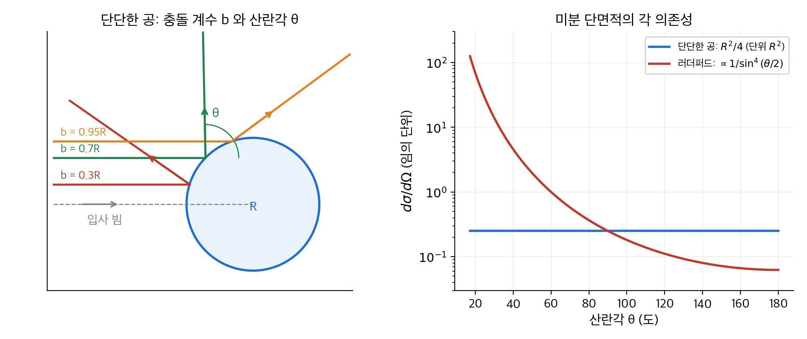
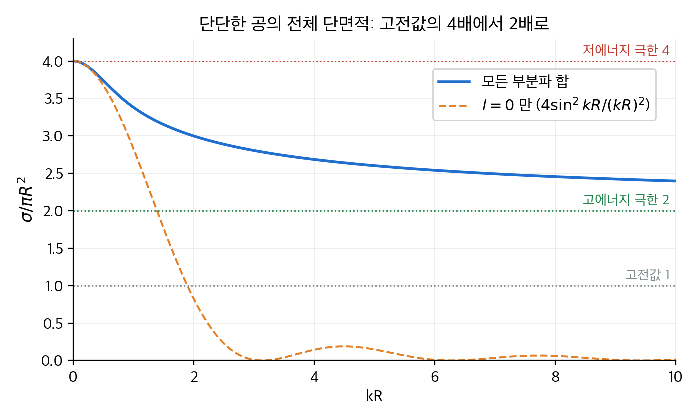
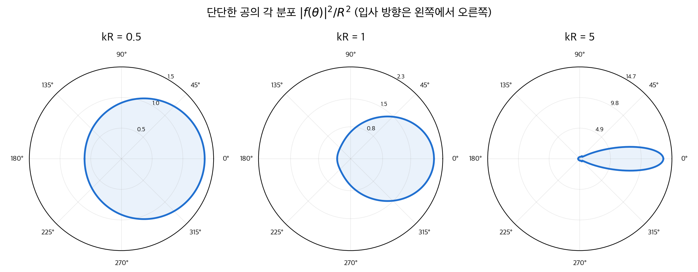
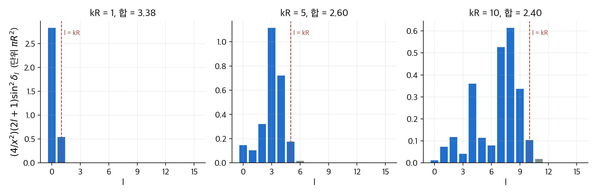
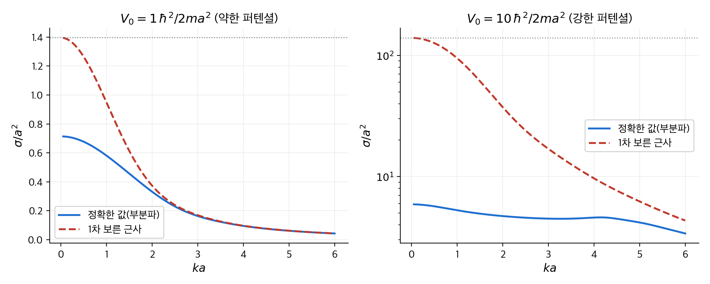
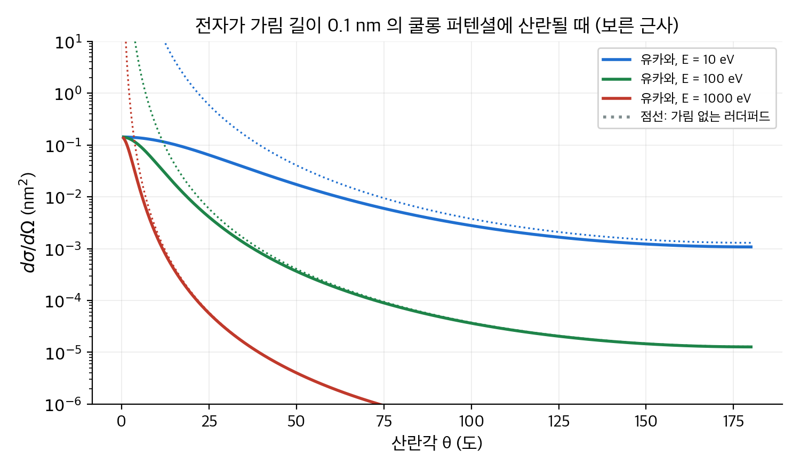

# 11. 산란

이 장은 입자 빔을 표적에 쏘았을 때 어느 방향으로 얼마나 튀어 나가는지를 계산합니다.
앞 장까지는 묶인 상태(bound state)의 에너지를 구했습니다. 이 장에서는 $E > 0$ 인 자유 입자가 퍼텐셜을 지나가는 문제를 다룹니다.
핵심 양은 **산란 진폭**(scattering amplitude) $f(\theta)$ 입니다. 입사 평면파에 더해지는 바깥쪽 구면파의 세기이고, 미분 단면적은 $|f(\theta)|^2$ 입니다.
$f(\theta)$ 를 구하는 방법은 두 가지입니다. **부분파 분석**(partial wave analysis)은 각운동량 $l$ 별로 정확히 풀고, **보른 근사**(Born approximation)는 퍼텐셜이 약할 때 적분 한 번으로 답을 냅니다.
결론은 다음과 같습니다. 저에너지에서는 $l = 0$ 하나만 남아 단단한 공의 단면적이 고전값의 4배인 $4\pi R^2$ 이 됩니다. 고에너지에서는 보른 근사가 정확해지고, 가려진 쿨롱 퍼텐셜의 극한에서 러더퍼드 공식이 나옵니다.

!!! info "원문과 자료"
    - 원문: Griffiths, *Introduction to Quantum Mechanics*, 1st ed. (1995), 11장 Scattering (11.1 Introduction, 11.2 Partial Wave Analysis, 11.3 The Born Approximation)
    - 함께 읽기: [2. 시간에 무관한 슈뢰딩거 방정식](02-time-independent-schrodinger.md)의 산란 행렬, [4. 3차원 양자역학](04-three-dimensions.md)의 구면 좌표와 각운동량
    - 예시의 수치는 모두 NumPy와 SciPy로 다시 계산해서 검증했습니다. 구면 베셀 함수는 `scipy.special.spherical_jn`, `spherical_yn` 을 썼습니다.

## 1. 산란 문제를 어떻게 적는가 (원문 11.1절)

### 고전 산란: 충돌 계수와 단면적

고전 역학에서 입자 하나는 정해진 궤적을 따릅니다. 표적의 중심축에서 입사 경로까지 거리를 **충돌 계수**(impact parameter) $b$ 라고 합니다.
$b$ 가 정해지면 **산란각**(scattering angle) $\theta$ 가 정해집니다. 정면 충돌($b = 0$)이면 되튕겨 나가고($\theta = \pi$), 멀리 지나가면($b$ 가 크면) 거의 휘지 않습니다($\theta \approx 0$).

빔의 단면에서 고리 모양 넓이 $d\sigma = 2\pi b\,db$ 를 지나는 입자는 입체각 $d\Omega = 2\pi \sin\theta\,d\theta$ 로 나갑니다. 이 비율이 **미분 단면적**(differential cross section)입니다.

$$
D(\theta) \equiv \frac{d\sigma}{d\Omega} = \frac{b}{\sin\theta}\left|\frac{db}{d\theta}\right|
$$

전체 **단면적**(total cross section) $\sigma = \int D(\theta)\,d\Omega$ 는 "표적이 빔에서 가로막는 넓이"입니다. 단위는 넓이입니다. 핵물리에서는 $1\,\mathrm{barn} = 10^{-28}\,\mathrm{m^2} = 100\,\mathrm{fm^2}$ 을 씁니다.

### 손계산 예: 단단한 공

반지름 $R$ 인 단단한 공에 구슬을 쏩니다. 입사각과 반사각이 같으므로, 충돌점의 법선과 입사 방향 사이 각을 $\alpha$ 라 하면 $b = R\sin\alpha$, $\theta = \pi - 2\alpha$ 입니다. 따라서

$$
b = R\sin\!\left(\frac{\pi - \theta}{2}\right) = R\cos\frac{\theta}{2}, \qquad
\frac{db}{d\theta} = -\frac{R}{2}\sin\frac{\theta}{2}
$$

이고 미분 단면적은

$$
D(\theta) = \frac{R\cos(\theta/2)}{\sin\theta}\cdot\frac{R}{2}\sin\frac{\theta}{2}
= \frac{R^2}{4}\cdot\frac{\cos(\theta/2)\sin(\theta/2)}{2\sin(\theta/2)\cos(\theta/2)}\cdot 2
= \frac{R^2}{4}
$$

입니다. 모든 방향으로 똑같이 튀어 나갑니다. 전체 단면적은 $\sigma = (R^2/4)\cdot 4\pi = \pi R^2$ 이고, 공의 그림자 넓이와 같습니다. 직관과 맞습니다.

<figure markdown>

<figcaption markdown>
<span class="fig-title"><b>Figure 1.</b> 고전 산란의 기하와 미분 단면적</span>

왼쪽: 충돌 계수 $b$ 가 클수록 산란각 $\theta$ 는 작아집니다. 오른쪽: 단단한 공은 모든 각도로 고르게 산란하지만, 쿨롱 퍼텐셜(러더퍼드)은 작은 각도로 압도적으로 많이 산란합니다.
</figcaption>
</figure>

### 수치 예: 러더퍼드 산란

전하 $q_1$ 인 입자가 전하 $q_2$ 인 고정된 표적의 쿨롱 퍼텐셜에 산란될 때는 $b = \dfrac{q_1 q_2}{8\pi\epsilon_0 E}\cot\dfrac{\theta}{2}$ 입니다. 같은 계산으로 **러더퍼드 공식**(Rutherford formula)이 나옵니다.

$$
D(\theta) = \left[\frac{q_1 q_2}{16\pi\epsilon_0 E\,\sin^2(\theta/2)}\right]^2
$$

$5\,\mathrm{MeV}$ 알파 입자($q_1 = 2e$)를 금 원자핵($q_2 = 79e$)에 쏘는 경우를 계산합니다. $e^2/4\pi\epsilon_0 = 1.44\,\mathrm{eV\,nm}$ 을 씁니다.

| 양 | 계산 | 값 |
| --- | --- | --- |
| 앞 계수 $q_1 q_2 / 16\pi\epsilon_0 E$ | $2 \times 79 \times 1.44\,\mathrm{eV\,nm} / (4 \times 5 \times 10^6\,\mathrm{eV})$ | $11.4\,\mathrm{fm}$ |
| $D(90^\circ)$ | $(11.4\,\mathrm{fm})^2 / \sin^4 45^\circ$ | $518\,\mathrm{fm^2/sr} = 5.2\,\mathrm{b/sr}$ |
| $D(10^\circ)$ | $(11.4\,\mathrm{fm})^2 / \sin^4 5^\circ$ | $2.2 \times 10^6\,\mathrm{fm^2/sr}$ |
| 정면 충돌 최근접 거리 | $q_1 q_2 / 4\pi\epsilon_0 E$ | $45.5\,\mathrm{fm}$ |

$10^\circ$ 와 $90^\circ$ 의 단면적이 4000배 넘게 차이 납니다. 따라서 러더퍼드 실험에서 대부분의 알파 입자는 거의 직진하고, 드물게 크게 꺾입니다.
최근접 거리 $45\,\mathrm{fm}$ 은 금 원자핵 반지름(약 $7\,\mathrm{fm}$)보다 크므로, 이 에너지에서는 점전하 모형이 잘 맞습니다.
쿨롱 퍼텐셜은 무한히 멀리까지 미치므로 전체 단면적 $\sigma$ 는 발산합니다. $\theta \to 0$ 에서 $D(\theta) \to \infty$ 이기 때문입니다.

### 양자 산란: 평면파와 구면파

양자역학에서는 궤적이 없습니다. 대신 $z$ 방향으로 들어오는 **평면파**(plane wave) $e^{ikz}$ 가 퍼텐셜을 만나 **바깥쪽 구면파**(outgoing spherical wave)를 만든다고 적습니다. 표적에서 충분히 먼 곳($r \to \infty$)에서 파동 함수는 다음 꼴입니다.

$$
\psi(r, \theta) \approx A\left[e^{ikz} + f(\theta)\,\frac{e^{ikr}}{r}\right], \qquad k = \frac{\sqrt{2mE}}{\hbar}
$$

$f(\theta)$ 가 **산란 진폭**입니다. 길이의 차원을 가집니다. 구면파에 $1/r$ 이 붙은 이유는 확률이 보존되려면 구면파의 세기가 $1/r^2$ 으로 줄어야 하기 때문입니다.

$D(\theta) = |f(\theta)|^2$ 임은 확률 흐름으로 보입니다. 입사파의 확률 흐름 밀도는 $|A|^2 \hbar k / m$ 입니다. 시간 $dt$ 동안 넓이 $d\sigma$ 를 지나는 확률은 $|A|^2 (\hbar k/m)\,d\sigma\,dt$ 입니다.
산란파가 반지름 $r$ 인 구면의 입체각 $d\Omega$ 를 지나는 확률은 $|A|^2 |f|^2 (\hbar k / m)(1/r^2)\,(r^2 d\Omega)\,dt$ 입니다. 두 확률이 같아야 하므로 $d\sigma = |f(\theta)|^2 d\Omega$ 입니다.

### 비유: 구슬과 물결

고전 산란은 볼링공에 구슬을 던지는 것과 같습니다. 구슬 하나하나의 경로가 정해져 있고, 볼링공의 그림자 넓이만큼만 가로막힙니다.
양자 산란은 잔잔한 연못의 기둥에 물결이 닿는 것과 같습니다. 파장이 기둥보다 길면 물결은 기둥을 "느끼기만" 하고 사방으로 퍼집니다. 파장이 기둥보다 짧으면 기둥 뒤에 뚜렷한 그림자가 생깁니다.
이 비유의 한계는 물결은 세기이고 양자 파동 함수는 확률 진폭이라는 점입니다. 입자 하나는 한 방향으로만 검출되고, $|f(\theta)|^2$ 은 그 방향의 확률만 알려 줍니다.

## 2. 부분파 분석 (원문 11.2절)

### 각운동량별로 나누기

구면 대칭 퍼텐셜 $V(r)$ 에서는 [4장](04-three-dimensions.md)처럼 변수를 분리할 수 있습니다. 퍼텐셜 바깥($V = 0$)의 지름 방정식은

$$
\frac{d^2 u}{dr^2} = \left[\frac{l(l+1)}{r^2} - k^2\right]u, \qquad u(r) = rR(r)
$$

이고, 해는 **구면 베셀 함수**(spherical Bessel function) $j_l(kr)$ 과 **구면 노이만 함수**(spherical Neumann function) $n_l(kr)$ 의 결합입니다. 먼 곳에서 바깥쪽으로 나가는 파동을 만들려면 둘을 묶은 **구면 한켈 함수**(spherical Hankel function) $h_l^{(1)} = j_l + i n_l$ 을 씁니다. $kr \gg 1$ 에서 $h_l^{(1)}(kr) \approx (-i)^{l+1} e^{ikr}/kr$ 이기 때문입니다.

| $l$ | $j_l(x)$ | $n_l(x)$ | $h_l^{(1)}(x)$ |
| --- | --- | --- | --- |
| 0 | $\dfrac{\sin x}{x}$ | $-\dfrac{\cos x}{x}$ | $-i\dfrac{e^{ix}}{x}$ |
| 1 | $\dfrac{\sin x}{x^2} - \dfrac{\cos x}{x}$ | $-\dfrac{\cos x}{x^2} - \dfrac{\sin x}{x}$ | $-\dfrac{e^{ix}}{x}\left(1 + \dfrac{i}{x}\right)$ |

입사 방향 $z$ 를 축으로 잡으면 $\phi$ 의존성이 사라집니다. 산란파를 $l$ 별로 전개하면 다음과 같습니다. $P_l$ 은 르장드르 다항식입니다.

$$
\psi(r, \theta) = A\left[e^{ikz} + k\sum_{l=0}^{\infty} i^{l+1}(2l+1)\,a_l\,h_l^{(1)}(kr)\,P_l(\cos\theta)\right]
$$

$r \to \infty$ 에서 $h_l^{(1)}$ 의 점근 꼴을 넣으면 산란 진폭과 단면적이 **부분파 진폭**(partial wave amplitude) $a_l$ 로 표현됩니다. 단면적에서 교차항이 사라지는 이유는 르장드르 다항식의 직교성 $\int P_l P_{l'} d\Omega = 4\pi\delta_{ll'}/(2l+1)$ 때문입니다.

$$
f(\theta) = \sum_{l=0}^{\infty}(2l+1)\,a_l\,P_l(\cos\theta), \qquad
\sigma = 4\pi\sum_{l=0}^{\infty}(2l+1)\,|a_l|^2
$$

입사 평면파도 같은 언어로 적어야 경계 조건을 맞출 수 있습니다. **레일리 공식**(Rayleigh's formula)이 그 전개입니다.

$$
e^{ikz} = \sum_{l=0}^{\infty} i^l (2l+1)\,j_l(kr)\,P_l(\cos\theta)
$$

### 위상 이동

퍼텐셜이 없으면 $l$ 번째 지름 파동은 먼 곳에서 $\sin(kr - l\pi/2)$ 처럼 진동합니다. 퍼텐셜이 있어도 확률은 보존되므로 진폭은 그대로이고 위상만 $\delta_l$ 만큼 밀립니다.
이 **위상 이동**(phase shift)은 실수 하나입니다. 복소수 $a_l$ 을 실수 $\delta_l$ 로 바꾸는 것이 부분파 분석의 핵심입니다.

$$
a_l = \frac{e^{i\delta_l}\sin\delta_l}{k}, \qquad
f(\theta) = \frac{1}{k}\sum_l (2l+1)\,e^{i\delta_l}\sin\delta_l\,P_l(\cos\theta), \qquad
\sigma = \frac{4\pi}{k^2}\sum_l (2l+1)\sin^2\delta_l
$$

$\sin^2\delta_l \le 1$ 이므로 $l$ 번째 부분파가 낼 수 있는 단면적은 최대 $4\pi(2l+1)/k^2$ 입니다. 이를 **유니터리 한계**(unitarity bound)라고 합니다.
$\theta = 0$ 에서 $P_l(1) = 1$ 이므로 $\mathrm{Im}\,f(0) = \frac{1}{k}\sum_l (2l+1)\sin^2\delta_l = \frac{k\sigma}{4\pi}$ 입니다. 이 관계가 **광학 정리**(optical theorem)입니다. 전방 산란 진폭의 허수부가 빔에서 빠져나간 전체 확률을 알려 줍니다.

### 몇 개의 부분파가 필요한가

고전적으로 각운동량은 $L = \hbar l \approx p\,b = \hbar k\,b$ 입니다. 퍼텐셜의 범위가 $R$ 이면 $b > R$ 인 입자는 산란되지 않으므로, $l \lesssim kR$ 인 항만 기여합니다.
파장 $\lambda = 2\pi/k$ 가 표적보다 훨씬 길면($kR \ll 1$) $l = 0$ 하나만 남습니다. 이 경우를 **s파 산란**(s-wave scattering)이라고 합니다. s파는 $P_0 = 1$ 이므로 각 분포가 등방적입니다.

### 수치 예: 단단한 공의 양자 산란

반지름 $R$ 안으로 들어갈 수 없는 퍼텐셜($r < R$ 에서 $V = \infty$)을 생각합니다. 경계 조건은 $\psi(R, \theta) = 0$ 입니다. $l$ 번째 바깥 해를 $j_l(kr)\cos\delta_l - n_l(kr)\sin\delta_l$ 로 적고 $r = R$ 에서 0으로 놓으면

$$
\tan\delta_l = \frac{j_l(kR)}{n_l(kR)}
$$

입니다. $l = 0$ 은 손으로 풀립니다. $\tan\delta_0 = (\sin x/x)/(-\cos x/x) = -\tan x$ 이므로 $\delta_0 = -kR$ 입니다. 파동이 공 표면에서 되밀려 나와 $kR$ 만큼 위상이 뒤처집니다.

**저에너지 극한**($kR \ll 1$): $\sin^2\delta_0 \approx (kR)^2$ 이고 나머지 $\delta_l$ 은 $(kR)^{2l+1}$ 에 비례해 훨씬 작습니다.

$$
\sigma \approx \frac{4\pi}{k^2}(kR)^2 = 4\pi R^2
$$

고전값 $\pi R^2$ 의 **4배**이고, 공의 겉넓이와 같습니다. 긴 파장은 공을 "둘러싸서" 느끼기 때문입니다. 연못의 물결이 작은 기둥을 돌아 사방으로 퍼지는 것과 같습니다.

$kR = 1$ 에서 각 부분파를 계산한 표입니다. $\delta_l$ 은 $\pi$ 의 배수를 빼고 $(-90^\circ, 90^\circ]$ 로 적었습니다.

| $l$ | $\delta_l$ | $\sin^2\delta_l$ | $(4/(kR)^2)(2l+1)\sin^2\delta_l$ (단위 $\pi R^2$) |
| --- | --- | --- | --- |
| 0 | $-57.30^\circ$ ($= -1\,\mathrm{rad}$) | 0.7081 | 2.832 |
| 1 | $-12.30^\circ$ | 0.0454 | 0.544 |
| 2 | $-0.99^\circ$ | 0.0003 | 0.006 |
| 3 | $-0.03^\circ$ | $< 10^{-6}$ | 0.000 |
| 합 | | | **3.382** |

$kR = 1$ 에서 $\sigma = 3.38\,\pi R^2$ 이고, $l \le 1$ 두 항이 99.8%를 설명합니다. "$l \lesssim kR$" 어림이 맞습니다.
광학 정리도 확인할 수 있습니다. 같은 수치에서 $\mathrm{Im}\,f(0)/R = 0.8456$ 이고, $k\sigma/4\pi = (1/R)(3.382\pi R^2)/4\pi = 0.8456$ 으로 일치합니다.

```python
import numpy as np
from scipy.special import spherical_jn, spherical_yn

def hard_sphere_sigma(x, lmax=None):           # x = kR, 결과 단위 pi R^2
    lmax = lmax or int(x) + 15
    ls = np.arange(lmax + 1)
    delta = np.arctan2(spherical_jn(ls, x), spherical_yn(ls, x))
    return 4 / x**2 * np.sum((2 * ls + 1) * np.sin(delta)**2)

for x in (0.1, 1, 5, 10, 50):
    print(x, round(hard_sphere_sigma(x), 3))   # 3.987, 3.382, 2.602, 2.397, 2.143
```

| $kR$ | 0.1 | 0.5 | 1 | 2 | 5 | 10 | 50 |
| --- | --- | --- | --- | --- | --- | --- | --- |
| $\sigma / \pi R^2$ | 3.99 | 3.74 | 3.38 | 3.00 | 2.60 | 2.40 | 2.14 |

**고에너지 극한**($kR \gg 1$): $\sigma \to 2\pi R^2$ 으로 수렴합니다. 고전값의 2배입니다. 절반 $\pi R^2$ 은 공에 부딪혀 반사되는 몫이고, 나머지 $\pi R^2$ 은 공 뒤의 그림자를 만들기 위해 전방으로 회절되는 몫입니다.
그림자는 "입사파가 없는 영역"인데, 파동으로는 입사파를 상쇄하는 산란파가 있어야 만들어집니다. 이 전방 회절 피크는 폭이 $1/kR$ 이라 아주 좁지만, 단면적에는 반사와 같은 몫을 냅니다.

<figure markdown>

<figcaption markdown>
<span class="fig-title"><b>Figure 2.</b> 단단한 공의 전체 단면적</span>

모든 부분파를 더한 $\sigma/\pi R^2$ 은 저에너지에서 4, 고에너지에서 2로 갑니다. $l = 0$ 만 쓰면 $kR \approx 1$ 부터 크게 어긋납니다. 고전값 1은 어느 에너지에서도 나오지 않습니다.
</figcaption>
</figure>

<figure markdown>

<figcaption markdown>
<span class="fig-title"><b>Figure 3.</b> 단단한 공의 각 분포 $|f(\theta)|^2$</span>

$kR = 0.5$ 에서는 거의 원(등방)입니다. $kR = 1$ 이면 $l = 1$ 항이 섞여 앞쪽으로 치우칩니다. $kR = 5$ 에서는 전방 회절 피크가 지배합니다.
</figcaption>
</figure>

<figure markdown>

<figcaption markdown>
<span class="fig-title"><b>Figure 4.</b> 부분파별 단면적 기여</span>

$l \le kR$ 인 항(파랑)이 거의 전부를 냅니다. $l > kR$ 인 항(회색)은 바로 사라집니다. $kR = 10$ 에서는 $l \approx 7 \sim 9$ 가 가장 크게 기여합니다.
</figcaption>
</figure>

### 수치 예: 중성자와 양성자의 저에너지 산란

저에너지($kR \ll 1$)에서는 s파만 남고, $\delta_0 \approx -ka$ 꼴로 적을 수 있습니다. 이 길이 $a$ 가 **산란 길이**(scattering length)이고, $\sigma = 4\pi a^2$ 입니다.
단단한 공은 $a = R$ 입니다. 인력 퍼텐셜은 $a$ 가 음수일 수도 있고 $R$ 보다 훨씬 클 수도 있습니다.

핵력의 범위는 약 $2\,\mathrm{fm}$ 인데, 열중성자가 양성자에 산란될 때 측정되는 단면적은 약 $20\,\mathrm{b} = 2000\,\mathrm{fm^2}$ 입니다. $4\pi(2\,\mathrm{fm})^2 = 50\,\mathrm{fm^2}$ 의 40배입니다.
이유는 스핀 상태에 따라 산란 길이가 다르기 때문입니다. 두 스핀이 평행한 삼중항은 $a_t \approx 5.4\,\mathrm{fm}$, 반평행한 단일항은 $a_s \approx -23.7\,\mathrm{fm}$ 입니다. 편극되지 않은 빔은 두 상태를 3:1로 섞으므로

$$
\sigma = \pi\left(3a_t^2 + a_s^2\right) = \pi\left(3 \times 29.2 + 561.7\right)\,\mathrm{fm^2} \approx 2040\,\mathrm{fm^2} = 20.4\,\mathrm{b}
$$

입니다. 단일항의 $|a_s|$ 가 큰 이유는 그 상태가 묶인 상태를 "아슬아슬하게" 만들지 못하기 때문입니다. 묶인 상태가 생기기 직전의 퍼텐셜은 산란 길이가 발산합니다. 책은 이런 저에너지 산란이 모두 s파라는 점을 강조합니다.

## 3. 보른 근사 (원문 11.3절)

### 슈뢰딩거 방정식의 적분 꼴

부분파 분석은 퍼텐셜이 구면 대칭이고 $kR$ 이 작을 때 편합니다. 반대로 고에너지이거나 퍼텐셜이 구면 대칭이 아니면 다른 방법이 필요합니다.
슈뢰딩거 방정식을 $(\nabla^2 + k^2)\psi = Q$, $Q = (2m/\hbar^2)V\psi$ 로 적으면 헬름홀츠 방정식의 **그린 함수**(Green's function) $G(\mathbf r) = -e^{ikr}/4\pi r$ 로 해를 적분 꼴로 쓸 수 있습니다.

$$
\psi(\mathbf r) = \psi_0(\mathbf r) - \frac{m}{2\pi\hbar^2}\int \frac{e^{ik|\mathbf r - \mathbf r_0|}}{|\mathbf r - \mathbf r_0|}\,V(\mathbf r_0)\,\psi(\mathbf r_0)\,d^3 r_0
$$

$\psi_0 = Ae^{ikz}$ 는 입사파입니다. 이 식은 미분 방정식의 해가 아닙니다. 우변에 $\psi$ 가 다시 들어 있으므로 같은 문제를 적분 방정식으로 바꾼 꼴입니다. 하지만 근사하기에는 적분 꼴이 훨씬 좋습니다.

### 1차 보른 근사

멀리 떨어진 검출기($r \gg r_0$)에서는 $|\mathbf r - \mathbf r_0| \approx r - \hat{\mathbf r}\cdot\mathbf r_0$ 입니다. 그러면 적분 밖으로 $e^{ikr}/r$ 이 빠져나오고 산란 진폭을 읽을 수 있습니다.
$\mathbf k \equiv k\hat{\mathbf r}$ 을 산란된 파수 벡터, $\mathbf k' \equiv k\hat{\mathbf z}$ 를 입사 파수 벡터라 하면

$$
f(\theta, \phi) = -\frac{m}{2\pi\hbar^2 A}\int e^{-i\mathbf k\cdot\mathbf r_0}\,V(\mathbf r_0)\,\psi(\mathbf r_0)\,d^3 r_0
$$

입니다. 여전히 정확한 식입니다. **1차 보른 근사**는 여기서 "퍼텐셜이 약해서 그 안에서도 파동 함수가 입사파와 거의 같다"고 놓습니다. $\psi(\mathbf r_0) \approx Ae^{i\mathbf k'\cdot\mathbf r_0}$ 을 넣으면

$$
f(\theta, \phi) \approx -\frac{m}{2\pi\hbar^2}\int e^{i(\mathbf k' - \mathbf k)\cdot\mathbf r_0}\,V(\mathbf r_0)\,d^3 r_0
$$

입니다. 산란 진폭이 퍼텐셜의 **푸리에 변환**이 됩니다. 변환 변수는 운동량 전달 $\boldsymbol\kappa \equiv \mathbf k' - \mathbf k$ 이고, 크기는 $\kappa = 2k\sin(\theta/2)$ 입니다.

두 가지 특수한 경우가 자주 쓰입니다.

- **저에너지**($kR \ll 1$): 지수 함수를 1로 놓으면 $f \approx -\dfrac{m}{2\pi\hbar^2}\displaystyle\int V\,d^3 r$ 입니다. 퍼텐셜의 부피 적분이 산란 진폭입니다.
- **구면 대칭**: $\boldsymbol\kappa$ 를 극축으로 잡고 각 적분을 하면 $f(\theta) \approx -\dfrac{2m}{\hbar^2\kappa}\displaystyle\int_0^\infty r\,V(r)\sin(\kappa r)\,dr$ 입니다.

### 수치 예: 부드러운 공과 정확한 답의 비교

$r < a$ 에서 $V = V_0$, 바깥에서 0인 **부드러운 공**(soft sphere)을 생각합니다. 구면 대칭 공식에 넣어 적분하면

$$
f(\theta) \approx -\frac{2mV_0}{\hbar^2\kappa^3}\left[\sin(\kappa a) - \kappa a\cos(\kappa a)\right]
$$

이고, 저에너지에서는 $f \approx -\dfrac{2mV_0 a^3}{3\hbar^2}$, $\sigma \approx 4\pi\left(\dfrac{2mV_0 a^3}{3\hbar^2}\right)^2$ 입니다.

이 문제는 부분파로 정확히 풀 수도 있어서 보른 근사가 언제 맞는지 직접 볼 수 있습니다. 저에너지 정확한 답은 척력 ($V_0 > 0$) 인 경우 산란 길이가 닫힌 꼴로 나옵니다. $\kappa_0 = \sqrt{2mV_0}/\hbar$ 로 두면

$$
a_s = a\left[1 - \frac{\tanh(\kappa_0 a)}{\kappa_0 a}\right], \qquad \sigma_{\text{정확}} = 4\pi a_s^2
$$

입니다. $\kappa_0 a \ll 1$ 이면 $\tanh x / x \approx 1 - x^2/3$ 이므로 $a_s \approx \kappa_0^2 a^3/3 = 2mV_0 a^3/3\hbar^2$ 으로 보른 결과와 같아집니다. 즉 1차 보른 근사는 $\kappa_0 a \ll 1$, 다시 말해 $V_0 \ll \hbar^2/2ma^2$ 일 때 맞습니다.

에너지 단위를 $\hbar^2/2ma^2$ 으로 잡고 두 경우를 계산합니다. 정확한 값은 안쪽 해 $j_l(qr)$ 또는 $i_l(qr)$ 과 바깥 해의 로그 미분을 $r = a$ 에서 맞춰 $\delta_l$ 을 구했습니다.

| $ka$ | $V_0 = 1$ 정확 | $V_0 = 1$ 보른 | $V_0 = 10$ 정확 | $V_0 = 10$ 보른 |
| --- | --- | --- | --- | --- |
| 0.1 | 0.713 | 1.391 | 5.88 | 139.1 |
| 1 | 0.581 | 0.948 | 5.27 | 94.8 |
| 2 | 0.332 | 0.373 | 4.71 | 37.3 |
| 4 | 0.0953 | 0.0966 | 4.58 | 9.66 |
| 6 | 0.0431 | 0.0433 | 3.39 | 4.33 |

단위는 $a^2$ 입니다. 저에너지 닫힌 꼴로 확인하면 $V_0 = 1$ 에서 $a_s = 1 - \tanh 1 = 0.238$, $4\pi a_s^2 = 0.714$ 로 표의 0.713과 맞습니다. $V_0 = 10$ 에서는 $a_s = 1 - \tanh(3.16)/3.16 = 0.685$, $4\pi a_s^2 = 5.89$ 입니다.

읽는 법은 다음과 같습니다.

- $V_0 = 1$(약한 퍼텐셜)에서도 저에너지 보른 값은 2배 큽니다. 보른 산란 길이 $1/3$ 과 정확한 값 $0.238$ 의 차이입니다. $ka \ge 4$ 가 되면 1% 안으로 맞습니다.
- $V_0 = 10$(강한 퍼텐셜)에서 저에너지 보른 값은 24배 틀립니다. 정확한 단면적은 단단한 공의 $4\pi a^2 = 12.6$ 쪽으로 포화하는데, 보른 근사는 $V_0^2$ 에 비례해 끝없이 커지기 때문입니다.
- 어느 경우든 **에너지가 높아지면** 보른 근사가 정확해집니다. 빠른 입자는 퍼텐셜 안에 머무는 시간이 짧아 파동 함수가 덜 변형되기 때문입니다. 고에너지 조건은 대략 $V_0 a / \hbar v \ll 1$ 입니다.

<figure markdown>

<figcaption markdown>
<span class="fig-title"><b>Figure 5.</b> 부드러운 공: 1차 보른 근사와 정확한 값</span>

왼쪽($V_0 = 1$)은 $ka \gtrsim 3$ 에서 두 곡선이 겹칩니다. 오른쪽($V_0 = 10$, 로그 축)은 저에너지에서 20배 넘게 어긋나고 $ka = 6$ 에서도 30% 차이가 남습니다. 점선은 저에너지 보른 극한 $4\pi(V_0/3)^2$ 입니다.
</figcaption>
</figure>

```python
import numpy as np
from scipy.special import spherical_jn, spherical_yn, spherical_in

def soft_sphere_delta(l, k, V0, a=1.0):        # 단위: hbar^2/2m = 1
    q = np.sqrt(abs(k**2 - V0))
    if k**2 > V0:                               # 안쪽 해 j_l(qr)
        g = q * spherical_jn(l, q*a, derivative=True) / spherical_jn(l, q*a)
    else:                                       # 안쪽 해 i_l(qr) (지수적으로 감쇠)
        g = q * spherical_in(l, q*a, derivative=True) / spherical_in(l, q*a)
    j, jp = spherical_jn(l, k*a), spherical_jn(l, k*a, derivative=True)
    n, np_ = spherical_yn(l, k*a), spherical_yn(l, k*a, derivative=True)
    return np.arctan2(g*j - k*jp, g*n - k*np_)  # 로그 미분 맞추기

k, V0 = 0.1, 10.0
print(4*np.pi/k**2 * np.sin(soft_sphere_delta(0, k, V0))**2)   # 5.88 (보른 값은 139)
```

### 유카와 퍼텐셜과 러더퍼드 극한

**유카와 퍼텐셜**(Yukawa potential) $V(r) = \beta\,e^{-\mu r}/r$ 은 범위가 $1/\mu$ 인 가려진 쿨롱 퍼텐셜입니다. 구면 대칭 보른 공식의 적분은 손으로 됩니다.

$$
\int_0^\infty e^{-\mu r}\sin(\kappa r)\,dr = \frac{\kappa}{\mu^2 + \kappa^2}
\quad\Longrightarrow\quad
f(\theta) \approx -\frac{2m\beta}{\hbar^2\left(\mu^2 + \kappa^2\right)}
$$

$\mu \to 0$ 으로 보내면 쿨롱 퍼텐셜입니다. $\beta = q_1 q_2 / 4\pi\epsilon_0$ 이고 $\kappa^2 = 4k^2\sin^2(\theta/2) = (8mE/\hbar^2)\sin^2(\theta/2)$ 이므로

$$
f(\theta) \approx -\frac{2m\beta}{\hbar^2\kappa^2} = -\frac{\beta}{4E\sin^2(\theta/2)}
\quad\Longrightarrow\quad
D(\theta) = \left[\frac{q_1 q_2}{16\pi\epsilon_0 E\sin^2(\theta/2)}\right]^2
$$

입니다. 1절의 고전 러더퍼드 공식과 정확히 같습니다. 쿨롱 산란은 고전, 1차 보른, 정확한 양자 계산이 모두 같은 단면적을 주는 드문 경우입니다.

### 수치 예: 원자에 산란되는 전자

중성 원자의 전자 구름은 원자핵의 전하를 가립니다. 이를 $\beta = -e^2/4\pi\epsilon_0 = -1.44\,\mathrm{eV\,nm}$, 가림 길이 $1/\mu = 0.1\,\mathrm{nm}$ 인 유카와 퍼텐셜로 모형화하고 전자를 쏩니다.
전자에 대해 $2m/\hbar^2 = 2/(0.0762\,\mathrm{eV\,nm^2}) = 26.2\,\mathrm{eV^{-1}\,nm^{-2}}$ 이므로 $2m|\beta|/\hbar^2 = 37.8\,\mathrm{nm^{-1}}$ 입니다. 전방 산란 진폭은 에너지와 무관하게

$$
|f(0)| = \frac{37.8\,\mathrm{nm^{-1}}}{\mu^2} = \frac{37.8}{100}\,\mathrm{nm} = 0.378\,\mathrm{nm}, \qquad D(0) = 0.143\,\mathrm{nm^2}
$$

입니다. 후방($\theta = \pi$)은 $\kappa^2 = 4k^2$ 이 더해져 작아집니다. 전체 단면적은 $\int |f|^2 d\Omega$ 를 하면 $\sigma = \left(\dfrac{2m\beta}{\hbar^2}\right)^2\dfrac{4\pi}{\mu^2(\mu^2 + 4k^2)}$ 입니다.

| $E$ | $k$ ($\mathrm{nm^{-1}}$) | $\lvert f(\pi)\rvert$ (nm) | $\sigma$ ($\mathrm{nm^2}$) | $2m\lvert\beta\rvert/\hbar^2 k$ |
| --- | --- | --- | --- | --- |
| 10 eV | 16.2 | 0.0329 | 0.156 | 2.3 |
| 100 eV | 51.2 | 0.0036 | 0.0169 | 0.74 |
| 1000 eV | 162 | 0.00036 | 0.0017 | 0.23 |

마지막 열은 고에너지 보른 조건에 들어가는 무차원 수입니다. 이 값이 1보다 충분히 작아야 1차 보른 근사를 믿을 수 있습니다.
$10\,\mathrm{eV}$ 에서는 2.3이라 숫자는 정성적 안내일 뿐입니다. 저에너지 조건 $2m|\beta|/\hbar^2\mu = 3.8$ 도 1보다 커서, 이 퍼텐셜은 저에너지에서 보른 근사로 다룰 수 없습니다.
$1\,\mathrm{keV}$ 에서는 0.23이라 쓸 만합니다. 에너지가 10배 오를 때마다 단면적이 10배씩 줄고, 산란은 점점 전방으로 쏠립니다.

<figure markdown>

<figcaption markdown>
<span class="fig-title"><b>Figure 6.</b> 유카와 퍼텐셜의 보른 각 분포</span>

실선은 유카와, 점선은 가림이 없는 러더퍼드입니다. 큰 각도($\kappa \gg \mu$)에서는 둘이 같습니다. 작은 각도에서는 가림 때문에 유카와가 유한한 값 $0.143\,\mathrm{nm^2}$ 에서 멈추고, 러더퍼드는 발산합니다. 에너지가 높을수록 분포가 앞쪽으로 몰립니다.
</figcaption>
</figure>

### 보른 급수

적분 방정식을 $\psi = \psi_0 + \int g V \psi$ 꼴로 적습니다. 우변의 $\psi$ 에 좌변을 반복해서 대입하면 **보른 급수**(Born series)가 나옵니다.

$$
\psi = \psi_0 + \int gV\psi_0 + \iint gVgV\psi_0 + \cdots
$$

0차 항은 산란이 없는 입사파, 1차 항은 퍼텐셜과 한 번 상호작용한 파동, 2차 항은 두 번 상호작용한 파동입니다. 1차 보른 근사는 이 급수를 첫 항에서 끊은 결과입니다.
Figure 5의 강한 퍼텐셜에서 1차 항이 틀린 이유는 입자가 공 안에서 여러 번 "다시 산란"되는 고차 항이 크기 때문입니다. 이 급수를 항별로 그린 그림이 파인만 도형의 출발점입니다.

## 4. 정리

| 방법 | 잘 맞는 조건 | 얻는 것 | 이 장의 예 |
| --- | --- | --- | --- |
| 고전 궤적 | 파장 $\ll$ 표적 크기, 퍼텐셜이 매끄러움 | $b(\theta)$ 에서 $D(\theta)$ | 단단한 공 $\pi R^2$, 러더퍼드 |
| 부분파 분석 | 구면 대칭, $kR$ 이 작음 | 위상 이동 $\delta_l$, 정확한 $\sigma$ | 단단한 공 $4\pi R^2 \to 2\pi R^2$, n-p 20 b |
| 1차 보른 근사 | 약한 퍼텐셜 또는 고에너지 | $f \propto$ 퍼텐셜의 푸리에 변환 | 부드러운 공, 유카와, 러더퍼드 극한 |

세 결과를 한 줄로 묶으면 다음과 같습니다. 파장이 표적보다 길면 양자 산란은 고전과 전혀 다릅니다(단면적이 4배). 파장이 짧아질수록 고전 결과에 가까워지지만, 그림자 회절 때문에 2배의 차이가 끝까지 남습니다.
보른 근사는 "퍼텐셜이 파동 함수를 거의 바꾸지 않는다"는 가정입니다. 따라서 퍼텐셜이 강하거나 입자가 느리면 반드시 정확한 방법과 비교해야 합니다.
