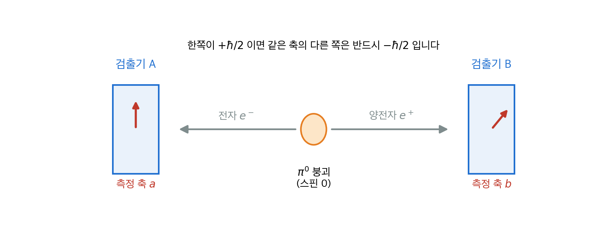
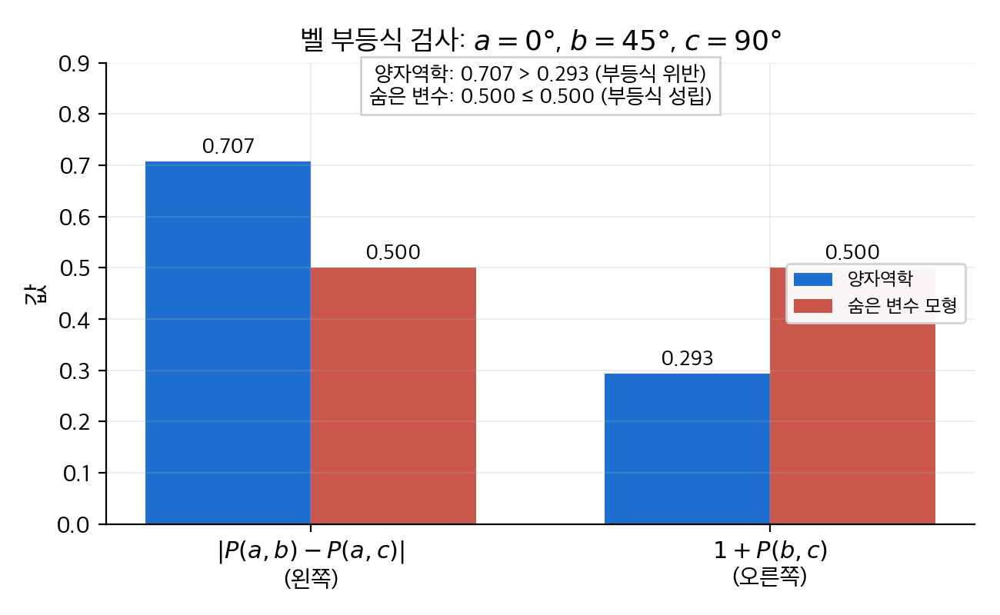
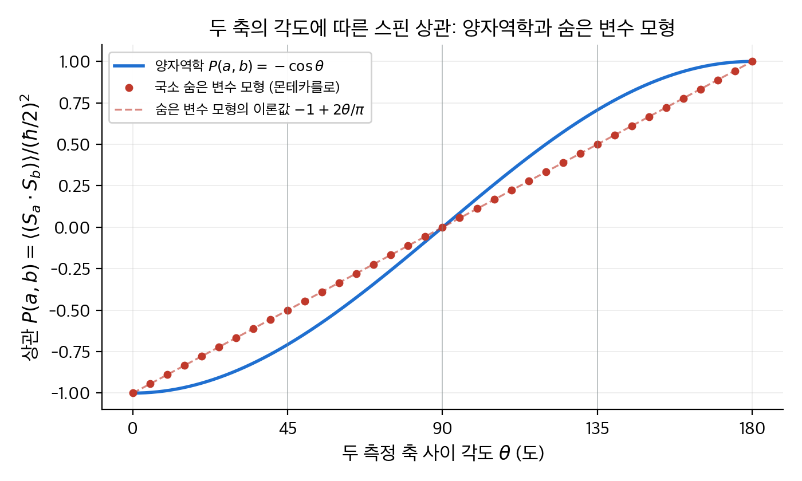
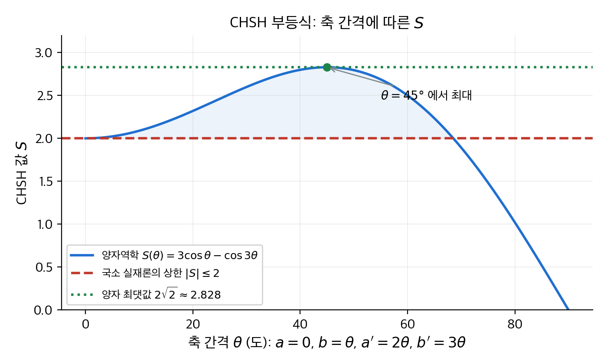
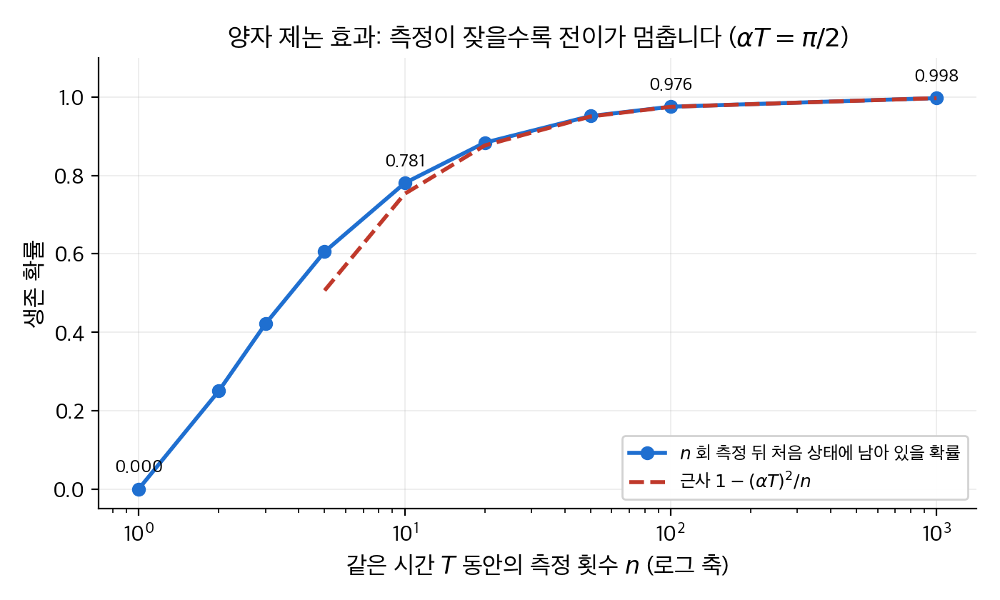

# 12. 맺음말: 양자역학의 해석

앞의 열한 장은 양자역학으로 **계산하는 방법**을 다뤘습니다. 이 장은 그 계산이 세계에 대해 **무엇을 말하는지**를 묻습니다.
출발점은 1935년의 EPR 역설입니다. 멀리 떨어진 두 입자의 측정 결과가 완전히 상관되어 있다면, 결과는 측정 전에 이미 정해져 있던 것이 아닐까 하는 물음입니다.
1964년 벨은 이 물음을 실험으로 판가름할 수 있는 부등식으로 바꿨습니다. 실험은 양자역학의 손을 들어 주었습니다.
결론적으로 자연은 **국소 실재론**(local realism)을 따르지 않습니다. 다만 이 비국소성은 신호를 빛보다 빨리 보내는 데 쓸 수 없습니다.
이어서 복제 불가 정리, 슈뢰딩거의 고양이가 드러내는 측정 문제, 측정을 반복하면 전이가 멈추는 양자 제논 효과를 다룹니다.

!!! info "원문과 자료"
    - 원문: Griffiths, *Introduction to Quantum Mechanics*, 1st ed. (1995), Afterword (The EPR Paradox, Bell's Theorem, The No-Clone Theorem, Schrödinger's Cat, The Quantum Zeno Paradox)
    - 함께 읽기: [3. 형식 체계](03-formalism.md)의 일반화된 통계적 해석, [4. 3차원 양자역학](04-three-dimensions.md)의 스핀, [5. 동일 입자](05-identical-particles.md)의 두 입자 계
    - 예시의 수치는 모두 NumPy로 다시 계산해서 검증했습니다. 숨은 변수 모형은 몬테카를로 시뮬레이션으로 검증했습니다.

## 1. EPR 역설

### 설정

중성 파이온 $\pi^0$ 은 스핀이 0이고, 전자와 양전자로 붕괴할 수 있습니다.

$$
\pi^0 \to e^- + e^+
$$

각운동량 보존 때문에 두 입자의 스핀은 합이 0인 **단일항 상태**(singlet state)여야 합니다.

$$
|\psi\rangle = \frac{1}{\sqrt{2}}\bigl(|\!\uparrow\downarrow\rangle - |\!\downarrow\uparrow\rangle\bigr)
$$

왼쪽 화살표는 전자, 오른쪽 화살표는 양전자의 $z$ 성분 스핀입니다.
전자는 왼쪽으로, 양전자는 오른쪽으로 날아갑니다. 두 입자가 10 m 떨어진 뒤 각자의 검출기에서 스핀을 잽니다.

<figure markdown>

<figcaption markdown>
<span class="fig-title"><b>Figure 1.</b> EPR 실험의 배치</span>

스핀 0인 파이온이 전자와 양전자로 붕괴합니다. 두 검출기는 각자 고른 축 $a$, $b$ 방향의 스핀 성분을 잽니다.
</figcaption>
</figure>

### 완전 반상관을 손으로 계산하기

두 검출기가 모두 $z$ 축을 재면 결과는 어떻게 나올까요?
단일항 상태를 4차원 벡터로 쓰면 기저 $\{|\!\uparrow\uparrow\rangle, |\!\uparrow\downarrow\rangle, |\!\downarrow\uparrow\rangle, |\!\downarrow\downarrow\rangle\}$ 에서 다음과 같습니다.

$$
|\psi\rangle = \frac{1}{\sqrt{2}}\begin{pmatrix} 0 \\ 1 \\ -1 \\ 0 \end{pmatrix}
$$

[3장](03-formalism.md)의 일반화된 통계적 해석에 따라 각 결과의 확률은 성분의 제곱입니다.

| 전자 | 양전자 | 진폭 | 확률 |
| --- | --- | --- | --- |
| $\uparrow$ | $\uparrow$ | $0$ | $0$ |
| $\uparrow$ | $\downarrow$ | $1/\sqrt{2}$ | $1/2$ |
| $\downarrow$ | $\uparrow$ | $-1/\sqrt{2}$ | $1/2$ |
| $\downarrow$ | $\downarrow$ | $0$ | $0$ |

전자가 $+\hbar/2$ 이면 양전자는 반드시 $-\hbar/2$ 입니다. 반대도 마찬가지입니다.
어느 쪽이 먼저 나올지는 반반이지만, 둘이 같은 결과를 내는 일은 결코 없습니다. 이것을 **완전 반상관**(perfect anticorrelation)이라고 합니다.
단일항 상태는 회전에 대해 불변입니다. 따라서 두 검출기가 $z$ 축 대신 같은 임의의 축을 골라도 결론은 같습니다.

### 일상 비유: 벨트만의 양말

물리학자 벨은 이 상황을 동료 벨트만의 양말에 비유했습니다. 벨트만은 늘 양쪽 발에 다른 색 양말을 신습니다.
왼발이 분홍색인 것을 보는 순간, 오른발은 분홍색이 아님을 압니다. 오른발을 보지 않아도 압니다.
여기에는 아무 신비도 없습니다. 양말 색은 아침에 신을 때 이미 정해졌기 때문입니다.

EPR의 주장이 바로 이것입니다. 전자의 스핀을 재는 순간 양전자의 스핀이 정해진다면, 정보가 10 m 를 순간적으로 건너간 셈입니다.
아인슈타인은 이것을 받아들이지 않았습니다. EPR은 스핀이 양말 색처럼 **붕괴 순간에 이미 정해져 있었다**고 결론지었습니다.
양자역학의 파동 함수는 그 값을 담지 못하므로 **불완전**하다는 주장입니다. 빠진 정보를 **숨은 변수**(hidden variable) $\lambda$ 라고 부릅니다.

### 두 가지 가정

EPR의 논증은 두 가정에 기댑니다.

- **실재론**(realism): 측정 결과는 측정하기 전부터 정해진 값이 있습니다. 양말 색처럼 보기 전에도 색이 있습니다.
- **국소성**(locality): 한 곳의 측정이 멀리 떨어진 곳에 즉시 영향을 줄 수 없습니다. 영향은 빛의 속도보다 빠를 수 없습니다.

1935년에는 이것이 철학의 문제로 보였습니다. 숨은 변수가 있든 없든 측정 결과의 통계는 같아 보였기 때문입니다.
벨은 두 검출기의 축이 **다를 때** 통계가 달라짐을 보였습니다.

## 2. 벨 정리

### 양자역학의 상관 함수

검출기 A는 단위 벡터 $a$ 방향의 스핀을, 검출기 B는 $b$ 방향의 스핀을 잽니다. 결과는 각각 $\pm 1$ 로 적습니다. 단위는 $\hbar/2$ 입니다.
두 결과의 곱의 평균을 **상관 함수**(correlation function) $P(a, b)$ 라고 합니다. 양자역학의 예측은 다음과 같습니다.

$$
P(a, b) = \langle \psi | (\sigma \cdot a) \otimes (\sigma \cdot b) | \psi \rangle = -\, a \cdot b = -\cos\theta
$$

$\theta$ 는 두 축 사이의 각도입니다. 같은 축이면 $-1$ (완전 반상관)입니다. 수직이면 $0$ (무관), 반대 축이면 $+1$ 입니다.

### 수치 예: 4×4 행렬로 직접 계산하기

$a$ 를 $z$ 축, $b$ 를 $xz$ 평면에서 $z$ 축과 45° 기울어진 축으로 잡습니다. [4장](04-three-dimensions.md)의 파울리 행렬로 두 연산자를 씁니다.

$$
\sigma \cdot a = \sigma_z = \begin{pmatrix} 1 & 0 \\ 0 & -1 \end{pmatrix}, \qquad
\sigma \cdot b = \frac{\sigma_z + \sigma_x}{\sqrt{2}} = \frac{1}{\sqrt{2}}\begin{pmatrix} 1 & 1 \\ 1 & -1 \end{pmatrix}
$$

두 행렬의 크로네커 곱은 4×4 행렬입니다. 단일항 벡터로 기댓값을 구하면 $-\cos 45° = -0.7071$ 이 나옵니다.

```python
import numpy as np
sx = np.array([[0, 1], [1, 0]]); sz = np.array([[1, 0], [0, -1]])
up, dn = np.array([1, 0]), np.array([0, 1])
psi = (np.kron(up, dn) - np.kron(dn, up)) / np.sqrt(2)      # 단일항

def P(theta_a, theta_b):                                     # xz 평면의 두 축
    sa = np.cos(theta_a) * sz + np.sin(theta_a) * sx
    sb = np.cos(theta_b) * sz + np.sin(theta_b) * sx
    return psi @ np.kron(sa, sb) @ psi

print(P(0, np.pi / 4), -np.cos(np.pi / 4))                   # -0.7071 -0.7071
```

같은 설정에서 네 가지 결과의 결합 확률도 구할 수 있습니다. 확률은 $\frac{1}{2}\sin^2(\theta/2)$ 와 $\frac{1}{2}\cos^2(\theta/2)$ 입니다.

| A 결과 | B 결과 | 확률 ($\theta = 45°$) |
| --- | --- | --- |
| $+1$ | $+1$ | $0.0732$ |
| $+1$ | $-1$ | $0.4268$ |
| $-1$ | $+1$ | $0.4268$ |
| $-1$ | $-1$ | $0.0732$ |

상관 함수는 "같은 결과의 확률 − 다른 결과의 확률"입니다. $0.1464 - 0.8536 = -0.7071$ 로 위의 행렬 계산과 일치합니다.

### 숨은 변수 모형이 지켜야 하는 부등식

이제 숨은 변수가 있다고 가정합니다. 붕괴 순간 두 입자는 공통의 변수 $\lambda$ 를 나눠 갖습니다.
검출기 A의 결과는 $a$ 와 $\lambda$ 만으로 정해지는 함수 $A(a, \lambda) = \pm 1$ 입니다. 검출기 B의 결과는 $B(b, \lambda) = \pm 1$ 입니다.
A의 결과가 B의 축 $b$ 에 의존하지 않는다는 것이 **국소성**입니다. $\lambda$ 의 분포를 $\rho(\lambda)$ 라고 하면 상관 함수는 다음과 같습니다.

$$
P(a, b) = \int \rho(\lambda)\, A(a, \lambda)\, B(b, \lambda)\, d\lambda
$$

같은 축에서 완전 반상관이어야 하므로 $B(a, \lambda) = -A(a, \lambda)$ 입니다. 그러면 $P(a, b) = -\int \rho\, A(a, \lambda) A(b, \lambda)\, d\lambda$ 입니다.
세 축 $a$, $b$, $c$ 를 고르고 두 상관 함수의 차를 씁니다. $A(b, \lambda)^2 = 1$ 을 끼워 넣습니다.

$$
P(a, b) - P(a, c) = -\int \rho\, A(a, \lambda) A(b, \lambda) \bigl[1 - A(b, \lambda) A(c, \lambda)\bigr] d\lambda
$$

대괄호 안은 0 또는 2이므로 음수가 아닙니다. 앞의 곱 $A(a, \lambda) A(b, \lambda)$ 는 크기가 1이므로 절댓값을 취하면 다음을 얻습니다.

$$
\bigl| P(a, b) - P(a, c) \bigr| \le \int \rho \bigl[1 - A(b, \lambda) A(c, \lambda)\bigr] d\lambda = 1 + P(b, c)
$$

이것이 **벨 부등식**(Bell inequality)입니다. 어떤 숨은 변수든, 어떤 분포 $\rho$ 든, 국소적이기만 하면 이 부등식을 지켜야 합니다.

### 수치 예: 세 각도로 부등식 깨뜨리기

$a = 0°$, $b = 45°$, $c = 90°$ 로 잡고 양자역학의 $P = -\cos\theta$ 를 넣어 봅니다.

1. $P(a, b) = -\cos 45° = -0.7071$
2. $P(a, c) = -\cos 90° = 0$
3. $P(b, c) = -\cos 45° = -0.7071$

왼쪽은 $|{-0.7071} - 0| = 0.7071$ 입니다. 오른쪽은 $1 + (-0.7071) = 0.2929$ 입니다.
$0.7071 > 0.2929$ 이므로 부등식이 깨집니다. 양자역학의 예측은 **어떤 국소 숨은 변수 이론과도 양립할 수 없습니다**.

<figure markdown>

<figcaption markdown>
<span class="fig-title"><b>Figure 2.</b> 세 각도에서 벨 부등식의 양변</span>

양자역학은 왼쪽이 오른쪽보다 커서 부등식을 어깁니다. 뒤에 나오는 숨은 변수 모형은 양변이 같아 부등식을 꼭 맞게 지킵니다.
</figcaption>
</figure>

### 손계산 예: 가장 단순한 숨은 변수 모형

부등식이 추상적으로 느껴지면 구체적인 모형 하나를 만들어 봅니다. $\lambda$ 를 구면 위에 고르게 분포한 단위 벡터라고 둡니다.
전자는 $\lambda$ 가 $a$ 와 같은 반구에 있으면 $+1$ 을, 아니면 $-1$ 을 냅니다. 양전자는 그 반대입니다.

$$
A(a, \lambda) = \operatorname{sign}(a \cdot \lambda), \qquad B(b, \lambda) = -\operatorname{sign}(b \cdot \lambda)
$$

같은 축이면 항상 반대 결과가 나오므로 완전 반상관은 재현합니다.
두 축이 $\theta$ 만큼 벌어지면 두 반구의 경계면이 $\theta$ 만큼 어긋납니다. 경계 사이의 쐐기 영역은 구면의 $\theta / \pi$ 비율을 차지합니다.
$\lambda$ 가 쐐기 안에 있으면 두 부호가 같아져 곱이 $+1$ 입니다. 밖에 있으면 $-1$ 입니다.

$$
P_{\text{숨은}}(a, b) = (+1)\frac{\theta}{\pi} + (-1)\Bigl(1 - \frac{\theta}{\pi}\Bigr) = -1 + \frac{2\theta}{\pi}
$$

$\theta = 45°$ 에서 $-0.5$, $90°$ 에서 $0$ 입니다. 벨 부등식에 넣으면 왼쪽 $|{-0.5} - 0| = 0.5$, 오른쪽 $1 - 0.5 = 0.5$ 로 꼭 맞게 성립합니다.
양자역학의 $-0.7071$ 은 이 모형이 낼 수 있는 값보다 더 강한 상관입니다.

다음 코드는 이 모형을 몬테카를로로 확인합니다. 40만 개의 무작위 $\lambda$ 에서 $\theta = 45°$ 의 상관은 $-0.5006$ 으로 나왔습니다.

```python
rng = np.random.default_rng(1)
lam = rng.normal(size=(400_000, 3))
lam /= np.linalg.norm(lam, axis=1)[:, None]                  # 구면 위에 고른 분포

def P_hidden(theta):
    a = np.array([0, 0, 1.0]); b = np.array([np.sin(theta), 0, np.cos(theta)])
    return np.mean(np.sign(lam @ a) * (-np.sign(lam @ b)))

print(P_hidden(np.pi / 4), -1 + 2 * (np.pi / 4) / np.pi)       # -0.5006 -0.5
```

<figure markdown>

<figcaption markdown>
<span class="fig-title"><b>Figure 3.</b> 각도에 따른 상관 함수의 비교</span>

양자역학의 $-\cos\theta$ 와 숨은 변수 모형의 직선은 $0°$, $90°$, $180°$ 에서만 만납니다. 그 사이에서 양자역학의 상관이 더 강합니다.
직선이 아닌 다른 숨은 변수 모형을 만들어도 벨 부등식 때문에 $-\cos\theta$ 를 모든 각도에서 재현할 수 없습니다.
</figcaption>
</figure>

### CHSH 형태

실험에서는 완전 반상관을 가정하지 않는 **CHSH 부등식**(Clauser-Horne-Shimony-Holt inequality)을 더 많이 씁니다.
A는 두 축 $a$, $a'$ 가운데 하나를, B는 $b$, $b'$ 가운데 하나를 고릅니다. 다음 조합을 만듭니다.

$$
S = P(a, b) - P(a, b') + P(a', b) + P(a', b')
$$

국소 숨은 변수 이론에서는 $|S| \le 2$ 입니다. 이유는 간단합니다. 각 $\lambda$ 에 대해 $A(a)[B(b) - B(b')] + A(a')[B(b) + B(b')]$ 를 봅니다. 대괄호 둘 가운데 하나는 0이고 다른 하나는 $\pm 2$ 입니다.
양자역학에서는 네 축을 $xz$ 평면에서 $a = 0°$, $b = 45°$, $a' = 90°$, $b' = 135°$ 로 잡으면 다음이 나옵니다.

$$
S = -\cos 45° + \cos 135° - \cos 45° - \cos 45° = -4 \times 0.7071 = -2.828
$$

$|S| = 2\sqrt{2} \approx 2.828 > 2$ 입니다. 축 간격을 $\theta$ 로 두고 $a = 0$, $b = \theta$, $a' = 2\theta$, $b' = 3\theta$ 로 잡으면 $|S(\theta)| = |3\cos\theta - \cos 3\theta|$ 입니다. $\theta = 45°$ 에서 최대입니다.

<figure markdown>

<figcaption markdown>
<span class="fig-title"><b>Figure 4.</b> 축 간격에 따른 CHSH 값</span>

축 간격이 약 $0°$ 에서 $67°$ 사이이면 양자역학의 $S$ 가 고전 상한 2를 넘습니다. 색칠한 영역이 실험으로 검증할 수 있는 구간입니다.
</figcaption>
</figure>

### 실험의 판결

1982년 아스페(Aspect) 연구진은 칼슘 원자가 연달아 내는 광자 쌍의 편광으로 이 실험을 했습니다.
광자가 날아가는 동안 측정 축을 바꿔서, 한 검출기의 설정이 다른 검출기에 빛의 속도로도 전달될 수 없게 했습니다.
결과는 양자역학의 예측과 일치했고 벨 부등식을 여러 표준 편차만큼 어겼습니다.
2015년에는 검출 효율과 거리 조건을 동시에 만족하는 실험이 세 곳에서 이루어졌습니다. 결론은 바뀌지 않았습니다.

따라서 실재론과 국소성 가운데 적어도 하나는 틀렸습니다. 양자역학은 측정 전에 값이 없다고 말하므로 실재론을 버립니다.
그 대가로 한쪽 측정이 다른 쪽 상태를 즉시 바꾸는 **비국소성**(nonlocality)을 받아들입니다.

### 비국소성으로 할 수 없는 것

비국소성은 신호를 빛보다 빨리 보내는 데 쓸 수 없습니다. 위의 결합 확률 표에서 확인할 수 있습니다.
A 혼자서 볼 수 있는 것은 자기 결과의 통계뿐입니다. A가 $+1$ 을 볼 확률은 $0.0732 + 0.4268 = 0.5$ 입니다.
B가 축을 $45°$ 로 잡든 $90°$ 로 잡든, 아예 재지 않든 이 값은 0.5 입니다. B의 선택은 A의 통계에 흔적을 남기지 않습니다.
상관은 두 기록을 **나란히 놓고 비교할 때**만 보입니다. 비교하려면 결과를 보통의 통신으로 주고받아야 하므로 빛의 속도를 넘지 못합니다.

비유하면 이렇습니다. 두 사람이 멀리서 각자 주사위를 던지는데 결과가 늘 합이 7이 되도록 맞춰져 있습니다.
각자 자기 주사위만 보면 완전히 무작위입니다. 짝이 맞았음은 전화로 결과를 맞춰 본 뒤에야 압니다.
양자역학이 양말 비유와 다른 점은 단 하나입니다. 주사위 눈이 던지기 전에 정해져 있었다고 보면 벨 부등식에 걸립니다.

## 3. 복제 불가 정리

### 왜 복제가 문제인가

비국소성으로 신호를 보낼 수 없다는 논증에는 빈틈이 있어 보입니다. A가 자기 입자를 **여러 개 복제**해 각각 다른 축으로 재면 B의 설정을 알아낼 수 있지 않을까요?
**복제 불가 정리**(no-clone theorem)는 이것이 불가능함을 보입니다. 임의의 양자 상태를 복사하는 장치는 존재하지 않습니다.

### 증명: 선형성 네 줄

복사 장치가 있다고 가정합니다. 원본 $|\psi\rangle$ 과 빈 종이 $|0\rangle$ 을 넣으면 $|\psi\rangle|\psi\rangle$ 이 나와야 합니다. 이 장치의 시간 변화는 유니터리 연산자 $U$ 입니다.

1. 스핀 위 상태를 복사합니다: $U\,|\!\uparrow\rangle|0\rangle = |\!\uparrow\rangle|\!\uparrow\rangle$
2. 스핀 아래 상태를 복사합니다: $U\,|\!\downarrow\rangle|0\rangle = |\!\downarrow\rangle|\!\downarrow\rangle$
3. 중첩 $|\psi\rangle = (|\!\uparrow\rangle + |\!\downarrow\rangle)/\sqrt{2}$ 를 넣습니다. $U$ 는 선형이므로 1과 2를 더한 결과가 나옵니다.

$$
U\,|\psi\rangle|0\rangle = \frac{1}{\sqrt{2}}\bigl(|\!\uparrow\uparrow\rangle + |\!\downarrow\downarrow\rangle\bigr)
$$

4. 그러나 복사라면 다음이 나와야 합니다.

$$
|\psi\rangle|\psi\rangle = \frac{1}{2}\bigl(|\!\uparrow\uparrow\rangle + |\!\uparrow\downarrow\rangle + |\!\downarrow\uparrow\rangle + |\!\downarrow\downarrow\rangle\bigr)
$$

3과 4는 다른 상태입니다. 모순이므로 그런 $U$ 는 없습니다. 선형성 하나만 쓴 증명입니다.

### 수치 확인

위 상태와 아래 상태를 올바르게 복사하는 4×4 유니터리 행렬을 하나 만듭니다. 그다음 중첩을 넣어 봅니다.
얻은 상태와 원하는 상태의 겹침 제곱, 즉 **충실도**(fidelity)는 1이 아니라 0.5 입니다.

```python
U = np.zeros((4, 4))
U[:, 0] = np.kron(up, up); U[:, 2] = np.kron(dn, dn)          # 기저 상태는 복사됩니다.
U[:, 1] = np.kron(up, dn); U[:, 3] = np.kron(dn, up)          # 나머지 열은 유니터리가 되게 채웁니다.
psi = (up + dn) / np.sqrt(2)
got = U @ np.kron(psi, up)                                    # (|↑↑> + |↓↓>)/√2
want = np.kron(psi, psi)                                      # 모든 성분이 1/2
print(abs(want @ got) ** 2)                                   # 0.5
```

복제 불가 정리는 뒤에 양자 암호의 바탕이 되었습니다. 도청자가 전송 중인 양자 상태를 복사해 둘 수 없기 때문입니다.

## 4. 슈뢰딩거의 고양이

### 측정 문제

양자역학에는 서로 다른 두 가지 시간 변화가 있습니다. 측정하지 않을 때 파동 함수는 슈뢰딩거 방정식을 따라 매끄럽게 변합니다.
측정하면 파동 함수는 측정값의 고유 상태로 불연속적으로 **붕괴**(collapse)합니다. 어디까지가 "측정하지 않음"이고 어디부터가 "측정"일까요?
이것이 **측정 문제**(measurement problem)입니다. 슈뢰딩거는 1935년에 이 문제를 극단으로 밀어붙인 사고 실험을 제안했습니다.

상자 안에 고양이, 방사성 원자 하나, 가이거 계수기, 독약 병을 넣습니다. 원자가 붕괴하면 계수기가 작동해 병을 깨뜨리고 고양이는 죽습니다.
원자는 한 시간 안에 붕괴할 확률이 1/2 입니다. 한 시간 뒤 상자를 열기 전, 양자역학은 전체 계를 어떻게 기술할까요?

### 수치 예: 두 준위 붕괴 모형

원자의 상태를 붕괴 전 $|u\rangle$ 과 붕괴 후 $|d\rangle$ 로 둡니다. 반감기가 1시간이면 평균 수명은 $\tau = 1\,\mathrm{h} / \ln 2 = 1.443\,\mathrm{h}$ 입니다.
붕괴 전 상태의 진폭은 $e^{-t/2\tau}$ 로 줄어듭니다. 고양이까지 포함한 전체 상태는 다음과 같습니다.

$$
|\Psi(t)\rangle = e^{-t/2\tau}\,|u\rangle|\text{삶}\rangle + \sqrt{1 - e^{-t/\tau}}\,|d\rangle|\text{죽음}\rangle
$$

| 시간 | 삶 진폭 | 죽음 진폭 | 삶 확률 | 죽음 확률 |
| --- | --- | --- | --- | --- |
| 0 | 1 | 0 | 1 | 0 |
| 30분 | 0.841 | 0.541 | 0.707 | 0.293 |
| 1시간 | 0.707 | 0.707 | 0.5 | 0.5 |
| 2시간 | 0.5 | 0.866 | 0.25 | 0.75 |

한 시간 뒤의 상태는 삶과 죽음이 같은 크기로 **중첩**되어 있습니다. 상자를 여는 순간 둘 가운데 하나로 붕괴합니다.
슈뢰딩거의 요점은 이 기술이 터무니없다는 주장입니다. 고양이는 열어 보기 전에도 살아 있거나 죽어 있지, 둘의 중첩일 수는 없습니다.

### 붕괴는 어디서 일어나는가

전통적인 코펜하겐 해석의 답은 "거시적 장치가 기록하는 순간"입니다. 가이거 계수기가 이미 측정 장치이므로 고양이는 중첩에 놓이지 않습니다.
그러나 가이거 계수기 역시 원자로 이루어져 있고 슈뢰딩거 방정식을 따릅니다. 어디서 선을 긋느냐는 물음은 남습니다.
책은 이 물음에 양자역학이 최종 답을 주지 못한다고 솔직하게 적습니다. 계산에는 문제가 없지만, 그 계산이 무엇을 뜻하는지는 아직 논쟁 중입니다.

### 결어긋남: 현대의 부분적 답

오늘날 가장 널리 받아들여지는 부분적 답은 **결어긋남**(decoherence)입니다. 고양이는 공기 분자, 열복사, 빛과 끊임없이 상호 작용합니다.
이 상호 작용이 삶과 죽음 두 가지 사이의 **위상 관계**를 환경으로 흩어 버립니다. 그러면 중첩은 간섭을 일으킬 수 없는 고전적 혼합과 구별되지 않습니다.
얼마나 빨리 일어나는지 어림해 봅니다. 질량 $m$ 인 물체가 온도 $T$ 인 환경에 있습니다. 거리 $\Delta x$ 만큼 떨어진 두 위치의 중첩에 있을 때 결어긋남 시간은 대략 다음과 같습니다.

$$
\tau_D \approx \tau_R \left(\frac{\lambda_T}{\Delta x}\right)^2, \qquad \lambda_T = \frac{\hbar}{\sqrt{2 m k_B T}}
$$

$\tau_R$ 은 에너지가 환경과 평형을 이루는 시간이고, $\lambda_T$ 는 열적 드브로이 파장입니다. 실온 $T = 300\,\mathrm{K}$ 에서 계산합니다.

| 대상 | $m$ | $\Delta x$ | $\lambda_T$ | $(\lambda_T / \Delta x)^2$ |
| --- | --- | --- | --- | --- |
| 전자 | $9.1 \times 10^{-31}\,\mathrm{kg}$ | 1 nm | 1.2 nm | 약 1.5 |
| 먼지 알갱이 | $10^{-15}\,\mathrm{kg}$ | 1 µm | $3.7 \times 10^{-17}\,\mathrm{m}$ | $1.3 \times 10^{-21}$ |
| 1 g 물체 | $10^{-3}\,\mathrm{kg}$ | 1 cm | $3.7 \times 10^{-23}\,\mathrm{m}$ | $1.3 \times 10^{-41}$ |

전자는 결어긋남 시간이 평형 시간과 비슷하므로 중첩이 오래 살아남습니다. 1 g 물체는 평형 시간이 1년이라도 결어긋남은 $10^{-34}$ 초 안에 끝납니다.
고양이의 중첩은 우리가 보기 전에 이미 사라집니다. 다만 결어긋남은 "왜 간섭이 안 보이는가"를 설명할 뿐, "왜 하필 이쪽 결과가 나왔는가"는 설명하지 못합니다. 측정 문제의 그 부분은 여전히 열려 있습니다.

## 5. 양자 제논 효과

### 아이디어

측정이 파동 함수를 붕괴시킨다면, 측정을 아주 자주 하면 어떻게 될까요? 계가 처음 상태에서 벗어나려 할 때마다 측정이 처음 상태로 되돌립니다.
충분히 자주 재면 계는 영원히 처음 상태에 머뭅니다. 움직이는 화살이 매 순간 정지해 있다는 제논의 역설을 따서 **양자 제논 효과**(quantum Zeno effect)라고 부릅니다.

### 유도

처음 상태 $|1\rangle$ 이 다른 상태 $|2\rangle$ 로 넘어가는 두 준위 계를 봅니다. 결합 세기를 $\alpha$ 로 두면 처음 상태에 남아 있을 확률은 [9장](09-time-dependent-perturbation.md)의 라비 진동과 같은 꼴입니다.

$$
P_1(t) = \cos^2(\alpha t) \approx 1 - (\alpha t)^2 \quad (\alpha t \ll 1)
$$

핵심은 짧은 시간에 떠날 확률이 $t$ 에 비례하지 않고 $t^2$ 에 비례한다는 점입니다.
전체 시간 $T$ 를 $n$ 등분하고 매 구간 끝에 "아직 $|1\rangle$ 인가"를 잽니다. 측정마다 상태는 $|1\rangle$ 또는 $|2\rangle$ 로 붕괴합니다.
한 구간을 살아남을 확률은 $\cos^2(\alpha T / n)$ 입니다. $n$ 구간을 모두 살아남을 확률은 다음과 같습니다.

$$
P_{\text{생존}}(n) = \Bigl[\cos^2\Bigl(\frac{\alpha T}{n}\Bigr)\Bigr]^n \approx \Bigl[1 - \Bigl(\frac{\alpha T}{n}\Bigr)^2\Bigr]^n \approx 1 - \frac{(\alpha T)^2}{n}
$$

$n \to \infty$ 에서 생존 확률은 1로 갑니다. 측정을 멈추지 않으면 전이가 일어나지 않습니다.

### 수치 예

$\alpha T = \pi / 2$ 로 잡습니다. 측정 없이 시간 $T$ 를 기다리면 $\cos^2(\pi/2) = 0$ 이므로 계는 확실히 $|2\rangle$ 로 넘어갑니다.

| 측정 횟수 $n$ | 한 구간 생존 확률 | $T$ 뒤 생존 확률 |
| --- | --- | --- |
| 1 | 0 | 0 |
| 2 | 0.5 | 0.25 |
| 10 | 0.9755 | 0.781 |
| 100 | 0.99975 | 0.976 |
| 1000 | 0.9999975 | 0.998 |

같은 시간 동안 계를 1000번 들여다보면 99.8 %의 확률로 처음 상태에 남습니다. 한 번도 보지 않으면 반드시 넘어갑니다.

```python
alpha_T = np.pi / 2
for n in [1, 2, 10, 100, 1000]:
    print(n, np.cos(alpha_T / n) ** (2 * n))                 # 0, 0.25, 0.781, 0.976, 0.998
```

<figure markdown>

<figcaption markdown>
<span class="fig-title"><b>Figure 5.</b> 측정 횟수에 따른 생존 확률</span>

측정 횟수가 10배 늘 때마다 떠날 확률이 약 10분의 1로 줄어듭니다. 점선은 $1 - (\alpha T)^2 / n$ 근사입니다.
</figcaption>
</figure>

### 실험과 주의점

1990년에 베릴륨 이온의 두 준위 사이 전이에서 이 효과가 확인되었습니다. 전이를 일으키는 전자기파를 켜 둔 채 짧은 레이저 펄스로 상태를 반복해 재자, 펄스 수가 늘수록 전이가 억제되었습니다.
주의할 점이 하나 있습니다. 유도의 핵심은 짧은 시간에 떠날 확률이 $t^2$ 에 비례한다는 조건입니다.
자발 방출 같은 지수 붕괴는 떠날 확률이 $t$ 에 비례합니다. 그런 계에서는 $(1 - \gamma T / n)^n \to e^{-\gamma T}$ 가 되어 측정 횟수와 무관합니다.
실제로는 지수 붕괴도 아주 짧은 시간에는 $t^2$ 영역이 있지만, 그 영역이 너무 짧아 측정으로 잡기 어렵습니다.

## 6. 정리

| 주제 | 핵심 주장 | 숫자로 보는 예 |
| --- | --- | --- |
| EPR 역설 | 완전 반상관은 숨은 변수를 암시하는 것처럼 보입니다 | 같은 축: $P(\uparrow\downarrow) = P(\downarrow\uparrow) = 1/2$ |
| 벨 정리 | 국소 숨은 변수는 $\lvert P(a,b) - P(a,c) \rvert \le 1 + P(b,c)$ 를 지킵니다 | $0°, 45°, 90°$ 에서 $0.707 > 0.293$ |
| CHSH | 국소 실재론은 $\lvert S \rvert \le 2$ 입니다 | 양자역학 최대 $2\sqrt{2} = 2.828$ |
| 신호 불가 | 상대의 축 선택은 내 통계에 보이지 않습니다 | 어떤 축이든 $P(+1) = 0.5$ |
| 복제 불가 | 선형성 때문에 임의 상태를 복사할 수 없습니다 | 중첩 복사의 충실도 0.5 |
| 슈뢰딩거의 고양이 | 붕괴의 위치는 양자역학이 정해 주지 않습니다 | 1 g 물체의 결어긋남 비율 $10^{-41}$ |
| 양자 제논 효과 | 잦은 측정은 전이를 멈춥니다 | 1000회 측정에 생존 확률 0.998 |

양자역학은 지금까지 어떤 실험과도 어긋난 적이 없습니다. 벨 정리는 그 성공이 "아직 모르는 고전적 설명"으로 환원될 수 없음을 보였습니다.
측정이 무엇인지는 여전히 열린 물음입니다. 그러나 열린 물음이 계산을 방해하지는 않습니다. 앞의 열한 장이 보인 대로 계산은 잘 작동합니다.
