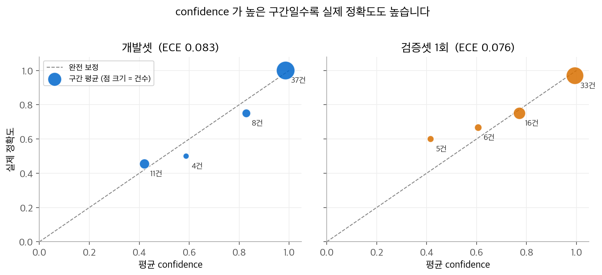
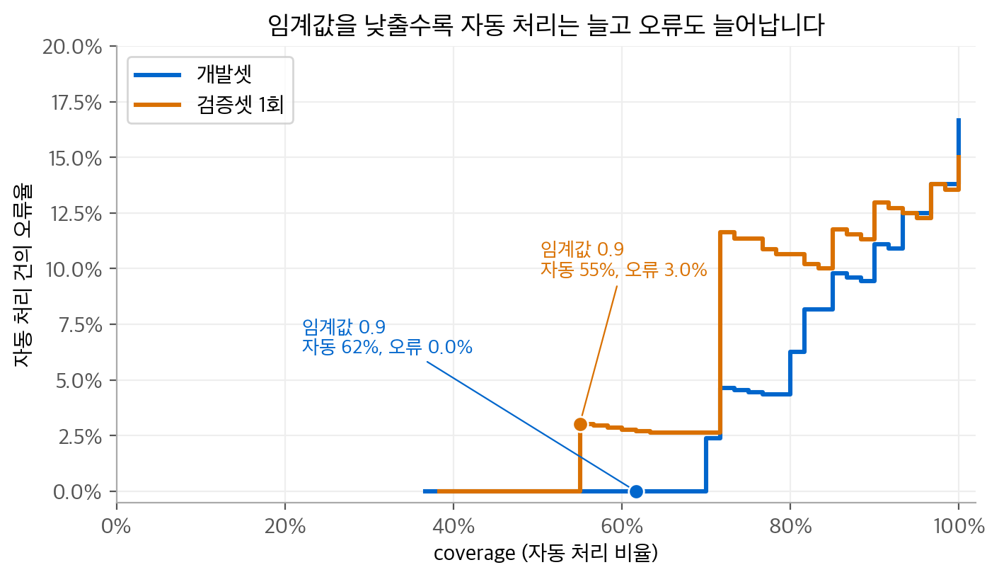
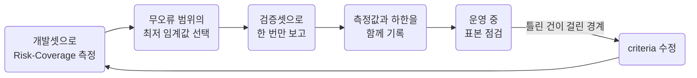

# Jev 시리즈 3. 확률을 믿어도 되는가: 보정, 임계값, 기권

Jev가 LLM과 가장 크게 다른 점은 답과 함께 확률을 돌려준다는 점입니다.
하지만 확률이 쓸모 있으려면 **"0.9라고 말한 답이 실제로 90% 맞는가"**가 성립해야 합니다.
이 성질을 보정(calibration)이라고 합니다.
이 글은 보정을 재는 지표, 임계값을 고르는 방법, 그리고 결과를 숫자로 방어하는 방법을 정리합니다.

<!-- more -->

!!! info "출처와 데이터"
    Jev 튜토리얼 [예제 저장소](https://github.com/ady95/jev_tutorial)의 `ch04`, `ch09`, `ch11` 코드를 바탕으로 정리했습니다.
    그림은 저장소에 공개된 벤치마크 원자료(`ch09/results/book/benchmark_2026-09-23.json`, 모델 `jev-1.13.0`)로
    다시 그렸습니다. 평가셋은 저장소 작성자가 직접 만든 고객 문의 분류 데이터입니다.
    개발셋 60건과 검증셋 60건이 있고, 부서 후보는 `billing`, `technical`, `sales`, `other` 넷입니다.

## 1. 정확도와 보정은 다른 질문입니다

두 분류기가 모두 정확도 85%라고 가정합니다.

- 분류기 A는 모든 답에 확률 0.99를 붙입니다.
- 분류기 B는 맞힌 답에는 0.95를, 틀린 답에는 0.4를 붙입니다.

정확도는 같지만, 자동화에 쓸 수 있는 것은 B뿐입니다.
B는 확률만 보고 "틀릴 것 같은 15%"를 골라 사람에게 넘길 수 있습니다.
A의 확률은 정보가 없습니다.
이 차이를 재는 것이 보정 지표입니다.

## 2. 보정을 재는 두 지표

### Brier Score

각 문항에서 예측 확률 벡터와 정답 원-핫 벡터의 제곱 거리를 구하고, 문항 수로 평균합니다.

$$
\text{Brier} = \frac{1}{N} \sum_{i=1}^{N} \sum_{k \in \text{후보}} \bigl(p_{i,k} - \mathbb{1}[y_i = k]\bigr)^2
$$

0이면 완벽하고, 클수록 나쁩니다.
틀린 답에 높은 확률을 붙이면 크게 벌점을 받습니다.
정확도와 보정을 함께 반영하는 지표입니다.

### ECE (Expected Calibration Error)

`confidence`를 구간(bin)으로 나누고, 각 구간에서 평균 `confidence`와 실제 정확도의 차이를 구합니다.
그 차이를 구간의 문항 비율로 가중 평균합니다.

$$
\text{ECE} = \sum_{b=1}^{B} \frac{\lvert S_b \rvert}{N} \,\Bigl\lvert \operatorname{acc}(S_b) - \operatorname{conf}(S_b) \Bigr\rvert
$$

ECE가 0이면 "0.8이라고 말한 답들은 정확히 80% 맞는다"가 모든 구간에서 성립합니다.

### 실측: jev-1.13.0

<figure markdown>

<figcaption markdown>
<span class="fig-title"><b>Figure 1.</b> Jev 신뢰도 다이어그램</span>

점이 점선에 가까울수록 보정이 잘 된 것입니다. 0.9 이상 구간의 정확도는 개발셋 37/37, 검증셋 32/33입니다.
</figcaption>
</figure>

| 데이터 | 정확도 | Brier | ECE |
| --- | --- | --- | --- |
| 개발셋 (60건) | 0.833 | 0.184 | 0.083 |
| 검증셋 1회 (60건) | 0.850 | 0.235 | 0.076 |

두 가지를 읽을 수 있습니다.

- confidence가 높을수록 실제 정확도도 높습니다. 확률이 순서 정보로는 믿을 만하다는 뜻입니다.
- 문항 수가 적은 구간(4~6건)의 점은 크게 흔들립니다. 60건 평가에서 구간별 차이를 세밀하게 해석하면 안 됩니다.

!!! warning "Jev가 보정을 보장하지는 않습니다"
    공개 자료에 따르면 TypeSafe는 확률이 실제 정답률과 맞도록 학습했다고 설명합니다.
    하지만 보정은 데이터 분포에 따라 달라집니다. 특히 영어 이외의 언어에서는 같은 답이라도 confidence가
    낮게 나온다는 관찰이 있습니다([Dale Seo](https://daleseo.com/jev/)).
    **임계값은 반드시 자신의 데이터로 다시 잽니다.**

## 3. Risk-Coverage 곡선으로 임계값을 고릅니다

임계값 $\tau$를 정하면 시스템은 두 갈래로 나뉩니다.
$\text{confidence} \ge \tau$이면 자동 처리하고, 나머지는 사람이나 LLM에게 넘깁니다.
이때 두 숫자가 맞바뀝니다.

$$
\text{coverage}(\tau) = \frac{\lvert \{i : c_i \ge \tau\} \rvert}{N},
\qquad
\text{risk}(\tau) = 1 - \operatorname{acc}\bigl(\{i : c_i \ge \tau\}\bigr)
$$

- coverage는 자동 처리 비율입니다. 높을수록 사람의 일이 줄어듭니다.
- risk는 자동 처리한 건 중 틀린 비율입니다. 낮을수록 안전합니다.

<figure markdown>

<figcaption markdown>
<span class="fig-title"><b>Figure 2.</b> Risk-Coverage 곡선</span>

임계값 0.9의 검증셋 결과는 자동 55%, 오류 3.0%입니다. coverage를 70% 이상으로 넓히면 오류율이 계단처럼 뜁니다.
</figcaption>
</figure>

예제 저장소의 벤치마크가 쓰는 임계값 정책은 다음과 같습니다.

1. 개발셋에서 Risk-Coverage를 잽니다.
2. 오류가 0인 범위에서 가장 낮은 임계값을 고릅니다. 이 데이터에서는 0.9였습니다.
3. 그 값을 고정하고 검증셋으로 성능을 보고합니다. 검증셋을 보고 임계값을 다시 고르지 않습니다.

### 개발셋으로 보고하면 낙관 편향이 생깁니다

임계값을 고른 데이터로 성능까지 보고하면 숫자가 실제보다 좋게 나옵니다.
위 그림에서 게이트 신뢰도(자동 처리 건의 정확도)는 개발셋에서 1.000이었고, 검증셋에서는 0.970이었습니다.
저장소 README는 처음에 이 둘을 나누지 않아 1.000을 보고했다가,
검증셋에서 0.946을 얻고 5.4퍼센트포인트의 낙관 편향을 확인했다고 적고 있습니다.

> 검증셋을 보고 설정을 바꾸면 그 순간 검증셋이 아니게 됩니다. — 예제 저장소 README

## 4. 측정값과 주장할 수 있는 값은 다릅니다

검증셋의 게이트 구간에서 33건 중 32건을 맞혔다고 해서 "신뢰도 97%"라고 주장할 수는 없습니다.
표본이 33건뿐이기 때문입니다. 예제 저장소의 `ch11/02_reliability_stats.py`는 두 가지 하한을 씁니다.

### 오류가 0건일 때: 3의 법칙

$n$건을 모두 맞혔을 때, 95% 신뢰수준에서 실제 오류율의 상한은 약 $3/n$입니다.

$$
P(\text{n건 연속 정답} \mid \text{오류율 } p) = (1-p)^n \approx e^{-np} = 0.05
\;\Rightarrow\; p \approx \frac{-\ln 0.05}{n} \approx \frac{3}{n}
$$

개발셋 게이트 구간은 37건 무오류였습니다. 따라서 주장할 수 있는 신뢰도는 $1 - 3/37 \approx 0.919$입니다.
"99%"를 주장하려면 무오류 300건이 필요하고, "95%"를 주장하려면 무오류 60건이 필요합니다.

### 오류가 있을 때: Wilson 하한

성공 $s$건, 전체 $n$건일 때 정답률 $\hat p = s/n$의 95% Wilson 구간 하한은 다음과 같습니다.

$$
\text{하한} = \frac{\hat p + \frac{z^2}{2n} - z\sqrt{\frac{\hat p(1-\hat p)}{n} + \frac{z^2}{4n^2}}}{1 + \frac{z^2}{n}},
\qquad z = 1.96
$$

검증셋 게이트 구간(32/33)에 넣으면 하한은 약 0.847입니다.

| 표현 | 개발셋 게이트 (37/37) | 검증셋 게이트 (32/33) |
| --- | --- | --- |
| 측정한 신뢰도 | 1.000 | 0.970 |
| 95% 수준에서 주장할 수 있는 하한 | 0.919 (3의 법칙) | 0.847 (Wilson) |

보고서에는 두 숫자를 함께 적습니다. 운영을 시작한 뒤에는 자동 처리 건 일부를 표본으로 뽑아 계속 점검합니다.
점검 건수가 쌓이면 하한이 올라갑니다.

## 5. 기권할 수 있는 시스템

임계값 아래의 건을 자동 처리하지 않는 것을 **기권(abstention)**이라고 합니다.
좋은 기권 신호는 "틀릴 건"과 "맞을 건"을 잘 가릅니다. 이 능력을 분리력이라고 부릅니다.
예제 저장소의 `ch11`은 confidence보다 나은 기권 신호를 찾으려고 다섯 가지를 시도했습니다.

| 시도 | 내용 | 결과 |
| --- | --- | --- |
| 메타 질문 | "두 상담원이 같은 부서를 고를까?" 같은 Noul을 함께 묻기 | 실패 (분리력 +0.03~+0.09) |
| LLM 합의 | 여러 LLM의 답이 일치할 때만 자동 처리 | 실패 (신뢰도 0.737) |
| 교차 검증 | 게이트를 통과한 건을 다른 방법으로 다시 검사 | 실패 (잡아낸 오류 0건) |
| margin | 1위와 2위 확률의 차이를 보조 신호로 사용 | 부분 성공 |
| 후보 정의 수정 | 틀린 건이 걸린 경계를 `criteria`에 명시 | 성공 (임계값 0.95에서 coverage +11.6%p) |

교훈은 두 가지입니다.

- **판단을 다시 판단하게 하는 질문은 거의 효과가 없었습니다.** 같은 모델이 같은 입력을 보고 답하므로 새 정보가 없습니다.
- **효과가 있었던 것은 분류 체계를 고친 것이었습니다.** 다음은 `ch11/04_improve_criteria.py`에서 고친 후보 설명의 일부입니다.

```python
V2 = {
    "billing": ("요금, 결제, 환불, 세금계산서, 영수증. "
                "청구 금액이나 사용량이 왜 이런지 묻는 것도 포함"),
    "sales": ("구매 상담, 견적, 요금제 선택, 우리 파트너 프로그램 가입 문의, "
              "계약 갱신, 타사에서 넘어오는 전환 지원"),
    # ...
}
```

후보 설명을 고친 뒤에는 전체 평가셋을 다시 돌려 새로 틀린 건이 생겼는지 확인합니다.

## 정리



- 정확도와 보정은 다른 질문입니다. 자동화에는 보정이 필요합니다.
- 임계값은 Risk-Coverage 곡선에서 고르고, 고른 데이터와 다른 데이터로 보고합니다.
- 표본이 작으면 측정값보다 하한을 말합니다.
- 기권 신호를 늘리기보다 후보 정의를 고치는 편이 효과가 컸습니다.

다음 글에서는 이 확률과 임계값을 실제 시스템에 넣는 설계 패턴을 다룹니다.
