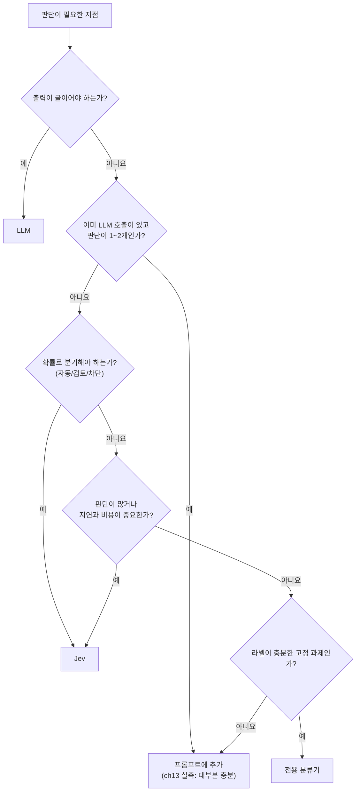
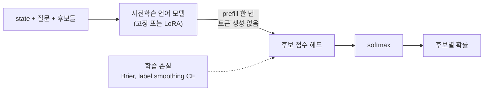

# Jev 시리즈 5. 한계, 비판, 그리고 생태계

앞의 네 편은 Jev를 어떻게 쓰는지 다뤘습니다. 이 글은 반대 방향을 봅니다.
Jev가 못하는 일, 외부 평가와 비판, 프롬프트만으로 충분한 경우를 정리합니다.
마지막으로 출시 한 달 만에 생긴 호환 모델과 경쟁 모델을 정리합니다.

<!-- more -->

## 1. 공식 문서가 밝힌 약점

TypeSafe는 모델 버전별로 약점 목록("jaggedness")을 공개합니다.
다음은 [`jev-1.13` 문서](https://docs.typesafe.ai/model-jaggedness/jev-1.13.md)의 내용입니다.

| 약점 | 내용 | 대응 |
| --- | --- | --- |
| 문자 그대로 읽음 | 의도가 아니라 쓰인 질문에 답합니다 | 경계 사례를 `criteria`에 적습니다 |
| 수 세기, 계산 | 글자 수, 항목 수, 목록 길이를 셀수록 정확도가 떨어집니다 | 항목마다 Noul로 묻고 코드에서 합산합니다 |
| 숫자 형식 | 16진수, RGB, 2진수 해석이 약합니다 | 코드에서 변환한 뒤 넣습니다 |
| 날짜와 시간 | 순서, 기간 포함 여부, 간격이 부정확합니다 | 날짜 계산은 코드가 합니다 |
| 간접 참조 | 다단계 추론, 속성의 속성, 이중 부정에 약합니다 | 질문을 원자 단위로 쪼갭니다 |
| 무관한 맥락 | state에 무관한 내용이 많을수록 정확도가 떨어집니다 | 필요한 필드만 넣습니다 |
| 첫 후보 편향 | 첫 번째 후보를 더 자주 고릅니다 | 후보 순서를 바꿔 평가해 봅니다 |
| 프롬프트 주입 | state 안의 지시문이 판단을 바꿀 수 있습니다 | 사용자 입력을 신뢰하지 않습니다 |
| 질문 간 의존 불가 | 질문을 병렬로 평가하므로 한 답을 다른 질문에 쓸 수 없습니다 | 의존 관계는 호출을 나눠 코드로 잇습니다 |
| 글 생성 | 선택을 이어 붙여 글을 만들면 느리고 품질이 낮습니다 | 글은 LLM에게 맡깁니다 |

[Dale Seo의 실험](https://daleseo.com/jev/)은 수 세기의 한계를 구체적으로 보여 줍니다.
항목 8개는 정확히 셌지만, 16개부터 confidence가 0.44로 떨어졌습니다.
32개에서는 11개를 물었는데 10개라고 틀렸습니다(confidence 0.25).
confidence가 함께 떨어졌다는 점이 중요합니다. 틀린 답을 확신하지는 않았습니다.

### 한국어

공식 문서는 영어가 주 언어이고, 한중일 언어는 "처리하지만 같은 수준은 아니다"라고 적습니다.
Dale Seo는 명확한 문의에서는 한국어 결과가 영어와 같았지만, 애매한 문의에서는 같은 답이라도 confidence가 낮았다고 보고했습니다.
**임계값을 언어별로 따로 정하는 편이 안전합니다.**
2026. 10. 14.에 공개된 `jev-1.14.0`은 다국어 개선을 내세웠습니다. 한국어 개선 폭은 아직 확인하지 못했습니다.

## 2. 외부의 평가와 비판

### "환각이 없다"는 형식에 대한 말입니다

TypeSafe는 Jev가 타입 오류와 환각이 없다고 홍보합니다.
이 주장은 **출력 형태**에 대한 보장입니다. 응답은 항상 주어진 후보 중 하나이고, JSON 구조가 깨지지 않습니다.
답이 맞는다는 보장은 아닙니다. confidence 0.7인 답은 설계상 약 30% 틀립니다.
[The Register](https://www.theregister.com/ai-and-ml/2026/09/16/typesafe-ai-debuts-model-for-machines-that-plays-doom/5296711)는 이 표현이 오해를 부른다고 지적했습니다.

### 보정은 모든 데이터에서 성립할 수 없습니다

[Alex Molas](https://www.alexmolas.com/2026/09/23/jev-cant-be-calibrated.html)의 비판 요지는 이렇습니다.
보정은 데이터 분포에 묶인 성질입니다. 한 모델이 모든 사용자의 분포에서 동시에 보정될 수는 없습니다.
그는 사용자들이 보고한 예로 "공정한 동전이 앞면이 나온다"에 0.92가 나온 사례를 듭니다.
권하는 대응은 자신의 라벨 수백 건으로 Platt scaling 같은 사후 보정을 하는 것입니다.

$$
p_{\text{보정}} = \sigma\bigl(a \cdot \operatorname{logit}(p_{\text{Jev}}) + b\bigr),
\qquad a, b \text{는 자신의 라벨로 추정}
$$

[redreamality의 조사](https://redreamality.com/blog/open-decision-models-2026-survey-benchmarks/)도 비슷한 관찰을 보고합니다.

- 평균 confidence는 0.81인데 정확도는 0.74였습니다(과신).
- 후보 16개의 순서를 바꾸면 답의 약 7%가 바뀌었습니다.
- 짧은 자연어 맥락 하나로 답이 특정 오답에 고정되는 사례("JevOut")가 있었습니다.

이 시리즈 3편의 실측(한국어 고객 문의 60건)에서는 ECE가 0.08 안팎이었습니다.
과제와 데이터에 따라 보정 수준이 다르다는 Molas의 지적과 맞는 결과입니다.

### 가드레일 벤치마크: 더 낫지도, 더 싸지도 않았습니다

[Red Hat의 비교](https://developers.redhat.com/articles/2026/10/02/benchmarking-ai-decision-models-against-traditional-guardrails)는 Jev를 기존 가드레일과 비교했습니다.

| 과제 | Jev | 비교 대상 |
| --- | --- | --- |
| 프롬프트 주입 탐지 | 정확도 86.35% (9개 중 4위), 지연 중앙값 348ms | DeBERTa 분류기 89.01%, 54ms |
| 콘텐츠 안전성 | 정확도 86.20% (9개 중 1위), 360ms | |

Red Hat의 결론은 판단 모델이 LLM 판정기나 작은 전용 분류기보다 빠르지도, 싸지도, 낫지도 않았다는 것입니다.
**학습 데이터가 충분한 고정 과제에서는 전용 분류기가 여전히 강합니다.**
Jev의 장점은 라벨 없이 `criteria`만 바꿔 새 판단을 바로 만들 수 있다는 점입니다.

## 3. 프롬프트로 하면 안 되는가

판단 모델을 붙이면 의존성이 늘고 호출이 하나 더 생깁니다.
LLM 에이전트의 시스템 프롬프트에 한 줄 적어서 될 일이라면 그쪽이 낫습니다.
예제 저장소의 `ch13`은 이 질문을 실측했습니다.

실험 설정은 가상의 세무 안내 문서 40건을 검색하는 LangChain 상담 에이전트입니다.
질문 60건은 세 군으로 나뉩니다.

| 군 | 건수 | 정답 행동 |
| --- | --- | --- |
| A군: 문서에 답이 있음 | 15 + 15 | 답해야 합니다 |
| B군: 문서에 답이 없음 | 10 + 10 | 답하면 안 됩니다 |
| C군: 함정 (비슷한 다른 문서가 걸림) | 5 + 5 | 답하면 안 됩니다 |

같은 일을 프롬프트로도 하고 판단 모델로도 해서 다섯 번 비교했습니다.
**네 번은 프롬프트가 이겼습니다.**
판단 모델이 이긴 한 번은 판단이 여러 개일 때의 **지연시간**이었습니다.
판단 5개를 LLM으로 하면 출력이 길어지지만, Jev는 질문 수와 거의 관계없이 한 번에 끝납니다.

이 실측의 결론을 정리하면 다음과 같습니다.



## 4. 생태계: 호환 모델과 경쟁 모델

출시 한 달 사이에 여러 회사와 개인이 Jev의 API 모양(state + Choice/Noul/Score)을 따라 했습니다.
일부는 Jev API와 호환되어 SDK를 그대로 쓸 수 있습니다.

### Laya: 로컬에서 돌리는 호환 모델

[Laya](https://github.com/NandhaKishorM/laya)는 Convai Innovations가 Apache-2.0으로 공개한 모델입니다.
`laya-serve`는 Jev와 같은 경로(`/v1/systemone`)를 여는 FastAPI 서버입니다.
그래서 Jev SDK의 기본 주소만 바꾸면 그대로 동작합니다. 예제 저장소의 `ch12/laya_compare.py`가 이 방법으로 API 키 없이 실습합니다.

```bash
pip install "laya[serve]"
LAYA_HOST=127.0.0.1 LAYA_PORT=8010 LAYA_DEVICE=cpu laya-serve

# .env
TYPESAFE_API_KEY=local
TYPESAFE_BASE_URL=http://127.0.0.1:8010
```

| 항목 | Laya |
| --- | --- |
| 백본 | `laya`: ModernBERT-large (421M, 영어), `laya-multilingual`: mmBERT-base (322M, 100개 이상 언어) |
| 속도 | T4 GPU에서 질문당 약 33~40ms |
| 학습 | 적절한 점수 규칙(proper scoring rule)을 보상으로 쓰는 RLCD 방식이라고 설명 |
| 보정 | 과신 상태로 배포되므로 온도 보정이 필요합니다. 기권 도우미(`min_confidence`)를 제공합니다 |
| 차이 | `instructions`가 없는 질문을 422 오류로 거절합니다 |

### 큰 회사들의 같은 설계

| 이름 | 회사 | 공개 | 구조 |
| --- | --- | --- | --- |
| [Clef, Clef-flash](https://blog.cloudflare.com/clef-decision-models/) | Cloudflare | 2026. 10. 1. | Qwen 계열 LLM을 고정하고 LoRA와 라우팅 헤드를 붙임. 입력만 읽고(prefill) 후보 점수를 냄. Jev API와 호환 |
| [Strands Decider 2B](https://strandsagents.com/blog/introducing-strands-decider/) | Amazon | 2026. 10. 1. | Qwen3.5-2B에서 언어 모델 헤드를 떼고, 약 1M 파라미터의 포인터 헤드로 후보를 점수화 |
| [Decisions API](https://developers.openai.com/api/docs/guides/decisions) | OpenAI | 공개 베타 | `POST /v1/decisions`. `predicate`, `choice`, `score` 세 유형. 이미지 입력 지원. 출력 무료 |

공개 모델들의 공통 구조는 1편에서 비유로 든 "후보 점수 매기기"입니다.



Cloudflare가 공개한 비교표에서 지연 중앙값은 Clef 209ms, Clef-flash 39ms, Jev 524ms였습니다.
BANKING77 매크로 F1은 각각 94.2, 90.9, 79.7이었습니다.
경쟁사가 낸 수치이므로 같은 조건에서 다시 잴 필요가 있습니다.
이 범주에는 아직 표준 벤치마크가 없습니다. Jev Decision Index, JevBench 같은 시도가 진행 중입니다.

## 5. 이 시리즈를 마치며

Jev가 바꾼 것은 모델의 성능보다 **인터페이스**입니다.
"판단을 함수로 부르고, 확률을 받아서, 정책은 코드로 쓴다"는 모양이 생겼습니다.
이 모양은 Jev가 아닌 모델로도 구현할 수 있다는 것이 한 달 만에 드러났습니다.

1. 판단에는 확률이 필요합니다. 확률이 있어야 자동 처리와 사람 검토를 나눌 수 있습니다.
2. 확률은 직접 재야 믿을 수 있습니다. 보정은 데이터마다 다릅니다.
3. 정책은 코드에 둡니다. 모델이 약한 계산, 날짜, 금액 비교도 코드가 맡습니다.
4. 프롬프트로 충분한 곳에는 판단 모델을 붙이지 않습니다.

## 출처

**예제**

- [ady95/jev_tutorial, 예제 코드와 벤치마크 원자료](https://github.com/ady95/jev_tutorial)

**공식 자료**

- [TypeSafe 출시 글: Introducing System One Models and Jev](https://typesafe.ai/blog/introducing-system-one-models-and-jev)
- [Jev 1.14 공개 글](https://typesafe.ai/blog/jev-1-14)
- [TypeSafe 문서: 소개](https://docs.typesafe.ai/introduction), [confidence](https://docs.typesafe.ai/confidence.md), [jev-1.13 약점](https://docs.typesafe.ai/model-jaggedness/jev-1.13.md), [모델과 가격](https://docs.typesafe.ai/models.md)
- [Latent Space 팟캐스트: TypeSafe CEO 인터뷰](https://www.latent.space/p/jev)

**해설과 비판**

- [Dale Seo, Jev: 텍스트 대신 확률을 돌려주는 TypeSafe AI의 결정 모델](https://daleseo.com/jev/)
- [CODIGITAL, Jev System One 모델 정리](https://ai.codigital.co.jp/en/guides/jev-system-one-model/)
- [Understanding AI, Understanding Jev](https://www.understandingai.org/p/understanding-jev-the-new-model-everyone)
- [AINews, Here are 6 Clones of Jev in 2 days](https://www.latent.space/p/ainews-here-are-6-clones-of-jev-in)
- [Alex Molas, Jev can't be calibrated](https://www.alexmolas.com/2026/09/23/jev-cant-be-calibrated.html)
- [Red Hat, Benchmarking AI decision models against traditional guardrails](https://developers.redhat.com/articles/2026/10/02/benchmarking-ai-decision-models-against-traditional-guardrails)
- [redreamality, Open decision models 2026 survey](https://redreamality.com/blog/open-decision-models-2026-survey-benchmarks/)
- [The Register, 출시 보도](https://www.theregister.com/ai-and-ml/2026/09/16/typesafe-ai-debuts-model-for-machines-that-plays-doom/5296711)

**호환 모델과 경쟁 모델**

- [Laya (Convai Innovations)](https://github.com/NandhaKishorM/laya)
- [Cloudflare Clef](https://blog.cloudflare.com/clef-decision-models/)
- [Amazon Strands Decider](https://strandsagents.com/blog/introducing-strands-decider/)
- [OpenAI Decisions API](https://developers.openai.com/api/docs/guides/decisions)
