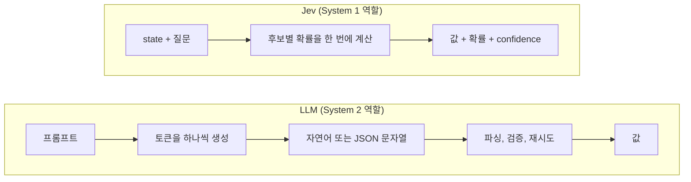

# Jev 시리즈 1. 글을 쓰지 않는 AI, Jev 개요

Jev는 TypeSafe AI가 2026. 9. 15. 얼리 액세스로 공개한 **판단 전용 모델**입니다.
LLM처럼 자연어를 읽지만 글을 쓰지 않습니다.
대신 미리 정한 후보 위의 확률 분포와 타입이 정해진 값을 돌려줍니다.
회사는 이런 모델을 **System One 모델**이라고 부릅니다.
이 글은 Jev가 무엇이고, 왜 등장했고, LLM과 무엇이 다른지 정리합니다.

<!-- more -->

!!! info "이 시리즈의 구성"
    | 편 | 주제 |
    | --- | --- |
    | 1. 개요 (이 글) | Jev는 무엇이고 왜 등장했는가 |
    | [2. 세 가지 질문](2026-10-18-jev-primitives.md) | Choice, Noul, Score의 요청과 응답 |
    | [3. 확률과 보정](2026-10-18-jev-calibration.md) | 보정 지표, 임계값, 기권 |
    | [4. 설계 패턴](2026-10-18-jev-patterns.md) | 라우팅, 하이브리드, 가드레일, RAG, 에이전트 |
    | [5. 한계와 생태계](2026-10-18-jev-limits.md) | 약점, 비판, 프롬프트와의 비교, 호환 모델 |

## 1. 한 문장 정의

> 비정형 상태(state)를 넣으면 타입이 정해진 확률적 판단이 나오는 함수 호출
> — TypeSafe의 [출시 글](https://typesafe.ai/blog/introducing-system-one-models-and-jev) 요약

TypeSafe는 Jev를 **"똑똑한 if 문(smart if-statements)"**이라고도 설명합니다.
프로그램 안에서 사람의 판단이 필요했던 분기 하나를 모델 호출 하나로 바꾼다는 뜻입니다.

## 2. 이름에 담긴 두 가지 생각

### System One: 빠른 직관

이름은 대니얼 카너먼의 『생각에 관한 생각(Thinking, Fast and Slow)』에서 왔습니다.
카너먼은 사람의 사고를 두 체계로 나눴습니다.

| 체계 | 성격 | 예 | AI에 대응시키면 |
| --- | --- | --- | --- |
| System 1 | 빠르고 자동적인 직관 | 문장을 보고 화가 났는지 아는 것 | Jev: 1초 안의 판단 |
| System 2 | 느리고 의식적인 추론 | 세금 계산, 긴 글 작성 | LLM: 긴 추론과 글쓰기 |

TypeSafe의 주장은 이렇습니다. 지금까지 소프트웨어는 System 1 수준의 판단에도 System 2 도구(LLM)를 썼습니다.
고객 문의 분류처럼 사람이 1초 안에 하는 판단에 수 초짜리 생성 모델을 부른 것입니다.

### Jev: 제번스의 역설

"Jev"는 경제학자 윌리엄 스탠리 제번스(William Stanley Jevons)에서 왔습니다.
제번스의 역설은 "자원을 쓰는 효율이 오르면 자원의 총소비가 오히려 늘어난다"는 관찰입니다.
판단 한 번의 값이 충분히 싸지면, 지금은 비싸서 하지 않던 판단을 소프트웨어 곳곳에 넣게 된다는 뜻을 담았습니다.

## 3. 왜 LLM으로는 부족했는가

예제 저장소의 `ch01` 실험은 LLM으로 판단 작업을 할 때 실제로 무엇이 문제인지 실측합니다.
결과는 흔히 예상하는 "형식 오류"가 아니었습니다.

| 측정 | 결과 | 해석 |
| --- | --- | --- |
| JSON 형식 준수 (모델 5종 × 10건) | 50회 모두 파싱 성공 | **형식은 문제가 아니었습니다** |
| 출력 토큰 | 한 방식은 17토큰, 다른 방식은 55토큰 (약 3배) | 비용과 지연은 출력 길이에 비례합니다 |
| 확률 하나를 얻는 비용 | 같은 질문을 20번 호출해 빈도를 셈 | Jev는 한 번 호출로 확률을 줍니다 |
| 질문을 묶었을 때 | 단독 20/20, 3개 묶음 18/20으로 답이 흔들림 | 질문끼리 간섭합니다 |

정리하면 LLM으로 판단하는 문제는 **확률이 없고, 느리고, 비싸다**는 점이었습니다.

- **확률이 없습니다.** LLM은 답 하나를 문자열로 줍니다. "얼마나 확실한가"를 알려면 여러 번 부르거나, 모델에게 확신도를 말하게 해야 합니다. 말로 한 확신도는 보정되어 있지 않습니다.
- **느립니다.** 출력 토큰을 하나씩 생성하므로, 추론 토큰까지 포함하면 판단 하나에 수 초가 걸립니다. 예제 저장소의 벤치마크에서 프런티어 LLM의 지연 중앙값은 약 2.4초였고, Jev는 약 0.27초였습니다.
- **비쌉니다.** 출력 토큰은 보통 입력 토큰보다 단가가 높습니다. Jev는 출력 토큰을 과금하지 않습니다.

## 4. Jev는 어떻게 동작하는가

### 공개된 것

TypeSafe가 공식으로 밝힌 내용은 많지 않습니다.

- **새로운 모델 구조와 병렬 샘플러**: 출력을 토큰 단위로 이어 쓰지 않고, 한 번의 질의로 모든 출력을 만듭니다.
- **질문별 독립 평가**: 같은 state에 대한 질문들을 서로 격리해 병렬로 평가합니다. 그래서 질문을 늘려도 지연시간이 거의 늘지 않습니다.
- **RLCD(Reinforcement Learning for Calibrated Decisions)**: 확률이 실제 결과 빈도와 맞도록 학습하는 방법입니다. 목표는 "확률 0.2를 받은 결과가 실제로 약 20% 일어나는 것"입니다.
- **사용자 데이터로 학습하지 않음**: CEO는 팟캐스트에서 사용자 데이터로 학습하지 않는다고 말했습니다. 학습 데이터는 모두 합성 데이터라고 알려졌습니다.

논문이나 기술 보고서는 아직 없습니다. 출시 FAQ도 "Jev는 작은 LLM인가?" 같은 질문에 답하지 않았습니다.

### 추측과 비유 (공식 설명이 아닙니다)

!!! warning "JEPA와의 관계"
    일부 기사는 Jev를 얀 르쿤(Yann LeCun)의 JEPA(Joint Embedding Predictive Architecture) 계열과 함께 언급합니다.
    두 방식 모두 토큰 단위 생성을 버렸기 때문입니다. 하지만 **TypeSafe의 어떤 공식 자료도 JEPA나 에너지 기반 모델을 언급하지 않습니다.**
    CEO는 팟캐스트에서 르쿤의 자기회귀 LLM 비판에 공감한다고 말했지만, JEPA는 "흥미로운 초기 연구"라고만 했습니다.
    Jev가 JEPA 기반이라고 볼 근거는 없습니다.

개념을 이해하는 데는 **에너지 기반 모델(EBM)의 비유**가 도움이 됩니다.
생성 모델은 출력 $y$를 직접 만듭니다. 반면 EBM은 입력 $x$와 후보 $y$가 얼마나 잘 맞는지를 점수 $E(x, y)$로 매깁니다.
Jev도 후보를 만들지 않고, 사용자가 준 후보 $y_1, \dots, y_n$에 점수를 매겨 분포로 바꿉니다.

$$
\underbrace{p(y_1, y_2, \dots, y_T \mid x) = \prod_{t=1}^{T} p(y_t \mid x, y_{<t})}_{\text{생성: 토큰을 } T \text{번 이어 씀}}
\qquad\text{vs.}\qquad
\underbrace{p(y_k \mid x) = \frac{\exp(-E(x, y_k))}{\sum_{j=1}^{n} \exp(-E(x, y_j))}}_{\text{점수: 후보 } n \text{개를 한 번에 비교}}
$$

오른쪽 식은 Jev의 실제 구조가 아니라 개념 비유입니다.
Jev를 흉내 낸 공개 모델들은 실제로 비슷한 방식을 씁니다(5편 참고).
사전학습된 언어 모델에 후보 점수 헤드를 붙이고, 입력을 한 번만 읽고(prefill) 후보별 점수를 냅니다.

## 5. LLM과 Jev 비교

| 구분 | LLM | Jev |
| --- | --- | --- |
| 출력 | 자연어, 코드, JSON 문자열 | 타입이 정해진 값(후보, 확률, 기대값) |
| 확률 | 없음 (반복 호출로 추정) | 응답에 포함 |
| 파싱 | 필요 (형식 검증, 재시도) | 필요 없음 |
| 지연 | 수 초 이상 (공식 비교 3~329초) | 70~500ms (공식 수치) |
| 가격 | 입력 + 출력 토큰 | 입력 100만 토큰당 $0.042, 출력 무료 |
| 잘하는 일 | 긴 추론, 글쓰기, 계산, 도구 인자 생성 | 분류, 라우팅, 점수화, 검사, 분기 판단 |
| 못하는 일 | 확률이 필요한 대량 판단 | 글쓰기, 수 세기, 날짜 계산, 다단계 추론 |

!!! note "공식 수치는 마케팅 수치입니다"
    TypeSafe 홈페이지는 "193.6배 빠르고 444.6배 싸다"고 적습니다.
    TypeSafe 스스로 이 수치가 자사 팀이 만든 평가 4종에서 나온 "높은 쪽 값"이고, 미국 서부에서 노트북으로 쟀다고 밝힙니다.
    예제 저장소의 벤치마크(한국어 고객 문의 60건)에서 Jev와 프런티어 LLM의 지연 중앙값 차이는 약 9배였습니다.

Jev는 LLM을 대체하지 않습니다. TypeSafe와 예제 저장소 모두 **함께 쓰는 구조**를 권합니다.
LLM은 글을 쓰고, Jev는 판단합니다. 확신이 낮은 판단만 LLM이나 사람에게 넘깁니다.
이 구조는 4편에서 자세히 다룹니다.

## 6. 타임라인 (2026년)

| 날짜 | 사건 |
| --- | --- |
| 2024 | TypeSafe AI 설립. CEO 디오구 아우메이다(Diogo Almeida)는 OpenAI 출신으로 InstructGPT 논문 공저자입니다 |
| 9. 15. | Jev 얼리 액세스 공개(`jev-1.13.0`), 시드 투자 4천만 달러 발표 |
| 9. 20. ~ 9. 27. | 가입 신청 폭주로 가입을 일시 중단했다가 재개 |
| 9. 22. | 공개 GitHub 프로젝트 2,170개가 Jev를 사용 (논문 "Jev in the Wild" 집계) |
| 출시 직후 | 호환 모델과 모방 모델이 잇달아 공개됨. AINews는 이틀 사이에 6개를 집계했습니다 (Laya 등) |
| 10. 1. | Cloudflare Clef, Amazon Strands Decider 공개 |
| 10. 9. | 시리즈 A 8억 7천만 달러, 기업 가치 75억 달러 |
| 10. 14. | `jev-1.14.0`(`jev-preview`) 공개. 다국어 성능 개선, 이미지 입력과 Box 질문(실험 기능) |

## 정리

- Jev는 글을 쓰지 않고 판단만 하는 모델입니다. 출력은 후보 위의 확률과 타입이 정해진 값입니다.
- 등장 배경은 "LLM으로 판단하면 확률이 없고, 느리고, 비싸다"는 문제입니다.
- 내부 구조는 공개되지 않았습니다. JEPA 기반이라는 근거는 없고, 후보 점수 매기기라는 비유가 이해에 도움이 됩니다.
- LLM을 대체하지 않고, LLM 앞이나 뒤에서 판단 계층으로 씁니다.

다음 글에서는 Jev에게 묻는 세 가지 질문, Choice, Noul, Score를 다룹니다.
