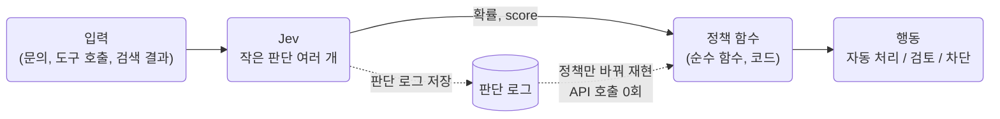
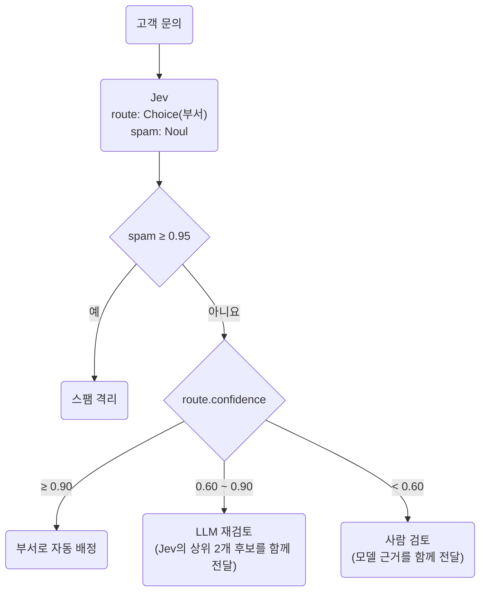
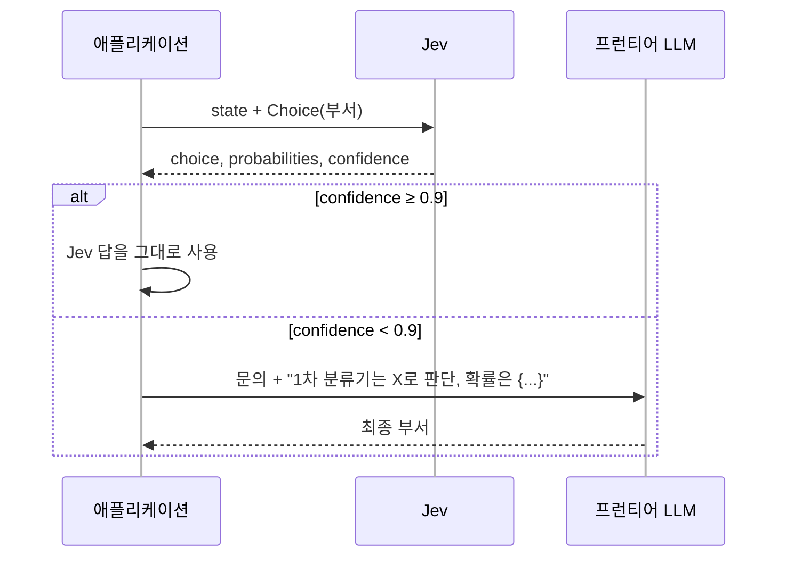
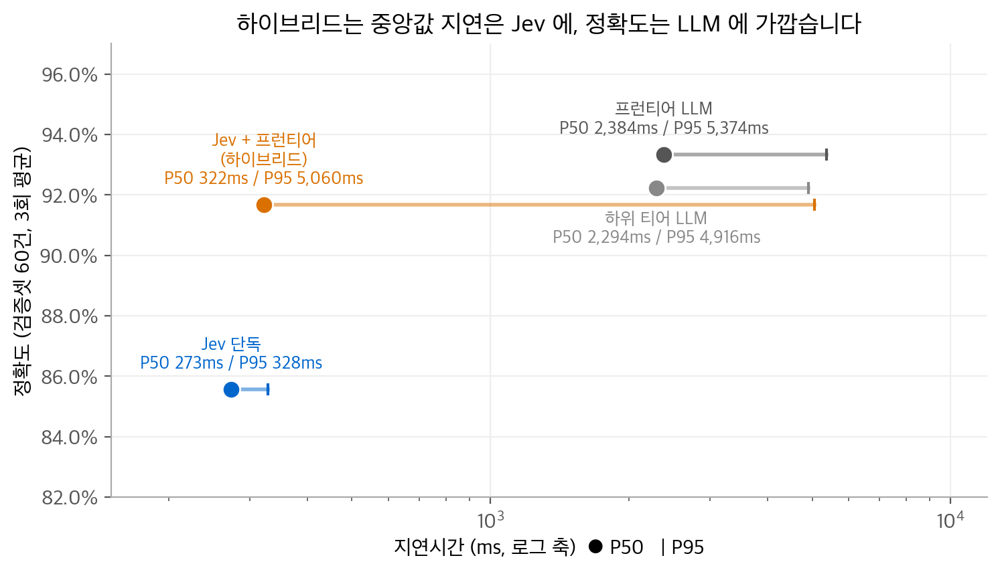
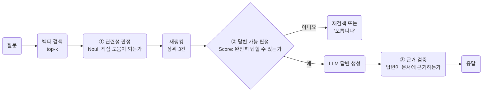
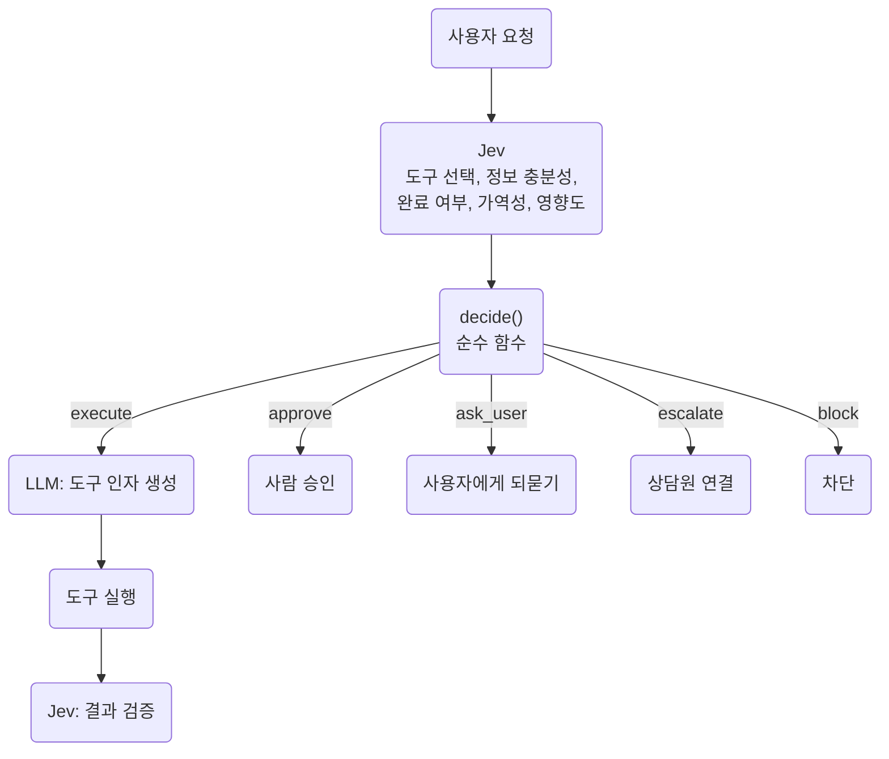

# Jev 시리즈 4. 설계 패턴: 판단은 모델이, 정책은 코드가

Jev를 시스템에 넣는 방법은 여러 가지이지만, 모든 패턴에 공통된 원칙이 하나 있습니다.
**모델은 작은 판단만 돌려주고, 그 판단을 행동으로 바꾸는 정책은 코드에 둡니다.**
이 글은 이 원칙을 먼저 설명하고, 라우팅, 하이브리드, 가드레일, RAG, 에이전트에 적용한 패턴을 차례로 정리합니다.

<!-- more -->

!!! info "출처"
    Jev 튜토리얼 [예제 저장소](https://github.com/ady95/jev_tutorial)의 `ch05`~`ch09`, `projects` 코드를 바탕으로 정리했습니다.
    성능 수치는 저장소의 벤치마크 원자료에서 다시 계산했습니다.

## 1. 핵심 원칙: 판단과 정책의 분리



이렇게 나누면 세 가지 이점이 생깁니다.

1. **정책을 바꿔도 모델을 다시 부르지 않습니다.** 판단 로그를 저장해 두면 가중치나 임계값을 바꾼 결과를 과거 데이터로 바로 계산할 수 있습니다.
2. **정책을 단위 테스트할 수 있습니다.** 정책 함수에는 네트워크도 부작용도 없습니다.
3. **모델이 못하는 일을 코드가 맡습니다.** 금액 비교, 날짜 계산, 수 세기는 코드가 정확합니다(시리즈 5편 참고).

## 2. Smart If: 규칙 엔진 대신 판단 하나

키워드 규칙으로 "환불 요구인가"를 판정하는 코드를 생각해 봅니다.

```python
KEYWORDS = ["환불", "취소", "돌려", "반환"]
NEGATIONS = ["안 해", "안해", "필요 없", "괜찮"]

def rule_with_negation(text):
    if not any(k in text for k in KEYWORDS):
        return False
    return not any(n in text for n in NEGATIONS)
```

예제 저장소의 `ch05/smart_if.py`(20건)에서 부정어 예외를 추가해도 정확도는 그대로였습니다.
"환불은 안 해주셔도 되고요" 같은 오탐은 사라졌지만,
"당장 해지하고 전액 환불 안 해주면 신고하겠습니다" 같은 요구를 놓쳤습니다.
**예외 규칙은 오류를 없애지 않고 다른 칸으로 옮길 뿐입니다.**

같은 자리를 Noul 하나로 바꾸면 `if` 문의 조건이 확률이 됩니다.

```python
REFUND = Noul(
    instructions="고객이 환불이나 결제 취소를 요구하고 있는가?",
    criteria={"true": "환불, 결제 취소, 금액 반환을 요구한다",
              "false": "환불을 언급만 하거나, 문의·불만·다른 요청이다"})

if client.system_one(state=text, questions={"r": REFUND}).nouls["r"].noul >= 0.9:
    start_refund_flow(text)
```

## 3. 의도 라우팅과 confidence 게이트

고객 문의를 부서로 보내는 시스템입니다. Choice 하나와 Noul 하나를 한 호출로 묻고, 결과를 네 갈래로 보냅니다.



사람 검토 큐로 넘길 때 Jev의 상위 후보와 확률을 함께 넘깁니다.
담당자는 "billing 0.48 / sales 0.45" 같은 정보를 보고 경계 사례라는 것을 바로 압니다.

## 4. 작은 판단을 조합해 우선순위를 만듭니다

"이 티켓의 우선순위는?"을 Score 하나로 묻지 않습니다.
심각도, 영향 범위, 감정, 이탈 위험, 법적 위협을 따로 묻고, 조합은 코드에서 합니다(`ch05/composite.py`).

```python
FACTORS = {
    "severity": Score(criteria=["불편하지만 사용 가능", "일부 기능 불가", "서비스 전체 불가"]),
    "scope": Score(criteria=["한 사용자", "일부 사용자", "전체 사용자"]),
    "sentiment": Score(criteria=["차분함", "약간 불만", "화남", "매우 화남"]),
    "churn_risk": Noul(instructions="이 고객이 서비스를 떠날 위험이 있는가?"),
    "legal_threat": Noul(instructions="법적 조치나 신고를 언급하고 있는가?"),
}
WEIGHTS = {"severity": 0.4, "scope": 0.3, "sentiment": 0.1, "churn_risk": 0.2}
```

정책 함수는 각 Score를 최대 단계로 나눠 0~1로 정규화하고 가중합을 구합니다.

$$
\text{priority} = \sum_{f} w_f \cdot \frac{\text{score}_f}{K_f - 1},
\qquad
\text{trust} = \min_{f}\, \text{confidence}_f
$$

`trust`는 판단 다섯 개 중 **가장 약한 고리**입니다.
판단을 여러 개 합치면 불확실성도 합쳐지므로, 하나라도 불확실하면 사람에게 보냅니다.
법적 위협(`legal_threat ≥ 0.7`)은 가중합과 관계없이 P1로 올립니다.
이런 예외 규칙도 코드에 있으므로 회의에서 바로 읽고 고칠 수 있습니다.

## 5. 하이브리드: Jev 게이트 + LLM 재검토

가장 많이 쓰는 패턴입니다. Jev가 confidence 0.9 이상인 건을 처리하고, 나머지만 프런티어 LLM에게 넘깁니다.
LLM에게 넘길 때 Jev의 판단과 후보별 확률을 힌트로 함께 줍니다.



### 4파전 벤치마크 (예제 저장소 `ch09`)

| 전략 | 개발셋 정확도 | 검증셋 정확도 (3회 평균) | 검증셋 지연 P50 | 검증셋 지연 P95 | LLM 호출 비율 |
| --- | --- | --- | --- | --- | --- |
| 규칙 엔진 | 0.667 | 0.467 | 0.003ms | 0.003ms | 0% |
| Jev 단독 | 0.833 | 0.856 | 273ms | 328ms | 0% |
| 하위 티어 LLM | 0.917 | 0.922 | 2,294ms | 4,916ms | 100% |
| 프런티어 LLM | 0.950 | 0.933 | 2,384ms | 5,374ms | 100% |
| **Jev + 프런티어** | **0.950** | **0.917** | **322ms** | 5,060ms | **38% (개발) / 45% (검증)** |

<figure markdown>

<figcaption markdown>
<span class="fig-title"><b>Figure 1.</b> 정확도와 지연시간의 트레이드오프</span>

검증셋 3회 평균입니다. 하이브리드는 지연 중앙값이 Jev와 비슷하고, 정확도는 LLM에 가깝습니다.
</figcaption>
</figure>

읽을 때 주의할 점이 있습니다.

- **규칙 엔진은 개발셋 0.667에서 검증셋 0.467로 떨어졌습니다.** 규칙은 본 데이터에만 맞춰집니다.
- **Jev 단독은 LLM보다 정확도가 낮습니다.** Jev의 장점은 정확도가 아니라 확률과 지연시간입니다.
- **하이브리드의 지연은 오프라인 조합 값입니다.** 같은 회차의 Jev 결과와 LLM 결과를 건별로 합친 값이며, 실제 종단 지연을 잰 것은 아닙니다.
- **하이브리드의 P95는 LLM 수준입니다.** 꼬리 지연이 중요한 서비스라면 LLM 구간에 타임아웃과 대체 경로를 둡니다.

## 6. 가드레일: LLM 출력을 검사합니다

Jev를 LLM의 **뒤**에 둘 수도 있습니다. `state`에 고객 질문과 LLM 답변을 함께 넣고, 판단 세 개를 동시에 묻습니다(`ch06/guardrail.py`).

```python
CHECKS = {
    "relevant": Noul(instructions="답변이 고객의 질문에 실제로 답하고 있는가?", criteria=...),
    "safe": Noul(instructions="답변에 보안이나 법적 위험이 있는가?", criteria=...),
    "tone": Score(criteria=["전문적이고 적절함", "다소 부자연스러움", "부적절함"]),
}
r = client.system_one(state={"고객 질문": q, "LLM 답변": a}, questions=CHECKS)
```

판정 정책은 실패의 종류에 따라 대응을 다르게 합니다.

| 판정 | 조건 | 이유 |
| --- | --- | --- |
| BLOCK | 위험 ≥ 0.7 | 다시 생성해도 같은 위험이 나올 수 있습니다 |
| RETRY | 관련성 < 0.5 또는 어조 ≥ 1.5 | 다시 생성하면 나아질 수 있습니다 |
| HUMAN | 관련성 < 0.7 또는 위험 ≥ 0.3 | 경계 구간입니다 |
| PASS | 그 외 | |

관련성과 위험을 따로 판정하는 점이 중요합니다.
**"질문에는 잘 답했지만 위험한 답변"**(예: 임시 비밀번호를 알려 주는 답변)이 가장 위험하기 때문입니다.

## 7. RAG: 비슷한 문서가 아니라 답이 되는 문서

벡터 검색은 **비슷한** 문서를 찾습니다. 질문 "환불은 며칠 안에 신청해야 하나요?"에 대해
"환불 신청은 마이페이지에서 할 수 있습니다"도 높은 유사도로 걸립니다.
하지만 이 문서에는 기한이 없습니다. 판단 계층은 **답이 되는** 문서를 고릅니다.



문서별 판정은 서로 독립적이므로 비동기 클라이언트(`AsyncTypeSafeClient`)로 동시에 보냅니다.
문서 6건을 동시에 판정해도 시간은 한 건과 비슷합니다.

!!! tip "도입 전에 잽니다"
    예제 저장소의 프로젝트 3은 재랭킹 전후의 precision@k를 재라고 권합니다.
    개선폭이 없으면 판정 비용만 늘어납니다.

## 8. 에이전트: 되돌릴 수 없는 행동을 막는 결정 계층

에이전트가 도구를 호출하기 직전에 Jev가 위험을 판정합니다(`ch07/agent_risk.py`).

```python
RISK = {
    "reversible": Noul(instructions="이 행동은 되돌릴 수 있는가?", criteria=...),
    "impact": Score(criteria=["영향 없음 또는 읽기만 함", "되돌릴 수 있는 변경",
                              "금전이나 외부 발송이 발생", "데이터 삭제나 복구 불가"]),
}
r = client.system_one(state={"실행하려는 도구": tool, "인자": args}, questions=RISK)
```

예제 코드는 정책을 두 번 썼습니다.

| 정책 | 규칙 | 결과 |
| --- | --- | --- |
| v1 | impact ≥ 2.5 또는 reversible < 0.3이면 차단 | 너무 무딥니다. 소액 환불과 이메일 발송까지 막았습니다 |
| v2 | 코드가 아는 사실을 먼저 씁니다. 읽기 전용 도구는 허용, 파괴적 도구는 차단, 금액은 한도와 비교 | 기대 판정과 일치 |

예제의 결론은 다음 문장입니다. **"판단은 정확했고 정책이 틀렸습니다."**
5천 원 환불과 300만 원 환불의 impact가 거의 같게 나온 것은 정상입니다.
두 행동 모두 "금전이 발생"하는 단계이기 때문입니다. 금액 비교는 모델이 아니라 코드가 할 일입니다.

예제 저장소의 프로젝트 4는 이 구조를 완성한 형태입니다.



프로젝트 4의 README는 이 구조가 과할 수도 있다고 적습니다.
도구가 두세 개이고 모두 읽기 전용이라면 LLM의 함수 호출로 충분합니다.
**되돌릴 수 없는 행동이 있을 때** 이 구조가 값어치를 합니다.

## 9. 모델 라우터: 같은 정확도를 더 싸게

Jev로 요청의 난이도와 민감도를 판정하고, 쉬운 요청은 하위 티어 LLM으로, 어려운 요청은 프런티어 LLM으로 보냅니다.
예제 저장소의 프로젝트 2는 두 가지를 꼭 함께 재라고 권합니다.

- **트래픽의 난이도 분포**: 쉬운 요청이 적으면 라우터를 만들 이유가 없습니다.
- **절감액의 기준선**: 싼 모델의 토큰에 프런티어 단가를 곱하면 안 됩니다. 모델마다 출력 길이가 다르기 때문입니다. 일부 요청을 프런티어로 다시 보내 실제 토큰 수를 기록하고, 그 값으로 기준선을 계산합니다.

## 정리

| 패턴 | Jev의 위치 | 주로 쓰는 질문 | 정책이 하는 일 |
| --- | --- | --- | --- |
| Smart If | 규칙 엔진 자리 | Noul | 임계값 비교 |
| 의도 라우팅 | 입력 직후 | Choice + Noul | confidence로 네 갈래 분기 |
| 우선순위 조합 | 입력 직후 | Score 여러 개 + Noul | 가중합, 가장 약한 고리 |
| 하이브리드 | LLM 앞 | Choice | 불확실한 건만 LLM으로 |
| 가드레일 | LLM 뒤 | Noul + Score | 차단, 재생성, 사람 검토 |
| RAG | 검색과 생성 사이 | Noul + Score | 재랭킹, 답변 가능 여부 |
| 에이전트 결정 계층 | 도구 호출 직전 | Choice + Noul + Score | 실행, 승인, 차단 |
| 모델 라우터 | LLM 앞 | Score + Noul | 등급 선택 |

다음 글에서는 Jev가 못하는 일, 프롬프트로 충분한 경우, 그리고 Jev를 둘러싼 생태계를 정리합니다.
