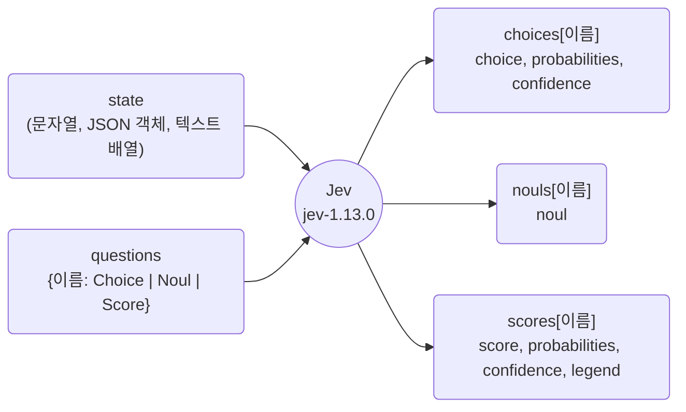
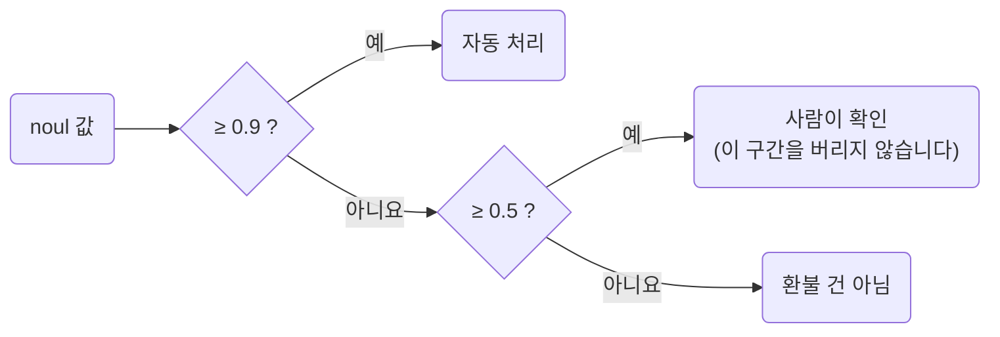
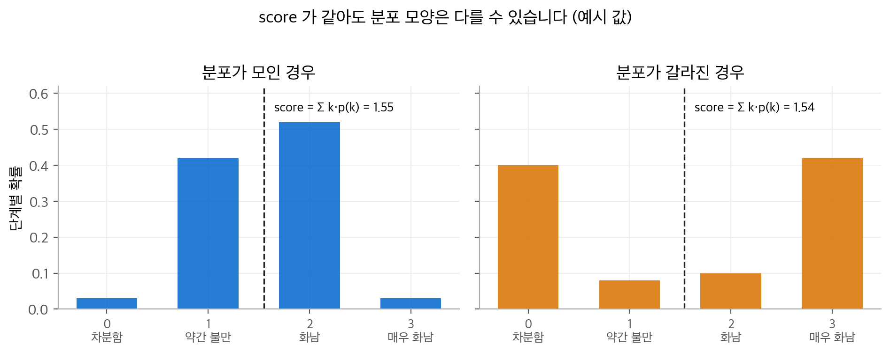

# Jev 시리즈 2. 세 가지 질문: Choice, Noul, Score

Jev에게 묻는 방법은 세 가지뿐입니다. 여러 후보 중 하나를 고르는 **Choice**,
명제가 참일 확률을 묻는 **Noul**, 순서가 있는 단계 위의 위치를 묻는 **Score**입니다.
이 글은 각 질문의 요청과 응답 구조를 정리하고, 응답 숫자를 어떻게 읽는지 설명합니다.

<!-- more -->

!!! info "출처"
    Jev 튜토리얼 [예제 저장소](https://github.com/ady95/jev_tutorial)의 `ch02`, `ch03` 코드를 바탕으로 정리했습니다.
    API 필드와 계산식은 [TypeSafe 공식 문서](https://docs.typesafe.ai/introduction),
    [Dale Seo의 Jev 소개 글](https://daleseo.com/jev/),
    [CODIGITAL의 정리 글](https://ai.codigital.co.jp/en/guides/jev-system-one-model/)로 확인했습니다.

## 1. 한 번의 호출 구조

Jev API는 엔드포인트 하나(`POST /v1/systemone`)로 동작합니다.
요청에는 판단 대상인 `state`와, 이름을 붙인 질문 묶음인 `questions`를 넣습니다.



Python SDK(`typesafe-sdk`)로 쓰면 다음과 같습니다.
예제 저장소의 `ch02/first_call.py`에서 출력 부분만 줄였습니다.

```python
from typesafe_sdk import Choice, Noul, Score, TypeSafeClient

DEPARTMENTS = {
    "billing": "요금, 결제, 환불, 세금계산서 관련",
    "technical": "오류, 장애, 사용법, 연동 문제",
    "sales": "구매 상담, 견적, 요금제 문의",
    "other": "위 어디에도 해당하지 않음",
}

QUESTIONS = {
    "department": Choice(criteria=DEPARTMENTS),
    "refund": Noul(
        instructions="고객이 환불이나 결제 취소를 요구하고 있는가?",
        criteria={"true": "환불이나 결제 취소를 실제로 요청하고 있다",
                  "false": "가능 여부만 묻거나, 원하지 않거나, 무관하다"}),
    "urgency": Score(criteria=["급하지 않음", "보통", "급함", "매우 급함"]),
}

with TypeSafeClient() as client:          # TYPESAFE_API_KEY 환경 변수를 읽습니다
    r = client.system_one(state="결제가 두 번 됐습니다. 빨리 환불해주세요.",
                          questions=QUESTIONS)

r.choices["department"].choice            # 'billing'
r.nouls["refund"].noul                    # 참일 확률 하나 (0~1)
r.scores["urgency"].score                 # 단계의 기대값 (예: 2.4)
```

이 코드에는 세 가지가 없습니다. 프롬프트가 없고, 출력 형식 지시가 없고, 파싱 코드가 없습니다.
응답은 처음부터 타입이 정해진 값이므로 바로 `if` 문에 넣을 수 있습니다.

### 질문을 늘려도 지연시간이 거의 늘지 않습니다

같은 `state`에 대한 질문들은 서로 독립적으로, 병렬로 평가됩니다.
예제 저장소의 `ch03/parallel.py`는 질문 수를 1개, 3개, 6개로 늘리며 지연시간 중앙값을 쟀습니다.
결과는 질문 수와 거의 무관했고, 늘어난 것은 입력 토큰뿐이었습니다.

| 방식 | 질문 6개를 처리하는 시간 | 서로 간섭하는가 |
| --- | --- | --- |
| LLM에 질문을 하나씩 순차 호출 | 약 6배 | 간섭 없음 |
| LLM 프롬프트 하나에 질문 6개를 묶음 | 1배 + 출력 길이만큼 증가 | 예제 저장소의 실험에서 단독 20/20, 3개 묶음 18/20으로 흔들림 |
| Jev 한 번 호출에 질문 6개 | 거의 1배 | 질문별로 따로 평가하므로 간섭이 설계상 없음 |

!!! tip "요청 한도"
    공개 문서 기준으로 요청 하나는 64k 토큰까지 받습니다.
    `state`와 가장 긴 질문 하나를 합친 길이는 32k 토큰을 넘을 수 없습니다.
    입력은 텍스트만 받습니다. 이미지, 오디오, 비디오는 받지 않습니다.

## 2. Choice: 여러 후보 중 하나 고르기

### 응답 필드

| 필드 | 의미 |
| --- | --- |
| `choice` | `probabilities`에서 확률이 가장 큰 후보(argmax) |
| `probabilities` | 후보별 확률. 합은 1입니다 |
| `confidence` | 분포가 얼마나 한쪽으로 몰렸는지 나타내는 값 |

`confidence`는 최고 확률과 같은 값이 아닙니다.
[공식 문서](https://docs.typesafe.ai/confidence.md)는 후보가 $n$개일 때 다음 식으로 정의합니다.

$$
\text{confidence} = \frac{p_{\max} - 1/n}{1 - 1/n}
$$

균등 분포($p_{\max} = 1/n$)이면 0이고, 한 후보에 확률이 모두 몰리면 1입니다.
예를 들어 후보 4개에서 $p_{\max} = 0.82$이면 confidence는 $(0.82 - 0.25)/0.75 = 0.76$입니다.
즉 confidence는 분포에서 계산한 통계량입니다.
문서는 이 값이 실제 정답률과 일치한다고 주장하지 않습니다. 일치하는지는 시리즈 3편처럼 직접 잽니다.

후보는 질문 하나에 최대 255개까지 둘 수 있습니다.
후보 목록이 모든 경우를 포함하지 않을 수 있다면 `other` 후보를 함께 두라고 문서는 권합니다.

### 후보 설명이 답을 바꿉니다

`criteria`는 이름만 줄 수도 있고, 이름과 설명을 함께 줄 수도 있습니다.
예제 저장소의 `ch03/choice.py`는 "쓰던 요금제가 저한테 안 맞는 것 같아요. 어떻게 하죠?"라는 문의로 두 방식을 비교했습니다.

```python
BARE = Choice(criteria={"billing": None, "technical": None, "sales": None, "other": None})
DESC = Choice(criteria={
    "billing": "요금 조정, 청구, 환불",
    "technical": "오류와 장애",
    "sales": "다른 상품 추천, 업그레이드 상담",
    "other": "기타",
})
```

이 문의는 `billing`과 `sales` 사이에 걸칩니다.
후보 설명은 이 경계를 어디에 그을지를 모델에게 알려 줍니다.
즉 `criteria`는 프롬프트가 아니라 **분류 체계의 정의**입니다.
예제 저장소의 `ch11` 실측에서도 모델과 임계값을 그대로 두고 후보 설명만 고친 방법이 유일하게 크게 효과를 냈습니다
(시리즈 3편 참고).

### 같은 입력을 여러 번 불러 다수결하지 않습니다

같은 요청을 20번 보내면 확률은 조금씩 흔들립니다.
`choice`는 argmax이므로 두 후보의 확률이 0.5 근처일 때 작은 흔들림이 선택을 뒤집습니다.
따라서 "20번 중 몇 번 `billing`을 골랐는가"는 정답률과 관계없는 숫자입니다.
불확실성이 궁금하면 다수결 대신 한 번의 응답에 있는 `probabilities`를 읽습니다.

$$
\text{choice} = \arg\max_{k} \; p_k ,
\qquad
p_{\text{billing}} = 0.51,\; p_{\text{sales}} = 0.47 \;\Rightarrow\; \text{작은 잡음으로도 선택이 뒤집힘}
$$

## 3. Noul: 명제가 참일 확률

### 응답은 숫자 하나입니다

Noul이라는 이름은 베르누이(Bernoulli) 분포에서 왔습니다.
TypeSafe CEO는 [Latent Space 팟캐스트](https://www.latent.space/p/jev)에서 이름의 유래를 이렇게 설명했습니다.
`Bool`이라고 부르면 참/거짓 둘 중 하나로 오해할 수 있어서 다른 이름을 붙였다고 합니다.
Noul은 예/아니요 질문입니다. 응답은 명제가 참일 확률 `noul` 하나($0 \le \text{noul} \le 1$)입니다.
Choice, Score와 달리 `confidence` 필드가 없습니다.
확률 하나에 판단과 확신이 함께 들어 있기 때문입니다.

- 1에 가까우면 "참"이라고 확신합니다.
- 0에 가까우면 "거짓"이라고 확신합니다.
- 0.5에 가까우면 모델이 판단을 반반으로 나눈 상태입니다. "중간 정도"라는 뜻이 아닙니다.

확신의 정도가 필요하면 0.5로부터의 거리로 환산합니다.
예제 코드와 공식 문서는 같은 식($\lvert 2p - 1 \rvert$)을 권합니다.

$$
\text{확신도} = 2\,\lvert \text{noul} - 0.5 \rvert
\qquad (\text{noul}=0.95 \Rightarrow 0.9,\;\; \text{noul}=0.6 \Rightarrow 0.2)
$$

### criteria로 경계를 정합니다

Noul도 `instructions`만 줄 수 있고, `true`와 `false`의 뜻을 `criteria`로 함께 줄 수 있습니다.
예제 저장소의 `ch03/noul.py`는 다음 문장들로 두 방식을 비교했습니다.

| 문의 | 함정의 종류 | 어떤 정의가 필요한가 |
| --- | --- | --- |
| 전액 환불해주세요 | 명백한 요구 | 정의가 없어도 됩니다 |
| 환불은 안 해주셔도 되고요, 그냥 원인만 알려주세요 | 부정문 | "원하지 않는 경우는 거짓" |
| 서비스가 별로네요 | 불만이지만 요구가 아님 | "불만은 거짓" |
| 이거 환불 되나요? | 요구인지 문의인지 애매함 | "가능 여부만 묻는 경우는 거짓" |

정의를 추가하면 애매한 문장의 값이 크게 달라집니다.
특히 "이거 환불 되나요?" 같은 문장에서 차이가 큽니다.
Jev는 질문을 쓰인 그대로 읽기 때문에, 경계 사례는 `criteria`에 적어야 합니다.

### 임계값을 세 구간으로 나눕니다

Noul 값은 그대로 `if` 문의 조건이 됩니다. 예제 코드는 0.5 하나로 자르지 말고 세 구간으로 나누라고 권합니다.



임계값 0.9와 0.5는 예시 값입니다. 실제 값은 시리즈 3편의 Risk-Coverage 측정으로 정합니다.

## 4. Score: 순서가 있는 단계 위의 위치

### 응답은 정수가 아니라 기대값입니다

Score의 `criteria`는 낮은 단계부터 높은 단계까지 순서대로 적은 목록입니다. 단계는 2개에서 10개까지 둘 수 있습니다.
`["차분함", "약간 불만", "화남", "매우 화남"]`을 주면 각 단계는 0, 1, 2, 3이 됩니다.
공식 문서에 따르면 Jev는 각 단계를 번호나 이웃 단계 없이 따로 판단합니다.
응답의 `score`는 단계별 확률 $p(k)$로 계산한 기대값입니다.

$$
\text{score} = \sum_{k=0}^{K-1} k \cdot p(k)
$$

그래서 `score`는 1.4처럼 단계 사이의 값이 될 수 있습니다.
예제 코드는 이 식으로 응답을 검산하고, 오차가 0.02 이내인지 `assert`로 확인합니다.

```python
expected = sum(int(k) * v for k, v in s.probabilities.items())
assert abs(expected - s.score) < 0.02
```

### 반올림하기 전에 분포를 봅니다

기대값은 같아도 분포 모양은 전혀 다를 수 있습니다.

<figure markdown>

<figcaption markdown>
<span class="fig-title"><b>Figure 1.</b> Score 기대값과 분포 모양</span>

설명을 위해 만든 예시입니다. 두 분포 모두 score는 약 1.5이므로, 반올림만 보면 갈라진 분포를 잘못 읽습니다.
</figcaption>
</figure>

오른쪽처럼 갈라진 분포는 `confidence`가 낮게 나옵니다.
Score의 `confidence`는 가장 가능성 높은 단계로부터의 확률 가중 거리를 균등 분포의 같은 값과 비교해 계산합니다.
TypeSafe의 한계 문서는 Score 기대값의 수치 보정이 약하다고도 밝힙니다.
따라서 Score를 정수 단계로 바꾸기 전에 `confidence`를 먼저 확인합니다.
`confidence`가 낮으면 반올림하지 말고 사람에게 넘기거나 LLM에 다시 묻습니다.

## 5. 세 질문 비교

| 구분 | Choice | Noul | Score |
| --- | --- | --- | --- |
| 묻는 것 | 어느 후보인가 | 참인가 | 어느 정도인가 |
| `criteria` | 후보 이름과 설명(사전) | `true`, `false`의 정의 | 순서가 있는 단계 목록 |
| 주 응답값 | `choice` (argmax) | `noul` (참일 확률) | `score` (기대값) |
| 분포 | `probabilities` | 없음(값 하나가 분포) | `probabilities` (단계별) |
| `confidence` | $\frac{p_{\max}-1/n}{1-1/n}$ | 없음. $\lvert 2p-1\rvert$로 환산 | 분포 퍼짐으로 계산 |
| 코드에 비유하면 | 열거형 `switch` | `if` 문 | 정렬, 임계값 비교 |
| 대표 용도 | 부서 라우팅, 의도 분류 | 환불 요구, 스팸, 위험 여부 | 긴급도, 감정, 심각도 |

## 정리

- 질문은 Choice, Noul, Score 세 가지입니다. 한 호출에 섞어서 여러 개를 보낼 수 있습니다.
- 응답은 타입이 정해진 값과 확률입니다. 파싱 코드가 필요 없습니다.
- `criteria`는 분류 체계의 정의입니다. 경계 사례는 여기에 적습니다.
- 다수결하지 말고 확률을 읽습니다. Score는 반올림하기 전에 `confidence`를 봅니다.

다음 글에서는 이 확률을 얼마나 믿을 수 있는지, 그리고 임계값을 어떻게 정하는지 다룹니다.
