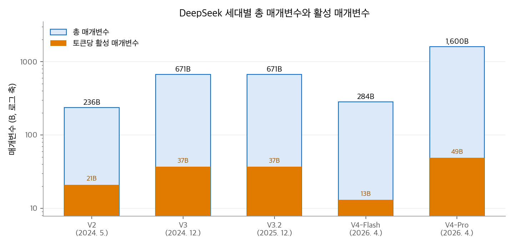
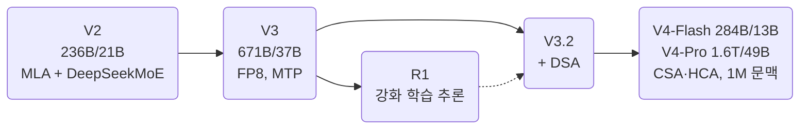

# LLM Model: DeepSeek 계열 정리

DeepSeek은 중국의 DeepSeek-AI가 만드는 대규모 MoE 모델 계열입니다.
V2에서 MLA와 세분화 MoE를 내놓았고, V3에서 FP8 학습으로 671B 모델을 적은 비용에 학습했습니다.
R1은 강화 학습만으로 추론 능력을 끌어낸 과정을 공개했고, V3.2와 V4는 희소·압축 어텐션으로 문맥을 100만 토큰까지 늘렸습니다.
이 글은 세대별 규모와 학습 방법, 공개 정책을 정리하고, 구성 요소를 AI 섹션의 장으로 연결합니다.

<!-- more -->

## 1. 한 문장 요약

> 학습과 추론의 비용을 줄이는 구조(MLA, 세분화 MoE, FP8, 희소 어텐션)를 직접 설계하고, 그 결과를 MIT 라이선스로 공개하는 계열

DeepSeek의 기술 보고서는 거의 매번 "같은 품질을 얼마나 싸게 내는가"를 숫자로 제시합니다.
V2는 이전 67B 밀집 모델 대비 학습 비용 42.5% 절감과 KV 캐시 93.3% 절감을, V4는 V3.2 대비 100만 토큰에서 KV 캐시 10%를 보고했습니다.

## 2. 세대별 개요

| 세대 (공개) | 총 / 활성 매개변수 | 사전학습 토큰 | 문맥 | 핵심 변화 |
| --- | --- | --- | --- | --- |
| V2 (2024. 5.) | 236B / 21B | 8.1T | 128K | MLA, DeepSeekMoE |
| V3 (2024. 12.) | 671B / 37B | 14.8T | 128K | FP8 학습, MTP, 보조 손실 없는 부하 분산 |
| R1 (2025. 1.) | 671B / 37B (V3-Base 기반) | — | 128K | 강화 학습 중심의 추론 모델 |
| V3.2 (2025. 12.) | 671B / 37B | — | 128K | DeepSeek Sparse Attention (DSA) |
| V4-Flash (2026. 4.) | 284B / 13B | 32T | 1M | CSA·HCA 압축 어텐션, mHC, Muon |
| V4-Pro (2026. 4.) | 1.6T / 49B | 33T | 1M | 위와 같음 |

V3.2의 직전 실험판 V3.2-Exp는 2025. 9.에 나왔습니다. V4는 2026. 4. 24.에 프리뷰로 공개되었습니다.

<figure markdown>

<figcaption markdown>
<b>Figure 1.</b> DeepSeek 세대별 총 매개변수와 활성 매개변수

로그 축입니다. V2에서 V4-Pro까지 총 매개변수는 약 7배, 활성 매개변수는 약 2.3배(21B→49B) 늘었습니다.
</figcaption>
</figure>

### 세대별 특징

- **V3**: FP8 혼합 정밀도 학습을 초대형 모델에서 처음 검증했다고 밝혔습니다. 사전학습 2.664M, 전체 2.788M H800 GPU 시간이 들었습니다. 학습 중 복구 불가능한 손실 급등이나 되돌리기가 한 번도 없었다고 보고했습니다. 공개 체크포인트 685B에는 MTP 모듈 14B가 포함됩니다.
- **R1**: R1-Zero는 지도 학습 없이 V3-Base에 대규모 강화 학습만 적용했습니다. 반복과 언어 혼용 문제가 있어서, R1은 콜드 스타트 데이터와 두 번의 RL·SFT 단계를 더했습니다. R1의 출력으로 Qwen2.5와 Llama 기반 1.5B~70B 모델 6개를 증류해 함께 공개했습니다. MIT 라이선스이고, 증류로 다른 모델을 학습하는 용도도 허용합니다.
- **V3.2**: 구조는 직전 모델과 같고 DSA만 추가했습니다. 사후 학습 계산을 늘린 RL, 도구 사용과 추론을 결합하는 에이전트 데이터 합성 파이프라인을 강조합니다. 추론 전용 고연산 변형 V3.2-Speciale을 함께 냈습니다. Speciale은 도구 호출을 지원하지 않습니다.
- **V4**: 추론 모드가 세 가지입니다(Non-think, Think High, Think Max). 사후 학습은 두 단계입니다. 먼저 분야별 전문가 모델을 SFT와 GRPO 강화 학습으로 만들고, 이를 온폴리시 증류로 한 모델에 합칩니다. MoE 전문가 가중치는 FP4, 나머지 대부분은 FP8입니다. 잔차 연결에는 mHC(Manifold-Constrained Hyper-Connections, 잔차 흐름 4개)를 씁니다.

## 3. 아키텍처 한눈에 보기

| 구성 요소 | DeepSeek이 쓴 방식 | 설명 장 |
| --- | --- | --- |
| 어텐션 (V2~V3.2) | MLA. 키와 값을 512차원 잠재 벡터로 압축하고 흡수로 복원을 생략 | [MLA](../../ai/attention/05-mla.md) |
| 희소 선택 (V3.2) | DSA. 인덱서 64헤드 × 128차원, 쿼리마다 2,048토큰 | [희소 어텐션](../../ai/attention/06-sparse-attention.md) |
| 압축 어텐션 (V4) | CSA(4토큰 압축 + top-k)와 HCA(128토큰 압축) 교차, 최근 128토큰 창 | [희소 어텐션](../../ai/attention/06-sparse-attention.md) |
| 헤드 공유 (V4) | 압축 KV 하나를 쿼리 헤드 128개가 공유하는 MQA | [MQA와 GQA](../../ai/attention/03-mqa-gqa.md) |
| 어텐션 싱크 (V4) | 헤드별 학습 싱크 로짓을 소프트맥스 분모에 추가 | [어텐션 싱크와 게이트](../../ai/attention/08-attention-sink-gating.md) |
| 위치 인코딩 | 분리 RoPE. 위치 정보는 64차원에만 | [RoPE](../../ai/llm-techniques/01-rope.md) |
| 긴 문맥 확장 | YaRN. V3은 4K → 32K → 128K 두 단계, V4는 4K → 16K → 64K → 1M | [긴 문맥 확장](../../ai/llm-techniques/02-long-context.md) |
| 로짓 안정화 (V4) | 쿼리 헤드와 압축 KV에 RMSNorm | [정규화와 로짓 안정화](../../ai/llm-techniques/03-normalization.md) |
| FFN | DeepSeekMoE. 공유 전문가 1개 + 라우팅 전문가 256개 중 8개(V3), 보조 손실 없는 부하 분산 | [MoE](../../ai/llm-techniques/05-moe.md) |
| MTP | V3부터 MTP 모듈 1개(`num_nextn_predict_layers: 1`). 학습 목표로 쓰고, 추론에서는 추측 디코딩에 재사용 | [MTP와 추측 디코딩](../../ai/llm-techniques/06-mtp.md) |
| 옵티마이저 (V3) | AdamW ($\beta_1 = 0.9$, $\beta_2 = 0.95$, 가중치 감쇠 0.1) | [AdamW](../../ai/llm-techniques/optimizer/02-adamw.md) |
| 학습률 (V3) | 2K 스텝 워밍업 → $2.2\times10^{-4}$ 를 10T 토큰까지 유지 → 4.3T 토큰 동안 코사인 감소로 $2.2\times10^{-5}$ → 마지막 500B 토큰은 $2.2\times10^{-5}$ 와 $7.3\times10^{-6}$ | [AdamW: 학습률 스케줄](../../ai/llm-techniques/optimizer/02-adamw.md) |
| 옵티마이저 (V4) | 대부분 Muon(모멘텀 0.95, 가중치 감쇠 0.1, 갱신 RMS 0.18로 조정). 임베딩, 출력층, RMSNorm 가중치는 AdamW | [Muon](../../ai/llm-techniques/optimizer/03-muon.md) |
| 학습률 (V4) | 2,000스텝 선형 워밍업, 코사인 감소. 최댓값 Flash $2.7\times10^{-4}$, Pro $2.0\times10^{-4}$, 최종값은 각각 1/10 | [AdamW: 학습률 스케줄](../../ai/llm-techniques/optimizer/02-adamw.md) |

## 4. 공개 설정값

| 항목 | V3.2 | V4-Pro |
| --- | --- | --- |
| 층 수 | 61 | 61 |
| 은닉 차원 | 7,168 | 7,168 |
| 쿼리 헤드 | 128 | 128 |
| KV 표현 | 잠재 512 + RoPE 키 64 (MLA) | 공유 KV 1헤드 × 512 (RoPE 64 포함) |
| 쿼리 잠재 차원 | 1,536 | 1,536 |
| 인덱서 | 64헤드 × 128, top-2,048 | 64헤드 × 128, top-1,024 (CSA층) |
| 압축 비율 | 없음 | 4 (CSA), 128 (HCA) |
| 최근 창 | 없음 | 128 |
| 전문가 | 공유 1 + 라우팅 256 중 8 | — |
| RoPE | $b = 10^4$, YaRN 계수 40 | $b = 10^4$, YaRN 계수 16 |
| 최대 위치 | 163,840 | 1,048,576 |

## 5. 비용 계산: KV 캐시

**V3 (MLA).** 토큰 하나, 층 하나에 576개 값을 저장합니다. 61층, BF16이면 다음과 같습니다.

$$
576 \times 61 \times 2\ \text{B} = 70{,}272\ \text{B} \approx 68.6\ \text{KiB / 토큰}
$$

128K 토큰이면 약 8.6GiB입니다. 같은 헤드 수(128)와 헤드 차원(128)의 MHA였다면 토큰당 약 3.8MiB, 128K에서 약 488GiB입니다.

**V4 (CSA·HCA).** 층 하나가 100만 토큰에서 저장하는 원소 수를 비교하면, MLA는 약 6억 개, CSA층은 약 1억 3천만 개, HCA층은 약 430만 개입니다.
V4 보고서는 저장 정밀도(FP8, RoPE 차원만 BF16)까지 포함해 100만 토큰에서 V4-Pro가 V3.2의 10%, V4-Flash가 7%의 KV 캐시를 쓴다고 보고했습니다.

<figure markdown>

<figcaption markdown>
<b>Figure 2.</b> 층 하나가 저장하는 KV 원소 수

MLA, CSA, HCA층 하나가 저장하는 원소 수입니다. 인덱서 키와 정밀도 차이는 넣지 않았습니다.
</figcaption>
</figure>

## 6. 다른 계열과 비교

| 항목 | [Gemma](2026-10-20-llm-gemma.md) | DeepSeek | [Qwen](2026-10-20-llm-qwen.md) | [GLM](2026-10-20-llm-glm.md) | [Kimi](2026-10-20-llm-kimi.md) |
| --- | --- | --- | --- | --- | --- |
| 최신 주력 | Gemma 4 31B (밀집) | V4-Pro 1.6T/49B | Qwen3.5-397B-A17B | GLM-5.2 (약 744B/40B) | K3 2.8T/104B |
| 문맥 (최신) | 256K | 1M | 262K (YaRN으로 1M) | 1M | 1M |
| 옵티마이저 (확인한 범위) | 명시 없음 | AdamW(V3) → Muon(V4) | 명시 없음 | Muon(GLM-4.5부터) | MuonClip(K2) |

GLM-5는 DeepSeek의 MLA와 DSA를 그대로 가져왔습니다. 그래서 두 계열은 어텐션 구조가 가장 가깝습니다.
Kimi K2도 DeepSeek-V3의 구조(61층, 은닉 7,168, MLA)를 출발점으로 삼고, 전문가를 384개로 늘리고 헤드를 64개로 줄였습니다.

## 참고 자료

- DeepSeek-AI, [DeepSeek-V2](https://arxiv.org/abs/2405.04434), 2024.
- DeepSeek-AI, [DeepSeek-V3 Technical Report](https://arxiv.org/abs/2412.19437), 2024.
- DeepSeek-AI, [DeepSeek-R1](https://arxiv.org/abs/2501.12948), 2025. [모델 카드](https://huggingface.co/deepseek-ai/DeepSeek-R1).
- DeepSeek-AI, [DeepSeek-V3.2](https://arxiv.org/abs/2512.02556), 2025. [모델 카드](https://huggingface.co/deepseek-ai/DeepSeek-V3.2).
- DeepSeek-AI, [DeepSeek-V4](https://arxiv.org/abs/2606.19348), 2026. [V4-Pro 모델 카드](https://huggingface.co/deepseek-ai/DeepSeek-V4-Pro).
