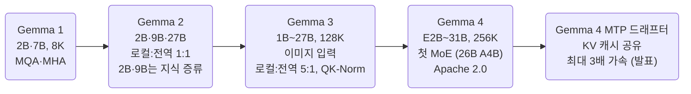
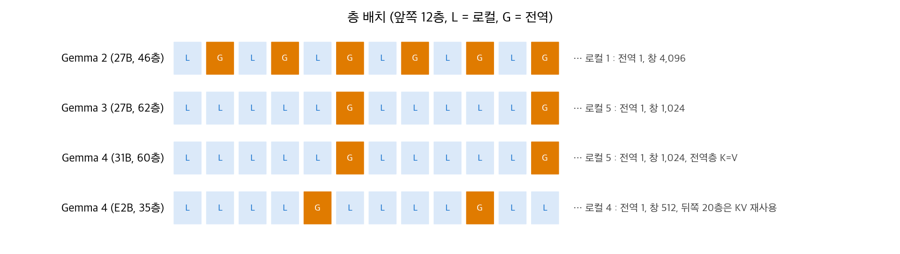
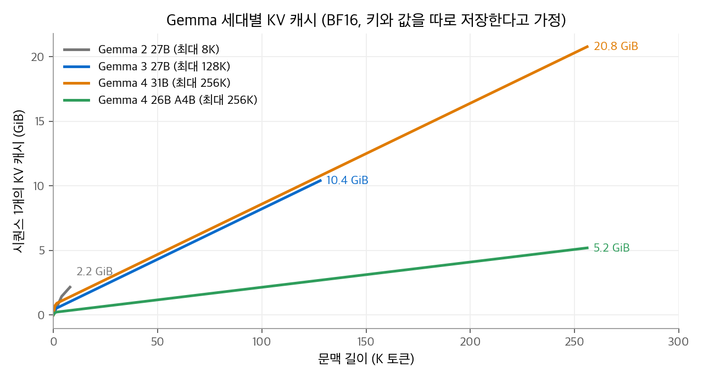

# LLM Model: Gemma 계열 정리

Gemma는 Google DeepMind가 공개하는 오픈 가중치 모델 계열입니다.
같은 회사의 Gemini 연구를 바탕으로 만들고, 노트북 한 대나 GPU 한 장에서 돌릴 수 있는 크기에 집중합니다.
2024. 2.의 Gemma 1부터 2026. 4.의 Gemma 4까지 네 세대가 나왔습니다.
이 글은 세대별 크기, 학습 방법, 멀티모달 지원, 라이선스를 정리합니다. 그리고 아키텍처의 각 구성 요소를 AI 섹션의 해당 장으로 연결합니다.

<!-- more -->

## 1. 한 문장 요약

> 작은 크기에서 최대 성능을 내도록, 지식 증류로 학습하고 대부분의 층을 로컬 어텐션으로 두는 오픈 모델 계열

Gemma의 설계 방향은 "단일 가속기에서 돌아가는 크기"입니다.
그래서 모델을 키우는 대신, 같은 크기에서 KV 캐시와 메모리를 줄이는 장치를 세대마다 더했습니다.

## 2. 세대별 개요

| 세대 (공개) | 크기 | 구조 | 문맥 | 멀티모달 | 라이선스 |
| --- | --- | --- | --- | --- | --- |
| Gemma 1 (2024. 2.) | 2B, 7B | 밀집 | 8K | 텍스트 | Gemma 이용 약관 |
| Gemma 2 (2024. 6.) | 2B, 9B, 27B | 밀집 | 8K | 텍스트 | Gemma 이용 약관 |
| Gemma 3 (2025. 3.) | 1B, 4B, 12B, 27B | 밀집 | 128K (1B는 32K) | 이미지 입력 (1B 제외) | Gemma 이용 약관 |
| Gemma 4 (2026. 4. 2.) | E2B, E4B, 26B A4B, 31B | 밀집 + MoE (26B A4B) | 256K (E2B·E4B는 128K) | 이미지·영상, E2B·E4B는 음성 | Apache 2.0 |

### 세대별 특징

- **Gemma 2**: 2B와 9B 모델을 다음 토큰 예측 대신 큰 교사 모델의 분포를 따라 하는 지식 증류로 학습했습니다.
- **Gemma 3**: 모든 모델을 지식 증류로 학습했습니다. 사전학습 토큰은 27B가 14T, 12B가 12T, 4B가 4T, 1B가 2T입니다. 이미지는 고정된 400M 매개변수 SigLIP 인코더가 처리합니다. 토크나이저는 어휘 262K개이고 140개 이상의 언어를 지원합니다. 사후 학습은 큰 지시 모델로부터의 증류 뒤에, BOND·WARM·WARP를 개선한 강화 학습을 씁니다.
- **Gemma 4**: 라이선스를 자체 약관에서 Apache 2.0으로 바꿨습니다. 처음으로 MoE 모델(26B A4B)을 넣었습니다. 26B A4B는 총 약 25B 매개변수 중 토큰마다 약 4B만 계산합니다. "E" 모델은 층별 임베딩을 써서 **유효(effective)** 매개변수가 2B, 4B 수준인 기기용 모델입니다.
- **Gemma 4 MTP 드래프터 (2026. 5. 5.)**: Google은 Gemma 4 전 크기에 쓸 수 있는 멀티 토큰 예측(MTP) 드래프터를 따로 공개했습니다. 작은 드래프터가 토큰 여러 개를 먼저 제안하고, 본 모델이 한 번의 병렬 계산으로 검증하는 추측 디코딩 방식입니다. 드래프터는 본 모델의 활성값을 입력으로 쓰고 본 모델의 KV 캐시를 공유하므로, 이미 처리한 문맥을 다시 계산하지 않습니다. 외부 분석에 따르면 드래프터의 로컬층은 본 모델의 마지막 로컬층 KV를, 전역층은 전역 KV를 재사용합니다. Google은 출력 품질 저하 없이 최대 3배 빨라진다고 발표했습니다. E2B·E4B는 마지막 로짓 계산이 병목이어서, 임베딩 쪽에 클러스터링 기법을 더했습니다. 드래프터도 Apache 2.0입니다.

## 3. 아키텍처 한눈에 보기

알고리즘의 작동 원리는 링크한 AI 섹션 장에 있습니다. 이 표는 Gemma가 어떤 방식을 골랐는지만 적습니다.

| 구성 요소 | Gemma가 쓴 방식 | 설명 장 |
| --- | --- | --- |
| 어텐션 헤드 공유 | Gemma 1은 MQA(2B)와 MHA(7B), Gemma 2부터 GQA. Gemma 4 전역층은 쿼리 8개가 KV 하나를 공유 | [MQA와 GQA](../../ai/attention/03-mqa-gqa.md) |
| 어텐션 범위 | 로컬(슬라이딩 창)과 전역 어텐션 교차. 1 : 1(Gemma 2) → 5 : 1(Gemma 3, 4) | [슬라이딩 창 어텐션](../../ai/attention/04-sliding-window.md) |
| KV 크기 줄이기 | Gemma 4 전역층의 K=V(값 사상 없음), E2B·E4B의 층 간 KV 공유 | [MQA와 GQA](../../ai/attention/03-mqa-gqa.md) |
| 위치 인코딩 | RoPE. 로컬층 기저 $10^4$, 전역층 $10^6$. Gemma 4 전역층은 차원 쌍의 25%만 회전(p-RoPE) | [RoPE](../../ai/llm-techniques/01-rope.md) |
| 긴 문맥 확장 | Gemma 3은 32K로 사전학습 후 RoPE 위치를 8배 선형 보간해 128K | [긴 문맥 확장](../../ai/llm-techniques/02-long-context.md) |
| 로짓 안정화 | 소프트 캡핑(Gemma 2) → QK-Norm(Gemma 3) → QK-Norm + V-Norm(Gemma 4) | [정규화와 로짓 안정화](../../ai/llm-techniques/03-normalization.md) |
| 정규화 | RMSNorm | [정규화와 로짓 안정화](../../ai/llm-techniques/03-normalization.md) |
| FFN | 밀집. Gemma 4 26B A4B는 전문가 128개 중 8개 선택 | [MoE](../../ai/llm-techniques/05-moe.md) |
| 추측 디코딩 | Gemma 4용 MTP 드래프터를 별도 공개. 본 모델의 활성값과 KV 캐시를 공유 | [MTP와 추측 디코딩](../../ai/llm-techniques/06-mtp.md) |
| 옵티마이저·학습률 | Gemma 3 보고서에 명시 없음. Gemma 4는 확인한 공개 자료에 명시 없음 | [옵티마이저](../../ai/llm-techniques/optimizer/index.md) |

## 4. 공개 설정값

Hugging Face의 `config.json` 에서 읽은 값입니다.

| 항목 | Gemma 2 27B | Gemma 3 27B | Gemma 4 31B | Gemma 4 26B A4B |
| --- | --- | --- | --- | --- |
| 층 수 | 46 | 62 | 60 | 30 |
| 은닉 차원 | 4,608 | 5,376 | 5,376 | 2,816 |
| 쿼리 헤드 | 32 | 32 | 32 | 16 |
| KV 헤드 (로컬 / 전역) | 16 / 16 | 16 / 16 | 16 / 4 | 8 / 2 |
| 헤드 차원 (로컬 / 전역) | 128 / 128 | 128 / 128 | 256 / 512 | 256 / 512 |
| 로컬 : 전역 층 | 23 : 23 | 52 : 10 | 50 : 10 | 25 : 5 |
| 로컬 창 | 4,096 | 1,024 | 1,024 | 1,024 |
| 최대 위치 | 8,192 | 131,072 | 262,144 | 262,144 |
| 점수 안정화 | 소프트 캡 50 | QK-Norm | QK-Norm, V-Norm | QK-Norm, V-Norm |
| 어휘 | 256K | 262K | 262K | 262K |

<figure markdown>

<figcaption markdown>
<b>Figure 1.</b> Gemma 세대별 층 배치

주황 칸이 전역층입니다. Gemma 3부터 6층에 1층만 전역층입니다.
</figcaption>
</figure>

## 5. 비용 계산: 세대별 KV 캐시

위 설정으로 시퀀스 하나의 KV 캐시를 계산합니다. BF16이고, 키와 값을 따로 저장한다고 가정합니다.
로컬층은 창 크기만큼만 저장하므로, 긴 문맥에서는 전역층이 전체 크기를 정합니다.

| 모델 | 전역층 토큰당 | 로컬층 고정분 | 최대 문맥에서 합계 |
| --- | --- | --- | --- |
| Gemma 2 27B | 23층 × 8KiB = 184KiB | 23층 × 4,096토큰 × 8KiB = 736MiB | 8K에서 2.2GiB |
| Gemma 3 27B | 10층 × 8KiB = 80KiB | 52층 × 1,024토큰 × 8KiB = 416MiB | 128K에서 10.4GiB |
| Gemma 4 31B | 10층 × 8KiB = 80KiB | 50층 × 1,024토큰 × 16KiB = 800MiB | 256K에서 20.8GiB |
| Gemma 4 26B A4B | 5층 × 4KiB = 20KiB | 25층 × 1,024토큰 × 8KiB = 200MiB | 256K에서 5.2GiB |

<figure markdown>

<figcaption markdown>
<b>Figure 2.</b> Gemma 세대별 KV 캐시

Gemma 4 31B는 Gemma 3 27B와 토큰당 증가율이 같습니다. 26B A4B는 같은 문맥에서 약 1/4입니다.
</figcaption>
</figure>

Gemma 3 보고서도 같은 방향의 수치를 냅니다. 32K 문맥에서 전역층만 쓰면 KV 캐시가 모델 메모리의 60%를 더 쓰지만, 로컬·전역 교차와 창 1,024를 쓰면 15% 미만으로 줄어든다고 보고했습니다.
Gemma 4 전역층의 K=V를 이용해 키 사상 결과 하나만 저장하는 엔진이라면, 위 전역층 값은 절반이 됩니다.

## 6. 다른 계열과 비교

| 항목 | Gemma | [DeepSeek](2026-10-20-llm-deepseek.md) | [Qwen](2026-10-20-llm-qwen.md) | [GLM](2026-10-20-llm-glm.md) | [Kimi](2026-10-20-llm-kimi.md) |
| --- | --- | --- | --- | --- | --- |
| 주력 크기 | 1B~31B | 284B~1.6T (MoE) | 0.6B~397B | 9B~744B | 48B~2.8T (MoE) |
| KV 캐시 줄이는 방법 | 로컬층 비율 높이기 | 잠재 압축(MLA), 시퀀스 압축 | 선형 어텐션 층 섞기 | MLA + 희소 선택 | KDA(선형) + MLA 하이브리드 |
| 라이선스 (최신 세대) | Apache 2.0 | MIT | Apache 2.0 | MIT | Kimi K3 License |

Gemma는 다섯 계열 중 가장 작은 크기에 집중합니다. 다른 네 계열이 수백 B 규모의 MoE로 경쟁하는 동안, Gemma는 31B 밀집 모델과 기기용 E 모델로 "한 대에서 돌아가는 모델"을 다듬었습니다.

## 참고 자료

- Gemma Team, [Gemma 2: Improving Open Language Models at a Practical Size](https://arxiv.org/abs/2408.00118), 2024.
- Gemma Team, [Gemma 3 Technical Report](https://arxiv.org/abs/2503.19786), 2025.
- Google, [Introducing Gemma 3: The Developer Guide](https://developers.googleblog.com/introducing-gemma3/), 2025.
- Gemma 4 31B [config.json](https://huggingface.co/google/gemma-4-31B/blob/main/config.json), Gemma 4 26B A4B [config.json](https://huggingface.co/google/gemma-4-26B-A4B/blob/main/config.json).
- Maarten Grootendorst, [A Visual Guide to Gemma 4](https://newsletter.maartengrootendorst.com/p/a-visual-guide-to-gemma-4), 2026.
- Google, [Accelerating Gemma 4: faster inference with multi-token prediction drafters](https://blog.google/innovation-and-ai/technology/developers-tools/multi-token-prediction-gemma-4/), 2026.
- Implicator, [Google releases Gemma 4 under Apache 2.0](https://www.implicator.ai/google-releases-gemma-4-under-apache-2-0-dropping-its-custom-ai-license/), 2026.
