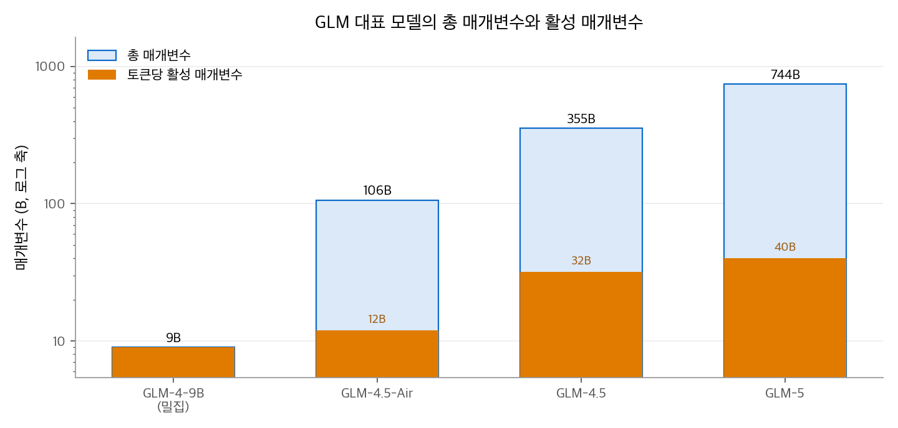
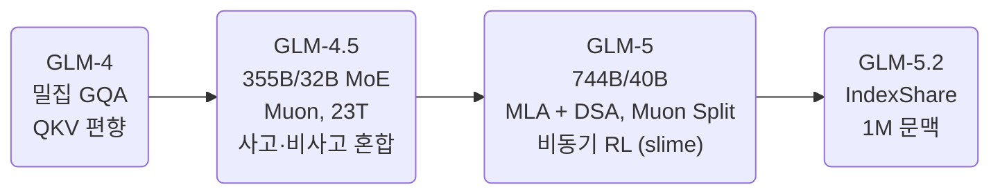
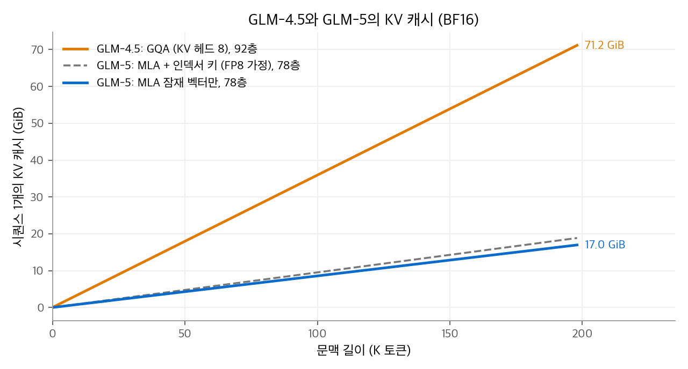

# LLM Model: GLM 계열 정리

GLM은 Z.ai(옛 Zhipu AI)와 칭화대 연구진이 만드는 모델 계열입니다.
GLM-4.5부터 대형 MoE로 넘어갔고, 처음부터 Muon 옵티마이저로 학습했습니다.
GLM-5는 DeepSeek의 MLA와 DSA를 가져와 고쳐 썼고, GLM-5.2는 인덱서 계산을 층 사이에서 공유해 문맥을 100만 토큰으로 늘렸습니다.
이 글은 세대별 규모, 학습 설정, 에이전트 중심의 사후 학습, 공개 정책을 정리하고 구성 요소를 AI 섹션의 장으로 연결합니다.

<!-- more -->

## 1. 한 문장 요약

> 코딩과 에이전트 작업을 목표로, Muon으로 학습한 대형 MoE에 DeepSeek식 희소 어텐션을 얹고 MIT 라이선스로 공개하는 계열

GLM-5 보고서의 부제는 "바이브 코딩에서 에이전트 엔지니어링으로(from Vibe Coding to Agentic Engineering)"입니다.
모델 카드와 보고서의 벤치마크도 SWE-bench, Terminal-Bench, BrowseComp 같은 에이전트 과제를 앞에 둡니다.

## 2. 세대별 개요

| 세대 (공개) | 총 / 활성 매개변수 | 사전학습 토큰 | 문맥 | 라이선스 |
| --- | --- | --- | --- | --- |
| GLM-4 (2024. 6.) | 9B 밀집 등 | — | 8K (9B 기본) | — |
| GLM-4.5 (2025. 7.) | 355B / 32B, Air 106B / 12B | 23T | 128K | MIT |
| GLM-5 (2026. 2.) | 744B / 40B | 28.5T | 약 200K (202,752) | MIT |
| GLM-5.2 (2026. 6.) | GLM-5와 같은 규모 (카드 표기 753B) | — | 1M | MIT |

<figure markdown>

<figcaption markdown>
<b>Figure 1.</b> GLM 대표 모델의 총 매개변수와 활성 매개변수

로그 축입니다. GLM-5는 GLM-4.5보다 총 매개변수가 약 2.1배, 활성 매개변수는 1.25배(32B→40B)입니다.
</figcaption>
</figure>

### 세대별 특징

- **GLM-4.5**: 폭(은닉 차원, 전문가 수)을 줄이고 층을 늘렸습니다. 보고서는 깊은 모델이 추론 능력이 좋았다고 설명합니다. 사고 모드와 즉답 모드를 한 모델에서 고르는 혼합 추론을 지원합니다.
- **GLM-5**: 사전학습 28.5T 토큰 뒤에, 중간 학습(mid-training)으로 문맥을 32K(1T 토큰), 128K(500B 토큰), 200K(50B 토큰)로 늘렸습니다. 사후 학습은 생성과 학습을 분리한 비동기 강화 학습 인프라 slime을 씁니다. SFT 단계에서 INT4 양자화 인식 학습을 적용했습니다. 모델 카드는 SWE-bench Verified 77.8, GPQA-Diamond 86.0, HLE(도구 사용) 50.4를 보고합니다.
- **GLM-5.2**: GLM-5.1의 후속입니다. 모델 카드는 4개의 희소 어텐션층마다 인덱서 하나를 공유해 100만 토큰에서 토큰당 FLOPs를 2.9배 줄였다고 밝혔습니다. 개선한 MTP 층으로 추측 디코딩의 수락 길이가 최대 20% 늘었다고 합니다. 사고 노력 수준을 여러 단계로 고를 수 있습니다.

## 3. 아키텍처 한눈에 보기

| 구성 요소 | GLM이 쓴 방식 | 설명 장 |
| --- | --- | --- |
| 헤드 공유 (GLM-4, 4.5) | GQA. GLM-4 9B는 쿼리 32 : KV 2, GLM-4.5는 쿼리 96 : KV 8 | [MQA와 GQA](../../ai/attention/03-mqa-gqa.md) |
| 헤드 수 (GLM-4.5) | 은닉 5,120에 쿼리 헤드 96개(일반 설계의 약 2.5배). 학습 손실은 같았지만 추론 벤치마크가 올랐다고 보고 | [멀티헤드 어텐션](../../ai/attention/02-multi-head.md) |
| 어텐션 (GLM-5) | MLA. 헤드 64개 × 쿼리·키 256(내용 192 + RoPE 64), 잠재 512 | [MLA](../../ai/attention/05-mla.md) |
| 희소 선택 (GLM-5, 5.2) | DSA. 인덱서 32헤드 × 128, top-2,048. GLM-5.2는 IndexShare로 78층 중 21층만 인덱서 계산 | [희소 어텐션](../../ai/attention/06-sparse-attention.md) |
| 위치 인코딩 | RoPE. GLM-4·4.5는 헤드 차원의 50%만, GLM-5는 64차원만 | [RoPE](../../ai/llm-techniques/01-rope.md) |
| 긴 문맥 확장 | GLM-4.5는 32K로 늘릴 때 RoPE 기저를 $10^4$ 에서 $10^6$ 으로. GLM-5.2는 기저 $8\times10^6$ | [긴 문맥 확장](../../ai/llm-techniques/02-long-context.md) |
| 로짓 안정화 | GLM-4.5는 QK-Norm. GLM-5는 Muon Split으로 별도 클리핑 없이 로짓 크기 안정 | [정규화와 로짓 안정화](../../ai/llm-techniques/03-normalization.md) |
| FFN | MoE. GLM-4.5는 전문가 160개 중 8개, GLM-5는 256개 중 8개 + 공유 1개. 앞 3층은 밀집 | [MoE](../../ai/llm-techniques/05-moe.md) |
| MTP | GLM-4.5부터 MTP 층 1개(`num_nextn_predict_layers: 1`). GLM-4.5는 MTP 손실 가중치를 0.3에서 0.1로 낮춤 | [MTP와 추측 디코딩](../../ai/llm-techniques/06-mtp.md) |
| 옵티마이저 (GLM-4.5) | Muon(뉴턴-슐츠 5회, 모멘텀 0.95, 갱신 RMS 0.2로 조정). 임베딩, 편향, RMSNorm 가중치는 Muon에서 제외. 가중치 감쇠 0.1 | [Muon](../../ai/llm-techniques/optimizer/03-muon.md) |
| 학습률 (GLM-4.5) | 0에서 $2.5\times10^{-4}$ 로 워밍업 후 코사인 감소로 중간 학습 끝에 $2.5\times10^{-5}$. WSD 스케줄은 안정 구간에서 과소적합해 쓰지 않았다고 보고 | [AdamW: 학습률 스케줄](../../ai/llm-techniques/optimizer/02-adamw.md) |
| 옵티마이저 (GLM-5) | GLM-4.5 설정을 따르는 Muon. MLA 복원 행렬은 헤드별로 직교화(Muon Split) | [Muon](../../ai/llm-techniques/optimizer/03-muon.md) |
| 학습률 (GLM-5) | 0에서 $2\times10^{-4}$ 로 워밍업, 코사인 감소로 사전학습 끝에 $4\times10^{-5}$, 중간 학습에서 $10^{-5}$ 까지 선형 감소 | [AdamW: 학습률 스케줄](../../ai/llm-techniques/optimizer/02-adamw.md) |

GLM-4.5는 배치 크기를 처음 500B 토큰 동안 16M에서 64M 토큰으로 늘렸습니다. GLM-5도 배치 워밍업을 쓴다고만 밝혔습니다.

## 4. 공개 설정값

| 항목 | GLM-4-9B | GLM-4.5 | GLM-5 | GLM-5.2 |
| --- | --- | --- | --- | --- |
| 층 수 | 40 | 92 | 78 | 78 |
| 은닉 차원 | 4,096 | 5,120 | 6,144 | 6,144 |
| 쿼리 헤드 | 32 | 96 | 64 | 64 |
| KV 표현 | KV 헤드 2 × 128 | KV 헤드 8 × 128 | 잠재 512 + RoPE 키 64 | 잠재 512 + RoPE 키 64 |
| 쿼리 잠재 차원 | — | — | 2,048 | 2,048 |
| 인덱서 | — | — | 32 × 128, top-2,048 | 32 × 128, top-2,048, 21층만 계산 |
| RoPE 기저 | — | $10^6$ (50%) | $10^6$ | $8\times10^6$ |
| 최대 위치 | 8,192 | 131,072 | 202,752 | 1,048,576 |
| QKV 편향 | 있음 | 있음 | 없음 | 없음 |

## 5. 비용 계산: KV 캐시

| 모델 | 토큰당 KV (BF16) | 128K | 약 200K |
| --- | --- | --- | --- |
| GLM-4.5 | $2 \times 92 \times 8 \times 128 \times 2\,\text{B}$ = 368KiB | 46.0GiB | 71.2GiB |
| GLM-5 | $576 \times 78 \times 2\,\text{B}$ ≈ 87.75KiB | 11.0GiB | 17.0GiB |

GLM-5는 총 매개변수가 GLM-4.5의 약 2.1배이지만 KV 캐시는 약 1/4입니다.
DSA 인덱서 키(128차원)를 FP8로 함께 저장하면 층마다 토큰당 128바이트가 더해져, 200K에서 약 18.9GiB가 됩니다.

<figure markdown>

<figcaption markdown>
<b>Figure 2.</b> GLM-4.5와 GLM-5의 KV 캐시

GLM-5의 MLA 캐시는 GLM-4.5보다 훨씬 작습니다. 점선은 인덱서 키를 FP8로 함께 저장한다고 가정한 경우입니다.
</figcaption>
</figure>

GLM-5.2의 IndexShare는 KV 캐시를 줄이지 않고 계산을 줄입니다. 계산량 추정은 [희소 어텐션](../../ai/attention/06-sparse-attention.md) 장에 있습니다.

## 6. 다른 계열과 비교

| 항목 | [Gemma](2026-10-20-llm-gemma.md) | [DeepSeek](2026-10-20-llm-deepseek.md) | [Qwen](2026-10-20-llm-qwen.md) | GLM | [Kimi](2026-10-20-llm-kimi.md) |
| --- | --- | --- | --- | --- | --- |
| 어텐션 (최신) | 로컬·전역 GQA | CSA·HCA 압축 | Gated DeltaNet + 게이트 어텐션 | MLA + DSA + IndexShare | KDA + 게이트 MLA |
| 옵티마이저 (확인한 범위) | 명시 없음 | AdamW(V3) → Muon(V4) | 명시 없음 | Muon(GLM-4.5부터) | MuonClip(K2), Per-Head Muon(K3) |
| 라이선스 (최신) | Apache 2.0 | MIT | Apache 2.0 | MIT | Kimi K3 License |

GLM-5의 어텐션은 DeepSeek-V3.2와 가장 가깝습니다. 차이는 헤드 수(64 대 128)와 헤드 차원(256 대 192), 그리고 Muon Split입니다.
GLM-5 보고서는 슬라이딩 창과 Gated DeltaNet도 비교했습니다. 이미 학습한 밀집 모델을 짧게 이어 학습하는 조건에서는 두 방법 모두 긴 문맥 검색 점수가 떨어졌고, 그래서 DSA를 골랐다고 설명합니다.

## 참고 자료

- GLM Team, [ChatGLM: A Family of Large Language Models from GLM-130B to GLM-4 All Tools](https://arxiv.org/abs/2406.12793), 2024.
- GLM-4.5 Team, [GLM-4.5: Agentic, Reasoning, and Coding (ARC) Foundation Models](https://arxiv.org/abs/2508.06471), 2025. [모델 카드](https://huggingface.co/zai-org/GLM-4.5).
- GLM-5 Team, [GLM-5: from Vibe Coding to Agentic Engineering](https://arxiv.org/abs/2602.15763), 2026. [모델 카드](https://huggingface.co/zai-org/GLM-5).
- GLM-5.2 [모델 카드](https://huggingface.co/zai-org/GLM-5.2), [config.json](https://huggingface.co/zai-org/GLM-5.2/blob/main/config.json).
- Sebastian Raschka, [GLM-5.2 and IndexShare for Long-Context Sparse Attention](https://www.sebastianraschka.com/blog/2026/glm-5-2-indexshare.html), 2026.
