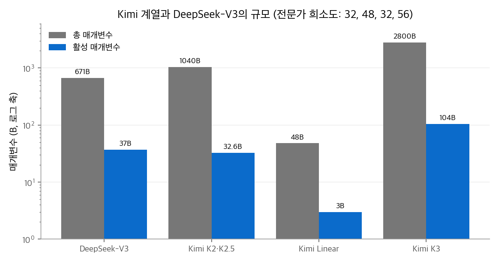
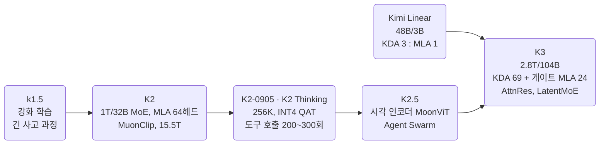
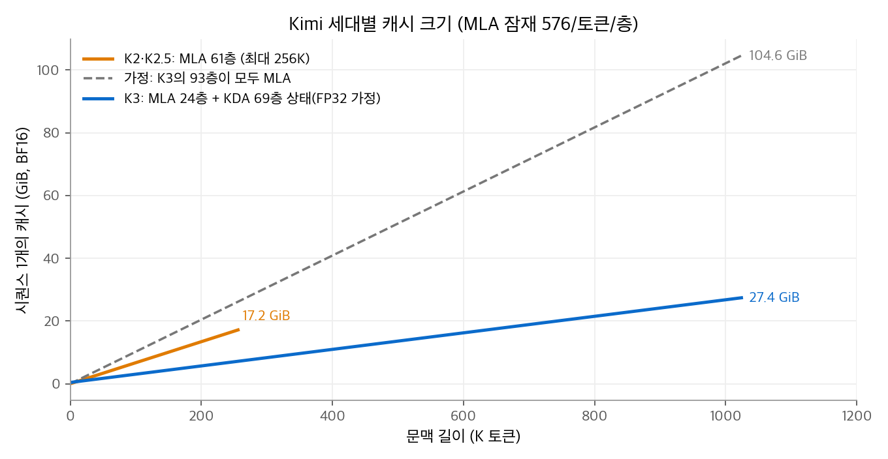

# LLM Model: Kimi 계열 정리

Kimi는 Moonshot AI가 만드는 모델 계열입니다.
Kimi K2는 DeepSeek-V3의 구조를 출발점으로 삼았지만, 전문가를 384개로 늘리고 어텐션 헤드를 64개로 줄였습니다. 그리고 1조 매개변수 모델을 Muon 계열 옵티마이저(MuonClip)로 학습했습니다.
Kimi Linear는 Gated DeltaNet을 고친 [KDA(Kimi Delta Attention)](../../ai/attention/09-kda.md)를 MLA와 섞었고, Kimi K3는 이 하이브리드 구조를 2.8T 매개변수로 키웠습니다.
이 글은 세대별 규모, 학습 방법, 에이전트 중심의 사후 학습, 공개 정책을 정리하고 구성 요소를 AI 섹션의 장으로 연결합니다.

<!-- more -->

## 1. 한 문장 요약

> 에이전트 작업을 목표로, 전문가를 아주 잘게 나눈 대형 MoE를 Muon으로 학습하고, 최신 세대는 KDA 하이브리드 어텐션으로 100만 토큰 문맥을 다루는 계열

K2 보고서의 부제는 "열린 에이전트 지능(Open Agentic Intelligence)"입니다.
K2부터 사후 학습에 도구 사용 궤적 합성과 강화 학습을 크게 넣었고, K2 Thinking은 도구 호출 200~300회를 이어 가는 장기 작업을 목표로 했습니다.

## 2. 세대별 개요

| 세대 (공개) | 총 / 활성 매개변수 | 사전학습 토큰 | 문맥 | 라이선스 |
| --- | --- | --- | --- | --- |
| Kimi k1.5 (2025. 1., 보고서) | 보고서에 규모 비공개 | — | 128K (강화 학습 문맥) | — |
| Kimi K2 (2025. 7.) | 1.04T / 32.6B | 15.5T | 128K | Modified MIT |
| K2-Instruct-0905 (2025. 9.) | K2와 같음 | — | 256K | Modified MIT |
| Kimi Linear (2025. 10.) | 48B / 3B | 5.7T | 1M | MIT |
| K2 Thinking (2025. 11.) | K2와 같음 | — | 256K | Modified MIT |
| Kimi K2.5 (2026. 1.) | 1T / 32B | K2-Base에서 시각·텍스트 혼합 약 15T 추가 학습 | 256K | Modified MIT |
| Kimi K3 (2026. 7.) | 2.8T / 104B | 공개 자료에 명시 없음 | 1M | Kimi K3 License (자체 라이선스) |

- k1.5는 강화 학습으로 긴 사고 과정을 학습한 추론 모델 보고서입니다. K2 보고서의 강화 학습 목적 함수는 k1.5에서 이어받았습니다.
- K2.5의 공개일은 모델 카드에 없습니다. 보고서와 변경 기록이 2026. 1. 말~2. 초 날짜입니다.
- K3는 2026. 7. 중순에 발표되었고, 가중치는 발표 당시 7. 27.까지 공개한다고 예고되었습니다. 지금은 Hugging Face에 `moonshotai/Kimi-K3` 가중치와 설정이 있습니다.

<figure markdown>

<figcaption markdown>
<b>Figure 1.</b> Kimi 계열과 DeepSeek-V3의 규모

로그 축입니다. 괄호 안은 희소도(라우팅 전문가 수 ÷ 토큰당 활성 전문가 수)입니다.
</figcaption>
</figure>

### 세대별 특징

- **K2**: 사전학습 15.5T 토큰 동안 손실 급등(loss spike)이 한 번도 없었다고 보고했습니다. 지식 데이터는 문체와 관점을 바꿔 여러 번 다시 쓰는 방식으로 늘렸습니다. 보고서의 SimpleQA 절제 실험에서 원문 10에폭은 23.76, 10번 다시 쓴 데이터 1에폭은 28.94였습니다. 사후 학습은 MCP 도구 3,000개 이상과 합성 도구 2만 개 이상으로 에이전트 궤적을 합성하고, 검증 가능한 보상과 자기 비평 루브릭 보상을 함께 쓰는 강화 학습을 했습니다.
- **K2-0905**: 문맥을 128K에서 256K로 늘리고 에이전트 코딩을 개선했습니다. 모델 카드 기준 SWE-Bench Verified가 65.8에서 69.2로 올랐습니다.
- **K2 Thinking**: 사고 과정과 도구 호출을 번갈아 수행하도록 학습했습니다. 사후 학습에서 MoE 부분에 INT4 가중치 양자화 인식 학습(QAT)을 적용해 생성 속도를 약 2배로 높였고, 모든 벤치마크를 INT4로 보고했습니다.
- **Kimi Linear**: 같은 학습 조건에서 전체 MLA보다 모든 평가 과제에서 좋았고, KV 캐시를 최대 75% 줄이고, 1M 문맥에서 생성 처리량을 최대 6배로 높였다고 보고했습니다.
- **K2.5**: 약 4억 매개변수의 시각 인코더 MoonViT를 붙인 멀티모달 모델입니다. 사고 모드, 즉답 모드, 에이전트 모드, 그리고 작업을 하위 작업으로 나눠 여러 에이전트가 병렬로 처리하는 Agent Swarm을 지원합니다. INT4는 K2 Thinking과 같은 방법을 씁니다.
- **K3**: 텍스트와 이미지(소개 글에는 영상도 언급)를 다룹니다. 사고는 항상 켜져 있고 노력 수준을 low, high, max로 고릅니다. SFT 단계부터 MXFP4 가중치·MXFP8 활성값 QAT를 적용했습니다.

## 3. 아키텍처 한눈에 보기

| 구성 요소 | Kimi가 쓴 방식 | 설명 장 |
| --- | --- | --- |
| 어텐션 (K2, K2.5) | MLA. 잠재 512 + RoPE 키 64, 쿼리 잠재 1,536. 헤드를 DeepSeek-V3의 128개에서 64개로 줄임 | [MLA](../../ai/attention/05-mla.md) |
| 헤드 수 결정 (K2) | 128K 문맥에서 64헤드→128헤드는 추론 FLOPs가 약 83% 늘지만 검증 손실은 0.5~1.2%만 좋아져 64헤드를 고름 | [MLA](../../ai/attention/05-mla.md) |
| 어텐션 (Kimi Linear, K3) | KDA와 MLA를 3 : 1로 교차. MLA층은 위치 인코딩을 쓰지 않음(NoPE). K3의 MLA층은 출력 게이트를 씀 | [KDA](../../ai/attention/09-kda.md), [선형 어텐션과 Gated DeltaNet](../../ai/attention/07-linear-attention.md), [어텐션 싱크와 게이트](../../ai/attention/08-attention-sink-gating.md) |
| 위치 인코딩 | K2는 RoPE 기저 50,000, 64차원에만 적용. Kimi Linear와 K3는 KDA가 위치 정보를 맡고 MLA는 NoPE | [RoPE](../../ai/llm-techniques/01-rope.md) |
| 긴 문맥 확장 | K2는 32K에서 YaRN으로 128K(설정의 계수 32, 원래 길이 4,096). K2.5 설정은 계수 64로 256K. Kimi Linear는 NoPE라 RoPE 조정이 필요 없다고 설명 | [긴 문맥 확장](../../ai/llm-techniques/02-long-context.md) |
| 로짓 안정화 (K2) | QK-Clip. 헤드별 최대 로짓이 τ = 100을 넘으면 그 헤드의 쿼리·키 가중치를 줄임 | [정규화와 로짓 안정화](../../ai/llm-techniques/03-normalization.md) |
| 옵티마이저 (K2) | MuonClip = Muon + 가중치 감쇠 + QK-Clip. 갱신 RMS를 0.2로 맞춤 | [Muon](../../ai/llm-techniques/optimizer/03-muon.md) |
| 학습률 (K2) | WSD. 워밍업 500스텝, 처음 10T 토큰은 $2\times10^{-4}$ 고정, 다음 5.5T 토큰에 코사인으로 $2\times10^{-5}$, 어닐링에서 $7\times10^{-6}$. 가중치 감쇠 0.1, 배치 67M 토큰 | [옵티마이저](../../ai/llm-techniques/optimizer/index.md) |
| 옵티마이저 (K3) | 소개 글은 어텐션 헤드를 독립적으로 최적화하는 Per-Head Muon을 언급 | [Muon](../../ai/llm-techniques/optimizer/03-muon.md) |
| FFN (K2) | MoE. 전문가 384개 중 8개 + 공유 1개, 앞 1층만 밀집, 전문가 그룹 제한 없음. 시그모이드 점수, `routed_scaling_factor` 2.827 | [MoE](../../ai/llm-techniques/05-moe.md) |
| FFN (K3) | LatentMoE. 은닉 7,168을 3,584차원 잠재 공간으로 줄인 뒤 전문가 896개 중 16개에 보내고, 공유 전문가 2개는 원래 폭으로 계산. 균형은 Quantile Balancing | [MoE](../../ai/llm-techniques/05-moe.md) |
| MTP | 공개 설정의 `num_nextn_predict_layers` 가 K2, K2.5, Kimi Linear, K3 모두 0. 공개 가중치에 MTP 모듈 없음 | [MTP와 추측 디코딩](../../ai/llm-techniques/06-mtp.md) |

### 희소도 스케일링 법칙

K2 보고서는 활성 매개변수를 고정하고 전문가 수만 늘리는 실험을 했습니다. 희소도(전체 전문가 수 / 활성 전문가 수)가 클수록 학습·검증 손실이 꾸준히 낮아졌습니다.
검증 손실 1.5에 도달하는 데 필요한 FLOPs는 희소도 48이 희소도 8보다 1.69배, 16보다 1.39배, 32보다 1.15배 적었습니다.
K2는 인프라 복잡도와의 균형으로 희소도 48(384개 중 8개)을 골랐습니다. K3는 896개 중 16개로 희소도 56입니다.

### QK-Clip

K2는 Muon으로 학습할 때 일부 헤드의 어텐션 로짓이 폭주하는 문제를 겪었습니다. QK-Clip은 옵티마이저 갱신이 끝난 뒤 헤드마다 이번 배치의 최대 로짓을 봅니다.

$$
S_{\max}^h = \frac{1}{\sqrt{d}}\max_{X \in B}\max_{i,j}\ \mathbf{q}_i^h \cdot \mathbf{k}_j^h,\qquad
\gamma_h = \min\!\left(1,\ \frac{\tau}{S_{\max}^h}\right),\quad \tau = 100
$$

$S_{\max}^h > \tau$ 인 헤드만 손봅니다. MLA에서는 헤드별 내용 성분 $\mathbf{q}^C, \mathbf{k}^C$ 를 각각 $\sqrt{\gamma_h}$ 배, 헤드별 RoPE 쿼리 $\mathbf{q}^R$ 을 $\gamma_h$ 배 합니다. 모든 헤드가 공유하는 RoPE 키 $\mathbf{k}^R$ 은 건드리지 않습니다.
예를 들어 어떤 헤드의 최대 로짓이 125이면 $\gamma = 0.8$ 이고, 내용 성분 가중치는 $\sqrt{0.8} \approx 0.894$ 배가 됩니다. 내용 항의 로짓은 $0.894^2 = 0.8$ 배인 100이 됩니다.
보고서는 최대 로짓이 학습 초반에 100에 묶였다가, τ를 바꾸지 않아도 이후 정상 범위로 내려왔다고 밝혔습니다.

## 4. 공개 설정값

| 항목 | K2 / K2.5 | Kimi Linear | K3 |
| --- | --- | --- | --- |
| 층 수 | 61 | 27 | 93 |
| 은닉 차원 | 7,168 | 2,304 | 7,168 |
| 어텐션 구성 | MLA 61층 | KDA 20층 + MLA 7층 | KDA 69층 + 게이트 MLA 24층 |
| MLA 헤드 | 64 | 32 | 96 |
| MLA 잠재 / RoPE 키 | 512 / 64 | 512 / 64 (NoPE) | 512 / 64 (NoPE) |
| KDA 헤드 × 헤드 차원 | — | 32 × 128 | 96 × 128 |
| 라우팅 전문가 / 활성 / 공유 | 384 / 8 / 1 | 256 / 8 / 1 | 896 / 16 / 2 |
| 전문가 중간 차원 | 2,048 | 1,024 | 3,072 (잠재 3,584에서 계산) |
| 최대 위치 | 131,072 (K2) / 262,144 (K2.5) | 1,048,576 | 1,048,576 |

K3 설정의 `attn_res_block_size: 12` 는 Attention Residuals(AttnRes)의 블록 크기입니다. 소개 글은 AttnRes를 "표현을 깊이 방향으로 고르게 누적하지 않고 선택적으로 가져오는 구조"라고 설명합니다.
K3의 활성 함수는 SiTU-GLU입니다. 설정의 두 β 값(게이트 4, 업 25)은 두 분기에 각각 $\beta\tanh(x/\beta)$ 형태의 상한을 거는 데 쓰입니다.

## 5. 비용 계산: 캐시 크기

MLA층은 토큰마다 $512 + 64 = 576$ 개 값을 저장합니다. KDA층은 헤드마다 $128 \times 128$ 상태 하나를 들고 다니며, 이 크기는 문맥 길이와 무관합니다. 상태는 FP32로 저장한다고 가정합니다.

| 모델 | 문맥에 비례하는 부분 (BF16) | 고정 부분 | 최대 문맥에서 합계 |
| --- | --- | --- | --- |
| K2 / K2.5 | $61 \times 576 \times 2\,\text{B} \approx 68.6\,\text{KiB/토큰}$ | 없음 | 256K에서 17.2GiB |
| Kimi Linear | $7 \times 576 \times 2\,\text{B} \approx 7.9\,\text{KiB/토큰}$ | $20 \times 32 \times 128^2 \times 4\,\text{B} = 40\,\text{MiB}$ | 1M에서 약 7.9GiB |
| K3 | $24 \times 576 \times 2\,\text{B} = 27\,\text{KiB/토큰}$ | $69 \times 96 \times 128^2 \times 4\,\text{B} \approx 0.40\,\text{GiB}$ | 1M에서 약 27.4GiB |

Kimi Linear는 27층 중 7층만 KV를 쌓으므로, 같은 층 수의 전체 MLA보다 KV 캐시가 $1 - 7/27 \approx 74\%$ 줄어듭니다. 보고서의 "최대 75%"와 맞는 값입니다.
K3의 93층이 모두 MLA였다면 1M 토큰에서 약 104.6GiB가 필요합니다. 하이브리드 구조로 약 1/4이 되었습니다.

<figure markdown>

<figcaption markdown>
<b>Figure 2.</b> Kimi 세대별 캐시 크기

주황선은 K2·K2.5, 파란선은 K3의 실제 구조입니다. 점선은 K3의 93층이 모두 MLA라고 가정한 경우입니다.
</figcaption>
</figure>

## 6. 다른 계열과 비교

| 항목 | [Gemma](2026-10-20-llm-gemma.md) | [DeepSeek](2026-10-20-llm-deepseek.md) | [Qwen](2026-10-20-llm-qwen.md) | [GLM](2026-10-20-llm-glm.md) | Kimi |
| --- | --- | --- | --- | --- | --- |
| 어텐션 (최신) | 로컬·전역 GQA | CSA·HCA 압축 | Gated DeltaNet + 게이트 어텐션 | MLA + DSA + IndexShare | KDA + 게이트 MLA (3 : 1) |
| 옵티마이저 (확인한 범위) | 명시 없음 | AdamW(V3) → Muon(V4) | 명시 없음 | Muon(GLM-4.5부터) | MuonClip(K2), Per-Head Muon(K3) |
| MoE 전문가 (최신, 전체 / 활성) | 128 / 8 (26B A4B) | 확인한 범위 밖 | 512 / 10 | 256 / 8 | 896 / 16 |
| 라이선스 (최신) | Apache 2.0 | MIT | Apache 2.0 | MIT | Kimi K3 License |

K2의 구조는 DeepSeek-V3와 가장 가깝습니다. 층 수(61)와 은닉 차원(7,168)이 같고, 전문가 수, 헤드 수, 밀집층 수만 다릅니다.
Kimi Linear와 K3의 하이브리드 구조는 Qwen3-Next·Qwen3.5와 같은 3 : 1 비율입니다. 차이는 선형층의 감쇠 게이트(스칼라 대 채널별)와 남은 소프트맥스층의 종류(GQA 대 MLA)입니다. 두 선형층의 차이는 [KDA](../../ai/attention/09-kda.md) 장의 비교표에 정리했습니다.

## 참고 자료

- Kimi Team, [Kimi k1.5: Scaling Reinforcement Learning with LLMs](https://arxiv.org/abs/2501.12599), 2025.
- Kimi Team, [Kimi K2: Open Agentic Intelligence](https://arxiv.org/abs/2507.20534), 2025. [K2-Instruct 모델 카드](https://huggingface.co/moonshotai/Kimi-K2-Instruct), [config.json](https://huggingface.co/moonshotai/Kimi-K2-Instruct/blob/main/config.json).
- [Kimi-K2-Instruct-0905 모델 카드](https://huggingface.co/moonshotai/Kimi-K2-Instruct-0905), [Kimi-K2-Thinking 모델 카드](https://huggingface.co/moonshotai/Kimi-K2-Thinking).
- Kimi Team, [Kimi Linear: An Expressive, Efficient Attention Architecture](https://arxiv.org/abs/2510.26692), 2025. [모델 카드](https://huggingface.co/moonshotai/Kimi-Linear-48B-A3B-Instruct).
- [Kimi-K2.5 모델 카드](https://huggingface.co/moonshotai/Kimi-K2.5).
- [Kimi-K3 모델 카드](https://huggingface.co/moonshotai/Kimi-K3), [config.json](https://huggingface.co/moonshotai/Kimi-K3/blob/main/config.json), [Kimi K3 소개 글](https://www.kimi.ai/blog/kimi-k3).
