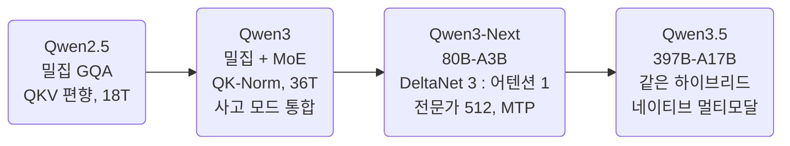
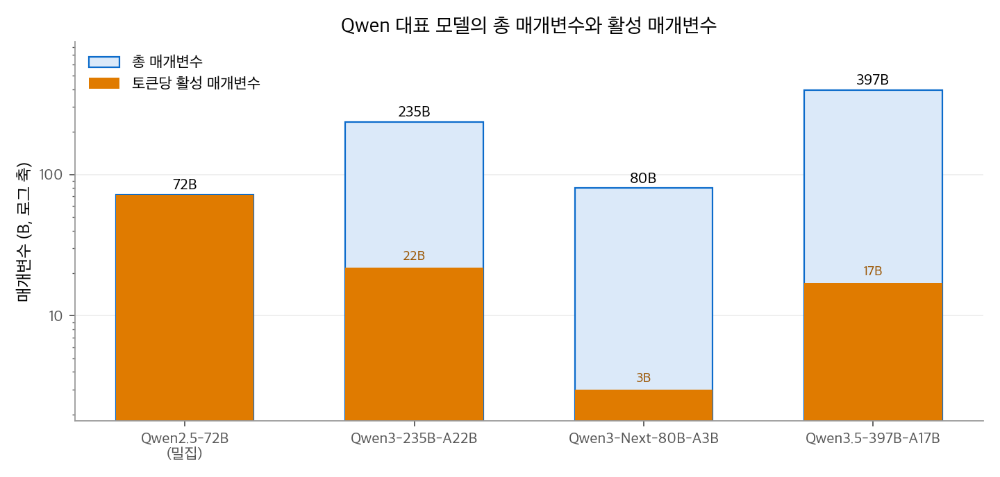
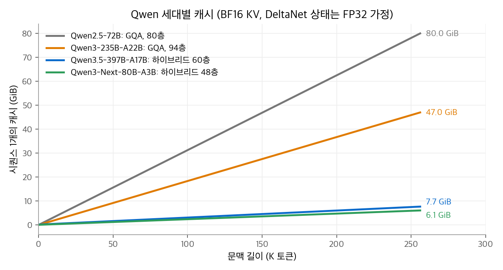

# LLM Model: Qwen 계열 정리

Qwen은 Alibaba의 Qwen 팀이 만드는 모델 계열입니다.
0.6B부터 수백 B까지 크기를 촘촘하게 내고, 대부분을 Apache 2.0으로 공개합니다.
Qwen3까지는 표준 GQA 트랜스포머를 다듬었고, Qwen3-Next와 Qwen3.5에서는 층의 3/4을 선형 어텐션으로 바꾼 하이브리드 구조로 넘어갔습니다.
이 글은 세대별 규모, 학습 단계, 사고(thinking) 모드, 공개 정책을 정리하고 구성 요소를 AI 섹션의 장으로 연결합니다.

<!-- more -->

## 1. 한 문장 요약

> 넓은 크기 범위와 다국어, 사고 모드 통합을 앞세운 오픈 모델 계열. 최신 세대는 Gated DeltaNet 하이브리드와 고희소 MoE로 긴 문맥 비용을 줄입니다.

## 2. 세대별 개요

| 세대 (공개) | 대표 크기 | 사전학습 토큰 | 문맥 | 특징 |
| --- | --- | --- | --- | --- |
| Qwen2.5 (2024. 9.) | 0.5B~72B 밀집 (MoE는 API 전용) | 18T | 32K (최대 위치) | 7T에서 18T로 데이터 확대 |
| Qwen3 (2025. 4.) | 밀집 0.6B~32B, MoE 30B-A3B·235B-A22B | 약 36T | 32K, YaRN으로 128K | 사고·비사고 모드 통합, 119개 언어 |
| Qwen3-Next (2025. 9.) | 80B-A3B | 15T | 262K, YaRN으로 약 1M | Gated DeltaNet 하이브리드, 전문가 512개 |
| Qwen3.5 (2026. 2.) | 397B-A17B 등 | 보고 없음 | 262K, YaRN으로 약 1M | 이미지·텍스트 조기 융합, 201개 언어·방언 |

라이선스는 Qwen3, Qwen3-Next, Qwen3.5 모두 Apache 2.0입니다(모델 카드 기준).

<figure markdown>

<figcaption markdown>
<b>Figure 1.</b> Qwen 대표 모델의 총 매개변수와 활성 매개변수

로그 축입니다. 활성 비율은 Qwen3-Next 약 3.75%, Qwen3.5-397B 약 4.3%, Qwen3-235B 약 9.4%입니다.
</figcaption>
</figure>

### 세대별 특징

- **Qwen3**: 사전학습이 세 단계입니다. 4K 길이로 30T 이상의 일반 데이터(S1), 약 5T의 STEM·코드·추론 데이터(S2), 32K 길이로 수천억 토큰의 긴 문맥 데이터(S3)입니다. S3에서 RoPE 기저를 $10^4$ 에서 $10^6$ 으로 올렸습니다. 사후 학습은 네 단계입니다: 긴 CoT 콜드 스타트, GRPO 추론 RL, 사고 모드 융합 SFT, 일반 RL. 작은 모델(0.6B~14B, 30B-A3B)은 큰 모델의 로짓을 따라 하는 강약(strong-to-weak) 증류로 만들었습니다. `/think`, `/no_think` 나 `enable_thinking` 으로 한 모델 안에서 모드를 바꾸고, 사고 길이 예산을 줄 수 있습니다.
- **Qwen3-Next**: Qwen3의 36T 데이터 중 15T로 학습했습니다. 모델 카드는 Base 모델이 Qwen3-32B-Base보다 학습 비용 10%로 더 좋은 성능을 내고, 32K 이상 문맥에서 처리량이 10배라고 밝혔습니다. 안정화를 위해 영점 중심(zero-centered)이고 가중치 감쇠를 적용한 LayerNorm을 썼습니다. Instruct 모델은 `<think>` 블록을 만들지 않고, 사고 모델은 별도로 냈습니다.
- **Qwen3.5**: Qwen3-Next의 하이브리드 구조를 주력 모델로 키웠습니다. 비전 인코더를 붙이고 멀티모달 토큰으로 처음부터 함께 학습합니다(early fusion). 사고 모드가 기본으로 켜져 있습니다. 모델 카드는 수백만 개 에이전트 환경으로 RL을 키웠다고 설명합니다.

## 3. 아키텍처 한눈에 보기

| 구성 요소 | Qwen이 쓴 방식 | 설명 장 |
| --- | --- | --- |
| 헤드 공유 | GQA. Qwen2.5-72B는 쿼리 64 : KV 8, Qwen3-235B는 64 : 4, Qwen3.5-397B 어텐션층은 32 : 2 | [MQA와 GQA](../../ai/attention/03-mqa-gqa.md) |
| 하이브리드 층 배치 | Qwen3-Next·3.5는 Gated DeltaNet 3층마다 게이트 어텐션 1층 | [선형 어텐션과 Gated DeltaNet](../../ai/attention/07-linear-attention.md) |
| 어텐션 출력 게이트 | 헤드 출력에 시그모이드 게이트(`attn_output_gate`) | [어텐션 싱크와 게이트](../../ai/attention/08-attention-sink-gating.md) |
| 위치 인코딩 | RoPE. Qwen3는 $b = 10^6$, Qwen3-Next·3.5는 $b = 10^7$ 에 헤드 차원의 25%만 회전 | [RoPE](../../ai/llm-techniques/01-rope.md) |
| 긴 문맥 확장 | 기저 주파수 상향(ABF), YaRN, DCA | [긴 문맥 확장](../../ai/llm-techniques/02-long-context.md) |
| 로짓 안정화 | Qwen2.5는 QKV 편향, Qwen3부터 편향을 없애고 QK-Norm | [정규화와 로짓 안정화](../../ai/llm-techniques/03-normalization.md) |
| 정규화 | RMSNorm. Qwen3-Next는 영점 중심·가중치 감쇠 LayerNorm | [정규화와 로짓 안정화](../../ai/llm-techniques/03-normalization.md) |
| FFN | Qwen3 MoE: 전문가 128개 중 8개, 공유 전문가 없음, 전역 배치 부하 분산 손실. Qwen3-Next: 512개 중 10개 + 공유 1개 | [MoE](../../ai/llm-techniques/05-moe.md) |
| MTP | Qwen3-Next와 Qwen3.5. 사전학습 성능을 높이고, SGLang·vLLM에서 추측 디코딩에 사용 | [MTP와 추측 디코딩](../../ai/llm-techniques/06-mtp.md) |
| 옵티마이저·학습률 | Qwen3 보고서에 옵티마이저 명시 없음. 학습률과 배치는 스케일링 법칙으로 정했고 S2에서 학습률 감소를 앞당겼다고만 적었습니다. Qwen3-Next·3.5는 확인한 공개 자료에 명시 없음 | [옵티마이저](../../ai/llm-techniques/optimizer/index.md) |

## 4. 공개 설정값

| 항목 | Qwen2.5-72B | Qwen3-235B-A22B | Qwen3-Next-80B-A3B | Qwen3.5-397B-A17B |
| --- | --- | --- | --- | --- |
| 층 수 | 80 | 94 | 48 (어텐션 12 + DeltaNet 36) | 60 (어텐션 15 + DeltaNet 45) |
| 은닉 차원 | 8,192 | 4,096 | 2,048 | 4,096 |
| 쿼리 / KV 헤드 | 64 / 8 | 64 / 4 | 16 / 2 | 32 / 2 |
| 헤드 차원 | 128 | 128 | 256 | 256 |
| DeltaNet 키 / 값 헤드 | — | — | 16 / 32 (차원 128) | 16 / 64 (차원 128) |
| RoPE 기저 | $10^6$ | $10^6$ | $10^7$ (25%) | $10^7$ (25%) |
| 최대 위치 | 32,768 | 40,960 | 262,144 | 262,144 |
| 전문가 | 밀집 | 128 중 8 | 512 중 10 + 공유 1 | — |

## 5. 비용 계산: 캐시 크기

어텐션층의 KV는 BF16, Gated DeltaNet층의 상태는 FP32로 저장한다고 가정합니다.
DeltaNet 상태는 값 헤드마다 $128 \times 128$ 행렬이고, 문맥 길이와 무관합니다.

| 모델 | 어텐션층 토큰당 KV | DeltaNet 상태 (고정) | 32K | 262K |
| --- | --- | --- | --- | --- |
| Qwen2.5-72B | $2 \times 80 \times 8 \times 128 \times 2\,\text{B}$ = 320KiB | 없음 | 10.0GiB | 80.0GiB |
| Qwen3-235B-A22B | $2 \times 94 \times 4 \times 128 \times 2\,\text{B}$ = 188KiB | 없음 | 5.9GiB | 47.0GiB |
| Qwen3-Next-80B-A3B | $2 \times 12 \times 2 \times 256 \times 2\,\text{B}$ = 24KiB | 36층 × 32헤드 → 72MiB | 0.8GiB | 6.1GiB |
| Qwen3.5-397B-A17B | $2 \times 15 \times 2 \times 256 \times 2\,\text{B}$ = 30KiB | 45층 × 64헤드 → 180MiB | 1.1GiB | 7.7GiB |

<figure markdown>

<figcaption markdown>
<b>Figure 2.</b> Qwen 세대별 캐시 크기

하이브리드 모델의 캐시는 같은 길이에서 Qwen3-235B의 약 1/6입니다. 32K·40K 이후의 Qwen2.5·Qwen3 선은 가상의 연장입니다.
</figcaption>
</figure>

Qwen3.5-397B는 Qwen3-235B보다 총 매개변수가 1.7배이지만, 262K 문맥의 캐시는 약 1/6입니다.
어텐션층을 15층으로 줄이고 KV 헤드를 2개로 둔 결과입니다.

## 6. 다른 계열과 비교

| 항목 | [Gemma](2026-10-20-llm-gemma.md) | [DeepSeek](2026-10-20-llm-deepseek.md) | Qwen | [GLM](2026-10-20-llm-glm.md) | [Kimi](2026-10-20-llm-kimi.md) |
| --- | --- | --- | --- | --- | --- |
| 크기 범위 | 1B~31B | 284B~1.6T | 0.6B~397B | 9B~744B | 48B~2.8T |
| 긴 문맥 전략 | 로컬층 비율 | MLA, 압축·희소 | 선형 어텐션 하이브리드 | MLA + 희소 선택 | 선형 어텐션(KDA) 하이브리드 |
| 사고 모드 | — | 3단계(V4) | 한 모델에서 전환(Qwen3), 기본 켜짐(3.5) | 사고·비사고 혼합(GLM-4.5), 노력 단계(GLM-5.2) | 사고·즉답(K2.5), 항상 켜짐·노력 3단계(K3) |

Qwen은 다섯 계열 중 크기 선택지가 가장 넓습니다. 같은 세대 안에서 0.6B 밀집부터 수백 B MoE까지 내므로, 같은 구조를 여러 규모에서 비교하기 좋습니다.
Kimi Linear와 K3도 Qwen3-Next·Qwen3.5와 같은 3 : 1 하이브리드 비율을 씁니다. 선형층은 채널별 감쇠 게이트([KDA](../../ai/attention/09-kda.md))이고, 남은 소프트맥스층은 MLA입니다.

## 참고 자료

- Qwen Team, [Qwen2.5 Technical Report](https://arxiv.org/abs/2412.15115), 2024.
- Qwen Team, [Qwen3 Technical Report](https://arxiv.org/abs/2505.09388), 2025.
- Qwen3-Next-80B-A3B [모델 카드](https://huggingface.co/Qwen/Qwen3-Next-80B-A3B-Instruct), Qwen3.5-397B-A17B [모델 카드](https://huggingface.co/Qwen/Qwen3.5-397B-A17B).
- Qwen2.5-72B [config.json](https://huggingface.co/Qwen/Qwen2.5-72B-Instruct/blob/main/config.json), Qwen3-235B-A22B [config.json](https://huggingface.co/Qwen/Qwen3-235B-A22B/blob/main/config.json), Qwen3.5-397B-A17B [config.json](https://huggingface.co/Qwen/Qwen3.5-397B-A17B/blob/main/config.json).
