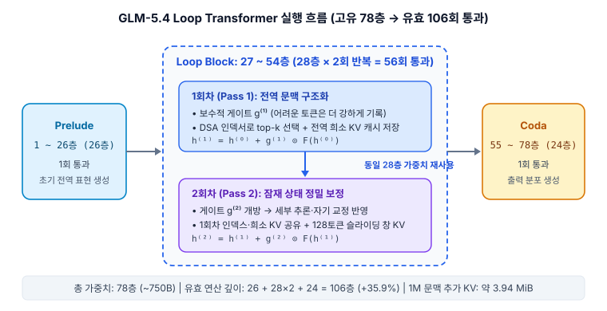
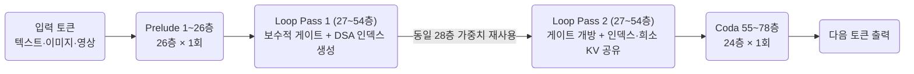

# LLM Model: GLM-5.4 아키텍처 리뷰

Z.ai가 `2026. 11. 23.` 공개한 플래그십 모델 GLM-5.4를 정리합니다.
GLM-5.4는 GLM-5 계열의 약 750B 78층 MoE 뼈대에 **Loop Transformer** 구조를 적용한 첫 상용 모델입니다.
중간 28개 층을 두 번 반복 실행해 매개변수를 늘리지 않고 연산 깊이를 106층으로 키웠습니다.
네이티브 멀티모달 입력과 100만 토큰 문맥도 지원합니다.
세부 원리는 [LLM 핵심 기법 8장: 루프 아키텍처](../../ai/llm-techniques/08-loop-architecture.md)와 기존 어텐션·LLM 핵심 기법 장을 바탕으로 해석합니다.

<!-- more -->

## 1. 한 문장 요약

> GLM-5의 78층 MoE 중 28개 중간층을 두 번 반복 실행해 매개변수를 늘리지 않고 추론 깊이를 106층으로 키운 Z.ai의 첫 상용 Loop Transformer

Z.ai는 GLM-5.4의 핵심 목표를 **Generalized Coding**으로 제시했습니다.
단순한 소프트웨어 코드 생성에 머무르지 않습니다.
게임 제작, 3D·CAD 기계 설계, 영상 생성·편집처럼 인과 사슬이 긴 작업을 코드 실행 기반으로 묶어 처리합니다.
기존 주력 플래그십이 텍스트 중심이었던 것과 달리, GLM-5.4는 영상·이미지·텍스트·파일 입력을 직접 받아 시각 디버깅과 멀티모달 에이전트 작업을 함께 다룹니다.

## 2. 공개 사양과 출시 현황

[Z.ai GLM-5.4 가이드](https://docs.z.ai/guides/llm/glm-5.4)와 출시 발표에서 확인된 사양은 다음과 같습니다.

| 항목 | 확인된 내용 | 비고 |
| --- | --- | --- |
| 공개일 | `2026. 11. 23.` | 기술 블로그·가이드 동시 공개 |
| 기반 규모 | 약 750B 매개변수 (78층 MoE) | GLM-5 기반 이어 학습 전환 |
| 루프 구조 | 중간 28층(27~54층) 2회 반복 | 유효 통과 깊이 106층 (+35.9%) |
| 입력 / 출력 모달리티 | 영상·이미지·텍스트·파일 / 텍스트 | 네이티브 비전 통합 |
| 최대 문맥 / 출력 길이 | 1M 토큰 (`glm-5.4[1m]`) / 128K 토큰 | 에이전트 작업 권장 창 512K |
| 추론 및 서빙 기능 | Thinking Mode, 스트리밍 | 비혼잡 시간대 최대 200토큰/초 보고 |
| 제공 범위 | GLM Coding Plan 우선 제공 | GLM-5.3 대비 1.5배 할당량 |

출시 시점에 확인되지 않은 항목도 분명히 구분해야 합니다.
일반 종량제 API 단가, 오픈 가중치, `config.json` 은 아직 공개되지 않았습니다.
전체 표준 벤치마크 점수표도 보안·안전 평가 이후 순차 공개 예정이라 확인되지 않았습니다.

## 3. 아키텍처 분석: Loop Transformer 적용 방식

GLM-5.4의 설계는 [루프 아키텍처](../../ai/llm-techniques/08-loop-architecture.md) 장에서 정리한 핵심 기법 네 가지를 실제 대규모 MoE에 맞춘 형태입니다.

<figure markdown>

<figcaption markdown>
<b>Figure 1.</b> GLM-5.4 Loop Transformer 실행 흐름 (고유 78층 → 유효 106회 통과)

Prelude(1~26층)와 Coda(55~78층)는 1회씩만 통과합니다. 중간 28층(27~54층)을 두 번 실행하면서 2회차는 1회차의 희소 KV와 인덱스를 재사용하고, 지역 128토큰 슬라이딩 창 KV만 새로 기록합니다.
</figcaption>
</figure>

### 기반 모델 전환과 Middle-Cycle 층 배치

Z.ai는 루프 구조를 처음부터 학습하지 않고, 이미 사전학습된 GLM-5 기반 모델에 이어 학습(continued training)을 적용해 GLM-5.4로 전환했습니다.
처음부터 학습하는 루프 모델은 초기 수렴이 느리고 같은 연산량에서 비공유 모델에 뒤처질 위험이 있기 때문입니다([루프 아키텍처 5절](../../ai/llm-techniques/08-loop-architecture.md#5)).

전체 78층은 세 구간으로 나뉩니다.

- **Prelude(1~26층)**: 26개 고유 층을 1회 통과하며 입력 임베딩을 잠재 표현으로 옮깁니다.
- **Loop Block(27~54층)**: 28개 층을 두 번 실행해 56층 분량의 추론 계산을 수행합니다.
- **Coda(55~78층)**: 24개 고유 층을 1회 통과하며 어휘 공간 출력 분포를 만듭니다.

양 끝 경계 층을 고유 가중치로 남기는 방식은 **Middle-Cycle** 패턴에 해당합니다([루프 아키텍처 2절](../../ai/llm-techniques/08-loop-architecture.md#2)).
총 고유 가중치는 78층으로 유지되면서 유효 통과 깊이는 $26 + 28 \times 2 + 24 = 106$ 층(+35.9%)이 됩니다.

### Gated Progressive Updates

같은 28층 블록에 은닉 상태를 두 번 통과시키면 잔차 스트림의 활성화 노름이 폭주할 수 있습니다.
GLM-5.4는 이를 막기 위해 반복 회차마다 독립된 토큰별 게이트를 둡니다([루프 아키텍처 3절](../../ai/llm-techniques/08-loop-architecture.md#3-gated-progressive-updates)).

- **1회차**: 게이트가 작은 값으로 열려 보수적인 갱신만 반영하면서 전역 문맥을 안정적으로 세웁니다. 단, 예측이 어려운 토큰에서는 1회차 게이트도 더 크게 열려 많은 정보를 기록합니다.
- **2회차**: 게이트가 넓게 열려 1회차가 잡은 문맥 위에서 논리 오류를 고치고 추론을 정교화합니다.

### Hybrid KV Cache와 Sparse Attention Index Reuse

100만 토큰 문맥에서 루프 2회차의 KV 캐시를 모두 새로 저장하면 메모리 사용량과 대역폭 부하가 크게 늘어납니다.
GLM-5.4는 두 가지 공학 선택으로 추가 비용을 상수로 묶었습니다([루프 아키텍처 4절](../../ai/llm-techniques/08-loop-architecture.md#4-kv)).

1. **Hybrid KV Cache**: 2회차는 먼 과거 토큰을 참조할 때 1회차가 저장한 전역 희소 KV 캐시를 재사용합니다. 대신 2회차에서 새로 만든 KV는 최근 128토큰 슬라이딩 창([슬라이딩 창](../../ai/attention/04-sliding-window.md)) 안에만 별도로 저장합니다.
2. **Sparse Attention Index Reuse**: 기반 모델의 동적 희소 어텐션(DSA) 인덱서([희소 어텐션](../../ai/attention/06-sparse-attention.md))가 1회차에서 고른 top-$k$ 인덱스를 2회차가 그대로 재사용합니다. Z.ai는 인덱스를 다시 계산하는 경우와 정확도 차이가 거의 없으면서 추가 인덱서 연산을 없앴다고 설명했습니다.

### 구성 요소 한눈에 보기

| 구성 요소 | GLM-5.4 방식 | 설명 장 |
| --- | --- | --- |
| 루프 배치 | Middle-Cycle (Prelude 26 + Loop Block 28×2 + Coda 24) | [루프 아키텍처](../../ai/llm-techniques/08-loop-architecture.md) |
| 활성화 안정화 | Gated Progressive Updates (회차별 독립 토큰 게이트) | [루프 아키텍처](../../ai/llm-techniques/08-loop-architecture.md) |
| 루프 KV 캐시 | Hybrid KV Cache (1회차 희소 KV 공유 + 2회차 128창) | [루프 아키텍처](../../ai/llm-techniques/08-loop-architecture.md), [슬라이딩 창](../../ai/attention/04-sliding-window.md) |
| 희소 인덱스 | Sparse Attention Index Reuse (1회차 top-$k$ 재사용) | [희소 어텐션](../../ai/attention/06-sparse-attention.md) |
| 기반 어텐션·FFN | GLM-5 계열의 MLA + DSA + 세분화 MoE (추정, 세부 `config.json` 미공개) | [MLA](../../ai/attention/05-mla.md), [MoE](../../ai/llm-techniques/05-moe.md) |
| 문맥 길이 | 최대 1M 토큰 (`glm-5.4[1m]`) | [긴 문맥 확장](../../ai/llm-techniques/02-long-context.md) |

## 4. 비용 계산: 1M 문맥에서의 루프 KV 캐시

GLM-5.4의 `config.json` 은 아직 공개되지 않았습니다.
따라서 기반 모델 GLM-5의 공개 MLA 규격(잠재 512 + RoPE 키 64 = 576개 원소)을 가정합니다.
BF16 기준 층당 토큰당 $1{,}152\,\text{B}$ 로 루프 추가 비용을 추정합니다([루프 아키텍처 4절](../../ai/llm-techniques/08-loop-architecture.md#4-kv)).

| 구성 (1M = 1,048,576 토큰 기준) | 토큰당 KV 크기 | 1M 총 KV 캐시 | 비루프 대비 추가량 |
| --- | --- | --- | --- |
| 비루프 기준 (78층) | 87.75 KiB | 87.75 GiB | — |
| 루프 전체 복제 (28층 KV 추가) | 119.25 KiB | 119.25 GiB | +31.50 GiB (+35.9%) |
| Hybrid KV Cache (128토큰 창) | 87.75 KiB + 상수 | 87.754 GiB | +3.94 MiB (+0.0044%) |

디코드 단계는 메모리 대역폭에 묶이므로([Prefill과 Decode](../../ai/llm-techniques/07-prefill-decode.md)), Hybrid KV Cache가 없으면 1M 문맥에서 요청마다 $31.5\,\text{GiB}$ 의 캐시 읽기·저장 부담이 더해집니다.
슬라이딩 창을 128토큰으로 제한하면 추가 KV 캐시가 $28 \times 1{,}152 \times 128\,\text{B} \approx 3.94\,\text{MiB}$ 로 문맥 길이와 무관한 상수가 됩니다.
참고로 GLM-5.4의 총 연산 통과량은 78층에서 106층으로 약 35.9% 늘지만, 가중치는 78층분만 VRAM에 올리면 됩니다.

## 5. 검증 실험과 트레이드오프

### 30B 통제 실험과 규모 주장

Z.ai는 750B 주력 모델에 루프를 적용하기 전에 30B 매개변수 모델로 통제 실험을 진행했습니다.
기술 블로그 보고에 따르면 동일 매개변수(30B) 조건에서 루프 모델에 약 10%의 추가 학습 연산을 투입했습니다.
그 결과 비루프 대조군보다 수학·과학·복합 추론 벤치마크에서 8~11점 높은 점수를 기록했습니다.
동시에 평균 출력 토큰 길이는 10~14% 짧아져 불필요한 장황함이 줄었다고 보고했습니다.

Z.ai는 이 구조를 약 750B 규모에 적용한 GLM-5.4가 기존 2T~3T 매개변수급 모델에 맞먹는 추론 수준에 도달했다고 발표했습니다.
다만 공식 벤치마크 표와 오픈 가중치가 아직 나오지 않았습니다.
따라서 이 수치는 Z.ai의 발표 자료로 구분해 해석해야 합니다.

### Marathon Thinking 트레이드오프

루프 아키텍처는 복잡한 설계·디버깅 작업에서 깊은 잠재 추론을 끌어내지만, 짧은 즉답 작업에서는 트레이드오프가 따릅니다.
Z.ai와 초기 사용자 보고 모두 GLM-5.4가 복잡한 과제에서 내부 반성 단계를 길게 이어 가는 **Marathon Thinking** 경향을 보인다고 지적합니다.
토큰당 통과 층 수가 78층에서 106층으로 늘었습니다.
긴 사고 출력까지 겹치면, 단순 질의에서는 비루프 모델보다 전체 응답 완료 시간이 길어질 수 있습니다.

### GLM-5 계열 내 진화

GLM-5 세대는 버전마다 병목 지점을 하나씩 교체하며 발전했습니다.

- **GLM-5 (`2026. 2.`)**: 744B/40B MoE에 MLA + DSA와 Muon Split을 결합하고 200K 문맥을 지원했습니다.
- **GLM-5.2 (`2026. 6.`)**: IndexShare로 4층마다 인덱서를 공유해 1M 문맥을 열었습니다.
- **GLM-5.3 (`2026. 8.`)**: 동일 기반 구조에서 코딩·에이전트 사후 학습을 강화했습니다.
- **GLM-5.4 (`2026. 11.`)**: 사후 학습을 넘어 아키텍처 자체를 Loop Transformer로 전환하고 네이티브 멀티모달 입력을 통합했습니다.

## 참고 자료

- Z.ai, [GLM-5.4 Developer Guide](https://docs.z.ai/guides/llm/glm-5.4), 2026.
- Z.ai, *GLM-5.4: Toward Generalized Coding with Our First Loop Transformer* (기술 블로그), 2026. 11. 23.
- GLM-5 Team, [GLM-5: from Vibe Coding to Agentic Engineering](https://arxiv.org/abs/2602.15763), 2026.
- [LLM 핵심 기법 8장: 루프 아키텍처](../../ai/llm-techniques/08-loop-architecture.md).
- [LLM Model: GLM 계열 정리](2026-10-20-llm-glm.md).
