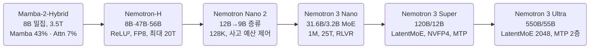
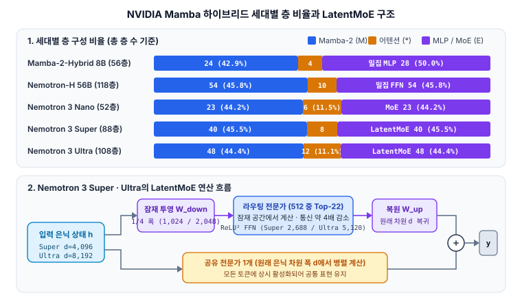
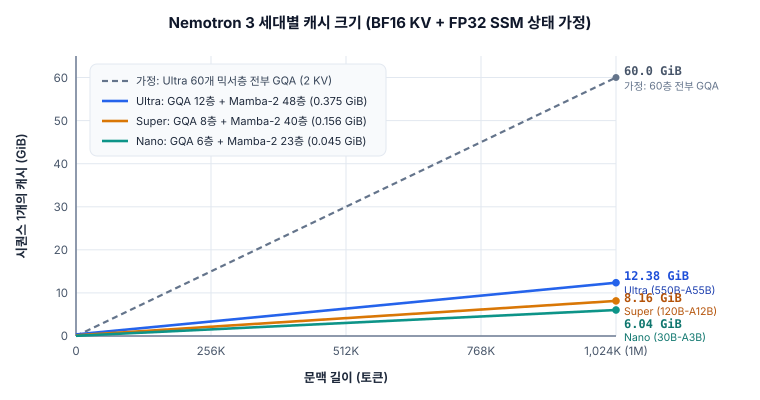

# LLM Model: NVIDIA Mamba (Nemotron) 계열 정리

NVIDIA는 2024년 6월 실증 연구에서 Mamba-2와 소수의 셀프 어텐션층을 섞은 **Mamba-2-Hybrid** 구조를 제안했습니다.
이후 이 하이브리드 뼈대를 밀집 모델 **Nemotron-H**(2025. 4.)와 **Nemotron Nano 2**(2025. 8.)로 키웠습니다.
최신 **Nemotron 3** 계열(2025. 12.~2026. 6.)은 Mamba-2 하이브리드 위에 세분화 MoE, 잠재 공간 라우팅(**LatentMoE**), **NVFP4** 네이티브 사전학습, 멀티 토큰 예측(**MTP**)을 결합해 100만 토큰 문맥을 처리합니다.
이 글은 세대별 규모, 층 배치 원리, 최신 구조 특징을 정리하고 각 구성 요소를 AI 섹션의 해당 장으로 연결합니다.

<!-- more -->

## 1. 한 문장 요약

> 전체 층의 약 45%를 Mamba-2 상태 공간 모델로, 약 7~11%만 GQA 어텐션으로 두고, 최신 세대에서 LatentMoE와 NVFP4를 결합한 하이브리드 LLM 계열

순수 상태 공간 모델(SSM, State Space Model)은 토큰당 추론 메모리와 연산량이 문맥 길이와 무관한 상수입니다.
하지만 2024년 6월 NVIDIA 연구는 순수 SSM이 정밀 복사나 문맥 내 학습(in-context learning) 과제에서 트랜스포머에 뒤처짐을 보였습니다.
NVIDIA는 Mamba-2 블록 사이에 GQA(Grouped-Query Attention)층을 소수만 끼워 넣어 정확도와 긴 문맥 추론 속도를 함께 확보했습니다.

## 2. 세대별 개요

| 세대 (공개) | 총 / 활성 매개변수 | 사전학습 토큰 | 문맥 | 라이선스 | 핵심 변화 |
| --- | --- | --- | --- | --- | --- |
| Mamba-2-Hybrid (2024. 6.) | 8B 밀집 | 3.5T | 4K (확장 128K) | Apache 2.0 | Mamba-2 43% + 어텐션 7% + MLP 50%, NoPE |
| Nemotron-H (2025. 4.) | 8B·47B·56B 밀집 | 최대 20T | 8K (확장 512K) | NVIDIA Open Model | $\text{ReLU}^2$ FFN, FP8 학습, MiniPuzzle 압축(47B) |
| Nemotron Nano 2 (2025. 8.) | 9B (12B-Base 압축) | 20T | 128K | NVIDIA Open Model | E4M3 블록 FP8, Minitron 가지치기, 사고 예산 제어 |
| Nemotron 3 Nano (2025. 12.) | 31.6B / 3.2B | 25T | 1M | NVIDIA Open Model | 첫 Mamba-2 + MoE (128 중 6 + 공유 1), 다중 환경 RLVR |
| Nemotron 3 Super (2026. 3.) | 120B / 12B | 25T | 1M | NVIDIA Open Model | LatentMoE(잠재 1,024), NVFP4 사전학습, 공유 MTP |
| Nemotron 3 Ultra (2026. 6.) | 550B / 55B | 20T | 1M | NVIDIA Open Model | LatentMoE(잠재 2,048), NVFP4, 공유 MTP 2층 |

<figure markdown>

<figcaption markdown>
<b>Figure 1.</b> NVIDIA Mamba 하이브리드 세대별 층 비율과 LatentMoE 구조

위 패널은 총 층 수 기준 Mamba-2, 어텐션, MLP·MoE의 비율입니다. 아래 패널은 Nemotron 3 Super·Ultra가 은닉 폭을 1/4로 줄여 512개 전문가에 라우팅하는 LatentMoE 흐름입니다.
</figcaption>
</figure>

### 세대별 특징

- **Mamba-2-Hybrid (2024. 6., arXiv:2406.07887)**: NVIDIA 연구진이 8B 규모와 3.5T 토큰 동일 예산에서 트랜스포머, Mamba, Mamba-2, Mamba-2-Hybrid를 비교한 실증 연구입니다. 순수 Mamba와 Mamba-2는 일반 언어 모델링 지표에서 트랜스포머와 비슷했지만, 전화번호부 조회(Phonebook) 같은 정밀 복사와 5-shot MMLU에서 점수가 낮았습니다. 반면 56층을 **Mamba-2 24층(42.9%) + 셀프 어텐션 4층(7.1%) + MLP 28층(50.0%)**으로 짠 Mamba-2-Hybrid는 12개 표준 평가 과제 모두에서 8B 트랜스포머를 평균 2.65점 앞섰습니다. 첫 층에 Mamba-2를 두어 별도 위치 인코딩 없이(NoPE) 16K·32K·128K 긴 문맥(RULER)을 처리했고, 토큰 생성 속도는 트랜스포머 대비 최대 8배 빠르다고 분석했습니다. Megatron-LM 학습 코드와 체크포인트를 Apache 2.0으로 공개했습니다.
- **Nemotron-H (2025. 4., arXiv:2504.03624)**: 연구 단계의 하이브리드 구조를 8B(52층)와 56B(118층) 상용 규모로 확장했습니다. FFN 활성화 함수로 Squared ReLU($\text{ReLU}^2$)를 쓰고, FP8 정밀도로 최대 20T 토큰을 학습했습니다. 56B 모델은 MiniPuzzle 가지치기와 증류로 47B(어텐션 5층)로 압축해 추론 속도를 약 20% 높였습니다.
- **Nemotron Nano 2 (2025. 8., arXiv:2508.14444)**: 12B 기반 모델을 E4M3 블록 단위 FP8로 20T 토큰 사전학습한 뒤, Minitron 가지치기·증류로 9B(56층: Mamba-2 27 + 어텐션 4 + MLP 25)를 만들었습니다. 128K 문맥 확장 학습과 SFT·GRPO·DPO 추론 사후 학습을 거쳐 추론 토큰 예산 제어를 지원합니다.
- **Nemotron 3 Nano (2025. 12., arXiv:2512.20848)**: 밀집 FFN을 MoE로 교체한 첫 세대입니다. 총 31.6B 중 토큰당 3.2B(30B-A3B)만 활성화하며, 52층(Mamba-2 23 + 어텐션 6 + MoE 23)으로 구성됩니다. 25T 토큰(일반 다양성 23.5T + 고품질 1.5T) 사전학습 후 다중 환경 검증 보상 강화 학습(RLVR)으로 에이전트 추론과 1M 문맥을 학습했습니다.
- **Nemotron 3 Super (2026. 3., arXiv:2604.12374)**: 120B / 12B 모델로 88층(Mamba-2 40 + 어텐션 8 + LatentMoE 40)을 씁니다. 은닉 차원 4,096을 1,024차원 잠재 공간으로 줄여 전문가 512개 중 22개에 라우팅하는 **LatentMoE**를 처음 도입했습니다. 네이티브 **NVFP4** 사전학습(25T 토큰)과 추측 디코딩용 공유 가중치 MTP 층도 함께 적용했습니다.
- **Nemotron 3 Ultra (2026. 6., arXiv:2606.15007)**: 550B / 55B 플래그십 모델로 108층(Mamba-2 48 + 어텐션 12 + LatentMoE 48)을 사용합니다. 은닉 차원 8,192를 잠재 2,048차원으로 압축하는 LatentMoE, 네이티브 NVFP4 사전학습(20T 토큰), 공유 가중치 MTP 2층을 탑재했습니다. `enable_thinking` 매개변수로 추론 모드를 전환합니다.

## 3. 아키텍처 한눈에 보기

| 구성 요소 | NVIDIA Mamba가 쓴 방식 | 설명 장 |
| --- | --- | --- |
| 시퀀스 믹서 | Mamba-2(SSD) 43~46% + GQA 어텐션 7~11.5% 교차 배치 | [선형 어텐션과 Gated DeltaNet](../../ai/attention/07-linear-attention.md) |
| 어텐션 헤드 공유 | GQA. 8B·56B는 KV 8개, Nemotron 3 전 모델은 KV 2개 | [MQA와 GQA](../../ai/attention/03-mqa-gqa.md) |
| 위치 인코딩 | 전 세대 NoPE(첫 층 Mamba-2의 인과 합성곱과 순환 상태가 위치 표현) | [RoPE](../../ai/llm-techniques/01-rope.md) |
| 긴 문맥 확장 | Mamba-2 상태 공간 + 소수 NoPE GQA로 128K~1M 확장 | [긴 문맥 확장](../../ai/llm-techniques/02-long-context.md) |
| 정규화 | RMSNorm | [정규화와 로짓 안정화](../../ai/llm-techniques/03-normalization.md) |
| FFN / 활성화 | Nemotron-H는 밀집 $\text{ReLU}^2$. Nemotron 3는 세분화 MoE + $\text{ReLU}^2$ | [MoE](../../ai/llm-techniques/05-moe.md) |
| 전문가 라우팅 | Nano는 128 중 6 + 공유 1. Super·Ultra는 LatentMoE (512 중 22 + 공유 1) | [MoE](../../ai/llm-techniques/05-moe.md) |
| MTP | Super(1층)·Ultra(2층)에 공유 가중치 MTP 내장 | [MTP와 추측 디코딩](../../ai/llm-techniques/06-mtp.md) |
| 저정밀도 학습 | Nemotron-H·Nano 2는 FP8, Nemotron 3 Super·Ultra는 네이티브 NVFP4 | [Prefill과 Decode](../../ai/llm-techniques/07-prefill-decode.md) |
| 옵티마이저·학습률 | AdamW ($\beta_1 = 0.9$, $\beta_2 = 0.95$, 가중치 감쇠 0.1) + WSD 스케줄 | [AdamW](../../ai/llm-techniques/optimizer/02-adamw.md) |

### Mamba-2-Hybrid 층 배치와 상태 공간 모델

Mamba-2는 선형 어텐션과 같은 쌍대성(Structured State Space Duality, SSD)을 이용합니다.
입력 토큰 $\mathbf{x}_t$ 를 길이 4의 인과 깊이별 합성곱(Conv1d)과 SiLU로 섞은 뒤, 스칼라 감쇠 계수 $a_t \in (0, 1)$ 와 입력·상태 투영 $\mathbf{B}_t, \mathbf{C}_t$ 로 헤드별 고정 크기 상태 행렬 $\mathbf{H}_t$ 를 갱신합니다.

$$
\mathbf{H}_t = a_t\,\mathbf{H}_{t-1} + \mathbf{v}_t\mathbf{B}_t^\top,\qquad \mathbf{y}_t = \mathbf{C}_t^\top \mathbf{H}_t + D\,\mathbf{x}_t
$$

상태 $\mathbf{H}_t$ 의 크기가 문맥 길이 $N$ 과 무관하므로 디코드 단계 메모리와 연산이 토큰당 $O(1)$ 입니다.
반면 상태 용량이 `mamba_head_dim × ssm_state_size` 로 고정되어 과거의 임의 토큰을 글자 단위로 정확히 회상하는 데 한계가 있습니다.

NVIDIA는 `hybrid_override_pattern` 문자열(`M`은 Mamba-2, `*`는 GQA 어텐션, `E`는 MoE)로 다음 네 가지 배치 규칙을 유지합니다.

1. **첫 층은 항상 Mamba-2(`M`)**: 인과 합성곱과 순환 상태가 토큰 순서 정보를 자연스럽게 만들므로, 이후 어텐션층까지 위치 인코딩(RoPE)을 생략하는 **NoPE** 설계가 가능합니다.
2. **어텐션 비율은 7~11.5% 유지**: 52~118층 전체 중 4~12개 층만 어텐션(`*`)으로 두어 정밀 검색과 문맥 내 학습을 맡깁니다.
3. **어텐션 직후는 FFN/MoE(`*E`)**: 어텐션이 모은 문맥 정보를 바로 비선형 변환에 넘겨 표준 트랜스포머 블록 구조를 보존합니다.
4. **마지막 층은 FFN/MoE(`E`)**: 출력 로짓 투영 직전 표현을 정제합니다.

### LatentMoE, NVFP4, MTP

최신 **Nemotron 3 Super·Ultra**는 긴 추론(thinking) 궤적과 다중 에이전트 호출에서 생기는 디코드 대역폭 병목을 줄이기 위해 세 가지 기법을 추가했습니다.

- **LatentMoE**: 일반 MoE는 은닉 차원 $d$ 그대로 모든 라우팅 전문가 가중치를 읽고 all-to-all 통신을 수행합니다. Super와 Ultra는 먼저 $\mathbf{W}_{\text{down}}$ 으로 은닉 상태를 $1/4$ 크기의 잠재 공간(Super $4{,}096 \to 1{,}024$, Ultra $8{,}192 \to 2{,}048$)으로 압축한 뒤 512개 전문가 중 Top-22에 라우팅하고 $\mathbf{W}_{\text{up}}$ 으로 복원합니다. 공유 전문가 1개만 원래 은닉 폭 $d$ 에서 병렬 계산합니다. 전문가당 가중치와 통신량이 약 4배 줄어 같은 지연 시간 예산 안에서 전문가 수(512개)와 활성 전문가 수(22개)를 크게 늘렸습니다.
- **네이티브 NVFP4 사전학습**: 사후 양자화가 아니라 첫 그래디언트 갱신부터 4비트 부동소수점(NVFP4) 형식으로 사전학습해 Blackwell GPU의 메모리 대역폭과 연산 처리량을 활용합니다.
- **공유 가중치 MTP**: Super와 Ultra는 가중치를 공유하는 MTP 층(Ultra 기준 2층)을 내장해 한 번의 정방향 계산으로 여러 미래 토큰을 예측하는 추측 디코딩을 지원합니다.

## 4. 공개 설정값

기술 보고서와 Hugging Face `config.json` 에서 확인한 값입니다.

| 항목 | Mamba-2-Hybrid 8B | Nemotron-H 8B | Nemotron-H 56B | Nemotron 3 Nano | Nemotron 3 Super | Nemotron 3 Ultra |
| --- | --- | --- | --- | --- | --- | --- |
| 총 층 수 (`M / * / FFN·MoE`) | 56 (24 / 4 / 28) | 52 (24 / 4 / 24) | 118 (54 / 10 / 54) | 52 (23 / 6 / 23) | 88 (40 / 8 / 40) | 108 (48 / 12 / 48) |
| 은닉 차원 | 4,096 | 4,096 | 8,192 | 2,688 | 4,096 | 8,192 |
| 어텐션 쿼리 / KV 헤드 | 32 / 8 | 32 / 8 | 64 / 8 | 32 / 2 | 32 / 2 | 64 / 2 |
| 어텐션 헤드 차원 | 128 | 128 | 128 | 128 | 128 | 128 |
| Mamba-2 헤드 × 차원 | 128 × 64 | 128 × 64 | 256 × 64 | 64 × 64 | 128 × 64 | 256 × 64 |
| Mamba-2 상태 크기 (`ssm_state_size`) | 128 | 128 | 256 | 128 | 128 | 128 |
| Conv 커널 / 그룹 수 | 4 / 8 | 4 / 8 | 4 / 8 | 4 / 8 | 4 / 8 | 4 / 8 |
| 라우팅 전문가 / 활성 / 공유 | 밀집 | 밀집 ($\text{ReLU}^2$) | 밀집 ($\text{ReLU}^2$) | 128 / 6 / 1 | 512 / 22 / 1 (잠재 1,024) | 512 / 22 / 1 (잠재 2,048) |
| 위치 인코딩 | NoPE | NoPE | NoPE | NoPE | NoPE | NoPE |
| 최대 문맥 | 4K (확장 128K) | 8K (확장 512K) | 8K (확장 512K) | 1,048,576 (1M) | 1,048,576 (1M) | 1,048,576 (1M) |

## 5. 비용 계산: 캐시 크기

어텐션층의 KV 캐시는 BF16(2바이트), Mamba-2층의 SSM 상태(`mamba_num_heads × mamba_head_dim × ssm_state_size`)는 FP32(4바이트)로 저장한다고 가정합니다.
Mamba-2의 길이 4 인과 합성곱(Conv1d) 상태는 SSM 상태의 약 1~2% 수준이므로 아래 표에는 SSM 상태 기준으로 계산합니다.

| 모델 | 어텐션층 토큰당 KV (BF16) | Mamba-2 SSM 상태 (고정, FP32) | 128K (131,072) | 1M (1,048,576) |
| --- | --- | --- | --- | --- |
| Nemotron-H 8B | $2 \times 4 \times 8 \times 128 \times 2\,\text{B} = 16\,\text{KiB}$ | $24 \times 128 \times 64 \times 128 \times 4\,\text{B} = 96\,\text{MiB}$ | 2.09 GiB | — |
| Nemotron-H 56B | $2 \times 10 \times 8 \times 128 \times 2\,\text{B} = 40\,\text{KiB}$ | $54 \times 256 \times 64 \times 256 \times 4\,\text{B} = 864\,\text{MiB}$ | 5.84 GiB | — |
| Nemotron 3 Nano | $2 \times 6 \times 2 \times 128 \times 2\,\text{B} = 6\,\text{KiB}$ | $23 \times 64 \times 64 \times 128 \times 4\,\text{B} = 46\,\text{MiB}$ | 0.79 GiB | 6.04 GiB |
| Nemotron 3 Super | $2 \times 8 \times 2 \times 128 \times 2\,\text{B} = 8\,\text{KiB}$ | $40 \times 128 \times 64 \times 128 \times 4\,\text{B} = 160\,\text{MiB}$ | 1.16 GiB | 8.16 GiB |
| Nemotron 3 Ultra | $2 \times 12 \times 2 \times 128 \times 2\,\text{B} = 12\,\text{KiB}$ | $48 \times 256 \times 64 \times 128 \times 4\,\text{B} = 384\,\text{MiB}$ | 1.88 GiB | 12.38 GiB |

<figure markdown>

<figcaption markdown>
<b>Figure 2.</b> Nemotron 3 세대별 캐시 크기

회색 점선은 Ultra의 60개 시퀀스 믹서층(48 + 12)을 전부 2-KV-헤드 GQA로 두었을 때의 가상 기준선(1M에서 60.0 GiB)입니다. Ultra의 실제 하이브리드 구조는 1M 토큰에서 약 1/5인 12.38 GiB입니다.
</figcaption>
</figure>

Nemotron 3 Ultra(550B)는 시퀀스 믹서 60개 층 중 12개만 어텐션이고 KV 헤드도 2개만 둡니다.
덕분에 550B 규모이면서도 100만 토큰 문맥의 시퀀스 캐시가 12.38 GiB에 머뭅니다.
Mamba-2-Hybrid 8B 논문에서도 32층 표준 GQA 트랜스포머 대비 디코드 처리량이 최대 8배 높다고 보고했고, Nemotron 3 계열도 같은 선형·어텐션 하이브리드 원리로 긴 추론 궤적의 메모리 병목을 낮춥니다.

## 6. 다른 계열과 비교

| 항목 | [Gemma](2026-10-20-llm-gemma.md) | [DeepSeek](2026-10-20-llm-deepseek.md) | [Qwen](2026-10-20-llm-qwen.md) | [GLM](2026-10-20-llm-glm.md) | [Kimi](2026-10-20-llm-kimi.md) | NVIDIA Mamba |
| --- | --- | --- | --- | --- | --- | --- |
| 최신 주력 | Gemma 4 31B | V4-Pro 1.6T/49B | Qwen3.5-397B-A17B | GLM-5.4 (~750B 루프) | K3 2.8T/104B | Nemotron 3 Ultra 550B/55B |
| 긴 문맥 전략 | 로컬·전역 GQA | MLA + CSA·HCA 압축 | Gated DeltaNet : GQA (3 : 1) | MLA + DSA + IndexShare | KDA : MLA (3 : 1) | Mamba-2 : GQA (4~5 : 1) |
| 위치 인코딩 | RoPE (전역 25%) | 분리 RoPE (64차원) | 부분 RoPE (25%) | 분리·부분 RoPE | NoPE (Kimi Linear·K3 MLA) | NoPE (전 세대) |
| MoE 구조 | 128/8 (26B A4B) | 256/8 + 공유 1 | 512/10 + 공유 1 | 256/8 + 공유 1 | LatentMoE 896/16 + 공유 2 | LatentMoE 512/22 + 공유 1 |
| 라이선스 (최신) | Apache 2.0 | MIT | Apache 2.0 | MIT | Kimi K3 License | NVIDIA Open Model |

같은 하이브리드 비이차(sub-quadratic) 노선이라도 세 계열은 믹서와 어텐션을 다르게 조합합니다.
Qwen3.5는 Gated DeltaNet과 게이트 GQA를 3 : 1 비율로 섞고, Kimi K3는 채널별 망각 게이트를 쓰는 KDA와 게이트 MLA를 3 : 1로 섞습니다.
반면 NVIDIA Nemotron 3는 Mamba-2(스칼라 감쇠 SSD) 비중을 더 높이고(어텐션 비율 9~11.5%), 첫 층 Mamba-2 덕분에 위치 인코딩(NoPE)을 완전히 생략합니다.
특히 Nemotron 3 Super·Ultra의 LatentMoE는 Kimi K3의 LatentMoE와 함께 대형 MoE의 통신·메모리 병목을 잠재 공간 투영으로 푸는 최신 설계 흐름을 보여 줍니다.

## 참고 자료

- Waleffe et al., [An Empirical Study of Mamba-based Language Models](https://research.nvidia.com/publication/2024-06_empirical-study-mamba-based-language-models) ([arXiv:2406.07887](https://arxiv.org/abs/2406.07887)), 2024.
- NVIDIA, [Nemotron-H: A Family of Accurate and Efficient Hybrid Mamba-Transformer Models](https://arxiv.org/abs/2504.03624), 2025.
- NVIDIA, [NVIDIA Nemotron Nano 2: An Accurate and Efficient Hybrid Mamba-Transformer Reasoning Model](https://arxiv.org/abs/2508.14444), 2025.
- NVIDIA, [Nemotron 3 Nano: Open, Efficient Mixture-of-Experts Hybrid Mamba-Transformer Model for Agentic Reasoning](https://arxiv.org/abs/2512.20848), 2025. [모델 카드](https://huggingface.co/nvidia/NVIDIA-Nemotron-3-Nano-30B-A3B-BF16).
- NVIDIA, [Nemotron 3 Super: Open, Efficient Mixture-of-Experts Hybrid Mamba-Transformer Model for Agentic Reasoning](https://arxiv.org/abs/2604.12374), 2026. [모델 카드](https://huggingface.co/nvidia/NVIDIA-Nemotron-3-Super-120B-A12B-BF16).
- NVIDIA, [Nemotron 3 Ultra: Open, Efficient Mixture-of-Experts Hybrid Mamba-Attention Model for Agentic Reasoning](https://arxiv.org/abs/2606.15007), 2026. [모델 카드](https://huggingface.co/nvidia/NVIDIA-Nemotron-3-Ultra-550B-A55B-BF16).
